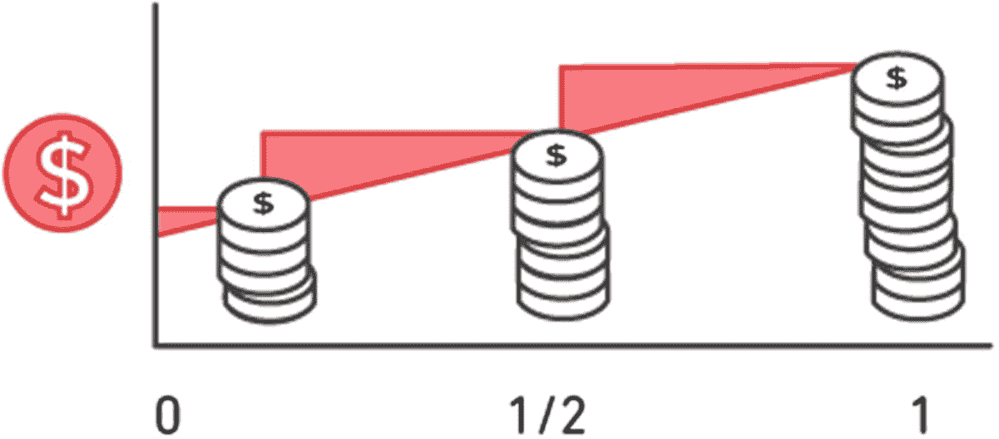
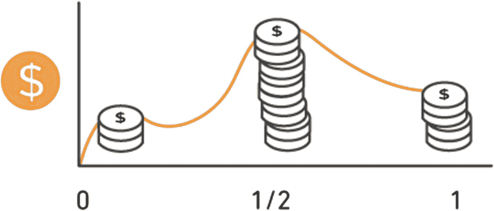
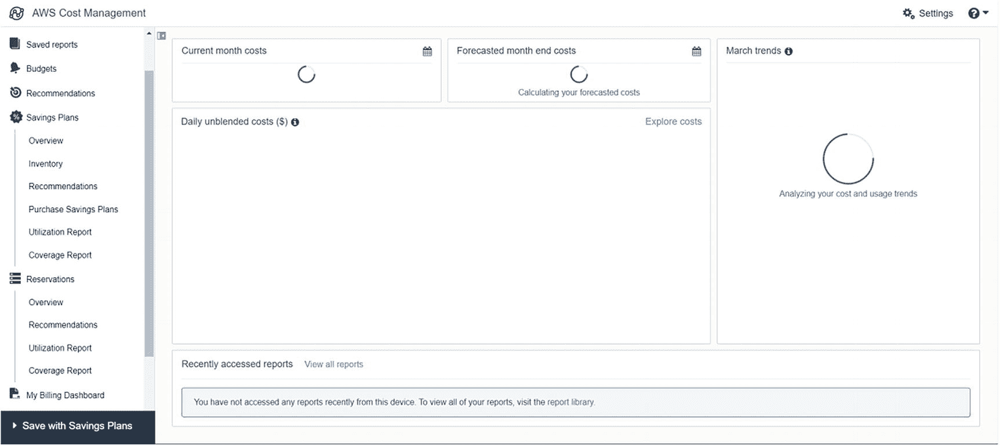
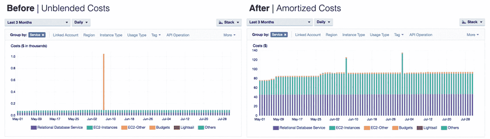
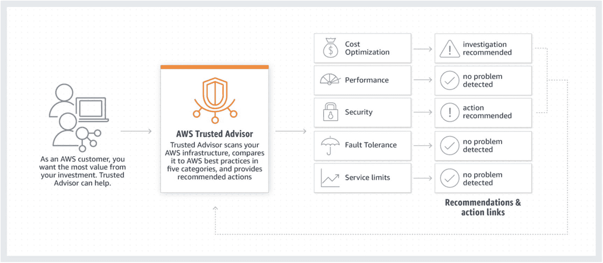
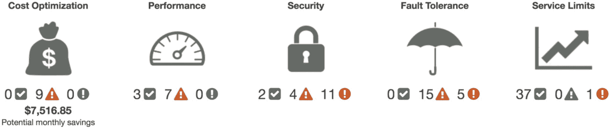

# 2. AWS 定价与成本管理

在上一章中，我们了解了一些云计算的概念，并探索了 AWS 提供的一些重要服务。在本章中，我们将探讨 AWS 如何对其提供的服务收费，以及我们如何以尽可能最小的经济负担，从 AWS 中获得最大收益。

## 了解 AWS 的定价机制

根据文档所述，AWS 试图通过与我们使用水电相同的计费方式来简化我们的生活。这意味着我们只需为实际使用的部分付费。当我们在本地拥有基础设施时，即使不使用，也必须为所有东西付费。在 AWS 中，情况则不同。这被称为按需付费。

在图 2-1 和图 2-2 中，AWS 试图展示两种架构之间的定价差异。当我们查看图 2-1 时，我们看到即使我们没有使用基础设施（即红色阴影区域所示的部分），我们仍然需要为其付费。因此，最终你会发现每个月的费用都在增加，到年底时你会支付一大笔钱。

图 2-1 本地基础设施的定价

相反，图 2-2 显示，使用量越大，付费越多，而在其余时间费用则低得多。因此，使用 AWS 可以节省更多成本。AWS 帮助我们省钱的另一种方式是使用其提供的预留功能。

图 2-2 AWS 基础设施的定价

通过预留实例，AWS 意味着你预先为某项 AWS 服务付费，以获得更长时间的使用权。这意味着该服务后续所需的资源和基础设施已被预留，因此其他人无法使用这些预留的服务和基础设施。由于你要求长时间使用整个服务，这意味着 AWS 将持续从这些服务中获利。这些基础设施在资金层面永远不会闲置。因此，为了让选择预留实例的公司更容易，AWS 会向他们收取更少的费用。有时，其费用甚至低于我们在前一章讨论的按需实例的 70%。

现在，在深入了解 AWS 定价细节之前，让我们先看看 AWS 免费套餐，包括我们可以免费使用哪些服务以及可以使用多长时间。

## AWS 免费套餐

AWS 在三个方面提供免费服务。

*   始终免费的服务
*   大约 12 个月内免费的服务
*   提供试用期的服务

以下是一些始终免费的服务：

*   DynamoDB 提供 25 GB 的免费存储空间。
*   AWS Lambda 每月提供 100 万次请求和高达 320 万秒的计算时间，始终免费。
*   可以在 Amazon Glue 中免费存储 100 万个对象。

以下是一些大约 12 个月内免费的服务：

*   5 GB 的 Amazon S3 存储
*   每月 750 小时的 EC2 实例使用时间，支持 t2.micro 和 t3.micro
*   在 Amazon Comprehend 中处理 5 万个文本单位

以下是提供试用期的服务：

*   使用 t2.medium 实例，每月 250 小时的 Amazon SageMaker 试用，为期两个月
*   使用 m4.xlarge 实例，每月 50 小时的 Amazon SageMaker 试用，为期两个月
*   每月 125 小时的 Amazon SageMaker 托管服务，为期两个月

## 影响 AWS 定价的因素

AWS 根据以下三个要素计算定价：

*   计算
*   存储
*   数据传输

AWS 不会对传入的数据传输或仅在 AWS 内部两个或多个服务之间的数据传输收费。但是，任何离开 AWS 网络的数据（出站数据传输），AWS 都会对此收费。费用取决于传输的数据量。数据量越大，每 GB 的价格越低。

如前所述，计算费用按小时计费，存储费用按 GB 计费。既然我们已经了解了影响 AWS 定价的因素，我们必须知道如何优化 AWS 中的成本。

## AWS 成本优化

我们可以通过遵循以下四个简单步骤来构建经济高效的 AWS 架构：

*   合理调整服务规模
*   使用预留实例
*   使用竞价市场
*   使用成本管理器

### 合理调整规模

合理调整规模意味着你只使用你需要的服务。这意味着你只使用你需要的计算能力或只使用你需要的存储空间。你既不能过度配置，也不能在容量上妥协。AWS 为你提供了通过自动扩展来帮助你合理调整规模的服务，这包括根据使用情况进行纵向扩展、纵向缩减、横向扩展和横向缩减。

为了合理调整规模，组织应准确了解其需求和用量模式，然后利用 AWS 的弹性来实现合理调整。通过这种方式，组织可以节省高达 70% 的总成本。此外，必须记住这不是一次性的工作。这意味着公司必须定期规划其需求和模式，并做出相应的调整。因此，可以说合理调整规模是一个持续的过程。

你如何决定何时是再次进行合理调整的最佳时机？为此，AWS 为我们提供了一些可用于做出此类决策的工具。

*   Amazon CloudWatch：你可以了解 CPU 利用率、网络吞吐量、磁盘 I/O 操作等，然后使用这些信息来决定是否需要进行修订后的合理调整。
*   AWS 成本优化：这可以根据当前利用率提供关于合理调整的建议。我们将在下一节中进一步讨论这一点。
*   AWS 成本管理器：你可以使用成本管理器来了解公司产生成本的主要驱动因素。基于此，可以做出正确的决策。
*   AWS Trusted Advisor：这可以帮助你更多地了解闲置或未充分利用的资源。

以下是在决定最佳合理调整规模时可以考虑的一些因素。这些因素可以分为以下几类：

*   基于性能数据的合理调整
*   基于使用需求的合理调整
*   通过停止实例进行合理调整
*   基于选择正确实例系列的合理调整
*   基于选择数据库实例的合理调整

在分析性能数据时，应识别出闲置或未充分利用的实例。为此，可以查看实例的 CPU 和内存使用情况。这可以使用 CloudWatch 或前面提到的任何其他工具来完成。Amazon 建议，那些在四周内最大 CPU 或内存使用率低于 40% 的实例可以进行合理调整。

在分析使用需求时，必须考虑以下几点：

*   如果负载在较长时间内保持恒定，我们可以选择预留实例，而不是按需实例或竞价实例。我们将在下一节详细讨论预留实例。
*   如果负载不是恒定的，但我们可以说负载在大致相等的时间间隔内或在特定场景下增加或减少，那么我们可以使用 AWS EC2 实例的自动扩展功能。
*   所有被认为是灵活的负载，即仅在需要时使用然后可以关闭的负载，可以使用按需实例或竞价实例。

当我们运行笔记本电脑或台式机等常规系统时，不使用时我们会将其关闭。AWS 也可以采用同样的做法。所有闲置超过两周的实例都可以停止或终止。一旦实例停止，公司就无需再为该 EC2 实例付费。但请记住，每个 EC2 实例都关联着一个 EBS 卷。该卷仍然存在，你仍需为其付费。如果你想终止该实例，附加的 EBS 卷也会被删除；因此，也就无需为 EBS 付费。但是，如果你想重新运行该实例，则需要重新配置以恢复 EBS 卷。最佳方法之一是存储 EBS 卷的快照，这样在终止甚至删除期间，EBS 卷可以以快照的形式作为备份保存下来。

#### 什么是 EBS 卷？

在理解 Amazon 弹性块存储（EBS）之前，我们必须知道什么是块设备。简单来说，块设备是一种用于存储信息的设备。因此，所有像 HDD 或 SSD 这样的磁盘驱动器都是块设备。它们是平台无关的，这意味着你可以为它们安装任何操作系统，块设备都能正常工作。在块设备内部，存储着你所有的文件，并且可以通过任何实例和操作系统进行访问。

现在，当我们谈论 EBS 时，它允许在 Amazon EC2 实例中使用这种块存储。它为你提供了将多个 EBS 卷附加到单个 EC2 实例，或将一个 EBS 卷附加到多个 EC2 实例的功能。

我们可以决定为工作负载选择最合适的实例，也可以根据两个选项进行更改：在同一系列中更改实例，以及将实例更改为不同系列。我们可以根据以下指标将实例更改为同一系列中的另一个实例：

*   vCPU 数量
*   查看内存
*   查看网络吞吐量
*   查看附加存储

但是，当我们将实例更改为不同系列中的另一个实例时，我们会考虑以下指标：

*   选择正确的虚拟化类型
*   选择是否需要 VPC 支持
*   选择正确的平台
*   选择是否升级硬件要求

对于前三点，我们必须确保升级前后的配置相同。对于最后一点，将整个架构迁移到升级后的 EC2 实例需要付出努力。我们在前一章讨论了 EC2 实例的不同系列。

#### 什么是虚拟化类型？

AWS 中的 Linux 机器支持两种虚拟化类型：半虚拟化（PV）和硬件虚拟机（HVM）。这两种实例的区别在于操作系统如何启动，以及如何利用 CPU、存储等额外配置。

#### 合理调整数据库实例规模

最后但同样重要的是，我们可以合理调整数据库实例的规模。为此，必须牢记以下指标：

*   要么向上扩展，要么向下扩展数据库实例，或者存储大小保持不变。
*   我们可以单独更改数据库实例的存储大小。

# AWS 成本优化与管理服务

AWS 非常重视许可证。因此，无论个人使用什么数据库，都必须拥有正确的许可证。

你可以选择调整数据库实例规模的时间。可以立即执行，也可以在特定时间窗口内执行，例如在维护期间。

至此，我们关于 AWS 中合理调整规模的讨论就结束了。接下来，我们必须了解更多关于预留实例的内容。

## 使用预留实例

预留实例关乎承诺。在购买 AWS 的预留兼容服务时，你必须决定是进行长期承诺，还是你的需求会定期变化。如果是长期承诺，那么你可以选择预留服务，这可以降低该服务的每小时成本。以下是 AWS 提供的提供预留功能的服务：
* `Amazon EC2`
* `Amazon RDS`
* `Amazon ElastiCache`
* `Amazon RedShift`
* `Amazon DynamoDB`

使用预留实例时必须绝对确定，因为锁定期要么是一年，要么是三年。这意味着你必须提前支付整整一年或三年的费用。付款完成后，无论你使用该实例多少，都不会像按需实例那样获得退款。因此，一旦你支付了锁定期的费用，你可以获得高达按需实例 75% 的折扣，但之后你将无法根据使用模式获得动态定价。

预留实例提供以下付款选项：
* 无预付费用
* 部分预付费用
* 全部预付费用

顾名思义，无预付费用意味着你一开始无需支付任何金额。部分预付费用意味着你可能一开始支付一部分金额，而全部预付费用则意味着你一开始支付全部金额。对于无预付的情况，客户按折扣后的每小时费率收费。但是，由于 AWS 不确定客户是否会付款，因此需要与他们签订合同协议，并且还会查看这些客户与 AWS 的过往关系。对于部分预付费用，也遵循同样的做法。剩余金额按折扣后的每小时费率收取。

预留实例分为两种类型。
* 标准预留实例
* 可转换预留实例

使用`标准预留实例`，可以增加实例大小或修改可用区，也可以在预留实例市场中出售。另一方面，`可转换预留实例`可以与其他可能具有新属性（如实例系列、实例类型、平台等）的可转换实例进行交换。它们不能在市场中出售。

每月可购买的预留实例数量也有限制。对于特定区域，每月可以购买 20 个区域实例和 20 个可用区实例。区域实例是可用于整个区域的实例，而可用区实例是可用于特定可用区的实例。

## 使用竞价实例

正如前一章所讨论的，竞价实例是那些处于闲置状态、目前未为 AWS 产生任何收益的实例。公司可以使用这些实例，并获得高达按需实例 90% 的折扣。请记住，这些实例目前是闲置的，但这并不意味着它们会一直闲置。这意味着，每当它们的使用量再次上升时，EC2 会给你两分钟的通知，然后中断你的竞价实例会话。显然，每件好事都有缺点。你的竞价实例被终止的另一种方式是，当你产生的成本超过了设定的阈值。

我们必须了解在哪些场景下应该使用竞价实例。Amazon 建议在以下场景中使用竞价实例：
* 构建容错且灵活的应用程序
    * Web 服务器
    * API 后端
    * CI/CD 流水线（DevOps）
    * Hadoop 数据处理
* 图像渲染
* 无状态 Web 服务
* 大数据分析
* 并行计算

一旦你拥有按需实例，你可以请求竞价实例来处理应用程序的一些额外功能。为此，你可以通过在 EC2 中启动向导来请求竞价实例。你只需告知实例数量、实例类型、可用区以及你愿意为此支付的最高价格。

## 使用 Cost Explorer

在决定了要使用的服务类型（预留实例、按需实例或竞价实例）后，您可以使用 AWS 提供的名为 `Cost Explorer` 的工具来分析您的使用情况和产生的成本。`Cost Explorer` 提供三种类型的报告来帮助您：报告过去 12 个月的使用情况和产生的成本、根据您过去的使用情况预测未来三个月的支出，以及获取关于使用实例类型的建议。

如果您打开 `Cost Explorer` 控制面板，它会显示一个默认视图，如图 2-3 所示。

图 2-3 AWS Cost Explorer 控制面板

查看控制面板，我们可以说 `Cost Explorer` 由以下组件组成：
* `Cost Explorer` 成本
* `Cost Explorer` 趋势
* 每日非混合成本
* 每月非混合成本
* 净非混合成本
* 最近的 `Cost Explorer` 报告
* 摊销成本

### Cost Explorer 成本

此组件向您展示两个指标：当前成本与上月成本的比较，以及当前预测与上月实际成本的比较。`Cost Explorer` 以图表形式显示截至某个日期的当月当前成本，然后将其与上月同期的成本进行比较。它还会预测当月剩余天数的成本，然后将其与上月实际产生的成本进行比较。这有助于用户就各种因素做出决策，例如调整规模、减少用量等。

### Cost Explorer 趋势

此部分向您展示用户正在使用的不同服务的成本趋势。它在控制面板中显示主要趋势，但用户可以深入查看所有服务的趋势，并可以进一步深入查看特定服务，了解构成该趋势的不同成本。

### 每日非混合成本

首先，我们必须理解什么是非混合成本。它是指 AWS 在特定时间点向用户收取的费用。例如，如果 AWS 在上午 10:45 因我使用一个 EC2 实例而向我收取了 100 美元，那么这笔费用将计入我的每日非混合成本。通常，它被认为是最重要的成本数据，因为它能告诉您成本发生时的具体情况。显然，您可以使用不同的筛选条件来更改 `Cost Explorer` 非混合成本部分的视图。您还可以以 CSV 格式下载这些信息。有一点需要明确：非混合成本不显示用户在特定时间段内收到的退款金额。

### 每月非混合成本

顾名思义，您可以将粒度更改为月度级别，而不是查看每日非混合成本信息。这可以让您了解各个月份的整体情况，然后您可以继续查看特定月份的每日非混合成本，以便发现异常或进行进一步调查。

### 净非混合成本

净成本会考虑您产生的总成本，并根据同一时期给予您的折扣进行调整，然后向您呈现信息。如果用户愿意，他们可以实际包含或排除任何其他调整项，例如 AWS 提供的退款或信用额度。

### 最近的 Cost Explorer 报告

此指标包含用户过去访问过的所有报告的列表，并附有时间戳和每个报告的链接。您只需点击链接即可再次查看报告。

### 摊销成本

通常，摊销成本是一种标准化的成本信息。例如，如果我们考虑一个月，不同服务的使用成本将按日收取，我们可以在非混合成本部分查看这些信息。但是，如果我们购买了预留实例，那么很可能每月的第一天就会收取整个月的费用。您会在图表中看到一个突然的峰值。因此，与其处理所有这些峰值，不如将信息标准化并分摊，这样就能为我们提供更好的整体视图。图 2-4 完美地展示了非混合成本和摊销成本之间的区别。

图 2-4 非混合成本与摊销成本的区别

现在我们已经了解了 AWS `Cost Explorer` 的工作原理，接下来让我们探讨一下 `AWS Trusted Advisor` 是如何工作的。

## AWS Trusted Advisor

众所周知，AWS 是云计算服务领域的市场领导者。由于它拥有大量客户，因此了解所有人的使用模式统计数据。基于此，AWS 提出了一些最佳实践。它们分为以下几类：
* 成本优化
* 安全性
* 容错能力
* 性能
* 服务限制

我们在本章中已经看到了一些影响成本优化的因素。我们将在下一章讨论其余的因素。但是，考虑到所有这些因素，用户可以以最低的成本获得最高的性能。`AWS Trusted Advisor` 会考虑所有这些因素，并提供自己的建议，以帮助用户实现尽可能低的成本。`Trusted Advisor` 的工作原理在图 2-5 中得到了完美的展示。

图 2-5 AWS Trusted Advisor

它的工作原理类似于您个人电脑中的防病毒保护软件，该软件会为您提供恶意软件和其他相关的见解。在这里，您获得的不是恶意软件见解，而是我之前指定的五个类别的见解。这些见解可能如图 2-6 所示。

图 2-6 AWS Trusted Advisor 见解

绿色对勾表示我们做得正确的事情。黄色感叹号是需要处理的警告，否则可能导致问题。红色感叹号表示应立即查看建议，因为它们已经影响到成本、性能、安全性等。

以下是使用 `AWS Trusted Advisor` 的一些好处：

一旦您登录到您的 AWS 账户，Trusted Advisor 就会为您提供实时通知。如果您启用它，它还可以通过电子邮件定期向您发送通知。

如果您愿意，可以对 Trusted Advisor 生成的报告进行更改。您可以包含或排除项目。

当 Trusted Advisor 提出建议时，它会提供一个链接，将您带到 AWS 管理控制台，您可以在那里处理这些警告。

## AWS 服务的定价

我们已经了解了查找 AWS 服务使用成本以及优化成本的不同方法，接下来看看在哪里可以找到更多信息；请参见表 2-1。

**表 2-1**

成本链接

| AWS 服务 | AWS 定价页面 |
| --- | --- |
| 按需 EC2 实例 | [`https://aws.amazon.com/ec2/pricing/on-demand/`](https://aws.amazon.com/ec2/pricing/on-demand/) |
| 竞价型 EC2 实例 | [`https://aws.amazon.com/ec2/spot/pricing/`](https://aws.amazon.com/ec2/spot/pricing/) |
| 预留 EC2 实例 | [`https://aws.amazon.com/ec2/pricing/reserved-instances/pricing/`](https://aws.amazon.com/ec2/pricing/reserved-instances/pricing/) |
| Amazon S3 | [`https://aws.amazon.com/s3/pricing/`](https://aws.amazon.com/s3/pricing/) |
| Amazon VPC | [`https://aws.amazon.com/vpc/pricing/`](https://aws.amazon.com/vpc/pricing/) |
| Amazon SageMaker | [`https://aws.amazon.com/sagemaker/pricing/`](https://aws.amazon.com/sagemaker/pricing/) |
| Amazon RDS | [`https://aws.amazon.com/rds/pricing/`](https://aws.amazon.com/rds/pricing/) |

如需了解其他服务的信息，您可以登录 AWS 管理控制台，然后切换到您选择的服务并查看其定价部分。

## 结论

在本章中，您学习了 AWS 如何对其服务收费，以及如何有效利用某些 AWS 服务来最大限度地降低成本。本章有助于您根据自己的预算和需求决定选择哪些服务。

在下一章中，您将详细了解 AWS 的安全方面。您还将了解 AWS 如何处理容错，以及如何有效地构建一个能够基于组织层级提供 AWS 服务的架构。