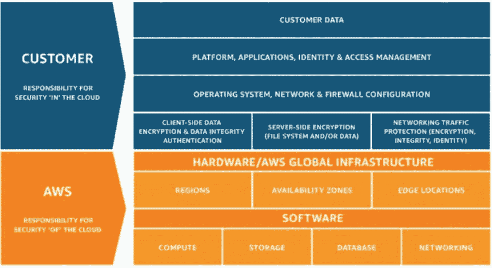
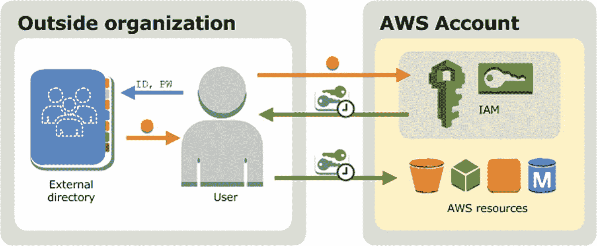
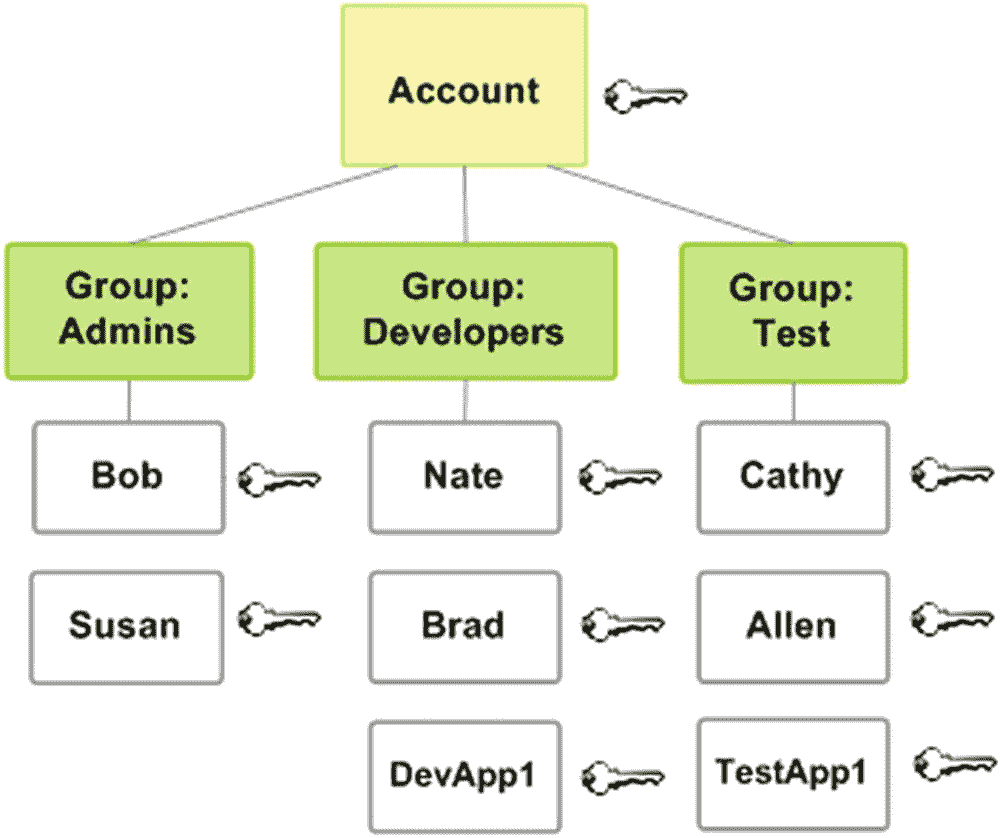
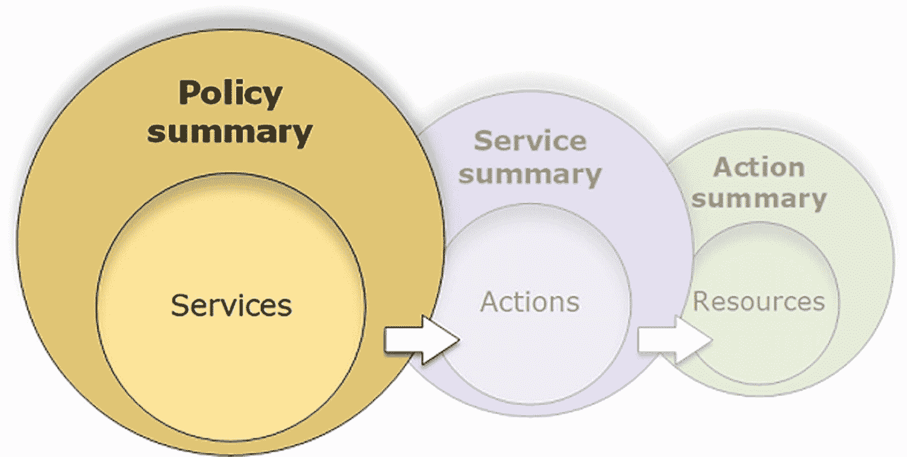
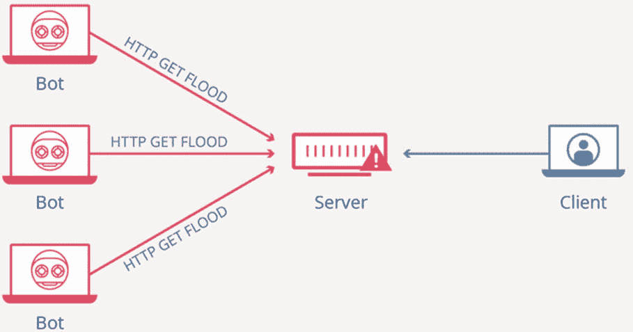
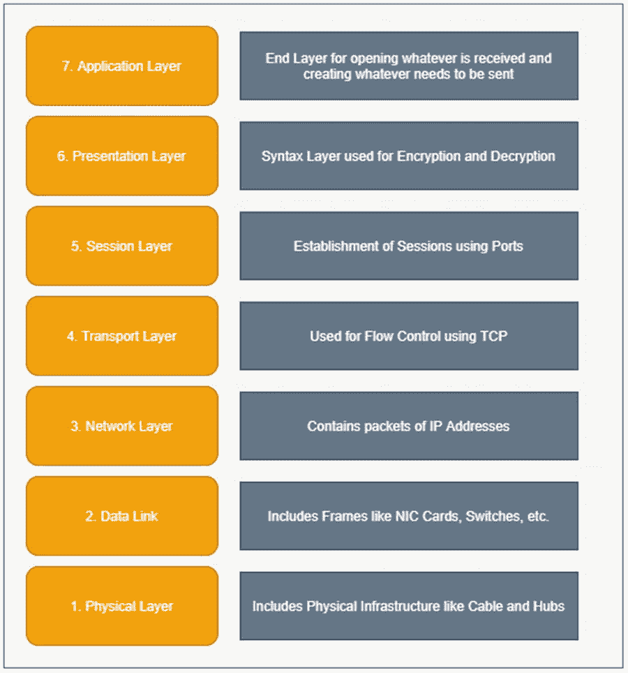

# 3. Amazon Web Services 中的安全性

在本章中，我们将探讨 AWS 的安全方面。如您所知，AWS 拥有数百种服务，服务于成千上万的客户，因此其安全性上的任何微小疏漏都可能导致特定公司乃至 AWS 自身的巨大损失。这就是 AWS 拥有一些具体的安全实践以及专门的安全服务来全面照管 AWS 功能的原因。

本章专门介绍这些服务中一些最重要的部分。学完本章后，您将理解 AWS 的底层安全机制，并且能够在您使用的产品中实施不同的安全功能。

## AWS 的 SSR 模型

在安全方面，AWS 遵循共享安全责任（SSR）模型。这个模型很简单：责任应由客户和 AWS 共同承担。具体来说，AWS 负责其提供给客户的整个基础设施的安全。另一方面，客户则负责其在该基础设施中存放的任何内容。图 3-1 展示了 AWS 的 SSR 模型。



图 3-1 AWS 的共享安全模型

以下是 AWS 的部分责任：

*   AWS 负责整个基础设施，包括 AWS 用于运行其服务的硬件、软件、网络和其他设施。
*   AWS 通过组织第三方审计定期提供其运营报告。其合规性、安全标准和法规均经过验证。
*   对于大多数服务，基本的安全任务也由 AWS 完成，例如安装客户操作系统、修补数据库、配置防火墙以及进行灾难恢复。

以下是客户和用户的部分责任：

*   在服务被预订且 AWS 处理了基本安全事务后，客户有责任执行所有必要的安全配置和管理任务。这可能包括更新操作系统、安装安全补丁、配置防火墙等。
*   客户必须使用 Amazon Identity and Access Management (`IAM`) 服务设置用户账户。这将允许客户为其每个用户提供不同的凭证，从而访问不同的服务。
*   客户必须为每个账户设置多因素认证。

我们将在本章后面更深入地讨论 Amazon `IAM` 和多因素认证。

AWS 为其客户提供高级别的安全性，这些安全性可以分为以下几类：

*   合规性要求
*   物理和环境安全
*   业务连续性管理
*   网络安全

### 合规性

AWS 的基础设施基于多项 IT 安全标准，包括：

*   `SOC 1/SSAE 16/ISAE 3402`（原 `SAS 70`）
*   `SOC 2`
*   `SOC 3`
*   `FISMA`、`DIACAP` 和 `FedRAMP`
*   `DOD CSM` 级别 1–5
*   `PCI DSS` 级别 1
*   `ISO 9001/ISO 27001/ISO 27017/ISO 27018`

此外，AWS 还遵循一些行业特定标准。

*   刑事司法信息服务（`CJIS`）
*   云安全联盟（`CSA`）
*   家庭教育权利和隐私法案（`FERPA`）
*   健康保险流通与责任法案（`HIPAA`）
*   美国电影协会（`MPAA`）

### 物理和环境安全

为了基础设施的物理和环境安全，AWS 遵循以下标准：

*   只有经过授权的人员才允许进入 AWS 数据中心场所，即使他们是 AWS 或亚马逊的员工也不例外。
*   设施内安装了自动火灾探测传感器和灭火装置。
*   AWS 数据中心不仅拥有稳定的电力供应，还配备了强大的 `UPS`，以便在发生电源故障时，运营永不中断。
*   数据中心内安装了温度控制设备，并由人员持续监控，以保持最佳温度。
*   AWS 按照严格规范淘汰任何硬件，以确保数据永不泄露。

### 业务连续性管理

许多公司正在迁移到云平台，他们不希望自己的业务运营因 AWS 而中断。当公司将整个业务基础设施迁移到 AWS 时，他们所有的数据都驻留在那里。即使是几个小时的业务中断也可能给公司造成巨大损失。因此，AWS 在制定其基础设施计划时必须严格，以防止这种情况发生。为了确保业务连续性管理，AWS 采取了许多措施。

*   AWS 的所有数据中心全年 365 天、每周 7 天、每天 24 小时运行。因此，如果某个特定数据中心发生故障，AWS 要做的第一件事就是将数据流量从受影响的区域转移出去。
*   使用 AWS，客户可以将其数据放入多个地理区域，并且在每个区域内，数据可以放入多个可用区。可用区的构建方式使其与同一区域内的所有其他可用区相互独立。因此，例如，如果某个可用区所在的区域在特定季节有可能受到洪水影响，那么同一区域内的所有其他可用区都将被放置在永远不会受到同一洪水影响的场所。
*   每个数据中心都配备有 `UPS` 和现场备用发电设施。此外，为了进一步提高安全性，设施内还提供来自不同电网的电力，以便在一条线路发生故障时，另一条线路仍能有效供电。

### 网络安全

正如我们在上一节中所见，AWS 已使其数据中心能够抵御灾难。但比这更大的威胁是网络入侵。随着技术的进步，黑客的技能也在提升。那么，AWS 是如何应对其网络安全问题的呢？好吧，让我们来探讨一下 AWS 为确保其网络安全而采取的一些措施。

*   有一个防火墙可以保护你的入站和出站流量。这是网络安全最基本但也是最强大的第一步。
*   AWS 拥有访问控制列表（`ACL`），其中包含一组策略，用于决定谁可以访问 AWS 的哪些服务，以及哪些信息流向哪个服务。这些 `ACL` 会定期更新，并通过名为 `ACLManage` 的 AWS 工具自动推送。
*   信息流入 AWS 服务器可能有很多入口点，出口点也是如此。因此，在这种情况下，管理这些入口和出口点会变得非常困难。为了解决这个问题，AWS 采用了安全接入点。通过使用它们，AWS 只有有限数量的接入点，通过这些接入点对所有进出传输进行全面监控。这些接入点被称为 *API 端点*，并且只允许 `HTTPS` 访问以建立安全连接。
*   AWS 通过 Amazon `VPC` 为其客户提供额外的安全选项。我们在第 1 章中讨论过 `VPC`。
*   对于 AWS 来说，有两种类型的客户端。一种是其常规客户，另一种是其自身的企业网络。AWS 在访问 AWS 服务时不会给予其企业网络任何特殊权限。对于 AWS 员工，如果他们想访问任何 AWS 服务，首先必须提交一个工单，如果获得批准，他们才能获得访问权限。此外，出于安全目的，员工所做的所有操作都会被安全地记录下来。
*   AWS 拥有许多自动化监控工具，以便监控服务器和网络使用情况，扫描端口的入站和出站传输，检测未经授权的入侵尝试等。

## AWS 账户安全功能

在前面的章节中，我们了解了 AWS 如何确保其基础设施的安全。在本节中，我们将探讨 AWS 如何确保其客户的 AWS 账户安全。AWS 做的第一件事就是使用凭证保护每个账户。AWS 使用凭证进行身份验证的方式有多种。

*   密码
*   加密密钥
*   数字签名
*   证书
*   多因素身份验证

一旦你为账户创建了凭证，就可以轻松地从安全凭证页面下载凭证报告。报告中包含的信息告诉我们：账户是否使用了密码、密码是否可轮换、密码上次更改时间、密钥上次轮换时间以及是否启用了多因素身份验证。

在 AWS 中，我们可以创建多个访问密钥并定义多个证书。这样做是为了出于安全原因持续轮换它们。当它们被轮换时，为了不影响业务连续性，我们可以使用并发的密钥和证书。我们可以使用 AWS `IAM` 来轮换密钥。我们将在下一节中更详细地了解密钥和证书。

### 用于身份验证的密码

如果你想访问 AWS 服务，密码非常重要。它们授予你在 AWS 内部的第一级访问权限。密码在创建账户时创建，并可以随时通过安全凭证页面更改。AWS 允许密码长度最多为 128 个字符，并且必须包含特殊字符组合才能足够强大。

如果你的组织基础设施完全托管在 AWS 上，你可以创建密码策略，以便新密码必须遵循你的安全策略。这确保了创建最强大的密码。

### 多因素身份验证

这是客户可以选择的一种额外安全级别。多因素身份验证要求客户成功输入用户名和密码后，用户还必须提供一个特定的、唯一的六位数代码进行身份验证。如果验证成功，则该人员将被允许进入账户。这个六位数代码会发送到客户的一个经过身份验证的设备上。它可以是智能手机、电子邮件或电话号码。当人员登录时，会收到一个需要输入的代码，然后才能成功登录。

### 用于 API 身份验证的访问密钥

`API` 是一种功能，通过它向封装在 `API` 后的一段代码发送请求，然后人员接收输出。现在，`API` 内部的编码逻辑可能允许用户访问敏感信息。因此，发送给这些 `API` 的请求也必须经过身份验证，这意味着只有正确的用户才能获得 `API` 的访问权限。这是通过*数字签名*完成的。这个数字签名是通过将请求文本和秘密访问密钥传递给负责加密的哈希函数生成的。这个哈希函数对消息进行加密，然后将其发送给 `API`。这反过来在 `API` 端被解密；检查秘密密钥，然后提供入口。

目前，数字签名使用名为 `HMAC-SHA256` 的协议，该协议已发展到第四版。数字签名验证中还有一个安全级别，即在请求中添加时间戳。如果生成的数字签名的时间戳与 `API` 接收到的时间戳相差超过 15 分钟，则该请求将被拒绝。

### X.509 证书

当我们希望两个或多个 Web 服务相互通信时，我们使用基于 SOAP 的请求。为了使这类请求安全，我们使用 X.509 证书。这些证书由三部分组成。

*   公钥
*   私钥
*   附加元数据

第一步是使用我们在上一节中看到的过程生成数字签名。现在，我们使用这个数字签名和证书来发送请求。首先，AWS 尝试通过解密数字签名并验证它来确认是经过身份验证的用户在发送请求。之后，AWS 会将发送过来的证书与经过身份验证的用户在其自己的 AWS 账户中上传的证书进行匹配。如果一切正常，请求将被转发；否则，请求将被拒绝。

## AWS 身份与访问管理

正如我们通过 Amazon 管理控制台访问所有 AWS 服务一样，对于所有安全需求，我们也有 AWS 身份与访问管理。所有身份验证或授权都可以通过 IAM 进行管理。我们可以创建用户、定义角色、授予权限、分配策略以及执行许多其他操作，所有这些都可以在 IAM 中完成。因此，无论是从事机器学习还是 Web 开发，只要是使用 AWS 的人，都必须了解这项服务。

想要使用 AWS 服务的人，首先要做的就是创建一个根用户账户。该账户可通过用户名和密码访问，并赋予用户对其已注册的所有服务的无限访问权限。但是，AWS 不鼓励我们始终使用根用户账户登录，因为这可能会危及组织的安全。因此，我们可以使用 IAM 服务创建不同的用户，而不是使用根用户。这些用户被称为 *IAM 用户*。管理员可以向所有这些用户授予权限，要求他们设置自己的密码，分配不同的策略，从而使整个基础设施既简单又安全。

为了更好地理解这一点，让我们看一个例子。假设有一个拥有 5000 名员工的组织。其中有董事会、CEO、CTO、总裁、经理、架构师、工程师和其他员工。首先，我们不能给每个人根访问权限，这无需解释。因此，组织可以创建 IAM 用户。但是，授予高层管理人员的权限与授予层级较低员工的权限是不同的。即使在高层管理中，董事会成员可能只对某些具有仪表盘或可视化支持（例如 Splunk 仪表盘）的特定服务拥有只读访问权限，而 CTO 则拥有某种根访问权限。同样，工程师将有权访问他们被雇用来使用的服务。机器学习工程师可能有权访问 SageMaker，数据工程师可能有权访问 EMR 或 DynamoDB，等等。因此，通过这个例子我们可以得出结论：不同的用户需要不同的权限，而所有这些都可以通过 AWS IAM 来实现。

一旦定义了 IAM 用户，它就会有自己的密码。用户登录后，将只能看到他们有权使用的服务。其他服务会要求提供凭证或拒绝访问。请注意，IAM 用户可能不是真实的人。它可能是一个软件服务。例如，假设一家公司在一个不同的平台上托管了一个网站，但使用了某些 AWS 服务，如 S3 或 DynamoDB。因此，该网站需要持续与这些服务通信。为了验证正确的软件与 AWS 服务通信，会为这些服务创建一个 IAM 用户，然后该网站使用自己的凭证访问相应的服务。

但是，组织通常已经拥有自己的基础设施，并且管理层中每个员工都有一个电子邮件 ID 和密码。当员工需要使用 AWS 时，他们将获得一个新的 ID 和密码。这意味着该人员必须记住并保护两个账户：公司账户和 AWS 账户。如果 AWS 能提供一种方式，让员工只需登录公司账户就能自动登录 AWS 账户，那岂不是太棒了？AWS 确实有解决方案，称为*联合用户*。

### AWS 中的用户联合

如果员工在公司网络中有账户，并且公司在 AWS 网络中也有账户，那么一旦员工登录公司网络，组织就可以将该用户身份联合到 AWS 网络。这样，就减轻了公司员工在 AWS 内部登录的麻烦。参见图 3-2。



图 3-2

用户联合

以下是联合的一些特性：

*   公司网络使用*单点登录* (SSO) 使得联合成为可能。此后，自动登录发生，员工无需再次登录即可进入 Amazon 管理控制台。
*   即使某人在 Gmail、Facebook、Amazon 等平台拥有账户，这些账户也可用于 SSO。

### AWS 中的访问管理是如何实现的

通常来说，*访问管理*也可以被称为*授权*。登录到 AWS 账户的个人或服务被称为*主体实体*。主体实体通过 IAM 进行身份验证（IAM 用于验证 IAM 角色或用户）。身份验证完成后，系统会检查附加到特定用户或角色的策略。这些策略有助于确定授予主体实体的权限。它们被创建并附加到不同的 IAM 身份，例如用户、角色或组。现在，如果主体实体发送了某个服务的请求，但策略中未定义使用该服务的权限，那么访问将被拒绝。这就是 AWS 中访问管理的实现方式。

策略可以基于 IAM 角色、资源或访问控制列表来应用。角色示例是数据工程师。所有具有数据工程师角色的 IAM 用户都将被分配相同的策略。这意味着该角色中的每个人都能以相同的权限级别访问相同的资源。应用于资源的策略会对特定资源的使用施加限制。例如，我们可以创建一个策略，允许用户读取 DynamoDB 表，但不允许创建表。当我们想要应用跨平台策略时，会使用 ACL。

这里给出了一个基于角色的策略示例。我们定义了一个 JSON 文件，展示了针对 DynamoDB 定义的策略。

```
{
  "Version": "2012-10-17",
  "Statement": {
    "Effect": "Allow",
    "Action": "dynamodb:*",
    "Resource": "arn:aws:dynamodb:us-east-2:123456789012:table/Books"
  }
}
```

这授予了用户使用 DynamoDB 中 `Books` 表的权限。这清楚地表明，要分配策略，必须创建 JSON 文件，并且这些文件必须附加到相应的实体。策略不仅可以附加到特定实体，还可以附加到一组实体。这些被称为*IAM 组*；见图 3-3。



图 3-3

IAM 组

图 3-3 定义了多个 IAM 用户，并将他们分组到三个 IAM 组中：管理员、开发人员和测试人员。现在，策略可以应用于整个组，并自动应用于其成员。但这里需要注意的一点是，如果某个特定成员未被授予某个服务的权限，那么即使该组有权访问该服务，该成员仍然没有权限访问该服务。

在哪里可以找到所有已定义策略的摘要？IAM 控制台中有三个表格提供了关于策略的详细信息。这些表格如下：

*   策略摘要
*   服务摘要
*   操作摘要

当我们打开策略摘要时，会看到已定义策略的服务列表。我们可以点击任意服务，进入该特定服务的摘要表。摘要表列出了可以在该特定服务上执行的所有操作以及附加到这些操作的权限。您可以点击任意操作，然后进入操作摘要，该摘要显示了已授予该特定操作的权限。图 3-4 为您总结了这些表格。



图 3-4

策略、服务和操作摘要

策略可以分为两种：基于身份的策略和基于资源的策略。顾名思义，当策略附加到 IAM 角色、用户或组时，它们被称为*基于身份的策略*；而当我们将它们附加到资源（如 S3 存储桶或 DynamoDB）时，它们被称为*基于资源的策略*。

### 基于属性的访问控制

在讨论基于属性的访问控制（ABAC）之前，我们必须了解*AWS 标签*。这些是附加到 IAM 用户、角色、组甚至 AWS 资源的一些属性。当我们有一个大型组织并且需要为员工制定策略时，这些标签非常有用。标签如何发挥作用？让我们看一个例子。

一家生产机器学习产品的公司已将其整个架构迁移到 AWS。现在，它正在使用 Amazon SageMaker 构建模型，使用 Amazon EMR 进行数据工程，构建网站、API，并使用 DynamoDB 和 CloudFormation 进行数据库管理，同时使用各种其他 AWS 服务（如 CloudWatch、TrustedAdvisor 等）来保障安全。现在，假设该公司约有 5,000 名员工。为每个员工提供 IAM 角色并附加策略将是一项繁琐的任务。那么，我们该怎么办？这时，标签和 ABAC 就派上用场了。

想象两位机器学习工程师；一位只使用 SageMaker 和 S3 存储桶，而另一位除了使用前一位工程师使用的服务外，还使用 EMR。组织可以为不同的用途创建两个标签。假设一个标签叫做 `basic-machine-learning`，另一个叫做 `advanced-machine-learning`。在定义 IAM 角色时，所有机器学习工程师和初级数据科学家都可以被赋予第一个标签。高级数据科学家和解决方案架构师可以被赋予第二个标签。现在，当一位初级数据科学家尝试访问 EMR 时，系统会检查标签，并查看其相应的策略。由于策略不足以提供此访问权限，访问将立即被拒绝。但是，如果一位解决方案架构师尝试访问初级数据科学家访问过的同一个标签，他将被授予访问权限，因为与该标签关联的策略为该人员提供了适当的权限。这些标签也被称为 `属性`，因此这个过程被称为 `基于属性的访问控制`（ABAC）。

我们如何说 ABAC 流程优于传统流程？让我们看看它们之间的一些区别。传统流程也称为 `基于角色的访问控制`（RBAC）。

*   第一个区别是，在 RBAC 中，每次添加新资源时，都必须更新附加到角色或用户的策略——不仅针对一个角色，而是针对所有角色。而在 ABAC 中，只需要更新标签。
*   由于这些标签的存在，ABAC 的策略比 RBAC 少得多，因此更易于管理。

在本书的第二部分，我们将介绍使用 IAM 创建根凭证，然后定义角色、用户、组等的完整过程。在本节中，我们涵盖了其理论方面。实际上，我们将在下一节中查看其应用。

AWS 还提供了一些其他服务来增强应用程序的安全性。

*   AWS WAF
*   AWS Shield
*   AWS Firewall Manager

让我们逐一讨论每个服务。

## AWS Web 应用防火墙

发送至特定 AWS 服务（如 Amazon API Gateway、Amazon CloudFront 或 Application Load Balancer）的所有 HTTP 或 HTTPS 请求，均由 AWS Web 应用防火墙（WAF）进行监控。WAF 允许你根据特定条件和规则来控制对内容的访问。以下列出其中一些规则：

*   允许所有 HTTP/HTTPS 请求，但明确指定的请求除外。
*   阻止所有 HTTP/HTTPS 请求，但明确指定的请求除外。
*   对请求进行计数，并将请求中定义的属性与 WAF 中提及的属性进行匹配。如果匹配的属性数量一致，则允许请求；否则，阻止请求。

用于允许或阻止请求的匹配条件遵循某些特征。以下是其中一些特征：

*   监控 IP 地址以查看请求的来源。
*   查看请求来源的国家/地区。
*   分析请求标头中的值。
*   可以创建正则表达式，用于在字符串中搜索特定模式，然后做出接受或拒绝的决定。
*   检查是否存在可能具有恶意的 SQL 代码。
*   检查是否存在可能具有恶意的脚本。

WAF 还可用于保护托管在 ECR 内的应用程序。ECR 允许你高效地管理集群内的 Docker 容器。要在 WAF 中定义规则和条件，可以使用以下功能：

*   Web ACL
*   规则
*   规则组

首先，可以创建一个 ACL 来监控对特定 AWS 资源的访问。然后，可以将规则分配给这些 ACL，这些规则将充当防火墙并监控请求。每条规则都是一种带有条件的语句，该条件被称为 `检查标准`。如果满足条件，则允许或阻止请求。我们还可以使用规则组，这些规则组是包含条件的语句组，可以附加到你的 ACL，从而间接附加到 AWS 资源。

## AWS Shield

在了解 AWS Shield 服务之前，我们必须先了解一种名为 `分布式拒绝服务`（DDoS）的网络攻击，因为 AWS Shield 有助于缓解这种攻击。

每个 Web 服务或服务器都有一定的带宽，以便在高峰时段处理更多流量的同时，尽可能多地服务其当前用户群。为了发起 DDoS 攻击，网络犯罪分子会向服务或服务器发送大量流量，导致用户难以操作，甚至整个服务或服务器崩溃。如果流量来自单个系统，攻击效果不会那么显著。这就是为什么流量会从多个系统并行产生，并对目标发起攻击。图 3-5 展示了 DDoS 攻击的直观表示。



图 3-5
DDoS 攻击

AWS WAF 可用于阻止此类攻击，但为了获得高级安全性，我们还可以使用 AWS Shield Standard 和 AWS Shield Advanced。默认情况下，我们在 AWS 中使用的所有服务都附带 AWS Standard Shield，无需额外费用。要使用 AWS Advanced Shield，用户需要支付少量额外费用。

网络中容易受到网络攻击的两个特定层是：网络层和传输层。AWS Standard Shield 会监控这两层并提供保护。如果将 AWS Standard Shield 与 Amazon CloudFront 或 Route53 一起使用，它还会提供一些额外的好处。

为了获得额外的保护，例如，如果你想保护运行在 EC2 或 Elastic Load Balancer 中的应用程序，用户可以选择 AWS Advanced Shield。Advanced Shield 不仅为网络层和传输层提供安全保护，还为应用层提供保护。图 3-6 使用开放系统互连（OSI）网络模型展示了网络内的不同层。



图 3-6
OSI 七层模型

## AWS Firewall Manager

为了确保 AWS WAF 和 AWS Shield 平稳高效地运行，可以使用 AWS Firewall Manager。AWS Firewall Manager 负责自动应用在资源和服务上定义的所有规则。即使在 AWS 中添加了新资源，这一点也依然适用。由于这种自动化能力，AWS Firewall Manager 提供了许多优势。

*   如果一组资源遵循特定的标签，AWS Firewall Manager 可以自动应用一些自定义规则。
*   AWS Firewall Manager 允许你创建和管理自己的规则，或从市场购买的规则。
*   如果你的组织中有许多用户，使用 AWS Firewall Manager 通常是有益的。

## 结论

在本章中，你了解了 AWS 的各个安全方面。这完成了本书的第一部分，我们涵盖了与 AWS 相关的所有基础知识。现在，我们将进入本书的第二部分，我们将探讨如何使用 AWS 创建机器学习模型。在下一章中，我们将更实际地应用本章中的概念，不仅成为创建机器学习模型的专家，还能熟练使用各种其他服务，例如 S3 存储桶、DynamoDB、AWS 安全工具等。你还将学习如何使模型高效以及如何实现自动化。