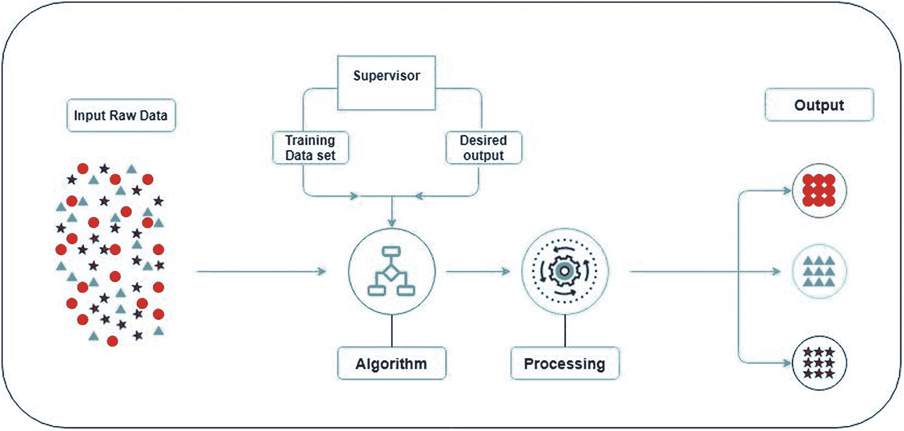
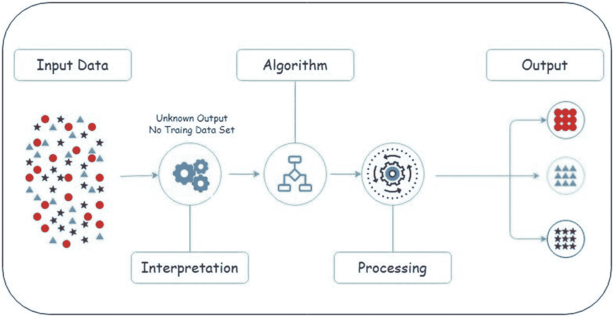
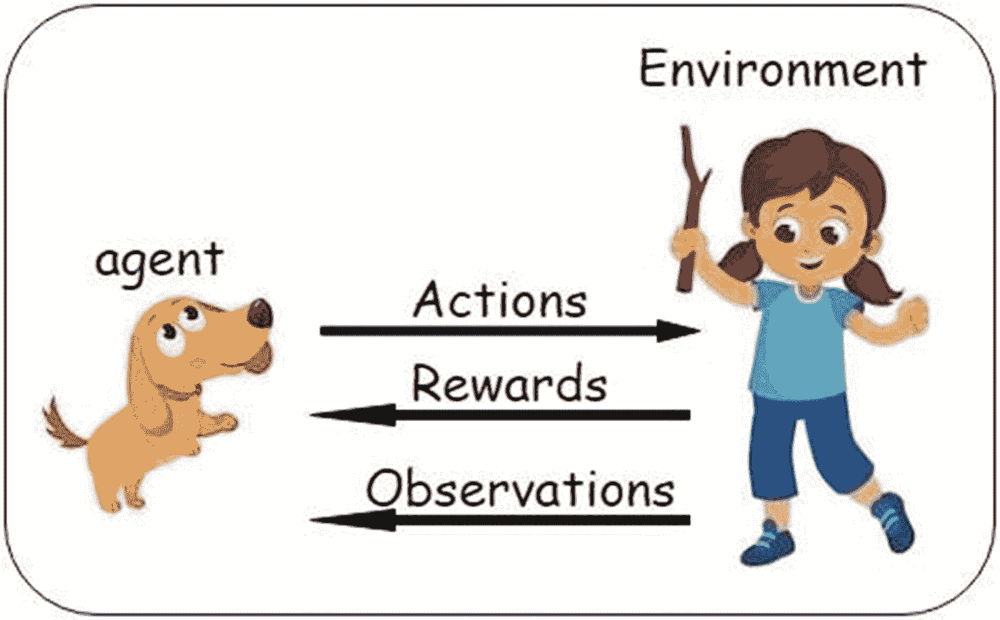
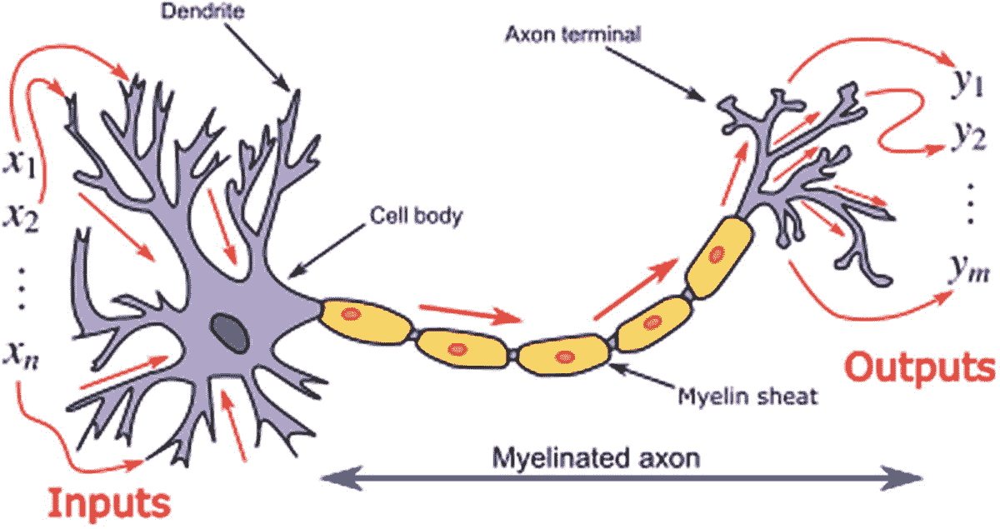
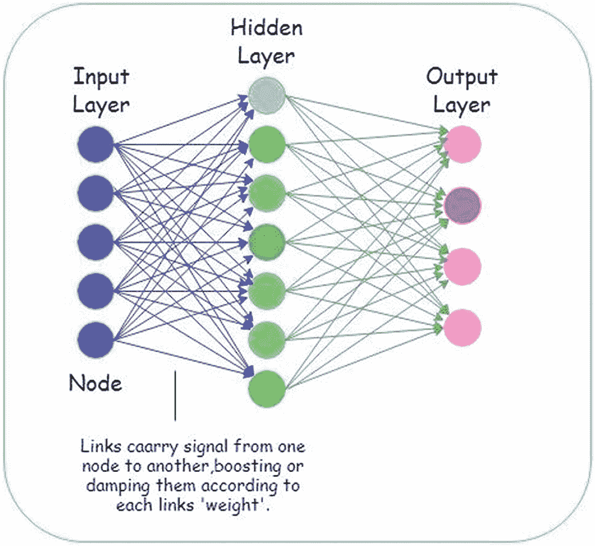
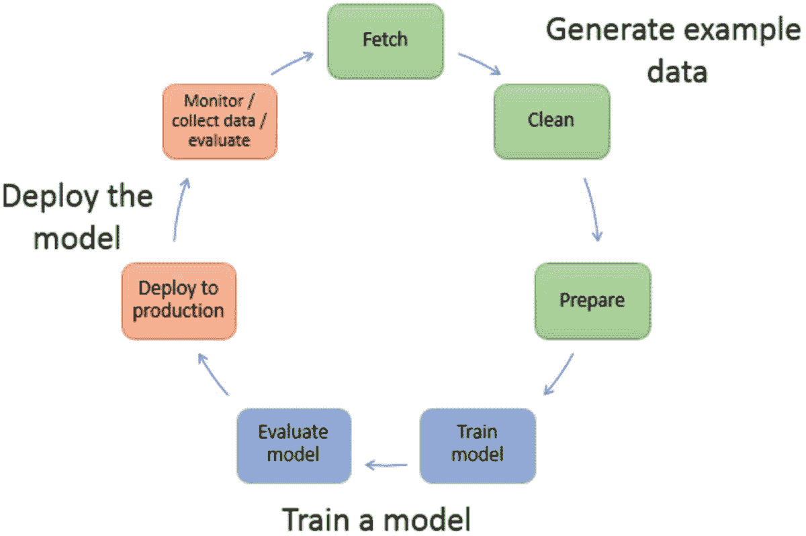
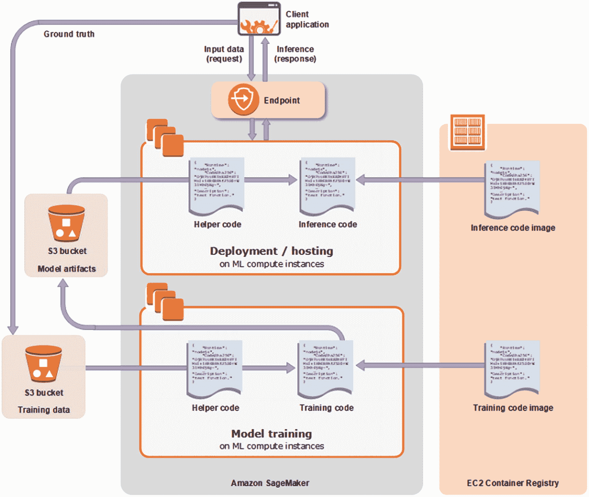
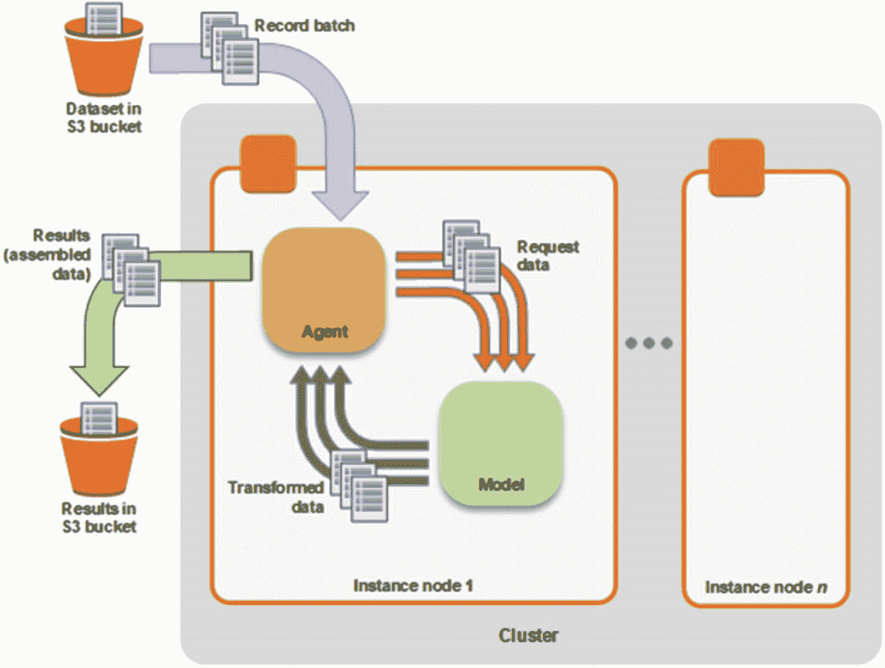

# 4. 机器学习简介

本章涵盖两个主要主题。首先，你将了解机器学习及其组成部分；然后，你将了解 AWS 提供的不同服务，以帮助你创建机器学习模型。

## 机器学习与人工智能简介

机器学习和人工智能是当今业界频繁使用的两个术语。大多数时候，人们认为它们是同义词，没有太大区别。然而，它们是有区别的。人工智能是计算机科学和数学的一个领域，它试图模仿人类的行为，并做出与人类相似的决策。机器学习可以被视为人工智能的一个子集，我们通过提供的历史数据让机器进行学习，然后在未来遇到类似信息时，利用学到的行为来预测结果。因此，机器学习主要关乎预测和推荐，而凡是能让机器像人类一样思考的领域都属于人工智能。

例如，我们与 Alexa 对话，就像它是个真人一样。Alpha Zero 机器人能够击败国际象棋冠军，仿佛它是一个超级智能的人类。汽车现在可以在没有人类帮助的情况下自动驾驶，在道路上实时做出自己的决策。所有这些都是人工智能体的例子，因为它们的行为方式与人类无异。

当我们试图预测未来六个月的销售额，预测某只股票在未来几天是上涨还是下跌，或者判断一台机器能否理解一段文字的语境并分类其谈论某事物是负面还是正面时，我们谈论的就是机器学习。在这里，我们通过提供过去的数据来训练模型，然后机器预测未来输入数据的结果。

我们究竟为什么希望机器能够学习并协助我们的日常生活？以下是一些令人信服的理由：

*   我们人类通过从周围环境中学习来做决策。但我们受限于所能接触到的信息。而且，人类在面对新情况时犯错的可能性很高。这就是为什么我们有句俗话：“毕竟，我只是个凡人。” 另一方面，机器可以被赋予尽可能多的信息。它们可以被赋予尽可能复杂的信息。因此，经过训练后，它们可以根据周围环境做出自己的决策。当然，我们不能让机器独立做出决策，但它们可以协助人类进行决策。

*   过去，人们构建的是基于规则的系统。这意味着，如果出现某种情况，就执行这个操作；否则，就执行那个操作。但是，如今数据变得复杂，数据的四个 V——体量（Volume）、真实性（Veracity）、速度（Velocity）和多样性（Variety）——都达到了顶峰。因此，构建基于规则的系统几乎是不可能的。机器学习系统帮助我们理解这些复杂的非结构化数据并做出决策。

机器学习通过三种学习方式来解决这些问题。

*   监督学习

*   无监督学习

*   强化学习

### 监督学习

监督学习是机器学习的一个分支，我们确切地知道过去发生了什么，然后我们尝试预测，如果过去发生的情况以某种组合再次出现，是否会产生相同的结果。例如，在过去的六年里，我们收集了一些村庄的降雨和降雪数据。具体来说，每当降雨或降雪时，我们收集了关于湿度、气压、温度等的不同信息。我们基于这些数据训练了一个机器学习模型。现在，如果我们知道未来几天的湿度、气压和温度信息，我们能预测是否会下雨或下雪吗？这就是监督学习。

在监督学习的术语中，湿度、气压、温度等因素被称为自变量。我们试图预测的因素，即是否会下雨或下雪，被称为因变量。

图 4-1 展示了一个监督学习框架。你可以看到有一个监督者，它检查预测输出是否与期望输出相同。基于此，会进行调整，这种调整对于不同的机器学习算法是不同的。最终，我们得到预测输出。

图 4-1

监督学习

### 无监督学习

在机器学习的这个分支中，我们没有指导变量，这意味着因变量不存在。因此，无监督学习的主要目标是首先理解数据内部存在的模式，然后将遵循相似模式的数据归入同一组。因此，我们可以得到具有相似特征的聚类，或者可以找到经常一起购买的商品等。让我们通过一个例子来理解这一点。

当我们去一家零售店，比如宜家，我们可以看到很多商品。我们去那里是为了购买某件特定物品。我们也会买一些其他东西。在结账时，收银员会询问我们的手机号码，通过这个号码他们可以识别出独特的顾客。现在，因为我们喜欢这家店，我们再次光顾并购买了其他必需品。这家店成了我们最喜欢的商店，三年来我们所有的购物都在那里完成。利用无监督机器学习，现在这家店可以利用我们的购买历史，并开始推荐不同的商品。例如，如果我们最近买了窗帘，它可能会推荐一些其他的装饰品。

图 4-2 展示了无监督学习框架。在这个图中，你可以看到在“解释”部分发现了一个隐藏的相似性模式，基于此，相似的项目被放在同一个地方，正如我们在输出中看到的那样。

图 4-2

无监督学习

你不仅可以在实体店中找到这类例子，在电子商务网站上也能找到。

### 强化学习

强化学习是机器学习中一个独特的领域，机器通过分析不同的场景来自主学习。其实现方式是：每当机器成功完成一项任务，就给予奖励；如果任务失败，则给予惩罚。机器的目标是获得尽可能多的奖励。通过这种模式，机器能够自动学习在不同场景下如何运作。让我们来看一个例子。

一个机器人想要学习走路。首先，提供给它的环境是一条平坦的道路。每成功迈出一步，可能获得 50 个奖励点，但每摔倒一次，就会被扣除 100 个惩罚点。机器人迈出第一步并摔倒，因此受到了惩罚。它重复尝试多次，并不断摔倒。最终，它迈出一步并且没有摔倒，因此获得了奖励点。这一次，机器人知道了自己做了什么才获得了第一次奖励。现在，它会努力避免每次摔倒，以便获得最大数量的奖励。一旦它训练好自己学会走路，就可以改变环境，并引入多种障碍物。机器人将再次开始探索不同的选项以获取最大奖励。这就是强化学习的过程。

在强化学习中，有两种方法的结合：探索和利用。探索意味着机器人应该查看环境中的多种选项，以便学习所有存在的困难。利用意味着无论机器人做什么，它都必须持续获得最大数量的奖励点。机器人通过探索并最大化奖励点，从而学会如何在困难情况下运作。强化学习超出了本书的讨论范围，但我们将在本书中详细介绍机器学习的其他方面。

图 4-3 展示了强化学习的过程。

图 4-3

强化学习

还有一种机器学习类型需要专门讨论：深度学习。

## 深度学习

我们人类究竟是如何思考的？我们是如何做决定的？显然，大脑是负责的，但它并不完全负责决策。大脑只有在接收到某些信息时才会运作，但要让这些信息到达大脑，还需要其他一些非常微小但重要的组件。这些组件被称为神经元。它们是首先接收信息的单元，然后通过一系列神经元，这些信息被传递到大脑，大脑再据此做出决策。这个神经元链被称为神经网络或生物神经网络。图 4-4 展示了一个简单的生物神经元及其组成部分。

图 4-4

生物神经元

数学和计算机专家们研究是否有可能模仿这种接收信息然后做出决策的人类行为。这项研究催生了人工神经网络领域，它是深度学习的主要组成部分。这些神经网络的工作方式与生物神经网络类似。它们接收信息，然后通过一系列数学方程，如前向传播和反向传播、梯度下降、激活函数等，做出决策。我们将在本书后面讨论这些内容。

图 4-5 展示了一个人工神经网络，它由隐藏层中的多个人工神经元组成。

图 4-5

人工神经网络

现在我们已经对机器学习有了一个总体介绍，接下来让我们探索 AWS 中帮助用户构建机器学习模型的不同服务。

## AWS 中的机器学习

在本节中，我们将讨论以下 AWS 服务：

*   Amazon SageMaker

*   Amazon Comprehend

*   Amazon Polly

*   Amazon Rekognition

*   Amazon Ground Truth

*   Amazon Textract

*   Amazon Translate

*   Amazon Transcribe

*   Amazon Lex

让我们从探索第一个也是最重要的服务开始：Amazon SageMaker。

## Amazon SageMaker

Amazon SageMaker 是跨行业使用的最重要的服务之一。因此，它是本书所有章节的基础，理解该服务至关重要，所以与亚马逊的其他机器学习服务相比，我将对其进行详细解释。

## 机器学习模型构建与SageMaker

机器学习不仅仅是构建模型；事实上，根据我的经验，与特征工程、数据准备或模型服务相比，花在模型构建上的时间是最少的。SageMaker 通过提供可用于准备数据、构建模型、测试模型并将其部署到生产环境的服务，大大简化了数据科学家的工作。它提供了构建机器学习模型所需的大多数常用算法，如果您想制作任何 SageMaker 不支持的定制模型，它还可以通过使用自带容器服务来实现。它还提供了分布式训练选项，与单节点运行相比，可以使您的模型运行得更快。

Amazon SageMaker 具有以下功能：

*   **SageMaker Studio**

    这是一个可以构建、训练、验证、处理和部署模型的应用程序。它是一个可以完成所有操作的一站式平台。

*   **SageMaker Ground Truth**

    用于创建带标签的数据集。

*   **Studio Notebooks**

    这是 SageMaker 的最新功能之一，包括单点登录功能、更快的启动时间和一键文件共享。

*   **预处理**

    用于分析和探索数据。它执行特征工程和数据转换，以及为机器学习准备数据所需的所有其他工作。

*   **调试器**

    具有不同的调试用途，例如跟踪在模型训练期间值不断变化的超参数。如果参数或数据出现异常，它甚至可以发出警报。

*   **自动驾驶**

    如果您希望 SageMaker 处理您的模型构建（无论是回归问题还是分类问题），而无需编写一行代码，那么自动驾驶功能就是您要使用的功能。它通常适用于编码经验较少的用户。

*   **强化学习**

    提供了一个运行强化学习算法的接口，该算法基于奖励和惩罚架构运行。

*   **批量转换**

    构建模型后，如果您想对数据子集进行预测或预处理数据子集，可以使用 SageMaker 的批量转换功能。

*   **模型监控**

    用于检查模型质量是保持稳定还是偏离标准模型。

图 4-6 SageMaker 流程

## 理解 SageMaker 的工作原理

图 4-6 展示了 SageMaker 工作的逐步流程。

此图不仅适用于 SageMaker，也适用于我们构建的任何机器学习模型。它们都遵循相同的过程。以下是该过程遵循的主要步骤：

1.  **获取数据**

    这是构建任何机器学习模型的第一步。一旦我们确定了要解决的问题陈述，就必须收集与之相关的所有数据。数据可以是数据库表、Excel 表格、文本文件、Word 文档、图像等格式。当我们了解所有数据源后，需要将这些文件放入一个单一的存储库中，以便模型知道其位置。

2.  **清洗数据**

    我们的数据可能包含空值、异常值、拼写错误的单词、损坏的文件等。在将数据提供给模型之前，需要探索并解决所有这些问题。数据清洗也使用了许多统计方法。

3.  **准备数据**

    一旦数据清洗完毕，就该准备数据了。这包括对数据执行的所有转换、缩放和归一化过程、特征组合或特征拆分等。完成所有这些操作后，必须将其存储在特定位置，以便模型知道干净且准备好的数据文件的引用。

    我们看到的这三个步骤，所有这些操作都可以在 SageMaker Jupyter Notebook 中完成，之后，清洗后的数据可以存储在 S3 存储桶中。

4.  **训练模型**

    数据准备好后，我们需要训练模型。首先要选择需要应用的模型。可以从 SageMaker 提供的内置算法列表中选择模型，也可以通过创建自己的容器并将其上传到 AWS 或从 AWS 市场购买来使用自定义模型。

    此外，为了训练模型，我们必须决定需要什么样的计算资源。可以根据 RAM 大小或 GPU 数量等进行选择。这取决于数据集的大小或模型的复杂程度。

5.  **评估训练好的模型**

    模型在数据集上成功训练后，在将其部署到生产环境之前需要进行评估。为此，可以使用多种指标。对于回归模型，可以使用 RMSE 分数；而对于分类模型，可以使用精确率和召回率。只有当指标超过设定的阈值时，才能将其推向生产环境。

6.  **将模型部署到生产环境**

    在 SageMaker 中部署模型很容易。通常，在正常情况下，需要制作 API，然后通过端点提供模型服务。所有这些都需要编码。但是，在 SageMaker 中，只需最少的编码工作，模型就可以转换为 API 端点，之后就可以开始实时或批量模型推理。此外，部署模型时可以选择另一个计算实例，与训练模型实例相比，该实例通常需要更少的 RAM 或 GPU。

7.  **监控模型**

    一旦模型开始在生产环境中提供服务，我们可以持续监控模型的性能。我们可以衡量模型在哪些数据点上表现良好，以及在哪些方面表现不佳。这个过程被称为了解*真实情况*。

8.  **当更多数据到来时重复该过程（重新训练）**

    最后，当新数据到来时，可以重新训练模型，并且可以重复所有前面的步骤。所有这些都可以在零停机时间的情况下完成。这意味着旧模型会持续提供服务，直到新模型投入生产。

## SageMaker 中的数据预处理

正如我们在上一节中讨论的，在将数据提供给任何模型之前，我们首先要对其进行清洗和预处理。我们可以通过多种方式在 SageMaker 中完成此操作。

*   使用 SageMaker Jupyter Notebook 编写 Python 脚本来处理数据

*   使用 SageMaker 批量转换脚本在处理数据之前获取推理结果

*   使用脚本处理器编写数据处理脚本

使用这些方法之一，可以处理数据，然后可以调用任何 SageMaker 训练模型来对此处理后的数据进行训练。为此，我们可以使用流行的 Python 库，例如 Scikit-Learn 或 TensorFlow。如果您的脚本涉及其他库，则可以将自己的脚本上传到 Docker 容器中。您将在后续章节中了解更多相关信息。

## SageMaker 中的模型训练

图 4-7 展示了模型训练和模型部署的具体过程。在本节中，我们将讨论训练部分，而在下一节中，我们将介绍部署部分。

图 4-7 SageMaker 训练和部署过程

要理解 SageMaker 中的模型训练是如何工作的，我们将查看图像的底部部分。我们可以看到有五个部分对此有贡献。

*   用于训练数据的 S3 存储桶

*   辅助代码

*   训练代码

*   训练代码镜像

*   用于模型工件的 S3 存储桶

在 SageMaker 中训练模型被称为*训练作业*。在 SageMaker 中执行的任何算法都需要训练数据存在于 S3 存储桶中。这是因为用于训练模型的计算实例是在模型执行期间动态调用的，并且它们不是持久化的。这意味着一旦作业完成，存储在那里的数据将被删除。因此，我们可以将数据保存在 S3 中，模型将始终知道通过 S3 URL 从何处获取数据。

用 Python 编写的编码部分包含两个部分。第一部分，辅助代码，帮助您处理数据、获取数据、存储输出等。第二部分，训练代码，通过将所选算法应用于数据来实际为您进行模型训练。

训练代码镜像是存储在 AWS ECR 中的 Docker 容器镜像。它包含执行代码所需的所有包和软件。它还包含您编写的训练和部署脚本。我们将所有需要的东西打包到一个容器中，并将其推送到 ECR。然后，我们只需将镜像的 URL 传递给所选算法，训练脚本就会自动运行。我们需要理解 SageMaker 是基于 Docker 容器工作的，因此用户在学 SageMaker 之前必须先了解 Docker。

最后，一旦模型训练完成，模型相关的参数值应存储在 S3 中；如前所述，一旦训练作业完成，计算实例将被删除，因此我们将丢失所有学习到的参数。这就是为什么 S3 成为存储所有信息的共同点。

这里需要注意的一点是，Docker 镜像是由您构建的，但我们仍然没有选择硬件要求。因此，当我们调用 SageMaker 算法并传递诸如 S3 URL 和 Docker 镜像 URL 等参数时，我们才能传递必须选择的实例类型。这些实例是我们在第 1 章中看到的 EC2 实例。一旦我们选择了实例，Docker 镜像就会连同训练数据一起下载到该实例上。最后，模型训练开始。

我们将在接下来的章节中探讨在 SageMaker 中训练模型的这些方面。

## SageMaker 中的模型部署

模型训练完成后，所有学习到的参数都会存储在 S3 存储桶中，并被称为*模型工件*。这些模型工件将在推理（或预测）过程中使用。在图 4-7 中，底部是模型训练部分；现在我们将讨论上半部分，即模型部署部分。它包含以下几个部分：

*   S3 存储桶中模型工件的 URL 引用

*   辅助代码和推理代码

*   推理代码镜像

*   端点

*   客户端

辅助代码和推理代码由处理脚本和预测脚本组成。此外，它还包含了预测结果需要发送或保存的格式。预测时会使用训练阶段生成的模型工件。

SageMaker 会将训练时的计算需求替换为部署时的计算需求。这是因为训练可能需要具有更强计算能力的大型实例，但预测时我们不需要那么多大型实例。因此，预测也可以使用较小的实例来完成。这有助于节省大量成本。

我们可以使用为训练模型而构建的同一个 `Docker` 镜像来进行推理，只需添加一些额外的 `Python` 脚本即可帮助部署。这些脚本可能包括使用 `Flask`、`Gunicorn` 等包。要开始部署，我们需要提供模型工件的 `URL`、`ECR` 镜像 `URL` 以及所需的计算实例。提供这三个参数后，部署即可完成，并会创建一个端点。

端点是一个地方，我们以特定格式（可能是 `CSV` 或 `JSON`）向其发送请求，并从模型获取响应。这被称为 `RESTful API`。创建的模型通过此 `API` 提供服务，我们希望进行预测的数据以 `CSV` 格式逐行发送，并以相同方式获取预测结果。这些是 `POST` 和 `GET` 请求。我们可以将此端点暴露给任何客户端对象。它可以是网站、移动应用、物联网设备或任何其他东西。我们只需要将一些记录发送到端点并获取预测结果。

当我们进行实时预测时，会使用端点。因此，除非我们手动停止它们或添加超时条件，否则它们会一直运行。但假设我们只想对一部分数据（例如 5000 行）进行预测，并且不想要实时端点。那么 `SageMaker` 支持一种称为批量转换的功能。使用这种方法，我们提供与部署代码相同的参数，但会额外提供一个参数。这个参数是需要进行推理的数据的链接。这些数据同样存储在 `S3` 中，因此在需要预测时会下载到实例中。预测完成后，预测结果会存储回 `S3`，然后计算实例会立即停止。图 4-8 展示了 `SageMaker` 中批量转换的过程。

图 4-8：批量处理

我们将在接下来的章节中探讨这两种方法：端点生成和批量转换。

### SageMaker 内置算法

以下是 `SageMaker` 提供的所有算法：

*   **Blazing text**

该算法用于涉及文本分类的问题陈述。它是 `Word2Vec` 算法的优化版本，可用于多种任务，如情感分析、命名实体识别等。

*   **DeepAR 预测**

该算法用于使用 `RNN` 进行单变量时间序列预测的领域。它可以用于在多个相似的时间序列数据上进行训练，并且在大多数情况下优于 `ARIMA` 或指数平滑方法。

*   **因子分解机**

这是一种通用算法，既可用于回归任务，也可用于分类任务。对于分类，它仅支持二分类问题。

*   **图像分类**

该算法基于 `ResNet`（`CNN` 模型）构建，用于图像的多标签分类。如果可用数据集很大，可以从头开始训练；如果数据集规模较小，则可以应用迁移学习。

*   **IP 洞察**

该算法用于一个特殊用例——查找 `IPv4` 地址的使用模式。它可以用来判断用户发送请求的 `IP` 地址是否异常。

*   **K-means**

该算法用于查找遵循相似模式的数据簇。它是统计 `K-means` 聚类算法的优化版本。

*   **K-近邻**

它通过寻找最近邻的方法对数据进行分类。它是统计 `K-近邻` 算法的优化版本。

*   **潜在狄利克雷分配**

这是一种用于发现文档中主题的算法，因此其应用领域也被称为*主题建模*。它是一种无监督学习方法，用于从一堆文档中找出类别。

*   **线性学习器**

这是一个普通的简单和多元线性回归算法，也能够在分类问题上执行逻辑回归。

*   **神经主题模型**

这同样是一种主题建模方法，通过查找文档的统计分布从一堆文档中提取主题。该算法可用于文本摘要或推荐领域。

*   **Object2Vec**

该算法用于为对象生成向量，类似于 `Word2Vec` 算法。唯一不同的是，它是 `Word2Vec` 的通用版本。使用这种方法，可以进行大量优化且高效的分类和回归，从而为我们提供更好的性能。

*   **目标检测**

查找并识别图像中的对象是该算法的主要任务。它包含一个单一的深度神经网络来执行此操作。该模型使用的框架是单次多框检测器（`SSD`），并以 `VGGNet` 和 `ResNet` 作为基础。

*   **主成分分析**

该算法基于查找变量的重要性，然后根据相似性合并变量。它用于数据的降维，以便通过使用特征值和特征向量的概念合并变量的重要性来减少变量的数量。

*   **随机切割森林**

该算法用于查找数据集中存在的模式，然后找出那些偏离数据集中所有一般模式的模式。例如，为什么时间序列数据中会出现不必要的尖峰？为什么某个特定数据点无法被分类？这些是随机切割森林方法的众多用途中的几个。

*   **语义分割**

该算法用于开发计算机视觉应用。它是一种像素级算法，根据数据对每个像素进行标记。可用于自动驾驶汽车、医学影像等领域。

*   **SeqtoSeq 建模**

当我们有输入序列并且需要生成输出序列时，会使用此算法。例如，我们可以有德语的输入序列，并需要将其翻译成英语序列。类似地，它也可以用于时间序列数据、图像和其他文本应用。该算法使用带有注意力机制的 `RNN` 和 `CNN`。

*   **XGBoost**

这是集成树的高度优化版本之一，它使用了梯度提升方法的概念，并利用了多线程和多处理的能力，从而在数据集上提供出色的推理性能。它不仅是 `SageMaker` 中，也是其他领域中使用最广泛的算法之一。

我们将在接下来的章节中看到这些算法中的大部分及其实际实现。

### SageMaker 中的自定义算法

在上一节中，我们了解了 `SageMaker` 支持的不同算法。但如果你想使用 `SageMaker` 不支持的另一种算法，该怎么办？例如，除了 `blazing text`，如果你想使用 `BERT` 模型呢？在这种情况下，我们可以使用自定义 `Docker` 镜像，用 `SageMaker` 的术语来说，这被称为*自带模型*。正如你之前所见，我们所需要的只是一个用于训练和推理的 `Docker` 镜像、`S3` 存储桶中的训练文件、输出 `S3` 存储桶位置等。因此，要让你的自定义模型在 `SageMaker` 中运行，你需要遵循以下步骤：

1.  编写训练脚本。

2.  在 `Docker` 中安装所有重要包后，在 `Docker` 容器内测试训练脚本。

3.  编辑 `Docker` 内的推理脚本。这很可能是一个用 `Python` 和 `Flask` 编写的脚本。

4.  测试推理脚本。

5.  一切正常后，将 `Docker` 镜像连同训练和推理脚本推送到 `ECR`。

6.  现在，你可以通过传递 `ECR` 的 `URL` 来调用此算法。

我们将在后续章节中探讨如何在 `SageMaker` 中创建自定义算法。

`SageMaker` 还有许多其他功能，我们将在本书中持续讨论。但就目前而言，这个介绍已经足够。在接下来的章节中，我们将深入探讨 `SageMaker` 以及如何在其中执行代码和算法。

现在，让我们探索 `AWS` 在 `SageMaker` 之外提供的其他一些机器学习服务。

## AWS 的其他机器学习服务

让我们从查看 `Amazon Comprehend` 开始本节内容，这是 `AWS` 中专门用于文本分析的服务。

### Amazon Comprehend

`Amazon Comprehend` 是 `AWS` 提供的用于 `NLP` 相关任务的服务。如果一家公司有一组文档，需要从中提取一些信息以得出特定见解，那么 `Amazon Comprehend` 就是应该使用的服务。同样的任务也可以在 `SageMaker` 中完成，但 `Comprehend` 所需的编码量最少。对于编码经验较少的人来说，这是一个理想的解决方案。以下是可以从文档中提取的关键元素：

*   实体，例如组织、地点、名称等。

*   文档中的关键短语

*   句子的语言和情感

*   句子的语法和句法结构

除了这些功能之外，还可以构建自定义分类器，根据相似性将文档分类到不同类别。此外，除了可以提取的默认实体之外，还可以从文档中提取自定义实体。这可以通过训练 `Amazon Comprehend` 的基础模型来实现。`Amazon Comprehend` 的所有 `NLP` 任务都基于神经网络。这意味着所有执行的任务都是基于深度学习的，并且也可以进行自定义。

此外，当我们可以根据单词的频率和分布找到所有文档中存在的关键主题时，我们可以使用 `Amazon Comprehend` 进行主题建模。对于此任务，`Amazon` 建议至少使用 1,000 个文档。

### Amazon Polly

`Amazon Polly` 是 `AWS` 提供的用于语音合成的服务。你提供给 `Polly` 的任何文本，它都会转换成逼真的语音。它支持多种语言，并且可以根据我们选择的语音进行自定义。与 `Comprehend` 一样，`Amazon Polly` 的基础也是神经网络。它被称为*神经文本转语音*（`NTTS`）模型。这就是为什么与竞争对手相比，`Polly` 拥有最像人类的声音。

# AWS 机器学习服务概览

Polly 的发音准确度超高，并且包括缩写、首字母缩略词扩展以及日期/时间解释；它还支持同形异义词消歧。这意味着拼写相同但根据使用句子不同而含义不同的单词，Polly 也能理解。这个过程被称为*上下文感知分析*。

Polly 提供男声和女声，并支持三种英式英语语音和八种美式英语语音。Polly 甚至支持听起来像新闻播音员的语音。

### Amazon Rekognition

Amazon Rekognition 用于理解图像或视频中存在的对象，然后提取它们。这些对象可能包括人物、文本、场景、活动、不当内容等。它具有面部分析、面部比较和面部搜索的能力。与其他服务一样，Amazon Rekognition 的后端是深度学习，使用神经网络来理解模式。

Amazon Rekognition 的开发是持续进行的，这意味着数据会不断更新并输入给模型，标签数量也在增加。这意味着模型对不同类别的准确性会不断提高。Amazon Rekognition 的一些常见用例包括：

*   在图像或视频中搜索是否存在某个对象

*   使用基于面部特征的认证

*   理解情感表达，例如快乐、悲伤、热情等

*   使用人口统计信息，例如性别、地点、类型等

*   检测视频或图像中的成人和暴力内容

*   从图像中识别和提取文本内容

如果针对与问题陈述相关的特定数据集有需要，我们还可以在自定义标签上训练 Amazon Rekognition。

### Amazon Translate

机器翻译是 NLP 的应用之一，我们将一种语言翻译成另一种语言。亚马逊专门为此用例提供了一项服务，它支持多种语言之间的神经机器翻译。这项服务被称为 Amazon Translate。

该服务基于编码器-解码器架构，类似于 BERT 和其他语言模型。在这里，首先使用编码器架构理解输入语言，然后使用解码器架构完成翻译任务。它还使用了一种称为*注意力层*的技术，该技术试图通过理解单词之间的关系来理解句子的上下文。将所有这些与长短期记忆网络（LSTM）等神经网络相结合，就实现了翻译过程。

### Amazon Transcribe

当我们有多个音频文件，并且想要将剪辑中说的任何内容转换为文本时，我们可以使用 Amazon Transcribe。它有多种应用，包括与其他一些亚马逊服务的组合。以下是一些示例：

*   新闻剪辑可以首先使用 Transcribe 从语音转换为文本，然后使用 Translate 转换为你选择的语言，最后使用 Polly 大声朗读出来。

*   可以录制和转录客户服务电话。最后，可以使用 Comprehend 来理解转录文本的不同方面。

*   它可以用于提供实时字幕。

Amazon Transcribe 可用于根据声音识别说话者。它可以用来区分提问者和回答者，例如在录制的新闻发布会上。此外，如果你觉得 Transcribe 无法理解某些单词，则可以通过提供自定义词汇表来增加 Transcribe 的词汇量。

### Amazon Textract

Amazon Textract 用于检测 PDF 格式或图像格式文档中存在的文本。它还可以从表格数据或其他类型的文档格式中提取信息，这些格式可以包括财务报表提取、医疗记录提取等应用。与其他服务一样，Textract 也建立在深度神经网络架构之上，通过访问超过十亿张图像和视频，其权重几乎每天都在更新。Textract 也可用于从表单、CSV 工作表、网站等中提取数据。

## 结论

在本章中，你了解了 AWS 在机器学习领域的特定概览。下一章，我们将探讨如何使用 SageMaker 进行数据处理，并探索其他有助于数据处理的服務。