# 5. AWS 中的数据处理

数据处理是机器学习流程中的首要步骤之一。由于不同数据源的格式各异，在模型内部处理所有格式几乎是不可能的。因此，我们为数据赋予一个统一的结构，然后尝试处理其中各种不需要的部分。这些部分包括空值、异常值、分类列的哑变量化、数值列的标准化等。我们可以有效利用 SageMaker 来处理所有这些领域的数据。本章假设你已掌握不同的数据处理技术及其在 Python 中的实现。本章将专注于如何使用 SageMaker 来完成这些任务。

## Jupyter Notebook 中的预处理

从接收原始数据到将数据输入模型，中间数据要经历许多步骤。这些步骤就是数据处理步骤。数据处理包括特征选择、特征变换、特征填充、特征归一化等。完成所有这些步骤后，我们将数据拆分为训练集和验证集，最终将它们提供给模型。

在本节中，我们将介绍一些可以遵循的基本数据处理步骤。

1. 加载原始数据
2. 填充空值，即如何用实际值替换空值。
3. 将数据拆分为分类数据框和数值数据框
4. 对分类数据进行“哑变量化”处理
5. 填充剩余的空值
6. 拼接分类数据框和数值数据框
7. 归一化最终的数据框
8. 将数据拆分为训练集和验证集

本章假设你具备 `Pandas`、`Numpy` 和 `Scikit-Learn` 的实践知识。这些包是数据处理步骤所必需的。如果不熟悉，建议在学习 SageMaker 之前，先探索这些包以获得一些实践经验。

我们将用于处理的数据集是 Big Mart 销售数据集，可以从 Kaggle 的 [`www.kaggle.com/devashish0507/big-mart-sales-prediction`](http://www.kaggle.com/devashish0507/big-mart-sales-prediction) 下载。

该数据集包含大量与零售店商品销售相关的信息。任务是预测商品的销售额。本章我们不会涉及预测部分，而只探讨流程中的数据处理部分。让我们从使用 `Pandas` 框架读取训练文件开始。

```python
import pandas as pd
data = pd.read_csv("Train.csv")
```

现在，整个 CSV 表格的列都保存在一个名为 `data` 的数据框对象中。接下来，让我们查看数据集的前五行。

```python
data.head()
```

这将输出如图 5-1 所示的结果。

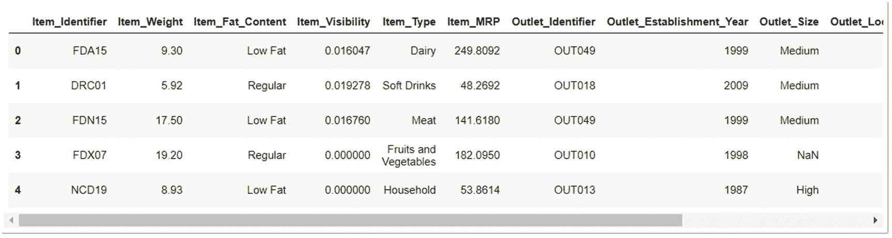

图 5-1：数据的前五行

如你所见，图 5-1 中未显示许多其他列。因此，让我们查看数据的形状以及所有列的列表。

```python
print(data.shape)
print("*****************************************************************")
print(data.columns)
```

这将输出如图 5-2 所示的结果。

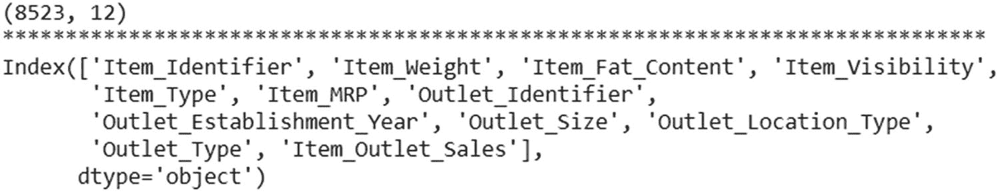

图 5-2：数据的形状和列

如我们所见，共有 8,523 行和 12 列。此外，我们可以在给出的列表中看到所有列的名称。

正如我们在处理步骤中看到的，下一步是填充空值。因此，让我们查看所有包含空值的列。

```python
data.isna().sum()
```

这段代码输出如图 5-3 所示的结果。


图 5-3：空值探索

因此，有两个列包含空值：`Item_Weight` 和 `Outlet_Size`。我们可以使用 `Scikit-Learn` 提供的常规填充方法来填充这些空值。但我们将改用附近列的数据来填充这些空值。让我们查看这些列的数据类型，这将有助于我们制定填充策略。

```python
print(data['Item_Weight'].dtype)
print(data['Outlet_Size'].dtype)
```

输出结果显示，`Item_Weight` 列是浮点型，而 `Outlet_Size` 列是类别型（或对象型）。我们将首先对 `Item_Weight` 列进行填充。如果我们计算 `Item_Weight` 的平均值并按 `Item_Type` 分组，就会发现不同商品类型的平均值是不同的。见图 5-4。

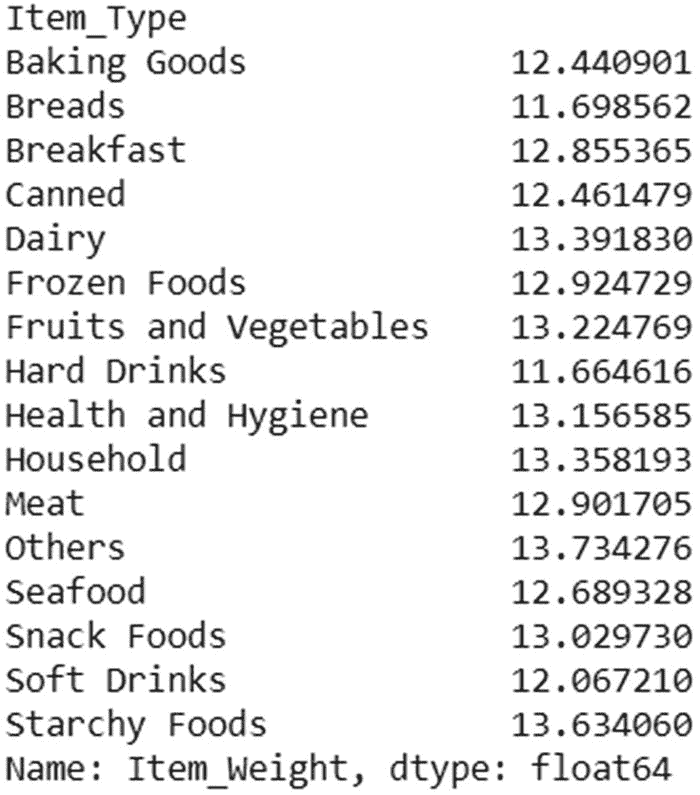

图 5-4：基于商品类型的商品重量平均值

```python
data.groupby(['Item_Type']).mean()['Item_Weight']
```

观察输出结果，我们可以做的是，根据 `Item_Type` 的不同，使用其对应的平均值来填充 `Item_Weight` 中的所有空值。这可以通过执行以下代码行来实现：

```python
for i in data.Item_Type.value_counts().index:
    data.loc[(data['Item_Weight'].isna()) & (data['Item_Type'] == i), ['Item_Weight']] = \
    data.loc[data['Item_Type'] == 'Fruits and Vegetables', ['Item_Weight']].mean()[0]
```

现在，如果我们再次检查空值，会得到图 5-5。

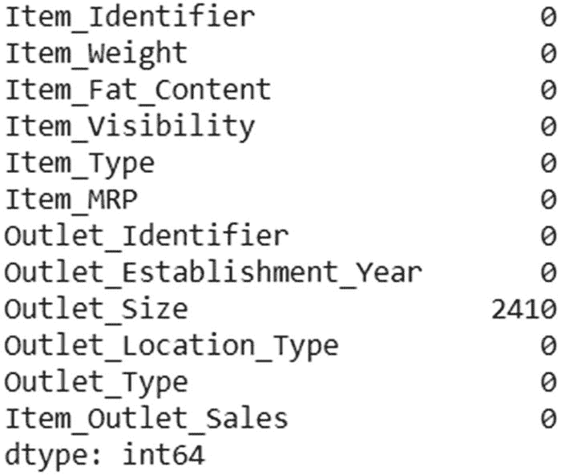

图 5-5：已移除的数值型空值

因此，我们成功填充了 `Item_Weight` 列的空值。对于 `Outlet_Size`，我们接下来要做的是先将数据拆分为数值型和类别型两个数据框，然后再填充空值。

```python
import numpy as np
cat_data = data.select_dtypes(object)
num_data = data.select_dtypes(np.number)
```

现在，所有类别型列都在 `cat_data` 中了。我们可以再次检查是否存在空值。见图 5-6。

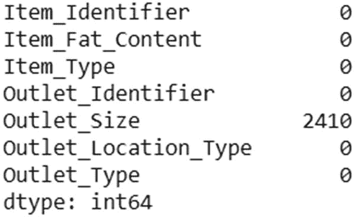

图 5-6：类别型数据空值

```python
cat_data.isna().sum()
```

所以，空值仍然存在。如果我们查看 `Outlet_Size` 列中的类别，会发现有三个。见图 5-7。

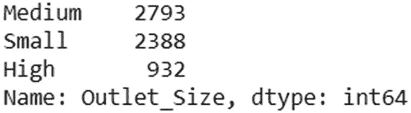

图 5-7：类别及其计数

```python
cat_data.Outlet_Size.value_counts()
```

但是，如果我们根据 `Outlet_Type` 来查看这些类别的计数，结果如图 5-8 所示。

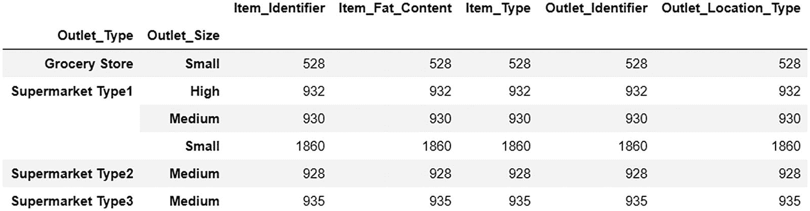

图 5-8：按类型对门店规模进行分组

```python
cat_data.groupby(['Outlet_Type','Outlet_Size']).count()
```

在此图中，我们可以看到，对于杂货店，最大规模的 `Small` 门店数量最多；对于超市类型 1，`Small` 最多；对于超市类型 2 和超市类型 3，`Medium` 最多。因此，我们将根据门店类型相应地填充空值。

处理缺失值后，我们现在检查空值以进行确认。见图5-9。

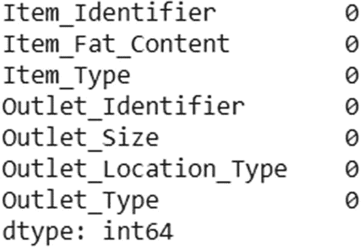
图 5-9 所有空值已移除

最后，所有空值都已成功移除。请记住，我们可以使用`Pandas`的`fillna()`方法来完成同样的操作。此外，我们还可以使用其他不同的方法进行填充，例如向后填充、向前填充、插值等。你可以自行尝试所有这些方法。

现在我们已经处理了所有空值，在进入虚拟变量处理之前，我们还需要做最后一件事。如果查看`Item Fat Content`列的类别，会发现存在以不同方式表示的相同值。见图5-10。

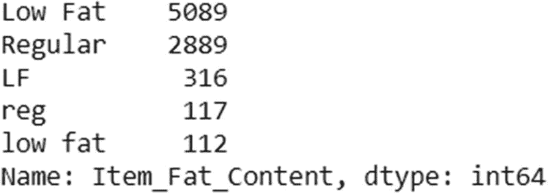
图 5-10 重复值

```
cat_data.Item_Fat_Content.value_counts()
```

`LF`表示低脂（Low Fat），`reg`表示常规（Regular），而`low fat`只是低脂的小写版本。让我们统一修正这些问题。

```
cat_data.loc[cat_data['Item_Fat_Content'] == 'LF' , ['Item_Fat_Content']] = 'Low Fat'
cat_data.loc[cat_data['Item_Fat_Content'] == 'reg' , ['Item_Fat_Content']] = 'Regular'
cat_data.loc[cat_data['Item_Fat_Content'] == 'low fat' , ['Item_Fat_Content']] = 'Low Fat'
```

现在，我们将看到图5-11中显示的值。

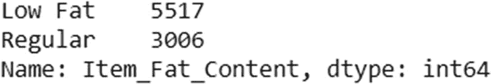
图 5-11 重复值已移除

至此，这项任务已成功完成。接下来，让我们对分类数据框应用标签编码。我们将使用`Scikit-Learn`包来实现。

```
from sklearn.preprocessing import LabelEncoder
le = LabelEncoder()
cat_data = cat_data.apply(le.fit_transform)
```

输出结果得到的数据框如图5-12所示。

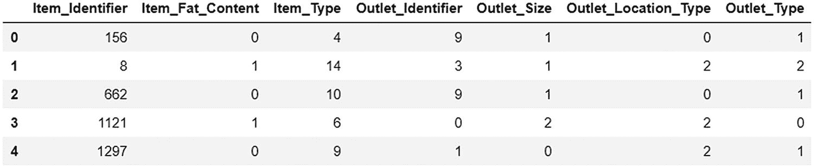
图 5-12 标签编码输出

```
cat_data.head()
```

我们将合并分类数据框和数值数据框，然后对列进行归一化。此外，在此之前我们还需要移除两列：`Item_Identifier`和`Item_Sales`。`Item_Identifier`并不是一个重要的列，而`Item_Sales`将作为我们的因变量，因此它不能出现在自变量列表中。见图5-13。

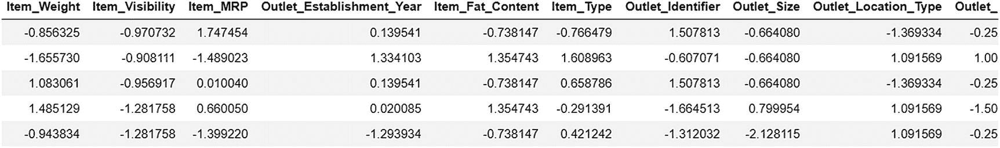
图 5-13 标准化缩放输出

```
from sklearn.preprocessing import StandardScaler
ss = StandardScaler()
num_data = pd.DataFrame(ss.fit_transform(num_data.drop(['Item_Outlet_Sales'], axis=1)), columns = num_data.drop(['Item_Outlet_Sales'],axis=1).columns)
cat_data = pd.DataFrame(ss.fit_transform(cat_data.drop(['Item_Identifier'], axis=1)), columns = cat_data.drop(['Item_Identifier'], axis=1).columns)
final_data = pd.concat([num_data,cat_data],axis=1)
final_data.head()
```

现在，我们的最终数据已经准备就绪。我们使用了`StandardScaler`类将所有数值归一化为它们的z分数。我们将使用`final_data`作为自变量，同时提取`Item Sales`作为因变量。

```
X = final_data
y = data['Item_Outlet_Sales']
```

最后一步是获取我们的训练集和验证集。为此，我们将使用`Scikit-Learn`提供的`model_selection`类。我们将取10%的数据作为验证集，其余作为测试集。

```
from sklearn.model_selection import train_test_split
X_train, X_test, y_train, y_test = train_test_split(X, y, test_size = 0.1, random_state=5)
```

这标志着数据处理的最后一步。现在，我们可以用它来训练任何我们想要的模型。我展示的这些代码行可以在任何`Jupyter Notebook`中执行，无论是在本地主机还是在云端。唯一的要求是必须安装必要的包。

在下一节中，我将向你展示如何使用`SageMaker`服务提供的`Scikit-Learn`容器在`SageMaker`中运行相同的代码。脚本保持不变，但流程发生了变化，因为我们需要持续与`S3`存储桶通信并定义实例。我们将在下一节中详细探讨这一点。

## 使用 SageMaker 的 Scikit-Learn 容器进行预处理

我们使用`SageMaker`是为了利用其多项优势，尤其是计算能力、API生成和存储的便捷性。因此，为了实现这些目标，代码必须以特定格式编写。我们将使用上一节中看到的相同代码，但会对整体结构进行一些修改，使其与`SageMaker`兼容。

首先，数据应位于`S3`存储桶中。在本章的第一节中，我们已经将`Train.csv`文件放入了存储桶。完成此操作后，我们就可以开始编写代码了。首先，我们将定义用户的角色以及我们使用`SageMaker`服务的区域。

```
import boto3
import sagemaker
from sagemaker import get_execution_role
region = boto3.session.Session().region_name
role = get_execution_role()
```

如果我们使用`SageMaker notebook`，`Boto3`包会尝试自动提取区域名称。如果我们在本地主机`notebook`上工作，则需要自定义定义区域。我们将在本书的最后部分讨论这部分内容。`get_execution_role()`提取用户登录时使用的当前角色。它可以是根用户或`IAM`角色。

现在我们已经定义了区域和角色，下一步将是定义我们的`Scikit-Learn`容器。正如本书第一部分所述，`SageMaker`基于`Docker`容器运行。所有内置算法本质上都是`Docker`容器，甚至自定义算法也必须放入`Docker`容器中并上传到`ECR`。由于我们将使用`Scikit-Learn`处理数据，`SageMaker`已经为此提供了一个处理容器。我们只需要实例化它，然后使用它即可。

在前面的代码中，我们创建了一个名为`SKLearnProcessor`的对象。传递的参数指定了要使用的 Scikit-Learn 版本、要传递给实例的 IAM 角色、要使用的计算实例类型，以及最后要启动的计算实例数量。完成此操作后，我们编写的任何使用 Scikit-Learn 的 Python 脚本都可以在此容器内运行。

现在，让我们检查一下我们的数据是否可以从 SageMaker 访问。

```python
import pandas as pd
input_data = 's3://slytherins-test/Train.csv'
df = pd.read_csv(input_data)
df.head()
```

`slytherins-test`是我们在本章前面创建的 S3 存储桶的名称。`Train.csv`是我们上传的数据。如果一切正常，你将得到如图 5-14 所示的输出。

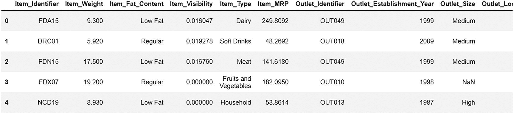

图 5-14

数据概览

如果你遇到任何错误，请确保存储桶和数据都已授予公共访问权限。我们在本书的前面部分已经讨论过这一点。

现在，是时候定义将在容器内运行的处理脚本了。我们已经在上一部分编写了这个脚本。我们只需重构代码并将其保存到名为`preprocessing.py`的文件中即可。

正如我们所见，前面的代码与本书上一部分的代码相同；我们所做的只是定义了数据在容器内的存储位置、输出的存储位置，以及从那里上传到 S3 存储桶的位置。

一旦定义好这个脚本，我们就可以开始了。我们需要做的就是启动实例化的容器，将此脚本作为参数传递，将数据作为参数传递，传递输出文件将存储的目录，最后传递目标 S3 存储桶。

```python
import argparse
import os
import warnings
import pandas as pd
import numpy as np
from sklearn.model_selection import train_test_split
from sklearn.preprocessing import StandardScaler, LabelEncoder
from sklearn.exceptions import DataConversionWarning
warnings.filterwarnings(action='ignore', category=DataConversionWarning)
# 这里我们定义了数据中存在的所有列
columns = ['Item_Identifier', 'Item_Weight', 'Item_Fat_Content', 'Item_Visibility',
'Item_Type', 'Item_MRP', 'Outlet_Identifier',
'Outlet_Establishment_Year', 'Outlet_Size', 'Outlet_Location_Type',
'Outlet_Type', 'Item_Outlet_Sales']
# 此方法将帮助我们打印数据的形状
def print_shape(df):
print('数据形状: {}'.format(df.shape))
if __name__=='__main__':
# 在容器执行时，我们将使用此解析器来定义训练验证集划分比例。默认保留 10%
parser = argparse.ArgumentParser()
parser.add_argument('--train-test-split-ratio', type=float, default=0.1)
args, _ = parser.parse_known_args()
print('接收到的参数 {}'.format(args))
# 这是容器内数据路径，Train.csv 将被下载并保存于此
input_data_path = os.path.join('/opt/ml/processing/input', 'Train.csv')
print('正在从 {} 读取输入数据'.format(input_data_path))
data = pd.read_csv(input_data_path)
data = pd.DataFrame(data=data, columns=columns)
for i in data.Item_Type.value_counts().index:
data.loc[(data['Item_Weight'].isna()) & (data['Item_Type'] == i), ['Item_Weight']] = \
data.loc[data['Item_Type'] == 'Fruits and Vegetables', ['Item_Weight']].mean()[0]
cat_data = data.select_dtypes(object)
num_data = data.select_dtypes(np.number)
cat_data.loc[(cat_data['Outlet_Size'].isna()) & (cat_data['Outlet_Type'] == 'Grocery Store'), ['Outlet_Size']] = 'Small'
cat_data.loc[(cat_data['Outlet_Size'].isna()) & (cat_data['Outlet_Type'] == 'Supermarket Type1'), ['Outlet_Size']] = 'Small'
cat_data.loc[(cat_data['Outlet_Size'].isna()) & (cat_data['Outlet_Type'] == 'Supermarket Type2'), ['Outlet_Size']] = 'Medium'
cat_data.loc[(cat_data['Outlet_Size'].isna()) & (cat_data['Outlet_Type'] == 'Supermarket Type3'), ['Outlet_Size']] = 'Medium'
cat_data.loc[cat_data['Item_Fat_Content'] == 'LF' , ['Item_Fat_Content']] = 'Low Fat'
cat_data.loc[cat_data['Item_Fat_Content'] == 'reg' , ['Item_Fat_Content']] = 'Regular'
cat_data.loc[cat_data['Item_Fat_Content'] == 'low fat' , ['Item_Fat_Content']] = 'Low Fat'
le = LabelEncoder()
cat_data = cat_data.apply(le.fit_transform)
ss = StandardScaler()
num_data = pd.DataFrame(ss.fit_transform(num_data), columns = num_data.columns)
cat_data = pd.DataFrame(ss.fit_transform(cat_data), columns = cat_data.columns)
final_data = pd.concat([num_data,cat_data],axis=1)
print('清洗后的数据: {}'.format(final_data.shape))
X = final_data.drop(['Item_Outlet_Sales'], axis=1)
y = data['Item_Outlet_Sales']
split_ratio = args.train_test_split_ratio
print('正在以比例 {} 将数据拆分为训练集和测试集'.format(split_ratio))
X_train, X_test, y_train, y_test = train_test_split(X, y, test_size=split_ratio, random_state=0)
# 这定义了容器内的输出路径，所有 CSV 文件将从这里被取出并上传到 S3 存储桶
train_features_output_path = os.path.join('/opt/ml/processing/train', 'train_features.csv')
train_labels_output_path = os.path.join('/opt/ml/processing/train', 'train_labels.csv')
test_features_output_path = os.path.join('/opt/ml/processing/test', 'test_features.csv')
test_labels_output_path = os.path.join('/opt/ml/processing/test', 'test_labels.csv')
print('正在将训练特征保存到 {}'.format(train_features_output_path))
pd.DataFrame(X_train).to_csv(train_features_output_path, header=False, index=False)
print('正在将测试特征保存到 {}'.format(test_features_output_path))
pd.DataFrame(X_test).to_csv(test_features_output_path, header=False, index=False)
print('正在将训练标签保存到 {}'.format(train_labels_output_path))
y_train.to_csv(train_labels_output_path, header=False, index=False)
print('正在将测试标签保存到 {}'.format(test_labels_output_path))
y_test.to_csv(test_labels_output_path, header=False, index=False)
```

在前面的代码中，我们传递了所有参数。此外，我们还定义了告知划分比例的参数。在`preprocessing.py`脚本内部，我们有解析此参数的代码。

图 5-15 展示了接下来会发生什么。

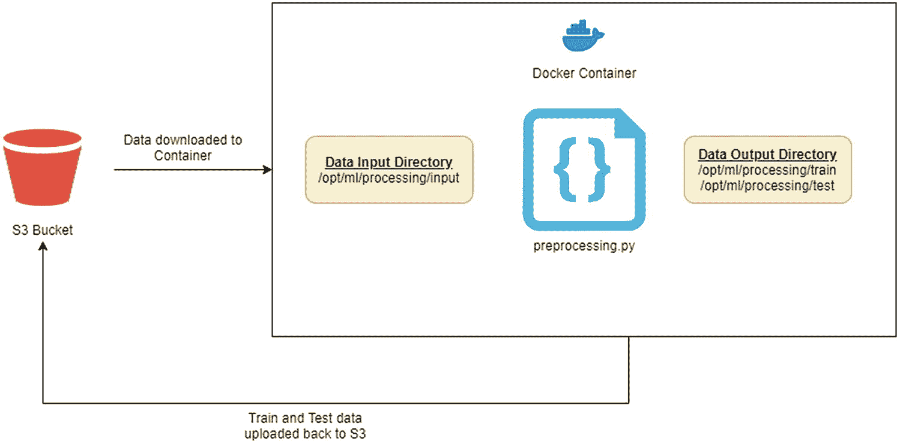
图 5-15 处理作业的工作原理

处理作业需要一些时间才能完成。它首先启动一个实例（类似于启动操作系统），然后在实例上下载`sklearn`镜像。接着，数据被下载到实例。然后处理作业开始。当作业完成时，训练和测试数据被存回 S3。然后整个操作结束。作业完成后，我们可以使用以下脚本获取有关该作业的详细信息：

```
preprocessing_job_description = sklearn_processor.jobs[-1].describe()
```

让我们使用这个脚本来获取训练和测试数据集的 S3 存储桶位置：

```
output_config = preprocessing_job_description['ProcessingOutputConfig']
for output in output_config['Outputs']:
    if output['OutputName'] == 'train_data':
        preprocessed_training_data = output['S3Output']['S3Uri']
    if output['OutputName'] == 'test_data':
        preprocessed_test_data = output['S3Output']['S3Uri']
```

现在，我们可以通过使用 Pandas 读取数据来检查输出。

```
training_features = pd.read_csv(preprocessed_training_data + 'train_features.csv', nrows=10, header=None)
print('训练特征形状: {}'.format(training_features.shape))
training_features.head(10)
```

这为我们提供了图 5-16 中所示的输出。

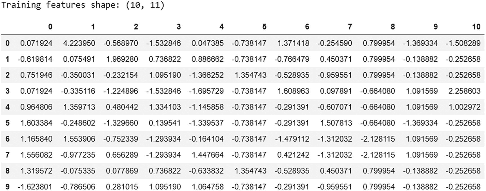
图 5-16 处理后的数据

至此，使用`SklearnProcessor`可以完成的整个处理作业就结束了。下一步始终是定义机器学习算法。我们将在接下来的章节中讨论这一点。

但是，假设我们不想使用 SageMaker 预定义的容器（如`ScriptProcessor`），而是想创建自己的容器并在其上运行脚本。在这种情况下，我们可以使用 SageMaker 的一个名为`ScriptProcessor`的类。让我们在下一节中探讨这一点。

## 使用 ScriptProcessor 创建自定义预处理代码

在上一节中，我们使用了`SkLearnProcessor`，这是 SageMaker 提供的内置容器。但很多时候，我们编写的代码无法仅在 SageMaker 预定义的容器中执行。为此，我们必须创建自己的容器。在训练机器学习模型时，我们也会探讨如何创建自己的容器。在本节中，我们将创建一个执行与`SKlearnProcessor`容器相同任务的容器。唯一的区别在于它不是预构建的；我们将从头开始构建它。

要为处理作业使用自定义容器，我们需要使用 SageMaker 提供的名为`ScriptProcessor`的类。在向`ScriptProcessor`提供输入之前，首要任务是创建我们的 Docker 容器并将其推送到 ECR。

### 创建 Docker 容器

为此，我们将创建一个名为`Dockerfile`的文件（无扩展名）。在该文件中，我们将下载一个最小操作系统的镜像，然后在其内部安装所需的软件包。因此，我们的最小操作系统将基于 Linux，并在其中安装 Python、Scikit-Learn 和 Pandas。

```
FROM python:3.7-slim-buster
RUN pip3 install pandas==0.25.3 scikit-learn==0.21.3
ENV PYTHONUNBUFFERED=TRUE
ENTRYPOINT ["python3"]
```

上述脚本必须存在于`Dockerfile`中。第一行`FROM python:3.7-slim-buster`指定了需要从 Docker Hub 下载的最小操作系统。该操作系统仅包含 Python 3.7 和运行 Python 所需的最小软件包。但是，我们还需要安装其他软件包。因此，我们使用下一行`RUN pip3 install pandas==0.25.3 scikit-learn==0.21.3`。这将安装 Pandas、Scikit-Learn、Numpy 以及其他重要的软件包。下一行`ENV PYTHONUNBUFFERED=TRUE`是一条高级指令，它告诉 Python 立即记录日志消息。这有助于调试。最后一行`ENTRYPOINT ["python3"]`指定了我们的`preprocessing.py`文件应如何执行。

### 构建并推送镜像

现在我们的 Docker 文件已准备就绪，我们需要构建此镜像，然后将其推送到 Amazon ECR（一个 Docker 镜像仓库服务）。要构建并推送此镜像，需要以下信息：

*   账户 ID
*   仓库名称
*   区域
*   分配给镜像的标签

所有这些信息都可以使用以下脚本进行初始化：

```
import boto3
account_id = boto3.client('sts').get_caller_identity().get('Account')
ecr_repository = 'sagemaker-processing-container'
tag = ':latest'
region = boto3.session.Session().region_name
```

一旦我们有了这些信息，就可以首先定义 ECR 仓库地址，然后执行一些命令行脚本来启动该过程。

```
processing_repository_uri = '{}.dkr.ecr.{}.amazonaws.com/{}'.format(account_id, region, ecr_repository + tag)
# 创建 ECR 仓库并推送 Docker 镜像
! docker build -t $ecr_repository docker # 构建镜像
! $(aws ecr get-login --region $region --registry-ids $account_id --no-include-email) # 登录 AWS
! aws ecr create-repository --repository-name $ecr_repository # 创建 ECR 仓库
! docker tag {ecr_repository + tag} $processing_repository_uri # 为镜像打标签以区别于其他镜像
! docker push $processing_repository_uri # 将镜像推送到 ECR
```

如果一切顺利，您的镜像将成功推送到 ECR。您可以前往 ECR 服务并检查仓库。您可以在图 5-17 中看到视图。

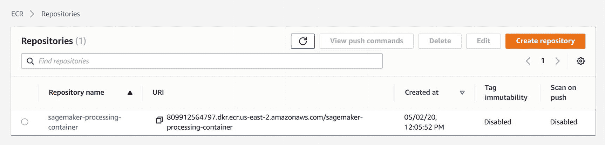
图 5-17 镜像已推送到 ECR

### 使用 ScriptProcessor 类

现在我们的镜像已准备就绪，我们可以开始使用 `ScriptProcessor` 类了。我们将在此容器内执行相同的代码 `preprocessing.py`。就像我们在 `SKLearnProcessor` 中所做的那样，我们将首先创建该类的对象。

```python
from sagemaker.processing import ScriptProcessor, ProcessingInput, ProcessingOutput
from sagemaker import get_execution_role
role = get_execution_role()
script_processor = ScriptProcessor(command=['python3'],
image_uri=processing_repository_uri,
role=role,
instance_count=1,
instance_type='ml.m5.xlarge')
```

创建对象后，我们可以使用它来运行我们的 `preprocessing.py` 文件。

```python
input_data = 's3://slytherins-test/Train.csv'
script_processor.run(code='preprocessing.py',
inputs=[ProcessingInput(
source=input_data,
destination='/opt/ml/processing/input')],
outputs=[ProcessingOutput(source='/opt/ml/processing/train', destination='s3://slytherins-test/'),
ProcessingOutput(source='/opt/ml/processing/test', destination='s3://slytherins-test/')])
```

您会发现代码与 `SKLearnProcessor` 的代码几乎相同。它也会产生相同的输出。最后，处理作业完成后，我们可以用同样的方式再次检查输出。

```python
preprocessing_job_description = script_processor.jobs[-1].describe()
output_config = preprocessing_job_description['ProcessingOutputConfig']
for output in output_config['Outputs']:
if output['OutputName'] == 'output-1':
preprocessed_training_data = output['S3Output']['S3Uri']
if output['OutputName'] == 'output-2':
preprocessed_test_data = output['S3Output']['S3Uri']
import pandas as pd
training_features = pd.read_csv(preprocessed_training_data + 'train_features.csv', nrows=10, header=None)
print('Training features shape: {}'.format(training_features.shape))
training_features.head(n=10)
```

您将获得的输出与图 5-16 中显示的相同。

在本节中，我们了解了如何创建自己的容器并运行处理脚本。这在许多情况下变得很重要。例如，如果我们想对 NLP 任务使用基于 BERT 的预处理，我们将需要为此创建一个容器，因为 SageMaker 不提供基于 BERT 的服务。在后续章节中创建训练和推理作业时，我们将进一步探索自定义容器。

在过去的两个部分中，我们一直在 SageMaker 容器内的 Jupyter Notebook 中工作。但大多数时候，尤其是在生产环境中，我们必须在不同的系统中运行代码。为此，我们将不得不使用 Boto3 API 进行身份验证和执行。在下一节中，我们将了解如何使用 Boto3 运行我们的自定义脚本。

## 使用 Boto3 运行处理作业

如前所述，我们使用 `boto3` 包从任何其他计算机（包括您的本地主机）访问 AWS 的服务。因此，在本节中，我们将使用 Boto3 运行我们在上一节中看到的自定义 Docker 容器脚本。

### 安装 Boto3

使用 Boto3 的第一步是在本地主机环境中安装它。除了 Boto3，我们还需要安装 `awscli`，它将帮助我们完成与 AWS 的身份验证，以及 `s3fs`，后者将帮助我们与 S3 存储桶进行通信。我们将使用 `pip` 进行安装，如下所示：

```bash
pip install boto3
pip install awscli
pip install s3fs
```

安装完成后，我们需要配置 AWS 的凭证。为此，我们将运行以下命令：

```bash
aws configure
```

这将要求您提供以下四项信息：

*   AWS 访问密钥

*   AWS 秘密访问密钥

*   默认区域名称

*   默认输出格式

提供这些信息后，我们就可以轻松使用 Boto3 连接到 AWS 服务。我已经向您展示了在创建 IAM 角色时如何获取访问密钥和秘密访问密钥。默认区域名称将是 `us-east-2`，但您可以通过查看 AWS 管理控制台右上角来重新确认。它会显示您的位置。如图 5-18 所示，我已经传入了所需的信息。

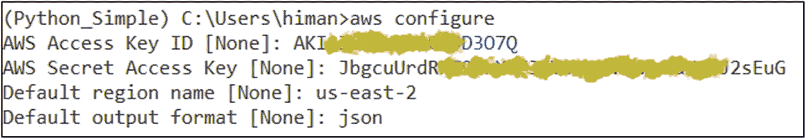

图 5-18

设置 AWS 凭证

这部分完成后，我们可以启动 Jupyter Notebook（本地系统笔记本），并在我们安装所有包并配置了 AWS 的同一环境中创建一个笔记本。

### 初始化 Boto3

在笔记本中，第一步是初始化 Boto3。为此，我们将使用以下脚本：

```python
import boto3
import s3fs
region = boto3.session.Session().region_name
client = boto3.client('sagemaker')
```

在上一步中，区域由您设置。相同的区域将被提取并存储在变量 `region` 中。接下来是设置 Boto3。Boto3 可以为 AWS 的所有服务进行设置。目前，我们将使用 SageMaker；因此，我们将调用 Boto3 的 `client` 类，并用 SageMaker 初始化它（`client = boto3.client('sagemaker')`）。

### 修改 Dockerfile 并推送镜像

现在，我们将使用 Boto3 API 调用处理作业方法。这将创建我们在上一节中看到的相同处理作业。但是，需要进行一些小的更改，我们将逐一探讨。

我们将使用 `create_processing_job` 方法来运行数据处理作业。要了解有关此方法或 Boto3 提供的所有与 SageMaker 相关的方法的更多信息，您可以访问 [`https://boto3.amazonaws.com/v1/documentation/api/latest/reference/services/sagemaker.html`](https://boto3.amazonaws.com/v1/documentation/api/latest/reference/services/sagemaker.html)。

但在此之前，我们必须对我们的 Docker 容器和处理 Python 文件进行一些更改。对于 Docker 容器，我们需要将 `preprocessing.py` 脚本复制到其中，以便 Boto3 方法可以直接运行该脚本。为此，我们将对 Dockerfile 进行以下更改：

```dockerfile
FROM python:3.7-slim-buster
RUN pip3 install pandas==0.25.3 scikit-learn==0.21.3
ENV PYTHONUNBUFFERED=TRUE
ENV PATH="/opt/ml/code:${PATH}"
COPY preprocessing.py /opt/ml/code/preprocessing.py
WORKDIR /opt/ml/code
```

我们在现有的 Dockerfile 中添加了三行新内容。`ENV PATH="/opt/ml/code:${PATH}"` 这一行将环境路径设置为 `/opt/ml/code`。我们将通过 `COPY preprocessing.py /opt/ml/code/preprocessing.py` 把我们的脚本 `preprocessing.py` 放置在其中。最后，我们将工作目录设置为同一个文件夹：`WORKDIR /opt/ml/code`。这是必需的，以便 Docker 容器知道脚本文件所在的位置，这将有助于其执行。

在`Dockerfile`中做出更改后，我们将对构建镜像并将其推送到ECR的脚本进行更改。我们需要做的唯一更改是添加一行，授予容器操作`preprocessing.py`脚本的权限。否则，Docker可能没有权限打开和查看其内容。

```
# 创建 ECR 仓库并推送 Docker 镜像
! chmod +x docker/preprocessing.py # 此行授予预处理脚本读写权限
! docker build -t $ecr_repository docker # 构建镜像
! $(aws ecr get-login --region $region --registry-ids $account_id --no-include-email) # 登录 AWS
! aws ecr create-repository --repository-name $ecr_repository # 创建 ECR 仓库
! docker tag {ecr_repository + tag} $processing_repository_uri # 标记镜像以区别于其他镜像
! docker push $processing_repository_uri # 将镜像推送到 ECR
```

完成此步骤后，我们就可以运行`Boto3`处理作业了。

## 创建处理作业

简而言之，使用`Boto3`创建处理作业需要四个部分的信息。
*   输入数据信息 (`ProcessingInput`)
*   输出数据信息 (`ProcessingOutput`)
*   资源信息 (`ProcessingResources`)
*   容器信息 (`AppSpecification`)

如下代码所示，上述所有信息都已提供。这段代码与我们之前看到的代码类似；区别在于，`Boto3`需要手动将信息作为参数传入，而当我们从SageMaker内部运行代码时，大部分信息会自动提取。

```
response = client.create_processing_job(       # 初始化方法
ProcessingInputs=[
{
'InputName': "Training_Input",    # 为输入作业命名
'S3Input': {
'S3Uri': input_data,          # 数据来源的 URL
'LocalPath': '/opt/ml/processing/input',     # 数据将下载到的本地目录
'S3DataType': 'S3Prefix',     # 数据类型是什么？
'S3InputMode': 'File'         # 是文件还是连续数据流？
}
},
],
ProcessingOutputConfig={
'Outputs': [
{
'OutputName': 'Training',      # 指定输出名称
'S3Output': {
'S3Uri': 's3://slytherins-test/',      # 输出需要存储的位置
'LocalPath': '/opt/ml/processing/train',   # 需要查找输出的本地目录
'S3UploadMode': 'EndOfJob'     # 作业完成时上传
},
'OutputName': 'Testing',
'S3Output': {
'S3Uri': 's3://slytherins-test/',
'LocalPath': '/opt/ml/processing/test',
'S3UploadMode': 'EndOfJob'
}
},
],
},
ProcessingJobName='preprocessing-job-test',    # 为整个作业命名，名称应唯一
ProcessingResources={
'ClusterConfig': {
'InstanceCount': 1,                  # 需要多少个实例？
'InstanceType': 'ml.m5.xlarge',      # 实例类型是什么？
'VolumeSizeInGB': 5                 # 实例大小应为多少？
}
},
AppSpecification={
'ImageUri': '809912564797.dkr.ecr.us-east-2.amazonaws.com/sagemaker-processing-container:latest',
# Docker 镜像 URL
'ContainerEntrypoint': [
'Python3','preprocessing.py'         # 如何运行脚本
]
},
RoleArn='arn:aws:iam::809912564797:role/sagemaker-full-accss',    # IAM 角色定义
)
```

`RoleArn`定义了运行代码所需的IAM角色。我们已经在活动部分创建了这个角色。我还解释了如何在创建IAM角色时复制`ARN`。

上述代码将启动处理作业。但是，你不会看到任何输出。要了解作业的状态，你可以使用`CloudWatch`，我将在下一节中介绍。现在，我们将借助`Boto3`的`describe_processing_job`方法来获取信息。我们可以通过编写以下代码来实现：

```
client.describe_processing_job(
ProcessingJobName='processing-job-test'
)
```

这将提供关于该作业的详细信息，如图5-19所示。

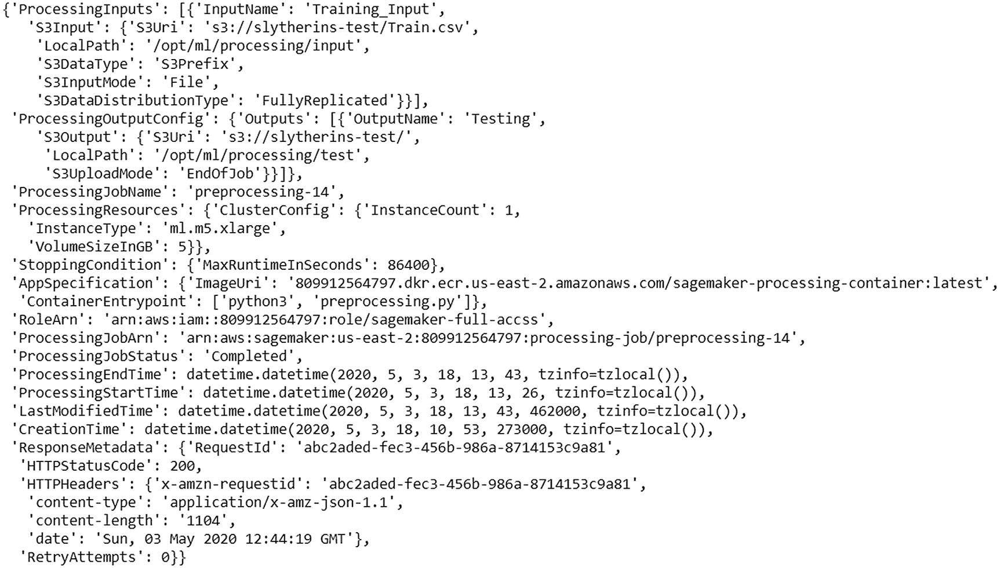

图5-19

处理作业描述

你会找到`ProcessingJobStatus`键，它指示了状态，如果作业失败，你还会获得失败原因键。至此，我们已经了解了SageMaker提供的三种数据处理方式。接下来，让我们在下一节中探讨如何监控这些作业。

## 使用CloudWatch监控处理作业

`CloudWatch`是Amazon提供的一项出色服务，可帮助你监控几乎所有作业，无论是训练、推理还是处理作业。在本节中，我们将探讨如何使用`CloudWatch`来监控处理作业。在后续章节中，我们还将把它用于其他机器学习技术。

首先，登录AWS管理控制台后，我们需要转到“服务”，然后搜索*CloudWatch*并打开它。接着，在右侧面板中找到“日志”部分并点击它。参见图5-20。

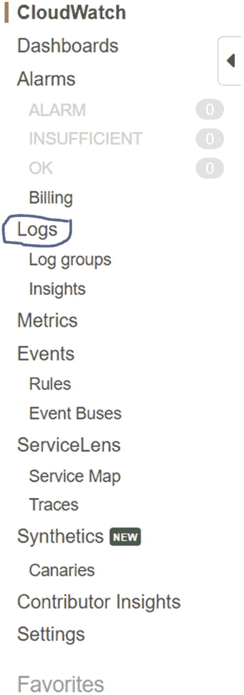

图5-20

CloudWatch菜单

在这里，你可以看到所有日志组，具体取决于我们使用过的AWS服务。由于我们目前只使用了SageMaker和Processing这两个服务，你可以轻松找到相关信息，如图5-21所示。

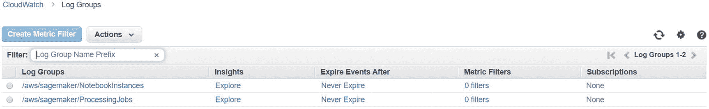

图5-21

CloudWatch中的作业信息

我们将点击`ProcessingJobs`部分，并搜索我们为作业指定的处理作业名称。找到后，点击该链接。它将显示一些类似于图5-22的输出。

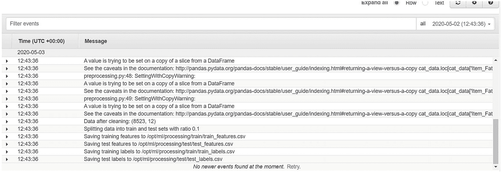

图5-22

CloudWatch中的作业日志

如果你有任何错误，也可以根据处理作业的名称在此处找到它们。这就是我之前提到名称应唯一的原因。`CloudWatch`中还有很多其他部分，但目前它们并不重要。我们将在需要时再进行探索。

这里需要记住的一点是，在SageMaker控制台内部，你找不到处理作业的日志。这就是为什么你必须到`CloudWatch`中查找作业的原因。对于大多数训练作业、转换作业等，你可以直接在SageMaker控制台中找到日志——但处理作业除外。

## 结论

本章主要介绍了如何使用SageMaker处理原始数据。在下一章中，我们将详细探讨SageMaker的大部分内置算法。我们将从处理原始数据开始，然后转向训练模型并将模型工件保存到S3存储桶。