# 6. 在 SageMaker 中构建和部署模型

在本章中，我们将探索一些业界广泛使用的 SageMaker 内置算法。我们将从通用领域、自然语言处理领域、计算机视觉领域和预测领域探索这些算法。

## 探索线性学习器算法

SageMaker 的线性学习器算法类似于机器学习领域的回归算法。我们可以使用线性学习器算法创建多元线性回归、逻辑回归和多项逻辑回归模型。在本节中，我们将了解如何将此算法用于线性回归和逻辑回归。我们将使用上一章中使用的 Big Mart 数据集来应用此算法。在深入探讨如何在 SageMaker 中应用线性学习器之前，让我们先简要了解一下线性回归和逻辑回归。

### 线性回归概述

线性回归是机器学习中最基础但也是最重要的算法之一。它用于在观测数据上拟合一条线（在非线性回归的情况下是曲线），然后对拟合的线进行插值以获得预测值。为了拟合这条线，我们使用一种称为*最小二乘估计*的方法，该方法为我们提供了系数值。这些系数值的确定方式使得误差的均值近似为零。误差是每个观测点到拟合线的欧几里得距离。图 6-1 展示了用于拟合一条线的简单线性回归。

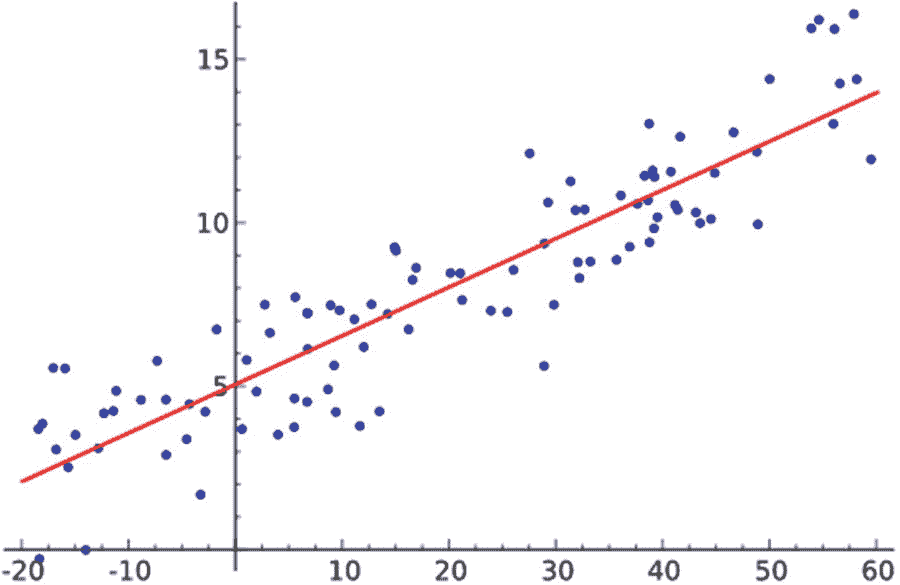

图 6-1

简单线性回归

线性回归用于预测数值。回归有多种变体，例如岭回归、套索回归、弹性网络回归、高斯回归等。


### 逻辑回归概述

逻辑回归是对线性回归的一种转换，其预测范围被限制在 0 到 1 之间。这是通过将线性回归方程传递给 Sigmoid 函数来实现的。因此，线性回归中的直线会转换为一条上限为 1、下限为 0 的 S 形曲线，如图 6-2 所示。

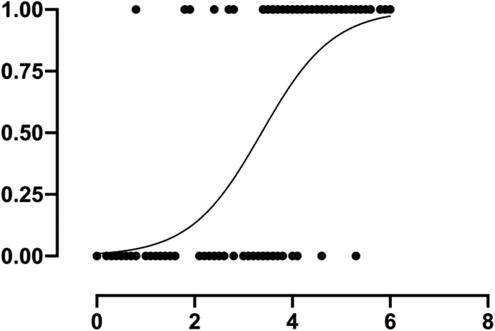

图 6-2

逻辑回归

一旦逻辑回归预测出一个值，该值就会被视为二分类场景下的预测概率。默认情况下，如果预测值超过 0.5，则预测为成功类别；否则预测为失败类别。0.5 这个阈值是可自定义的，这样我们就能获得更好的精确率和召回率（将在下一章详细讨论）。用于多分类的逻辑回归被称为*多项逻辑回归*，它不使用 Sigmoid 函数，而是使用 Softmax 函数。

### 线性学习器的 SageMaker 应用

第一步是从 S3 存储桶中读取数据集，对列进行预处理以去除空值，并应用缩放和编码。我们在前一章已经了解了如何预处理数据集并获取因变量和自变量。因此，本节我们将直接对预处理后的数据集应用算法。我们将定义角色和存储桶，以便 SageMaker 能够与不同的服务正常通信。

```
import boto3
from sagemaker import get_execution_role
bucket = 'slytherins-test'
prefix = 'linear-learner'
role = get_execution_role()
```

现在，我们需要决定应用哪种算法，即线性回归还是逻辑回归。我们将从逻辑回归开始。要构建逻辑回归模型，我们需要一个分类列。我们知道目标变量是`Sales`，它是一个数值列；因此，无法应用逻辑回归。所以，我们将`Sales`列划分为四个类别，然后就可以开始应用算法了。

```
y_binned = pd.cut(y['Item_Outlet_Sales'], 4, labels=['A', 'B', 'C', 'D'])
```

上述代码将`y`划分为`A`、`B`、`C`和`D`四个类别，每个类别具有相等的范围。输出结果如下所示：

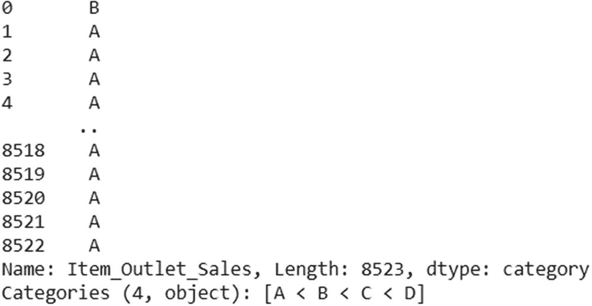

现在，我们有了分类列作为目标变量，我们将对其应用标签编码，以便每个类别可以用一个整数表示。

```
from sklearn.preprocessing import LabelEncoder
le = LabelEncoder()
temp = le.fit(y_binned)
y_final = temp.transform(y_binned)
```

现在，我们已经定义了最终的目标变量并将其存储在`y_final`中，接下来将用它来训练模型。如前一章所述，SageMaker 在 Docker 容器内运行算法，因此数据应存储在 S3 存储桶中，以便容器能够访问。下一步是将数据存储到 S3 中。对于我们的线性学习器算法，我们将使用一种称为 RecordIO-Protobuf 格式的数据格式。使用这种数据格式有助于缩短训练时间，并且可以在实时数据模式下训练模型（称为*管道模式*）。我们可以使用以下代码将自变量和目标变量转换为 RecordIO 格式：

```
import io
import numpy as np
import sagemaker.amazon.common as smac
vectors = np.array(X.values, dtype="float32")
labels = np.array(y_final, dtype="float32")
buf = io.BytesIO()
smac.write_numpy_to_dense_tensor(buf, vectors, labels)
buf.seek(0)
```

上述代码将数据转换为 RecordIO 格式，然后打开临时文件，以便可以直接插入到 S3 中。RecordIO 文件通过将大文件分割成块，然后使用这些块进行分析。该文件有助于我们在 SageMaker 中创建流式作业，从而加快训练速度。为了发送数据，我们将使用以下代码：

```
key = 'recordio-pb-data'
boto3.resource('s3').Bucket(bucket).Object(os.path.join(prefix, 'train', key)).upload_fileobj(buf)
s3_train_data = 's3://{}/{}/train/{}'.format(bucket, prefix, key)
print('uploaded training data location: {}'.format(s3_train_data))
```

这将把数据上传到 S3 并关闭我们创建的缓冲区。现在，基本步骤已经完成。我们只需要建立连接并训练模型。第一步是初始化我们的线性学习器算法 Docker 容器。

```
from sagemaker.amazon.amazon_estimator import get_image_uri
container = get_image_uri(boto3.Session().region_name, 'linear-learner')
```

初始化之后，让我们传递线性学习器所需的参数并初始化算法。

```
sess = sagemaker.Session()
linear = sagemaker.estimator.Estimator(container,
role,
train_instance_count=1,
train_instance_type='ml.m4.xlarge',
output_path=output_location,
sagemaker_session=sess)
```


众所周知，回归算法有一些需要定义的超参数，例如变量数量、批次大小等。接下来我们将定义这些值。

```
linear.set_hyperparameters(feature_dim=11,
predictor_type='multiclass_classifier',
mini_batch_size=100,
num_classes=4)
```

现在一切已定义完毕，接下来我们将开始训练。

```
linear.fit({'train': s3_train_data})
```

您将在开始时看到如下输出，然后训练将开始。

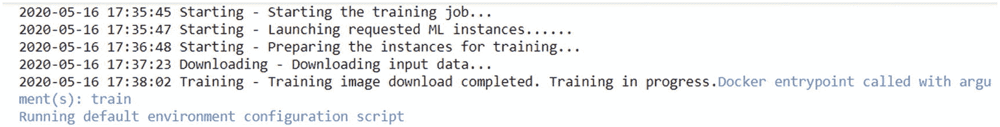

模型训练需要一些时间。一旦模型训练完成，我们可以将其部署为一个端点，然后开始测试。为了部署模型，我们将使用 `deploy` 函数。

```
linear_predictor = linear.deploy(initial_instance_count=1,
instance_type='ml.m4.xlarge')
```

部署模型并创建端点需要一些时间。完成后，我们就可以开始预测。要开始预测，我们首先需要告知端点将接收何种类型的数据。然后，我们必须对数据进行序列化。这种格式有助于高效地传输和存储数据，并能完美地还原原始数据。我们可以使用以下代码对测试数据进行序列化：

```
from sagemaker.predictor import csv_serializer, json_deserializer
linear_predictor.content_type = 'text/csv'
linear_predictor.serializer = csv_serializer
linear_predictor.deserializer = json_deserializer
```

现在，无论我们向端点发送什么数据，它都会被序列化并发送给模型。预测结果将以序列化形式返回，然后我们将看到其原始结构的数据。为了进行预测，我们将使用测试数据。

```
result = linear_predictor.predict(test_vectors[0])
print(result)
```

上一行代码给出了对单行的预测结果。但如果我们需要对多行进行预测，可以使用以下代码：

```
import numpy as np
predictions = []
for array in np.array_split(test_vectors, 100):
result = linear_predictor.predict(array)
predictions += [r['predicted_label'] for r in result['predictions']]
predictions = np.array(predictions)
```

上述代码每次处理 100 行数据，并将它们的预测结果存储在变量 `predictions` 中。现在，我们可以使用以下代码查看模型指标：

```
from sklearn.metrics import precision_score, recall_score, f1_score
print(precision_score(labels, predictions, average="weighted"))
print(recall_score(labels, predictions, average="weighted"))
print(f1_score(labels, predictions, average="weighted"))
```

这将为我们提供以下结果：

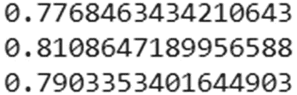

我们也可以使用 Cloud Metrics 来可视化模型的不同指标，但这将在下一章中探讨。

请记住，一旦创建了端点，它们将一直运行，直到我们手动或通过脚本停止它们。运行完上述所有代码后，我们的端点仍在运行。因此，我们将停止它，以免产生任何费用。

```
sagemaker.Session().delete_endpoint(linear_predictor.endpoint)
```

上一行代码会停止并删除端点。我们在前面的示例中执行了多项逻辑回归。我们也可以使用线性回归来预测数值。为此，我们需要对前面的代码进行如下修改：

```
linear.set_hyperparameters(feature_dim=11,
predictor_type='regression',
mini_batch_size=100)
```

另外，不要忘记使用 Big Mart 数据集中的原始目标变量（`Sales` 列），而不是分箱后的变量。在下一节中，我们将在同一数据集上应用 XGBoost 算法，并将其性能与逻辑回归进行比较。

## 探索 XGBoost 算法

XGBoost 代表*极限梯度提升*。在本节中，我们将首先了解普通的梯度下降算法是如何工作的，以及 XGBoost 如何使其效率更高。我们将把该算法应用于 Big Mart 数据集的多类分类问题。让我们先来看看这两种算法，以此开始本节内容。

### 梯度提升算法

*提升*是一种属于机器学习中集成树领域的技术。在该算法中，多个决策树被组合起来以给出最终预测。集成树中的其他方法包括装袋和随机森林。提升与这些方法的不同之处在于它组合多个树的方式。当构建第一个决策树（通常是 CART 决策树）时，所有观测值被赋予相同的权重。模型训练完成后，被应用于同一数据集。然后构建第二个决策树。在这个决策树中，所有在第一个决策树中被错误分类的观测值被赋予更大的权重，而其他观测值则被赋予较小的权重。这是通过增加难以分类的观测值的权重，同时减少所有其他观测值的权重来实现的。这个过程不断重复，最后，最后一个决策树给出最终的预测。因此，可以说每个决策树都受到前一个决策树的*提升*，这就是它被称为*提升*的原因。有不同类型的提升方法，例如 AdaBoost、梯度提升、Light GBM、XGBoost 等。参见图 6-3。

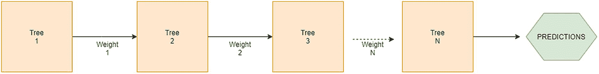

图 6-3

梯度提升

在梯度提升中，赋予参数的权重是使用梯度下降方法学习的。首先定义损失函数，对于回归问题可以是均方误差，对于分类问题可以是逻辑函数。每构建一个决策树并将其添加到下一个决策树后，都会最小化这个损失函数。最终目标是使整体损失函数最小化，这反过来为所有观测值提供了最佳的权重值。

### XGBoost 算法

XGBoost 算法基于梯度提升框架。XGBoost 是梯度提升的一个超优化版本，因为它充分利用了计算资源的能力，以至于对于中小型数据集，其性能通常优于神经网络。以下是使用 XGBoost 的一些主要优点：

*   支持多线程操作，因此构建的多个树利用了并行化概念，从而我们可以使用大量决策树，以更少的迭代次数获得更准确的预测。

*   可以通过使用缓存和缓冲区、核外计算等方法来最大化硬件性能。

*   XGBoost 在决策树中附加了正则化因子，因此可以处理过拟合和欠拟合问题。它同时支持 L1 和 L2 正则化。

*   XGBoost 通过理解邻近数据自动学习缺失值。

*   使用一种称为*加权分位数草图*算法的方法找到最佳分割点。

*   在每个步骤自动执行交叉验证，以找到超参数的最佳值。因此，无需编写自定义代码。

您可以在 [`https://arxiv.org/pdf/1603.02754.pdf`](https://arxiv.org/pdf/1603.02754.pdf) 找到 XGBoost 算法的详细概述。


### SageMaker 上的 XGBoost 应用

与之前的算法类似，第一步是定义存储桶并设置路径。

```
import os
import boto3
import re
import sagemaker
role = sagemaker.get_execution_role()
region = boto3.Session().region_name
bucket = 'slytherins-test'
prefix = 'xgboost'
bucket_path = 'https://s3-{}.amazonaws.com/{}'.format(region, bucket)
```

现在，我们将遵循与上一节和上一章中相同的预处理数据集的步骤。我们将从已获得分箱目标变量的部分开始。在 XGBoost 算法中，我们将使用 CSV 数据集，而之前我们使用的是 RecordIO-Protobuf。我们将保存数据并将其存储在 S3 中。

```
data_final.to_csv('train.csv', header=None, index=False)
boto3.Session(region_name=region).resource('s3').Bucket(bucket).Object(prefix + '/train.csv').upload_file('train.csv')
```

下一步是初始化 XGBoost 的 Docker 镜像。

```
from sagemaker.amazon.amazon_estimator import get_image_uri
container = get_image_uri(region, 'xgboost', '1.0-1')
```

容器初始化后，我们将初始化算法并运行模型。

```
import boto3
from time import gmtime, strftime
job_name = 'xgboost-classification-' + strftime("%Y-%m-%d-%H-%M-%S", gmtime())
create_training_params = \
{
"AlgorithmSpecification": {
"TrainingImage": container,
"TrainingInputMode": "File"
},
"RoleArn": role,
"OutputDataConfig": {
"S3OutputPath": bucket_path + "/" + prefix + "/xgboost"
},
"ResourceConfig": {
"InstanceCount": 1,
"InstanceType": "ml.m4.xlarge",
"VolumeSizeInGB": 5
},
"TrainingJobName": job_name,
"HyperParameters": {
"max_depth":"5",
"eta":"0.2",
"gamma":"4",
"min_child_weight":"6",
"subsample":"0.7",
"silent":"0",
"objective":"multi:softmax",
"num_round":"50",
"num_class":"4"
},
"StoppingCondition": {
"MaxRuntimeInSeconds": 3600
},
"InputDataConfig": [
{
"ChannelName": "train" ,
"DataSource": {
"S3DataSource": {
"S3DataType": "S3Prefix",
"S3Uri": bucket_path + "/" + prefix + '/',
"S3DataDistributionType": "FullyReplicated"
}
},
"ContentType": "csv",
"CompressionType": "None"
},
{
"ChannelName": "validation",
"DataSource": {
"S3DataSource": {
"S3DataType": "S3Prefix",
"S3Uri": bucket_path + "/" + prefix + '/',
"S3DataDistributionType": "FullyReplicated"
}
},
"ContentType": "csv",
"CompressionType": "None"
}
]
}
client = boto3.client('sagemaker', region_name=region)
client.create_training_job(**create_training_params)
```

让我们理解一下前面的代码。

1.  在算法规范中，我们将传入初始化的 Docker 容器和数据类型。这里我们使用的是 CSV 文件；因此，数据类型将是 `file`。

2.  在 `RoleArn` 中，我们将传入 IAM 角色。这是必须传入的，因为它将定义我们可以访问哪些资源。我们可以转到 IAM 角色部分，并记下我们在那里创建的角色的 ARN。

3.  `S3OutputPath` 定义了我们的模型文件将存储在 S3 中的位置。

4.  接下来，我们必须配置我们的资源。我们将指定资源数量、资源类型和存储空间。请记住，您选择的资源越大，您承担的成本就越高。在决定之前，请访问成本浏览器并查看您要选择的资源的成本。

5.  接下来需要设置 XGBoost 算法的超参数。

6.  下一部分讨论您希望资源运行的最长时间。如果运行时间超过该时间，作业将自动停止。

7.  最后，我们在最后一部分传入输入数据配置和类型。

这个 JSON 格式填充完毕后，会启动容器，训练开始。我们可以使用 Cloud Metrics 和 CloudWatch 了解模型的指标和日志，我们将在下一章中介绍这些内容。这里我们将编写一个脚本，该脚本将持续告知我们训练是否正在进行。一旦训练完成或发生错误，脚本会通知我们。

```
import time
status = client.describe_training_job(TrainingJobName=job_name)['TrainingJobStatus']
print(status)
while status !='Completed' and status!='Failed':
time.sleep(60)
status = client.describe_training_job(TrainingJobName=job_name)['TrainingJobStatus']
print(status)
```

训练完成后，我们会得到如下所示的输出：

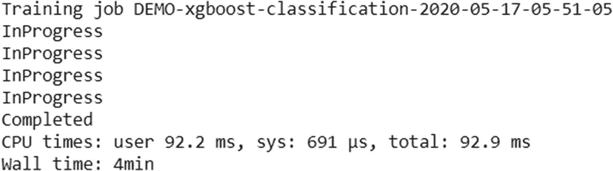

与上一节类似，模型训练完成后，我们可以准备并暴露一个可供预测使用的端点。要暴露端点，可以使用以下 XGBoost 算法脚本：

```
create_endpoint_response = client.create_endpoint(
EndpointName="xgboost-bigmart-endpoint",
EndpointConfigName="xgboost-bigmart-config")
```

这将启动端点，之后可以使用它进行预测。接下来，我们可以使用 `invoke_endpoint()` 方法测试模型。

```
runtime_client = boto3.client('runtime.sagemaker', region_name=region)
response = runtime_client.invoke_endpoint(EndpointName=endpoint_name,
ContentType='text/csv',
Body=test_data)
```

要读取预测结果，可以使用以下脚本：

```
result = response['Body'].read()
result = result.decode("utf-8")
result = result.split(',')
result = [math.ceil(float(i)) for i in result]
label = payload.strip(' ').split()[0]
print ('Label: ',label,'\nPrediction: ', result[0])
```

我们也可以像线性学习器一样进行批量预测。您可以在 GitHub 仓库中找到批量预测的代码。预测完成后，不要忘记删除端点。

```
client.delete_endpoint(EndpointName=endpoint_name)
```

## 探索 Blazing Text 算法

Blazing text 算法用于为文本数据生成词嵌入。之后，这些嵌入可以提供给任何机器学习模型来执行分类任务。在本节中，我们将首先了解 blazing text 算法，然后将其应用于 text8 数据集。

Blazing text 算法是 word2vec 算法的高度优化版本，它允许更快的训练和推理，并且也支持分布式训练。使用此算法生成向量后，我们可以将它们用于不同的任务，例如文本分类、摘要、翻译等。它支持两种架构，类似于 word2vec。

*   跳字（Skip gram）架构

*   连续词袋（Continuous bag of words）架构

让我们简要讨论一下这些架构。

### 词向量生成的跳字架构

跳字算法通过查找彼此最相似的词来生成词向量。该算法试图理解句子的上下文。为此，它以一个词作为输入，然后尝试预测所有具有相似上下文的词。图 6-4 展示了该架构，该图取自 [`https://arxiv.org/pdf/1301.3781.pdf`](https://arxiv.org/pdf/1301.3781.pdf) 的研究论文（Mikolov 等人）。

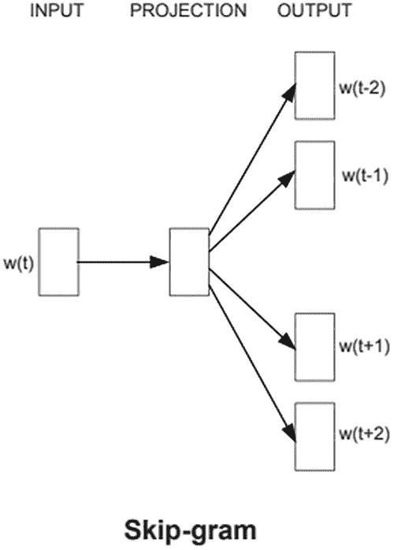

图 6-4

跳字算法

为了理解上下文并生成词向量，使用了一个小型神经网络架构，其隐藏层没有激活函数。最初，每个词都使用独热编码算法进行编码，然后输入到网络中。隐藏层被分配一个权重，其值通过损失函数学习。模型训练完成后，它可以用于生成词向量或直接用于文本分类模型。


### 词向量生成的连续词袋架构

连续词袋（CBOW）方法可以说是跳元模型的逆向过程。它通过理解上下文，然后尝试预测该上下文中的词语。例如，如果句子是“德里是印度的首都”，我们写下“德里是首都”，那么它应该预测出“印度”。其架构与跳元模型相同，包含一个隐藏层和一个输出层。传递给网络的每个词都采用独热编码。见图 6-5。

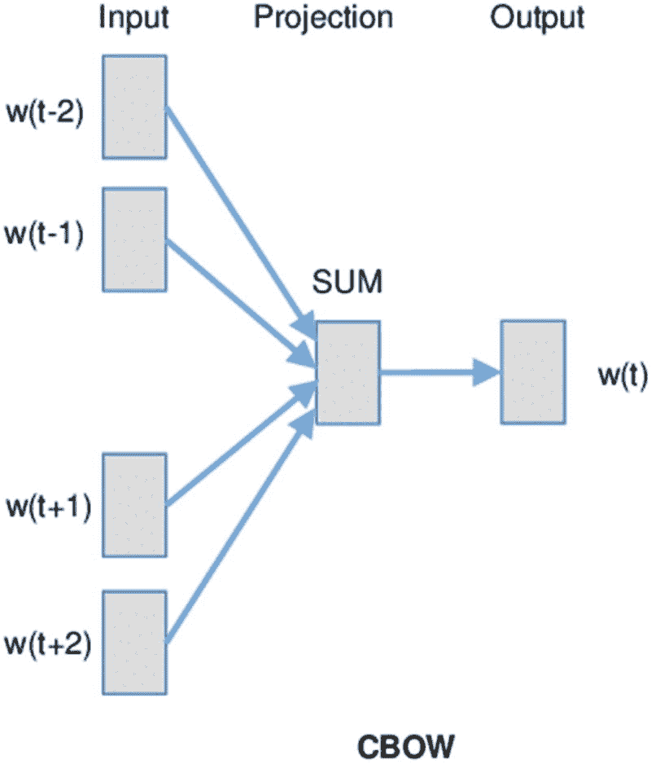

图 6-5

CBOW 算法

### SageMaker 中 BlazingText 的应用

在开始编码之前，我们必须了解将使用 BlazingText 算法生成词向量的数据集。我们将使用的数据集称为 text8 数据集。它是整个维基百科文本的一个小型、清理过的版本。整个维基百科的转储文件称为 wiki9，经过清理并转换为 fil9。从这个清理后的数据集中取一个子集（100 MB），称为 text8。我们可以从 [`http://mattmahoney.net/dc/text8.zip`](http://mattmahoney.net/dc/text8.zip) 下载该数据集。

你可能已经知道，下载的数据必须发送到 S3 存储桶，以便我们的资源和算法容器能够访问它。我们可以使用以下脚本上传数据：

```
train_channel = prefix + '/train'
sess.upload_data(path='text8', bucket=bucket, key_prefix=train_channel)
```

让我们将该数据集的路径存储在一个变量中。

```
s3_train_data = 's3://{}/{}'.format(bucket, train_channel)
```

在执行此代码之前，请记得定义所有必需的字段，即 bucket、role 等。我们已经在之前的章节中了解了如何定义它们。我们也可以查看 GitHub 仓库来理解完整的代码。

现在我们已经存储了数据并定义了路径，下一步将是初始化 BlazingText 的 Docker 容器。

```
container = sagemaker.amazon.amazon_estimator.get_image_uri(region_name, "blazingtext", "latest")
```

一旦容器准备就绪，我们就必须初始化实例/资源。

```
bt_model = sagemaker.estimator.Estimator(container,
role,
train_instance_count=1,
train_instance_type='ml.m4.xlarge',
train_volume_size = 5,
train_max_run = 360000,
input_mode= 'File',
output_path=s3_output_location,
sagemaker_session=sess)
```

在运行此代码之前，不要忘记定义 S3 输出位置。

```
s3_output_location = 's3://{}/{}/output'.format(bucket, prefix)
```

所有参数都是不言自明的，我们已经在上一节中查看过它们。请记住，`ml.m4.xlarge` 实例属于免费套餐。因此，如果你想尝试不同的算法，请始终使用此实例。接下来，我们将设置算法的超参数。

```
bt_model.set_hyperparameters(mode="batch_skipgram",
epochs=5,
min_count=5,
sampling_threshold=0.0001,
learning_rate=0.05,
window_size=5,
vector_dim=100,
negative_samples=5,
batch_size=11,
evaluation=True,
subwords=False)
```

我们已经在本节开头查看了算法的这些部分。现在，我们将数据作为 JSON 文件传递以训练算法。在此之前，我们必须告诉算法数据来自 S3。此信息在之前的算法中是通过 JSON 传递的。这里我们将使用以下脚本传递它：

```
train_data = sagemaker.session.s3_input(s3_train_data, content_type='text/plain', s3_data_type="S3Prefix")
data_channels = {'train': train_data}
bt_model.fit(inputs=data_channels, logs=True)
```

`logs` 参数不仅会训练模型，还会在同一个 Jupyter Notebook 中显示模型输出。否则，我们将不得不在 CloudWatch 中查看输出。接下来的步骤与之前相同。部署模型并测试它。

```
bt_endpoint = bt_model.deploy(initial_instance_count = 1,instance_type = 'ml.m4.xlarge')
words = ["awesome", "blazing"]
payload = {"instances" : words}
response = bt_endpoint.predict(json.dumps(payload))
vecs = json.loads(response)
print(vecs)
```

这里我们将得到输出，即针对单词 *awesome* 和 *blazing* 生成的词向量。最后，我们将删除模型端点。

```
sess.delete_endpoint(bt_endpoint.endpoint)
```

在下一节中，我们将探讨 SageMaker 中的图像分类算法。

## 探索图像分类算法

SageMaker 的图像分类算法基于一种称为 ResNet 的特殊卷积神经网络架构。在查看该算法的应用之前，让我们先探索并理解用于图像分类的 ResNet 架构。

### ResNet

ResNet 是一种基于卷积神经网络框架的架构，用于解决图像分类等问题陈述。要理解 ResNet，我们必须首先了解卷积神经网络的操作。见图 6-6。

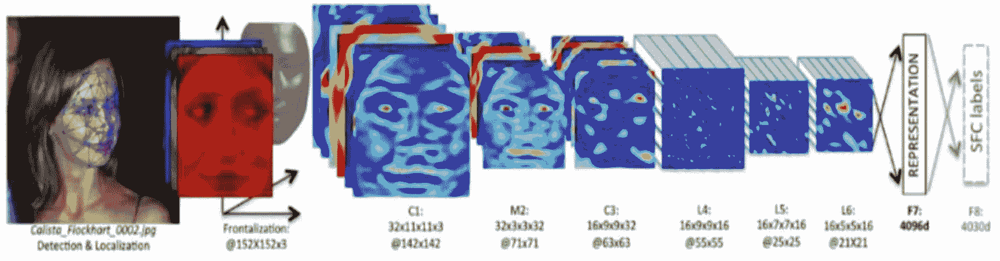

图 6-6

卷积神经网络，10.1109/ICEngTechnol.2017.8308186

一个典型的 CNN 包含以下操作：

1.  第一个操作是卷积操作，这也可以看作是滤波器的应用。我们对图像应用不同的滤波器，以便获得同一图像的不同版本，这有助于我们完美地理解图像。但是，这些滤波器的值不是硬编码的，而是通过反向传播方法学习得到的。

2.  下一步称为*池化*或*下采样*。在这里，我们减小图像的尺寸，从而使训练时间更快。有不同类型的池化方法，例如最大池化、平均池化等。

3.  前两个过程重复多次，然后将最终池化操作的输出提供给一个全连接的神经网络层。这里发生了主要的学习过程，最终完成分类任务。

前述架构的一个问题是当网络变得过深时，反向传播过程会受到影响。在反向传播过程中，梯度变为零，因此学习停止。这种现象称为*梯度消失*。因此，为了解决深度 CNN 训练中的这个问题，ResNet 应运而生。图 6-7 展示了 ResNet 的架构。

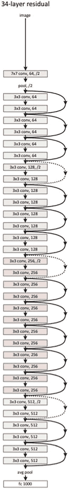

图 6-7

来源：[`https://arxiv.org/pdf/1512.03385.pdf`](https://arxiv.org/pdf/1512.03385.pdf)

ResNet 的关键在于它允许梯度在反向方向上流动。此外，每两次卷积后输入会被旁路。CNN 中的这两种变通方法解决了梯度消失的问题。要了解更多关于 ResNet 的信息，请访问 [`https://arxiv.org/pdf/1512.03385.pdf`](https://arxiv.org/pdf/1512.03385.pdf)。接下来介绍的是 34 层残差网络。


### SageMaker 图像分类应用

对于此算法，我们将使用一个名为 Caltech256 的数据集。该数据集包含约 30,000 张图像，涵盖 256 个物体类别。这些类别包括 ak47、蚱蜢、浴缸等。我们可以从 [`http://www.vision.caltech.edu/Image_Datasets/Caltech256/`](http://www.vision.caltech.edu/Image_Datasets/Caltech256/) 进一步探索或下载该数据集。

因此，在本节中，我们的任务是创建一个机器学习算法，将图像分类到这 256 个类别中。我们将从定义角色、区域等开始，这些内容在前面的章节中已经介绍过。接下来，让我们初始化图像分类算法的 Docker 容器。

```
training_image = get_image_uri(boto3.Session().region_name, 'image-classification')
```

我们已经将这些图像分成了训练集和验证集。我们可以直接使用这些图像。我们可以从这里下载图像：

[`http://data.mxnet.io/data/caltech-256/caltech-256-60-train.rec`](http://data.mxnet.io/data/caltech-256/caltech-256-60-train.rec)

[`http://data.mxnet.io/data/caltech-256/caltech-256-60-val.rec`](http://data.mxnet.io/data/caltech-256/caltech-256-60-val.rec)

让我们将这些图像移动到我们的 S3 存储桶中。这些图像采用 RecordIO-Protobuf 格式，因为算法只期望这种格式。这次，让我们创建一个将文件上传到 S3 的函数。

```
def upload_to_s3(channel, file):
s3 = boto3.resource('s3')
data = open(file, "rb")
key = channel + '/' + file
s3.Bucket(bucket).put_object(Key=key, Body=data)
```

现在，我们将在存储桶内定义用于保存数据的文件夹。

```
s3_train_key = "image-classification/train"
s3_validation_key = "image-classification/validation"
```

剩下的就是将图像文件存储到 S3 中。

```
upload_to_s3(s3_train_key, 'caltech-256-60-train.rec')
upload_to_s3(s3_validation_key, 'caltech-256-60-val.rec')
```

让我们定义与算法相关的参数，我们将使用这些参数来训练模型。

```
num_layers = "18"
image_shape = "3,224,224"
num_training_samples = "15420"
num_classes = "257"
mini_batch_size =  "64"
epochs = "2"
learning_rate = "0.01"
```

层数定义了网络的深度。图像形状为 224×224，具有三个通道（RGB）。训练数据集中的图像总数为 15,420。我们总共有 257 个类别，256 个物体，外加一个用于其他物体的额外类别。我们定义了批次大小为 64，这表示一次将有多少张图像输入网络。我们将周期数定义为 2，这意味着模型将在整个训练数据集上训练两次。最后，学习率选择为 0.1，它将决定收敛并达到局部最小值所需的步数。

现在我们可以定义算法了。我们已经初始化了容器。

```
s3 = boto3.client('s3')
job_name_prefix = 'imageclassification'
job_name = job_name_prefix + '-' + time.strftime('-%Y-%m-%d-%H-%M-%S', time.gmtime())
training_params = \
{
"AlgorithmSpecification": {
"TrainingImage": training_image,
"TrainingInputMode": "File"
},
"RoleArn": role,
"OutputDataConfig": {
"S3OutputPath": 's3://{}/{}/output'.format(bucket, job_name_prefix)
},
"ResourceConfig": {
"InstanceCount": 1,
"InstanceType": "ml.p2.xlarge",
"VolumeSizeInGB": 50
},
"TrainingJobName": job_name,
"HyperParameters": {
"image_shape": image_shape,
"num_layers": str(num_layers),
"num_training_samples": str(num_training_samples),
"num_classes": str(num_classes),
"mini_batch_size": str(mini_batch_size),
"epochs": str(epochs),
"learning_rate": str(learning_rate)
},
"StoppingCondition": {
"MaxRuntimeInSeconds": 360000
},
"InputDataConfig": [
{
"ChannelName": "train",
"DataSource": {
"S3DataSource": {
"S3DataType": "S3Prefix ",
"S3Uri": s3_train,
"S3DataDistributionType": "FullyReplicated"
}
},
"ContentType": "application/x-recordio",
"CompressionType": "None"
},
{
"ChannelName": "validation",
"DataSource": {
"S3DataSource": {
"S3DataType": "S3Prefix",
"S3Uri": s3_validation,
"S3DataDistributionType": "FullyReplicated"
}
},
"ContentType": "application/x-recordio",
"CompressionType": "None"
}
]
}
```

我们之前已经了解了上述 JSON 中的大部分参数，因为我们在 XGBoost 算法中已经介绍过它们。以下是此算法中一些独特的参数：

*   `ContentType` 是 `application/x-recordio`。正如我之前提到的，图像分类只期望 RecordIO-Protobuf 数据格式。

*   `S3DataDistributionType` 是完全复制，这意味着如果我们使用多个实例进行并行训练，那么数据集将被复制到所有实例中。

*   我们使用的实例类型是 `p2.xlarge`，因为图像分类需要一个带有显卡的实例。请注意，`p2` 和 `p3` 实例并非完全免费，它们是收费的。

完成算法规范后，我们将开始训练过程。

```
sagemaker = boto3.client(service_name='sagemaker')
sagemaker.create_training_job(**training_params)
status = sagemaker.describe_training_job(TrainingJobName=job_name)['TrainingJobStatus']
print(status)
while status !='Completed' and status!='Failed':
time.sleep(60)
status = client.describe_training_job(TrainingJobName=job_name)['TrainingJobStatus']
print(status)
```

如图所示，此代码将启动训练，然后告知我们训练是否成功完成。训练完成后，我们将部署模型并进行预测。同样，该过程与我们之前在之前的算法中看到的相同。

```
endpoint_response= sagemaker.create_endpoint(
EndpointName="image-classification-caltech-endpoint",
EndpointConfigName="image-classification-caltech-config")
```

这将花费一些时间来启动端点生成所需的资源。端点生成后，我们就可以开始预测了。

让我们下载一张图像并用它来测试我们的模型。我们可以下载一张浴缸图像，并检查模型是否能完美预测它。

```
! wget -O /tmp/test.jpg http://www.vision.caltech.edu/Image_Datasets/Caltech256/images/008.bathtub/008_0007.jpg
```

上一行代码将直接把图像下载到您的系统。如果您的系统不是 Linux，您可以直接访问链接并下载图像。接下来，我们需要读取图像并将其传递给端点。

```
with open('/tmp/test.jpg', 'rb') as f:
payload = f.read()
payload = bytearray(payload)
response = runtime.invoke_endpoint(EndpointName=endpoint_name,
ContentType='application/x-image',
Body=payload)
result = response['Body'].read()
result = json.loads(result)
```

变量 `result` 包含所有类别的预测概率。我们需要找到概率最大的类别。这意味着如果我们能获得概率最大的参数，那将是我们预测的类别。为此，我们可以使用 `np.argmax()` 函数。

```
index = np.argmax(result)
```

现在，我们可以使用这个索引来提取标签。我们可以按照数据集中标签的顺序创建一个所有标签的列表，然后传递索引来预测标签。假设我们将所有类别保存在变量 `object_classes` 中。接下来，我们可以打印预测结果。

```
print("Result: label - " + object_categories[index] + ", probability - " + str(result[index]))
```

您可以在 GitHub 仓库中找到完整的代码。另外，在所有操作完成后，不要忘记删除端点。

```
sage.delete_endpoint(EndpointName=endpoint_name)
```

## 探索 SeqToSeq 算法

Amazon 的序列到序列算法基于循环神经网络、卷积神经网络以及编码器-解码器架构，以更有效地理解上下文。下一节将简要概述 RNN 和编码器-解码器架构。


### 循环神经网络

在处理序列数据或基于时间的数据时，有必要记住过去的一些信息，并理解如何利用这些信息来预测结果。普通的神经网络或卷积神经网络无法实现这一点。因此，每当处理序列数据时，我们都会使用一种名为 RNN 的新架构。图 6-8 展示了一个简单的 RNN 架构。

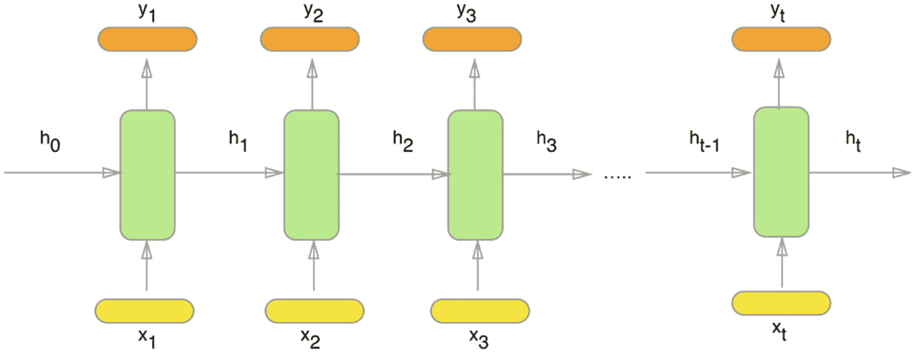

图 6-8
循环神经网络

例如，在文本分类中，会提取文本中的每个单词，应用一些基于神经网络的计算，存储重要信息，然后将其传递到下一个 RNN 层。存储发生在 `h` 中，单词通过 `x` 传递，而输出则通过 `y` 接收。单词并非直接传递，而是先转换为向量再传递。我们可以使用诸如 word2vec、glove 或 SageMaker 中的 blazing text 等算法来生成这些词向量。

RNN 有多种变体，用于解决原始版本中存在的缺陷。其中最常用的两种是长短期记忆网络（LSTM）和门控循环单元（GRU）。

### 编码器-解码器架构

图 6-9 展示了一个典型的编码器和解码器架构。

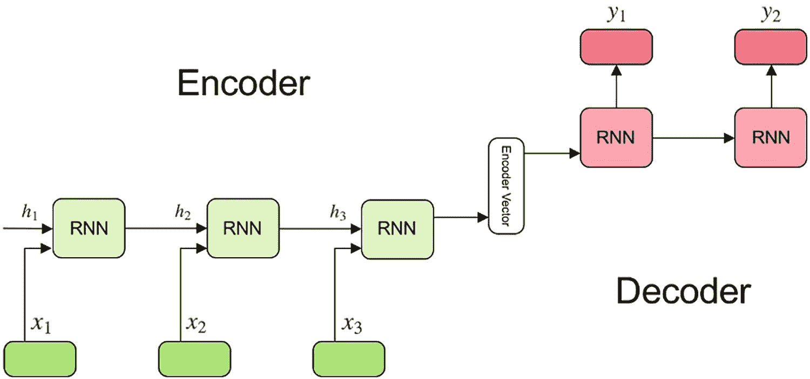

图 6-9
编码器和解码器

编码器主要用于不仅记住过去并给出准确预测，还要理解所传递文本的上下文。我们可以使用普通的 RNN 或 LSTM 和 GRU。一旦编码器查看了所有词向量，它们就会生成编码器向量并将其传递给解码器。编码器向量包含了编码器接收到的所有信息，解码器利用它来进行有效的预测。

解码器接收这些编码器向量，将其输入到自己的 RNN 中，然后应用 softmax 激活函数来给出输出。这种架构除了能理解上下文之外，最大的优势在于能够处理可变长度的输入并生成可变长度的输出。

### SeqToSeq 在 SageMaker 中的应用

让我们通过将其应用于机器翻译用例来更详细地理解该算法；也就是说，我们将一些内容从英语翻译成德语。前几个步骤将保持不变，正如我们在之前的算法中看到的那样。

```
from time import gmtime, strftime
import time
import numpy as np
import os
import json
import boto3
import re
from sagemaker import get_execution_role
region_name = boto3.Session().region_name
bucket = 'slytherins-test'
prefix = 'seq2seq-E2G'
role = get_execution_role()
from sagemaker.amazon.amazon_estimator import get_image_uri
container = get_image_uri(region_name, 'seq2seq')
```

因此，在前面的步骤中，我们定义了算法的容器，并定义了我们的存储桶以及其中将保存整个模型相关文件的文件夹。下一步是准备数据集。Seq2Seq 算法有两种方法。第一种，你可以使用可用于预测的预训练模型。因此，对于我们的示例，已经存在一个基于英语到德语机器翻译训练好的模型。或者，我们也可以用自己的语料库训练模型，然后将其用于预测。这个过程可能需要大量时间，但在用于特定领域的翻译任务时，这是最佳选择。

我们将首先了解如何在语料库上训练模型，然后使用预训练模型进行预测。我们将使用的数据是新闻数据。我们将拥有包含英语新闻评论及其德语翻译的文件。我们可以从 [`http://data.statmt.org/wmt17/translation-task/`](http://data.statmt.org/wmt17/translation-task/) 获取这些文件。

让我们从 notebook 内部下载数据，并创建我们的训练集和验证集。

```
! wget http://data.statmt.org/wmt17/translation-task/preprocessed/de-en/corpus.tc.de.gz
! wget http://data.statmt.org/wmt17/translation-task/preprocessed/de-en/corpus.tc.en.gz
! gunzip corpus.tc.de.gz
! gunzip corpus.tc.en.gz
! mkdir validation
! curl http://data.statmt.org/wmt17/translation-task/preprocessed/de-en/dev.tgz | tar xvzf - -C validation
```

我们之前下载的文件很大，每个大约 250 MB。因此，如果我们在整个数据集上训练模型，可能需要数天才能完成。所以，我们可以取整个数据的一个子集用于训练。

```
! head -n 10000 corpus.tc.en > corpus.tc.en.small
! head -n 10000 corpus.tc.de > corpus.tc.de.small
```

上面创建的子集有 10,000 行。我们将使用这个小型数据集进行训练。下一步是根据之前的文件生成英语和德语词汇表。这将使用分词和其他 NLP 组件来生成词汇表。

```
%%bash
python3 create_vocab_proto.py \
--train-source corpus.tc.en.small \
--train-target corpus.tc.de.small \
--val-source validation/newstest2014.tc.en \
--val-target validation/newstest2014.tc.de
```

前面的 Python 脚本将源英语文本和目标德语文本作为输入。它应用预处理来生成词汇表。最后，它将英语和德语词汇表保存在验证文件夹中。我们使用 `%%bash` 在 notebook 内部运行任何命令行脚本。这是一个 Jupyter 魔法函数。

现在我们的数据集已经创建好了，我们需要将其发送到我们的 S3 存储桶。

```
def upload_to_s3(bucket, prefix, channel, file):
s3 = boto3.resource('s3')
data = open(file, "rb")
key = prefix + "/" + channel + '/' + file
s3.Bucket(bucket).put_object(Key=key, Body=data)
upload_to_s3(bucket, prefix, 'train', 'train.rec')
upload_to_s3(bucket, prefix, 'validation', 'val.rec')
upload_to_s3(bucket, prefix, 'vocab', 'vocab.src.json')
upload_to_s3(bucket, prefix, 'vocab', 'vocab.trg.json')
```

我们刚刚执行的代码生成了两个文件。一个是生成的词汇表，另一个是数据的 RecordIO-Protobuf 版本。我们将使用前面的代码将这两个文件都上传到 S3。


所有基本步骤现已完成，接下来我们要初始化算法。我们将使用如下代码进行初始化：

```
job_name = 'seq2seq-E2G'
print("Training job", job_name)
create_training_params = \
{
"AlgorithmSpecification": {
"TrainingImage": container,
"TrainingInputMode": "File"
},
"RoleArn": role,
"OutputDataConfig": {
"S3OutputPath": "s3://{}/{}/".format(bucket, prefix)
},
"ResourceConfig": {
# Seq2Seq does not support multiple machines. Currently, it only supports single machine, multiple GPUs
"InstanceCount": 1,
"InstanceType": "ml.m4.xlarge", # We suggest one of ["ml.p2.16xlarge", "ml.p2.8xlarge", "ml.p2.xlarge"]
"VolumeSizeInGB": 5
},
"TrainingJobName": job_name,
"HyperParameters": {
# Please refer to the documentation for complete list of parameters
"max_seq_len_source": "60",
"max_seq_len_target": "60",
"optimized_metric": "bleu",
"batch_size": "64", # Please use a larger batch size (256 or 512) if using ml.p2.8xlarge or ml.p2.16xlarge
"checkpoint_frequency_num_batches": "1000",
"rnn_num_hidden": "512",
"num_layers_encoder": "1",
"num_layers_decoder": "1",
"num_embed_source": "512",
"num_embed_target": "512"
},
"StoppingCondition": {
"MaxRuntimeInSeconds": 48 * 3600
},
"InputDataConfig": [
{
"ChannelName": "train",
"DataSource": {
"S3DataSource": {
"S3DataType": "S3Prefix",
"S3Uri": "s3://{}/{}/train/".format(bucket, prefix),
"S3DataDistributionType": "FullyReplicated"
}
},
},
{
"ChannelName": "vocab",
"DataSource": {
"S3DataSource": {
"S3DataType": "S3Prefix",
"S3Uri": "s3://{}/{}/vocab/".format(bucket, prefix),
"S3DataDistributionType": "FullyReplicated "
}
},
},
{
"ChannelName": "validation",
"DataSource": {
"S3DataSource": {
"S3DataType": "S3Prefix",
"S3Uri": "s3://{}/{}/validation/".format(bucket, prefix),
"S3DataDistributionType": "FullyReplicated"
}
},
}
]
}
sagemaker_client = boto3.Session().client(service_name='sagemaker')
sagemaker_client.create_training_job(**create_training_params)
```

可以看到，其格式与 XGBoost 算法和图像分类算法相同。所有参数都与前几节讨论的算法一致，只有超参数是该算法特有的。下面我们来讨论这些参数：

*   原始文本和目标文本的最大序列长度，是指作为序列输入到神经网络架构的字符数量。

*   批量大小是指一次性传递给算法的数据行数。

*   检查点频率表示每处理 1000 行数据后保存一次模型。

*   神经网络的隐藏层数量定义为 512，包含一个编码器架构单元和一个解码器架构单元。请记住，这些单元用于理解句子的上下文。

*   嵌入源和目标定义了数据集中每个句子的词向量大小，此处设置为 512。

这段代码将启动训练的执行，并且需要花费大量时间才能完成。请记住，该算法需要 GPU 实例才能运行。因此，无论你选择哪种实例，都会产生费用。请谨慎选择。

现在，让我们看看如何使用已有的预训练模型，通过暴露端点对测试数据集进行推理。当我们训练完之前的模型后，会得到三个文件：

*   `Model.tar.gz`

*   `Vocab.src.json`

*   `Vocab.trg.json`

因此，一旦你训练好模型，就可以直接使用这些文件。但是，为了使用预训练模型，我们需要下载这些文件。我们可以从这里下载：

```
model_name = "DEMO-pretrained-en-de-model"
! curl https://s3-us-west-2.amazonaws.com/seq2seq-data/model.tar.gz > model.tar.gz
! curl https://s3-us-west-2.amazonaws.com/seq2seq-data/vocab.src.json > vocab.src.json
! curl https://s3-us-west-2.amazonaws.com/seq2seq-data/vocab.trg.json > vocab.trg.json
```

我们需要将模型文件上传到 S3，以便端点能够使用它们。

```
upload_to_s3(bucket, prefix, 'pretrained_model', 'model.tar.gz')
model_data = "s3://{}/{}/pretrained_model/model.tar.gz".format(bucket, prefix)
```

`model_data` 存储了已上传模型文件的地址。接下来，我们需要在算法中更新此模型，以便用于预测。为此，我们将使用 `create_model()` 函数。

```
sage = boto3.client('sagemaker')
primary_container = {
'Image': container,
'ModelDataUrl': model_data
}
create_model_response = sage.create_model(
ModelName = model_name,
ExecutionRoleArn = role,
PrimaryContainer = primary_container)
```

下一步是定义端点将使用的资源。

```
from time import gmtime, strftime
endpoint_config_name = 'DEMO-Seq2SeqEndpointConfig-' + strftime("%Y-%m-%d-%H-%M-%S", gmtime())
print(endpoint_config_name)
create_endpoint_config_response = sage.create_endpoint_config(
EndpointConfigName = endpoint_config_name,
ProductionVariants=[{
'InstanceType':'ml.m4.xlarge',
'InitialInstanceCount':1,
'ModelName':model_name,
'VariantName':'AllTraffic'}])
```

现在，我们可以使用之前的配置来暴露端点。

```
endpoint_name = 'DEMO-Seq2SeqEndpoint-' + strftime("%Y-%m-%d-%H-%M-%S", gmtime())
create_endpoint_response = sage.create_endpoint(
EndpointName=endpoint_name,
EndpointConfigName=endpoint_config_name)
```

一段时间后，我们的端点就可以进行推理了。让我们看看如何进行预测，本例中是将英文文本转换为德文。

```
runtime = boto3.client(service_name='runtime.sagemaker')
sentences = ["you are so good !",
"can you drive a car ?",
"i want to watch a movie ."
]
payload = {"instances" : []}
for sent in sentences:
payload["instances"].append({"data" : sent})
response = runtime.invoke_endpoint(EndpointName=endpoint_name,
ContentType='application/json',
Body=json.dumps(payload))
response = response["Body"].read().decode("utf-8")
response = json.loads(response)
print(response)
```

你将得到如下输出：

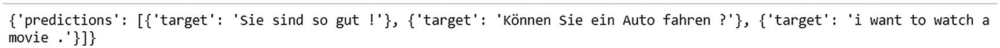

如你所见，预测已成功完成。

## 结论

在本章中，你了解了 SageMaker 的各种内置算法。这些是机器学习领域中已有算法的优化版本。在下一章中，我们将探索不同的指标，以便使用 Cloud Metrics 评估这些模型；通过 CloudWatch 查看容器运行时的日志；并详细探讨端点配置及其与 Lambda 函数的连接。此外，我们还将对本章已介绍的算法进行批量转换。

