# 7. 将 CloudWatch 与 SageMaker 结合使用

在本章中，我们将详细探讨 AWS 中的 CloudWatch 功能。具体来说，我们将关注 CloudWatch 的两个组件：CloudWatch Logs 和 CloudWatch Metrics，在使用 SageMaker 时会频繁用到它们。

## Amazon CloudWatch

Amazon CloudWatch 是亚马逊提供的一项服务，用于追踪 AWS 的资源活动并提供相关指标。它还会存储每个所用资源提供的日志。通过这些日志和指标，用户可以了解所用 AWS 资源的性能，并探索改进方法。

在机器学习领域，尤其是使用 SageMaker 时，CloudWatch Logs 会提供代码运行所在容器的输出。正如我们在前几章中看到的，机器学习算法运行在附加到 EC2 实例的 Docker 容器内。因此，这些容器产生的输出无法直接查看。要查看这些输出，我们需要对代码进行一些调整，然后状态就可以直接在所使用的 Jupyter Notebook 中看到，或者我们可以使用 CloudWatch Logs 逐步获取这些输出。输出内容可以包括模型输出、模型失败的原因、逐步执行的详细信息等。三个任务都需要容器，因此我们在机器学习中有三个日志组。

*   Processing Jobs（处理作业）日志组
*   Training Jobs（训练作业）日志组
*   Transform Jobs（转换作业）日志组

我们将在后续章节中详细查看这些日志组。

CloudWatch Metrics 以变量值的形式向我们提供信息。例如，在机器学习中，CloudWatch Metrics 可以提供模型准确率、精确率、误差等值。它还可以提供与资源相关的指标，例如 GPU 利用率、内存利用率等。我们将在后续章节中详细查看 CloudWatch Metrics。图 7-1 展示了 CloudWatch 的工作原理架构。

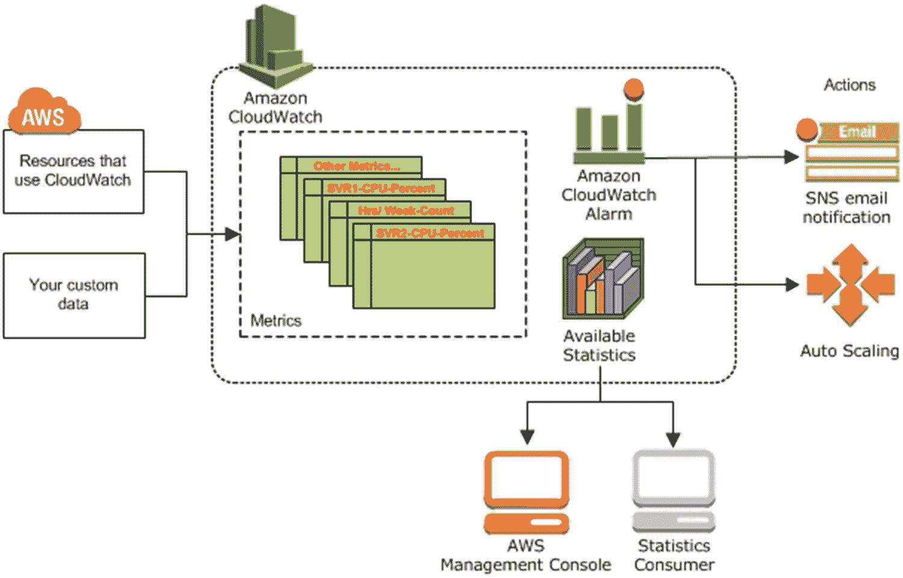

图 7-1

Amazon CloudWatch 架构

通过查看此架构，我们可以看到，除了通过 Amazon 管理控制台访问服务外，我们还可以通过 Amazon SNS 集成告警，这些告警可以连接到您的电子邮件。我们还可以根据特定条件设置自定义规则。这包括启动、停止和终止进程，或使用自动扩缩等功能。让我们在下一节中更深入地了解 CloudWatch Logs。

## CloudWatch Logs

在 SageMaker 控制台中，左侧有一个侧边栏，指导我们完成其中可能执行的不同操作。我们可以创建 Notebook 实例、查看我们运行过的不同算法以及分析端点。我们可以通过查看日志详细信息来查看我们使用过的所有服务的日志。让我们从训练作业相关的日志开始。

### 训练作业

在上一章中，我们在 Big Mart 数据集上运行了一个 XGBoost 模型。在 SageMaker 控制台内部，如果我们转到“训练”下拉菜单并选择“训练作业”（图 7-2），我们将看到所有已运行算法的列表（图 7-3）。

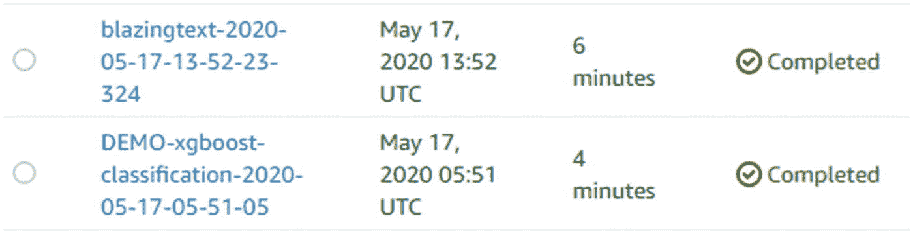

图 7-3

选择需要分析日志的作业

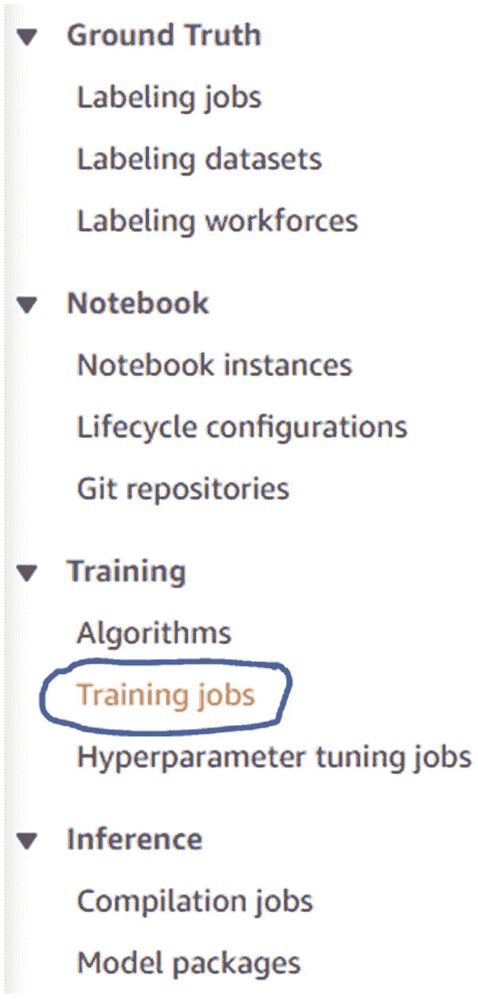

图 7-2

选择训练作业

我们可以选择想要了解更多细节的算法；在我们的例子中，是 XGBoost。当我们点击该算法时，会打开一个新页面，其中包含有关我们运行的模型的大量信息。例如，它会告诉我们运行模型时提供的算法规范。如果向下滚动页面，我们会看到一个名为“监控”的部分（图 7-4）。从那里我们可以跳转到 CloudWatch Logs。

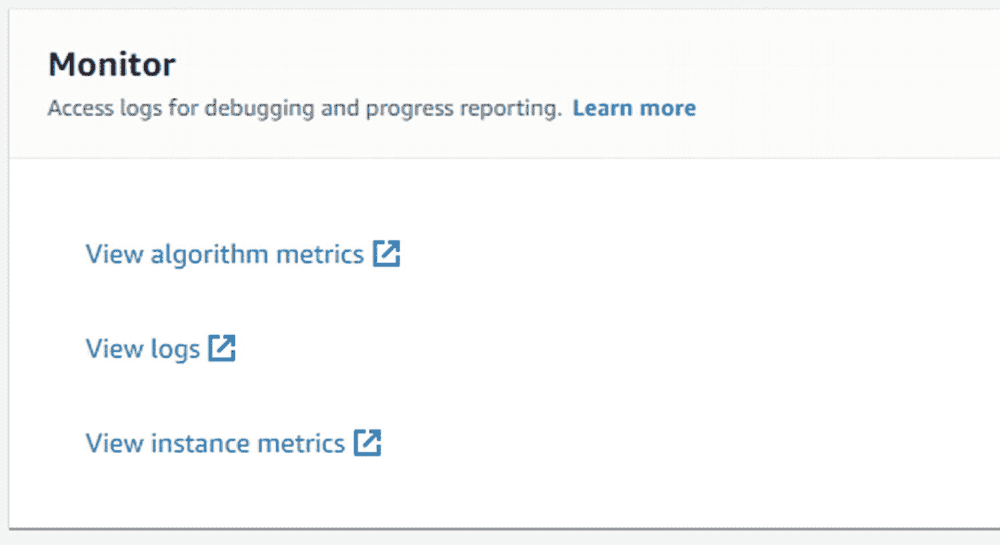

图 7-4

监控部分

点击“查看日志”链接，您将看到 CloudWatch 页面打开。见图 7-5。

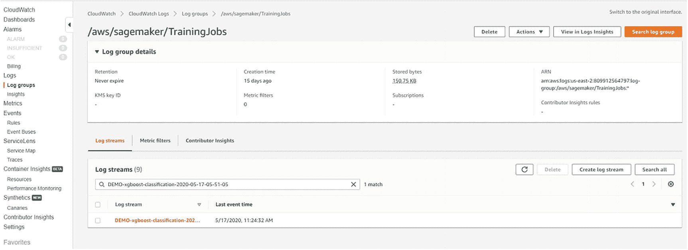

图 7-5

选择用于日志的算法

如图 7-5 所示，CloudWatch 控制台中有许多可用选项。我们正在查看日志组。如您所知，因为我们选择了训练作业，此信息显示在控制台顶部（见图 7-6）。

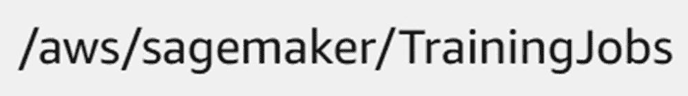

图 7-6

路径

当我们向下滚动时，可以在底部看到算法的名称。我们必须点击它才能进入日志（见图 7-7）。

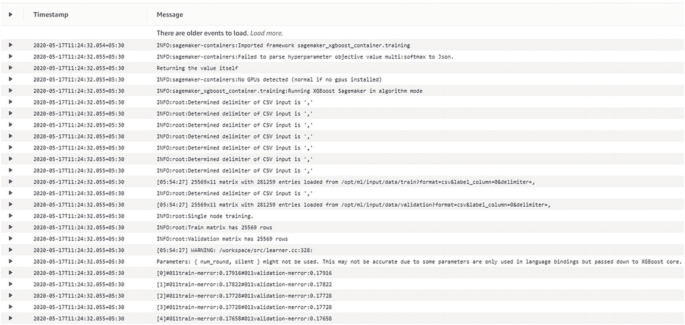

图 7-7

可视化日志

您可以看到与您的算法相关的完整日志将出现在那里。我们得到逐步的结果，在本例中包括训练误差和验证误差。您可以继续向下滚动到页面末尾，以查看算法的最后输出。这就是如何查看您已执行的任何训练算法的日志。

请记住，只有在容器成功启动并且算法开始运行后，日志才会开始出现。如果您的 Docker 脚本有问题，那么您将找不到任何生成的日志。但是，如果与算法相关的代码有错误，那么您会在日志部分找到信息，因为容器已成功启动，因此日志已开始生成。因此，如果您的模型没有运行，您可以查看日志以检查代码中的错误。对于自定义容器，如果日志没有开始运行，通常错误可能出在 Docker 脚本中。我们将在下一章探讨自定义容器。现在，让我们看看处理作业的日志。

### 处理作业

在第 5 章中，我们了解了如何使用处理脚本来处理数据。我们使用了 Sklearn 容器，并且我还向你展示了如何使用自定义容器进行处理。现在，让我们查看处理脚本生成的日志。为此，我们首先需要从服务列表中打开 CloudWatch 控制台。进入控制台后，点击“日志组”部分，也就是我们在上一节中使用过的那个。在这里，你会看到不同的日志组列表，如图 7-8 所示。

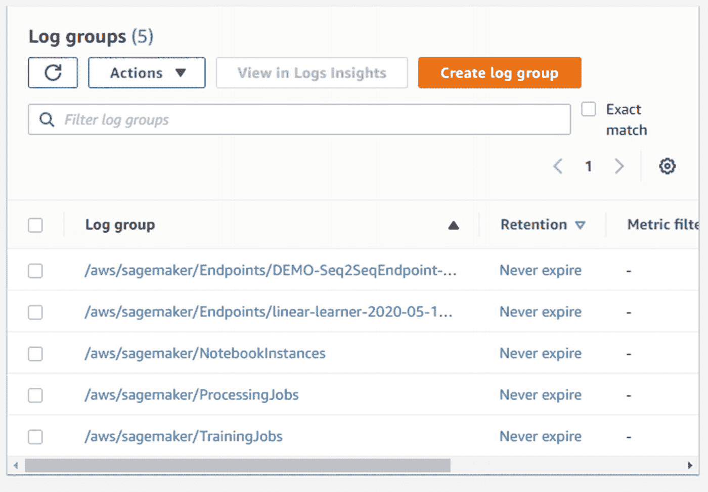

图 7-8

日志组

你可以看到，除了训练作业之外，还会找到处理作业、笔记本实例和终端节点的日志。让我们点击“处理作业”。你会看到你运行过的所有处理作业的列表。如果你记得作业的名称，那么找到它会更容易。这就是为什么始终建议为各种作业使用唯一标识符的原因。点击我们运行的最新处理作业。点击后，你会看到处理容器输出的所有步骤结果列表，如图 7-9 所示。

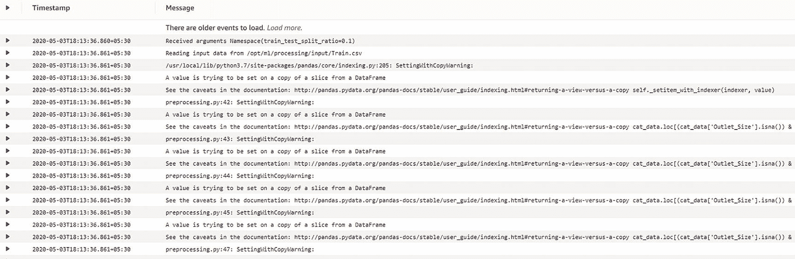

图 7-9

容器的输出

这就是如何使用 CloudWatch 来深入了解处理作业的方法。接下来，让我们看看点击我们创建的终端节点会得到什么输出。我们来探索一下线性学习器终端节点（图 7-10）。

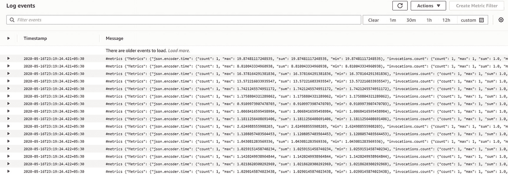

图 7-10

探索线性学习终端节点

你可以看到我们发送用于预测的所有测试数据，并且它以 JSON 格式返回输出。这就是我们如何为作业使用 CloudWatch 日志的方法。日志下的另一个部分是“转换作业”，我们将在下一章讨论批量转换作业时进行介绍。

## CloudWatch 指标

类似于我们可以使用 CloudWatch 日志查看作业日志的方式，我们也可以获取与算法或资源相关的指标。让我们从理解与训练作业相关的指标开始。我们将登录到 SageMaker 控制台，进入训练作业页面。我们将探索在 Big Mart 数据集上进行的分类任务的线性学习器指标。我们将按照与 CloudWatch 日志中相同的步骤进入算法页面。进入该页面后，我们不再点击查看日志，而是点击查看指标，如图 7-11 所示。

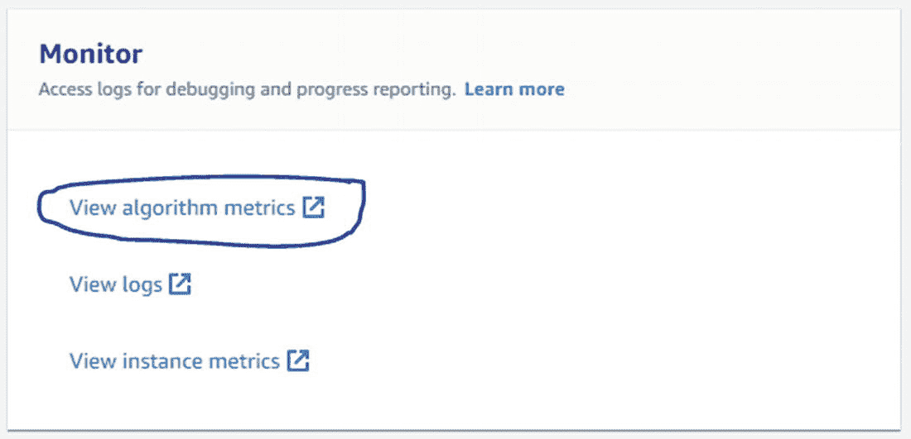

图 7-11

选择指标

点击“查看算法指标”后，在新屏幕上你会找到该算法可用的不同指标以及一个图表画布。它看起来会像图 7-12 所示。

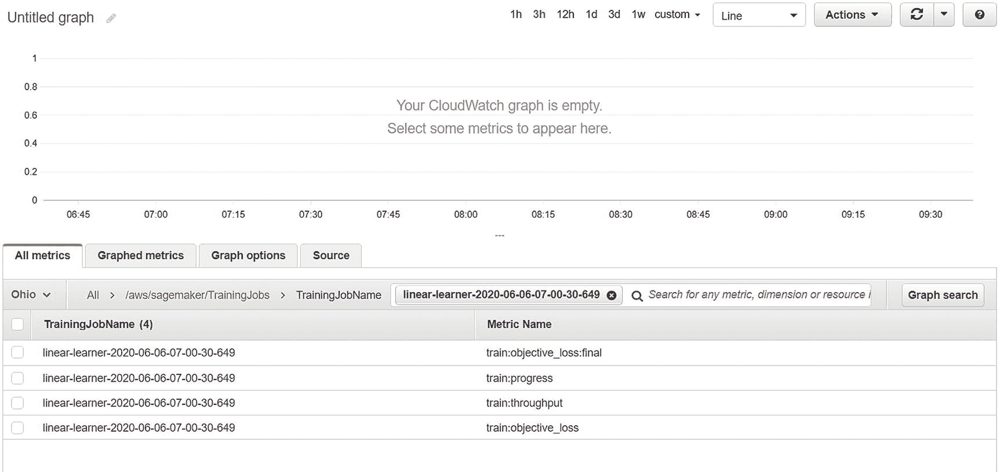

图 7-12

选择目标指标

在线性学习器算法中，我们可以看到的指标包括损失函数、训练进度和吞吐量。让我们看看训练停止时损失函数的最终值。我们可以点击“objective_loss”，然后点击“添加到图表”。接下来，我们可以转到“已绘制指标”选项，并将时间段更改为你完成训练的时间。你可以将图表类型更改为“数字”。你将得到如图 7-13 所示的输出。

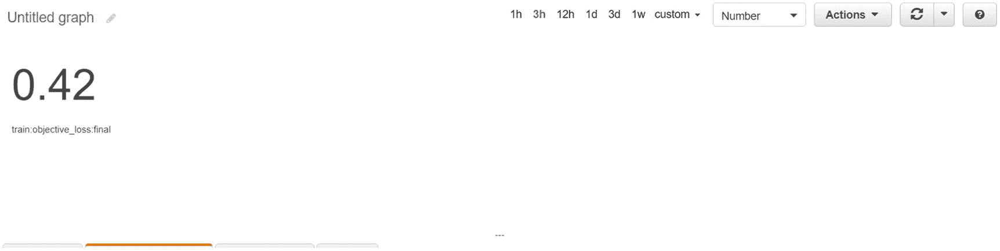

图 7-13

可视化目标损失

类似地，根据数据集，我们可以访问许多指标，如图 7-14 所示。

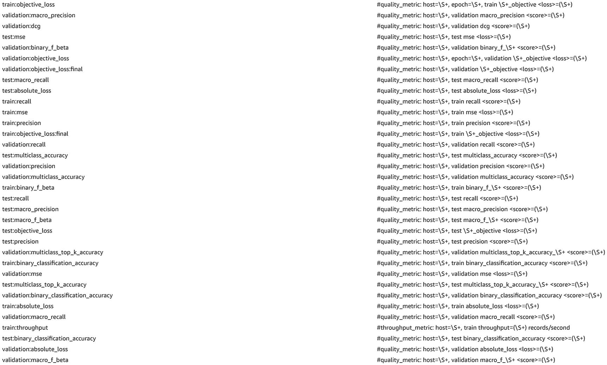

图 7-14

可用的不同种类指标

可以采用相同的过程来获取任何已运行算法的指标。让我们也看看实例指标的一些方面。在实例指标中，我们可以查看 CPU 利用率、内存利用率和磁盘利用率，如图 7-15 所示。

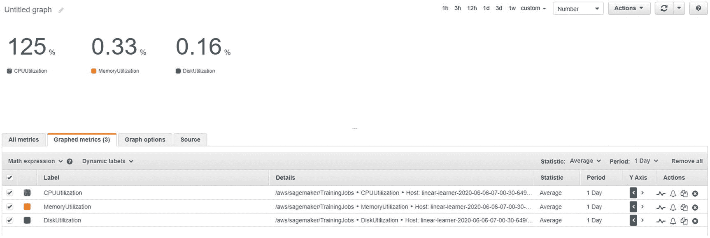

图 7-15

可视化指标

如果你在训练期间打开 CloudWatch，可以看到指标实时变化。

## 结论

在本章中，你学习了如何使用 CloudWatch 获取不同算法和资源的日志和指标。在下一章中，我们将探讨如何训练自定义算法，并了解 SageMaker 的其他一些方面。

