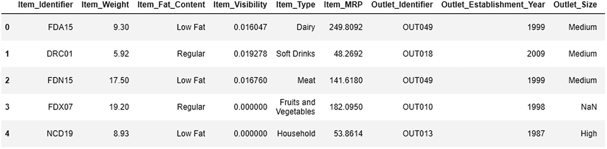
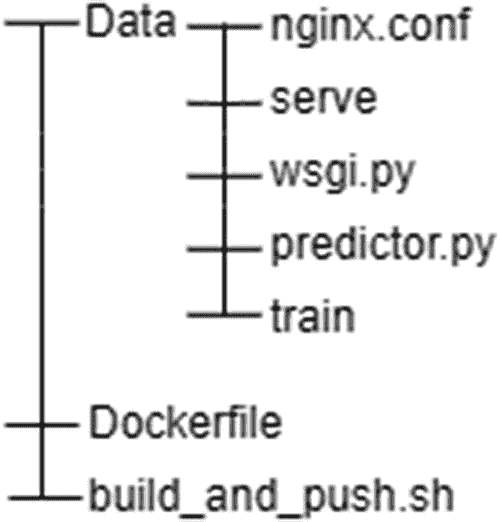
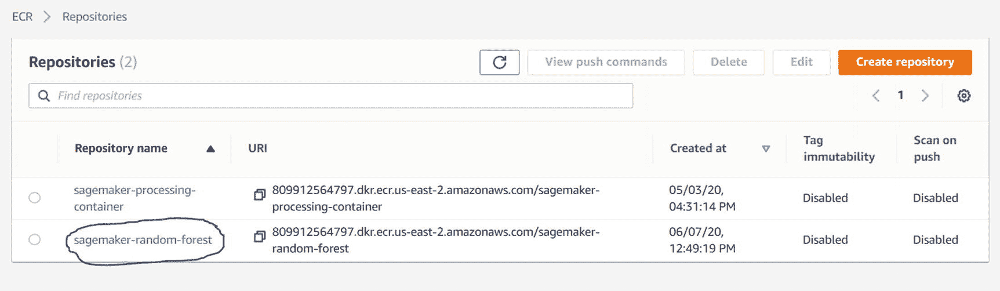
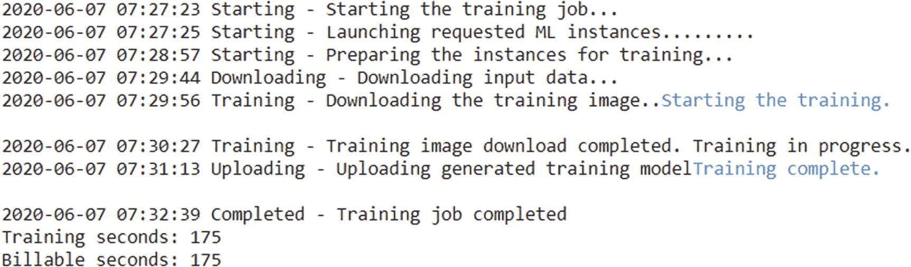
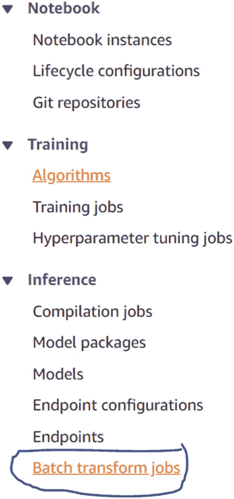
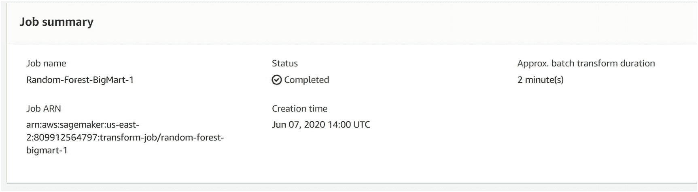

# 8. 在 SageMaker 中运行自定义算法

在本章中，你将了解如何运行自己的算法，而不是使用 SageMaker 的内置算法。尽管 SageMaker 为几乎任何类型的问题陈述都提供了内置算法，但很多时候我们希望利用 SageMaker 的强大功能来运行我们自己的自定义模型。如果我们具备 Docker 的实用知识和 Python 的动手经验，就可以有效地做到这一点。在本章中，我们将为 Big Mart 数据集创建一个自定义的随机森林模型。我们将把容器部署到 ECR 中，然后使用 SageMaker 训练模型。接着，我们将使用该模型进行实时推理，并了解如何进行批量转换。

## 问题陈述

问题陈述是：我们将尝试使用随机森林算法（一种监督学习集成树算法）来预测一家电子商务公司的销售额。由于这是一个回归问题，我们将使用 Scikit-Learn 包中的 `RandomForestRegressor` 类。我们已经在之前的章节中探索过该数据集；它就是 Big Mart 数据集。图 8-1 显示了数据集的前几行。



图 8-1

数据集的开头

如果你想了解该数据集，请回顾第 5 章。我们在那一章中已经处理了数据，并创建了训练集和验证集，因此这里不再重复该过程。我们将在完成训练集和测试集划分后继续开发算法。请通读第 5 章以复习整个过程。

## 运行模型

在将模型应用到 SageMaker 环境之前，我们先在本地用准备好的数据集运行算法，并检查产生的总损失。

```python
from sklearn.ensemble import RandomForestRegressor
rfc = RandomForestRegressor(n_estimators=500)
```

在上面的代码中，我们初始化了 `RandomForestRegressor` 算法，并要求合并 500 棵独立决策树的输出。初始化算法后，我们就可以开始训练模型了。

```python
rfc.fit(X_train, y_train)
```

上面的代码将开始训练模型。现在我们可以使用训练好的模型对测试集进行预测。

```python
predictions = rfc.predict(X_test)
```

所有预测结果都存储在变量 `predictions` 中。让我们计算所创建模型的均方根误差。

```python
from sklearn.metrics import mean_squared_error
np.sqrt(mean_squared_error(predictions, y_test))
```

这将给出最终误差的值。在我的例子中，大约是 1054。由于采样原因，不同系统可能输出不同结果。

## 转换代码以使用 SageMaker 资源

现在我们已经成功在本地环境中运行了代码，接下来将对其进行转换，以便能够在 SageMaker 环境中运行。以下是在 SageMaker 中运行自定义模型的步骤：

1.  将数据存储在 S3 中。

2.  创建一个训练脚本并将其命名为 `train`。

3.  创建一个有助于预测的推理脚本。我们将其命名为 `predictor.py`。

4.  设置文件以帮助生成端点。

5.  创建一个 Dockerfile，用于构建一个镜像，整个代码将在其中运行。

6.  编写一个脚本，将 Docker 镜像推送到 Amazon Elastic Container Registry (ECR)。

7.  使用 SageMaker 和 Boto3 API 来训练和测试模型。

我们的训练数据已经在 S3 中，因此我们将从创建训练脚本开始。

### 创建训练脚本

我们已经创建了一个训练笔记本。这个训练脚本将与笔记本类似，但我们需要额外考虑一些事项。首先需要记住的是，脚本将在容器内运行。因此，由于脚本在容器内部，而数据来自容器外部的 S3 存储桶，可能会存在同步问题。此外，算法的结果也应保存在 S3 存储桶中。在创建训练脚本时，我们需要牢记所有这些。

我们首先应该知道，在容器内部，无论传入什么数据，它都会被存储在 `/opt/ml` 文件夹中。因此，来自 S3 的数据将被下载到该文件夹。所以，我们需要在这个文件夹中创建三个子文件夹：一个用于存储输入，一个用于存储输出，一个用于存储模型。这可以通过使用以下脚本来定义：

```python
prefix = '/opt/ml/'
input_path = prefix + 'input/data'
output_path = os.path.join(prefix, 'output')
model_path = os.path.join(prefix, 'model')
```

在数据文件夹中，我们可以有多个文件，例如 `training`、`validation` 或 `testing`。我们也可以有多个文件共同组成一个训练文件。因此，我们也可以进行这种分类。对我们来说，只有一个文件：训练文件。所以，我们将只使用一个通道。

```python
channel_name='training'
training_path = os.path.join(input_path, channel_name)
```

这使我们的训练脚本能够处理数据。接下来是训练脚本本身。数据将来自 S3。首先我们必须读取它，然后应用我们在第 5 章中看到的所有步骤。要读取文件，我们可以使用以下脚本：

```python
input_files = [ os.path.join(training_path, file) for file in os.listdir(training_path) ]
raw_data = [ pd.read_csv(file) for file in input_files ]
data = pd.concat(raw_data)
```

如果你有多个 CSV 表需要读取，这个脚本也很有帮助。但是，在这种情况下，请记住设置参数 `header=None`。现在我们已经读取了数据，可以开始训练过程了。以下是完整的训练脚本：

# 训练与推理脚本

## 训练脚本

我们将整个脚本放在一个名为 `train()` 的函数中。读取 CSV 表后，我们将遵循与第 5 章中相同的过程。之后，我们将随机森林模型拟合到数据上，就像我们在上一节中运行的那样。

完成所有这些之后，我们必须保存这个模型，因为稍后我们将需要使用该模型进行预测。为了保存模型，我们首先使用 pickle 对其进行序列化，然后将其保存在模型位置。稍后，这个模型将被保存到 S3 中。

最后，我们可以运行整个脚本。

```python
def train():
    print('Starting the training.')
    try:
        # Take the set of files and read them all into a single pandas dataframe
        input_files = [ os.path.join(training_path, file) for file in os.listdir(training_path) ]
        if len(input_files) == 0:
            raise ValueError(('There are no files in {}.\n' +
            'This usually indicates that the channel ({}) was incorrectly specified,\n' +
            'the data specification in S3 was incorrectly specified or the role specified\n' +
            'does not have permission to access the data.').format(training_path, channel_name))
        raw_data = [ pd.read_csv(file) for file in input_files ]
        data = pd.concat(raw_data)
        data = data.sample(frac=1)
        for i in data.Item_Type.value_counts().index:
            data.loc[(data['Item_Weight'].isna()) & (data['Item_Type'] == i), ['Item_Weight']] = \
            data.loc[data['Item_Type'] == 'Fruits and Vegetables', ['Item_Weight']].mean()[0]
        cat_data = data.select_dtypes(object)
        num_data = data.select_dtypes(np.number)
        cat_data.loc[(cat_data['Outlet_Size'].isna()) & (cat_data['Outlet_Type'] == 'Grocery Store'), ['Outlet_Size']] = 'Small'
        cat_data.loc[(cat_data['Outlet_Size'].isna()) & (cat_data['Outlet_Type'] == 'Supermarket Type1'), ['Outlet_Size']] = 'Small'
        cat_data.loc[(cat_data['Outlet_Size'].isna()) & (cat_data['Outlet_Type'] == 'Supermarket Type2'), ['Outlet_Size']] = 'Medium'
        cat_data.loc[(cat_data['Outlet_Size'].isna()) & (cat_data['Outlet_Type'] == 'Supermarket Type3'), ['Outlet_Size']] = 'Medium'
        cat_data.loc[cat_data['Item_Fat_Content'] == 'LF' , ['Item_Fat_Content']] = 'Low Fat'
        cat_data.loc[cat_data['Item_Fat_Content'] == 'reg' , ['Item_Fat_Content']] = 'Regular'
        cat_data.loc[cat_data['Item_Fat_Content'] == 'low fat' , ['Item_Fat_Content']] = 'Low Fat'
        le = LabelEncoder()
        cat_data = cat_data.apply(le.fit_transform)
        ss = StandardScaler()
        num_data = pd.DataFrame(ss.fit_transform(num_data.drop(['Item_Outlet_Sales'], axis=1)), columns = num_data.drop(['Item_Outlet_Sales'],axis=1).columns)
        cat_data = pd.DataFrame(ss.fit_transform(cat_data.drop(['Item_Identifier'], axis=1)), columns = cat_data.drop(['Item_Identifier'], axis=1).columns)
        final_data = pd.concat([num_data,cat_data],axis=1)
        X = final_data
        y = data['Item_Outlet_Sales']
        from sklearn.model_selection import train_test_split
        X_train, X_test, y_train, y_test = train_test_split(X, y, test_size = 0.1, random_state=5)
        from sklearn.ensemble import RandomForestRegressor
        rfc = RandomForestRegressor(n_estimators=500)
        clf = rfc.fit(X_train, y_train)
        # save the model
        with open(os.path.join(model_path, 'randomForest-tree-model.pkl'), 'w') as out:
            pickle.dump(clf, out)
        print('Training complete.')
    except Exception as e:
        trc = traceback.format_exc()
        with open(os.path.join(output_path, 'failure'), 'w') as s:
            s.write('Exception during training: ' + str(e) + '\n' + trc)
        print('Exception during training: ' + str(e) + '\n' + trc, file=sys.stderr)
        sys.exit(255)
```

我们必须使用 `sys.exit(0)`，因为它会向 SageMaker 发送训练已成功完成的消息。将文件保存为 `train`，不带任何扩展名。

```python
if __name__ == '__main__':
    train()
    sys.exit(0)
```

## 创建推理脚本

训练脚本用于训练模型。但是，一旦模型训练完成，我们就需要进行预测，无论是像我们在第 6 章中看到的实时推理，还是本章将要介绍的批量转换。我们将推理脚本保存在名为 `predictor.py` 的文件中。

预测器文件包含以下组件：
*   `ScoringService()` 类
*   `ping()` 方法
*   `transformation()` 方法
*   任何其他所需的辅助函数

`ScoringService()` 类包含两个函数。第一个函数 `get_model()` 负责加载并反序列化模型，而第二个方法 `predict()` 则负责进行预测。请记住，推理脚本也使用与训练脚本相同的基础文件夹 `/opt/ml`。以下是 `ScoringService()` 类的脚本：

```python
prefix = '/opt/ml/'
model_path = os.path.join(prefix, 'model')
class ScoringService(object):
    model = None
    @classmethod
    def get_model(cls):
        if cls.model == None:
            with open(os.path.join(model_path, 'randomForest-tree-model.pkl'), 'r') as inp:
                cls.model = pickle.load(inp)
        return cls.model
    @classmethod
    def predict(cls, input):
        clf = cls.get_model()
        return clf.predict(input)
```

# 配置端点生成文件

`ping()` 方法仅用于检查运行代码的 Docker 容器是否健康。如果不健康，则返回 404 错误，否则返回 202。

```python
@app.route('/ping', methods=['GET'])
def ping():
    status = 200 if health else 404
    return flask.Response(response='\n', status=status, mimetype='application/json')
```

`transformation()` 是负责读取测试文件并调用所需方法和类的方法。这里需要理解的一点是，整个端点生成过程本质上就是创建一个 API。一旦创建了 API，数据就会作为 POST 请求发送，然后我们就会收到预测结果作为响应。整个架构是使用 Flask 框架构建的。

数据是使用 POST 方法发送的，因此要读取它，我们需要使用 `StringIO()` 方法来解码数据。一旦数据被解码，我们就可以使用常规的 Pandas 方法来读取它。`transformation()` 函数将数据发送给 `ScoringService()` 类的 `predict()` 函数。该方法将输出发送回 `transformation()` 函数。这个预测输出借助 `StringIO()` 函数被发送回调用 API 的主机。这样就完成了端点的整个循环。以下是 `transformation()` 的代码：

```python
@app.route('/invocations', methods=['POST'])
def transformation():
    data = None
    if flask.request.content_type == 'text/csv':
        data = flask.request.data.decode('utf-8')
        s = StringIO.StringIO(data)
        data = pd.read_csv(s, header=None)
    else:
        return flask.Response(response='This predictor only supports CSV data', status=415, mimetype='text/plain')
    print('Invoked with {} records'.format(data.shape[0]))
    # Do the prediction
    predictions = ScoringService.predict(data)
    # Convert from numpy back to CSV
    out = StringIO.StringIO()
    pd.DataFrame({'results':predictions}).to_csv(out, header=False, index=False)
    result = out.getvalue()
    return flask.Response(response=result, status=200, mimetype='text/csv')
```

我们将使用这个 Python 文件进行预测，但为了高效运行服务器，我们需要一些配置文件。让我们在下一节中探讨它们。

要成功运行推理服务器，我们需要配置以下文件：

*   `nginx.conf` 文件
*   `serve` 文件
*   `wsgi.py` 文件

通常我们不会更改这些文件。我们创建它们，然后直接用于我们的预测。我们不会逐行详细讲解这些文件，但让我们了解每个文件的目的。

Nginx 文件用于启动服务器，并使得部署在 EC2 实例上的 Docker 容器与 SageMaker 网络外部或内部的客户端之间建立连接成为可能。Nginx 使用一个名为 Gunicorn 的 Python 框架来帮助设置 HTTP 服务器。

`serve` 利用正在运行的 Gunicorn 服务器来使不同资源之间的连接变得可行。具体来说，它用于以下目的：

*   高效利用 CPU 数量来运行模型
*   定义服务器超时时间
*   生成日志
*   使用 Nginx 和 Gunicorn 启动服务器
*   如果事情没有按预期进行，则停止服务器

最后，`wsgi.py` 文件用于告诉服务器关于我们的 `predictor.py` 文件的信息。我们可以在本书的 GitHub 仓库中探索每个文件中的代码。请记住，这些文件非常重要，因为没有它们，服务器将永远无法运行；因此，你将无法进行预测。除非你非常确定自己在做什么，否则不要更改这些文件。

# 设置 Dockerfile

现在所有脚本文件都已就绪，我们需要创建一个 Docker 镜像，以便将其上传到 ECR，然后 SageMaker 可以访问其中的代码，并在附加的 EC2 实例上运行。首先，我们来看看如何为我们创建的文件赋予一个结构。图 8-2 展示了在创建镜像之前，目录应有的结构。



我们已经创建了 `Data` 目录中的所有文件。现在，我们需要创建一个 `Dockerfile` 脚本，该脚本将被运行以构建镜像。然后，我们将使用 `build_and_push.sh` 文件将镜像推送到 ECR。

以下是我们将在 `Dockerfile` 中遵循的步骤：

1.  从 DockerHub 下载一个包含我们操作系统的镜像。我们将下载一个最小版本的 Ubuntu，以便我们的代码可以在其中运行。为此，我们将使用以下脚本：

    ```dockerfile
    FROM ubuntu:16.04
    MAINTAINER Himanshu Singh
    ```

2.  指定维护和创建此镜像的个人或组织名称。

3.  运行一些 Ubuntu 命令，以便设置 Python 环境并更新操作系统文件。我们还将下载用于运行推理端点的服务器文件。你必须熟悉 Linux 命令才能理解该脚本。

    ```dockerfile
    RUN apt-get -y update && apt-get install -y --no-install-recommends \
    wget \
    python \
    nginx \
    ca-certificates \
    && rm -rf /var/lib/apt/lists/*
    ```

4.  设置完成后，我们可以使用 Python 的 `pip` 来安装重要的 Python 包。

    ```dockerfile
    RUN wget https://bootstrap.pypa.io/get-pip.py && python get-pip.py && \
    pip install numpy==1.16.2 scipy==1.2.1 scikit-learn==0.20.2 pandas flask gevent gunicorn && \
    (cd /usr/local/lib/python2.7/dist-packages/scipy/.libs; rm *; ln ../../numpy/.libs/* .) && \
    rm -rf /root/.cache
    ```

5.  设置环境变量，以便 Python 知道包含代码的默认文件夹。同时，我们还将设置 Python 的一些特性。我们首先确保能够及时从容器接收日志消息，然后确保一旦在 Python 中导入任何模块，就不会创建其 `.pyc` 文件。这分别通过变量 `PYTHONUNBUFFERED` 和 `PYTHONDONTWRITEBYTECODE` 来实现。

    ```dockerfile
    ENV PYTHONUNBUFFERED=TRUE
    ENV PYTHONDONTWRITEBYTECODE=TRUE
    ENV PATH="/opt/program:${PATH}"
    ```

6.  最后，实例将指示将我们的 `Data` 目录文件复制到默认工作目录，然后我们将更改默认工作目录。

    ```dockerfile
    COPY Data /opt/program
    WORKDIR /opt/program
    ```

至此，我们的 `Dockerfile` 创建完成。以下是完整的代码：

```dockerfile
FROM ubuntu:16.04
MAINTAINER Himanshu Singh

RUN apt-get -y update && apt-get install -y --no-install-recommends \
    wget \
    python \
    nginx \
    ca-certificates \
    && rm -rf /var/lib/apt/lists/*

RUN wget https://bootstrap.pypa.io/get-pip.py && python get-pip.py && \
    pip install numpy==1.16.2 scipy==1.2.1 scikit-learn==0.20.2 pandas flask gevent gunicorn && \
    (cd /usr/local/lib/python2.7/dist-packages/scipy/.libs; rm *; ln ../../numpy/.libs/* .) && \
    rm -rf /root/.cache

ENV PYTHONUNBUFFERED=TRUE
ENV PYTHONDONTWRITEBYTECODE=TRUE
ENV PATH="/opt/program:${PATH}"

COPY Data /opt/program
WORKDIR /opt/program
```

现在，让我们看看用于将此镜像推送到 ECR 的脚本。

### 将 Docker 镜像推送到 ECR

我们将创建一个 shell 脚本文件，该文件首先用于根据我们在上一节中创建的 `Dockerfile` 构建镜像，然后将镜像推送到 ECR。让我们看看此过程的逐步说明：

1. 命名镜像。我们将名称保存在一个变量中。

2. 为 `train` 和 `serve` 文件授予完全的读写权限，以便容器启动后不会出现访问被拒绝的错误。

```
chmod +x Data/train
chmod +x Data/serve
```

3. 获取 AWS 配置，以便在推送镜像时不会中断。我们将定义 AWS 的账户和区域。请记住，由于我们将从 SageMaker 内部运行此代码，因此可以自动获取这些信息。如果从本地系统或 AWS 外部的任何地方运行此代码，则必须提供自定义值。

```
account=$(aws sts get-caller-identity --query Account --output text)
region=$(aws configure get region)
region=${region:-us-east-2}
```

4. 为容器指定路径和名称。我们将使用第一步中给出的相同名称。稍后将使用此路径推送镜像。

```
fullname="${account}.dkr.ecr.${region}.amazonaws.com/${algorithm_name}:latest"
```

5. 检查镜像是否已存在。如果不存在，则创建新镜像；否则，更新现有镜像。

```
aws ecr describe-repositories --repository-names "${algorithm_name}" > /dev/null 2>&1
if [ $? -ne 0 ]
then
aws ecr create-repository --repository-name "${algorithm_name}" > /dev/null
fi
```

6. 获取 AWS 账户的登录凭据。

```
$(aws ecr get-login --region ${region} --no-include-email)
```

7. 使用已确定的名称构建镜像，使用包含 ECR 地址的完整名称重命名它，最后推送代码。

```
docker build  -t ${algorithm_name} .
docker tag ${algorithm_name} ${fullname}
docker push ${fullname}
```

以下是应保存在 `build_and_push.sh` 文件中的完整脚本。

```
algorithm_name=sagemaker-random-forest
chmod +x Container/train
chmod +x Container/serve
account=$(aws sts get-caller-identity --query Account --output text)
region=$(aws configure get region)
region=${region:-us-east-2}
fullname="${account}.dkr.ecr.${region}.amazonaws.com/${algorithm_name}:latest"
aws ecr describe-repositories --repository-names "${algorithm_name}" > /dev/null 2>&1
if [ $? -ne 0 ]
then
aws ecr create-repository --repository-name "${algorithm_name}" > /dev/null
fi
$(aws ecr get-login --region ${region} --no-include-email)
docker build  -t ${algorithm_name} .
docker tag ${algorithm_name} ${fullname}
docker push ${fullname}
```

完成此步骤后，我们需要进入终端，进入 `Dockerfile` 所在的目录，然后输入以下命令：

```
sh build_and_push.sh
```

这将开始运行脚本，并成功将镜像上传到 ECR。然后，您可以前往 ECR 检查镜像是否存在。图 8-3 显示了我们在 ECR 中的镜像。



图 8-3

ECR 中的容器镜像

至此，创建 Docker 的过程就完成了。在下一节中，我们将了解如何使用此镜像在 SageMaker 笔记本中训练模型。

## 训练模型

现在，我们将使用 SageMaker 笔记本，通过刚刚创建的随机森林容器，在 Big Mart 数据集上执行一个分类模型。与我们在第 6 章中看到的模型类似，我们必须首先定义角色，然后创建 SageMaker 会话，最后定义 SageMaker 运行的账户和区域。

```
import boto3
import re
import os
import numpy as np
import pandas as pd
from sagemaker import get_execution_role
import sagemaker as sage
role = get_execution_role()
sess = sage.Session()
account = sess.boto_session.client('sts').get_caller_identity()['Account']
region = sess.boto_session.region_name
```

下一步是获取我们的数据位置。在前面的章节中，我们已经将数据集上传到了 S3。现在我们来定义路径。

```
data_location = 's3://slytherins-test/Train.csv'
```

接下来，我们需要定义刚刚创建并推送到 ECR 的自定义 Docker 镜像的路径。

```
image = '{}.dkr.ecr.{}.amazonaws.com/sagemaker-random-forest:latest'.format(account, region)
```

现在，所有初始步骤都已完成，我们可以开始训练模型了。我们将首先使用 EC2 实例、镜像、角色和输出 S3 路径来初始化容器，然后拟合模型。

```
tree = sage.estimator.Estimator(image,
role, 1, 'ml.m4.xlarge',
output_path="s3://{}/output".format("slytherins-test"),
sagemaker_session=sess)
tree.fit(data_location)
```

这将启动训练任务，任务完成后，还会告知你可计费时间。图 8-4 显示了训练任务的输出。

```
FROM ubuntu:16.04
MAINTAINER Himanshu Singh
RUN apt-get -y update && apt-get install -y --no-install-recommends \
wget \
python \
nginx \
ca-certificates \
&& rm -rf /var/lib/apt/lists/*
RUN wget https://bootstrap.pypa.io/get-pip.py && python get-pip.py && \
pip install numpy==1.16.2 scipy==1.2.1 scikit-learn==0.20.2 pandas flask gevent gunicorn && \
(cd /usr/local/lib/python2.7/dist-packages/scipy/.libs; rm *; ln ../../numpy/.libs/* .) && \
rm -rf /root/.cache
ENV PYTHONUNBUFFERED=TRUE
ENV PYTHONDONTWRITEBYTECODE=TRUE
ENV PATH="/opt/program:${PATH}"
COPY Data /opt/program
WORKDIR /opt/program
```



图 8-4

### 训练任务的输出

至此，我们的训练任务就完成了。我们随时可以使用 `CloudWatch` 查看算法的详细日志。

## 部署模型

现在我们已经成功训练了模型，可以使用以下脚本行来部署它：

```
from sagemaker.predictor import csv_serializer
predictor = tree.deploy(1, 'ml.m4.xlarge', serializer=csv_serializer)
```

启动一个实例需要一些时间，之后就可以开始进行推理了。

## 进行实时推理

让我们使用 Big Mart 数据集的测试数据集，通过刚刚部署模型的实时端点进行预测。

```
predictions = predictor.predict(test_data.values).decode('utf-8')
```

请记住，要进行这些预测，我们需要有一个端点正在运行。这意味着当端点运行时，我们需要向亚马逊付费。但是，如果我们只想在预测时启动端点，然后自动删除端点，那么我们可以使用 `SageMaker` 中的批量转换服务。让我们在下一节中了解这一点。

## 进行批量转换

要进行批量转换，我们首先需要创建一个模型，该模型包含训练模型时生成的模型文件和算法镜像。以下是实现此目的的代码：

```
import boto3
client = boto3.client('sagemaker')
image = '{}.dkr.ecr.{}.amazonaws.com/sagemaker-random-forest:latest'.format(account, region)
role = get_execution_role()
primary_container = {
'Image': image,
'ModelDataUrl': 's3://sagemaker-us-east-2-809912564797/output/sagemaker-random-forest-2020-06-07-07-27-23-190/output/model.tar.gz'
}
create_model_response = client.create_model(
ModelName = 'Random-Forest-BigMart',
ExecutionRoleArn = role,
PrimaryContainer = primary_container)
```

这将打包所有内容，然后我们可以将其传递给批量转换脚本，以便开始预测。要启动批量转换，首先需要将测试文件存储在 S3 中。存储文件后，我们需要提供其位置以及 S3 中保存预测结果的位置。我们必须为任务指定一个唯一的名称。

以下是用于运行批量转换任务的脚本：

```
import time
from time import gmtime, strftime
batch_job_name = 'RF-Batch-Transform-' + strftime("%Y-%m-%d-%H-%M-%S", gmtime())
input_location = 's3://slytherins-test/test_data.csv'
output_location = 's3://{}/{}/output/{}'.format('slytherins-test', 'RF-Batch-Transform', batch_job_name)
request = \
{
"TransformJobName": 'Random-Forest-BigMart-1',
"ModelName": 'Random-Forest-BigMart',
"TransformOutput": {
"S3OutputPath": output_location,
"Accept": "text/csv",
"AssembleWith": "Line"
},
"TransformInput": {
"DataSource": {
"S3DataSource": {
"S3DataType": "S3Prefix",
"S3Uri": input_location
}
},
"ContentType": "text/csv",
"SplitType": "Line",
"CompressionType": "None"
},
"TransformResources": {
"InstanceType": "ml.m4.xlarge",
"InstanceCount": 1
}
}
client.create_transform_job(**request)
print("Created Transform job with name: ", batch_job_name)
```

前面代码中使用的一些键说明如下：

*   `ContentType` 表示测试数据集的数据类型。在我们的例子中是 CSV。

*   `SplitType` 表示数据集中不同行的拆分方式。在我们的例子中是按行拆分。

*   `CompressionType` 表示我们的数据是原始数据还是压缩文件（如 TAR 文件）。对我们来说，它是一个原始的 CSV 文件。

执行完前面的代码后，我们可以在 `SageMaker` 控制台中监控任务进度。但是，如果我们想直接在笔记本中监控进度，可以使用以下脚本：

```
try: client.get_waiter('transform_job_completed_or_stopped').wait(TransformJobName='Random-Forest-BigMart-1')
finally:
response = client.describe_transform_job(TransformJobName='Random-Forest-BigMart-1')
status = response['TransformJobStatus']
print("Transform job ended with status: " + status)
if status == 'Failed':
message =response['FailureReason']
print('Transform failed with the following error: {}'.format(message))
raise Exception('Transform job failed')
```

要在 `SageMaker` 控制台中查看任务，我们需要选择批量转换选项。参见图 8-5。



图 8-5

批量转换任务

您可以使用 `CloudWatch` 获取日志和指标。我们可以通过查看状态来了解任务是否成功完成。参见图 8-6。



图 8-6

任务状态

任务完成后，我们可以前往 S3 输出位置查看预测结果。

## 结论

在本章中，您学习了如何创建自定义容器来运行 `SageMaker` 中不存在的代码和算法，同时利用 AWS 的计算能力和 `SageMaker` 的服务。我们可以按照相同的过程运行任何类型的自定义代码。

在下一章中，您将学习如何使用 Step Functions 创建端到端管道。