# 9. 在 SageMaker 中构建端到端管道

在本章中，我们将了解如何构建整个机器学习过程的端到端管道。我们可以结合使用 AWS 服务来自动化整个机器学习过程。我们在前面章节中看到的所有过程，从数据处理步骤到端点生成，都可以自动化，然后只需点击一个按钮即可直接运行。我们唯一需要更改的是数据集，但过程保持不变。让我们看看如何自动化我们在前面章节中对 Big Mart 数据集所做的操作。

让我们从了解 AWS Step Functions 开始。


## Step Functions 概述

AWS Step Functions 是亚马逊提供的一项服务，可用于创建工作流并实现自动化。这些工作流由 AWS 资源、算法和处理过程组成，也可能包含 AWS 外部的资源。我们可以利用 Step Functions 构建一个端到端的自动化框架，从而帮助我们建立高效的持续集成与持续开发（CI/CD）DevOps 管道。

Step Function 中的每个组件被称为一个*状态机*。在本章中，我们将创建多个状态机，具体如下：

*   用于训练模型的状态机
*   用于保存模型的状态机
*   用于配置端点的状态机
*   用于模型部署的状态机

然后，我们将按顺序组合所有状态机，以便实现整个流程的自动化。图 9-1 是一个小型工作流，展示了这些状态机将如何连接。

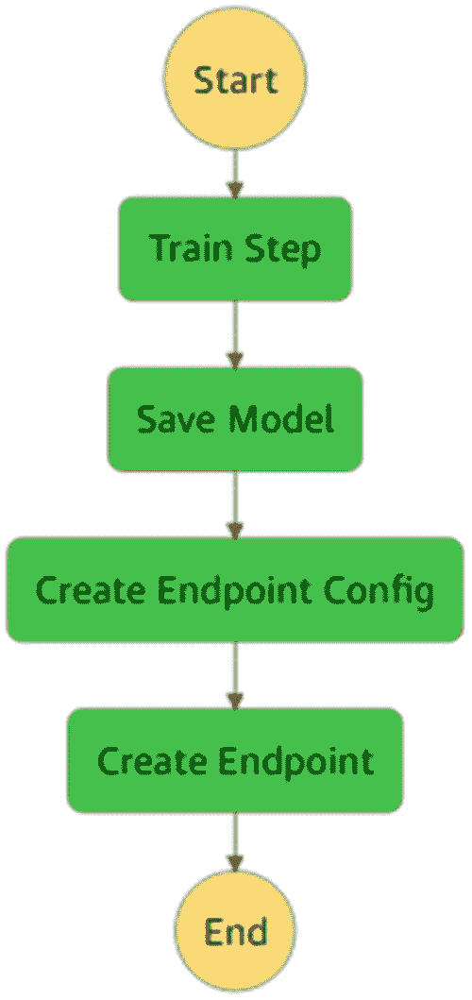

图 9-1

创建状态机涉及的步骤

现在，我们开始创建上述工作流。第一步是升级 Step Functions 包，以确保我们使用的是该模块的最新版本。

## 升级 Step Functions

我们将直接使用 Python 的 `pip` 来升级 Step Functions 包及其所有依赖包。

```
python -m pip install --upgrade stepfunctions
```

你可以在终端中运行此命令，也可以在 Jupyter Notebook 中通过添加感叹号（`!`）前缀来运行。

## 定义所需参数

接下来，我们定义运行代码所需的对象，包括角色、区域、存储桶等。

```
import boto3
import sagemaker
import time
import random
import uuid
import logging
import stepfunctions
import io
import random
from sagemaker.amazon.amazon_estimator import get_image_uri
from stepfunctions import steps
from stepfunctions.steps import TrainingStep, ModelStep, TransformStep
from stepfunctions.inputs import ExecutionInput
from stepfunctions.workflow import Workflow
from stepfunctions.template import TrainingPipeline
from stepfunctions.template.utils import replace_parameters_with_jsonpath
sagemaker_execution_role = sagemaker.get_execution_role()
workflow_execution_role = "arn:aws:iam::809912564797:role/himanshu-step-functions"
session = sagemaker.Session()
stepfunctions.set_stream_logger(level=logging.INFO)
region = boto3.Session().region_name
prefix = 'sagemaker/big-mart-pipeline'
bucket_path = 'https://s3-{}.amazonaws.com/{}'.format(region, "slytherins-test")
```

如代码所示，我们需要两个角色：一个是 SageMaker 执行角色，另一个是工作流执行角色。在下一节中，我们将了解如何定义工作流执行角色。此外，我们还创建了一个 SageMaker 会话，并定义了区域和 S3 存储桶位置。我们还设置了 Step Functions 日志记录器，以确保不会遗漏任何重要信息。

现在，让我们看看如何创建工作流执行所需的 IAM 角色。

## 设置所需角色

为了能够执行工作流，我们需要设置两项内容：

1.  为现有的 SageMaker 角色添加策略。
2.  创建一个新的 Step Functions IAM 角色。

### 为现有 SageMaker 角色添加策略

对于本书中用于运行所有模型的当前 SageMaker 角色，更新其策略以使其能够访问 Step Functions 的功能是很容易的。在 SageMaker 控制台中，我们需要点击正在使用的笔记本实例的名称。这将引导我们进入一个显示笔记本实例属性的页面。在该页面中，会有一个名为“权限和加密”的部分。在那里，你会找到该实例的 ARN 角色。参见图 9-2。

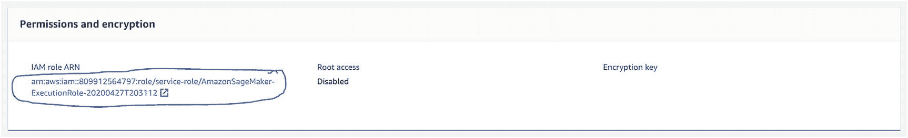

图 9-2

选择 ARN 角色

点击该角色后，你将进入该 ARN 对应的 IAM 角色页面。在该页面上，你需要点击“附加策略”，并搜索 *AWSStepFunctionsFullAccess*。附加此策略后，你的 SageMaker 实例就可以使用 Step Functions 了。参见图 9-3。

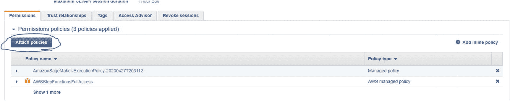

图 9-3

附加策略


### 为 Step Functions 创建新的 IAM 角色

在完成允许实例执行 Step Functions 任务后，我们需要创建一个执行角色，以便 Step Functions 能够执行已创建的任务。为此，我们需要再次进入 IAM 控制台来创建此角色。

进入 IAM 控制台，转到“角色”部分，然后点击“创建角色”。见图 9-4。

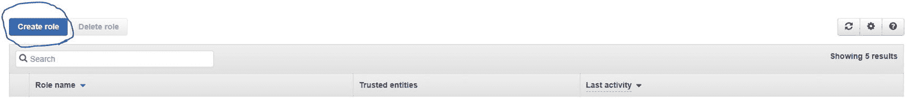

图 9-4

创建角色

选择 Step Functions 服务。你可能需要搜索该服务。见图 9-5。

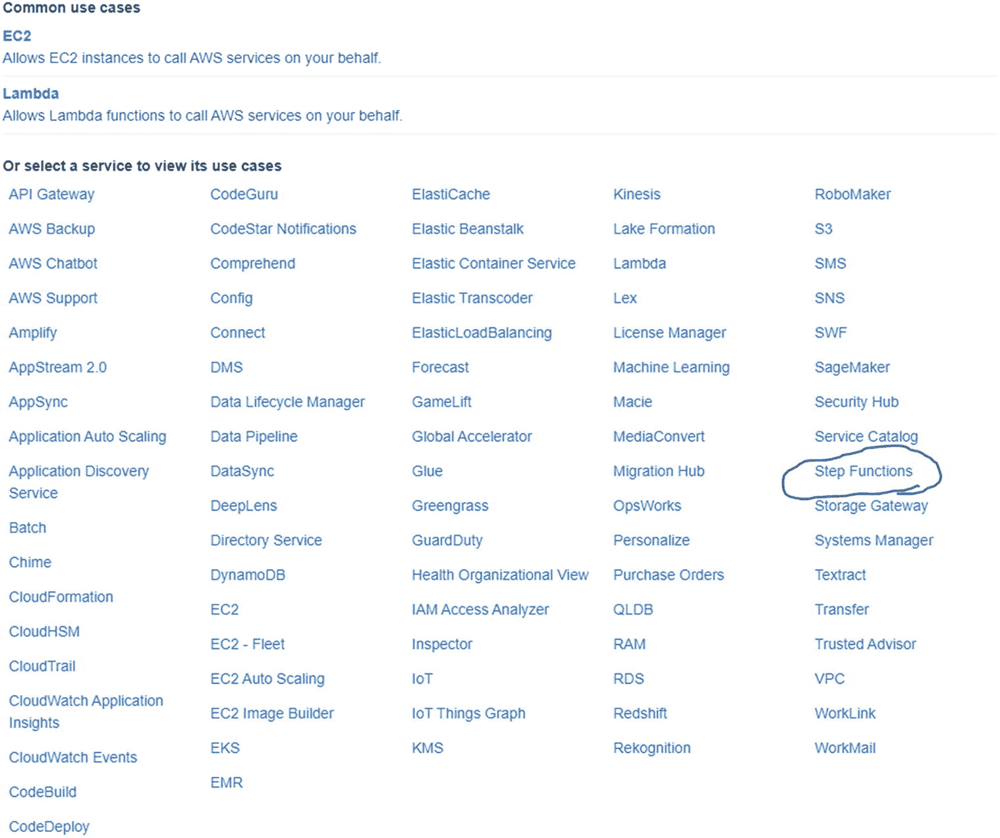

图 9-5

选择 Step Functions 服务

现在，继续该过程，持续点击“下一步”，直到到达需要提供角色名称的部分。输入你想要的任何角色名称，然后点击“创建角色”。接下来，创建好角色后，我们需要为其附加一个策略。这里我们将列出 Step Functions 服务被允许执行的所有服务。我们以 JSON 格式提供此列表。

点击你刚刚创建的角色，然后在“权限”部分点击“添加内联策略”。见图 9-6。

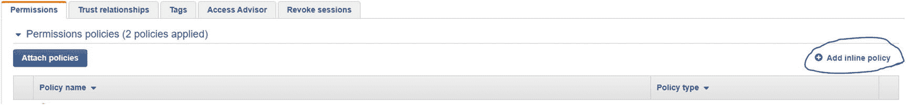

图 9-6

添加内联策略

在这里，你需要在 JSON 选项卡上添加一个 JSON 文件。文件内容如下所示：

```
{
"Version": "2012-10-17",
"Statement": [
{
"Effect": "Allow",
"Action": [
"sagemaker:CreateTransformJob",
"sagemaker:DescribeTransformJob",
"sagemaker:StopTransformJob",
"sagemaker:CreateTrainingJob",
"sagemaker:DescribeTrainingJob",
"sagemaker:StopTrainingJob",
"sagemaker:CreateHyperParameterTuningJob",
"sagemaker:DescribeHyperParameterTuningJob",
"sagemaker:StopHyperParameterTuningJob",
"sagemaker:CreateModel",
"sagemaker:CreateEndpointConfig",
"sagemaker:CreateEndpoint",
"sagemaker:DeleteEndpointConfig",
"sagemaker:DeleteEndpoint",
"sagemaker:UpdateEndpoint",
"sagemaker:ListTags",
"lambda:InvokeFunction",
"sqs:SendMessage",
"sns:Publish",
"ecs:RunTask",
"ecs:StopTask",
"ecs:DescribeTasks",
"dynamodb:GetItem",
"dynamodb:PutItem",
"dynamodb:UpdateItem",
"dynamodb:DeleteItem",
"batch:SubmitJob",
"batch:DescribeJobs",
"batch:TerminateJob",
"glue:StartJobRun",
"glue:GetJobRun",
"glue:GetJobRuns",
"glue:BatchStopJobRun "
],
"Resource": "*"
},
{
"Effect": "Allow",
"Action": [
"iam:PassRole"
],
"Resource": "*",
"Condition": {
"StringEquals": {
"iam:PassedToService": "sagemaker.amazonaws.com"
}
}
},
{
"Effect": "Allow",
"Action": [
"events:PutTargets",
"events:PutRule",
"events:DescribeRule"
],
"Resource": [
"arn:aws:events:*:*:rule/StepFunctionsGetEventsForSageMakerTrainingJobsRule",
"arn:aws:events:*:*:rule/StepFunctionsGetEventsForSageMakerTransformJobsRule",
"arn:aws:events:*:*:rule/StepFunctionsGetEventsForSageMakerTuningJobsRule",
"arn:aws:events:*:*:rule/StepFunctionsGetEventsForECSTaskRule",
"arn:aws:events:*:*:rule/StepFunctionsGetEventsForBatchJobsRule"
]
}
]
}
```

完成后，你可以查看策略，为其命名，然后创建策略。不要忘记复制你刚刚创建的策略的 ARN 编号。这将在你在 SageMaker 中创建代码时提供帮助。

## 设置训练步骤

在上一节中，我们完成了运行代码以创建管道所需的所有配置步骤。在本节中，我们将创建第一步：`TrainingStep`。我们要做的第一件事是创建一个字典，用于自动初始化训练任务名称、模型名称和端点名称。我们可以使用以下代码来实现：

```
names = {
'JobName': str,
'ModelName': str,
'EndpointName': str
}
execution_input = ExecutionInput(schema=names)
```

接下来，我们将使用我们在前几章中已经了解过的 XGBoost 容器来创建一个训练步骤。第一步是初始化容器。

```
tree = sage.estimator.Estimator(image,
sagemaker_execution_role, 1, 'ml.m4.xlarge',
output_path="s3://{}/output".format("slytherins-test"),
sagemaker_session=sess)
```

接下来，我们需要创建训练步骤。这是通过提供输入训练数据和验证数据的路径来完成的。

```
training_step = steps.TrainingStep(
'Train Step',
estimator=tree,
data={
'train': sagemaker.s3_input("s3://slytherins-test/Train.csv", content_type='text/csv'),
'validation': sagemaker.s3_input("s3://slytherins-test/test_data.csv", content_type='text/csv')
},
job_name=execution_input['JobName']
)
```

请记住，这不会执行模型。这里只是创建了一个步骤。首先，我们将创建所有步骤，然后将它们组合起来并按顺序运行。现在让我们确定保存模型的步骤。一旦进入管道，之前的训练完成，生成的模型工件应该被保存。这是使用以下代码完成的：

```
model_step = steps.ModelStep(
'Save model',
model=training_step.get_expected_model(),
model_name=execution_input['ModelName']
)
```

模型创建后的下一步是定义端点的配置。让我们在下一节中了解这一点。

## 设置端点配置步骤

在此步骤中，我们将定义部署端点所需的资源类型。我们已经了解了端点是如何部署的，因此我们将在此处创建的步骤将是不言自明的。

```
endpoint_config_step = steps.EndpointConfigStep(
"Create Endpoint Config",
endpoint_config_name=execution_input['ModelName'],
model_name=execution_input['ModelName'],
initial_instance_count=1,
instance_type='ml.m4.xlarge'
)
```

配置完成后，我们将创建实际部署端点的步骤。让我们在下一节中了解这一点。

## 设置端点步骤

以下代码创建用于端点部署的步骤：

```
endpoint_step = steps.EndpointStep(
"Create Endpoint",
endpoint_name=execution_input['EndpointName'],
endpoint_config_name=execution_input['ModelName']
)
```

端点部署完成后，我们可以像在前几节中看到的那样开始推理。现在我们已经成功创建了所有步骤，让我们在下一节中将它们连接起来并创建一个序列。

## 创建步骤链

要创建链，我们将从训练步骤开始，然后进入模型保存步骤，接着配置端点，最后将模型部署到配置好的端点上。我们可以使用以下代码创建此链：

```
workflow_definition = steps.Chain([
training_step,
model_step,
endpoint_config_step,
endpoint_step
])
```


## 定义工作流并启动运行

现在，上一节中的组件已连接完毕，我们需要提供所有必要的配置，以便该工作流能够执行。这可以通过以下代码实现：

```
workflow = Workflow(
name='Big-Mart_Workflow-v1',
definition=workflow_definition,
role=workflow_execution_role,
execution_input=execution_input
)
```

完成此操作后，我们只需执行创建的工作流即可。这可以通过以下代码实现：

```
workflow.create()
execution = workflow.execute(
inputs={
'JobName': 'regression-{}'.format(uuid.uuid1().hex),
'ModelName': 'regression-{}'.format(uuid.uuid1().hex),
'EndpointName': 'regression-{}'.format(uuid.uuid1().hex)
}
)
```

现在，当你执行上述代码时，整个管道将开始运行。要查看管道的图形化展示，可以使用 `render_graph()` 函数。

```
workflow.render_graph()
```

你将看到如图 9-7 所示的管道。


图 9-7

渲染图形

你还可以使用 `render_progress()` 函数检查当前执行过程的进度。参见图 9-8。

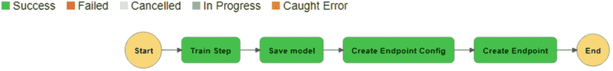

图 9-8

检查进度

```
execution.render_progress()
```

如图中所述，如果任何步骤失败，将以红色显示，否则为绿色。我们将通过进入 Step Functions 控制台来进一步探索此过程。我们将在下一节中了解这一点。

## 探索 Step Functions 中的任务

让我们看看本章创建的工作流在 Step Functions 控制台中是如何显示的。在服务列表中搜索 *Step Functions* 并点击它。这将打开你的控制台。你可以在其中找到本章创建的 Step Function，如下所示。参见图 9-9。

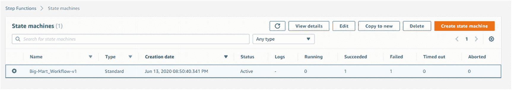

图 9-9

选择状态机

点击你的管道名称，然后点击最近运行或正在运行的任务。参见图 9-10。

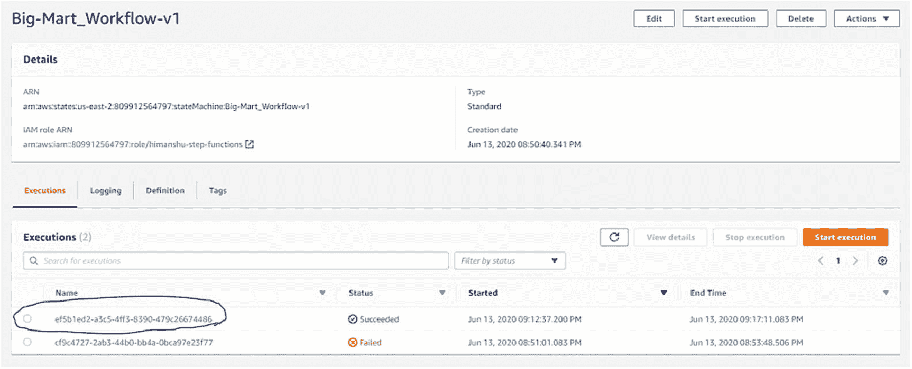

图 9-10

选择最新任务

在这里，你可以看到你创建的管道。它将在仪表板中清晰地显示所有步骤。你也可以点击各个组件并查看它们的进度。参见图 9-11。

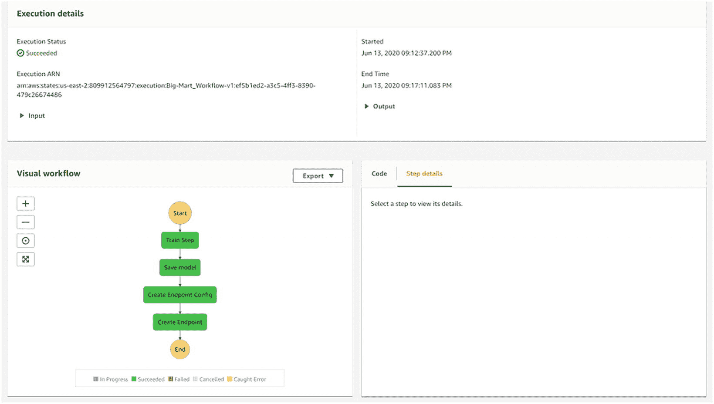

图 9-11

可视化进度

如果你点击训练步骤，你可以看到它自己的过程。参见图 9-12。

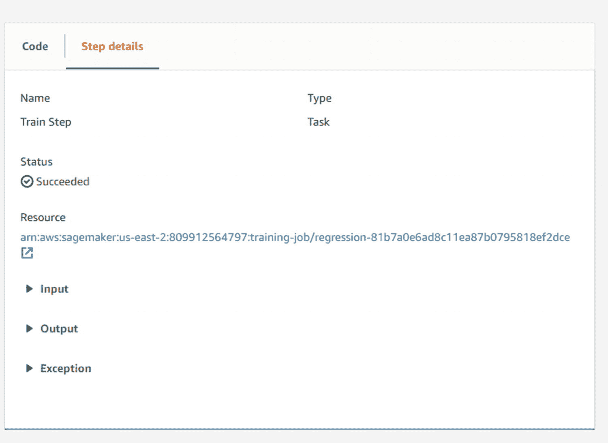

图 9-12

检查进度状态

## 探索可作为输入传递的 JSON 文件

如果我们想避免使用 Python 代码，还有另一种方法可以在 Step Functions 中创建流程。你可以直接传递一个 JSON，然后决定执行顺序。让我们看看 Step Functions 为我们的代码生成的 JSON。要查看 JSON 代码，我们必须点击“编辑状态机”选项。你可以查看整个 JSON 格式，如图 9-13 所示。

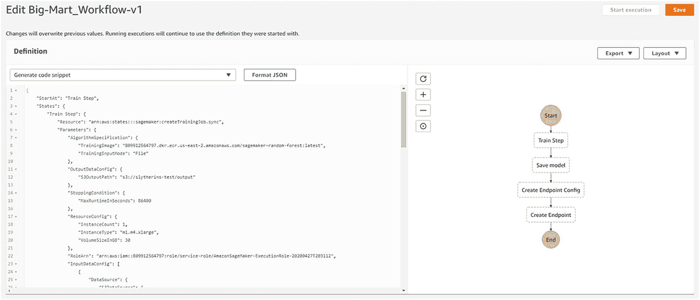

图 9-13

查看 JSON 结构

## 结论

在本章中，你学习了如何使用 Step Functions 创建端到端管道。这在创建完整的训练和部署流程，以及使用新数据或新配置重新训练模型时非常有用。这也有助于创建 CI/CD 管道，我们可以将代码推送到 Git，然后使用 Jenkins 或 Bamboo 等工具创建这些 Step Function 并启动执行。因此，当你将代码推送到 Git 时，训练过程会立即开始。这就是创建管道的强大之处。

至此，我们对 SageMaker 及其服务的讨论就结束了。在本书的下一章中，我们将介绍一些可以使用其他 AWS 服务完成的机器学习用例。

