# 10. AWS 中的机器学习用例

在本章中，我们将探讨三个用例，展示如何使用 AWS 解决典型的机器学习问题，而无需编写太多代码。除了 `SageMaker`，我们还将使用一些其他 AWS 服务。

## 用例 1：使用 `Amazon Comprehend` 进行自然语言处理

`Amazon Comprehend` 是 AWS 中的一项服务，可以执行各种 NLP 任务，例如从文本中提取关键实体、情感分析、短语提取、语法检查、语言检测、主题建模和文档分类。`Amazon Comprehend` 提供了一个用户界面，我们可以使用它来训练模型而无需编写任何代码。我们也可以使用 `Comprehend` 提供的 API 将其连接到您选择的脚本语言，然后直接从代码训练模型。

在本节中，我们将探讨如何使用 `Comprehend` 分析文本，然后使用它创建一个自定义情感分析模型。

### 文本分析

在亚马逊管理控制台中，我们可以选择 `Amazon Comprehend` 服务，然后点击启动 `Amazon Comprehend`。接着，我们会看到一个名为“实时分析”的板块。让我们使用这个板块来实时分析一些文本。我用于分析的文本摘自一篇《权力的游戏》评论：`https://www.polygon.com/tv/2019/6/3/18634311/game-of-thrones-review-full-tv-series-hbo`。

我们将分析的摘录如下：

“该剧的结局引发了粉丝们看似无穷无尽的不满，从长达一英里的推特讨论串，到一份恳请 HBO 从头重拍第八季的真诚请愿书。总体而言，这些抱怨听起来很符合‘巅峰电视’时代的特点：那种你预料中会来自某些人的喧嚣，他们将艾米莉亚·克拉克饰演的饱受创伤、残暴的丹妮莉丝·坦格利安解读为关于女性力量的单薄信息；愤怒于某某角色‘理应’得到某个他们未能获得的特定结局。其中很大一部分归结于观众将自己对该剧失败的不适感进行解读。”

图 10-1 显示了一个“输入文本”框。只需将前面的摘录粘贴到那里，然后点击分析。

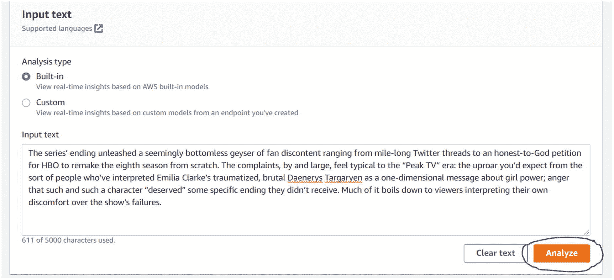
*图 10-1 将文本输入到 `Comprehend`*

现在，让我们看看 `Comprehend` 在分析后给出了什么结果。首先是它提取出的实体列表，以及相应的置信度。见图 10-2。

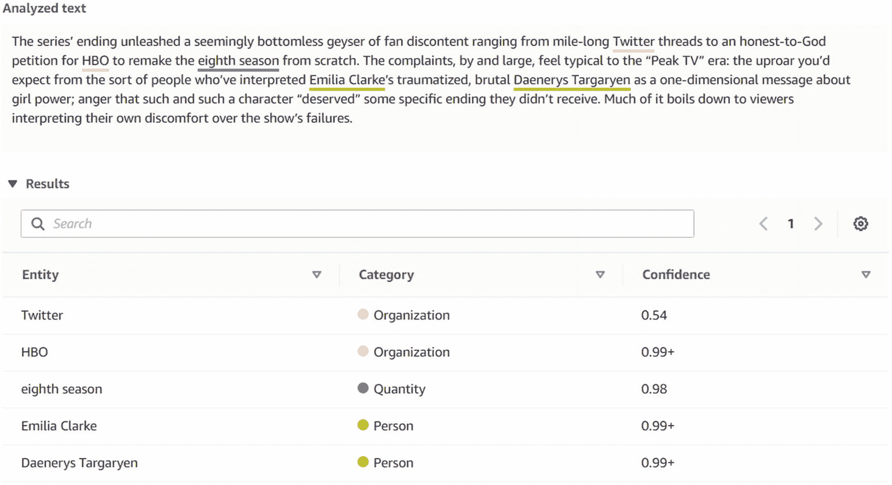
*图 10-2 分析结果*

在图 10-2 中，你可以看到提取出的大部分实体都是正确的。现在，让我们看看 `Comprehend` 认为文本中重要的关键短语有哪些。点击“关键短语”选项卡。图 10-3 显示了输出结果。

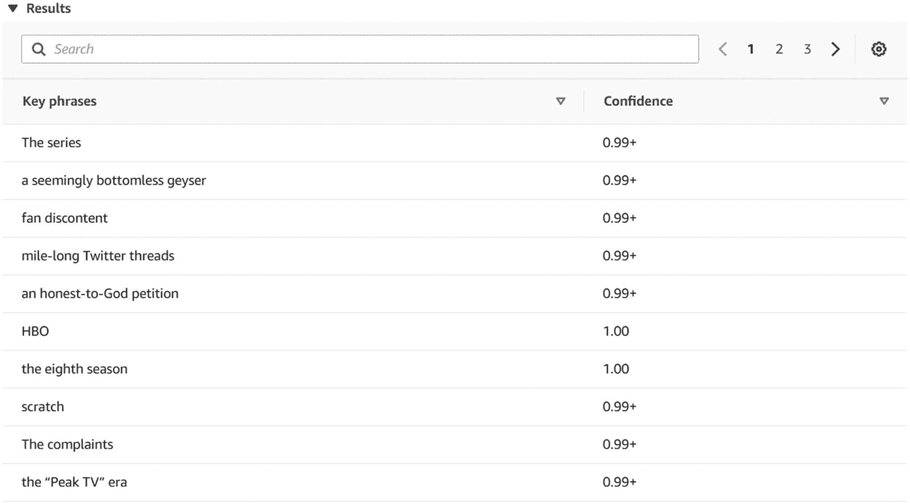
*图 10-3 文本中的关键短语*

其中一些短语非常重要，因为通过阅读它们，我们可以判断段落的内容以及语气。说到语气，让我们看看整个段落的情感倾向。为此，我们将点击“情感”选项卡。图 10-4 显示了该段落的情感分析结果。

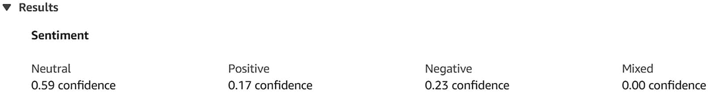
*图 10-4 情感分析输出*

在这里，你可以看到 `Comprehend` 告诉我们，作者对《权力的游戏》的态度基本上是中立的。如果你阅读该段落，你会发现作者实际上是在讲述那些不喜欢最终季的粉丝，而不是作者本人不喜欢。因此，在这一部分，`Comprehend` 能够为我们提供正确的图景。

如果你想用 `Comprehend` 来增强你的脚本，可以使用它提供的 API。这超出了本章的范围，但值得一试。你可以阅读 `Comprehend` API 文档来尝试。

接下来，让我们看看如何使用 `Comprehend` 创建一个自定义分类模型。在这里，我们将评估一段文本的有毒程度。数据集来自 Kaggle，你可以从 `www.kaggle.com/c/jigsaw-toxic-comment-classification-challenge/data` 下载。

### 自定义分类

该数据集总共包含八列。我只保留了两列，并删除了其余列，因为 `Comprehend` 中的多类分类只期望两列：一列是文本，另一列是类别。

在 `Comprehend` 控制台中，我们将点击“自定义分类”。然后点击“训练分类器”。图 10-5 显示了这些步骤。

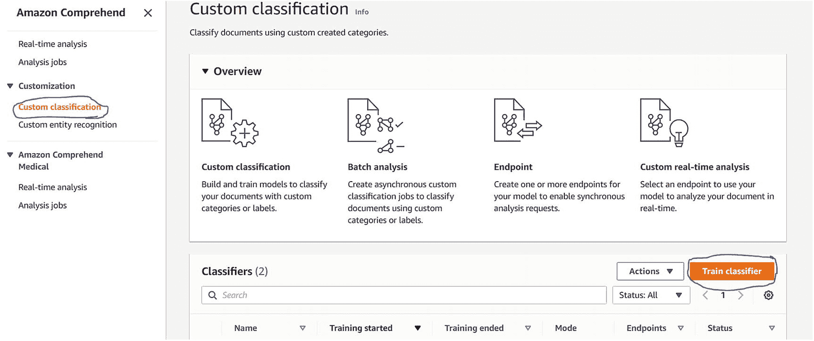
*图 10-5 训练自定义分类器*

第一步是给你的训练任务命名。请遵循 `Comprehend` 期望的命名约定说明。见图 10-6。

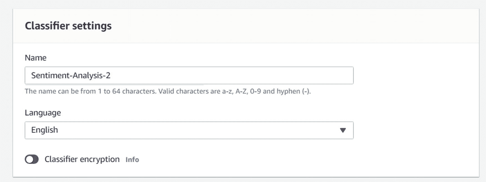
*图 10-6 命名分类器*

接下来，你必须选择分类模式。多类分类是指我们只有一列类别，而多标签分类是指每个类别还可以有子类别。我们将选择第一个，如图 10-7 所示。

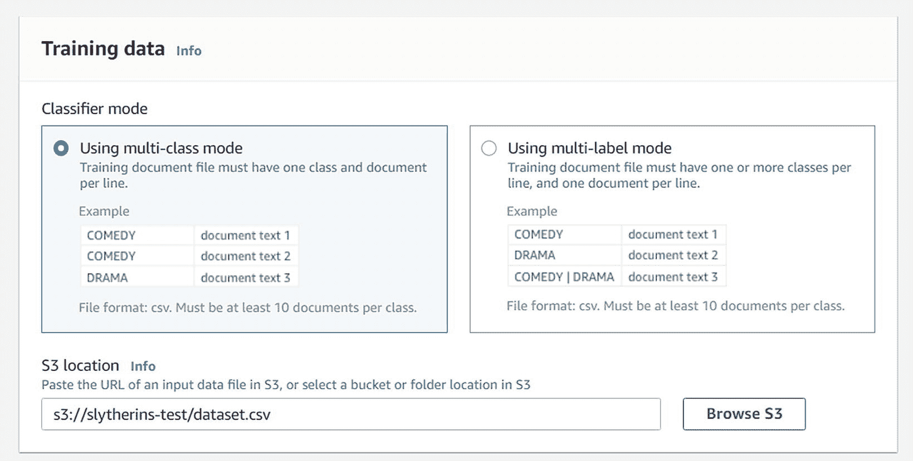
*图 10-7 `Comprehend` 多类分类*

接下来，我们必须将数据集上传到 S3 存储桶并提供路径。请记住，必须只包含两列。见图 10-8。

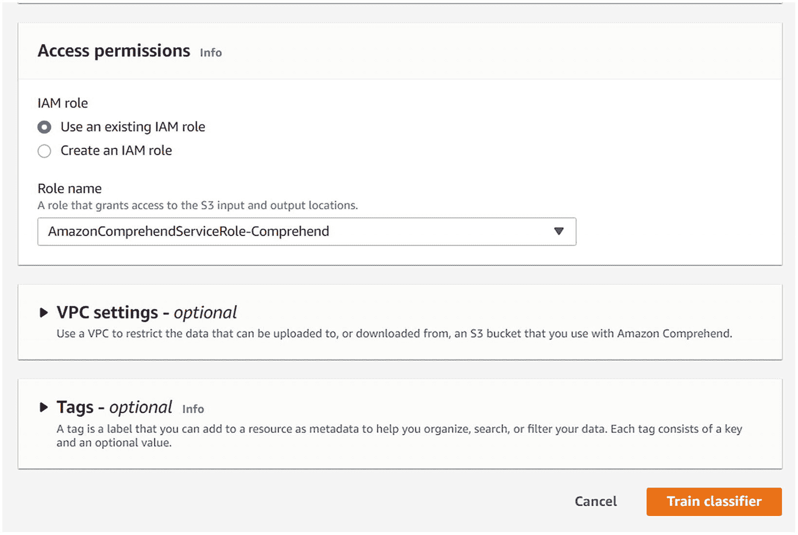
*图 10-8 定义 IAM 角色*

一旦你提供了路径，选择你的 IAM 角色，然后点击“训练分类器”。这将开始模型的训练。一旦你的模型训练完成，你将看到类似于图 10-9 的信息。

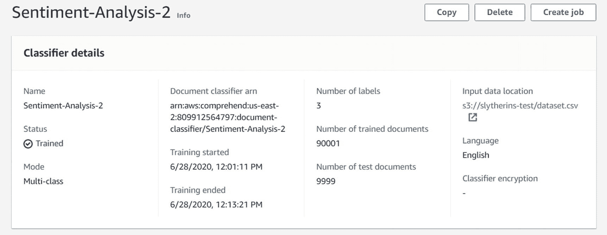
*图 10-9 模型训练输出*

接下来，你可以在“分类器性能”下找到训练模型的指标，如图 10-10 所示。

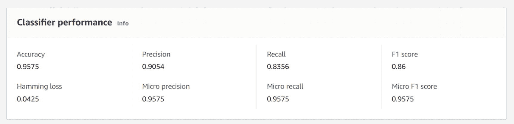
*图 10-10 `Comprehend` 分类器的性能*

你可以看到，它在准确率、精确率和召回率方面都给出了相当不错的结果。接下来，要使用这个模型，我们可以创建一个端点，然后开始推理。只需点击“创建端点”按钮并为其命名即可开始该过程。见图 10-11。

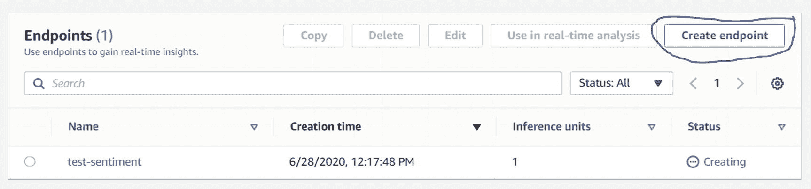
*图 10-11 创建端点*

一旦端点准备就绪，我们可以进入实时分析部分，这次不点击内置分析类型，而是点击“自定义”并选择你的端点。接下来，输入任何文本，它就会预测其类别，正如你在图 10-12 和 10-13 中看到的那样。

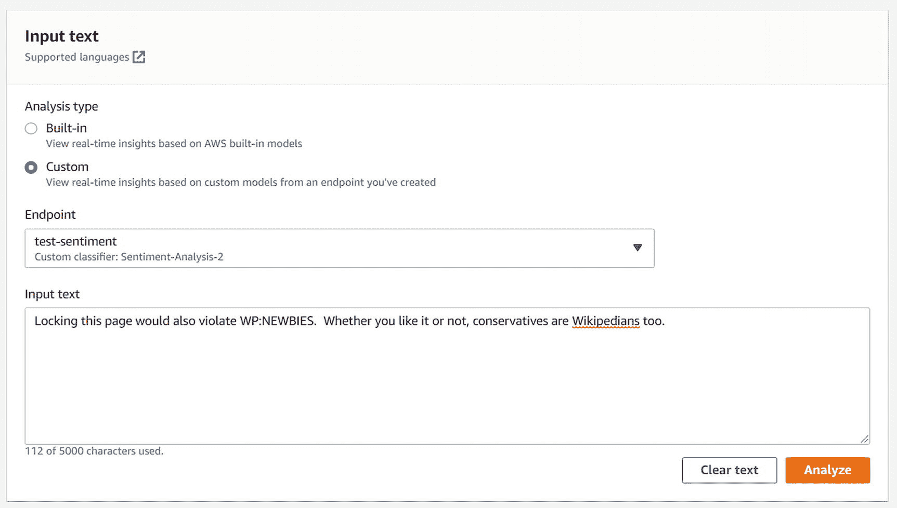
*图 10-12 使用自定义分类器进行推理*

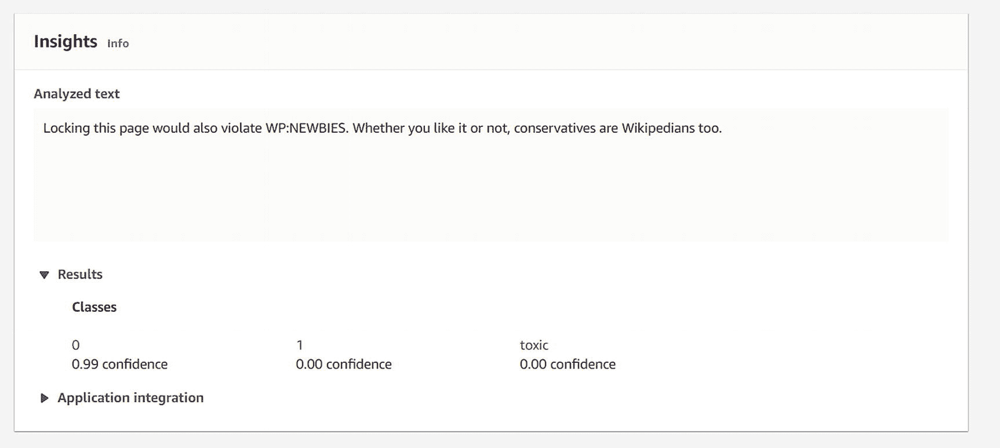
*图 10-13 推理结果洞察*

分析完成后，别忘了删除端点，因为它是收费的。这结束了我们对第一个用例的讨论。接下来，让我们看看一个销售预测模型，该模型可以使用另一个名为 `Amazon Forecast` 的亚马逊服务来构建。

## 用例 2：使用 `Amazon Forecast` 进行销售预测

## 销售预测

在本节中，我们将预测一家公司的销售情况。为此，我们将使用`Kaggle`上一个名为“商店商品需求预测”的预测数据集。你可以从[`https://www.kaggle.com/c/demand-forecasting-kernels-only/data?select=train.csv`](https://www.kaggle.com/c/demand-forecasting-kernels-only/data%253Fselect%253Dtrain.csv)下载该数据集。

下载数据集后，我们需要对其进行一些格式化。首先，我们要为其添加一个ID列。这应该是数据集的第一列。接下来，确保日期字段的格式为`YYYY-MM-DD`；否则，`Amazon Forecast`将无法接受。完成这些操作后，将数据集上传到`S3`，并记下其路径。

### 创建数据集组

现在，打开`Amazon`管理控制台，然后搜索`Amazon Forecast Service`。点击“创建数据集组”。第一步是为数据集组命名，然后选择预测领域。在我们的分析中，我们选择了自定义领域。见图 10-14。

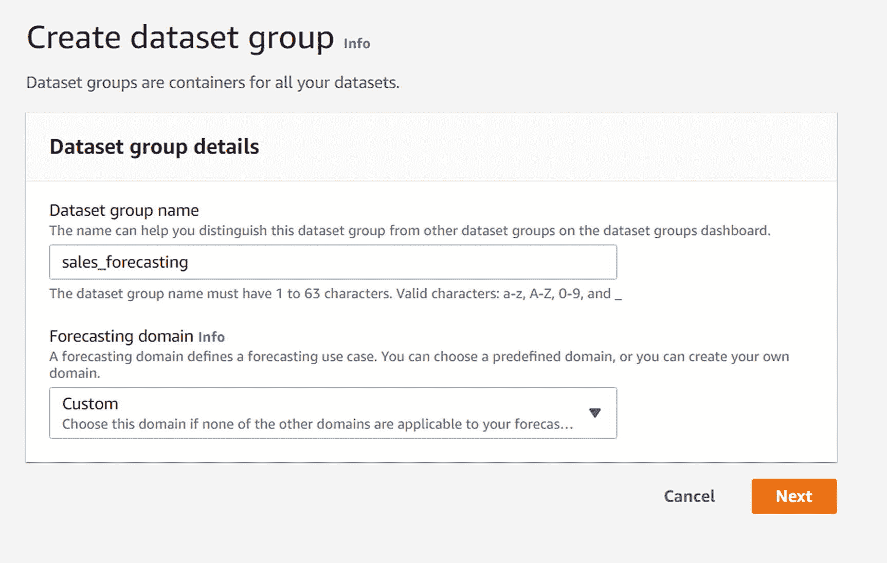

图 10-14

创建数据集组名称

### 定义列属性

下一步是为你的数据集命名。然后，你需要定义列属性。见图 10-15。

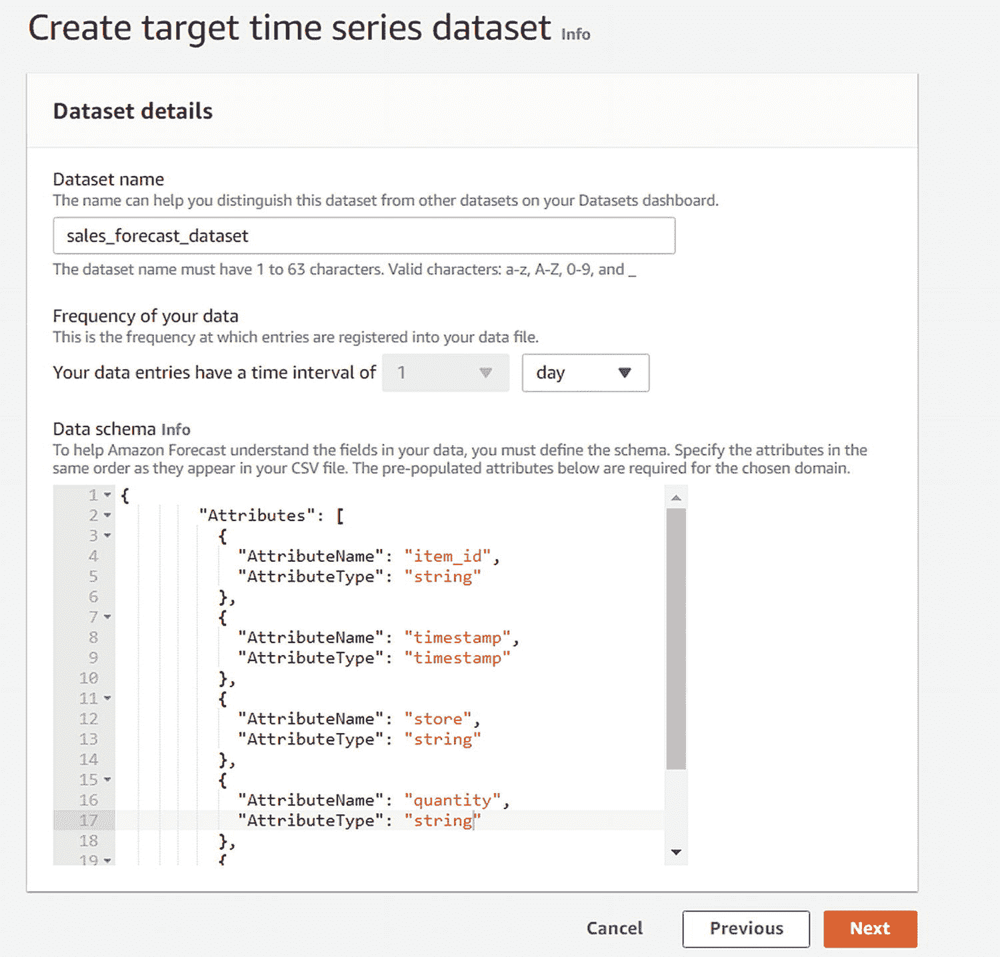

图 10-15

定义列属性

请记住，属性的顺序应与数据集中的顺序一致。此外，除了`JSON`模式中已有的属性外，所有其他属性都必须是字符串。这就是为什么商店和数量被标记为字符串。你也可以定义时间间隔。对我们来说，这是每日间隔，因此按此设置。点击“下一步”。

### 导入数据

最后一步是开始导入数据。在此，你需要提供`S3`路径和数据集导入的名称。见图 10-16。

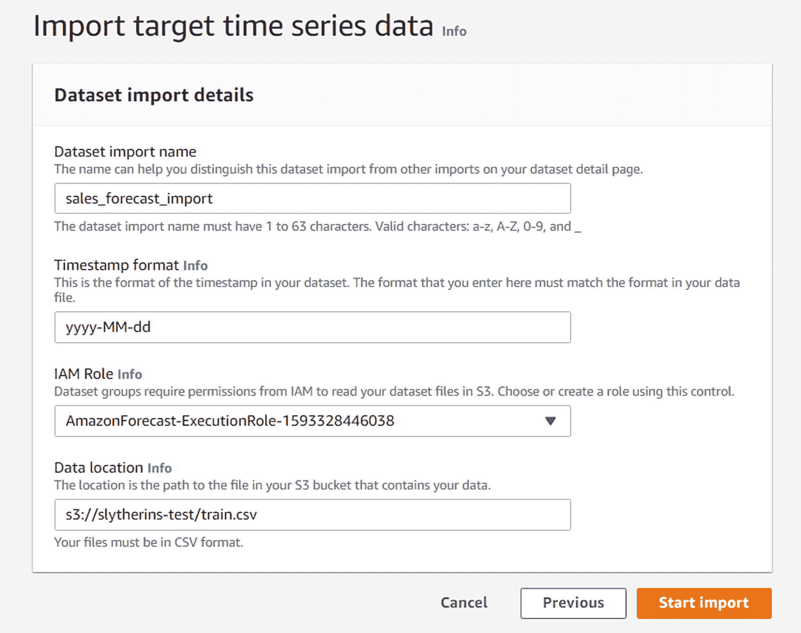

图 10-16

配置数据集路径

### 进行预测

现在，点击“开始导入”。导入完成后，我们需要点击“开始预测器训练”。在此，我们将告知`Amazon Forecast`需要进行的预测类型以及预测范围。图 10-17 显示了我们需要输入的参数。

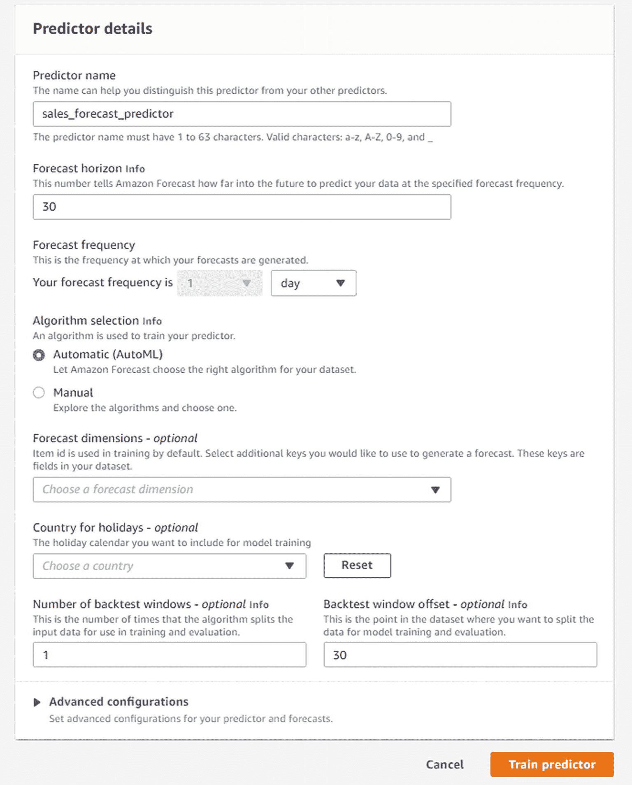

图 10-17

启动训练任务的输入参数

之后训练将开始。等待训练完成，如果你觉得`AutoML`耗时过长，可以选择任何自定义预测器。建议使用手动算法。

训练完成后，我们需要点击“创建预测”。在此，你需要为预测命名，并选择刚刚创建的预测器。点击“创建预测”。见图 10-18。

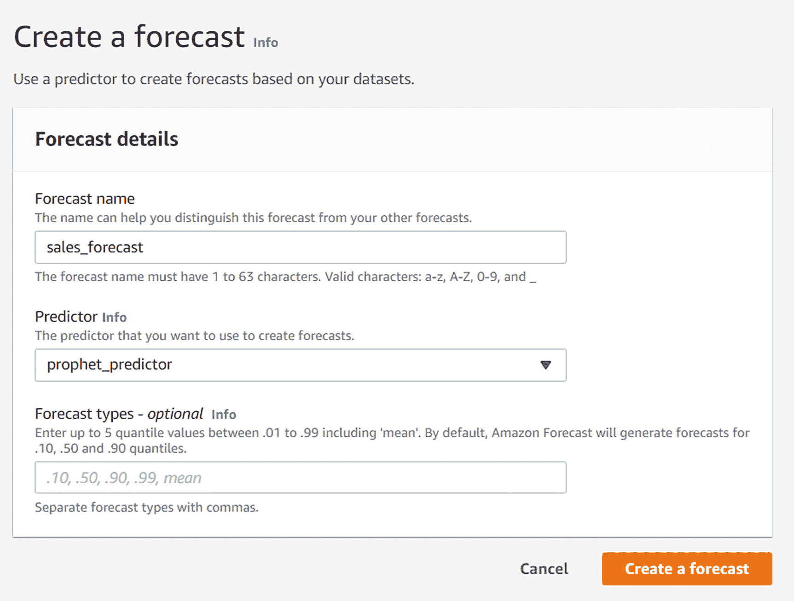

图 10-18

生成预测

预测完成后，你可以点击“预测查询”进行查看。见图 10-19。

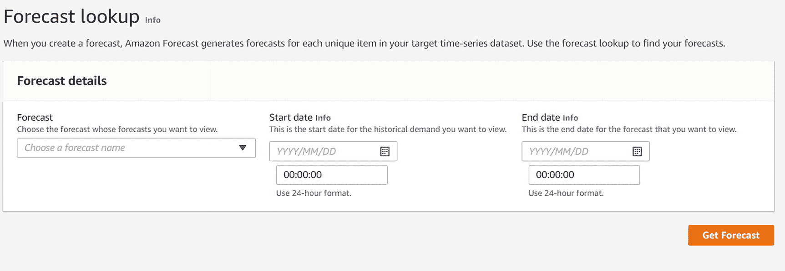

图 10-19

预测查询

只需指定预测范围，你将获得一个非常直观的可视化结果，如图 10-20 所示。

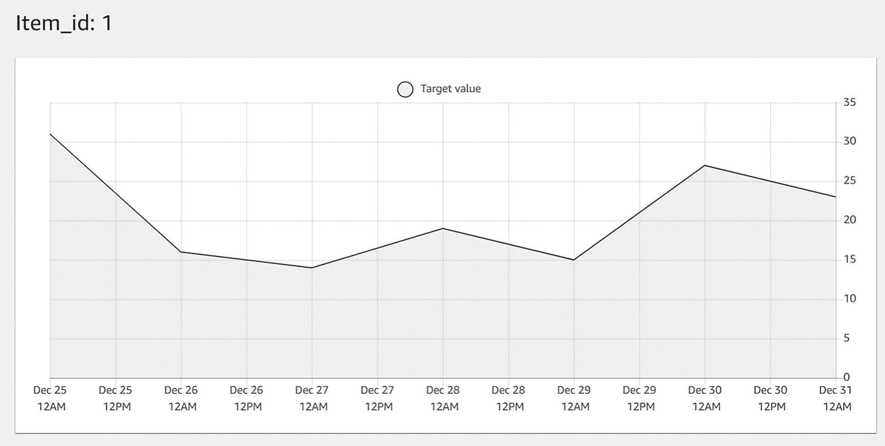

图 10-20

生成的预测结果

至此，我们完成了关于使用`Amazon Forecast`进行销售预测的讨论。如前所述，我们可以为不同的数据集创建不同类型的预测。现在，让我们来看最后一个用例，我们将使用`Amazon Textract`从不同文件格式中提取文本信息。

## 用例 3：使用 Amazon Textract 进行图像文本提取

使用`Amazon Textract`，我们不仅可以提取图像、`PDF`、`Word`文件等中的文本，还可以提取表格和表单数据。与之前的所有服务一样，这个过程很简单。我们只需上传包含信息的图像，数据就会被提取出来。让我们开始这个过程，首先进入`Amazon`管理控制台，搜索`Amazon Textract service`。接下来，点击“试用`Amazon Textract`”。最后，点击“上传文档”。

### 提取表格信息

首先，让我们在表格数据上应用`Textract`。为此，我们将使用图 10-21。

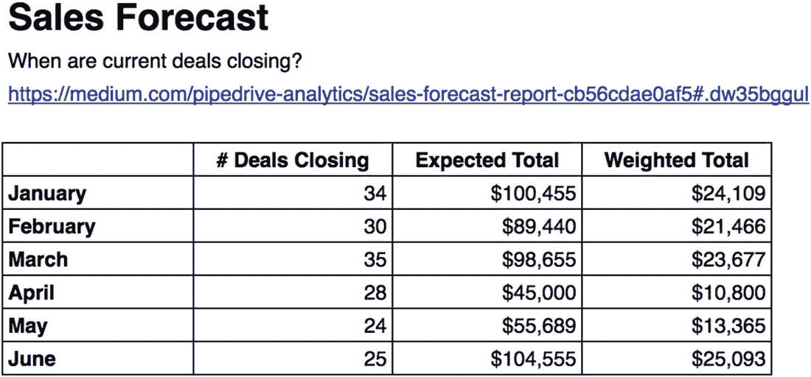

图 10-21

重要性表格

上传图像后，你将得到结果，如图 10-22 所示。第一次提取的是原始文本，第二次提取的是表格。我们可以看到`Textract`运行完美，如图 10-23 所示。

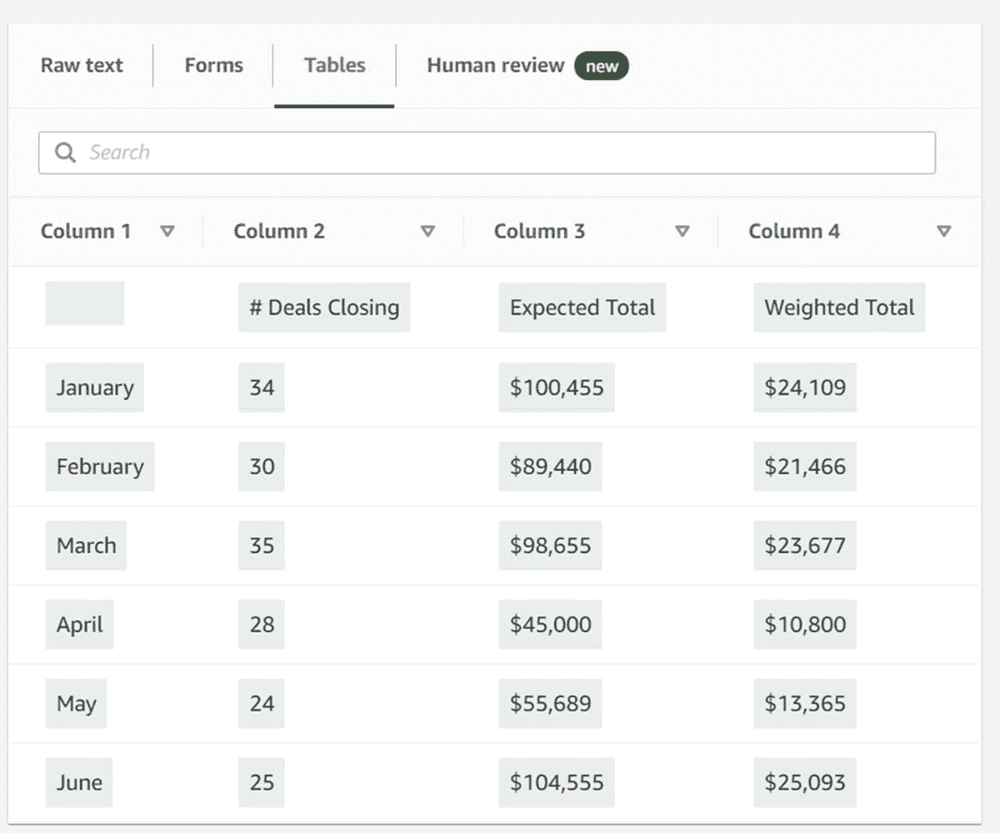

图 10-23

提取的表格关键词

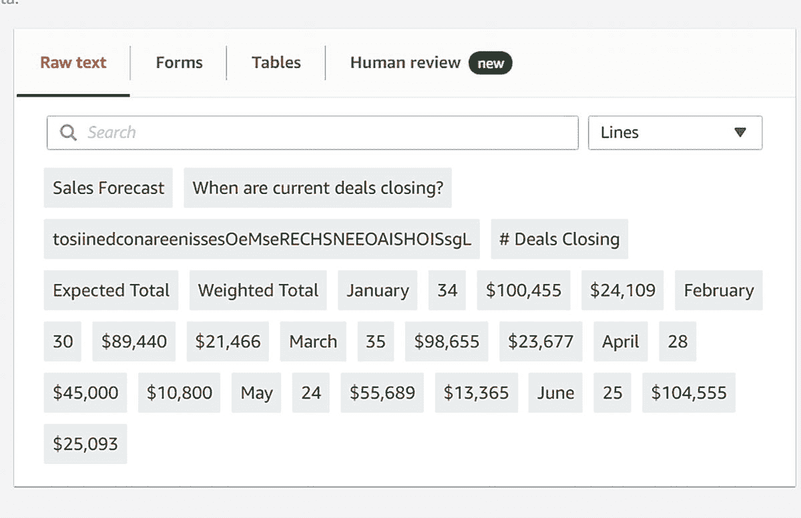

图 10-22

提取的关键词

### 提取表单数据

现在，让我们看看`Textract`如何处理表单数据。图 10-24 显示了我们将使用的图像。

图 10-24

表单数据测试图像

当我们上传此图像并分析表单结果时，会得到如图 10-25 所示的结果。

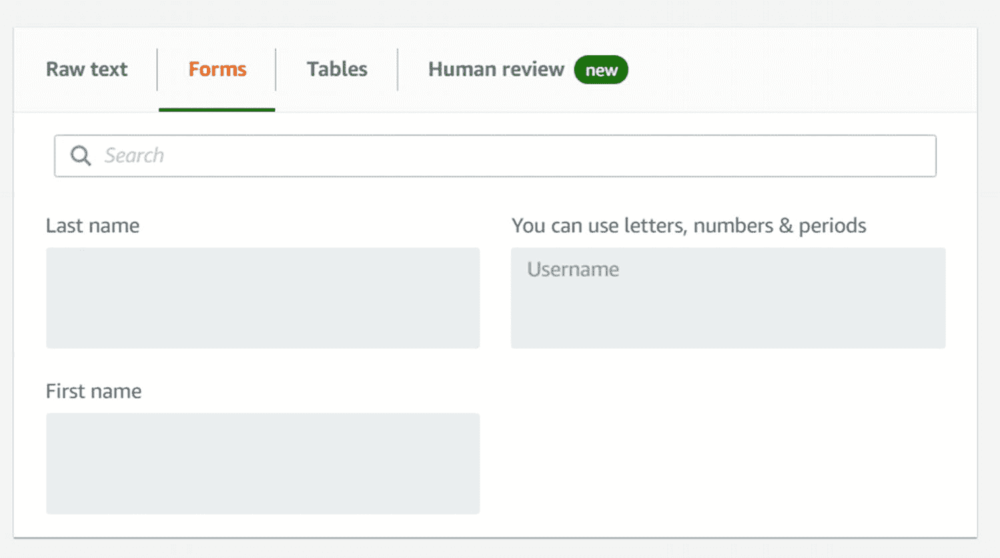

图 10-25

提取的表单数据

你可以看到，表单中的大多数字段都被`Textract`成功提取。同样，我们可以将`PDF`文件和其他支持的格式提供给`Textract`，以获取所需字段。我们也可以连接到`Textract API`，以便结果可以直接被`Python`等脚本语言吸收，并进行进一步分析。

## 结论

在本章中，你了解了机器学习领域中的不同`Amazon`服务。它们是`Amazon`提供的现成解决方案，最大限度地减少了编码知识需求，从而使具有深厚数学/统计学背景的人能够进行分析。至此，本书的最后一章结束。

# 索引

## A

访问控制列表（ACL）
账户安全、身份验证
数字签名
多因素认证
密码
X.509 证书
`Amazon Comprehend`
`Amazon Elastic File System（EFS）`
`Amazon Polly`
`Amazon Rekognition`
`Amazon SageMaker`
批量部署
批量转换
内置算法
自定义算法
数据预处理
特征
模型部署
模型训练过程
生产环境
`Amazon Simple Storage System（S3）`
`Amazon Textract`
`Amazon Transcribe`
`Amazon Web Services（AWS）`
账户安全，参见“账户安全、身份验证”
CLI
计算机服务
`EC2`
弹性容器注册表
数据服务器
防火墙管理器
网络/内容分发
`API` 网关
`CloudFront`
`VPC`
`OSI` 模型
`Shield`
服务
SSR，参见“共享安全责任（SSR）模型”
存储设备
`Amazon S3` 网关
`WAF`
一切皆服务（XaaS）
应用程序编程接口（API）
人工智能
注意力层
基于属性的访问控制（ABAC）
`AWS` 成本优化
预留实例
合理调整规模
竞价实例
`AWS` 管理控制台（`AMC`）
`AWS Trusted Advisor`

## B

批量转换
`Big Mart` 数据集
Blazing Text 算法
CBOW 方法
`SageMaker` 应用
跳元架构
词嵌入
Boosting
`Boto3`
包
`Dockerfile`
安装
初始化
处理作业

## C

CI/CD 流水线
云计算
社区云
混合云
IaaS
PaaS
私有云
公有云
SaaS
系统
XaaS
云安全联盟（CSA）
`CloudWatch`
`Amazon` 管理控制台
架构
自动扩缩
Docker 容器
错误信息
作业
机器学习
菜单
指标
监控
处理作业
资源活动，`AWS`
训练作业
上下文感知分析
连续词袋（CBOW）方法
`Cost Explorer`
摊销成本
成本 仪表盘
定义
未混合成本
刑事司法信息服务（CJIS）
自定义模型，`SageMaker`
创建推理脚本
将 Docker 镜像推送到 `ECR`
`ECR` 端点
生成
文件
设置，`Dockerfile`
训练脚本
转换代码

## D

数据处理
`Jupyter Notebook`，参见 `Jupyter Notebook`
机器学习流水线
深度学习
人工神经网络
生物神经元
因变量
数字签名
分布式拒绝服务（DDoS）

## E

弹性块存储（EBS）
弹性计算云（EC2）
弹性容器注册表（ECR）
编码器-解码器架构
端到端流水线

## F

家庭教育权利和隐私法案（FERPA）

## G

门控循环单元（GRU）
梯度提升算法

## H

硬件虚拟机（HVM）
健康保险可携性和责任法案（HIPAA）

## I

身份与访问管理（IAM），`AWS`
ABAC
EMR/DynamoDB
策略
主体实体
根用户账户
顶层管理
用户
联合身份
基于身份的策略
图像分类算法
`ResNet`
`SageMaker` 应用
图像文本提取，`Amazon Textract`
表单数据
表格数据
自变量
基础设施即服务（IaaS）
互联网小型计算机系统接口（iSCSI）

## J

`Jupyter Notebook`
类别/列
数据/列
数据处理步骤
重复值
`fillna()` 方法
商品类型
标签编码
输出
空值探索
`Pandas` 框架
移除数值型空值
标准缩放
输出

## K

`Kaggle`

## L

最小二乘估计
线性学习器算法
线性回归
逻辑回归
`SageMaker` 应用
长短期记忆网络（LSTM）

## M

机器学习
`AWS`
强化学习
监督学习
翻译
无监督学习
模型工件
多项逻辑回归

## N

自然语言处理（NLP），`Amazon Comprehend`
自定义分类
文本分析
网络附加存储（NAS）
网络文件系统（NFS）
神经网络/生物神经网络
神经文本转语音（NTTS）

## O

开放系统互连（OSI）模型

## P, Q

半虚拟化（PV）
平台即服务（PaaS）
池化或子采样

## R

随机森林算法
批量转换
分类模型
数据集
部署模型
均方误差
实时推理
`Scikit-Learn` 包
`RandomForestRegressor` 类
循环神经网络（RNN）架构
GRU
LSTM
强化学习
`render_progress()` 函数
基于资源的策略
基于角色的访问控制（RBAC）

## S

`S3`
存储桶
`SageMaker` 的 `Scikit-learn` 容器
计算能力
CSV 文件
数据概览
数据路径
`preprocessing.py` 脚本
读取数据，`Pandas`
`S3` 存储桶
`SKLearnProcessor`
`slytherins-test`
销售预测
列属性
数据集
分组
导入数据
预测
商店商品需求预测
`ScriptProcessor`
基于 `BERT` 的服务
构建/推送镜像
创建对象
`Dockerfile`
序列到序列算法
转换文本
`create_model()` 函数
编码器和解码器架构
超参数
机器翻译
输出
预训练模型
`RecordIO-Protobuf` 版本
RNN
分词
训练/验证集
共享安全责任（SSR）模型
`AWS`
业务连续性管理
合规性
客户责任
高级安全
`IAM`
基础设施
网络安全
物理/环境安全
单点登录（SSO）
`SKLearnProcessor` 容器
软件即服务（SaaS）
Step 函数
添加策略
创建链
部署
端点配置
`IAM` 角色
JSON 文件
参数
状态机
训练
升级
工作流
`XGBoost` 容器
`StringIO()` 方法
监督学习

## T

主题建模

## U

无监督学习

## V

虚拟私有云（VPC）

## W

Web 应用防火墙（`WAF`）

## X, Y, Z

`XGBoost` 算法，`SageMaker` 应用