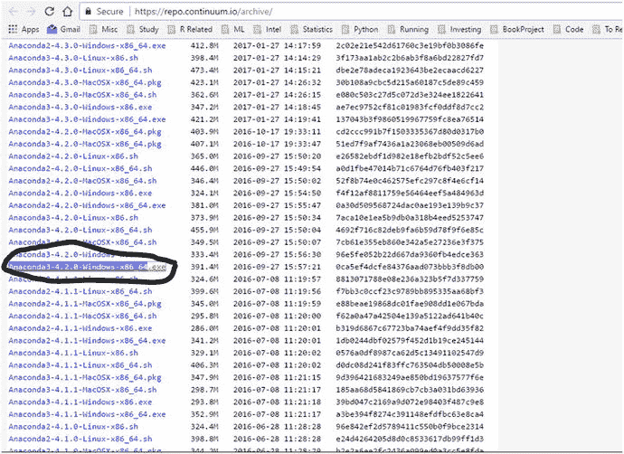
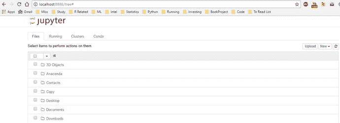
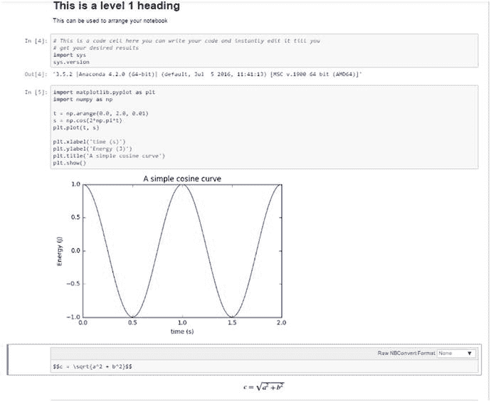
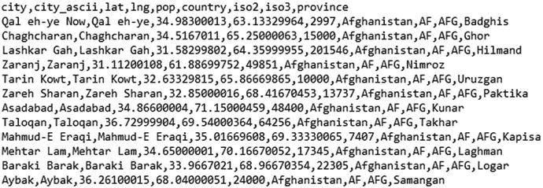
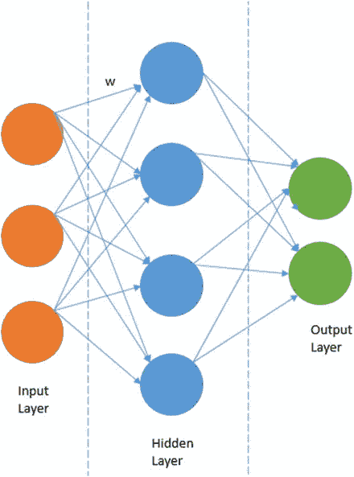
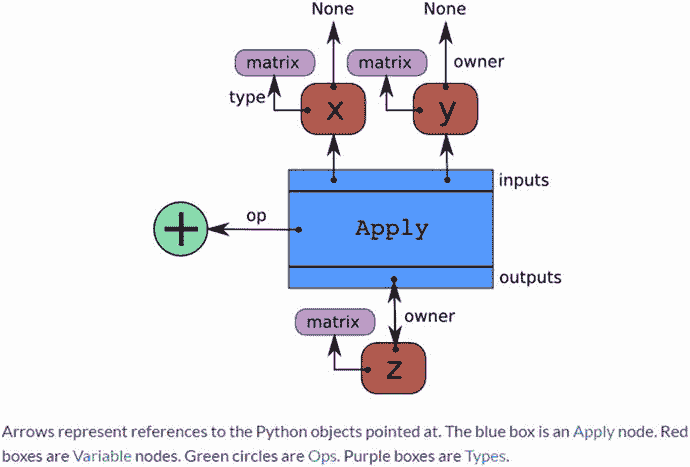
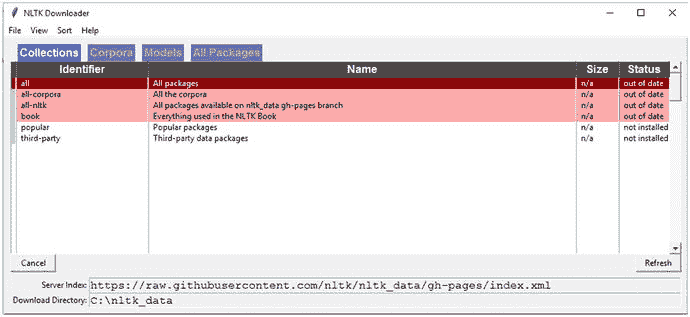

# 2. Python 机器学习生态系统

在第一章中，我们探讨了机器学习最基础的知识，并了解了一些我们可以使用的算法。机器学习是当今技术世界中一个非常流行且相关的主题。因此，在编程语言和框架方面，我们对机器学习有着非常多样化的支持。几乎所有流行语言都有机器学习库，包括 C++、R、Julia、Scala、Python 等。在本章中，我们试图论证为什么 Python 是一种适合机器学习的语言。在逻辑上论证了我们的选择之后，我们将简要介绍 Python 机器学习生态系统。这个 Python ML 生态系统是一个库的集合，它使开发者能够提取和转换数据、执行数据整理操作、应用现有的稳健机器学习算法，并轻松开发自定义算法。这些库包括`numpy`、`scipy`、`pandas`、`scikit-learn`、`statsmodels`、`tensorflow`、`keras`等。我们将简要介绍其中几个库，以便读者对每个库的基础知识有所了解。这些库将在本书的后续章节中被广泛使用。这里需要记住的一点是，本章的目的是让你熟悉 Python ML 生态系统中多样化的框架和库，从而了解可以利用哪些工具来解决机器学习问题。我们通过提供有用的链接来丰富内容，你可以参考这些链接获取详尽的文档和教程。我们假设你具备一定的 Python 和编程基础。本章中使用的所有代码片段和示例均可在本书的 GitHub 仓库中找到，地址为 [`https://github.com/dipanjanS/practical-machine-learning-with-python`](https://github.com/dipanjanS/practical-machine-learning-with-python)，位于第 2 章的目录/文件夹下。你可以参考名为 `python_ml_ecosystem.py` 的 Python 文件获取本章使用的所有示例，并在阅读本章时尝试这些示例，或者你也可以参考名为 `The Python Machine Learning Ecosystem.ipynb` 的 Jupyter 笔记本以获得更具交互性的体验。

## Python：简介

Python 由荷兰数学与计算机科学国家研究所（CWI，参见 [`https://www.cwi.nl/`](https://www.cwi.nl/) ）的吉多·范罗苏姆创建。Python 的第一个版本于 1991 年发布。吉多编写 Python 是为了作为 ABC 语言的继任者。在随后的几年里，Python 已发展成为一种广泛使用的高级语言和通用编程语言。Python 是一种解释型语言，这意味着 Python 程序的源代码会被转换为字节码，然后由 Python 虚拟机执行。Python 与 C 和 C++ 等主流编译型语言不同，因为 Python 代码不需要像这些语言的代码那样进行构建和链接。这一区别带来了两个重要特点：

*   Python 代码开发速度快：由于代码无需编译和构建，Python 代码可以更轻松地修改和执行。这造就了快速的开发周期。
*   Python 代码执行速度不快：由于代码不是直接编译执行的，而是由额外的 Python 虚拟机层负责执行，因此与 C、C++ 等传统语言相比，Python 代码运行速度稍慢。

### 优势

Python 在广泛使用的编程语言排行榜上稳步上升，根据多项调查和研究，它是世界上第五重要的语言。最近几项调查显示，Python 是机器学习和数据科学领域最受欢迎的语言！我们将简要列出 Python 提供的优势，这或许可以解释其流行原因。

1.  易于学习：Python 是一种相对容易学习的语言。对于初学者来说，其语法简单易懂。与 C 或 Java 等语言相比，执行 Python 程序所需的样板代码极少。
2.  支持多种编程范式：Python 是一种多范式、多用途的编程语言。它支持面向对象编程、结构化编程、函数式编程，甚至面向方面编程。这种多功能性使其能被众多程序员使用。
3.  可扩展性：Python 的可扩展性是其最重要的特性之一。Python 拥有大量易于获取的模块，可以随时安装和使用。这些模块涵盖了从数据访问到流行算法实现的编程各个方面。这种易于扩展的特性确保了 Python 开发人员的工作效率更高，因为大量问题都可以通过现有的库来解决。
4.  活跃的开源社区：Python 是开源的，并得到了庞大开发者社区的支持。这使其健壮且适应性强。遇到的错误很容易被 Python 社区修复。由于是开源的，如果需求允许，开发人员可以修改 Python 的源代码。

### 缺点

尽管 Python 是一种非常流行的编程语言，但它也有自身的缺点。它最重要的限制之一在于执行速度。作为一种解释型语言，与编译型语言相比，它的速度较慢。在需要极高性能代码的场景下，这一限制可能会有些束缚。这是 Python 未来实现需要改进的主要领域，后续的每个 Python 版本都在解决这个问题。尽管我们必须承认它永远无法像编译型语言那样快，但我们相信它通过在其他方面的高效和有效弥补了这一不足。

### 设置 Python 环境

我们进入数据科学世界的第一步是设置 Python 环境。我们通常有两种选择来设置环境：

*   单独安装 Python 和必要的库
*   使用预打包的 Python 发行版，其中包含必要的库，即 Anaconda

Anaconda 是一个打包的 Python 编译版本，附带一整套各种库，包括数据科学中广泛使用的核心库。由 Anaconda（前身为 Continuum Analytics）开发，它通常是数据科学家的首选设置。`numpy` 和 `scipy` 库的主要贡献者特拉维斯·奥利芬特是 Anaconda 的总裁兼联合创始人之一。Anaconda 发行版采用 BSD 许可，因此允许我们将其用于商业和再分发目的。该发行版的一个主要优势是我们不需要复杂的设置，并且它在所有类型的操作系统和平台上都能良好运行，尤其是 Windows，它经常在安装特定 Python 包时引发问题。因此，只需一次下载和安装，我们就可以开始数据科学之旅。Anaconda 发行版广泛应用于行业数据科学环境，它还附带了一个出色的 IDE——Spyder（科学 Python 开发环境），以及其他有用的工具，如 jupyter notebooks、IPython 控制台和优秀的包管理工具 `conda`。最近，他们还广泛讨论了 Jupyterlab，这是 Project Jupyter 的下一代用户界面。我们建议使用 Anaconda 发行版，并查看 [`https://www.anaconda.com/what-is-anaconda/`](https://www.anaconda.com/what-is-anaconda/) 以了解更多关于 Anaconda 的信息。

#### 设置 Anaconda Python 环境

使用所需的 Anaconda 发行版设置环境的第一步是从 [`https://www.anaconda.com/download/`](https://www.anaconda.com/download/) 下载所需的安装包，该网站是 Anaconda 发行版的提供者。这里需要注意的重要一点是，我们将使用 Python 3.5 和相应的 Anaconda 发行版。Python 3.5.2 于 2016 年 6 月发布，而 3.6 于 2016 年 12 月发布。我们选择 3.5 是为了确保本书中将使用的所有库都不会有任何兼容性问题。因此，由于 Python 3.5 已经存在很长时间，我们通过选择它来避免任何此类兼容性问题。但是，您可以自由使用 Python 3.6，并且本书中使用的代码预计可以正常运行而不会出现重大问题。我们选择不包含 Python 2.7，因为对 Python 2 的支持将于 2020 年结束，并且从 Python 社区的愿景来看，很明显 Python 3 是未来，我们建议您使用它。

从 [`https://repo.continuum.io/archive/`](https://repo.continuum.io/archive/) 下载 `Anaconda3-4.2.0-Windows-x86_64` 包（包含 Python 3.5 的那个）。目标页面的屏幕截图如图 2-1 所示。我们特别选择了 Windows 操作系统，因为有时少数 Python 包或库在安装或运行时会出现问题，因此我们希望确保涵盖这些细节。如果您使用任何其他操作系统，如 Linux 或 MacOSX，请为您的操作系统下载正确的版本并进行安装。



图 2-1.

下载 Anaconda 包

安装下载的文件就像双击文件并让安装程序处理整个过程一样简单。要检查安装是否成功，只需打开命令提示符或终端并启动 Python。您应该会看到如图 2-2 所示的消息，标识 Python 和 Anaconda 版本。我们还建议您使用 iPython shell（命令是 `ipython`）而不是常规的 Python shell，因为您可以获得许多功能，包括内联绘图、自动完成等。


图 2-2.

使用 Python shell 验证安装

这应该完成设置用于数据科学和机器学习的 Python 环境的过程。

#### 安装库

我们不会涵盖 Python 的基础知识，因为假设你已经熟悉了基本的 Python 语法。你可以自由查阅任何标准的 Python 编程课程或书籍来学习基础知识。我们将介绍一个非常基础但非常重要的方面：安装额外的库。在 Python 中，安装额外库的首选方式是使用 `pip` 安装器。使用 `pip` 从 Python 包索引（PyPI）安装包的基本语法如下。

```
pip install required_package
```

如果 `required_package` 存在于 PyPI 中，该命令将安装它。我们也可以使用 PyPI 以外的其他来源来安装包，但通常不需要这样做。Anaconda 发行版已经附带了大量额外的库，因此我们不太可能需要来自其他来源的额外包。

另一种安装包的方式（仅限于 Anaconda）是使用 `conda install` 命令。这将从 Anaconda 包渠道安装包，我们通常推荐使用这种方式，尤其是在 Windows 系统上。

### 为什么数据科学选择 Python？

根据 StackOverflow 2017 年的一项调查（[`https://insights.stackoverflow.com/survey/2017`](https://insights.stackoverflow.com/survey/2017)），Python 是全球第五大最常用的语言。它是数据科学家使用的三大语言之一，也是 StackOverflow 用户最“想要”的语言之一。事实上，在 KDnuggets 2017 年最近的一项投票中，根据用户的选择，Python 在分析、数据科学和机器学习领先平台方面获得了最多票数（[`http://www.kdnuggets.com/2017/08/python-overtakes-r-leader-analytics-data-science.html`](http://www.kdnuggets.com/2017/08/python-overtakes-r-leader-analytics-data-science.html)）。Python 有许多优点，使其成为数据科学实践中的首选语言。我们现在将尝试阐述这些优点，并论证“为什么 Python 是数据科学家的首选语言？”

#### 强大的包集合

Python 以其广泛而强大的包集合而闻名。事实上，Python 共享的理念之一是“自带电池”，这意味着 Python 拥有丰富且强大的包集合，可用于各种领域和用例。这一理念也延伸到了数据科学和机器学习所需的包中。像 `numpy`、`scipy`、`pandas`、`scikit-learn` 等包，是为解决各种现实世界的数据科学问题而量身定制的，并且功能极其强大。这使得 Python 成为解决数据科学相关问题的首选语言。

#### 简单快速的原型设计

在讨论 Python 对数据科学的适用性时，其简洁性是另一个重要方面。Python 语法易于理解且符合习惯，这使得理解现有代码相对简单。这允许开发者轻松修改现有实现并开发自己的实现。这一特性对于开发可能处于实验阶段或尚未被任何外部库支持的新算法尤其有用。基于我们之前讨论的内容，Python 开发独立于耗时的构建和链接过程。使用 REPL shell、IDE 和笔记本，你可以快速构建并迭代多个研究和开发周期，所有更改都可以随时进行和测试。

#### 易于协作

数据科学解决方案很少是单打独斗的工作。在数据科学团队中，通常需要大量协作才能开发出出色的分析解决方案。幸运的是，Python 提供了使多样化团队协作变得极其容易的工具。最受欢迎的功能之一，也是促进这种协作的关键，就是 Jupyter 笔记本。笔记本是一个新颖的概念，它允许数据科学家在同一个地方共享代码、数据和富有洞察力的结果。这使其成为一种易于重现的研究工具。我们认为这是一个非常重要的特性，并将用一整节来介绍使用笔记本的优势。

#### 一站式解决方案

在第一章中，我们探讨了数据科学领域如何与各个领域相互关联。一个典型的项目会有一个迭代的生命周期，涉及数据提取、数据处理、数据分析、特征工程、建模、评估、解决方案开发、部署以及持续更新解决方案。Python 作为一种多用途编程语言，极其多样化，它允许开发者从一个通用平台处理所有这些不同的操作。使用 Python 库，你可以从多种来源获取数据，对这些数据应用不同的数据整理操作，对处理后的数据应用机器学习算法，并部署开发好的解决方案。这使得 Python 非常有用，因为不需要接口，也就是说，你不需要将整个流水线的任何部分移植到不同的编程语言。此外，企业级的数据科学项目通常需要与不同的编程语言交互，这也可以通过 Python 实现。例如，假设某个企业使用自定义的 Java 库进行某种特殊的数据处理，那么你可以使用 Python 的 Jython 实现来使用该 Java 库，而无需为接口层编写自定义代码。

#### 庞大且活跃的社区支持

Python 开发者社区非常活跃且人数众多。这个庞大的社区确保了核心 Python 语言和包保持高效且无错误。开发者可以通过多种平台寻求关于 Python 问题的支持，例如 Python 邮件列表、Stack Overflow、博客和 Usenet 群组。这种庞大的支持生态系统也是使 Python 成为数据科学首选语言的原因之一。

## 介绍 Python 机器学习生态系统

在本节中，我们将介绍 Python 机器学习生态系统的重要组成部分，并对每个部分进行简要介绍。这些组件是 Python 成为数据科学重要语言的部分原因。本节旨在为你提供一个温和的介绍，并让你熟悉这些核心的数据科学库。深入覆盖所有内容是不切实际的，也超出了当前的范围，因为我们将在后续章节中详细使用它们。拥有一个庞大的 Python 开发者社区的另一个优势是，只需简单搜索，就能找到关于这些库中每一个的丰富内容。我们涵盖的组件列表绝非详尽无遗，但我们根据它们在整个生态系统中的重要性进行了筛选。

### Jupyter Notebooks

Jupyter notebooks，原名 ipython notebooks，是一种交互式计算环境，可用于开发基于 Python 的数据科学分析，其重点在于可重复研究。这种交互式环境非常适合开发，并使我们能够轻松地在同行之间共享 notebook 及其代码，让他们可以自行复现我们的研究和分析。这些 Jupyter notebooks 可以包含代码、文本、图像、输出等内容，并且可以按步骤排列，从而完整地逐步展示整个分析过程。这一功能使 notebook 成为可重复分析和研究的宝贵工具，尤其是在你想与同行分享工作时。在开发分析时，你可以记录你的思考过程，并将结果作为 notebook 的一部分保存下来。这种文档、代码和结果的无缝结合，使得 Jupyter notebooks 成为每位数据科学家的得力工具。

我们将使用 Jupyter notebooks，它已随 Anaconda 发行版默认安装。这与 ipython shell 类似，区别在于它可以用于不同的编程后端，而不仅仅是 Python。但两者的功能相似，而 Jupyter notebooks 还额外具有显示交互式可视化等更多优势。

#### 安装与执行

我们不需要为 Jupyter notebooks 进行任何额外安装，因为它已由 Anaconda 发行版安装好了。我们可以通过在命令提示符或终端中执行以下命令来启动 Jupyter notebook。

```
C:\>jupyter notebook
```

这将在你机器的 `localhost:8888` 地址上启动一个 notebook 服务器。这里需要注意的一个重要点是，你可以通过浏览器访问 notebook，因此你甚至可以在远程服务器上启动它，并使用 SSH 隧道等技术在本地使用它。当你拥有一个只能远程访问但缺乏图形界面的强大计算资源时，此功能极为有用。Jupyter notebook 允许你在一个可视化的交互式 shell 中访问这些资源。执行此命令后，你可以在浏览器中导航到地址 `localhost:8888`，找到如图 2-3 所示的登录页面，该页面可用于访问现有 notebook 或创建新的 notebook。



图 2-3.

Jupyter notebook 登录页面

在登录页面上，我们可以通过点击右上角的“New”按钮来启动一个新的 notebook。默认情况下，它将使用默认内核（即 Python 3.5 内核），但我们也可以将 notebook 关联到不同的内核（例如，如果你的系统中安装了 Python 2.7 内核）。一个 notebook 就是一组单元格的集合。notebook 中有三种主要类型的单元格：

1.  代码单元格：顾名思义，这些单元格可用于编写代码和相关注释。这些单元格的内容会被发送到与 notebook 关联的内核，计算后的输出会作为单元格的输出显示出来。
2.  Markdown 单元格：Markdown 可用于智能地注释计算过程。这些单元格可以包含简单的文本注释、HTML 标签、图像，甚至 LaTeX 公式。当我们处理新的、非标准的算法，并且想要捕获与算法相关的逐步数学和逻辑时，这些功能将非常有用。
3.  原始单元格：这是最简单的单元格，它们会按原样显示其中编写的文本。这些单元格可用于添加你不想被 notebook 转换机制转换的文本。

在图 2-4 中，我们看到了一个示例 Jupyter notebook，它涉及了我们刚刚在本节中讨论的概念。



图 2-4.

示例 Jupyter notebook

### NumPy

Numpy 是 Python 中机器学习的支柱。它是 Python 中用于数值计算的最重要的库之一。它为核心 Python 增加了对多维数组（和矩阵）以及在这些数组上进行快速向量化操作的支持。如今的 NumPy 库是早期库 Numeric 的后继者，该库由 [Jim Hugunin](https://en.wikipedia.org/wiki/Jim_Hugunin#Jim%20Hugunin) 和其他一些开发者创建。Anaconda 的总裁兼联合创始人 Travis Oliphant 以 Numeric 库为基础，并添加了大量修改，于 2005 年推出了如今的 NumPy 库。它是一个主要的开源项目，也是最受欢迎的 Python 库之一。几乎所有机器学习和科学计算库都在使用它。NumPy 的普及程度可以从一个事实得到验证：主要的操作系统发行版，如 Linux 和 MacOS，都将 NumPy 作为默认包捆绑，而不是将其视为附加包。

#### Numpy ndarray

`numpy` 的所有数值功能都由 `numpy` 包的两个重要组成部分协调完成：`ndarray` 和 `Ufuncs`（通用函数）。Numpy `ndarray` 是一个多维数组对象，是所有 `numpy` 操作的核心数据容器。通用函数是以逐元素方式操作 `ndarrays` 的函数。它们是 `numpy` 包中不太为人所知的成员，我们将在本节稍后部分对其进行简要介绍。在后续章节中，我们将主要学习 `ndarrays`。（为简单起见，从现在起我们将它们称为数组。）

数组（或矩阵）是数据的基本表示形式之一。大多数情况下，数组是单一数据类型（同质）的，有时可能是多维的。`numpy ndarray` 是它的一个泛化。让我们通过创建一个数组来开始介绍。

```
In [4]: import numpy as np
...: arr = np.array([1,3,4,5,6])
...: arr
Out[4]: array([1, 3, 4, 5, 6])
In [5]: arr.shape
Out[5]: (5,)
In [6]: arr.dtype
Out[6]: dtype('int32')
```

在前面的例子中，我们从一个包含整数的普通列表创建了一个一维数组。数组对象的 shape 属性会告诉我们数组的维度。数据类型是根据元素推断出来的，由于它们都是整数，所以数据类型是 `int32`。需要记住的一个重要点是，数组中的所有元素必须具有相同的数据类型。如果你尝试初始化一个元素混合的数组，例如将一些字符串与数字混合，那么所有元素都会被转换为字符串类型，我们将无法对该数组执行大多数 `numpy` 操作。因此，一个简单的经验法则是只处理数值数据。我们鼓励你在 `ipython` shell 中输入以下代码，查看在这种情况下出现的错误信息！

```
In [16]: arr = np.array([1,'st','er',3])
...: arr.dtype
Out[16]: dtype('<U11')
In [17]: np.sum(arr)
```

#### 创建数组

在 `numpy` 中，可以通过多种方式创建数组。前面演示了创建一维数组的一种方法。类似地，我们可以堆叠多个列表来创建多维数组。

```
In [19]: arr = np.array([[1,2,3],[2,4,6],[8,8,8]])
...: arr.shape
Out[19]: (3, 3)
In [20]: arr
Out[20]:
array([[1, 2, 3],
[2, 4, 6],
[8, 8, 8]])
```

除此之外，我们还可以使用 `numpy` 提供的一系列特殊函数来创建数组。

`np.zeros:` 创建一个指定维度、仅包含零的矩阵：

```
In [21]: arr = np.zeros((2,4))
...: arr
Out[21]:array([[ 0.,  0.,  0.,  0.],
[ 0.,  0.,  0.,  0.]])
```

`np.ones:` 创建一个指定维度、仅包含一的矩阵：

```
In [22]: arr = np.ones((2,4))
...: arr
Out[22]:
array([[ 1.,  1.,  1.,  1.],
[ 1.,  1.,  1.,  1.]])
```

`np.identity:` 创建一个指定维度的单位矩阵：

```
In [23]: arr = np.identity(3)
...: arr
Out[23]:
array([[ 1.,  0.,  0.],
[ 0.,  1.,  0.],
[ 0.,  0.,  1.]])
```

通常，一个重要的需求是用随机值初始化一个指定维度的数组。这可以通过使用 `numpy.random` 包中的 `randn` 函数轻松实现：

```
In [25]: arr = np.random.randn(3,4)
...: arr
Out[25]:
array([[ 0.0102692 , -0.13489664,  1.03821719, -0.28564286],
[-1.12651838,  1.41684764,  1.11657566, -0.1909584 ],
[ 2.20532043,  0.14813109,  0.73521382,  1.1270668 ]])
```

在实践中，大多数数组是在读取数据时创建的。我们将非常简要地介绍 `numpy` 的文本数据检索操作，因为我们通常会在数据摄取过程中尝试使用 `pandas`。（本章后面部分会详细介绍。）

我们可以用来从文本文件读取数据到 `numpy` 数组的函数之一是 `genfromtext`。此函数可以打开一个文本文件，并读取由任何字符分隔的数据。（逗号分隔文件的分隔符是“,”）。由于这不是我们检索数据的首选方式，因此我们在此给出一个简短的函数示例。

```
In [39]: b = BytesIO(b"2,23,33\n32,42,63.4\n35,77,12")
...: arr = np.genfromtxt(b, delimiter=",")
...: arr
Out[39]:
array([[  2\. ,  23\. ,  33\. ],
[ 32\. ,  42\. ,  63.4],
[ 35\. ,  77\. ,  12\. ]])
```

#### 访问数组元素

一旦我们通过读取数据创建了数组，下一个重要部分就是使用各种机制来访问这些数据。Numpy 提供了许多访问数组元素的方法。我们将尝试给出最常用且最有用的方法。

##### 基本索引和切片

Ndarray 可以利用 `list` 类遵循的基本索引操作，即 `list` 对象 `[obj]`。如果 obj 不是 `ndarray` 对象，则该索引被称为基本索引。

注意

需要记住的一个重要点是，基本索引总是返回原始数组的一个视图。这意味着它仅引用原始数组，并且对值的任何更改也会反映在原始数组中。

例如，如果我们想访问前面某个示例中数组的完整第二行，我们可以简单地使用 `arr[1]` 来引用它。

```
In [44]: arr[1]
Out[44]: array([32.,  42.,  63.4])
```

在数组具有超过两个维度的情况下，这种访问变得有趣。考虑以下代码片段。

```
In [48]: arr = np.arange(12).reshape(2,2,3)
In [49]: arr
Out[49]:
array([[[ 0,  1,  2],
[ 3,  4,  5]],
[[ 6,  7,  8],
[ 9, 10, 11]]])
In [50]: arr[0]
Out[50]:
array([[0, 1, 2],
[3, 4, 5]])
```

这里我们看到，使用与上面类似的索引方案，我们得到一个比原始数组少一个维度的数组。

访问数组的下一个重要概念是数组切片。假设我们只想获取一部分元素，而不是所有元素。那么我们可以使用切片来访问这些元素。我们将用一个一维数组来演示这个概念。

```
In [57]: arr = np.arange(10)
...: arr[5:]
Out[57]: array([5, 6, 7, 8, 9])
In [58]: arr[5:8]
Out[58]: array([5, 6, 7])
In [60]: arr[:-5]
Out[60]: array([0, 1, 2, 3, 4])
```

如果提供的对象中的维度数少于被访问数组的维度，则所有维度都假定为冒号（`:`）。考虑以下示例：

```
In [13]: arr = np.arange(12).reshape(2,2,3)
...: arr
Out[13]:
array([[[ 0,  1,  2],
[ 3,  4,  5]],
[[ 6,  7,  8],
[ 9, 10, 11]]])
In [14]: arr[1:2]
Out[14]:
array([[[ 6,  7,  8],
[ 9, 10, 11]]])
```

另一种访问数组的方法是使用基于省略号（`…`）的索引。假设在一个三维数组中，我们只想访问某一列的值。我们可以通过两种方式实现。

```
In [8]: arr = np.arange(27).reshape(3,3,3)
...: arr
Out[8]:
array([[[ 0,  1,  2],
[ 3,  4,  5],
[ 6,  7,  8]],
[[ 9, 10, 11],
[12, 13, 14],
[15, 16, 17]],
[[18, 19, 20],
[21, 22, 23],
[24, 25, 26]]])
```

现在，如果我们想访问第三列，我们可以使用两种不同的符号来访问该列：

```
In [10]: arr[:,:,2]
Out[10]:
array([[ 2,  5,  8],
[11, 14, 17],
[20, 23, 26]])
```

我们也可以使用省略号符号，如下所示。两种方法都能得到相同的结果，但省略号符号更简洁。省略号代表完成索引操作所需的任意数量的冒号。

```
In [11]: arr[...,2]
Out[11]:
array([[ 2,  5,  8],
[11, 14, 17],
[20, 23, 26]])
```

##### 高级索引

高级索引与基本索引的区别在于用于引用数组的对象类型。如果该对象是一个 `ndarray` 对象（数据类型为 `int` 或 `bool`）、一个非元组序列对象，或者一个包含 ndarray（数据类型为整数或布尔值）的 `tuple` 对象，那么对数组进行的索引操作就被称为高级索引。

注意

高级索引总是会返回原始数组数据的副本。

整数数组索引：当引用对象本身也是一个数组时，就会发生这种高级索引。最简单的索引类型是，我们提供一个维度与被访问数组相同的数组。例如：

```
In [19]: arr = np.arange(9).reshape(3,3)
...: arr
Out[19]:
array([[0, 1, 2],
[3, 4, 5],
[6, 7, 8]])
In [20]: arr[[0,1,2],[1,0,0]]
Out[20]: array([1, 3, 6])
```

在这个例子中，我们提供了一个数组，其中第一部分标识了我们要访问的行，第二部分标识了我们要访问的列。这与提供集体逐元素地址非常相似。

布尔索引：当引用对象是一个布尔值数组时，就会发生这种高级索引。当我们想要基于某些条件访问数据时，就可以使用布尔索引。我们将通过一个例子来说明。假设一个数组中存有一些城市的名称，另一个数组中存有与这些城市相关的一些数据。

```
In [3]: cities = np.array(["delhi","bangalore","mumbai","chennai","bhopal"])
...: city_data = np.random.randn(5,3)
...: city_data
Out[3]:array([[ 1.78780089, -0.25099029, -0.26002244],
[ 1.41016167, -0.43878679,  0.4912639 ],
[-0.32176723, -0.01912549, -1.22891881],
[-0.93371835, -0.03604015, -0.37319556],
[ 1.48625779,  0.62758167,  0.77321756]])
In [4]: city_data[cities =="delhi"]
Out[4]: array([[ 1.78780089, -0.25099029, -0.26002244]])
```

我们也可以使用布尔索引来选择数组中满足特定条件的某些元素。例如，在前面的数组中，假设我们只想选择非零元素。我们可以使用以下代码轻松实现。

```
In [6]: city_data[city_data >0]
Out[6]:
array([ 1.78780089,  1.41016167,  0.4912639 ,  1.48625779,  0.62758167,
0.77321756])
```

我们观察到数组的形状没有被保留，因此我们不能总是直接使用这种索引方法。但这种方法在进行条件数据替换时非常有用。假设在前面的例子中，我们想将所有非零值替换为 0。我们可以通过以下代码实现该操作。

```
In [7]: city_data[city_data >0] = 0
...: city_data
Out[7]:
array([[ 0\.        , -0.25099029, -0.26002244],
[ 0\.        , -0.43878679,  0\.        ],
[-0.32176723, -0.01912549, -1.22891881],
[-0.93371835, -0.03604015, -0.37319556],
[ 0\.        ,  0\.        ,  0\.        ]])
```

#### 数组上的运算

在本节开头，我们提到了通用函数（`Ufuncs`）的概念。在本小节中，我们将学习这些函数提供的一些功能。对 `numpy` 数组的大多数操作都是通过使用这些函数来实现的。Numpy 提供了丰富的函数集，我们可以利用它们对数组执行各种操作。我们将简要介绍其中一些函数，但我们建议您始终参考项目的官方文档以了解更多信息，并在您自己的项目中加以利用。

通用函数是以逐元素方式对数组进行运算的函数。`Ufunc` 的实现是向量化的，这意味着 `Ufuncs` 在数组上的执行速度非常快。`numpy` 包中实现的 `Ufuncs` 是用编译后的 C 代码实现的，以提高速度和效率。但是，也可以通过扩展 `numpy` 包的 `numpy.ufunc` 类来编写自定义函数。

一旦你能够将 `Ufuncs` 在特定数组上产生的输出关联起来，它们就变得简单易懂了。

```
In [23]: arr = np.arange(15).reshape(3,5)
...: arr
...:
Out[23]:
array([[ 0,  1,  2,  3,  4],
[ 5,  6,  7,  8,  9],
[10, 11, 12, 13, 14]])
In [24]: arr + 5
Out[24]:
array([[ 5,  6,  7,  8,  9],
[10, 11, 12, 13, 14],
[15, 16, 17, 18, 19]])
In [25]: arr * 2
Out[25]:
array([[ 0,  2,  4,  6,  8],
[10, 12, 14, 16, 18],
[20, 22, 24, 26, 28]])
```

我们看到，标准运算符在与数组结合使用时是逐元素工作的。一些 Ufuncs 会将两个数组作为输入并输出一个数组，而极少数也会输出两个数组。

```
In [29]: arr1 = np.arange(15).reshape(5,3)
...: arr2 = np.arange(5).reshape(5,1)
...: arr2 + arr1
Out[29]:
array([[ 0,  1,  2],
[ 4,  5,  6],
[ 8,  9, 10],
[12, 13, 14],
[16, 17, 18]])
In [30]: arr1
Out[30]:
array([[ 0,  1,  2],
[ 3,  4,  5],
[ 6,  7,  8],
[ 9, 10, 11],
[12, 13, 14]])
In [31]: arr2
Out[31]:
array([[0],
[1],
[2],
[3],
[4]])
```

这里我们看到，即使两个数组大小不同，我们也能够将它们相加。这是通过广播的概念实现的。我们将通过演示一个返回两个数组的函数来结束这次关于数组运算的简要讨论。

```
In [32]: arr1 = np.random.randn(5,3)
...: arr1
Out[32]:
array([[-0.57863219, -0.36613451, -0.92311378],
[ 0.81557068,  0.20486617, -0.16740779],
[ 0.73806067,  1.30173294,  0.6144705 ],
[ 0.26294157, -0.09300711,  1.1794524 ],
[ 0.25011242, -0.65374314, -0.57663904]])
In [35]: np.modf(arr1)
Out[35]:
(array([[-0.57863219, -0.36613451, -0.92311378],
[ 0.81557068,  0.20486617, -0.16740779],
[ 0.73806067,  0.30173294,  0.6144705 ],
[ 0.26294157, -0.09300711,  0.1794524 ],
[ 0.25011242, -0.65374314, -0.57663904]]),
array([[-0., -0., -0.],
[ 0.,  0., -0.],
[ 0.,  1.,  0.],
[ 0., -0.,  1.],
[ 0., -0., -0.]]))
```

函数 `modf` 会返回输入值的小数部分和整数部分。因此它会返回两个大小相同的数组。我们试图让您对 `numpy` 包提供的数组运算有一个基本的了解。但这个列表并不详尽；有关完整列表，您可以参考 Ufuncs 的参考页面，网址为 [`https://docs.scipy.org/doc/numpy/reference/ufuncs.html`](https://docs.scipy.org/doc/numpy/reference/ufuncs.html) 。

#### 使用 numpy 进行线性代数运算

线性代数是机器学习领域不可或缺的一部分。我们将要处理的大多数算法都可以使用线性代数的运算简洁地表达。Numpy 最初是为了提供类似于 MATLAB 的功能而构建的，因此数组上的线性代数函数一直是其重要组成部分。在本节中，我们将学习如何使用 `numpy` 包中实现的函数对 `ndarrays` 执行线性代数运算。

线性代数中最广泛使用的运算之一是点积。这可以通过使用 `dot` 函数在两个兼容的（如果你需要了解哪些数组兼容进行点积运算，请复习矩阵和数组知识）`ndarrays` 上执行。

```
In [39]: A = np.array([[1,2,3],[4,5,6],[7,8,9]])
...: B = np.array([[9,8,7],[6,5,4],[1,2,3]])
In [40]: A.dot(B)
Out[40]:
array([[ 24,  24,  24],
[ 72,  69,  66],
[120, 114, 108]])
```

类似地，还实现了用于查找矩阵不同乘积（如内积、外积等）的函数。另一种流行的矩阵运算是矩阵的转置。这可以通过使用 `T` 函数轻松实现。

```
In [41]: A = np.arange(15).reshape(3,5)
In [46]: A.T
Out[46]:
array([[ 0,  5, 10],
[ 1,  6, 11],
[ 2,  7, 12],
[ 3,  8, 13],
[ 4,  9, 14]])
```

通常，我们需要将矩阵分解为其组成因子。这被称为矩阵分解。这可以通过适当的函数来实现。一种流行的矩阵分解方法是 SVD 分解（在第 1 章的概念中简要介绍过），它将矩阵分解为三个不同的矩阵。这可以使用 `linalg.svd` 函数完成。

```
In [48]: np.linalg.svd(A)
Out[48]:
(array([[-0.15425367,  0.89974393,  0.40824829],
[-0.50248417,  0.28432901, -0.81649658],
[-0.85071468, -0.3310859 ,  0.40824829]]),
array([  3.17420265e+01,   2.72832424e+00,   4.58204637e-16]),
array([[-0.34716018, -0.39465093, -0.44214167, -0.48963242, -0.53712316],
[-0.69244481, -0.37980343, -0.06716206,  0.24547932,  0.55812069],
[ 0.33717486, -0.77044776,  0.28661392,  0.38941603, -0.24275704],
[-0.36583339,  0.32092943, -0.08854543,  0.67763613, -0.54418674],
[-0.39048565,  0.05843412,  0.8426222 , -0.29860414, -0.21196653]]))
```

线性代数也常用于求解方程组。利用方程组的矩阵表示法和 `numpy` 提供的函数，我们可以轻松求解这样的方程组。考虑以下方程组：

```
7x + 5y -3z = 16
3x - 5y + 2z = -8
5x + 3y - 7z = 0
```

这可以表示为两个矩阵：系数矩阵（示例中的 `a`）和常数向量（示例中的 `b`）。

```
In [51]: a = np.array([[7,5,-3], [3,-5,2],[5,3,-7]])
...: b = np.array([16,-8,0])
...: x = np.linalg.solve(a, b)
...: x
Out[51]: array([ 1.,  3.,  2.])
```

我们还可以使用 `np.allclose` 函数检查解是否正确。

```
In [52]: np.allclose(np.dot(a, x), b)
Out[52]: True
```

类似地，还有用于求矩阵的逆、特征向量和特征值、范数、行列式等的函数，其中一些我们在第 1 章中详细讨论过。请查看在 [`https://docs.scipy.org/doc/numpy/reference/routines.linalg.html`](https://docs.scipy.org/doc/numpy/reference/routines.linalg.html) 实现的函数的详细信息。

### Pandas

Pandas 是一个用于数据操作、整理和分析的重要 Python 库。它提供了一套直观且易于使用的工具集，用于对任何类型的数据执行操作。`pandas` 的初始工作由 Wes McKinney 在 2008 年完成，当时他是 AQR Capital Management 的开发人员。从那时起，`pandas` 项目的范围大大扩展，并已成为全球数据科学家青睐的热门库。Pandas 允许你处理横截面数据和时间序列数据。那么，让我们开始探索 `pandas` 吧！

#### Pandas 的数据结构

pandas 中的所有数据表示都使用两种主要数据结构完成：

*   Series
*   Dataframes

#### Series

`pandas` 中的 Series 是一个带轴标签的一维 `ndarray`。这意味着在功能上，它几乎类似于一个简单的数组。Series 中的值将具有一个需要可哈希的索引。当我们对 Series 数据结构中包含的数据执行操作和汇总时，需要满足此要求。Series 对象也可以用来表示时间序列数据。在这种情况下，索引是一个 `datetime` 对象。

#### Dataframe

Dataframe 是最重要且最有用的数据结构，用于 pandas 中几乎所有类型的数据表示和操作。与 `numpy` 数组（通常）不同，dataframe 可以包含异构数据。通常，表格数据使用 dataframes 表示，这类似于 Excel 工作表或 SQL 表。这在表示原始数据集以及机器学习和数据科学中处理过的特征集时非常有用。所有操作都可以沿着 dataframe 的轴、行和列执行。这将是我们在后续章节的大多数用例中利用的主要数据结构。

#### 数据检索

Pandas 提供了多种检索和读取数据的方法。我们可以将 CSV 文件、数据库、平面文件等中的数据转换为 dataframes。我们还可以将字典列表（Python `dict`）转换为 dataframe。`pandas` 允许我们处理的数据源几乎涵盖了所有主要数据源。作为介绍，我们将介绍三个最重要的数据源：

*   字典列表
*   CSV 文件
*   数据库

##### 从字典列表创建 Dataframe

这是创建 dataframe 的最简单方法之一。当我们对原始数据执行一些计算和操作后得到要分析的数据时，这种方法非常有用。这使我们能够将基于 `pandas` 的分析集成到由其他 Python 处理管道生成的数据中。

```
In[27]: import pandas as pd
In[28]: d =  [{'city':'Delhi',"data":1000},
...:        {'city':'Bangalore',"data":2000},
...:        {'city':'Mumbai',"data":1000}]
In[29]: pd.DataFrame(d)
Out[29]:
city  data
0      Delhi  1000
1  Bangalore  2000
2     Mumbai  1000
In[30]: df = pd.DataFrame(d)
In[31]: df
Out[31]:
city  data
0      Delhi  1000
1  Bangalore  2000
2     Mumbai  1000
```

这里，我们向 `pandas` 库的 `DataFrame` 类提供了一个 Python 字典列表，该字典被转换成了 DataFrame。这里需要注意两个重要事项：首先，字典的键被选作 dataframe 中的列名（我们也可以提供其他名称作为不同列名的参数）；其次，我们没有提供索引，因此它采用了普通数组的默认索引。

##### CSV 文件转换为数据框

CSV（逗号分隔值）文件或许是创建数据框最广泛使用的方式之一。我们可以使用 `pandas` 轻松读取 CSV 或任何带分隔符的文件（如 TSV），并将其转换为数据框。在我们的示例中，将读取以下文件并通过 Python 转换为数据框。图 2-5 中的数据是 CSV 文件的一个示例片段，其中包含来自 [`http://simplemaps.com/data/world-cities`](http://simplemaps.com/data/world-cities) 的世界城市数据。我们将在本章后续部分再次使用相同的数据。



图 2-5.

一个 CSV 文件示例

我们可以借助以下利用 `pandas` 的代码将此文件转换为数据框。

```
In [1]: import pandas as pd
In [2]: city_data = pd.read_csv(filepath_or_buffer='simplemaps-worldcities-basic.csv')
In [3]: city_data.head(n=10)
Out[3]:
city city_ascii lat lng pop country \
0 Qal eh-ye Now Qal eh-ye 34.983000 63.133300 2997 Afghanistan
1 Chaghcharan Chaghcharan 34.516701 65.250001 15000 Afghanistan
2 Lashkar Gah Lashkar Gah 31.582998 64.360000 201546 Afghanistan
3 Zaranj Zaranj 31.112001 61.886998 49851 Afghanistan
4 Tarin Kowt Tarin Kowt 32.633298 65.866699 10000 Afghanistan
5 Zareh Sharan Zareh Sharan 32.850000 68.416705 13737 Afghanistan
6 Asadabad Asadabad 34.866000 71.150005 48400 Afghanistan
7 Taloqan Taloqan 36.729999 69.540004 64256 Afghanistan
8 Mahmud-E Eraqi Mahmud-E Eraqi 35.016696 69.333301 7407 Afghanistan
9 Mehtar Lam Mehtar Lam 34.650000 70.166701 17345 Afghanistan
iso2 iso3 province
0 AF AFG Badghis
1 AF AFG Ghor
2 AF AFG Hilmand
3 AF AFG Nimroz
4 AF AFG Uruzgan
5 AF AFG Paktika
6 AF AFG Kunar
7 AF AFG Takhar
8 AF AFG Kapisa
9 AF AFG Laghman
```

由于我们提供的文件包含表头，这些值被用作结果数据框的列名。这是 `pandas.read_csv` 函数一个非常基础但核心的用法。该函数提供了大量参数，可根据需要修改其行为。我们不会涵盖所有可用参数，建议你阅读该函数的文档，因为它是大多数基于 Python 的数据分析的起点之一。

##### 数据库转换为数据框

对于数据科学家来说，最重要的数据源是其组织使用的现有数据源。关系型数据库和数据仓库几乎是所有组织中数据存储的事实标准。Pandas 提供了直接连接这些数据库、执行查询以提取数据，然后将查询结果转换为结构化数据框的功能。`pandas.from_sql` 函数结合 Python 强大的数据库库，使得从数据库获取数据的任务变得简单易行。由于这一能力，无需中间的数据提取步骤。现在，我们将以从 Microsoft SQL Server 数据库读取数据为例。以下代码将实现此任务。

```
server = 'xxxxxxxx' # 数据库服务器地址
user = 'xxxxxx'     # 数据库服务器的用户名
password = 'xxxxx'  # 上述用户的密码
database = 'xxxxx'  # 表所在的数据库
conn = pymssql.connect(server=server, user=user, password=password, database=database)
query = "select * from some_table"
df = pd.read_sql(query, conn)
```

这里需要注意的重要部分是连接对象（代码中的 `conn`）。该对象将向 pandas 标识数据库服务器信息和数据库类型。根据目标数据库服务器的不同，我们会更改连接对象。例如，这里我们使用 `pymssql` 库来访问 Microsoft SQL Server。如果数据源更改为 Postgres 数据库，连接对象会改变，但其余过程将类似。当我们需要对来自不同来源的数据执行类似分析时，这一功能非常方便。同样，`pandas` 的 `read_sql` 函数提供了许多参数，允许我们控制其行为。我们还建议你查看 `sqlalchemy` 库，它使得创建连接对象更加容易，无论数据库供应商类型如何，并且还提供了许多其他实用工具。

#### 数据访问

读取数据后最重要的部分是利用数据结构的访问机制来访问数据。在 `pandas` 数据框和序列对象中访问数据，与 Python `列表` 或 `numpy` 数组的访问机制非常相似。但它们也提供了一些针对数据框/序列的额外数据访问方法。

##### 头部和尾部

在上一节中，我们看到了 `head` 方法。它返回数据的前几行（默认是 5 行）。对应的函数是 `tail`，它返回数据框的最后几行。这些是最广泛使用的 `pandas` 函数之一，因为当我们对数据应用不同操作或选择时，经常需要快速查看数据。我们已经看到了 `head` 的输出，因此我们将在同一个数据框上使用 `tail` 函数并查看其输出。

```
In [11]: city_data.tail()
Out[11]:
city city_ascii lat lng pop country \
7317 Mutare Mutare -18.970019 32.650038 216785.0 Zimbabwe
7318 Kadoma Kadoma -18.330006 29.909947 56400.0 Zimbabwe
7319 Chitungwiza Chitungwiza -18.000001 31.100003 331071.0 Zimbabwe
7320 Harare Harare -17.817790 31.044709 1557406.5 Zimbabwe
7321 Bulawayo Bulawayo -20.169998 28.580002 697096.0 Zimbabwe
iso2 iso3 province
7317 ZW ZWE Manicaland
7318 ZW ZWE Mashonaland West
7319 ZW ZWE Harare
7320 ZW ZWE Harare
7321 ZW ZWE Bulawayo
```

##### 切片与切块

我们在 Python 列表中使用数据切片和切块的常规规则同样适用于 `Series` 对象。

```
In [12]: series_es = city_data.lat
In [13]: type(series_es)
Out[13]: pandas.core.series.Series
In [14]: series_es[1:10:2]
Out[14]:
1 34.516701
3 31.112001
5 32.850000
7 36.729999
9 34.650000
Name: lat, dtype: float64
In [15]: series_es[:7]
Out[15]:
0    34.983000
1    34.516701
2    31.582998
3    31.112001
4    32.633298
5    32.850000
6    34.866000
Name: lat, dtype: float64
In [23]: series_es[:-7315]
Out[23]:
0    34.983000
1    34.516701
2    31.582998
3    31.112001
4    32.633298
5    32.850000
6    34.866000
Name: lat, dtype: float64
```

这里给出的示例不言自明，你可以参考 `numpy` 部分了解更多细节。

类似的切片规则也适用于数据框，但唯一的区别在于，简单的切片现在指的是对行的切片，而所有其他列都会出现在结果中。考虑以下示例：

```
In [24]: city_data[:7]
Out[24]:
city city_ascii lat lng pop country \
0 Qal eh-ye Now Qal eh-ye 34.983000 63.133300 2997 Afghanistan
1 Chaghcharan Chaghcharan 34.516701 65.250001 15000 Afghanistan
2 Lashkar Gah Lashkar Gah 31.582998 64.360000 201546 Afghanistan
3 Zaranj Zaranj 31.112001 61.886998 49851 Afghanistan
4 Tarin Kowt Tarin Kowt 32.633298 65.866699 10000 Afghanistan
5 Zareh Sharan Zareh Sharan 32.850000 68.416705 13737 Afghanistan
6 Asadabad Asadabad 34.866000 71.150005 48400 Afghanistan
iso2 iso3 province
0 AF AFG Badghis
1 AF AFG Ghor
2 AF AFG Hilmand
3 AF AFG Nimroz
4 AF AFG Uruzgan
5 AF AFG Paktika
6 AF AFG Kunar
```

为了提供对特定行和特定列的访问，`pandas` 提供了诸如 `iloc` 和 `loc` 等有用的函数，可用于引用数据框中的特定行和列。此外还有 `ix` 函数，但我们建议使用 `loc` 或 `iloc`。以下示例利用了 `pandas` 提供的 `iloc` 函数。这允许我们使用类似于数组切片的结构来选择行和列。在示例中，我们将只选取前五行和前四列。

```
In [28]: city_data.iloc[:5,:4]
Out[28]:
city city_ascii lat lng
0 Qal eh-ye Now Qal eh-ye 34.983000 63.133300
1 Chaghcharan Chaghcharan 34.516701 65.250001
2 Lashkar Gah Lashkar Gah 31.582998 64.360000
3 Zaranj Zaranj 31.112001 61.886998
4 Tarin Kowt Tarin Kowt 32.633298 65.866699
```

另一种访问机制是基于布尔值对数据框的行或列进行访问。这对于数据框尤其重要，因为它允许我们处理特定的行和列集合。让我们考虑以下示例，我们希望选择人口超过 1000 万的城市，并选择以字母 `l` 开头的列：

```
In [56]: city_data[city_data['pop'] >
10000000][city_data.columns[pd.Series(city_data.columns).str.startswith('l')]]
Out[53]:
lat lng
360 -34.602502 -58.397531
1171 -23.558680 -46.625020
2068 31.216452 121.436505
3098 28.669993 77.230004
3110 19.016990 72.856989
3492 35.685017 139.751407
4074 19.442442 -99.130988
4513 24.869992 66.990009
5394 55.752164 37.615523
6124 41.104996 29.010002
7071 40.749979 -73.980017
```

当我们根据某个条件选择数据时，我们总是得到满足所提供条件的那部分数据框。有时我们想针对数据框测试一个条件，但希望保留数据框的形状。在这些情况下，我们可以使用 `where` 函数（也请查看 `numpy` 的 `where` 函数以了解类比！）。我们将通过一个示例来说明这个函数，在该示例中，我们将尝试选择所有人口超过 1500 万的城市。

```
In [6]: city_greater_10mil = city_data[city_data['pop'] > 10000000]
In [23]: city_greater_10mil.where(city_greater_10mil.population > 15000000)
Out[23]:
city city_ascii lat lng population country iso2 iso3 \
360 NaN NaN NaN NaN NaN NaN NaN NaN
1171 NaN NaN NaN NaN NaN NaN NaN NaN
2068 NaN NaN NaN NaN NaN NaN NaN NaN
3098 NaN NaN NaN NaN NaN NaN NaN NaN
3110 Mumbai Mumbai 19.016990 72.856989 15834918.0 India IN IND
3492 Tokyo Tokyo 35.685017 139.751407 22006299.5 Japan JP JPN
4074 NaN NaN NaN NaN NaN NaN NaN NaN
4513 NaN NaN NaN NaN NaN NaN NaN NaN
5394 NaN NaN NaN NaN NaN NaN NaN NaN
6124 NaN NaN NaN NaN NaN NaN NaN NaN
7071 NaN NaN NaN NaN NaN NaN NaN NaN
province
360 NaN
1171 NaN
2068 NaN
3098 NaN
3110 Maharashtra
3492 Tokyo
4074 NaN
4513 NaN
5394 NaN
6124 NaN
7071 NaN
```

这里我们看到我们得到了一个相同大小的输出数据框，但不满足条件的行被替换为 `NaN`。

在本节中，我们学习了 `pandas` 数据框的一些核心数据访问机制。`pandas` 的数据访问机制与 `numpy` 一样简单且功能广泛，这确保了我们拥有多种访问数据的方式。

#### 数据操作

在本书的后续章节中，`pandas` 数据框将是我们进行大多数数据处理和数据整理操作的首选数据结构。因此，我们想花更多时间探索一些可以使用特定函数在数据框上执行的重要操作。

##### Values 属性

每个 `pandas` 数据框都有某些属性。其中一个重要的属性是 `values`。它之所以重要，是因为它允许我们访问存储在数据框中的原始值，并且如果这些值都是同质的（即类型相同），那么我们可以对它们使用 `numpy` 操作。当我们的数据是数值和其他数据类型的混合，并且经过一些选择和计算后，我们得到了所需的数值数据子集时，这一点就变得很重要。使用输出数据框的 `values` 属性，我们可以像对待 `numpy` 数组一样对待它。这在处理机器学习中的特征集时非常有用。传统上，`numpy` 的向量化操作比基于函数的数据框操作要快得多。

```
In [55]:  df = pd.DataFrame(np.random.randn(8, 3),
...:   columns=['A', 'B', 'C'])
In [56]: df
Out[56]:
A         B         C
0 -0.271131  0.084627 -1.707637
1  1.895796  0.590270 -0.505681
2 -0.628760 -1.623905  1.143701
3  0.005082  1.316706 -0.792742
4  0.135748 -0.274006  1.989651
5  1.068555  0.669145  0.128079
6 -0.783522  0.167165 -0.426007
7  0.498378 -0.950698  2.342104
In [58]: nparray = df.values
In [59]: type(nparray)
Out[59]: numpy.ndarray
```

##### 缺失数据与 fillna 函数

在现实世界的数据集中，数据很少是干净和完美的。我们通常会遇到很多数据质量问题（缺失值、错误值等）。最常见的数据质量问题之一是数据缺失。Pandas 为我们提供了一个方便的函数，允许我们处理数据框中的缺失值。

为了演示 `fillna` 函数的使用，我们将使用上一个示例中创建的数据框，并在其中引入缺失值。

```
In [65]: df.iloc[4,2] = NA
In [66]: df
Out[66]:
A         B         C
0 -0.271131  0.084627 -1.707637
1  1.895796  0.590270 -0.505681
2 -0.628760 -1.623905  1.143701
3  0.005082  1.316706 -0.792742
4  0.135748 -0.274006       NaN
5  1.068555  0.669145  0.128079
6 -0.783522  0.167165 -0.426007
7  0.498378 -0.950698  2.342104
In [70]: df.fillna (0)
Out[70]:
A         B         C
0 -0.271131  0.084627 -1.707637
1  1.895796  0.590270 -0.505681
2 -0.628760 -1.623905  1.143701
3  0.005082  1.316706 -0.792742
4  0.135748 -0.274006  0.000000
5  1.068555  0.669145  0.128079
6 -0.783522  0.167165 -0.426007
7  0.498378 -0.950698  2.342104
```

这里我们用默认值替换了缺失值。我们可以使用多种方法来确定替换值（平均值、中位数等）。我们将在后续章节中看到更多处理缺失值的方法（如插补）。

##### 描述性统计函数

处理数据集时，一个常见的做法是尽可能多地了解它们。数据框的描述性统计能让数据科学家全面了解数据集中任何属性和特征的重要信息。`Pandas` 提供了一系列函数，方便我们轻松获取这些统计信息。

以我们在前面章节中提到的城市数据框（`city_data`）为例。我们将使用 `pandas` 函数来收集该数据框属性的一些描述性统计信息。由于该数据框中只有三个数值列，我们将处理只包含这三个值的子集。

```
In [76]: columns_numeric = ['lat','lng','pop']
In [78]: city_data[columns_numeric].mean()
Out[78]:
lat        20.662876
lng        10.711914
pop    265463.071633
dtype: float64
In [79]: city_data[columns_numeric].sum()
Out[79]:
lat    1.512936e+05
lng    7.843263e+04
pop    1.943721e+09
dtype: float64
In [80]: city_data[columns_numeric].count()
Out[80]:
lat    7322
lng    7322
pop    7322
dtype: int64
In [81]: city_data[columns_numeric].median()
Out[81]:
lat       26.792730
lng       18.617509
pop    61322.750000
dtype: float64
In [83]: city_data[columns_numeric].quantile(0.8)
Out[83]:
lat        46.852480
lng        89.900018
pop    269210.000000
dtype: float64
```

所有这些操作都默认应用于每一列。我们也可以通过使用不同的轴来获取每一行的这些统计信息。这将为我们提供数据框中每一行的计算统计结果。

```
In [85]: city_data[columns_numeric].sum(axis = 1)
Out[85]:
0       3.095116e+03
1       1.509977e+04
2       2.016419e+05
3       4.994400e+04
4       1.009850e+04
```

Pandas 还提供了另一个非常方便的函数，叫做 `describe`。这个函数可以一次性计算出数值数据最重要的统计信息，这样我们就不必逐个使用单独的函数了。

```
In [86]: city_data[columns_numeric].describe()
Out[86]:
lat          lng           pop
count  7322.000000  7322.000000  7.322000e+03
mean     20.662876    10.711914  2.654631e+05
std      29.134818    79.044615  8.287622e+05
min     -89.982894  -179.589979 -9.900000e+01
25%      -0.324710   -64.788472  1.734425e+04
50%      26.792730    18.617509  6.132275e+04
75%      43.575448    73.103628  2.001726e+05
max      82.483323   179.383304  2.200630e+07
```

##### 连接数据框

大多数数据科学项目的数据都来自多个数据源。这些数据源中的数据大多以某种方式相互关联，数据分析的后续步骤需要将它们连接或合并起来。`Pandas` 提供了丰富的函数，允许我们合并不同的数据源。我们只介绍其中一小部分方法。在本节中，我们将探索并学习两种可用于执行各种数据框合并操作的方法。

###### 使用 concat 方法进行连接

在 `pandas` 中连接不同数据框的第一种方法是使用 `concat` 方法。通过调整 `concat` 方法的参数，可以实现数据框上的大部分连接操作。让我们看几个例子来理解 `concat` 方法的工作原理。

最简单的连接场景是当我们有同一个数据框的多个片段时（如果你是从流中或分块读取数据，就可能出现这种情况）。在这种情况下，我们可以直接将组成数据框提供给 `concat` 函数，如下所示。

```
In [25]: city_data1 = city_data.sample(3)
In [26]: city_data2 = city_data.sample(3)
In [29]: city_data_combine = pd.concat([city_data1,city_data2])
In [30]: city_data_combine
Out[30]:
city city_ascii lat lng pop \
4255 Groningen Groningen 53.220407 6.580001 198941.0
5171 Tambov Tambov 52.730023 41.430019 296207.5
4204 Karibib Karibib -21.939003 15.852996 6898.0
4800 Focsani Focsani 45.696551 27.186547 92636.5
1183 Pleven Pleven 43.423769 24.613371 110445.5
7005 Indianapolis Indianapolis 39.749988 -86.170048 1104641.5
country iso2 iso3 province
4255 Netherlands NL NLD Groningen
5171 Russia RU RUS Tambov
4204 Namibia NaN NAM Erongo
4800 Romania RO ROU Vrancea
1183 Bulgaria BG BGR Pleven
7005 United States of America US USA Indiana
```

另一种常见的连接场景是，当我们有关于同一个数据框的列信息分散在不同的数据框中时。这时我们可以再次使用 `concat` 方法来合并所有数据框。请看下面的例子。

```
In [32]: df1 = pd.DataFrame({'col1': ['col10', 'col11', 'col12', 'col13'],
...:                     'col2': ['col20', 'col21', 'col22', 'col23'],
...:                     'col3': ['col30', 'col31', 'col32', 'col33'],
...:                     'col4': ['col40', 'col41', 'col42', 'col43']},
...:                    index=[0, 1, 2, 3])
In [33]: df1
Out[33]:
col1  col2  col3  col4
0 col10 col20 col30 col40
1 col11 col21 col31 col41
2 col12 col22 col32 col42
3 col13 col23 col33 col43
In [34]: df4 = pd.DataFrame({'col2': ['col22', 'col23', 'col26', 'col27'],
...:                     'Col4': ['Col42', 'Col43', 'Col46', 'Col47'],
...:                     'col6': ['col62', 'col63', 'col66', 'col67']},
...:                    index=[2, 3, 6, 7])
In [37]: pd.concat([df1,df4], axis=1)
Out[37]:
col1  col2  col3  col4  Col4  col2  col6
0 col10 col20 col30 col40   NaN   NaN   NaN
1 col11 col21 col31 col41   NaN   NaN   NaN
2 col12 col22 col32 col42 Col42 col22 col62
3 col13 col23 col33 col43 Col43 col23 col63
6   NaN   NaN   NaN   NaN Col46 col26 col66
7   NaN   NaN   NaN   NaN Col47 col27 col67
```

###### 使用 `merge` 命令实现数据库风格的拼接

对于熟悉关系型数据库的人来说，最熟悉的拼接数据方式是使用数据库提供的 `join` 操作。`Pandas` 为数据框提供了一套数据库友好的 `join` 操作。这些操作针对高性能进行了优化，通常是拼接不同数据框的首选方法。

按列拼接：这是拼接两个数据框最自然的方式。在这种方法中，我们有两个共享一个公共列的数据框，我们可以使用该列来拼接这两个数据框。`pandas` 库提供了全套的拼接操作（内连接、外连接、左连接、右连接等），我们将在本小节中演示内连接的使用。你可以通过查阅 `pandas` 文档轻松了解如何执行其余的 `join` 操作。

在本例中，我们将把原始的城市数据拆分成两个不同的数据框，一个包含 `city` 信息，另一个包含 `country` 信息。然后，我们可以使用其中一个共享的公共列来拼接它们。

```
In [51]: country_data = city_data[['iso3','country']].drop_duplicates()
In [52]: country_data.shape
Out[52]: (223, 2)
In [53]: country_data.head()
Out[53]:
iso3 country
0 AFG Afghanistan
33 ALD Aland
34 ALB Albania
60 DZA Algeria
111 ASM American Samoa
In [56]: del(city_data['country'])
In [59]: city_data.merge(country_data, 'inner').head()
Out[59]:
city city_ascii lat lng pop iso2 iso3 \
0 Qal eh-ye Now Qal eh-ye 34.983000 63.133300 2997 AF AFG
1 Chaghcharan Chaghcharan 34.516701 65.250001 15000 AF AFG
2 Lashkar Gah Lashkar Gah 31.582998 64.360000 201546 AF AFG
3 Zaranj Zaranj 31.112001 61.886998 49851 AF AFG
4 Tarin Kowt Tarin Kowt 32.633298 65.866699 10000 AF AFG
province country
0 Badghis Afghanistan
1 Ghor Afghanistan
2 Hilmand Afghanistan
3 Nimroz Afghanistan
4 Uruzgan Afghanistan
```

这里我们在两个数据框中都有一个公共列 `iso3`，`merge` 函数能够自动识别它。如果缺少这样的公共列名，我们可以通过使用 `merge` 函数的 `on` 参数来指定要用于拼接的列名。`merge` 函数提供了一组丰富的参数，可以根据需要改变其行为。我们将留给你通过尝试一些示例来进一步探索 `merge` 函数。

### Scikit-learn

`Scikit-learn` 是 Python 数据科学和机器学习中最重要的、不可或缺的 Python 框架之一。它实现了广泛的机器学习算法，涵盖了机器学习的主要领域，如分类、聚类、回归等。所有主流的机器学习算法，如支持向量机、逻辑回归、随机森林、K 均值聚类、层次聚类等等，都在这个库中得到了高效的实现。可以说，这个库构成了应用和实践机器学习的基础。除此之外，其易于使用的 API 和代码设计模式也已被其他框架广泛采用！

`scikit-learn` 项目由 David Cournapeau 作为谷歌编程之夏项目发起。该库的第一个公开版本发布于 2010 年底。它是目前最活跃的 Python 项目之一，并且仍在积极开发中，不断添加新功能和增强现有功能。`Scikit-learn` 主要用 Python 编写，但为了提供更好的性能，部分核心代码是用 Cython 编写的。它还使用了针对流行学习算法实现的封装，例如逻辑回归（使用 `LIBLINEAR`）和支持向量机（使用 `LIBSVM`）。

在我们对 `scikit-learn` 的介绍中，我们将首先了解该库的基本设计原则，然后在此基础上构建对该包的理论知识。我们将在示例数据上实现一些算法，让你熟悉基本语法。我们将在后续章节中广泛使用 `scikit-learn`，因此这里的目的是让你了解该库的结构及其核心组件。

#### 核心 API

`Scikit-learn` 是一个不断发展的活跃项目，其 GitHub 仓库的统计数据可以证明这一点。该框架建立在相当小而简单的核心 API 思想和设计模式之上。在本节中，我们将简要介绍 `scikit-learn` 核心操作所基于的核心 API。

*   **数据集表示**：大多数机器学习任务的数据表示方式彼此非常相似。我们通常会有一组数据点，这些数据点由数据点向量的堆叠来表示。基本上，考虑一个数据集，数据集中的每一行代表一个特定数据点观测值的向量。一个数据点向量包含多个自变量（或特征）以及一个或多个因变量（响应变量）。例如，如果我们有一个线性回归问题，可以表示为 [(X [1] , X [2] , X [3] , X [4] , …, X [n] ), (Y)]，其中自变量（特征）由 X 表示，因变量（响应变量）由 Y 表示。其思想是通过在特征上拟合模型来预测 Y。这种数据表示类似于一个矩阵（考虑多个数据点向量），一种自然的描述方式是使用 `numpy` 数组。这种数据表示方式既简单又强大，因为我们可以访问 `numpy` 数组强大的功能和高效的向量化操作。事实上，`scikit-learn` 的最新更新甚至可以直接接受 `pandas` 数据框作为输入，而无需你显式地将它们转换为特征数组！
*   **估计器**：估计器接口是 `scikit-learn` 库最重要的组件之一。该包中的所有机器学习算法都实现了估计器接口。学习过程分两步进行。第一步是初始化估计器对象；这包括为算法选择合适的类对象，并为其提供参数或超参数。第二步是对提供的数据（特征集和响应变量）应用 `fit` 函数。`fit` 函数将学习机器学习算法的输出参数，并将它们作为对象的公共属性暴露出来，以便于检查最终模型。提供给 `fit` 函数的数据通常以输入-输出矩阵对的形式提供。除了机器学习算法之外，一些数据转换机制也使用估计器 API 实现（例如，特征缩放、PCA 等）。这允许进行简单的数据转换，并提供一种以一致方式暴露转换机制的简单方法。
*   **预测器**：预测器接口的实现是为了使用已学习的估计器对未知数据进行预测、预报等。例如，在监督学习问题中，预测器接口将为提供给它的未知测试数组提供预测的类别。预测器接口还支持为其输出的结果提供量化值。预测器实现的一个要求是提供一个评分函数；该函数将为其提供的测试输入返回一个标量值，该值将量化所用模型的有效性。这些值将来将用于调整我们的机器学习模型。
*   **转换器**：在学习模型之前对输入数据进行转换是机器学习中非常常见的任务。一些数据转换很简单，例如用常量替换一些缺失数据、进行对数变换，而一些数据转换则类似于学习算法本身（例如，PCA）。为了简化此类转换任务，一些估计器对象会实现转换器接口。该接口允许我们对输入数据执行非平凡的转换，并将输出提供给我们的实际学习算法。由于转换器对象会保留用于转换的估计器，因此使用 `transform` 函数将相同的转换应用于未知测试数据变得非常容易。

#### 高级 API

在前面的部分中，我们了解了 `scikit-learn` 包的一些最基本的原则。在本节中，我们将简要介绍构建在这些基础之上的高级结构。这些高级 API 集通常可以帮助数据科学家使用简单且流线型的语法来表达一组复杂的核心操作。

*   **元估计器**：元估计器接口（使用多类接口实现）是一个估计器集合，可以通过累积简单的二元分类器来组合而成。它允许我们扩展二元分类器以实现多类、多标签、多回归以及多类-多标签分类。这个接口很重要，因为这些场景在现代机器学习中很常见，而开箱即用地实现此功能的能力减少了数据科学家的编程需求。我们还应该记住，`scikit-learn` 库中的大多数二元估计器都内置了多类功能，除非我们需要自定义行为，否则我们不会使用元估计器。
*   **流水线和特征联合**：机器学习的步骤大多是顺序进行的。我们将读取数据，应用一些简单或复杂的转换，拟合一个合适的模型，并使用该模型对未见过的数据进行预测。机器学习过程的另一个特点是，由于其迭代性质，这些步骤会多次迭代，以得出最佳模型，然后部署该模型。将这些操作链接在一起并作为一个整体单元重复执行，而不是零散地应用操作，是非常方便的。这个概念也称为机器学习流水线。`Scikit-learn` 提供了一个 Pipeline API 来实现类似的目的。来自 `pipeline` 模块的 `Pipeline()` 对象可以将多个估计器（转换、建模等）链接在一起，并且生成的对象本身可以作为一个估计器使用。除了按顺序应用这些估计器的流水线 API 之外，我们还可以使用 `FeatureUnion` API，它将并行执行一组指定的操作，并显示所有并行操作的输出。流水线的使用是一个相当高级的话题，当我们后续章节中看到具体示例时，它会变得更加清晰。
*   **模型调优与选择**：每个学习算法都有一组与之相关的参数或超参数。机器学习的迭代过程旨在找到能为我们提供性能最佳模型的最佳参数集。例如，调整随机森林算法的各种超参数，以找到能提供最佳预测精度（或任何其他性能指标）的参数集。这个过程有时涉及遍历参数空间，搜索最佳参数集。请注意，即使我们在这里提到了“参数”这个术语，我们通常指的是模型的超参数。`Scikit-learn` 提供了有用的 API，帮助我们轻松地导航这个参数空间，以找到最佳可能的参数组合。我们可以使用两个元估计器——`GridSearchCV` 和 `RandomizedSearchCV`——来促进最佳参数的搜索。顾名思义，`GridSearchCV` 涉及提供一个可能的参数网格，并尝试它们之间的每种可能组合，以得出最佳组合。一种优化的方法通常是随机搜索可能的参数集；这种方法由 `RandomizedSearchCV` API 提供。它对参数进行采样，避免了在参数数量较多时可能导致的组合爆炸。除了参数搜索之外，这些模型选择方法还允许我们使用不同的交叉验证方案和评分函数来衡量性能。

#### Scikit-learn 示例：回归模型

在第一章中，我们讨论了一个涉及分类任务的示例。在本节中，我们将解决另一个有趣的机器学习问题：回归问题。请记住，这里的重点是向您介绍使用一些 `scikit-learn` 库 API 所涉及的基本步骤。我们不会试图过度设计我们的解决方案来获得最佳模型。后续章节将使用真实数据集来关注这些方面。

对于我们的回归示例，我们将使用 `scikit-learn` 库自带的其中一个数据集，即 `diabetes` 数据集。

##### 数据集

`diabetes` 数据集是 `scikit-learn` 库自带的其中一个数据集。这个小型数据集允许库的新用户通过一个众所周知的数据集来学习和试验各种机器学习概念。它包含了 442 名糖尿病患者的 10 个基线变量（年龄、性别、身体质量指数、平均血压）以及六项血清测量的观察数据。该库附带的数据集已经过标准化（缩放），即它们具有零均值和单位 L2 范数。响应变量（或目标变量）是基线一年后疾病进展的定量测量。该数据集可用于回答两个问题：

*   对未来患者的疾病进展基线预测是什么？
*   哪些自变量（特征）是预测疾病进展的重要因素？

我们将通过构建一个简单的线性回归模型来尝试回答第一个问题。让我们从加载数据开始。

```
In [60]: from sklearn import datasets
In [61]: diabetes = datasets.load_diabetes()
In [63]: y = diabetes.target
In [66]: X = diabetes.data
In [67]: X.shape
Out[67]: (442L, 10L)
In [68]: X[:5]
Out[68]:
array([[ 0.03807591, 0.05068012, 0.06169621, 0.02187235, -0.0442235 ,
-0.03482076, -0.04340085, -0.00259226, 0.01990842, -0.01764613],
[-0.00188202, -0.04464164, -0.05147406, -0.02632783, -0.00844872,
-0.01916334, 0.07441156, -0.03949338, -0.06832974, -0.09220405],
[ 0.08529891, 0.05068012, 0.04445121, -0.00567061, -0.04559945,
-0.03419447, -0.03235593, -0.00259226, 0.00286377, -0.02593034],
[-0.08906294, -0.04464164, -0.01159501, -0.03665645, 0.01219057,
0.02499059, -0.03603757, 0.03430886, 0.02269202, -0.00936191],
[ 0.00538306, -0.04464164, -0.03638469, 0.02187235, 0.00393485,
0.01559614, 0.00814208, -0.00259226, -0.03199144, -0.04664087])
In [69]: y[:10]
Out[69]: array([ 151., 75., 141., 206., 135., 97., 138., 63., 110., 310.])
```

由于我们使用的是 `numpy` 数组形式的数据，因此无法直接从数据本身获取特征名称。但我们会保留变量名称的引用，因为它们在后续处理中或仅作为将来参考时可能会用到。

```
In [78]: feature_names=['age', 'sex', 'bmi', 'bp',
...:                's1', 's2', 's3', 's4', 's5', 's6']
```

为了预测这里的响应变量，我们将学习一个 Lasso 模型。Lasso 模型是普通线性回归模型的扩展，它允许我们对模型应用 L1 正则化。简单来说，Lasso 回归会尝试最小化最终模型中的自变量数量。这将使我们得到仅包含最重要变量的模型（特征选择）。

```
In [2]: from sklearn import datasets
...: from sklearn.linear_model import Lasso
...: import numpy as np
...: from sklearn import linear_model, datasets
...: from sklearn.model_selection import GridSearchCV
```

我们将把数据分成独立的 `test` 和 `train` 数据集（`train` 用于训练模型，`test` 用于模型性能测试和评估）。

```
In [3]: diabetes = datasets.load_diabetes()
...: X_train = diabetes.data[:310]
...: y_train = diabetes.target[:310]
...:
...: X_test = diabetes.data[310:]
...: y_test = diabetes.data[310:]
```

然后，我们将定义要使用的模型以及模型其中一个超参数的参数空间。这里我们将搜索 `Lasso` 模型的参数 `alpha`。该参数主要控制我们正则化的严格程度。

```
In [4]: lasso = Lasso(random_state=0)
...: alphas = np.logspace(-4, -0.5, 30)
```

接着，我们将初始化一个估计器，该估计器将识别要使用的模型。这里我们注意到，学习单个模型和进行模型网格搜索的过程是相同的，即它们都是 `estimator` 类的对象。

```
In [9]: estimator = GridSearchCV(lasso, dict(alpha=alphas))
In [10]: estimator.fit(X_train, y_train)
Out[10]:
GridSearchCV(cv=None, error_score='raise',
estimator=Lasso(alpha=1.0, copy_X=True, fit_intercept=True, max_iter=1000,
normalize=False, positive=False, precompute=False, random_state=0,
selection='cyclic', tol=0.0001, warm_start=False),
fit_params={}, iid=True, n_jobs=1,
param_grid={'alpha': array([ 1.00000e-04, 1.32035e-04, 1.74333e-04, 2.30181e-04,
3.03920e-04, ..., 2.39503e-01, 3.16228e-01])},
pre_dispatch='2*n_jobs', refit=True, return_train_score=True, scoring=None,
verbose=0)
```

这将使用我们的训练集，通过改变 `alpha` 超参数的值来学习一组 Lasso 模型。`GridSearchCV` 对象还会对我们正在学习的模型进行评分，我们可以使用 `best_estimator_` 属性来识别模型以及给出最佳评分的超参数最优值。此外，我们也可以直接使用同一个对象，用最佳模型对未知数据进行预测。

```
In [12]: estimator.best_score_
Out[12]: 0.46540637590235312
In [13]: estimator.best_estimator_
Out[13]:
Lasso(alpha=0.025929437974046669, copy_X=True, fit_intercept=True, max_iter=1000,
normalize=False, positive=False, precompute=False, random_state=0, selection='cyclic',
tol=0.0001, warm_start=False)
In [18]: estimator.predict(X_test)
Out[18]:
array([ 203.42104984, 177.6595529 , 122.62188598, 212.81136958, 173.61633075, 114.76145025,
202.36033584, 171.70767813, 164.28694562, 191.29091477, 191.41279009, 288.2772433,
296.47009002, 234.53378413, 210.61427168, 228.62812055,...])
```

接下来的步骤包括重复整个过程，对数据转换、机器学习算法、算法超参数调整等进行更改，但基本步骤保持不变。我们将在本书的后续章节中详细阐述这些过程。在此，我们将结束对 `scikit-learn` 框架的介绍，并鼓励您查阅其详尽的文档，网址为 [`http://scikit-learn.org/stable`](http://scikit-learn.org/stable) ，该链接指向 `scikit-learn` 当前最新稳定版本的主页。

### 神经网络与深度学习

近年来，深度学习已成为机器学习最广为人知的代表之一。深度学习应用在多个领域，尤其是图像和音频相关领域，取得了显著的准确性和普及度。在学习深度网络和数据的复杂表示方面，Python 是首选语言。在本节中，我们将简要讨论人工神经网络和深度学习网络。然后，我们将介绍 Python 中流行的深度学习框架。由于人工神经网络背后的数学相当高级，我们将保持介绍内容最少，并侧重于学习神经网络的实践方面。如果您对深度学习和神经网络的内部实现更感兴趣，我们建议您查阅一些标准文献，例如 Goodfellow 和 Bengio 所著的《深度学习》。以下部分基于我们在第 1 章中详细讨论的内容，对神经网络和深度学习进行简要回顾。

#### 人工神经网络

深度学习可视为人工神经网络（ANN）的延伸。神经网络作为一种学习方法，最早由弗兰克·罗森布拉特于 1958 年提出，尽管当时被称为感知机的学习模型与现代神经网络有所不同，但我们仍可将感知机视为第一代人工神经网络。

人工神经网络大致遵循学习数据分布式表征的原理。其基本假设是：生成的数据是若干潜在因子非线性组合的结果，如果我们能学习到这种分布式表征，就能对未知的新数据集做出准确预测。最简单的神经网络包含输入层、隐藏层（对输入数据应用非线性变换的结果）和输出层。ANN 模型的参数包括网络中每条连接对应的权重，有时还包括偏置参数。这种简单神经网络如图 2-6 所示。



图 2-6.

一个简单的神经网络

该网络包含一个大小为 3 的输入向量、一个大小为 4 的隐藏层，以及一个二元输出层。ANN 的学习过程包含以下步骤：

1.  定义我们想要使用的网络结构或架构。这一步至关重要，因为如果我们选择了一个包含大量神经元/单元（图 2-6 中的每个圆圈都可称为神经元或单元）的庞大网络，就可能导致训练数据过拟合，模型泛化能力变差。
2.  选择应用于每条连接的非线性变换。这种变换控制着网络中每个神经元的激活程度。
3.  确定输出层使用的损失函数。这适用于监督学习问题，即每个输入数据点都对应一个输出标签的情况。
4.  学习神经网络的参数，即确定每条连接权重的值。图 2-6 中的每条箭头都承载着一个连接权重。我们将通过某种优化算法和反向传播方法优化损失函数，从而学习这些权重。

此处不深入探讨反向传播的细节，因为这超出了本章的范围。我们将在实际使用神经网络时再扩展这些主题。

#### 深度神经网络

深度神经网络是普通人工神经网络的延伸。与普通神经网络相比，深度神经网络有两个主要区别。

##### 层数

普通神经网络是浅层的，最多只有一两个隐藏层。而深度神经网络的主要区别在于拥有更多的隐藏层，且这个数量通常非常庞大。例如，谷歌大脑项目使用的神经网络拥有数百万个神经元。

##### 多样化的架构

基于我们在第 1 章讨论的内容，深度神经网络架构种类繁多，包括 DNN、CNN、RNN 和 LSTM。最近的研究甚至提出了基于注意力机制的网络，用于对深度神经网络的特定部分给予特殊关注。因此，借助深度学习，我们无疑已经超越了传统 ANN 的架构。

##### 计算能力

网络越大、层数越多，网络就越复杂，训练所需的时间和资源也越多。深度神经网络在基于 GPU 的架构上表现最佳，训练时间远少于传统 CPU，尽管近期的改进已大幅缩短了训练时间。

#### 用于深度学习的 Python 库

Python 是学术界和企业界开发及使用普通/深度神经网络的首选语言。我们将学习两个软件包——Theano 和 TensorFlow——它们能让我们在数据集上构建基于神经网络的模型。此外，我们还将学习使用 Keras，这是一个用于轻松构建神经网络的高级接口，拥有简洁的 API，能够同时运行在 TensorFlow 和 Theano 之上。除此之外，还有一些优秀的深度学习框架。我们也建议你了解 PyTorch、MXNet、Caffe（近期已发布 Caffe2）和 Lasagne。

##### Theano

第一个广泛用于学习神经网络的库是 Theano。虽然 Theano 本身并非传统的机器学习或神经网络学习框架，但它提供了一套强大的构造，可用于训练普通机器学习模型和神经网络。Theano 允许我们以符号方式定义数学函数，并自动推导其梯度表达式。这是学习任何机器学习模型时最常用的步骤之一。使用 Theano，我们可以用常规的符号表达式来描述学习过程，然后 Theano 会生成执行这些步骤的优化函数。

机器学习模型的训练是一个计算密集型过程。尤其是神经网络，由于涉及大量学习步骤和其中的非线性特性，对计算能力的要求很高。当我们决定学习深度神经网络时，这个问题会成倍增加。Theano 在神经网络学习中如此重要的一个关键原因，在于它能够生成在 CPU 和 GPU 上无缝执行的代码。因此，如果我们使用 Theano 来定义机器学习模型，就能获得现代 GPU 带来的速度优势。

在本节的剩余部分，我们将了解如何安装 Theano，并使用 Theano 提供的表达式学习一个非常简单的神经网络。

###### 安装

通过 Python 包管理器`pip`或`conda`可以轻松安装 Theano。

```
pip install theano
```

在 Windows 系统上，`pip`安装器常常会失败，因此我们建议在 Windows 平台上使用`conda install theano`。我们可以通过在 Python shell 中导入新安装的包来验证安装是否成功。

```
In [1]: import theano
```

如果没有报错，则表明你已成功在系统中安装了`theano`库。

###### Theano 基础（精简版）

在本节中，我们将讨论 `theano` 提供的符号计算能力的一些基础知识，以及如何利用这些能力构建一些简单的学习模型。我们不会在本节中直接使用 `theano` 来构建神经网络，但您将了解如何在 `theano` 中执行符号运算。除此之外，您将在下一节中看到，当我们使用像 `keras` 这样的高级库时，构建神经网络会容易得多。

Theano 使用一种称为张量的东西来表达符号表达式。张量最简单的定义是一个多维数组。因此，零阶张量数组是标量，一阶张量是向量，二阶张量是矩阵。

现在我们来看看如何通过使用 `theano` 提供的结构来处理零阶张量或标量。

```
In [3]: import numpy
...: import theano.tensor as T
...: from theano import function
...: x = T.dscalar('x')
...: y = T.dscalar('y')
...: z = x + y
...: f = function([x, y], z)
...: f(8, 2)
Out[3]: array(10.0)
```

在这里，我们定义了一个符号运算（用符号 `z` 表示），然后将输入和运算绑定到一个函数中。这是通过使用 `theano` 提供的 `function` 结构实现的。与常规编程范式相比，我们需要自己定义整个函数。这是使用像 `theano` 这样的符号数学包最强大的方面之一。使用类似的结构，我们可以定义一组复杂的运算。

图结构：Theano 将符号数学运算表示为图。因此，当我们像前面的例子那样定义一个运算（如 `z`）时，并不会发生计算，而是得到该表达式的图表示。这些图由 Apply、Op 和变量节点组成。Apply 节点表示在某个变量节点集上应用某个 Op。因此，如果我们想将上一步定义的运算可视化为一个图，它看起来就像图 2-7 中描绘的那样。（来源：[`http://deeplearning.net/software/theano/extending/graphstructures.html`](http://deeplearning.net/software/theano/extending/graphstructures.html)）



图 2-7.

Theano 运算的图结构

Theano 有各种低层级的张量 API，用于使用张量算术和 Op 构建神经网络架构。这些 API 位于 `theano.tensor.nnet` 模块中，您可以在 [`http://deeplearning.net/software/theano/library/tensor/nnet/index.html`](http://deeplearning.net/software/theano/library/tensor/nnet/index.html) 查看相关函数，其中包括用于卷积神经网络的 `conv` 和用于常规神经网络运算的 `nnet`。至此，我们对 `theano` 的基本介绍就结束了。我们保持简单，因为我们很少会直接使用 `theano`，而是依赖像 `keras` 这样的高级库，用最少的代码构建强大的深度神经网络，并更专注于高效且有效地解决问题。

##### Tensorflow

Tensorflow 是一个由谷歌于 2015 年 11 月发布的开源机器学习软件库。Tensorflow 基于谷歌为其研究及生产系统提供支持所使用的内部系统。Tensorflow 与 Theano 非常相似，可以被视为谷歌试图通过提供易于使用的深度学习、神经网络和机器学习接口来升级 Theano 的一次尝试，其重点在于快速原型设计和模型部署结构。与 Theano 一样，它也提供了符号数学的结构，这些结构随后会被转换为计算图。然后这些图被编译成低级代码并高效执行。与 `theano` 一样，`tensorflow` 也无缝支持 CPU 和 GPU。事实上，`tensorflow` 在谷歌发明的张量处理单元（TPU）上运行效果最佳。除了拥有 Python API 之外，`tensorflow` 还通过 API 支持 C++、Haskell、Java 和 Go 语言。与 `theano` 相比，`tensorflow` 的主要区别之一在于对高级运算的支持，这简化了机器学习的过程，并且它专注于模型开发以及部署到生产环境，并通过多种机制提供模型服务（[`https://www.tensorflow.org/serving/serving_basic`](https://www.tensorflow.org/serving/serving_basic)）。此外，`theano` 的文档和使用方式不够直观，这也是 `tensorflow` 旨在通过其易于理解的实现和详尽的文档来填补的另一个领域。

Tensorflow 提供的结构与 Theano 非常相似，因此我们不再赘述。您可以随时参考 [`https://www.tensorflow.org/`](https://www.tensorflow.org/) 上提供的 `tensorflow` 文档以获取更多详细信息。

###### 安装

Tensorflow 在 Linux 和 Mac 系统上运行良好，但由于内部依赖 Bazel，之前无法直接在 Windows 上使用。好消息是，它最近也成功地在 Windows 平台上发布了。其运行至少需要 Python 3.5。该库可以通过使用 `pip` 或使用 `conda install` 函数来安装。请注意，为了成功安装 Tensorflow，我们的系统上还需要更新 `dask` 和 `pandas` 库。

```
conda install tensorflow
```

安装完库之后，我们可以通过在 `ipython` 控制台中执行以下命令来验证安装是否成功。

```
In [21]: import tensorflow as tf
...: hello = tf.constant('Hello, TensorFlow!')
...: sess = tf.Session()
...: print(sess.run(hello))

b'Hello, TensorFlow!'
```

这条消息验证了我们成功安装了 `tensorflow` 库。您可能还会看到一些警告消息，但可以安全地忽略它们。出现这些消息的原因是默认的 `tensorflow` 构建没有包含对某些指令集的支持，这可能会稍微减慢学习过程。

##### Keras

Keras 是一个用于 Python 的高级深度学习框架，能够运行在 Theano 和 Tensorflow 之上。由 Francois Chollet 开发，使用 Keras 最重要的优势在于其易于使用但功能强大的高级 API 节省了时间，能够快速实现想法的原型设计。Keras 允许我们以更直观、更易用的方式使用 Tensorflow 和 Theano 提供的结构，而无需编写过多的样板代码来构建基于神经网络的模型。这种灵活性和简洁性是 `keras` 广受欢迎的主要原因。除了提供对这两个有些深奥的库的便捷访问之外，`keras` 还确保我们仍然能够利用这些库所提供的优势。在本节中，您将学习如何安装 Keras，了解使用 Keras 进行模型开发的基础知识，然后学习如何使用 `keras` 和 `tensorflow` 开发一个示例神经网络模型。

###### 安装

使用常见的 `pip` 或 `conda` 命令即可轻松安装 Keras。我们假设你已经安装了 `tensorflow` 和 `theano`，因为它们将作为 `keras` 模型开发所需的后端。

```
conda install keras
```

我们可以通过在 `IPython` 中导入 `keras` 来检查它是否已成功安装到我们的环境中。导入成功后，它会显示当前的后端，默认情况下通常是 `theano`。因此，你需要找到位于用户账户目录下 `.keras` 目录中的 `keras.json` 文件。我们的配置文件内容如下。

```
{"epsilon": 1e-07, "floatx": "float32",
"backend": "tensorflow", "image_data_format": "channels_last"}
```

你可以参考 [`https://keras.io/backend/`](https://keras.io/backend/) ，该页面介绍了如何轻松地将 `keras` 的后端从 `theano` 切换为 `tensorflow`。一旦在配置文件中指定了后端，在导入 `keras` 时，你应该会在 `ipython` shell 中看到以下信息。

```
In [22]: import keras
Using TensorFlow backend
```

###### Keras 基础

在 `keras` 中，神经网络的主要抽象概念是模型。模型是神经元的集合，它将定义神经网络的结构。有两种不同类型的模型：

*   序贯模型：序贯模型只是层的堆叠。这些层可以共同定义一个神经网络。如果你回顾一下我们介绍神经网络时的图 2-6，该网络可以通过在序贯 `keras` 模型中指定三个层来定义。我们将在本节后面看到一个序贯模型的示例。
*   函数式 API 模型：序贯模型非常有用，但有时我们的需求会超出序贯模型所能实现的结构。这时函数式模型 API 就派上用场了。该 API 允许我们指定复杂的网络，例如，可以具有多个输出的网络、具有共享层的网络等。当我们需要使用高级神经网络（如卷积神经网络或循环神经网络）时，就需要这类模型。

###### 模型构建

使用 `keras` 构建模型是一个三步过程。第一步是指定模型的结构。这是通过配置我们想要使用的基础模型来完成的，该模型可以是序贯模型或函数式模型。一旦我们为问题确定了基础模型，我们将通过向模型添加层来进一步丰富该模型。我们将从输入层开始，将输入数据的特征向量馈送到该层。后续要添加到模型中的层取决于模型的需求。`keras` 提供了许多可以添加到模型中的层（隐藏层、全连接层、CNN、LSTM、RNN 等），我们将在运行神经网络示例时介绍其中一些层。我们可以以复杂的方式将这些层堆叠在一起，并添加最终的输出层，从而得到我们的整体模型架构。

模型学习过程的下一步是编译我们在第一步中定义的模型架构。根据我们在前面关于 Theano 和 Tensorflow 的章节中学到的知识，大多数模型构建步骤都是符号化的，实际的学习过程会推迟到后面进行。在编译步骤中，我们配置学习过程。除了模型的结构之外，学习过程还需要指定以下三个额外的重要参数：

*   优化器：我们在第一章中学到，学习过程最简单的解释是损失函数的优化。一旦我们有了模型和损失函数，我们就可以指定优化器，它将确定我们实际使用的优化算法或程序，以训练模型并最小化损失或误差。这可以是一个指向已实现优化器的字符串标识符、一个函数，或者一个指向我们可以实现的优化器类的对象。
*   损失函数：损失函数，也称为目标函数，将指定最小化损失/误差的目标，我们的模型将利用它来在多个周期/迭代中获得最佳性能。它同样可以是一个指向某些预实现损失函数（如交叉熵损失（分类）或均方误差（回归））的字符串标识符，也可以是我们自己开发的自定义损失函数。
*   性能指标：指标是学习过程的可量化度量。在编译模型时，我们可以指定一个想要跟踪的性能指标（例如，分类模型的准确率），这将让我们了解学习过程的有效性。这有助于评估模型性能。

模型构建过程的最后一步是执行编译后的方法以开始训练过程。这将执行底层编译后的代码，以在训练过程中找出我们模型所需的参数和权重。在 `keras` 中，与 `scikit-learn` 类似，这是通过调用模型上的 `fit` 函数来实现的。我们可以通过提供适当的参数来控制该函数的行为。你可以在 [`https://keras.io/models/sequential/`](https://keras.io/models/sequential/) 了解这些参数。

###### 学习一个示例神经网络

在本节最后，我们将使用 `scikit-learn` 包自带的一个数据集，构建一个简单的工作神经网络模型。我们的示例将使用 `tensorflow` 后端，但你也可以尝试使用 `theano` 后端，并验证模型在两个后端上的执行情况。

在我们的示例中，将使用 `scikit-learn` 库自带的威斯康星州乳腺癌数据集。该数据集包含从乳腺肿块细针抽吸物的数字化图像中提取的属性，描述了图像中细胞核的特征。根据这些属性，肿块可以被标记为恶性或良性。我们分类系统的目标是预测这一级别。那么，让我们从加载数据集开始。

```
In [33]: from sklearn.datasets import load_breast_cancer
...: cancer = load_breast_cancer()
...:
...: X_train = cancer.data[:340]
...: y_train = cancer.target[:340]
...:
...: X_test = cancer.data[340:]
...: y_test = cancer.target[340:]
```

下一步是使用 `keras` 模型类定义模型架构。我们看到输入向量有 30 个属性，因此我们将构建一个浅层网络，其中包含一个具有一半单元（神经元）的隐藏层，即隐藏层有 15 个单元。我们添加一个单单元的输出层，根据输入数据点是良性还是恶性来预测 1 或 0。这是一个简单的神经网络，不涉及深度学习。

```
In [39]: import numpy as np
...: from keras.models import Sequential
...: from keras.layers import Dense, Dropout
...:
In [40]: model = Sequential()
...: model.add(Dense(15, input_dim=30, activation='relu'))
...: model.add(Dense(1, activation='sigmoid'))
```

这里我们定义了一个顺序 `keras` 模型，它有一个包含 15 个单元的密集隐藏层。密集层意味着全连接层，因此这 15 个单元（神经元）中的每一个都与 30 个输入特征完全连接。我们示例中的输出层是一个带有 sigmoid 激活函数的密集层。sigmoid 激活函数用于将实值输入转换为二进制输出（1 或 0）。定义模型后，我们将通过提供必要的优化器、损失函数以及评估模型性能的指标来编译模型。

```
In [41]: model.compile(loss='binary_crossentropy', optimizer='rmsprop', metrics=['accuracy'])
```

这里我们使用了 `binary_crossentropy` 损失函数，这是二分类问题的标准损失函数。对于优化器，我们使用了 `rmsprop`，它是普通梯度下降算法的升级版。下一步是使用 `fit` 函数拟合模型。

```
In [41]: model.fit(X_train, y_train, epochs=20, batch_size=50)
Epoch 1/20
340/340 [==============================] - 0s - loss: 7.3616 - acc: 0.5382
Epoch 2/20
340/340 [==============================] - 0s - loss: 7.3616 - acc: 0.5382
...
Epoch 19/20
340/340 [==============================] - 0s - loss: 7.3616 - acc: 0.5382
Epoch 20/20
340/340 [==============================] - 0s - loss: 7.3616 - acc: 0.5382
```

这里，`epochs` 参数表示所有训练样本的一次完整前向和反向传播。`batch_size` 参数表示在训练模型和更新梯度时，一次前向和反向传播中通过神经网络模型传播的样本总数。因此，如果你有 100 个观测值，批次大小为 10，那么每个 epoch 将由 10 次迭代组成，每次迭代有 10 个观测值（数据点）通过网络，并更新隐藏层单元的权重。然而，我们可以看到整体损失和训练准确率保持不变。这意味着模型从表面上看并没有真正学到任何东西！

`keras` 的 API 再次遵循了 `scikit-learn` 模型的约定，因此我们可以使用 predict 函数来预测测试集中的数据点。实际上，我们使用 `predict_classes` 来获取为每个测试数据实例预测的实际类别标签。

```
In [43]: predictions = model.predict_classes(X_test)
128/229 [===============>..............] - ETA: 0s
```

让我们通过查看测试数据准确率以及其他性能指标（如精确率、召回率和 F1 分数）来评估模型性能。如果你不理解其中一些术语，请不要灰心，我们将在第 5 章中详细介绍。现在，你应该知道分数越接近 1 表示结果越好，即准确率为 1 表示 100%的模型准确率，这是完美的。幸运的是，`scikit-learn` 为我们提供了必要的性能指标测量 API。

```
In [44]: from sklearn import metrics
...: print('Accuracy:', metrics.accuracy_score(y_true=y_test, y_pred=predictions))
...: print(metrics.classification_report(y_true=y_test, y_pred=predictions))score
Accuracy: 0.759825327511
precision    recall  f1-score   support
0       0.00      0.00      0.00        55
1       0.76      1.00      0.86       174
avg / total       0.58      0.76      0.66       229
```

从之前的性能指标可以看出，尽管模型准确率为 76%，但对于患有癌症（恶性）即标签为 0 的数据点，它将其错误分类为 1（55 个实例），而对于其余 174 个类别标签为 1（良性）的实例，它则完美分类。因此，这个模型并没有学到太多东西，并将每个响应都预测为良性（标签 1）。我们能做得比这更好吗？

###### 深度学习的力量

深度学习的理念是利用多个隐藏层来学习潜在且复杂的数据模式、关系与表征，从而构建一个能够良好学习并泛化于底层数据的模型。我们沿用之前的示例，通过引入两个额外的隐藏层，将其转换为全连接深度神经网络（DNN）。以下代码片段构建并训练了一个 DNN，其配置与之前的实验相同，仅增加了两个新的隐藏层。

```
In [45]: model = Sequential()
...: model.add(Dense(15, input_dim=30, activation='relu'))
...: model.add(Dense(15, activation='relu'))
...: model.add(Dense(15, activation='relu'))
...: model.add(Dense(1, activation='sigmoid'))
...:
...: model.compile(loss='binary_crossentropy',
...:               optimizer='rmsprop',
...:               metrics=['accuracy'])
...:
...: model.fit(X_train, y_train,
...:           epochs=20,
...:           batch_size=50)
...:
Epoch 1/20
340/340 [==============================] - 0s - loss: 3.3799 - acc: 0.3941
Epoch 2/20
340/340 [==============================] - 0s - loss: 1.3740 - acc: 0.6059
Epoch 3/20
340/340 [==============================] - 0s - loss: 0.4258 - acc: 0.8471
...
Epoch 19/20
340/340 [==============================] - 0s - loss: 0.2361 - acc: 0.9235
Epoch 20/20
340/340 [==============================] - 0s - loss: 0.3154 - acc: 0.9000
```

根据上述训练输出，我们观察到训练准确率显著提升，损失值则有所下降。这确实非常出色，前景可期！现在，我们来检验模型在测试数据上的表现。

```
In [46]: predictions = model.predict_classes(X_test)
...: print('Accuracy:', metrics.accuracy_score(y_true=y_test, y_pred=predictions))
...: print(metrics.classification_report(y_true=y_test, y_pred=predictions))score
Accuracy: 0.912663755459
precision    recall  f1-score   support
0       0.78      0.89      0.83        55
1       0.96      0.92      0.94       174
avg / total       0.92      0.91      0.91       229
```

我们获得了 91%的整体准确率和 F1 分数，并且可以看到，对于类别标签 0（恶性），F1 分数达到了 83%，而之前的模型为 0%。因此，通过在我们的网络中仅增加更多隐藏层，就能让模型学习到更好的数据表征，从而清晰感受到深度学习的力量。尝试探索其他架构，或引入诸如 dropout 之类的正则化方法。

因此，在本节中，你了解了一些与神经网络和深度学习相关的重要框架。在后续章节中，当我们处理实际案例研究时，将重新探讨这些框架的更高级方面。

### 文本分析与自然语言处理

到目前为止，我们主要处理的是结构化数据格式和数据集，即数据中观测值以行形式出现，每个观测值的特征或属性以列形式出现。这种格式对机器学习算法最为便利，但问题在于原始数据并非总是以这种易于解释的格式呈现。音频、视频、文本数据集等非结构化数据格式就是这种情况。在本节中，我们将简要概述当处理的数据是非结构化文本数据时，可用于解决此问题的框架。我们不会深入探讨使用这些框架的详细示例，如果你感兴趣，建议查阅本书的第 7 章，该章涉及一个分析文本数据的实际案例研究。

#### 自然语言工具包

Python 中处理文本数据最重要的库或许是 NLTK，即自然语言工具包。本节将介绍 NLTK 及其重要模块。我们将介绍该库的安装过程，并简要描述其重要模块。

##### 安装与介绍

`nltk`包的安装方式与本书中使用的大多数其他包相同，即使用`pip`或`conda`命令。

```
conda install nltk
```

我们可以通过在`IPython`/Python shell 中导入该包来验证安装。

```
In [1]: import nltk
```

与其他标准库相比，`nltk`库有一个重要区别。对于其他库，通常我们不需要下载任何辅助数据。但要让`nltk`库充分发挥其潜力，我们需要一些辅助数据，这些数据主要是各种语料库。库中的多个函数和模块会利用这些数据。我们可以通过在 Python shell 中执行以下命令来下载这些数据。

```
In [5]: nltk.download()
```

此命令将显示如图 2-8 所示的界面，我们可以在其中选择要安装的附加数据并选择安装位置。我们将选择安装所有可用的附加数据和包。



图 2-8.

nltk 下载选项

你也可以选择不使用 GUI，而是通过 ipython 或 Python shell 中的以下命令下载所有必要的数据集。

```
nltk.download('all', halt_on_error=False)
```

下载完成后，我们将能够使用`nltk`包的所有必要功能及其捆绑数据。现在，我们将查看`nltk`库的主要模块，并介绍每个模块提供的功能。

##### 语料库

任何文本分析过程的起点都是将感兴趣的文档收集到单个数据集中的过程。该数据集对于后续的处理和分析步骤至关重要。这个文档集合通常称为语料库。多个语料库数据集称为 corpora。`nltk`模块`nltk.corpus`提供了必要的函数，可用于读取各种格式的语料库文件。它支持从`nltk`包中捆绑的数据集以及外部语料库中读取语料库。

##### 分词

分词是文本预处理和标准化中的核心步骤之一。每个文本文档都有多个组成部分，如段落、句子和单词，它们共同构成文档。分词过程用于将文档分解为这些更小的组成部分。这种分词可以分解为句子、单词、从句等。最流行的文档分词方式是使用句子分词和/或单词分词。`nltk`库的`nltk.tokenize`模块提供了能够高效分词任何文本数据的功能。

##### 词性标注

文本文档是基于各种语法规则和结构构建的。语法取决于文本文档的语言。每种语言的语法都包含不同的实体和词性，如名词、代词、形容词、副词等。词性标注过程包括获取文本语料库、对文本进行分词，并为语料库中的每个单词分配元数据信息（如标签）。`nltk.tag`模块包含了可用于此类标注及相关活动的不同算法的实现。

##### 词干提取与词形还原

一个单词根据其词性可能具有多种不同形式。以单词“fly”为例，它在同一文本中可能出现 flying、flies、flyer 等多种形式。词干提取的过程是将单词的所有不同形式转换为基础形式，即所谓的词根步骤。词形还原与词干提取类似，但其基础形式被称为词元，并且始终是一个在语义和词典学上正确的单词。这种转换至关重要，因为很多时候核心词汇包含了关于文档的更多信息，而这些信息可能会被不同的单词形式所稀释。`nltk` 模块中的 `nltk.stem` 包含了可用于对语料库进行词干提取和词形还原的不同技术。

##### 组块分析

组块分析是一个类似于解析或分词的过程，但主要区别在于，它不是试图解析每个单词，而是针对文档中的短语。考虑句子“The brown fox saw the yellow dog”。在这个句子中，有两个我们感兴趣的短语。第一个是短语“the brown fox”，这是一个名词短语；第二个是短语“the yellow dog”，同样也是一个名词短语。通过使用组块分析过程，我们能够为短语标记额外的词性信息，这对于理解文档结构非常重要。`nltk` 模块中的 `nltk.chunk` 包含了可用于将组块分析过程应用于我们语料库的必要技术。

##### 情感分析

情感或情绪分析是文本数据中最具代表性的应用之一。情感分析是指获取文本文档并试图确定该文档所代表的观点和极性的过程。在文本文档的语境中，极性可以指数据所代表的情感，例如正面、负面或中性。对文本数据的情感分析可以使用不同的算法，并在不同的文本分割层级上进行。`nltk.sentiment` 包是可用于对文本文档执行不同情感分析的模块。请查看第 7 章，了解关于情感分析的真实案例研究！

##### 分类/聚类

正如我们在第一章中解释的那样，文本文档的分类是一个监督学习问题。文本文档的分类可能涉及学习多个文本文档（语料库）的情感、主题、题材、类别等，然后使用训练好的模型在未来对未知文档进行标注。与普通结构化数据的主要区别在于我们将使用的非结构化文本的特征表示形式。聚类涉及基于某种相似性度量（如余弦相似度、bm25 距离，甚至语义相似度）将相似的文档分组在一起。一旦我们完成了必要的特征工程和提取，通常使用 `nltk.classify` 和 `nltk.cluster` 模块来执行这些操作。

#### 其他文本分析框架

通常，`nltk` 是我们处理文本数据的首选库，但 Python 生态系统中也包含其他可用于处理文本数据的有用库。我们将简要介绍其中一些库，以便您能很好地掌握在处理非结构化文本数据时可以使用的工具包。

*   `pattern`：`pattern` 框架是 Python 编程语言的一个网络挖掘模块。它拥有用于网络挖掘（从 Google、Twitter 提取数据，网络爬虫，或 HTML DOM 解析器）、信息检索、自然语言处理、机器学习、情感分析和网络分析以及可视化的工具。遗憾的是，`pattern` 目前在 Python 2.7 上运行效果最佳，并且没有官方的 Python 3.x 移植版本。
*   `gensim`：`gensim` 框架（意为生成相似）是一个 Python 库，其核心目标是进行大规模主题建模！这可用于从文档中提取语义主题。`gensim` 的重点是提供高效的主题建模和相似性分析。它还包含了 Google 流行的 `word2vec` 模型的 Python 实现。
*   `textblob`：这是另一个承诺简化文本处理的 Python 库。它提供了一个简单的 API 用于执行常见的文本处理任务，包括词性标注、分词、短语提取、情感分析、分类、翻译等等！
*   `spacy`：这是 Python 文本处理领域的新成员，但尽管如此，它仍是一个出色且健壮的框架。`spacy` 专注于工业级强度的自然语言处理，因此它针对大规模语料库的高效文本分析。它通过在 Cython 中精心管理内存操作来实现这种效率。我们推荐使用 `spacy` 进行自然语言处理，您还会在第 7 章中看到它被广泛用于我们的文本规范化过程。

### Statsmodels

Statsmodels 是一个用于在 Python 中进行统计和计量经济学分析的库。像 R 这样的语言的优势在于它是一种专注于统计的语言，具有很多功能。它包含易于使用但功能强大的模型，可用于统计分析和建模。然而，从部署、集成和性能方面来看，数据科学家和工程师通常更喜欢 Python，但它不具备像 R 那样易于使用的统计函数和库的强大功能。`statsmodels` 库旨在为 Python 用户弥合这一差距。它提供了统计、金融和计量经济学操作的能力，旨在将 Python 的优势与 R 等语言的统计能力相结合。因此，熟悉 R、SAS、Stata、SPSS 等工具并希望在 Python 中获得类似功能的用户可以使用 `statsmodels`。最初的 `statsmodel` 包是由斯坦福大学的统计学家 Jonathan Taylor 开发的，作为 SciPy 的一部分，名为 `models`。改进此代码库随后被接受为 2009 年（以及 2010 年）谷歌编程之夏中一个专注于 SciPy 的项目。当前包可作为 SciKit 或 SciPy 的附加包使用。我们建议您阅读 Seabold、Skipper 和 Josef Perktold 的论文《Statsmodels: Econometric and statistical modeling with Python》，该论文发表于 2010 年第 9 届 Python 科学会议论文集。

#### 安装

该包可以使用 `pip` 或 `conda install` 以及以下命令进行安装。

```
pip install statsmodels
conda install -c conda-forge statsmodels
```

#### 模块

在本节中，我们将简要介绍构成 `statsmodel` 包的重要模块以及这些模型提供的功能。这应该能让您充分了解可以利用哪些工具来构建统计模型并执行统计分析和推断。

##### 分布

统计学中的核心概念之一是统计数据集的分布。分布是一种列表或函数，它为数据的所有可能值分配一个概率值。`statsmodels` 包的 `distributions` 模块实现了一些与统计分布相关的重要函数，包括从分布中抽样、分布的变换、生成重要分布的累积分布函数等。

##### 线性回归

线性回归是统计建模中最简单的形式，用于建立响应因变量与一个或多个自变量之间的关系模型，其中响应变量通常服从正态分布。`statsmodels.regression` 模块允许我们在具有独立同分布（IID）误差的数据上学习线性模型。该模块支持使用普通最小二乘法（OLS）、加权最小二乘法（WLS）、广义最小二乘法（GLS）等多种方法来估计线性模型参数。

##### 广义线性模型

当因变量服从非正态分布时，可以对普通线性回归进行推广。`statsmodels.genmod` 模块允许我们将普通线性模型扩展到不同的响应变量。当因变量服从非正态分布时，该模块使我们能够预测自变量与因变量之间的线性关系。

##### 方差分析

方差分析是一系列统计过程，用于分析组均值之间的差异及其相关程序。方差分析是检验多个组的均值是否相等的重要方法。它在假设检验和统计推断中是一种极为强大的工具，并在 `statsmodels` 包的 `anova_lm` 模块中实现。

##### 时间序列分析

时间序列分析是数据分析的重要组成部分。许多数据源，如股票价格、降雨量、人口统计等，本质上具有周期性。时间序列分析用于发现这些数据流中的结构、趋势和模式。这些趋势可用于通过数学模型理解潜在现象，甚至对未来事件进行预测和预报。基本的时间序列模型包括单变量自回归模型（AR）、向量自回归模型（VAR）、单变量自回归移动平均模型（ARMA），以及非常流行的自回归积分滑动平均模型（ARIMA）。`statsmodels` 包的 `tsa` 模块提供了时间序列模型的实现，同时也提供了时间序列数据操作的工具。

##### 统计推断

传统统计推断的一个重要部分是假设检验过程。统计假设是关于总体参数的假设。假设检验是根据从总体中抽取的样本所收集的观测数据，接受或拒绝关于数据所做假设的正式过程。`statsmodels` 包的 `stats.stattools` 模块实现了最重要的假设检验。其中一些检验独立于任何模型，而另一些则仅与特定模型相关联。

##### 非参数方法

非参数统计是指不基于任何参数化概率分布族的统计方法。当我们对随机变量的分布做出假设时，我们会指定确定其行为所需的参数数量。例如，如果我们说某个感兴趣的指标服从正态分布，这意味着如果我们能够确定该指标的均值和方差，就能理解其行为。这是非参数方法的关键区别，即描述一个未知随机变量所需的参数数量不是固定的，而是取决于训练数据量。`statsmodels` 库中的 `nonparametric` 模块将帮助我们对其数据执行非参数分析。它包括单变量和多变量数据的核密度估计、核回归以及局部加权散点图平滑。

## 总结

本章介绍了一组精选的包，我们将常规使用它们来处理、分析和建模数据。你可以将这些库和框架视为数据科学家工具箱中的核心工具。我们涵盖的包列表远非详尽，但它们无疑是最重要的包。我们强烈建议你通过阅读相关文档和教程来进一步熟悉这些包。在后续章节中，我们将继续介绍和解释这些框架的其他重要特性和方面。本章中的示例，结合第一章提供的概念知识，应能让你很好地掌握机器学习，并以简单明了的方式解决问题。在后续章节中，我们将观察到，对数据学习模型的过程往往是这些简单步骤和概念的重复。在下一章中，你将学习如何运用这套工具来解决数据处理、整理和可视化领域中更大、更复杂的问题。

# 第二部分
机器学习流水线

