# 3. 数据处理、整理与可视化

自从计算机和互联网成为主流以来，我们周围的世界发生了巨大变化。随着无处不在的手机以及如今联网设备的普及，数字世界与物理世界之间的界限比以往任何时候都更加模糊。这一切的核心是数据。数据是我们周围一切的中心，无论是金融、供应链、医学科学、太空探索、通信等等。毫不奇怪，我们仅在最近几年就生成了世界上 90%的数据，而这仅仅是个开始。数据正被恰当地称为 21 世纪的石油。前几章介绍了机器学习的概念和用于入门的 Python 生态系统。本章将介绍机器学习世界赖以展现其魔力和奇迹的核心实体。

一切数字化的东西，其核心都以某种形式存在着数据。全球众多来源以多种格式、以不同速率生成数据。在深入探讨机器学习的细节之前，我们将花一些时间和精力来理解这个被称为数据的核心实体。理解它的各个方面，并根据需求掌握处理它的不同技术，这一点非常重要。

在本章中，我们将介绍数据在典型的机器学习相关用例中所经历的旅程，即数据从最初的原始形式转变为机器学习算法/模型可以使用的形式。我们将介绍各种数据格式、处理和整理技术，以使数据达到可以被机器学习算法用于分析的形式。我们还将学习不同的可视化技术，以更好地理解手头的数据。这些技术将帮助我们为后续章节以及现实世界场景中要解决的问题做好准备。

第一章介绍了 CRISP-DM 方法论。这是全球数据科学团队遵循的标准工作流程之一。在本章的后续部分，我们将重点讨论该方法的以下几个子部分：

*   `数据收集`：了解不同数据类型的不同数据检索机制
*   `数据描述`：了解所收集数据的各种属性和特征
*   `数据整理`：为建模步骤准备数据以供使用
*   `数据可视化`：可视化不同属性以分享结果、更好地理解等

本章的代码示例、Jupyter 笔记本和示例数据集可在本书的 GitHub 仓库中找到，地址为 [`https://github.com/dipanjanS/practical-machine-learning-with-python`](https://github.com/dipanjanS/practical-machine-learning-with-python)，位于第三章的目录/文件夹下。

## 数据收集

数据收集是一切工作的起点。尽管它被列为业务理解与问题定义之后的步骤，但数据收集常常是并行进行的。这样做是为了在形成完整的用例并着手处理之前，通过可用性、潜在价值等事实来辅助增强业务理解过程。当然，一旦问题陈述被定义且项目启动，数据收集就会以更正式、更完善的形式展开。

数据是我们周围一切的核心，这带来了巨大的机遇。然而，这也意味着数据必须以不同的格式、形态和规模存在。其无处不在的特性也意味着数据存在于各种系统中，例如传统机器（如大型机）、网络（如网站和网络应用）、数据库、平面文件、传感器、移动设备等。

让我们来看看一些最常见的数据格式及其收集方式。

### CSV

CSV 数据文件是最广泛使用的数据格式之一。它也是跨领域不同系统仍在使用的、最古老的格式之一。逗号分隔值（CSV）是一种数据文件，其每个属性都由一个“,”（逗号）分隔。图 3-1 展示了一个典型 CSV 文件的快速概览。

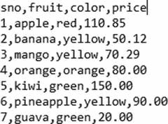

图 3-1. 示例 CSV 文件

示例 CSV 展示了数据的典型排列方式。它包含不同数据类型的属性，这些属性由逗号分隔。CSV 可能包含一个可选的标题行（如示例所示）。CSV 也可以选择性地将每个属性用单引号或双引号括起来，以便更好地界定。虽然 CSV 通常用于存储表格数据，即行和列形式的数据，但这并非唯一的方式。

CSV 有多种变体，只需将分隔符改为制表符，就变成了 TSV（制表符分隔值）文件。其基本思想是使用一个唯一的符号来界定/分隔不同的属性。

既然我们已经了解了 CSV 的样子，现在让我们运用一些 Python 魔法来读取/提取这些数据以供使用。

使用 Python 这类语言的优势之一在于其抽象和处理大量事务的能力。与其他需要特定库或大量代码才能完成基本任务的语言不同，Python 能轻松优雅地处理。读取 CSV 文件也是如此。读取 CSV 最简单的方法是通过 Python 的 `csv` 模块。该模块提供了一个名为 `reader()` 的抽象函数。`reader` 函数接收一个文件对象作为输入，并返回一个包含从 CSV 文件读取信息的 `iterator`。以下代码片段使用 `csv.reader()` 函数来读取指定文件。

```python
csv_reader = csv.reader(open(file_name, 'rb'), delimiter=',')
```

一旦返回了 `iterator`，我们就可以轻松地遍历其内容，并以所需的形式/格式获取数据。为了完整性，让我们看一个示例，该示例使用 `csv` 模块读取图 3-1 中所示的 CSV 文件内容。然后，我们将提取每个属性，并将数据转换为一个以属性名为键的 `dict`。以下代码片段实现了这些操作。

```python
csv_rows = list()
csv_attr_dict = dict()
csv_reader = None

# 读取 csv
csv_reader = csv.reader(open(file_name, 'rb'), delimiter=delimiter)

# 迭代并提取数据
for row in csv_reader:
    print(row)
    csv_rows.append(row)

# 迭代并将数据添加到属性列表
for row in csv_rows[1:]:
    csv_attr_dict['sno'].append(row[0])
    csv_attr_dict['fruit'].append(row[1])
    csv_attr_dict['color'].append(row[2])
    csv_attr_dict['price'].append(row[3])
```

输出是一个 `dict`，其中每个属性作为一个 `key`，其值是从 CSV 文件读取的有序 `list`。

```python
CSV Attributes::
{'color': ['red', 'yellow', 'yellow', 'orange', 'green', 'yellow', 'green'],
 'fruit': ['apple', 'banana', 'mango', 'orange', 'kiwi', 'pineapple', 'guava'],
 'price': ['110.85', '50.12', '70.29', '80.00', '150.00', '90.00', '20.00'],
 'sno': ['1', '2', '3', '4', '5', '6', '7']}
```

从 CSV 中提取数据及其转换方式取决于用例需求。将我们的示例 CSV 转换为属性 `dict` 只是其中一种方式。我们可以根据数据和需求选择不同的输出格式。

尽管处理和读取 CSV 文件的工作流程相当直接且易于使用，但我们希望标准化并加速这一过程。此外，通常情况下，以表格形式理解数据更为容易。在上一章中，我们了解了 `pandas` 库及其一些令人惊叹的功能。现在，让我们也利用 `pandas` 来读取 CSV。

以下代码片段展示了与 `csv` 模块相比，`pandas` 如何使从 CSV 中读取和提取数据变得更简单、更一致。

```python
df = pd.read_csv(file_name, sep=delimiter)
```

只需一行代码和几个可选参数（根据需求），`pandas` 就能从 CSV 文件中提取数据到一个数据框（dataframe）中，这是相同数据的表格化表示。使用 `pandas` 的主要优势之一在于它能够处理 CSV 文件中的许多不同变体，例如带或不带标题的文件、属性值用引号括起来、推断数据类型等等。此外，各种机器学习库能够直接操作 `pandas` 数据框，这使其实际上成为了处理 CSV 文件的事实标准包。

前面的代码片段生成了以下输出数据框：

```
   sno      fruit   color   price
0    1      apple     red  110.85
1    2     banana  yellow   50.12
2    3      mango  yellow   70.29
3    4     orange  orange   80.00
4    5       kiwi   green  150.00
5    6  pineapple  yellow   90.00
6    7      guava   green   20.00
```

**注意**：`pandas` 让读取 CSV 文件的过程变得轻而易举，然而，当我们需要更多灵活性时，`csv` 模块就派上了用场。例如，并非每个用例都需要表格形式的数据，或者数据格式可能不一致，这时就需要像 `csv` 这样灵活的库来启用自定义逻辑以处理此类数据。

同样地，来自包含非逗号分隔符（如制表符或分号）的平面文件的数据，也可以使用这两个模块轻松处理。在后续章节处理特定用例时，我们将使用这些工具；在此之前，鼓励大家探索并尝试使用它们，以便更好地理解。

## 数据交换格式

### JSON

JavaScript 对象表示法（JSON）是数字领域中使用最广泛的数据交换格式之一。JSON 是 XML（我们将在下一节讨论这种格式）等传统格式的轻量级替代方案。JSON 是一种文本格式，与语言无关，并遵循特定的约定。JSON 是一种人类可读的格式，在大多数编程/脚本语言中易于/简单解析。JSON 文件/对象本质上是一组名称（键）-值对的集合。这种键值对结构在编程语言中有对应的数据结构，例如字典（Python `dict`）、`struct`、`object`、`record`、键控列表等。更多详细信息请访问 [`http://www.json.org/`](http://www.json.org/)。

JSON 标准定义了其结构，如图 3-2 所示。


图 3-2. JSON 对象结构（参考：[`http://www.json.org/`](http://www.json.org/)）

图 3-3 是一个示例 JSON，展示了一条包含多种不同数据类型属性的词汇表记录。

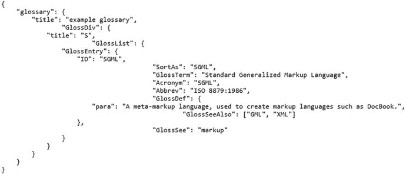

图 3-3. 示例 JSON（参考：[`http://www.json.org/`](http://www.json.org/)）

JSON 被广泛用于在系统之间传输信息。Python 中与 JSON 对象等价的数据类型是 `dict`，它本身就是一个键值对结构。Python 有各种与 JSON 相关的库，提供了抽象和实用函数。`json` 库就是其中之一，它允许我们处理 JSON 文件/对象。让我们先看一下示例 JSON 文件，然后使用这个库将这些数据导入 Python 以供使用。


图 3-4. 包含嵌套属性的示例 JSON

图 3-4 中的 JSON 对象展示了一个相当嵌套的结构，其中包含字符串、数字和数组类型的值。JSON 也支持对象、布尔值和其他数据类型作为值。以下代码片段读取文件内容，然后使用 `json.loads()` 实用函数将其解析并转换为标准的 Python `dict`。

```python
json_filedata = open(file_name).read()
json_data = json.loads(json_filedata)
```

`json_data` 是一个 Python `dict`，其键和值是解析后的 JSON 文件内容，并已类型转换为 Python 数据类型。`json` 库还提供了将 Python 字典写回为 JSON 文件的实用函数，并具备错误检查和类型转换功能。上述操作的输出如下所示。

```
outer_col_1 :
    nested_inner_col_1 : val_1
    nested_inner_col_2 : 2
    nested_inner_col_1 : val_2
    nested_inner_col_2 : 2
outer_col_2 :
    inner_col_1 : 3
outer_col_3 : 4
```

在继续介绍下一种格式之前，值得注意的是，`pandas` 也提供了解析 JSON 的实用函数。`pandas read_json()` 是一个非常强大的实用函数，它提供了多种选项来处理不同风格的 JSON。图 3-5 展示了一个示例 JSON，它表示多个数据点，每个数据点有两个属性，分别列为 `col_1` 和 `col_2`。

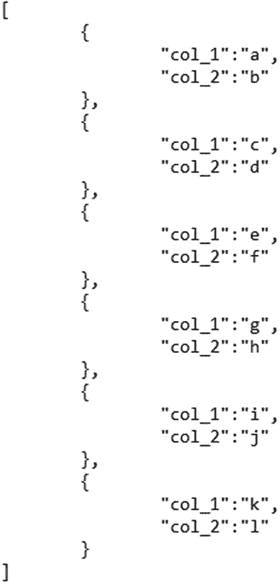

图 3-5. 展示具有相似属性记录的示例 JSON

我们可以使用 `pandas` 轻松解析这样的 JSON，只需将 `orientation` 参数设置为 “`records`”，如下所示。

```python
df = pd.read_json(file_name, orient="records")
```

输出是一个表格型数据框，每个数据点由两个属性值表示，如下所示。

```
col_1 col_2
0     a     b
1     c     d
2     e     f
3     g     h
4     i     j
5     k     l
```

建议你阅读更多关于 `pandas read_json()` 的内容，请访问 [`https://pandas.pydata.org/pandas-docs/stable/generated/pandas.read_json.html`](https://pandas.pydata.org/pandas-docs/stable/generated/pandas.read_json.html)。

### XML

我们已经介绍了两种最广泛使用的数据格式，现在让我们来看看 XML。XML 是一种相当古老的格式，但仍被许多系统使用。XML 或可扩展标记语言是一种标记语言，它定义了在互联网上共享数据/文档的编码规则。与 JSON 一样，XML 也是一种人类可读的文本格式。其设计目标包括对各种人类语言的强大支持（通过 Unicode）、平台无关性和简单性。XML 被广泛用于表示各种形状和大小的数据。

XML 被广泛用作不同系统的配置格式、元数据以及 RSS、SOAP 等服务的数据表示格式。

XML 是一种具有语法规则和模式的语言，这些规则和模式多年来不断被定义和完善。XML 最重要的组成部分如下：

*   `标签`：一种标记结构，由尖括号（“<” 和 “>”）括起来的字符串表示。

*   `内容`：未在标签语法内标记的任何数据，都是 XML 文件/对象的内容。

*   `元素`：XML 的逻辑结构。一个元素可以由一个开始标签和一个结束标签定义，可以带有属性，也可以只是一个空标签。

*   `属性`：表示所考虑元素的属性或特性的键值对。这些属性包含在开始标签或空标签内。

图 3-6 是一个示例 XML，展示了可扩展标记语言的各个组成部分。有关关键概念和细节的更多信息，可以浏览 [`https://www.w3schools.com/xml/`](https://www.w3schools.com/xml/)。

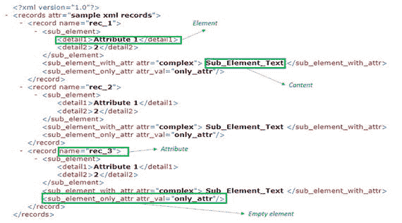

图 3-6. 标注了关键组件的示例 XML

XML 可以被视为树状结构，从一个根元素开始，分支到各种元素，每个元素都有自己的属性和进一步的分支，内容位于叶节点。

大多数 XML 解析器使用这种树状结构来读取 XML 内容。以下是两种主要的 XML 解析器类型：

*   `DOM 解析器`：文档对象模型解析器是 XML 最接近树形表示的形式。它解析 XML 并生成树结构。DOM 解析器的一个主要缺点是处理大型 XML 文件时的不稳定性。

*   `SAX 解析器`：XML 简单 API（简称 SAX）是一种在网络上广泛使用的变体。这是一种基于事件的解析器，它逐个元素地解析 XML，并提供钩子来根据标签触发事件。这克服了 DOM 基于内存的限制，但缺乏整体的表示能力。

从这两种类型衍生出了多种变体。首先，让我们看看 Python 的 `xml` 库中提供的 `ElementTree` 解析器。`ElementTree` 解析器是对 DOM 解析器的优化，它利用 Python 的数据结构（如 `lists` 和 `dicts`）以简洁的方式处理数据。

以下代码片段使用 `ElementTree` 解析器加载并解析我们之前看到的示例 XML 文件。`parse()` 函数返回一个树对象，该对象具有各种属性、迭代器和实用函数，用于提取解析后的 XML 的根元素及更多组件。

```python
tree = ET.parse(file_name)
root = tree.getroot()
print("Root tag:{0}".format(root.tag))
print("Attributes of Root:: {0}".format(root.attrib))
```

这两个 `print` 语句为我们提供了与根标签及其属性（如果有）相关的值。根对象还附带一个迭代器，可用于提取与所有子节点相关的信息。以下代码片段迭代根对象以打印子节点的内容。

```python
for child in xml:root:
    print("{0}tag:{1}, attribute:{2}".format(
        "\t"*indent_level,
        child.tag,
        child.attrib))
    print("{0}tag data:{1}".format("\t"*indent_level,
                                   child.text))
```

使用 `ElementTree` 解析 XML 后生成的最终输出如下。我们使用了一个自定义的打印工具来让输出更易读，该工具的代码可在仓库中找到。

```
Root tag:records
Attributes of Root:: {'attr': 'sample xml records'}
tag:record, attribute:{'name': 'rec_1'}
tag data:
tag:sub_element, attribute:{}
tag data:
tag:detail1, attribute:{}
tag data:Attribute 1
tag:detail2, attribute:{}
tag data:2
tag:sub_element_with_attr, attribute:{'attr': 'complex'}
tag data:
Sub_Element_Text
tag:sub_element_only_attr, attribute:{'attr_val': 'only_attr'}
tag data:None
tag:record, attribute:{'name': 'rec_2'}
tag data:
tag:sub_element, attribute:{}
tag data:
tag:detail1, attribute:{}
tag data:Attribute 1
tag:detail2, attribute:{}
tag data:2
tag:sub_element_with_attr, attribute:{'attr': 'complex'}
tag data:
Sub_Element_Text
tag:sub_element_only_attr, attribute:{'attr_val': 'only_attr'}
tag data:None
```

`xml` 库通过 `ElementTree` 解析器提供了非常有用的工具，但其功能仍有所欠缺。另一个 Python 库 `xmltodict` 提供了类似的功能，但使用了 Python 的原生数据结构（如 `dicts`）来提供更 Pythonic 的 XML 处理方式。以下是解析同一 XML 的快速代码片段。与 `ElementTree` 不同，`xmltodict` 的 `parse()` 函数读取文件对象并将其内容转换为嵌套字典。

```python
xml_filedata = open(file_name).read()
ordered_dict = xmltodict.parse(xml_filedata)
```

生成的输出与使用 `ElementTree` 生成的输出类似，区别在于 `xmltodict` 使用 `@` 符号自动标记元素和属性。以下是示例输出。

```
records :
@attr : sample xml records
record :
@name : rec_1
sub_element :
detail1 : Attribute 1
detail2 : 2
sub_element_with_attr :
@attr : complex
#text : Sub_Element_Text
sub_element_only_attr :
@attr_val : only_attr
```

### HTML 与网页抓取

我们在本章开头讨论了以极快速度生成的巨量信息/数据。互联网或万维网是这场革命的主要驱动力之一，再加上计算机、智能手机和平板电脑的广泛普及。

互联网是一个通过超链接连接的巨大信息网络。互联网上的大量数据以网页的形式存在。这些网页日复一日地被生成、更新和消费数百万次。由于信息存在于这些网页中，我们必须学会如何与之交互并提取这些信息/数据。

到目前为止，我们处理过 CSV、JSON 和 XML 等格式，这些格式可以通过手动下载、API 等各种方法获取/提取。但对于网页，方法则有所不同。在本节中，我们将讨论 HTML 格式（最常见的网页相关格式）以及网页抓取技术。

#### HTML

超文本标记语言（HTML）是一种类似于 XML 的标记语言。HTML 主要由网络浏览器和类似应用程序用于渲染网页以供消费。

HTML 使用标记定义了描述网页的规则和结构。以下是 HTML 页面的标准组件：

*   **元素**：构成 HTML 页面基本构建块的逻辑结构。

*   **标签**：由尖括号（`<` 和 `>`）定义的标记结构。一些重要的标签包括：

    *   `<html></html>`：这对标签包含整个 HTML 文档。它标记了 HTML 页面的开始和结束。

    *   `<body></body>`：这对标签包含浏览器渲染的 HTML 页面的主要内容。

HTML 标准中定义了许多其他标准标签集；更多信息请访问 [`https://www.w3schools.com/html/html_intro.asp`](https://www.w3schools.com/html/html_intro.asp)。

以下是一个生成 HTML 页面的代码片段，该页面由网络浏览器渲染，如图 3-7 中的截图所示。

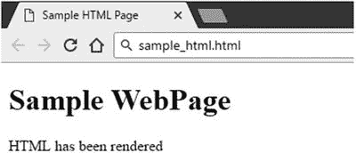

图 3-7. 浏览器中渲染的示例 HTML 页面

```html
<html>
    <head>
        <title>
            Sample HTML Page
        </title>
    </head>
    <body>
        <h1>
            Sample WebPage
        </h1>
        <p>
            HTML has been rendered
        </p>
    </body>
</html>
```

浏览器使用标记标签来理解特殊指令，如文本格式、定位、超链接等，但仅向最终用户渲染内容以供查看。对于数据/信息存在于 HTML 页面中的用例，我们需要特殊的技术来提取这些内容。

#### 网页抓取

网页抓取是一种从网络（尤其是网页）中抓取或提取数据的技术。网页抓取可能涉及手动复制数据，或使用自动化工具来爬取、解析和提取网页中的信息。在大多数情况下，网页抓取指的是自动爬取特定网站或网络的一部分，以提取和解析信息，这些信息随后可用于分析或其他用途。一个典型的网页抓取流程可概括如下：

*   **爬取**：设计一个机器人或网络爬虫，使用所需的 URL 集合向网络服务器发送请求，以获取网页。爬虫可能采用复杂的技术来获取相关 URL 链接页面中的信息，甚至在一定程度上解析信息。网站会维护一个名为 `robots.txt` 的文件，以实施所谓的“机器人排除协议”，从而限制或允许对其内容的访问。更多详情请参见 [`http://www.robotstxt.org/robotstxt.html`](http://www.robotstxt.org/robotstxt.html)。

*   **抓取**：一旦获取到原始网页，下一步就是从中提取信息。抓取任务涉及使用正则表达式、基于 XPath 的提取或特定标签等技术，以精确定位页面上的所需信息。

网页抓取在精确定位所需信息方面需要发挥创造力。随着网站不断变化、网页变得动态化（例如 `asp`、`jsp` 等），以及访问控制（用户名/密码、验证码等）的存在，使得这项任务更加复杂。Python 是一种非常强大的编程语言，这一点现在应该已经很明显了，而网页抓取是它提供多种实用工具的另一个领域。让我们从提取 Apress 博客上的一篇博文文本开始，以便更好地理解网页抓取。

第一步是确定我们感兴趣的 URL。在当前示例中，我们专注于 Apress 网站博客页面 [`http://www.apress.com/in/blog/all-blog-posts`](http://www.apress.com/in/blog/all-blog-posts) 上当天第一篇博文。点击最顶部的博文会跳转到我们要考虑的主文章。该文章在屏幕上的显示如图 3-8 所示。


图 3-8. Apress.com 上的一篇博文

现在我们有了所需的页面及其 URL，我们将使用 `requests` 库来查询所需的 URL 并获取响应。以下代码片段实现了这一功能。

```python
base_url = "http://www.apress.com/in/blog/all-blog-posts"
blog_suffix = "/wannacry-how-to-prepare/12302194"
response = requests.get(base_url+blog_suffix)
```

如果 `get` 请求成功，响应对象的 `status_code` 属性将包含值 200（相当于 HTTP 成功代码）。在获得成功响应后，下一步是设计一种方法来提取所需信息。

由于在本例中我们关心的是博文的实际内容，让我们分析一下页面背后的 HTML，看看是否能找到感兴趣的特定标签。

注意

大多数现代浏览器都内置了 HTML 检查工具。如果你使用的是 Google Chrome，请按 F12 或右键单击页面并选择“检查”或“查看源代码”。这将打开 HTML 代码供你分析。

图 3-9 展示了我感兴趣的博文背后 HTML 的快照。


图 3-9. 检查 Apress.com 上博文的 HTML 内容

经过仔细检查，我们可以清楚地看到博文的文本包含在 `div` 标签 `<div class="cms-richtext">` 中。现在我们已经缩小到感兴趣的标签，我们使用 Python 的正则表达式库 `re` 来搜索并仅提取这些标签内的数据。以下代码片段使用 `re.compile()` 编译一个正则表达式，然后使用 `re.findall()` 从获取的响应中提取信息。

```python
content_pattern = re.compile(r'(.*?)')
result = re.findall(content_pattern, content)
```

`find` 操作的输出是博文中的所需文本。当然，它仍然包含与实际文本交织在一起的 HTML 标签。我们可以进行进一步的清理以达到所需级别，但这已经是一个良好的开端。以下是使用正则表达式提取的信息快照。

```
Out[59]: 'By Mike HalseyIt was a perfectly ordinary Friday when the Wannacry ransomware struck in May 2017\. The malware spread around the world to more than 150 countries in just a matter of a few hours, affecting the National Health Service in the UK, telecoms provider Telefonica in Spain, and many other organisations and businesses in the USA, Canada, China, Japan, Russia, and right across Europe, the Middle-East, and Asia.The malware was reported to have been stolen in an attack on the US National Security Agency (NSA), though the NSA denied this, and exploited vulnerabilities in the Microsoft Windows operating system. Microsoft had been aware of the vulnerabilities since early in the year, and had patched them back in March.
```

这是一种直接且非常基础的方法来获取所需数据。如果我们想更进一步，提取页面上所有博文的相关信息并进行更好的清理，该怎么办？

对于此类任务，我们使用 `BeautifulSoup` 库。`BeautifulSoup` 是用于网页抓取及相关任务的首选标准库。它提供了一些出色的功能来简化抓取过程。对于手头的任务，我们的流程是首先爬取索引页面，提取页面上列出的所有博文链接的 URL。为此，我们将使用 `requests.get()` 函数来提取内容，然后利用 `BeautifulSoup` 的实用工具从这些 URL 中获取内容。以下代码片段展示了 `get_post_mapping()` 函数，该函数解析主页内容，将博文标题和相应的 URL 提取到一个字典中。该函数最终返回一个此类字典的列表。

```python
def get_post_mapping(content):
    """This function extracts blog post title and url from response object
    Args:
        content (request.content): String content returned from requests.get
    Returns:
        list: a list of dictionaries with keys title and url
    """
    post_detail_list = []
    post_soup = BeautifulSoup(content,"lxml")
    h3_content = post_soup.find_all("h3")
    for h3 in h3_content:
        post_detail_list.append(
            {'title':h3.a.get_text(),'url':h3.a.attrs.get('href')}
        )
    return post_detail_list
```

上述函数首先创建一个 `BeautifulSoup` 对象，并指定 `lxml` 作为其解析器。然后，它使用 `h3` 标签和基于正则表达式的搜索来提取所需的标签列表（我们通过之前使用的相同检查元素方法找到了 `h3` 标签）。接下来的任务就是简单地遍历 `h3` 标签列表，并利用 `BeautifulSoup` 的 `get_text()` 实用函数来获取博文标题及其对应的 URL。该函数返回的列表如下所示。

```python
[{'title': u"WannaCry：为何这只是开始，以及如何为后续威胁做好准备",
  'url': '/in/blog/all-blog-posts/wannacry-how-to-prepare/12302194'},
 {'title': u'在 Angular 中复用 ngrx/effects（在 reducers 之间通信）',
  'url': '/in/blog/all-blog-posts/reusing-ngrx-effects-in-angular/12279358'},
 {'title': u'采访 Tony Smith——作家兼 SharePoint 专家',
  'url': '/in/blog/all-blog-posts/interview-with-tony-smith-author-and-sharepoint-expert/12271238'},
 {'title': u'理解传感器——类型与识别层级',
  'url': '/in/blog/all-blog-posts/making-sense-of-sensors/12253808'},
 {'title': u'VS 2017、.NET Core 与 JavaScript 框架，天哪！',
  'url': '/in/blog/all-blog-posts/vs-2017-net-core-and-javascript-frameworks-oh-my/12261706'}]
```

现在我们有了列表，最后一步就是遍历这个 URL 列表，提取每篇博客文章的文本。以下函数展示了与之前使用正则表达式的方法相比，`BeautifulSoup`如何简化了任务。识别所需标签的方法保持不变，但我们利用了这个库的强大功能来获取不含所有 HTML 标签的纯文本。

```python
def get_post_content(content):
    """此函数从响应对象中提取博客文章内容
    参数:
        content (request.content): 从 requests.get 返回的字符串内容
    返回:
        str: 博客的纯文本内容
    """
    plain_text = ""
    text_soup = BeautifulSoup(content,"lxml")
    para_list = text_soup.find_all("div",
        {'class':'cms-richtext'})
    for p in para_list[0]:
        plain_text += p.getText()
    return plain_text
```

以下输出是其中一篇文章的内容。请注意，与之前的方法相比，此处的文本更加干净。

```
By Mike Halsey2017 年 5 月，一个看似平常的星期五，WannaCry 勒索病毒突然爆发。该恶意软件在短短几小时内蔓延至全球 150 多个国家，影响了英国国家医疗服务体系、西班牙电信公司 Telefonica，以及美国、加拿大、中国、日本、俄罗斯和整个欧洲、中东及亚洲的众多其他组织与企业。据报道，该恶意软件是在一次针对美国国家安全局的攻击中被窃取的，尽管 NSA 否认了这一点，并且它利用了微软 Windows 操作系统中的漏洞。微软早在当年年初就已获悉这些漏洞，并于 3 月份发布了补丁。
```

通过这两种方法，我们从目标网站抓取并提取了与博客文章相关的信息。建议您尝试使用`BeautifulSoup`的其他实用工具，并结合其他网站进行实践，以便更好地理解。当然，请务必阅读`robots.txt`并遵守网站管理员设定的规则。

### SQL

数据库的历史可以追溯到 20 世纪 70 年代，它们代表了以关系形式存储的大量数据。数据库中以表格形式存在的数据，或者更具体地说，关系型数据库中的数据，构成了我们在处理不同用例时遇到的另一种结构化数据格式。多年来，出现了多种不同风格的数据库，其中大多数都遵循 SQL 标准。

Python 生态系统主要通过两种方式处理来自数据库的数据。第一种也是最常见的方式，用于数据科学及相关用例，是直接使用 SQL 查询访问数据。为了使用 SQL 查询访问数据，像`sqlalchemy`和`pyodbc`这样强大的库提供了便捷的接口，用于连接、提取和操作来自各种关系型数据库（如 MS SQL Server、MySQL、Oracle 等）的数据。`sqlite3`库提供了一个轻量级且易于使用的接口来处理 SQLite 数据库，不过其他两个库同样可以处理该任务。

与数据库交互的第二种方式是 ORM（对象关系映射）方法。这种方法与面向对象的数据模型类似，即关系数据被映射为对象和类。`Sqlalchemy`提供了一个高级接口，用于以 ORM 方式与数据库交互。我们将在后续章节中根据具体用例进一步探讨这些内容。

## 数据描述

在上一节中，我们讨论了各种数据格式及其信息提取方法。每种数据格式都由包含不同类型属性的数据点组成。这些原始数据形式的数据类型构成了机器学习算法以及整个数据科学工作流中其他任务所使用输入特征的基础。在本节中，我们将介绍在处理不同用例时遇到的主要数据类型。

### 数值型

这是最简单的一种数据类型。它也是大多数算法可以直接使用和理解的类型（尽管这并不意味着我们直接使用原始形式的数值数据）。数值数据表示被观测实体的标量信息，例如，网站访问次数、产品价格、人的体重等。数值也是向量特征的基础，其中每个维度由一个标量值表示。数值数据的尺度、范围和分布对算法和/或整个工作流有隐含的影响。为了处理数值数据，我们使用诸如归一化、分箱、量化等技术，根据需求对数值数据进行转换。

### 文本型

由非结构化的字母数字内容组成的数据是最常见的数据类型之一。当文本数据表示人类语言内容时，它包含了隐含的语法结构和含义。这种数据类型需要额外的关注和努力来进行转换和理解。我们将在后续章节中介绍转换和使用文本数据的各个方面。

### 类别型

这种数据类型介于数值型和文本型之间。类别变量指的是被观测实体的类别。例如，头发颜色为黑色、棕色、金色和红色，或经济状况为低、中、高。这些值可以用数字或字母数字表示，它们描述了所考虑项目的属性。根据某些特征，类别变量可以分为：

*   名义型：仅定义数据点的类别，无法进行排序。例如，头发颜色可以是黑色、棕色、金色等，但这些类别之间没有顺序。

*   有序型：定义类别，但也可以根据上下文规则进行排序。例如，按经济状况（低、中、高）分类的人群可以明确地按相应顺序排序。

需要注意的是，标准的数学运算（如加法、减法、乘法等）对类别变量没有意义，即使它们在语法上可能允许（例如用数字表示的类别变量）。因此，谨慎处理类别变量非常重要，我们将在下一节中介绍几种处理类别数据的方法。

不同的数据类型构成了算法处理当前数据时所使用的特征基础。在接下来的章节中，特别是第 4 章：特征工程与选择，您将学习更多关于如何处理特定数据类型的内容。

## 数据整理

到目前为止，本章讨论了数据格式和数据类型，并学习了从不同来源收集数据的方法。既然我们已经了解了收集和理解数据的初始过程，那么合乎逻辑的下一步就是能够根据手头的用例，使用各种机器学习算法对数据进行分析。但在这些“原始”数据达到可供算法或可视化使用的阶段之前，我们需要对其进行打磨和塑形。

数据整理（Data wrangling）或数据清洗（data munging）是指对数据进行清洗、转换和映射，使其从一种形式变为另一种形式，以便用于分析、汇总、报告、可视化等任务的过程。

### 理解数据

数据整理是整个数据科学工作流程中最重要且最耗时的步骤之一。此过程的输出会直接影响所有下游步骤，例如探索、汇总、可视化、分析，甚至最终结果。这清楚地说明了为什么数据科学家会花费大量时间在数据收集和整理上。有许多调查都揭示了这样一个事实：数据科学家往往会把 80% 的时间花在数据处理和整理上！

因此，在接下来的章节中开始处理实际用例和算法之前，我们必须理解并学习如何整理数据，并将其转换为可用的形式。首先，让我们描述一下手头的数据集。为简单起见，我们准备了一个示例数据集，描述了某些用户的产品购买交易。由于我们已经讨论了收集/提取数据的方法，本节将跳过这一步。图 3-10 显示了数据集的快照。

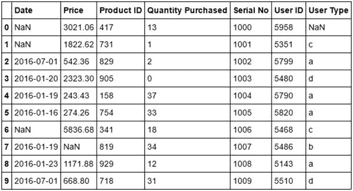

图 3-10. 示例数据集

> 注意：所考虑的数据集是使用标准 Python 库（如 `random`, `datetime`, `numpy`, `pandas` 等）生成的。该数据集是使用本书代码仓库中名为 `generate_sample_data()` 的实用函数生成的。数据是随机生成的，仅用于表示目的。

该数据集描述了具有以下属性/特征/特性的交易：

*   日期：交易日期
*   价格：所购产品的价格
*   产品 ID：产品识别号
*   购买数量：本次交易中购买的产品数量
*   序列号：交易序列号
*   用户 ID：执行交易的用户的识别号
*   用户类型：用户类型

现在，让我们开始整理/清洗过程，并了解各种方法/技巧，以清洗、转换和映射我们的数据集，使其成为可用的形式。通常，第一步也是最重要的一步是快速查看记录/行数、列/属性数、列/属性名称及其数据类型。

在本节及后续章节的大部分内容中，我们将依赖 `pandas` 及其工具来执行所需任务。以下代码片段提供了行数、属性数和详细信息。

```python
print("Number of rows::",df.shape[0])
print("Number of columns::",df.shape[1] )
print("Column Names::",df.columns.values.tolist())
print("Column Data Types::\n",df.dtypes)
```

所需信息可以直接从 `pandas` 数据框本身获取。`shape` 属性是一个二元组，分别代表行数和列数。列名可通过 `columns` 属性获取，而 `dtypes` 属性则提供了数据集中每一列的数据类型。以下是此代码片段生成的输出。

```
Number of rows:: 1001
Number of columns:: 7
Column Names:: ['Date', 'Price', 'Product ID', 'Quantity Purchased', 'Serial No', 'User ID', 'User Type']
Column Data Types::
Date                   object
Price                 float64
Product ID              int32
Quantity Purchased      int32
Serial No               int32
User ID                 int32
User Type              object
dtype: object
```

列名已清晰列出，并在前面进行了解释。检查数据类型后，我们可以清楚地看到 `Date` 属性被表示为对象类型。在进行转换和清理之前，让我们进一步深入挖掘并收集更多信息，以理解并制定数据集整理所需任务的策略。以下代码片段有助于获取与包含缺失值的属性/列、行数以及包含缺失值的索引相关的信息。

```python
print("Columns with Missing Values::",df.columns[df.isnull().any()].tolist())
print("Number of rows with Missing Values::",len(pd.isnull(df).any(1).nonzero()[0].tolist()))
print("Sample Indices with missing data::",pd.isnull(df).any(1).nonzero()[0].tolist()[0:5] )
```

使用 `pandas`，下标操作同时适用于行和列（详见第 2 章）。我们使用 `isnull()` 来识别包含缺失值的列。工具函数 `any()` 和 `nonzero()` 提供了很好的抽象，用于识别符合某个条件的任何行/列（本例中指向包含缺失值的行/列）。输出如下。

```
Columns with Missing Values:: ['Date', 'Price', 'User Type']
Number of rows with Missing Values:: 61
Sample Indices with missing data:: [0L, 1L, 6L, 7L, 10L]
```

让我们也快速进行事实核查，以获取每列非空行的详细信息以及此数据框消耗的内存量。我们还可以获得一些基本的汇总统计信息，如最小值、最大值等；这些信息在后续任务中会很有用。对于第一个任务，我们使用 `info()` 工具，而汇总统计信息则由 `describe()` 函数提供。以下代码片段实现了这一点。

# 数据分析

## 初始检查

以下是使用 `info()` 和 `describe()` 工具生成的输出。它显示 `Date` 和 `Price` 都有大约 970 个非空行，而数据集消耗了近 40KB 的内存。汇总统计信息不言自明，并且从输出中排除了 `Date` 和 `User Type` 等非数字列。

```python
print("General Stats::")
print(df.info())
print("Summary Stats::" )
print(df.describe())
```

输出如下：

```
General Stats::

RangeIndex: 1001 entries, 0 to 1000
Data columns (total 7 columns):
Date                  970 non-null object
Price                 970 non-null float64
Product ID            1001 non-null int32
Quantity Purchased    1001 non-null int32
Serial No             1001 non-null int32
User ID               1001 non-null int32
User Type             1000 non-null object
dtypes: float64(1), int32(4), object(2)
memory usage: 39.2+ KB
None
Summary Stats::
        Price   Product ID  Quantity Purchased    Serial No      User ID
count   970.000000  1001.000000         1001.000000  1001.000000  1001.000000
mean   1523.906402   600.236763           20.020979  1452.528472  5335.669331
std    1130.331869   308.072110           11.911782   386.505376   994.777199
min       2.830000     0.000000            0.000000    -1.000000  -101.000000
25%     651.622500   342.000000           10.000000  1223.000000  5236.000000
50%    1330.925000   635.000000           20.000000  1480.000000  5496.000000
75%    2203.897500   875.000000           30.000000  1745.000000  5726.000000
max    5840.370000  1099.000000           41.000000  2000.000000  6001.000000
```

## 数据过滤

我们已经完成了对现有数据集的初步检查，了解了它包含什么以及缺少什么。下一阶段是数据清洗。清洗数据集涉及诸如删除/处理错误或缺失数据、处理异常值等任务。清洗还包括标准化属性列名，使其更具可读性、更直观，并符合某些标准，以便所有相关人员理解。为了执行此任务，我们编写一个小函数，并利用 `pandas` 的 `rename()` 工具来完成这一步。`rename()` 函数接受一个 `dict`，其中键代表旧列名，值指向新列名。我们还可以通过适当设置 `inplace` 标志来决定是修改现有数据框还是生成一个新的。以下代码片段展示了这个函数。

```python
def cleanup_column_names(df,rename_dict={},do_inplace=True):
    """此函数用于重命名 pandas 数据框的列
    如果未传递 rename_dict，则将列名转换为蛇形命名法。
    参数:
    rename_dict (dict): 键代表旧列名，值指向新列名
    do_inplace (bool): 标志，用于更新现有数据框或返回新数据框
    返回:
    如果 do_inplace 设置为 False，则返回 pandas 数据框，否则返回 None
    """
    if not rename_dict:
        return df.rename(columns={col: col.lower().replace(' ','_')
                                  for col in df.columns.values.tolist()},
                         inplace=do_inplace)
    else:
        return df.rename(columns=rename_dict,inplace=do_inplace)
```

在我们所考虑的 `dataframe` 上使用此函数后，会生成图 3-11 中的输出。由于我们没有传递任何包含新旧列名的 `dict`，该函数会将所有列更新为蛇形命名法。

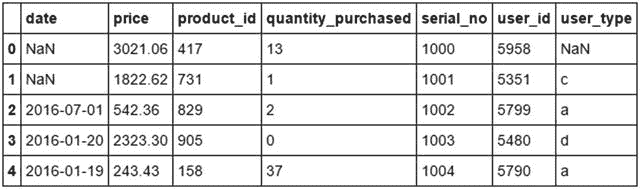

图 3-11. 列名已重命名的数据集

对于不同的算法、分析甚至可视化，我们通常只需要处理属性的一个子集。使用 `pandas`，我们可以通过多种方式垂直切片（选择列的子集）。`pandas` 提供了不同的方式来适应不同的场景，如下面的代码片段所示。

```python
print("使用列索引::" )
print(df[[3]].values[:, 0] )
print("使用列名::" )
print(df.quantity_purchased.values)
print("使用列数据类型::" )
print(df.select_dtypes(include=['float64']).values[:,0] )
```

在此代码片段中，我们以三种不同的方式执行了属性选择。第一种方法利用列索引号来获取所需信息。在此例中，我们只想处理 `quantity_purchased` 字段，因此索引号为 3（`pandas` 列从 0 开始索引）。第二种方法通过直接以点号表示法引用列名来提取同一属性的数据。第一种方法在循环中非常方便，而第二种方法更具可读性，并且在我们利用 Python 的面向对象特性时能很好地融合。然而，有时我们只需要根据数据类型来获取属性。第三种方法利用 `select_dtypes()` 工具来完成此任务。它提供了仅基于数据类型来包含和排除列的方法。在此示例中，我们选择了数据类型为浮点型的列（我们数据集中的价格列）。此代码片段的输出如下。

```
使用列索引::
[13  1  2 ...,  2 30 17]
使用列名::
[13  1  2 ...,  2 30 17]
使用列数据类型::
[ 3021.06  1822.62   542.36 ...,  1768.66  1848.5   1712.22]
```

选择特定的属性/列是数据框子集化的一种方式。也可能存在需要水平拆分数据框的需求。为了处理行的子集，`pandas` 提供了如下代码片段中概述的方法。

```python
print("选择特定的行索引::")
print(df.iloc[[10,501,20]] )
print("排除特定的行索引::" )
print(df.drop([0,24,51], axis=0).head())
print("基于逻辑条件进行子集化::" )
print(df[df.quantity_purchased>25].head())
print("基于距顶部（底部）的偏移进行子集化::" )
print(df[100:].head() #df.tail(-100) )
```

第一种方法利用基于 `iloc`（或整数索引/位置）的选择，我们需要指定要从数据框中获取的索引列表。第二种方法允许从数据框中删除/过滤掉特定的行索引。这在需要过滤掉不满足某些条件的行时非常有用。第三种方法展示了基于条件逻辑的行过滤。最后一种方法基于距数据框顶部的偏移进行过滤。还有一种类似的方法，称为 `tail()`，可用于从底部进行偏移。生成的输出如图 3-12 所示。

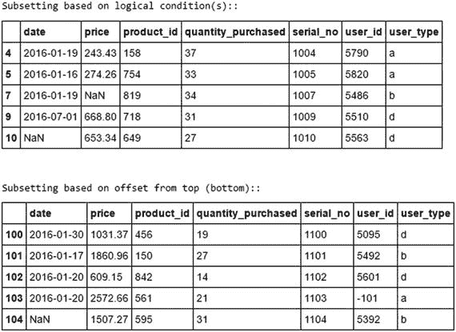

图 3-12. 行子集化的不同方式

## 类型转换

# 类型转换

类型转换，即将数据转换为适当的数据类型，通常是数据清洗和整理的重要组成部分。数据在从一种形式提取或转换为另一种形式时，常常会被转换为错误的数据类型。此外，不同的平台和系统对每种数据类型的处理方式也不同，因此获得正确的数据类型非常重要。在开始讨论数据整理时，我们检查了数据集中所有列的数据类型。如果你还记得，日期列被标记为对象。虽然如果我们不处理日期，这可能不是问题，但在我们需要日期及相关属性的情况下，将它们作为对象/字符串可能会带来问题。此外，如果日期以字符串形式存在，则很难处理日期操作。为了修复我们的数据框，我们使用 `pandas` 的 `to_datetime()` 函数。这是一个非常灵活的工具，允许我们设置不同的属性，如日期时间格式、时区等。在我们的例子中，值只是日期，因此我们按如下方式使用该函数及其默认设置。

```python
df['date'] = pd.to_datetime(df.date)
print(df.dtypes)
```

类似地，我们可以使用 `to_numeric()` 以及直接的 Python 风格类型转换，将标记为字符串的数值列进行转换。现在检查数据类型，我们可以清楚地看到日期列已转换为正确的 `datetime64` 数据类型。

```
date                  datetime64[ns]
price                        float64
product_id                     int32
quantity_purchased             int32
serial_no                      int32
user_id                        int32
user_type                     object
dtype: object
```

### 转换

数据整理中的另一项常见任务是根据用例或数据本身的需求转换现有列或派生新属性。为了派生或转换列，`pandas` 提供了三种不同的工具——`apply()`、`applymap()` 和 `map()`。`apply()` 函数用于对整个对象执行操作，具体取决于轴（默认为所有行）。`applymap()` 和 `map()` 函数按元素工作，其中 `map()` 来自 `pandas.Series` 层级结构。

为了理解这三种工具，我们以派生一些新属性为例。首先，我们使用 `map()` 函数扩展 `user_type` 属性。我们编写一个小函数，将每个不同的 `user_type` 代码映射到对应的用户类别，如下所示。

```python
def expand_user_type(u_type):
    if u_type in ['a','b']:
        return 'new'
    elif u_type == 'c':
        return 'existing'
    elif u_type == 'd':
        return 'loyal_existing'
    else:
        return 'error'

df['user_class'] = df['user_type'].map(expand_user_type)
```

类似地，我们使用 `applymap()` 函数执行另一个逐元素操作，从日期属性中获取交易所在的周数。在这种情况下，我们使用 `lambda` 函数来快速完成任务。有关 `lambda` 函数的更多详细信息，请参阅前面的章节。以下代码片段为我们获取了每笔交易的周数。

```python
df['purchase_week'] = df[['date']].applymap(lambda dt: dt.week
                                              if not pd.isnull(dt.week)
                                              else 0)
```

图 3-13 展示了我们的数据框，其中包含两个额外的属性——`user_class` 和 `purchase_week`。

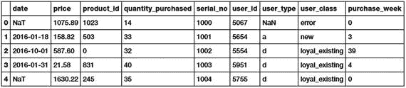

图 3-13. 使用 `map` 和 `applymap` 派生属性的数据框

现在，我们使用 `apply()` 函数对整个数据框对象本身执行操作。以下代码片段使用 `apply()` 函数获取所有数值属性的范围（最大值到最小值）。我们使用前面讨论过的 `select_dtypes` 和 `lambda` 函数来完成此任务。

```python
df.select_dtypes(include=[np.number]).apply(lambda x: x.max()- x.min())
```

输出是一个精简的 `pandas.Series` 对象，展示了每个数值列的范围值。

```
price                 5837.54
product_id            1099.00
quantity_purchased      41.00
serial_no             2001.00
user_id               6102.00
purchase_week           53.00
```

### 填充缺失值

在处理机器学习和数据科学相关用例时，缺失值可能导致各种问题。它们不仅会给算法带来问题，还可能扰乱计算甚至最终结果。缺失值还存在以非标准方式解释的风险，从而导致混淆和更多错误。因此，填充缺失值在整个数据整理过程中非常重要。

处理缺失值最简单的方法之一是从数据集中忽略或完全删除它们。当数据集相当大并且我们有足够多的各种类型样本时，可以安全地使用此选项。在以下代码片段中，我们使用 `pandas` 的 `dropna()` 函数删除交易日期缺失的数据行。

```python
print("删除日期缺失的行::" )
df_dropped = df.dropna(subset=['date'])
print("形状::", df_dropped.shape)
```

结果是一个没有缺失日期行的数据框。输出数据框如图 3-14 所示。

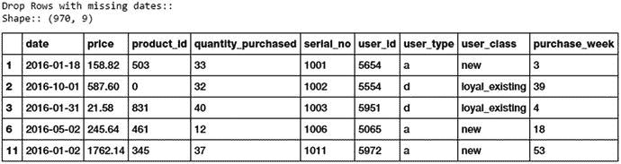

图 3-14. 没有任何缺失日期信息的数据框

通常，删除行是一个非常昂贵且不可行的选择。在许多情况下，缺失值是借助数据框中的其他值来填充的。一种常用的技巧是用集中趋势度量（如 `mean` 或 `median`）替换缺失值。也可以选择其他更复杂的度量/统计方法。在我们的数据集中，价格列似乎有一些缺失数据。我们利用 `pandas` 的 `fillna()` 方法，用数据框中的平均价格值填充这些值。

类似地，我们使用 `ffill()` 和 `bfill()` 函数来填充 `user_type` 属性的缺失值。由于 `user_type` 是字符串类型属性，我们使用基于邻近度的解决方案来处理这种情况下的缺失值。`ffill()` 和 `bfill()` 函数分别从前一行向前复制数据（前向填充）或从下一行复制值（后向填充）。以下代码片段展示了这三个函数。

```python
print("用平均价格填充缺失的价格值::" )
df_dropped['price'].fillna(value=np.round(df.price.mean(), decimals=2),
                           inplace=True)
print("用前一行的值填充缺失的 user_type 值（前向填充）::" )
df_dropped['user_type'].fillna(method='ffill', inplace=True)
print("用下一行的值填充缺失的 user_type 值（后向填充）::" )
df_dropped['user_type'].fillna(method='bfill', inplace=True)
```

除了这些方法之外，在某些情况下，如果一条记录缺失的属性值超过某个阈值，那么这条记录就没有太大用处。例如，如果我们的数据集中，一笔交易的非空属性少于三个，那么这笔交易可能几乎无法使用。在这种情况下，建议直接删除该数据点。我们可以使用 `dropna()` 函数并设置参数 `thresh` 为非空属性的阈值来过滤掉此类数据点。更多详细信息请参见官方文档页面。

### 处理重复值

许多数据集的另一个问题是存在重复值。虽然数据很重要且多多益善，但重复值本身并不会增加太多价值。更有甚者，重复值有助于我们识别数据记录/收集过程中潜在的错误区域。为了识别重复值，我们有一个名为 `duplicated()` 的工具，它可以应用于整个数据框，也可以应用于其子集。我们可以通过修复错误并使用 `duplicated()` 函数来处理重复值，尽管我们也可以选择完全删除重复的数据点。要删除重复值，我们使用 `drop_duplicates()` 方法。以下代码片段展示了这里讨论的两个函数。

```python
df_dropped[df_dropped.duplicated(subset=['serial_no'])]
df_dropped.drop_duplicates(subset=['serial_no'], inplace=True)
```

识别出数据框中 `serial_no` 字段具有重复值的子集的输出如图 3-15 所示。前一个代码片段中的第二行只是删除了这些重复值。

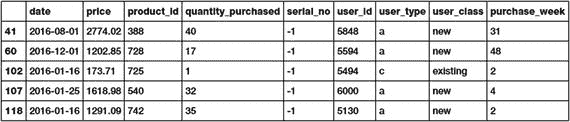

图 3-15. 具有重复 `serial_no` 值的数据框

### 处理分类数据

正如“数据描述”一节所讨论的，分类属性由可取有限数量值（尽管并非总是如此）的数据组成。在我们的数据集中，属性 `user_type` 是一个分类变量，它只能从允许的集合 {a, b, c, d} 中取有限数量的值。我们在后续章节中将学习和使用的算法大多处理数值数据，而分类变量可能会带来一些问题。使用 `pandas`，我们可以通过几种不同的方式处理分类变量。第一种是使用 `map()` 函数，我们只需将允许集合中的每个值映射到一个数值。尽管这可能有用，但这种方法需要谨慎处理并注意其局限性。例如，像加法、均值等统计操作，虽然在语法上是有效的，但出于显而易见的原因应避免使用（更多内容将在后续章节中讨论）。第二种方法是使用 `get_dummies()` 函数将分类变量转换为指示变量。该函数只是一个包装器，用于为所考虑的变量生成独热编码。独热编码和其他编码也可以使用像 `sklearn` 这样的库来处理（我们将在后续章节中看到更多示例）。

以下代码片段展示了前面讨论的两种方法，分别使用了 `map()` 和 `get_dummies()`。

```
# 使用 map 进行虚拟编码
type_map={'a':0,'b':1,'c':2,'d':3,np.NAN:-1}
df['encoded_user_type'] = df.user_type.map(type_map)
print(df.head())

# 使用 get_dummies 进行独热编码
print(pd.get_dummies(df,columns=['user_type']).head())
```

输出结果如图 3-16 和图 3-17 所示。图 3-16 展示了虚拟编码的输出。使用 `map()` 方法，我们控制了特征的数量，但必须注意本节中提到的局限性。

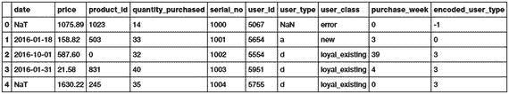

图 3-16. 对 `user_type` 属性进行虚拟编码后的数据框

第二张图，图 3-17，展示了 `user_type` 属性经过独热编码后的输出。

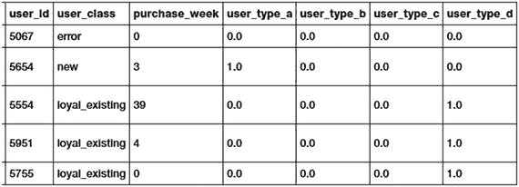

图 3-17. 对 `user_type` 属性进行独热编码后的数据框

我们将在第 4 章讨论特征工程时，更详细地探讨这些方法。

### 归一化数值

属性归一化是标准化属性值范围的过程。在许多情况下，机器学习算法会使用距离度量，而不同尺度/范围的属性或特征可能会对计算产生不利影响或使结果产生偏差。归一化也称为特征缩放。有多种缩放/归一化特征的方法，其中一些包括重新缩放、标准化（或零均值单位方差）、单位缩放等等。我们可以根据特征、算法和手头的用例选择一种归一化技术。当我们处理实际用例时，这一点会更加清晰。我们还会在第 4 章“特征工程与选择”中详细介绍特征缩放策略。以下代码片段展示了一个使用 min-max 缩放器的快速示例，该缩放器来自 `sklearn` 的 `preprocessing` 模块，可将属性重新缩放到所需的给定范围。

```
df_normalized = df.dropna().copy()
min_max_scaler = preprocessing.MinMaxScaler()
np_scaled = min_max_scaler.fit_transform(df_normalized['price'].reshape(-1,1))
df_normalized['normalized_price'] = np_scaled.reshape(-1,1)
```

图 3-18 展示了未缩放的 `price` 值和已缩放到 `[0, 1]` 范围的归一化 `price` 值。

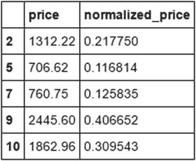

图 3-18. `price` 的原始值和归一化值

### 字符串操作

原始数据在可用于分析之前，会呈现出各种问题和复杂性。字符串是另一类原始数据，在我们的算法能够理解它们之前，需要特别关注和处理。正如在讨论分类数据的处理方法时提到的，直接在算法中使用字符串数据存在局限性和问题。

表示自然语言的字符串数据噪声很大，需要一套专门的步骤进行处理。尽管这些步骤大多取决于具体用例，但在此提及它们还是值得的（我们将在后续章节中结合用例更详细地介绍，以便更清晰地理解）。字符串数据通常经历以下处理步骤：

*   **分词**：将字符串数据拆分成组成单元。例如，将句子拆分成单词，或将单词拆分成字符。
*   **词干提取和词形还原**：这些是将单词转换为其词根或规范形式的归一化方法。词干提取是一种实现词根形式的启发式过程，而词形还原则利用语法和词汇规则来推导词根。
*   **停用词移除**：文本中包含一些出现频率高但信息量不大的词（如标点符号、连词等）。通常会移除这些词/短语，以减少数据的维度和噪声。

除了前面提到的三个常见步骤外，还有其他操作，如词性标注、哈希、索引等。这些操作都需要根据数据和手头的问题陈述进行调整和优化。请继续关注后续章节中关于这些内容的更多细节。

### 数据汇总

数据汇总是指为手头的原始数据准备紧凑表示形式的过程。该过程涉及使用不同的统计、数学及其他方法对数据进行聚合。汇总有助于可视化、压缩原始数据以及更好地理解其属性。

`pandas` 库提供了多种强大的汇总技术，以满足不同需求。我们将在此介绍其中几种。最广泛使用的汇总形式是基于特定条件或属性对值进行分组。以下代码片段展示了一种此类汇总。

```
print(df['price'][df['user_type']=='a'].mean())
print(df['purchase_week'].value_counts())
```

第一条语句计算了按 `user_type` 分组的所有交易的平均价格，而第二条语句则统计了每周的交易数量。尽管这些计算很有帮助，但基于属性对数据进行分组能帮助我们更好地理解数据。`groupby()` 函数可以帮助我们实现这一点，如下面的代码片段所示。

```
print(df.groupby(['user_class'])['quantity_purchased'].sum())
```

该语句生成一个表格输出，表示每个 `user_class` 购买数量的总和。生成的输出如下所示。

```
user_class
existing           4830
loyal_existing     5515
new               10100
Name: quantity_purchased, dtype: int32
```

`groupby()` 函数是一个强大的接口，允许我们执行复杂的分组和聚合操作。在前面的示例中，我们仅对单个属性进行了分组，并执行了单个聚合（即求和）。使用 `groupby()`，我们可以执行多属性分组，并在不同属性上应用多个聚合函数。以下代码片段展示了 `groupby()` 的三种使用变体及其对应的输出。

```
# 变体 1：对单个属性进行多种聚合
df.groupby(['user_class'])['quantity_purchased'].agg([np.sum, np.mean,
np.count_nonzero])

# 变体 2：为每个属性指定不同的聚合函数
df.groupby(['user_class','user_type']).agg({'price':np.mean,
'quantity_purchased':np.max})

# 变体 3
df.groupby(['user_class','user_type']).agg({'price':{'total_price':np.sum,
'mean_price':np.mean,
'variance_price':np.std,
'count':np.count_nonzero},
'quantity_purchased':np.sum})
```

这三种不同的变体可以解释如下。

变体 1：这里我们对按 `user_class` 分组的购买数量应用了三种不同的聚合（参见图 3-19）。

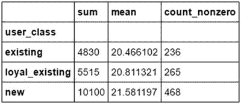

图 3-19. 对单个属性进行多种聚合的 Groupby 操作

变体 2：这里，我们对两个不同的属性应用了不同的聚合函数。`agg()` 函数接受一个字典作为输入，其中包含属性作为键，聚合函数作为值（参见图 3-20）。

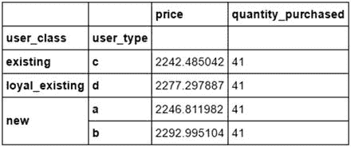

图 3-20.
对不同属性应用不同聚合函数的 Groupby 操作

变体 3：这里，我们结合了变体 1 和变体 2，即对价格字段应用多种聚合，同时对 `quantity_purchased` 仅应用单一聚合。同样，传递了一个字典，如代码片段所示。输出如图 3-21 所示。

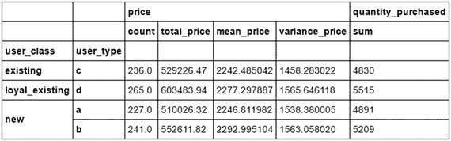

图 3-21.
展示复杂操作的 Groupby 操作

除了基于 `groupby()` 的汇总之外，其他函数如 `pivot()`、`pivot_table()`、`stack()`、`unstack()`、`crosstab()` 和 `melt()` 提供了根据需要重塑 `pandas` 数据框的能力。这些方法的完整描述及示例可在 `pandas` 文档的 [`https://pandas.pydata.org/pandas-docs/stable/reshaping.html`](https://pandas.pydata.org/pandas-docs/stable/reshaping.html) 中找到。我们鼓励您仔细阅读。

## 数据可视化

数据科学是一种以数据为主角的叙事方式。作为数据科学从业者，我们处理大量数据，这些数据日复一日地经历着处理、整理和分析，以满足各种用例。用图表、图形、地图等视觉元素来增强这种叙事，不仅有助于提高对数据的理解（进而理解用例/业务问题），而且还提供了发现隐藏模式和潜在洞察的机会。

因此，数据可视化是以图表、图形、图片等形式直观呈现信息的过程，旨在实现更好且普遍一致的理解。

我们提到普遍一致的理解，是为了指出人类语言中一个非常常见的问题。人类语言本质上是复杂的，根据作者的意图和技能，读者可能会以不同的方式理解书面信息（从而引发各种问题）。因此，以可视化方式呈现数据为我们提供了一种一致的语言来呈现和理解信息（尽管这也不能完全避免误解，但它确实提供了一定的一致性）。

在本节中，我们首先利用 `pandas` 及其通过不同可视化方式直观理解数据的能力。然后，我们将从 `matplotlib` 的角度介绍可视化。

**注意**

数据可视化本身是一个流行且深入的跨领域研究领域。本章和本节仅介绍一些入门主题。这绝不是一份全面详细的数据可视化指南。感兴趣的读者可以进一步探索，不过此处及后续章节涵盖的主题对于大多数常见的可视化相关任务来说应该足够了。

### 使用 Pandas 进行可视化

数据可视化本身是一个多样化的领域和一门科学。尽管可视化类型的选择在很大程度上取决于数据、受众等因素，但我们将继续使用上一节中的产品交易数据集来理解和进行可视化。

快速回顾一下，手头的数据集包含表示某些用户购买产品的交易记录。每笔交易都有以下属性。

*   日期：交易日期
*   价格：所购产品的价格
*   产品 ID：产品标识号
*   购买数量：本次交易中购买的产品数量
*   序列号：交易序列号
*   用户 ID：执行交易的用户的标识号
*   用户类型：用户类型

我们整理数据集以清理列名，将属性转换为正确的数据类型，并推导出额外的属性 `user_class` 和 `purchase_week`，如上一节所述。

`pandas` 是一个非常流行且强大的库，我们在本章中已经看到了许多例子。可视化是 `pandas` 另一个重要且广泛使用的特性。它通过绘图接口暴露其可视化能力，并紧密遵循 `matplotlib` 风格的可视化语法。

#### 折线图

首先，我们观察一位交易次数最多的用户的购买模式（我们将其作为练习，留给您自行找出该用户）。趋势最适合用折线图来可视化。只需对数据框按所需字段进行子集筛选，`plot()` 接口默认就会绘制出折线图。以下代码片段展示了该用户的价格趋势。

```python
df[df.user_id == max_user_id][['price']].plot(style='blue')
plt.title('Price Trends for Particular User')
```

`plt` 是 `matplotlib.pyplot` 的别名。我们将在下一节详细讨论，目前只需假设我们需要它来增强 `pandas` 生成的图表。在此例中，我们用它来为图表添加标题。生成的图表如图 3-22 所示。

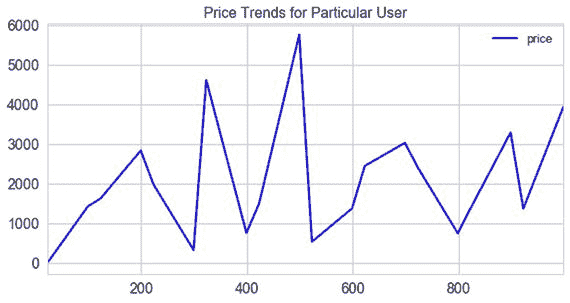

图 3-22.
展示某用户价格趋势的折线图

虽然我们可以通过可视化看到该用户不同交易的价格，但这并没有太大帮助。现在，我们再次使用折线图来了解他/她的购买趋势随时间的变化（请记住数据集中包含交易日期）。我们使用相同的绘图接口，对数据框按两个所需属性进行子集筛选。以下代码片段概述了该过程。

```python
df[df.user_id == max_user_id].plot(x='date',y='price',style='blue')
plt.title('Price Trends for Particular User Over Time')
```

这次，由于有两个属性，我们告知 `pandas` 将日期作为 x 轴，价格作为 y 轴。`plot()` 接口能优雅地处理 `datetime` 数据类型，如下面图 3-23 所示的输出结果。

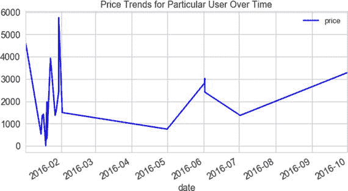

图 3-23.
某用户的价格随时间变化趋势

这次，我们的可视化清晰地展示了该用户的购买模式。虽然我们可以详细讨论从该可视化中获得的见解，但一个快速的推断是显而易见的。如图所示，该用户似乎在年初购买了高价值商品，并且随着时间推移，购买趋势呈下降态势。此外，与一年中的其他时间相比，年初的交易次数更多且更密集。我们可以将这些细节与更多数据关联起来，以识别模式和行为。我们将在后续章节中介绍更多此类方面。

#### 条形图

在观察了特定用户的趋势之后，让我们从聚合层面来看一下我们的数据集。由于我们已经有了一个名为 `purchase_week` 的派生属性，我们用它来聚合用户随时间推移的购买数量。我们首先使用 `groupby()` 函数按周聚合数据，然后聚合 `quantity_purchased` 属性。最后一步是将聚合结果绘制在条形图上。以下代码片段帮助我们绘制此信息。

```python
df[['purchase_week',
'quantity_purchased']].groupby('purchase_week').sum().plot.barh(
color='orange')
plt.title('Quantities Purchased per Week')
```

我们使用 `barh()` 函数来绘制水平条形图。它在信息表示方式上与标准的 `bar()` 图类似，区别在于图表的朝向。图 3-24 显示了生成的输出。

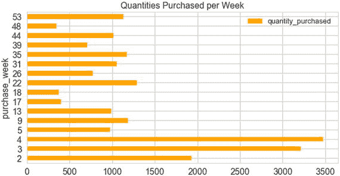

图 3-24.
表示每周购买数量的条形图

#### 直方图

探索性数据分析（EDA）最重要的方面之一是了解给定数据集中各种数值属性的分布情况。可视化分布最简单、最常用的方法是通过直方图。我们绘制数据集中所购商品的价格分布，如下所示。

```python
df.price.hist(color='green')
plt.title('Price Distribution')
```

我们使用 `hist()` 函数，仅用一行代码就绘制出了价格分布。输出结果如图 3-25 所示。

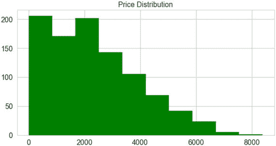

图 3-25.
表示价格分布的直方图

图 3-25 所示的输出结果清晰地显示了一个偏态且长尾的分布。在算法中使用此类属性时，此信息将非常有用。当我们处理实际用例时，这一点会更加清晰。

我们可以更进一步，尝试可视化每周的价格分布。为此，我们在 `hist()` 函数中使用参数 `by`。该参数帮助我们根据指定的属性（即 `by`）对数据进行分组，然后为每个分组生成一个子图。在我们的例子中，我们按购买周进行分组，如下所示。

```python
df[['price','purchase_week']].hist(by='purchase_week' ,sharex=True)
```

图 3-26 所示的输出结果展示了每周的价格分布，其中最高的柱状图用不同颜色清晰标出。

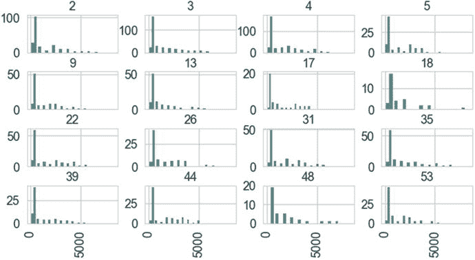

图 3-26.
按周划分的直方图

#### 饼图

在理解数据或提取见解时，最常见的问题之一是了解哪种类型贡献最大。为了可视化百分比分布，饼图是最佳选择。对于我们的数据集，以下代码片段帮助我们可视化不同用户类型的购买量。

### 饼图

前面的代码片段使用 `groupby()` 提取一个序列，该序列表示每个 `user_class` 级别的交易数量。然后我们使用 `pie()` 函数绘制百分比分布。我们使用 `autopct` 参数在图表上标注每个 `user_class` 的实际百分比贡献。图 3-27 展示了输出的饼图。

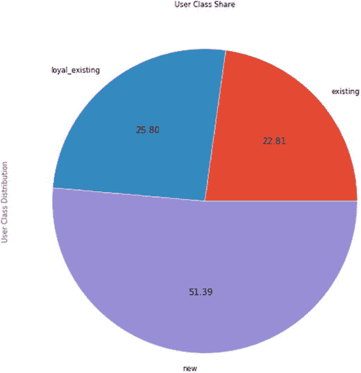

图 3-27.

表示用户类别交易分布的饼图

图 3-27 中的图表明确指出，新用户占据了总交易份额的 50% 以上，而 `existing` 和 `loyal_existing` 用户则占据了剩余部分。我们不建议使用饼图，尤其是在类别超过三或四个时。请改用条形图。

### 箱线图

箱线图是重要的可视化工具，有助于我们理解数值数据的四分位数分布。箱线图（或称箱须图）是一种简洁的表示方式，用于理解数据中的不同四分位数、偏度、离散程度和异常值。

我们将使用箱线图来查看属性 `quantity_purchased` 和 `purchase_week`。以下代码片段为我们生成了所需的图表。

```
df[['quantity_purchased','purchase_week']].plot.box()
plt.title('Quantity and Week value distribution')
```

现在，我们来看生成的图表（见图 3-28）。箱线图中箱体的底部边缘标记了第一四分位数，而顶部边缘标记了第三四分位数。箱体中间的线条标记了第二四分位数（即中位数）。从箱体延伸出的顶部和底部须线标记了数值的范围。异常值则标记在须线边界之外。在我们的示例中，对于购买数量，中位数非常接近箱体中间，而购买周的中位数则靠近箱体底部（这清楚地指出了数据中的偏度）。鼓励您阅读更多关于箱线图的内容以深入理解，可参考[`http://www.physics.csbsju.edu/stats/box2.html`](http://www.physics.csbsju.edu/stats/box2.html)和[`http://www.stat.yale.edu/Courses/1997-98/101/boxplot.htm`](http://www.stat.yale.edu/Courses/1997-98/101/boxplot.htm)。

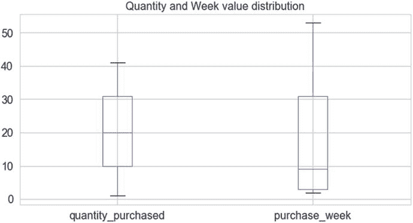

图 3-28.

使用 pandas 绘制的箱线图

### 散点图

散点图是另一类可视化工具，通常用于识别属性之间的相关性或模式。与我们目前看到的大多数可视化工具一样，散点图也可以通过 `pandas` 的 `plot()` 接口获得。

要理解散点图，我们首先需要执行几个数据整理步骤，将数据转换为所需的形状。我们首先使用 `map()` 对 `user_class` 进行虚拟编码（如上一节所述），然后使用 `groupby()` 获取每周每个 `user_class` 级别的平均价格和交易数量。以下代码片段帮助我们获取数据框。

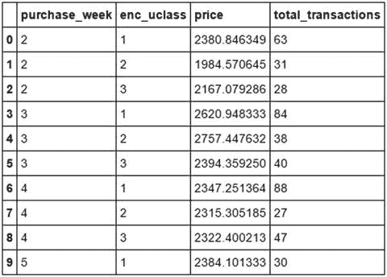

图 3-29.

按每周每个 user_class 级别聚合的数据框

```
uclass_map = {'new': 1, 'existing': 2, 'loyal_existing': 3,'error':0}
df['enc_uclass'] = df.user_class.map(uclass_map)
bubble_df = df[['enc_uclass',
'purchase_week',
'price','product_id']].groupby(['purchase_week',
'enc_uclass']).agg(
{'price':'mean',
'product_id':'count'}
).reset_index()
bubble_df.rename(columns={'product_id':'total_transactions'},inplace=True)
```

图 3-29 展示了生成的数据框。现在，让我们使用散点图来可视化这些数据。以下代码片段为我们完成了这项工作。

```
bubble_df.plot.scatter(x='purchase_week',
y='price')
plt.title('Purchase Week Vs Price ')
plt.show()
```

这将生成图 3-30 中的图表，展示了数据在周数和平均价格之间几乎随机的分布，并在图表的左上角略有集中。

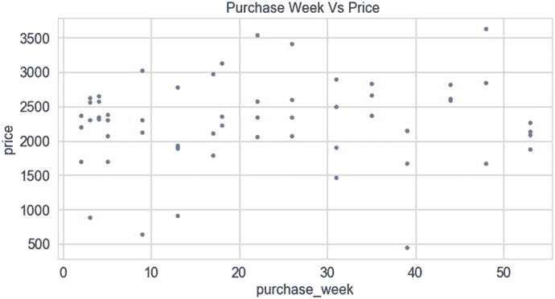

图 3-30.

显示数据在 purchase_week 和 price 之间分布的散点图

散点图还为我们提供了可视化更多维度的能力。我们可以使用颜色和大小来绘制第三和第四维度。以下代码片段帮助我们理解分布，其中颜色表示 `user_class`，而气泡的大小表示交易数量。

```
bubble_df.plot.scatter(x='purchase_week',
y='price',
c=bubble_df['enc_uclass'],
s=bubble_df['total_transactions']*10)
plt.title('Purchase Week Vs Price Per User Class Based on Tx')
```

这些参数不言自明——`c` 代表颜色，而 `s` 代表气泡的大小。此类图表也称为气泡图。生成的输出如图 3-31 所示。

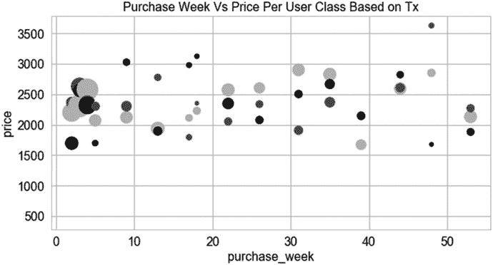

图 3-31.

可视化多维数据的散点图

在本节中，我们利用 `pandas` 绘制了各种类型的可视化图表。这些是一些最广泛使用的可视化图表，`pandas` 提供了很大的灵活性来对它们进行更多操作。此外，还有一系列扩展的图表可以使用 `pandas` 进行可视化。完整信息可在 `pandas` 文档中找到。

## 使用 Matplotlib 进行可视化

`matplotlib` 是一个流行的绘图库。它提供了生成出版级可视化效果的接口和实用程序。从 2003 年的第一个版本至今，`matplotlib` 一直由其活跃的开发者社区不断改进。它也是许多其他绘图库的基础和灵感来源。如前一节所述，`pandas` 与 `SciPy`（另一个用于科学计算的流行 Python 库）一起，为 `matplotlib` 的实现提供了封装，以便于数据可视化。

`matplotlib` 提供了两个主要模块供使用：`pylab` 和 `pyplot`。在本节中，我们将只关注 `pyplot` 模块（不鼓励使用 `pylab`）。`pyplot` 接口是一个面向对象的接口，它倾向于显式实例化，而不是 `pylab` 的隐式实例化。

在上一节中，我们简要介绍了不同的可视化图表，并看到了一些调整它们的方法。由于 `pandas` 的可视化源自 `matplotlib` 本身，我们将涵盖 `matplotlib` 的额外概念和功能。这将使您不仅能够轻松使用 `matplotlib`，还能掌握一些技巧来改进使用 `pandas` 生成的可视化效果。

### 图形与子图

首先，任何 `matplotlib` 风格的可视化基础都始于图形和子图对象。`figure` 模块帮助 `matplotlib` 生成绘图窗口对象及其相关元素。简而言之，它是所有可视化组件的顶层容器。在 `matplotlib` 语法中，图形是最顶层的容器，在一个图形内，我们可以灵活地可视化多个图表。因此，子图就是位于这个高层图形容器内部的图表。

让我们从一个简单的示例和必要的导入开始。然后，我们将基于这个示例进一步理解图形和子图的概念。以下代码片段导入了 `matplotlib` 的 `pyplot` 模块，并使用 `numpy` 生成 x 和 y 值，绘制了一条简单的正弦曲线。

```
import numpy as np
import matplotlib.pyplot as plt

# 示例绘图
x = np.linspace(-10, 10, 50)
y=np.sin(x)
plt.plot(x,y)
plt.title('使用 matplotlib 绘制的正弦曲线')
plt.xlabel('x 轴')
plt.ylabel('y 轴')
```

# Matplotlib 基础与绘图

`pyplot` 模块暴露了诸如 `plot()` 之类的方法来生成可视化。在示例中，通过 `plt.plot(x, y)`，`matplotlib` 在后台工作，生成 `figure` 和 `axes` 对象，以在图 3-32 中输出图表。为完整起见，语句 `plt.title()`、`plt.xlabel()` 等分别提供了设置图形标题和轴标签的方法。

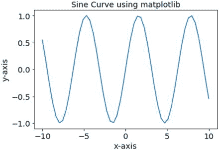
*图 3-32. 示例图表*

现在我们已经完成了一个示例图表，让我们看看不同对象在 `matplotlib` 世界中是如何交互的。如前所述，`figure` 对象是所有元素的顶层容器。在把事情复杂化之前，我们首先绘制不同的图形，即每个图形只包含一个图表。以下代码片段使用 `numpy` 和 `matplotlib` 在两个不同的图形中绘制了正弦波和余弦波。

```python
# 第一个图形
plt.figure(1)
plt.plot(x,y)
plt.title('图 1: 正弦曲线')
plt.xlabel('x 轴')
plt.ylabel('y 轴')

# 第二个图形
plt.figure(2)
y=np.cos(x)
plt.plot(x,y)
plt.title('图 2: 余弦曲线')
plt.xlabel('x 轴')
plt.ylabel('y 轴')
```

语句 `plt.figure()` 创建了一个 `Figure` 类型的实例。作为参数传入的数字是图形标识符，当存在多个图形时，它有助于引用同一个图形。其余的语句与我们示例图表中的类似，`pyplot` 始终引用当前的图形对象进行绘制。请注意，一旦实例化了一个新图形，除非另有指定，`pyplot` 会引用新创建的对象。生成的输出如图 3-33 所示。

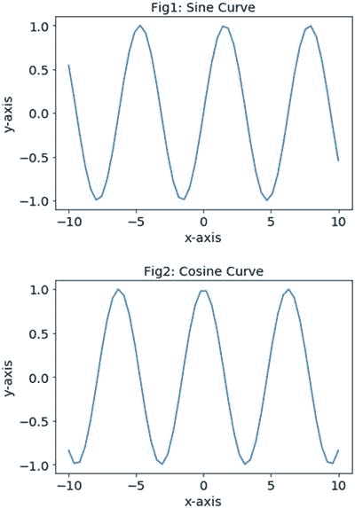
*图 3-33. 使用 matplotlib 绘制多个图形*

我们在为一个用例讲述数据故事时会绘制多个图形。然而，有些情况下我们需要在同一个图形中绘制多个图表。这就是子图概念发挥作用的地方。子图将一个图形划分为指定行数和列数的网格，并提供与绘图元素交互的接口。子图可以通过几种不同的方式生成，其使用取决于个人偏好和用例需求。我们从最直观的方法 `add_subplot()` 开始。该方法通过图形对象本身暴露出来。它的参数有助于定义网格布局和其他属性。以下代码片段在一个图形中生成了四个子图。

```python
y = np.sin(x)
figure_obj = plt.figure(figsize=(8, 6))
ax1 = figure_obj.add_subplot(2,2,1)
ax1.plot(x,y)
ax2 = figure_obj.add_subplot(2,2,2)
ax3 = figure_obj.add_subplot(2,2,3)
ax4 = figure_obj.add_subplot(2,2,4)
ax4.plot(x+10,y)
```

此代码片段首先使用 `plt.figure()` 定义了一个图形对象。然后，我们获取了一个指向第一个子图的轴对象，该子图是通过语句 `figure_obj.add_subplot(2,2,1)` 生成的。这个语句实际上是将图形划分为两行两列。最后一个参数（值为 1）指向此网格中的第一个子图。该代码片段仅在左上角的子图（标识为 `2,2,1`）中绘制了正弦曲线，并在第四个子图（标识为 `2,2,4`）中绘制了另一条在 x 轴上偏移了 10 个单位的正弦曲线。生成的输出如图 3-34 所示。

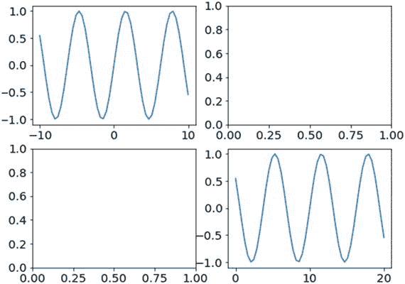
*图 3-34. 使用 add_subplot 方法创建的子图*

生成子图的第二种方法是通过 `pyplot` 模块直接进行。`pyplot` 模块暴露了一个 `subplots()` 方法，该方法返回图形对象和一个 `axes` 对象列表，每个对象都指向 `subplots()` 参数中提到的布局中的一个子图。当我们知道需要多少个子图时，这个方法很有用。以下代码片段展示了这一点。

```python
fig, ax_list = plt.subplots(2,1,sharex=True, figsize=(8, 6))
y= np.sin(x)
ax_list[0].plot(x,y)
y= np.cos(x)
ax_list[1].plot(x,y)
```

语句 `plt.subplots(2,1,sharex=True)` 一次性完成了三件事。首先，它生成了一个 `figure` 对象，然后将其划分为 2 行 1 列（即总共两个子图）。这两个子图以 `axes` 对象列表的形式返回。最后，第三件事是共享 x 轴，我们通过参数 `sharex` 实现了这一点。这种 x 轴的共享允许该图形中的所有子图拥有相同的 x 轴。这使我们能够在同一尺度上查看数据，同时提升美观性。输出如图 3-35 所示，展示了在同一 x 轴上的正弦和余弦曲线。

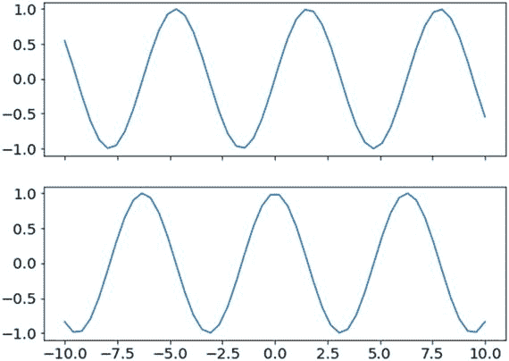
*图 3-35. 使用 subplots() 方法创建的子图*

另一个变体是 `subplot()` 函数，它也通过 `pyplot` 模块直接暴露出来。这个函数与图形对象的 `add_subplot()` 方法非常相似。你可以在本章的代码中找到相关示例。在进入其他概念之前，我们快速提一下 `subplot2grid()` 函数，它也通过 `pyplot` 模块暴露出来。该函数提供了与已讨论方法类似的功能，同时对定义网格布局有更精细的控制，子图可以跨越任意数量的列和行。以下代码片段展示了一个包含不同大小子图的网格。

```python
y = np.abs(x)
z = x**2
plt.subplot2grid((4,3), (0, 0), rowspan=4, colspan=2)
plt.plot(x, y,'b',x,z,'r')
ax2 = plt.subplot2grid((4,3), (0, 2),rowspan=2)
plt.plot(x, y,'b')
plt.setp(ax2.get_xticklabels(), visible=False)
plt.subplot2grid((4,3), (2, 2), rowspan=2)
plt.plot(x, z,'r')
```

`subplot2grid()` 函数接受多个参数，解释如下：
*   `shape`：一个元组，表示网格中的行数和列数，格式为 `(rows, columns)`。
*   `loc`：一个元组，表示子图的位置。此参数从 0 开始索引。
*   `rowspan`：此参数表示子图跨越的行数。
*   `colspan`：此参数表示子图跨越的列数。

代码片段生成的输出如图 3-36 所示，其中一个子图覆盖了四行两列，包含两个函数。另外两个子图各覆盖两行一列。

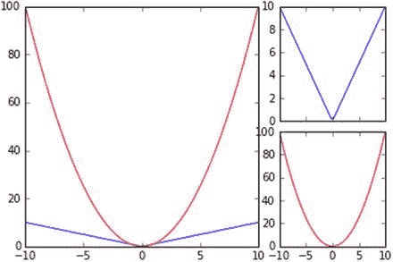
*图 3-36. 使用 subplot2grid() 创建的子图*

## 图表格式化

图表格式化是数据叙事中另一个重要方面，`matplotlib` 在这方面提供了丰富的功能。从更改颜色到标记点等，`matplotlib` 都提供了易于使用的直观接口。

我们从颜色属性开始，它是 `plot()` 接口的一部分。`color` 属性基于 RGBA 规范，允许我们以字符串（如 red、green 等）、单个字母（如 `r`、`g` 等）甚至十六进制值的形式提供 alpha 和颜色值。更多详细信息可参阅 `matplotlib` 文档：[`https://matplotlib.org/api/colors_api.html`](https://matplotlib.org/api/colors_api.html)。

下面的示例及图 3-37 所示的输出，展示了为图表设置 `color` 和 `alpha` 属性是多么简单。

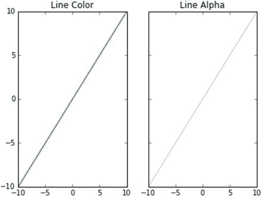
*图 3-37. 设置图表的颜色和透明度属性*

```python
y = x

# 颜色
ax1 = plt.subplot(321)
plt.plot(x,y,color='green')
ax1.set_title('线条颜色')

# 透明度
ax2 = plt.subplot(322,sharex=ax1)
alpha = plt.plot(x,y)
alpha[0].set_alpha(0.3)
ax2.set_title('线条透明度')
plt.setp(ax2.get_yticklabels(), visible=False)
```

类似地，我们还可以使用不同的形状来标记数据点，以及使用不同的样式来绘制线条。在将不同属性/类别表示在同一张图表上时，这些选项会非常有用。下面的代码片段及图 3-38 所示的输出展示了这一点。

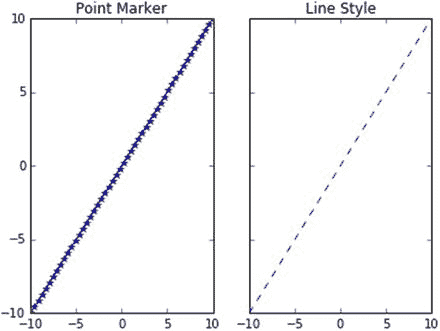

图 3-38.

设置图表的标记点和线条样式属性

```python
# 标记点
# 标记点 -> '+', 'o', '*', 's', ',', '.', 等
ax3 = plt.subplot(323, sharex=ax1)
plt.plot(x, y, marker='*')
ax3.set_title('点标记')

# 线条样式
# 线条样式 -> '-','--','-.', ':', 'steps'
ax4 = plt.subplot(324, sharex=ax1)
plt.plot(x, y, linestyle='--')
ax4.set_title('线条样式')
plt.setp(ax4.get_yticklabels(), visible=False)
```

尽管还有更多微调选项可用，但我们鼓励您查阅文档以获取详细信息。我们以最后两个技巧来结束格式化部分：线条宽度以及一种可以快速完成所有设置的简写符号，如下面的代码片段所示。

```python
# 线条宽度
ax5 = plt.subplot(325, sharex=ax1)
line = plt.plot(x, y)
line[0].set_linewidth(3.0)
ax5.set_title('线条宽度')

# 组合线条样式
ax6 = plt.subplot(326, sharex=ax1)
plt.plot(x, y, 'b^')
ax6.set_title('样式简写')
plt.setp(ax6.get_yticklabels(), visible=False)
```

此代码片段使用 `plot()` 函数返回的线条对象来设置线条宽度。代码片段的第二部分展示了使用简写符号 `b^` 一次性设置线条颜色和数据点标记。图 3-39 所示的输出有助于展示此效果。

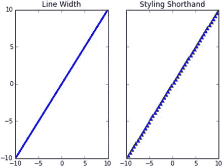

图 3-39.

展示线条宽度和简写符号的示例

### 图例

图例是一种键，有助于将颜色/形状或其他属性映射到图表所可视化的不同属性。虽然在大多数情况下，`matplotlib` 在准备和显示图例方面做得非常出色，但有时我们需要更精细的控制。

图表的图例可以通过 `legend()` 函数进行控制，该函数可直接通过 `pyplot` 模块使用。我们可以通过此函数设置位置、大小和其他格式化属性。以下示例展示了将图例放置在最佳位置。

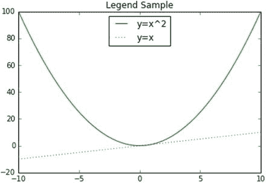

图 3-40.

带有图例的示例图表

```python
plt.plot(x, y, 'g', label='y=x²')
plt.plot(x, z, 'b:', label='y=x')
plt.legend(loc="best")
plt.title('图例示例')
```

`matplotlib` 的主要目标之一是提供达到出版质量的图表。`Matplotlib` 支持 `LaTEX` 样式的图例格式化，以清晰地显示数学符号和公式。`$` 符号用于标记 `LaTEX` 样式格式化的开始和结束。下面的代码片段和输出图（见图 3-41）展示了这一点。

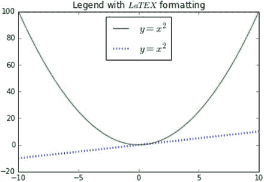

图 3-41.

带有 LaTEX 格式化图例的示例图表

```python
# 带有 LaTEX 格式的图例
plt.plot(x, y, 'g', label='$y = x²$')
plt.plot(x, z, 'b:', linewidth=3, label='$y = x²$')
plt.legend(loc="best", fontsize='x-large')
plt.title('带有 $LaTEX$ 格式的图例')
```

### 坐标轴控制

`matplotlib` 的另一个功能是能够控制绘图的 x 轴和 y 轴。除了使用 `set_xlabel()` 和 `set_ylabel()` 方法设置轴标签和颜色等基本功能外，还可以进行更精细的控制。我们先来看看如何添加辅助 y 轴。在很多场景下，我们需要在同一张图上绘制与不同特征（数值尺度不同）相关的数据。为了正确理解，通常将两个特征放在不同的 y 轴上（每个轴缩放到各自的范围内）会有所帮助。要获取额外的 y 轴，我们使用通过 `axes` 对象暴露的 `twinx()` 函数。以下代码片段概述了这种情况。

```python
# 辅助 y 轴
fig, ax1 = plt.subplots()
ax1.plot(x, y, 'g')
ax1.set_ylabel(r"主 y 轴", color="green")
ax2 = ax1.twinx()
ax2.plot(x, z, 'b:', linewidth=3)
ax2.set_ylabel(r"辅助 y 轴", color="blue")
plt.title('辅助 Y 轴')
```

起初，使用名为 `twinx()` 的函数来生成辅助 y 轴可能听起来很奇怪。巧妙的是，`matplotlib` 有这样的函数是为了指出这样一个事实：额外的 y 轴将共享同一个 x 轴，因此命名为 `twinx()`。同理，使用 `twiny()` 函数可以获得额外的 x 轴。输出图如图 3-42 所示。

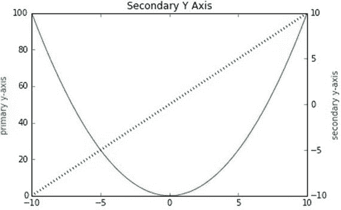

图 3-42.

带有辅助 y 轴的示例图

默认情况下，`matplotlib` 会识别所绘制数据的范围，并调整 x 轴和 y 轴的刻度及范围。它还提供了通过 `axis()` 函数手动设置这些值的能力。通过此函数，我们可以使用预定义的关键字（如 `tight`、`scaled` 和 `equal`）来设置轴范围，也可以传递一个列表，使其标记值为 [xmin, xmax, ymin, ymax]。以下代码片段展示了如何手动调整轴范围。

```python
# 手动轴范围
y = np.log(x)
z = np.log2(x)
w = np.log10(x)
plt.plot(x, y, 'r', x, z, 'g', x, w, 'b')
plt.axis([0, 2, -1, 2])
plt.title('手动轴范围')
```

图 3-43 中的输出展示了左侧未进行任何轴调整生成的图，而右侧则显示了前一个代码片段中所做的轴调整。

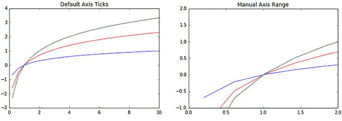

图 3-43.

展示默认轴和手动调整轴的图

现在我们已经了解了如何设置轴范围，接下来将快速介绍如何手动设置刻度或轴标记。对于轴刻度，我们有两个独立的函数可用，一个用于设置刻度的范围，另一个用于设置刻度标签。这两个函数直观地命名为 `set_ticks()` 和 `set_ticklabels()`。在下面的示例中，我们为 x 轴设置要标记的刻度，而对于 y 轴，我们使用相应的函数同时设置刻度范围和标签。

```python
# 手动刻度
plt.plot(x, y)
ax = plt.gca()
ax.xaxis.set_ticks(np.arange(-2, 2, 1))
ax.yaxis.set_ticks(np.arange(0, 5))
ax.yaxis.set_ticklabels(["min", 2, 4, "max"])
plt.grid(True)
plt.title("x 轴上的手动刻度")
```

输出是一个 x 轴标签仅标记在 -2 到 1 之间，而 y 轴范围为 0 到 5 且标签已手动更改的图。输出图如图 3-44 所示。

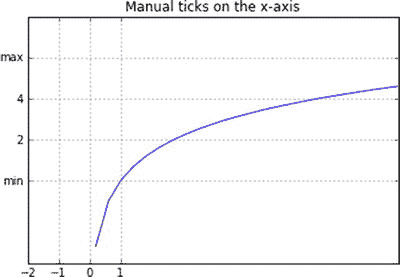

图 3-44.

展示带有手动刻度的坐标轴的图

在我们进入下一组功能/特性之前，值得注意的是，使用 `matplotlib`，除了手动设置（如前所述）之外，我们还可以根据数据范围以标准方式缩放坐标轴。以下是一个快速代码片段，用于在对数刻度上缩放 y 轴。输出如图 3-45 所示。

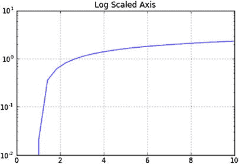

图 3-45.

展示对数缩放 y 轴的图

```python
# 缩放
plt.plot(x, y)
ax = plt.gca()
# 值: log, logit, symlog
ax.set_yscale("log")
plt.grid(True)
plt.title("对数缩放轴")
```

### 注释

# `pyplot` 模块中的 `text()` 接口暴露了 `matplotlib` 的注释功能。我们可以使用此接口注释图形/绘图/子图的任何部分。它接受 x 和 y 坐标、要显示的文本、对齐方式和字体大小参数作为输入，以将注释放置在绘图上的所需位置。以下代码片段注释了抛物线图的最小值。

```
# 注释
y = x**2
min_x = 0
min_y = min_x**2
plt.plot(x, y, "b-", min_x, min_y, "ro")
plt.axis([-10,10,-25,100])
plt.text(0, 60, "抛物线\n$y = x²$", fontsize=15, ha="center")
plt.text(min_x, min_y+2, "最小值", ha="center")
plt.text(min_x, min_y-6, "(%0.1f, %0.1f)"%(min_x, min_y), ha='center',color='gray')
plt.title("带注释的图")
```

`text()` 接口提供了更多功能和格式化特性。建议您查阅官方文档和示例以了解详细信息。展示带注释抛物线的输出图如图 3-46 所示。

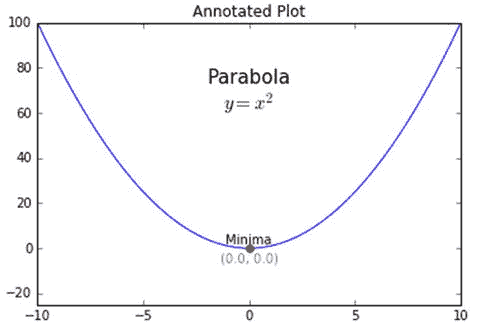
图 3-46. 展示注释的图

## 全局参数

为了保持一致性，我们通常尝试在整个可视化故事中保持绘图大小、字体和颜色相同。设置每个这些属性会增加代码库维护的复杂性和难度。为了克服这些问题，我们可以全局设置格式化设置，如下面的代码片段所示。

```
# 全局格式化参数
params = {'legend.fontsize': 'large',
'figure.figsize': (10, 10),
'axes.labelsize': 'large',
'axes.titlesize':'large',
'xtick.labelsize':'large',
'ytick.labelsize':'large'}
plt.rcParams.update(params)
```

一旦使用 `rcParams.update()` 设置，`params` 字典中提供的属性将应用于生成的每个绘图。建议您应用这些设置并重新生成本节讨论的图，以了解差异。

### Python 可视化生态系统

毫无疑问，`matplotlib` 库是一个非常强大且流行的可视化/绘图库。它提供了绘制任何类型数据所需的大部分工具和技巧，并且能够控制最细微的元素。

然而，即使是专业用户，`matplotlib` 也还有很多可以改进的地方。作为一个低级 API，它需要大量的样板代码，交互性有限，并且样式和其他格式化默认值看起来有些过时。

为了解决这些问题并提供高级接口以及与当前 Python 生态系统协同工作的能力，Python 领域有相当多的可视化库可供选择。一些最流行和强大的库包括 `bokeh`、`seaborn`、`ggplot` 和 `plotly`。这些库中的每一个都建立在 `matplotlib` 的理解和功能集之上，同时提供自己的一套功能和易于使用的包装器来弥补差距。

建议您探索这些库并了解它们的差异。我们将在后续章节中根据需要介绍其中的一些。尽管不同，但大多数库都基于与 `matplotlib` 相似的概念，因此如果您精通 `matplotlib`，学习曲线会更短。

## 总结

本章涵盖了理解、处理和数据整理方面的诸多内容。我们介绍了平面文件（CSV、JSON、XML、HTML 等）等主要数据格式，并使用标准库来提取/收集数据。我们简要介绍了标准数据类型及其在整个数据科学过程中的重要性。本章的主要部分涵盖了数据整理任务，包括转换、清理和处理数据，使其成为可用的形式。虽然这些技术是使用 `pandas` 库进行讲解的，但其概念具有通用性，适用于大多数数据科学相关的用例。你可以将这些技术作为参考，它们可以轻松地使用不同的库和编程/脚本语言来实现。我们使用示例数据集绘制了主要图表，并描述了它们的用法。我们还介绍了 `matplotlib` 的基础知识和强大技巧。我们强烈建议你阅读参考资料以深入理解。本章涵盖了 CRISP DM 模型中数据收集、处理和可视化的初始步骤。在接下来的章节中，我们将基于这些概念，并将其应用于解决特定的现实世界问题。敬请期待！