# 6. 分析共享单车趋势

“只工作不玩耍”是一句众所周知的谚语，我们当然不想变得枯燥乏味。到目前为止，我们已经涵盖了解决数据科学问题所需的理论概念、框架、工作流程和工具。以用例驱动为主题的内容从本章开始。在本书的这一部分，我们将通过真实案例研究涵盖广泛的机器学习/数据科学概念。通过本章及后续章节，我们将讨论并应用迄今为止学到的概念来解决一些激动人心的真实世界问题。

本章讨论基于回归的模型来分析数据和预测结果。具体来说，我们将利用来自 UCI 机器学习库的 Capital Bike Sharing 数据集来理解用于预测自行车使用需求的回归模型。通过本章，我们将涵盖以下主题：

*   **共享单车数据集**：了解 UCI 机器学习库中可用的数据集
*   **问题陈述**：正式定义要解决的问题
*   **探索性数据分析**：探索和理解手头的数据集
*   **回归分析**：理解回归建模概念并将其应用于解决问题

## 共享单车数据集

最初几章介绍的 CRISP-DM 模型讨论了与数据科学问题/项目相关的典型工作流程。工作流程图将数据置于中心位置是有原因的。在我们开始使用不同技术来理解和处理数据之前，让我们先了解其来源。

共享单车数据集可从 UCI 机器学习库获得。它是世界上最大、可能也是历史最悠久的在线数据集存储库之一，被用于世界各地的各类研究。我们将要使用的数据集是该网站上数百个可用数据集中的一个。

该数据集由葡萄牙波尔图大学于 2013 年捐赠。更多信息请访问[`https://archive.ics.uci.edu/ml/datasets/Bike+Sharing+Dataset`](https://archive.ics.uci.edu/ml/datasets/Bike+Sharing+Dataset)。

注意

我们鼓励您查看 UCI 机器学习库，特别是共享单车数据集页面。我们感谢 Fanaee 等人的工作以及通过 UCI 机器学习库分享该数据集。

Fanaee-T, Hadi, 和 Gama, Joao, Event labeling combining ensemble detectors and background knowledge, Progress in Artificial Intelligence (2013): pp. 1-15, Springer Berlin Heidelberg.

## 问题陈述

随着环境问题和健康成为热门话题，近年来，使用自行车作为一种交通方式已获得关注。为了鼓励自行车使用，世界各地的城市已成功推出了共享单车计划。根据此类计划，骑行者可以使用遍布城市的自动/手动租赁点租用自行车，租期固定。在大多数情况下，骑行者可以从一个地点取车，并将其归还到任何其他指定地点。

世界各地的共享单车平台是各种数据的集散地，包括出行时间、起止地点、骑行者人口统计数据等。这些数据连同天气、交通、地形等其他信息来源，使其成为不同研究领域有吸引力的命题。

Capital Bike Sharing 数据集包含与华盛顿特区正在进行的此类共享单车计划相关的信息。给定这个增强型（共享单车详情及天气信息）数据集，我们能否预测该计划的自行车租赁需求？

## 探索性数据分析

现在我们已经了解了业务案例的概况和正式的问题陈述，下一步就是探索和理解数据。这也被称为探索性数据分析（EDA）步骤。在本节中，我们将把数据加载到分析环境中并探索其属性。值得再次强调的是，EDA 是整个工作流程中最重要的阶段之一，它不仅有助于理解数据集，还能呈现某些对后续步骤有用的细节。

注意

共享单车数据集包含日级别和小时级别的数据。我们将只关注`hour.csv`中可用的小时级别数据。

### 预处理

EDA 过程首先将数据加载到环境中，快速查看数据以及记录数量和属性数量。我们将大量使用 `pandas` 和 `numpy` 来执行数据操作和相关任务。为了可视化，我们将尽可能使用 `matplotlib` 和 `seaborn` 以及 `pandas` 的可视化功能。

我们首先加载 `hour.csv` 并检查加载的数据框的形状。以下代码片段实现了这一点。

```
In [2]: hour_df = pd.read_csv('hour.csv')
...: print("Shape of dataset::{}".format(hour_df.shape))
Shape of dataset::(17379, 17)
```

该数据集包含超过 17k 条记录和 17 个属性。让我们检查前几行以了解数据的样子。我们使用 `pandas` 的 `head()` 工具来实现这一点，输出结果如图 6-1 所示。

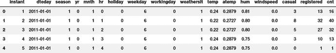

图 6-1.

来自共享单车数据集的示例行

数据似乎已正确加载。接下来，我们需要检查 `pandas` 推断出的数据类型，以及是否有任何属性需要进行类型转换。以下代码片段帮助我们检查所有属性的数据类型。

```
In [3]: hour_df.dtypes
Out[3]:
instant         int64
dteday          object
season          int64
yr              int64
mnth            int64
hr              int64
holiday         int64
weekday         int64
workingday      int64
weathersit      int64
temp            float64
atemp           float64
hum             float64
windspeed       float64
casual          int64
registered      int64
cnt             int64
dtype: object
```

正如数据集文档中所述，这里有共享单车以及天气属性。属性 `dteday` 需要从 `object`（或 `string` 类型）转换为 `timestamp`。像 season、holiday、weekday 等属性被 `pandas` 推断为整数，它们需要转换为分类变量以便正确理解。

在开始类型转换属性之前，以下代码片段清理了属性名称，使其更易于理解且更符合 Python 风格。

```
In [4]: hour_df.rename(columns={'instant':'rec_id',
...:                         'dteday':'datetime',
...:                         'holiday':'is_holiday',
...:                         'workingday':'is_workingday',
...:                         'weathersit':'weather_condition',
...:                         'hum':'humidity',
...:                         'mnth':'month',
...:                         'cnt':'total_count',
...:                         'hr':'hour',
...:                         'yr':'year'},inplace=True)
```

现在我们已经清理了属性名称，我们使用 `pd.to_datetime()` 和 `astype()` 等工具对属性进行类型转换。以下代码片段将属性转换为适当的数据类型。

```
In [5]: # 日期时间转换
...: hour_df['datetime'] = pd.to_datetime(hour_df.datetime)
...:
...: # 分类变量
...: hour_df['season'] = hour_df.season.astype('category')
...: hour_df['is_holiday'] = hour_df.is_holiday.astype('category')
...: hour_df['weekday'] = hour_df.weekday.astype('category')
...: hour_df['weather_condition'] = hour_df.weather_condition.astype('category')
...: hour_df['is_workingday'] = hour_df.is_workingday.astype('category')
...: hour_df['month'] = hour_df.month.astype('category')
...: hour_df['year'] = hour_df.year.astype('category')
...: hour_df['hour'] = hour_df.hour.astype('category')
```

### 分布与趋势

预处理（我们在上一步中执行）后的数据集已准备好进行一些可视化检查。我们首先可视化各季节的每小时乘客量。以下代码片段使用 `seaborn` 的 `pointplot` 来实现可视化。

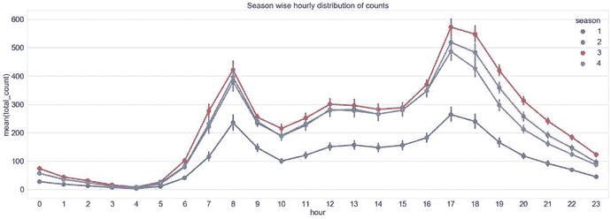

图 6-2.

按季节划分的每小时数据分布

```
In [6]: fig,ax = plt.subplots()
...: sn.pointplot(data=hour_df[['hour',
...:                            'total_count',
...:                            'season']],
...:              x='hour',y='total_count',
...:              hue='season',ax=ax)
...: ax.set(title="按季节划分的每小时计数分布")
```

图 6-2 中的图表显示所有季节的趋势相似，计数在早上 7-9 点和下午 4-6 点达到峰值，这可能是由于办公时间开始和结束时的高流动性。春季的计数最低，而秋季在所有 24 小时内乘客量最高。

类似地，一周中各天的乘客量分布也呈现出有趣的趋势：周末下午时段使用率较高，而工作日早上和晚上使用率较高。相关代码可在 Jupyter Notebook `bike_sharing_eda.ipynb` 中找到。图表如图 6-3 所示。

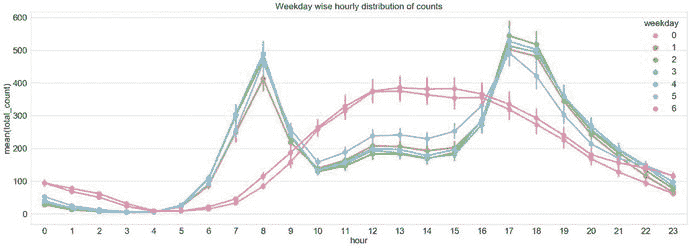

图 6-3.

按天划分的每小时数据分布

在观察了不同分类变量下的每小时数据分布之后，让我们看看是否存在任何聚合趋势。以下代码片段帮助我们使用 `seaborn` 的 `barplot()` 可视化月度乘客量趋势。

```
In [7]: fig,ax = plt.subplots()
...: sn.barplot(data=hour_df[['month',
...:                          'total_count']],
...:            x="month",y="total_count")
...: ax.set(title="月度计数分布")
```

生成的条形图展示了基于月份的明确乘客量趋势。六月至九月的乘客量最高。看来秋季是华盛顿特区共享单车项目的好季节。该图如图 6-4 所示。

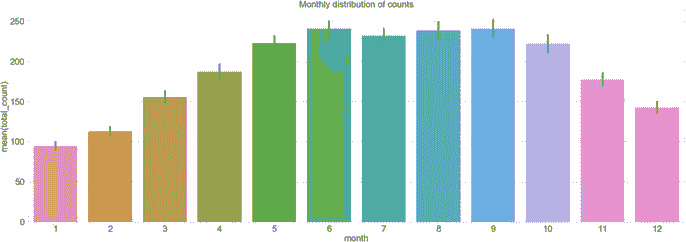

图 6-4.

月度乘客量分布

我们鼓励您尝试在不同的 `subplots` 中绘制四个季节，以此作为练习来运用绘图概念并分别查看每个季节的趋势。

提升聚合级别，让我们看看年度级别的分布。我们的数据集包含年份值 0 代表 2011 年，1 代表 2012 年。我们使用小提琴图以简洁的格式理解这种分布的多个方面。

注意

小提琴图类似于箱线图。与箱线图一样，小提琴图也可以可视化四分位距和其他汇总统计量（如均值/中位数）。然而，由于能够可视化数据的概率密度，这些图比标准箱线图更强大。如果数据是多模态的，这一点尤其有用。

以下代码片段绘制了年度分布的小提琴图。

```
In [8]: sn.violinplot(data=hour_df[['year',
...:                             'total_count']],
...:               x="year",y="total_count")
```

图 6-5 清楚地帮助我们理解了 2011 年和 2012 年乘客量计数中的多模态分布，与 2012 年相比，2011 年的峰值出现在较低的值。2012 年的计数分布范围也大得多，尽管这两年的最大密度都在 100-200 次骑行之间。

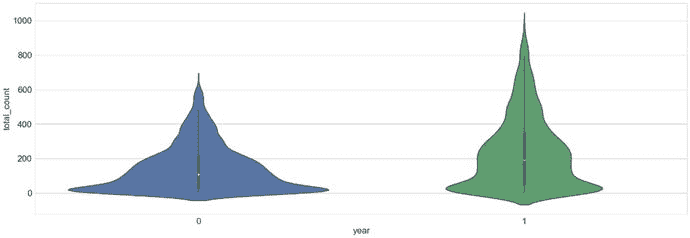

图 6-5.

展示年度乘客量分布的小提琴图

### 异常值

在探索和学习任何数据集时，检查极端和不可能的值是至关重要的。尽管我们在预处理数据集时会处理缺失和错误信息，但异常值通常是在探索性数据分析（EDA）阶段被发现的。异常值可能会对建模等下游步骤及结果产生严重的不利影响。

我们通常使用箱线图来检查数据中的异常值。在以下代码片段中，我们分析了数值属性（如 `total_count`、`temperature` 和 `wind_speed`）的异常值。

```
In [9]: fig,(ax1,ax2)= plt.subplots(ncols=2)
...: sn.boxplot(data=hour_df[['total_count',
...:                          'casual','registered']],ax=ax1)
...: sn.boxplot(data=hour_df[['temp','windspeed']],ax=ax2)
```

生成的图表如图 6-6 所示。我们可以很容易地发现，对于三个与计数相关的属性，它们似乎都有相当数量的异常值。不过，临时用户（casual rider）的分布整体数值较低。对于温度和风速这两个天气属性，我们仅在风速中发现了异常值。

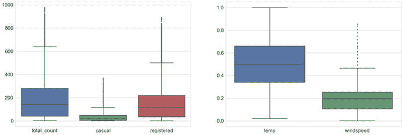

图 6-6.

数据集中的异常值

类似地，我们可以尝试在不同粒度级别（如小时级、月级等）检查异常值。图 6-7 中的可视化展示了小时级别的箱线图（相关代码可在 `bike_sharing_eda.ipynb` Jupyter Notebook 中找到）。

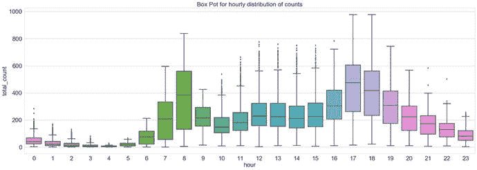

图 6-7.

骑行量小时分布中的异常值

### 相关性

相关性有助于我们理解数据中不同属性之间的关系。由于本章侧重于预测，相关性可以帮助我们理解并利用这些关系来构建更好的模型。

注意

理解相关性并不意味着因果关系至关重要。我们强烈建议您对此进行更深入的探索。

以下代码片段首先使用 `pandas` 工具函数 `corr()` 准备了一个相关矩阵。然后，它使用热力图来绘制该相关矩阵。

```
In [10]: corrMatt = hour_df[["temp","atemp",
...:                         "humidity","windspeed",
...:                        "casual","registered",
...:                         "total_count"]].corr()
...: mask = np.array(corrMatt)
...: mask[np.tril_indices_from(mask)] = False
...: sn.heatmap(corrMatt, mask=mask,
...: vmax=.8, square=True,annot=True)
```

图 6-8 展示了输出的相关矩阵（热力图），以蓝色到红色渐变（负相关到正相关）的下三角形式显示数值。

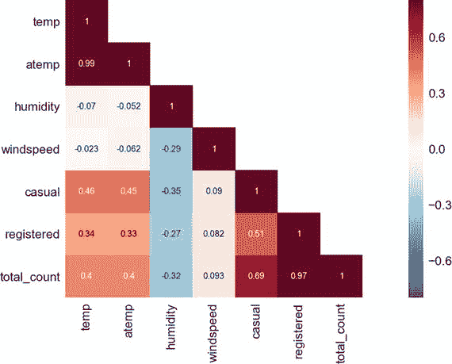

图 6-8.

相关矩阵

两个计数变量 `registered` 和 `casual` 与 `total_count` 显示出明显的强相关性。类似地，`temp` 和 `atemp` 也显示出高相关性。`wind_speed` 和 `humidity` 有轻微的负相关性。总体而言，没有任何属性显示出高的相关性统计量。

## 回归分析

回归分析是一种统计建模技术，被统计学家和数据科学家广泛使用。它是研究因变量和自变量之间关系的过程。回归本身包含了多种用于建模和分析变量之间关系的技术。它被广泛用于预测分析、预测和时间序列分析。

因变量或目标变量被估计为自变量或预测变量的函数。这个估计函数被称为回归函数。

注意

从非常抽象的意义上讲，回归指的是对连续响应/目标变量的估计，这与分类（估计离散目标）不同。

身高-体重关系是开始学习回归分析的经典例子。该例子指出，一个人的体重取决于他/她的身高。因此，我们可以构建一个回归函数，在给定一个人身高（自变量）的情况下估计其体重（因变量），前提是我们有足够的训练样本。我们将在下一节对此进行更多讨论。

回归分析对因变量和自变量之间的关系进行建模。需要牢记的是，因变量和自变量之间的相关性并不意味着因果关系！

### 回归的类型

多年来，已经发展出多种技术来帮助我们执行回归分析。通常，所有回归建模技术都涉及以下内容：

*   自变量 X
*   因变量或目标变量 Y
*   未知参数，记为 `β`

因此，一个回归函数将这些实体关联起来：

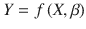

函数 `f()` 需要根据可用的数据集来指定或学习。根据手头的数据和用例，以下是常用的回归技术：

*   **线性回归**：顾名思义，它映射因变量和自变量之间的线性关系。在这种技术中，回归线是一条直线。其目标是使误差（例如，平方误差之和）最小化。
*   **逻辑回归**：当因变量是二元的（0/1 或 是/否）时，使用此技术。它帮助我们确定二元目标变量的概率。其名称来源于该技术使用的 logit 函数。此技术与分类技术的共同点比与回归技术更多。其目标是最大化观测值的似然。
*   **非线性回归**：当因变量与自变量呈多项式关系时，即回归函数中自变量的幂次大于 1。它也被称为多项式回归。

回归技术也可以被分类为非参数方法。

### 假设条件

回归分析有一些通用的假设条件，而特定的分析技术也会增加（或减少）一些假设条件。以下是回归分析的重要通用假设条件：

*   训练数据集需要能够代表被建模的总体。
*   自变量之间是线性独立的，即一个自变量不能表示为其他自变量的线性组合。换句话说，不应存在多重共线性。
*   误差的同方差性，即误差的方差在整个样本中是一致的。

### 评估标准

模型性能的评估是数据科学用例的一个重要方面。我们不仅应该能够理解结果，还应该能够评估模型之间的比较情况，或者性能是否可接受。

通常，评估指标和性能指南是高度用例和领域特定的，而回归分析经常使用一些标准指标。

#### 残差分析

回归是利用解释变量上的回归函数对目标变量进行估计。由于输出是近似值，因此目标变量的预测值与观测值之间会存在一定差异。

残差是观测值与预测值（回归函数的输出）之间的差异。数学上，第 i 个数据点的观测值与预测值之间的残差或差异表示为：

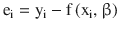

一个与数据拟合良好的回归模型，其残差会呈现随机性（即缺乏任何模式）。这源于回归建模的同方差性假设。通常使用残差与预测变量之间的散点图来确认该假设。任何模式的出现都意味着违反了这一性质，并表明模型拟合不佳。

#### 正态性检验（Q-Q 图）

这是一种用于检验数据正态性的可视化/图形化测试。该测试有助于我们识别异常值、偏态等。测试方法是将数据与理论分位数进行绘图。相同的数据也会绘制在直方图上以确认正态性。以下是展示数据通过正态性检验的示例图（见图 6-9）。

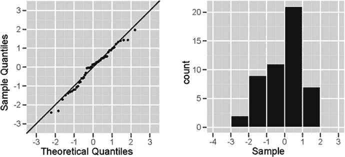

图 6-9.

左侧为正态概率图（Q-Q 图），右侧为用于确认正态性的直方图

正态概率图中任何偏离直线的现象，或直方图中出现偏态/多峰性，都表明数据未通过正态性检验。

#### R 方：拟合优度

R 方或决定系数是另一种用于检验回归分析拟合优度的度量。它用于确定回归线是否能够指示由自变量解释的因变量方差。

R 方是一个介于 0 和 1 之间的数值，1 表示自变量能够完全解释因变量的方差。数值越接近 0，表明模型拟合越差。

#### 交叉验证

如第 5 章所述，模型泛化能力也是处理数据科学问题的一个重要方面。一个在训练集上过拟合的模型，可能在未见过的数据上表现不佳，并导致各种问题和业务影响。因此，我们也在回归模型上采用 k 折交叉验证，以确保没有发生过拟合。

## 建模

现在，我们已准备好开始对共享单车数据集进行建模，并解决预测给定日期时间自行车需求量的业务问题。我们将利用上一节讨论的回归分析概念来建模并评估我们模型的性能。

本章前面部分已经对数据集进行了分析，并执行了某些转换，例如重命名属性和类型转换。由于数据集包含多个分类变量，因此在建模过程中使用它们之前，我们必须对名义变量进行编码。

以下代码片段展示了基于我们在第 4 章（特征工程与选择）中详细讨论的方法，对分类变量进行独热编码的函数。

```
def fit_transform_ohe(df,col_name):
"""此函数对指定列执行独热编码。
参数:
df(pandas.DataFrame): 包含指定列名的数据框
col_name: 需要进行独热编码的列
返回:
元组: label_encoder, one_hot_encoder, 转换后的列作为 pandas Series
"""

# 对列进行标签编码
le = preprocessing.LabelEncoder()
le_labels = le.fit_transform(df[col_name])
df[col_name+'_label'] = le_labels

# 独热编码
ohe = preprocessing.OneHotEncoder()
feature_arr = ohe.fit_transform(df[[col_name+'_label']]).toarray()
feature_labels = [col_name+'_'+str(cls_label) for cls_label in le.classes_]
features_df = pd.DataFrame(feature_arr, columns=feature_labels)
return le,ohe,features_df
```

我们使用 `fit_transform_ohe()` 函数以及 `transform_ohe()` 来对分类变量进行编码。标签编码器和独热编码器是 `scikit-learn` 的 `preprocessing` 模块的一部分。

注意

在接下来的章节中，我们将互换使用 `scikit` 和 `sklearn`。

如前几章所述，我们通常将手头的数据集划分为训练集和测试集，以评估模型的性能。在本例中，我们也使用 `scikit-learn` 的 `model_selection` 模块中提供的 `train_test_split()` 函数。我们将数据集分别按 67% 和 33% 的比例拆分为 `train` 和 `test`。以下代码片段展示了这一点。

```
In [11]: X, X_test, y, y_test = train_test_split(hour_df.iloc[:,0:-3],
...:                                         hour_df.iloc[:,-1],
...:                                         test_size=0.33,
...:                                         random_state=42)
...:
...: X.reset_index(inplace=True)
...: y = y.reset_index()
...:
...: X_test.reset_index(inplace=True)
...: y_test = y_test.reset_index()
```

以下代码片段遍历分类变量列表进行转换，并准备一个编码后的属性列表。

```
In [12]: cat_attr_list = ['season','is_holiday',
...:                 'weather_condition','is_workingday',
...:                 'hour','weekday','month','year']
...:
...: encoded_attr_list = []
...: for col in cat_attr_list:
...:         return_obj = fit_transform_ohe(X,col)
...:         encoded_attr_list.append({'label_enc':return_obj[0],
...:                                   'ohe_enc':return_obj[1],
...:                                   'feature_df':return_obj[2],
...:                                   'col_name':col})
```

注意

尽管我们已经将所有分类变量转换为其独热编码，但请注意，像 hour、weekday 等有序属性不需要此类编码。

接下来，我们将数值型和独热编码后的分类变量合并到一个数据框中，用于建模目的。以下代码片段帮助我们准备所需的数据集。

```
In [13]: feature_df_list = [X[numeric_feature_cols]]
...: feature_df_list.extend([enc['feature_df'] \
...:                                 for enc in encoded_attr_list \
...:                                         if enc['col_name'] in subset_cat_features])
...:
...: train_df_new = pd.concat(feature_df_list, axis=1)
...: print("Shape::{}".format(train_df_new.shape))
```

我们使用原始训练数据框中的数值型和独热编码后的分类属性，准备了一个新的数据框。原始数据框有 10 个这样的属性（包括数值型和分类变量）。经过此转换后，由于对分类变量进行了独热编码，新数据框有 19 个属性。

### 线性回归

最简单的回归分析技术之一是线性回归。正如本章前面所讨论的，线性回归是分析因变量与自变量之间的关系。线性回归假设两个变量之间存在线性关系。在一般回归分析符号的基础上进行扩展，线性回归采用以下形式：

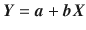

在这个方程中，`Y` 是因变量，`X` 是自变量。符号 `a` 表示回归线的截距，`b` 表示回归线的斜率。

基于截距（即 `a`）和斜率（即 `b`）的不同组合，可以将无数条线拟合到给定的数据集上。目标是找到最适合我们数据建模的拟合线。

如果我们思考一下，最佳拟合线会是什么样子？这样的线必然具有最小的误差/残差，即对于这样一条线，预测值与观测值之间的差异最小。

普通最小二乘法就是识别最佳拟合线的一种技术。该算法试图在斜率和截距方面最小化误差。它使用平方误差形式，如下所示：

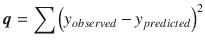

其中，`q` 是总平方误差。我们通过最小化总误差来获得最佳拟合线的斜率和截距。

#### 训练

现在我们已经了解了线性回归和 OLS 的背景知识，接下来开始构建模型。线性回归模型通过 `scikit-learn` 的 `linear_model` 模块提供。与 `scikit` 中的所有机器学习算法一样，它也遵循熟悉的 `fit()` 和 `predict()` 主题。以下代码片段为我们准备了线性回归对象。

```
In [14]: X = train_df_new
...: y= y.total_count.values.reshape(-1,1)
...:
...: lin_reg = linear_model.LinearRegression()
```

一种简单的处理方法是调用 `fit()` 函数来构建我们的线性回归模型，然后在测试数据集上调用 `predict()` 函数来获取用于评估的预测值。我们还需要牢记过拟合的方面，减少其影响，并获得一个可泛化的模型。正如前一节和前面章节所讨论的，交叉验证是控制过拟合的一种方法。

因此，我们使用 k 折交叉验证（具体为 10 折），如下面的代码片段所示。

```
In [15]: predicted = cross_val_predict(lin_reg, X, y, cv=10)
```

函数 `cross_val_predict()` 通过 `sklearn` 的 `model_selection` 模块提供。该函数将模型对象、预测变量和目标变量作为输入。我们使用 `cv` 参数指定 k 折中的 k 值。在我们的示例中，我们使用 10 折交叉验证。该函数返回由模型对象拟合的交叉验证预测值。

我们使用散点图来分析我们的预测。以下代码片段使用 `matplotlib` 生成残差与观测值之间的散点图。

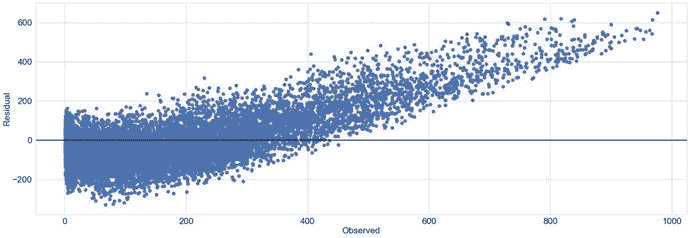

图 6-10.

残差图

```
In [16]: fig, ax = plt.subplots()
...: ax.scatter(y, y-predicted)
...: ax.axhline(lw=2,color='black')
...: ax.set_xlabel('Observed')
...: ax.set_ylabel('Residual')
...: plt.show()
```

图 6-10 中的图明显违反了同方差性假设，该假设要求残差是随机的，不遵循任何模式。为了进一步量化我们与模型相关的发现，我们绘制了交叉验证得分。我们再次使用 `model_selection` 模块中提供的 `cross_val_score()` 函数，如图 6-11 的可视化所示。

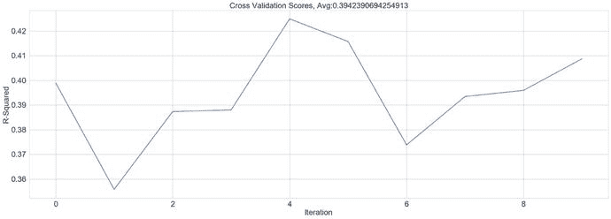

图 6-11.

交叉验证得分

对于 10 折交叉验证，r 平方或决定系数的平均值是 0.39。这表明预测变量仅能解释目标变量中 39% 的方差。

建议你绘制并确认数据的正态性。理解数据是否可以用线性模型来建模非常重要。这留作练习供你探索。

#### 测试

在训练阶段准备并评估的线性回归模型，需要在一个完全未见过的数据集（即测试数据集）上检验其性能。在本节开始时，我们使用了 `train_test_split()` 函数专门保留了一个用于测试的数据集。

但在将测试数据集应用于已学习的回归线之前，我们需要确保训练集和测试集中的属性都经过了相同的预处理。由于我们在训练数据集中将分类变量转换成了独热编码，因此在以下代码片段中，我们对测试数据集也执行了相同的操作。

```
In [17]: test_encoded_attr_list = []
...: for enc in encoded_attr_list:
...: col_name = enc['col_name']
...: le = enc['label_enc']
...: ohe = enc['ohe_enc']
...: test_encoded_attr_list.append({'feature_df':transform_ohe(X_test,
...:                                                                 le,ohe,
...:                                                                 col_name),
...:                                 'col_name':col_name})
...:
...:
...: test_feature_df_list = [X_test[numeric_feature_cols]]
...: test_feature_df_list.extend([enc['feature_df'] \
...:                                 for enc in test_encoded_attr_list \
...:                                         if enc['col_name'] in subset_cat_features])
...:
...: test_df_new = pd.concat(test_feature_df_list, axis=1)
...: print("Shape::{}".format(test_df_new.shape))
```

转换后的测试数据集如图 6-12 所示。

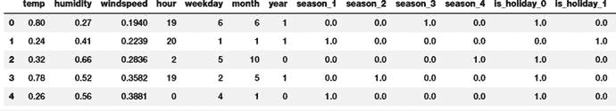

图 6-12.

转换后的测试数据集

最后的关键步骤是使用 `LinearRegression` 对象的 `predict()` 函数，并对比我们的结果/预测值。以下代码片段执行了上述操作。

```
In [18]: X_test = test_df_new
...: y_test = y_test.total_count.values.reshape(-1,1)
...:
...: y_pred = lin_reg.predict(X_test)
...:
...: residuals = y_test-y_pred
```

我们还计算了残差，并用它们来绘制残差图，类似于我们在训练阶段创建的那张图。以下代码片段在测试数据集上绘制了残差图。

```
In [19]: fig, ax = plt.subplots()
...: ax.scatter(y_test, residuals)
...: ax.axhline(lw=2,color='black')
...: ax.set_xlabel('Observed')
...: ax.set_ylabel('Residuals')
...: ax.title.set_text("Residual Plot with R-Squared={}".format(np.average(r2_score)))
...: plt.show()
```

生成的图表显示 R 方值与训练性能相当。该图如图 6-13 所示。

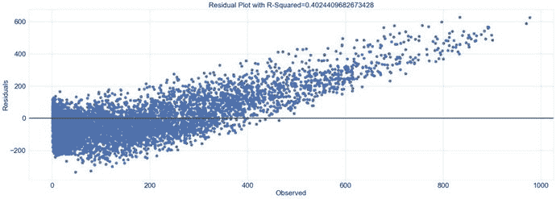

图 6-13.

测试数据集的残差图

从我们的评估中可以明显看出，线性回归模型无法对数据进行有效建模以产生理想的结果。不过需要注意的是，该模型在训练集和测试集上的表现是相当的。这看起来是一个需要使用能够建模非线性关系的方法来处理数据的案例。

练习

在本节中，我们使用了包含 19 个属性（包括数值型和独热编码的分类属性）的训练集和测试集。由于非线性等因素，模型性能不佳。

尝试使用不同的属性组合（仅使用子集、仅使用数值属性或它们的任意组合），并准备不同的线性回归模型。遵循本节概述的相同步骤。将性能与本节准备的模型进行对比，并分析是否可能获得性能更好的模型。

### 基于决策树的回归

决策树是一种用于回归和分类问题的监督学习算法。它们简单但功能强大，尤其擅长建模非线性关系。作为一种非参数模型，该算法的目标是学习一个模型，该模型能够基于简单的决策规则（例如，`if-else` 条件）根据特征预测结果。决策树的可解释性使其更具吸引力，因为我们可以可视化它从数据中推断出的规则。

我们通过一个例子来解释与决策树相关的概念和术语。假设我们有一个来自不同制造商的汽车模型的假设数据集。假设每个数据点具有诸如 `fuel_capacity, engine_capacity, price, year_of_purchase, miles_driven` 和 `mileage` 等特征。给定这些数据，我们需要一个能够根据其他属性预测油耗的模型。

由于决策树是监督学习算法，我们有一定数量的数据点及其实际的油耗值。决策树从根节点开始，将数据集划分为两个或多个不重叠的子集，每个子集表示为根节点的子节点。它根据特定属性将根节点划分为子集。它会在每个节点继续进行分割，直到到达一个包含目标值的叶节点。关于这一切是如何发生的，可能会有很多问题，我们稍后将逐一解答。为了更好地理解，假设图 6-14 是从手头数据集中推断出的决策树结构。

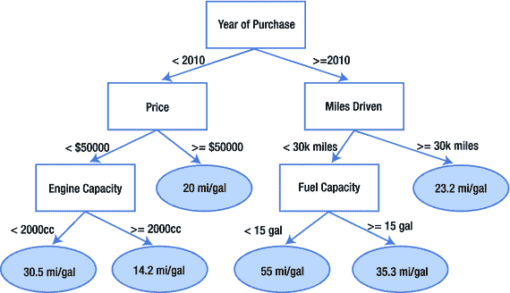

图 6-14.

示例决策树

图 6-14 中展示的可视化图呈现了一个示例决策树，其叶节点指向目标值。该树首先根据购买年份在根节点处对数据集进行分割，左子节点代表 2010 年之前的购买，右子节点代表 2010 年之后的购买，其他节点依此类推。当遇到新的/未见过的数据点时，我们只需遍历该树，到达一个决定目标值的叶节点。尽管前面的例子很简单，但它清晰地体现了模型的可解释性以及其学习简单规则的能力。

#### 节点分裂

决策树以自顶向下的方式工作，节点分裂是任何决策树算法的一个重要概念。大多数算法采用贪心方法将输入空间划分为子集。

简单来说，基本过程是尝试使用不同的属性/特征来分割数据点，并针对一个成本函数进行测试。每一步都会选择导致成本最小的分割方式。分类和回归问题使用不同的成本函数集。以下是一些最常见的成本函数：

*   **均方误差 (MSE)**：主要用于回归树，计算为观测值与预测值之差的平方。
*   **平均绝对误差**：用于回归树，与 MSE 类似，但我们只使用观测值与预测值之间的差值。
*   **方差缩减**：最初由 CART 算法引入，它使用方差的标准公式，我们选择导致方差最小的分割方式。
*   **基尼不纯度/指数**：主要由分类树使用，它衡量的是随机选择一个数据点，在随机标记的情况下被错误标记的概率。
*   **信息增益**：同样主要用于分类问题，也称为熵。我们根据信息增益的大小来选择分割方式。信息增益越高越好。

注意

这些是一些最常用的成本函数。在特定场景下还有更多其他函数被使用。

#### 停止准则

如前所述，决策树遵循节点的贪婪递归分裂，但它们如何或何时停止？有许多策略可用于定义停止准则。最常见的是数据点的最小数量。如果进一步分裂会违反此约束，则停止节点分裂。另一个使用的约束是树的深度。

停止准则与其他参数一起帮助我们实现能够良好泛化的树。一棵非常深或拥有过多非叶节点的树通常会导致过拟合。

#### 超参数

超参数是我们为了优化模型在未见数据上的性能而设置的旋钮和控制项。这些超参数不同于参数，参数是学习算法在训练过程中学习到的。超参数帮助我们实现避免过拟合等目标。决策树提供了相当多的超参数供我们使用，其中一些我们在第 5 章中讨论过。

最大深度、叶节点的最小样本数、分裂内部节点的最小样本数、最大叶节点数等，都是积极用于提升决策树性能的一些超参数。在接下来的章节中，我们将使用网格搜索（回顾第 5 章的内容）等技术来为这些超参数确定最优值。

#### 决策树算法

决策树已经存在相当长一段时间了。多年来，它们随着基于不同技术的算法改进而不断演变。以下列出了一些最常用的算法：

*   CART，即分类与回归树
*   ID3，即迭代二分器 3
*   C4.5

现在我们对决策树有了不错的理解，让我们看看能否通过将其用于预测自行车共享需求的回归问题来获得改进。

#### 训练

与线性回归的过程类似，我们将使用相同的预处理数据框 `train_df_new`，其中分类变量已转换为独热编码形式，并包含其他数值属性。我们还使用 `scikit-learn` 中的 `train_test_split()` 工具将数据集再次拆分为 `train` 和 `test`。

与线性回归相比，决策树的训练过程稍微复杂且有所不同。尽管我们在训练线性回归模型时执行了交叉验证，但我们没有任何需要调整的超参数。对于决策树，我们有很多超参数（其中一些我们甚至在上一节中讨论过）。在深入探讨获取最优超参数的具体细节之前，我们先来看一下 `sklearn` 的 `tree` 模块中的 `DecisionTreeRegressor`。我们通过实例化一个回归器对象并设置一些超参数来实现，如下所示。

```
In [1]: dtr = DecisionTreeRegressor(max_depth=4,
...:                                 min_samples_split=5,
...:                                 max_leaf_nodes=10)
```

这段代码片段准备了一个 `DecisionTreeRegressor` 对象，该对象设置为最大深度为 4，最大叶节点数为 10，以及分裂一个节点所需的最小样本数为 5。虽然可能还有更多参数，但这个示例概述了超参数如何在算法中使用。

注意

建议你尝试在训练数据上拟合默认的决策树回归器，并观察其在测试数据集上的性能。

如前所述，决策树具有可解释性的额外优势。我们可以使用 `Graphviz` 和 `pydot` 库来可视化模型对象，如下面的代码片段所示。

```
In [2]: dot_data = tree.export_graphviz(dtr, out_file=None)
...: graph = pydotplus.graph_from_dot_data(dot_data)
...: graph.write_pdf("bikeshare.pdf")
```

输出是一个 `pdf` 文件，展示了一个具有上一步中设置的超参数的决策树。下图如图 6-15 所示，显示了根节点在属性 3 上分裂，然后继续直到达到深度 4。也有一些叶节点的深度小于 4。每个节点都清晰地标出了与其关联的属性。

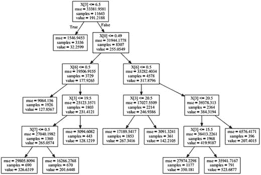

图 6-15.

在自行车共享数据集上具有定义超参数的决策树

现在我们开始实际的训练过程。从我们目前的工作流程中应该可以明显看出，我们将使用 k 折交叉验证来训练我们的回归器。由于在决策树的情况下我们还需要担心超参数，我们需要一种方法来微调它们。

微调超参数的方法有很多种，最常见的是网格搜索和随机搜索，其中网格搜索更受欢迎。顾名思义，随机搜索随机搜索超参数的组合以找到最佳组合，而网格搜索则是一种更系统的方法，在确定最佳组合之前会尝试所有组合。为了让我们的生活更轻松，`sklearn` 提供了一个工具，可以在使用 `model_selection` 模块中的 `GridSearchCV()` 方法对模型进行交叉验证的同时，对超参数进行网格搜索。

`GridSearchCV()` 方法将回归器/分类器对象作为输入参数，同时还需要一个超参数字典、所需的交叉验证次数以及其他一些参数。我们使用以下字典来定义我们的超参数网格。

```
In [3]: param_grid = {"criterion": ["mse", "mae"],
...:               "min_samples_split": [10, 20, 40],
...:               "max_depth": [2, 6, 8],
...:               "min_samples_leaf": [20, 40, 100],
...:               "max_leaf_nodes": [5, 20, 100, 500, 800],
...: }
```

该字典主要提供了我们想要微调的每个超参数的可行值列表。超参数作为键，而值则以这些超参数的可能值列表形式呈现。例如，我们的字典为`max_depth`提供了 2、6 和 8 层这几个可能值。`GridSearchCV()`函数将依次在这个定义好的可能值列表中搜索，以得出最佳值。以下代码片段准备了一个`GridSearchCV`对象，并将我们的训练数据集拟合到该对象中。

```
In [4]: grid_cv_dtr = GridSearchCV(dtr, param_grid, cv=5)
```

使用 k 折交叉验证进行超参数网格搜索是一个迭代过程，该过程由`GridSearchCV()`函数封装、优化并标准化。由于这一过程，训练需要花费时间，但会生成许多有用的属性用于分析。`best_score_`属性帮助我们获取决策树回归器能达到的最佳交叉验证分数。我们可以使用`best_params_`查看生成最佳分数的模型的超参数。我们还可以使用`cv_results_`属性查看`GridSearchCV()`每次迭代的详细信息。以下代码片段展示了其中一些属性。

```
In [5]: print("R-Squared::{}".format(grid_cv_dtr.best_score_))
...: print("Best Hyperparameters::\n{}".format(grid_cv_dtr.best_params_))
R-Squared::0.85891903233008
Best Hyperparameters::
{'min_samples_split': 10, 'max_depth': 8, 'max_leaf_nodes': 500, 'min_samples_leaf': 20, 'criterion': 'mse'}
```

结果相当不错，并且相比我们的线性回归模型有了显著提升。首先，让我们尝试理解该模型拟合在不同设置下的学习/模型拟合结果。为了获取网格搜索过程中准备的不同模型，我们使用`GridSearchCV`对象的`cv_results_`属性。`cv_results_`属性是一个`numpy`数组，我们可以轻松地将其转换为`pandas`数据框。该数据框如图 6-16 所示。

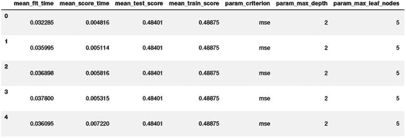

图 6-16.

展示使用带交叉验证的网格搜索的若干属性进行调优结果的数据框

理解这一点很重要：带交叉验证的网格搜索旨在优化找到最佳超参数集，以帮助构建一个泛化能力强的决策树回归器。可能存在进一步优化的空间。我们使用`seaborn`来绘制树的深度以及叶节点数量对整体分数的影响。以下代码片段使用了我们之前讨论过的、通过`GridSearchCV`对象的`cv_results_`属性准备的数据框。

```
In [6]: fig,ax = plt.subplots()
...: sn.pointplot(data=df[['mean_test_score',
...:                         'param_max_leaf_nodes',
...:                         'param_max_depth']],
...:                 y='mean_test_score',x='param_max_depth',
...:                 hue='param_max_leaf_nodes',ax=ax)
...: ax.set(title="Affect of Depth and Leaf Nodes on Model Performance")
```

输出显示，当深度从 2 增加到 6 时，分数突然提升，而从 6 增加到 8 时，则是逐渐提升。叶节点数量的影响则相当有趣。100 个叶节点和 800 个叶节点之间的分数差异并不显著。这清楚地表明存在进一步微调的可能性。图 6-17 展示了这些结果的可视化效果。

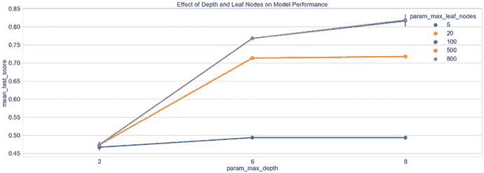

图 6-17.

平均测试分数以及树深度和叶节点数量的影响

如前所述，仍有微调的空间以进一步改善结果。因此，这是一个取决于用例和成本的决策。成本可以体现在工作量、时间以及相应的性能提升上。现在，我们将继续使用`GridSearchCV`对象帮助我们识别出的最佳模型。

#### 测试

一旦我们使用优化后的超参数训练好模型，就可以开始常规工作流程，在未见过的数据集上测试性能。我们将采用与准备线性回归测试集时相同的预处理方法（你可以参考线性回归的“测试”部分和/或 Jupyter notebook `decision_tree_regression.ipynb`）。以下代码片段使用训练阶段获得的最佳估计器来预测测试数据集的输出值。

```
In [7]: y_pred = best_dtr_model.predict(X_test)
...: residuals = y_test.flatten() - y_pred
```

最后一步是查看该数据集上的 R 平方分数。一个拟合良好的模型在此数据集上也应具有可比的性能，以下代码片段也证实了这一点。

```
In [1]: print("R-squared::{}".format(r2_score))
R-squared::0.8722
```

从 R 平方值可以看出，其性能与我们的训练性能相当。我们可以得出结论：与线性回归相比，决策树回归器在预测自行车需求方面表现更好。

## 后续步骤

决策树帮助我们实现了比基于线性回归的模型更好的性能，但仍有改进空间。以下是需要考虑和牢记的几个后续步骤：

*   **模型微调**：我们通过使用决策树取得了显著改进，但这可以通过分析训练、交叉验证等的结果来进一步优化。可接受的模型性能取决于具体用例，通常在正式确定问题陈述时进行讨论。在我们的案例中，R 平方值为 0.8 可能非常好，也可能未达到目标，因此需要与所有相关方讨论结果。
*   **其他模型与集成方法**：如果我们当前的模型未达到性能标准，我们需要评估其他算法，甚至是集成方法。还有许多其他回归模型可供探索。集成方法也非常有用，并且被广泛使用。
*   **机器学习流水线**：本章分享的工作流程较为详细，以帮助理解和探索概念与技术。一旦预处理和建模步骤的序列稳定下来，就会使用标准化的流水线来维护整个流程的一致性和有效性。建议你进一步探索`sklearn`的`pipeline`模块以获取更多详细信息。

## 总结

本章介绍了来自 UCI 机器学习知识库的共享单车数据集。我们遵循了本书上一节详细讨论过的机器学习工作流程。首先对数据集进行了简要讨论，随后正式定义了问题陈述。一旦我们确立了预测单车需求的任务，下一步就是开始探索性数据分析，以理解并揭示数据中的属性和模式。我们利用 `pandas`、`numpy` 和 `seaborn/matplotlib` 来操作、转换和可视化手头的数据集。折线图、条形图、箱线图、小提琴图等图表都帮助我们理解了数据集的不同方面。

随后，我们稍作转向，探索了回归分析。我们讨论了回归分析技术的重要概念、假设和类型。我们还简要涉及了回归问题中通常使用的各种性能/评估标准，例如残差图、正态概率图和决定系数。在更好地理解了数据集和回归本身之后，我们从一个名为线性回归的简单算法开始。它不仅是一个简单的算法，也是回归用例中研究最深入、应用最广泛的算法之一。我们利用 `sklearn` 的 `linear_model` 来构建和测试针对当前问题的数据集。我们还使用了 `model_selection` 模块来拆分数据集并对模型进行交叉验证。下一步，我们升级到基于决策树的回归模型，以改进线性回归的性能。在将决策树用于数据集建模之前，我们讨论了与其相关的概念和重要方面。线性回归和决策树使用了相同的预处理步骤。最后，我们简要讨论了后续改进和增强的步骤，以此结束本章。本章为后续章节设定了流程和背景，后续章节将在此基础上构建概念和工作流程。

