# 7. 分析电影评论情感

在本章中，我们将继续关注以案例研究为导向的章节，重点研究特定的现实世界问题和场景，以及如何使用机器学习来解决它们。本章将涵盖自然语言处理（NLP）、文本分析和机器学习相关的方面。当前的问题是情感分析或观点挖掘，我们希望分析一些文本文档，并根据这些文档的内容预测其情感或观点。情感分析可能是自然语言处理和文本分析最流行的应用之一，有大量关于此主题的网站、书籍和教程。通常，情感分析在主观文本上效果最佳，因为人们会在其中表达观点、感受和情绪。从现实世界的行业角度来看，情感分析被广泛用于分析企业调查、反馈调查、社交媒体数据，以及电影、地点、商品等的评论。其理念是分析和理解人们对特定实体的反应，并根据他们的情感采取有洞察力的行动。

一个文本语料库由多个文本文档组成，每个文档可以简单到单个句子，也可以复杂到包含多个段落的完整文档。尽管文本数据高度非结构化，但可以将其分为两大类文档。事实性文档通常描述某种形式的陈述或事实，不附带特定的感受或情感。这些也被称为客观文档。另一方面，主观文档包含表达感受、情绪、情感和观点的文本。

情感分析也常被称为观点分析或观点挖掘。其核心思想是利用文本分析、NLP、机器学习和语言学中的技术，从非结构化文本中提取重要信息或数据点。这反过来可以帮助我们推导出定性输出，例如整体情感处于正面、中性或负面等级，以及定量输出，例如情感极性、主观性和客观性比例。情感极性通常是一个数值分数，根据表达感受和情感的特定词语和短语等主观参数，分配给文本文档的正面和负面方面。中性情感通常具有 `0` 极性，因为它不表达任何特定情感；正面情感的极性 `> 0`，负面情感的极性 `< 0`。当然，你可以根据所处理文本的类型随时更改这些阈值；对此没有硬性约束。

在本章中，我们重点分析一个大型电影评论语料库并推导出情感。我们将涵盖多种用于分析情感的技术，包括以下内容。

*   无监督的基于词典的模型
*   传统的监督式机器学习模型
*   较新的监督式深度学习模型
*   先进的监督式深度学习模型

除了研究各种方法和模型外，我们还关注机器学习流程中的重要方面，包括文本预处理、规范化以及模型的深入分析，包括模型解释和主题模型。这里的核心思想是理解我们如何解决像非结构化文本情感分析这样的问题，学习各种技术、模型，并理解如何解释结果。这将使您将来能够在自己的数据集上使用这些方法。让我们开始吧！

## 问题陈述

本章的主要目标是预测从互联网电影数据库（IMDb）获取的大量电影评论的情感。该数据集包含 50,000 条电影评论，这些评论已根据评论内容预先标记了“正面”和“负面”情感类别标签。除此之外，还有一些未标记的电影评论。该数据集可从 [`http://ai.stanford.edu/~amaas/data/sentiment/`](http://ai.stanford.edu/%7Eamaas/data/sentiment/) 获取，感谢斯坦福大学以及 Andrew L. Maas、Raymond E. Daly、Peter T. Pham、Dan Huang、Andrew Y. Ng 和 Christopher Potts。该数据集也用于他们著名的论文《为情感分析学习词向量》（[Learning Word Vectors for Sentiment Analysis](http://ai.stanford.edu/%7Eamaas/papers/wvSent_acl2011.pdf)），该论文发表于第 49 届计算语言学协会年会（ACL 2011）论文集。他们提供了原始文本格式以及已处理的词袋格式的数据集。在本章的分析中，我们将仅使用原始标记的电影评论。因此，我们的任务是预测 15,000 条标记电影评论的情感，并使用剩余的 35,000 条评论来训练我们的监督模型。对于无监督模型，为了保持一致性并便于比较，我们仍将仅预测 15,000 条评论的情感。

## 设置依赖项

我们将使用多个专门用于文本分析、自然语言处理和机器学习的 Python 库和框架。虽然大部分内容会在各章节中提及，但你需要确保已安装 `pandas`、`numpy`、`scipy` 和 `scikit-learn`，它们将用于数据处理和机器学习。本章使用的深度学习框架包括以 `tensorflow` 为后端的 keras，但如果你愿意，也可以使用 `theano` 作为后端。将用到的自然语言处理库包括 `spacy`、`nltk` 和 `gensim`。请务必检查你安装的 `nltk` 版本至少为 `>= 3.2.4`，否则 `ToktokTokenizer` 类可能不存在。如果出于某种原因你想使用更低的 `nltk` 版本，你可以使用任何其他分词器，例如基于 `TreebankWordTokenizer` 的默认 `word_tokenize()`。`gensim` 的版本应至少为 `2.3.0`，而 `spacy` 使用的版本是 `1.9.0`。我们建议使用最近发布的 spacy 最新版本（2.x 版），因为它修复了几个错误并增加了多项改进。如果你是首次安装 `spacy` 和 `nltk`，还需要下载必要的依赖项和语料库。以下代码片段可以完成此操作。对于 `nltk`，在使用 `pip` 或 `conda` 安装 `nltk` 后，你需要在 Python 或 ipython shell 中输入以下代码。

```
import nltk
nltk.download('all', halt_on_error=False)
```

对于 `spacy`，你需要在 Unix shell\Windows 命令提示符中输入以下代码来安装该库（如果你不想使用 `conda`，可以使用 `pip install spacy`），并获取英文模型依赖项。

```
$ conda config --add channels conda-forge
$ conda install spacy
$ python -m spacy download en
```

我们还会使用自定义开发的文本预处理和标准化模块，你可以在名为 `contractions.py` 和 `text_normalizer.py` 的文件中找到它们。与监督模型拟合、预测和评估相关的工具函数位于 `model_evaluation_utils.py` 中，因此请确保将这些模块与本章的其他 Python 文件和 jupyter notebook 放在同一目录下。

## 获取数据

该数据集将随本章的代码文件一起，存放在本书的 GitHub 仓库中，地址为 [`https://github.com/dipanjanS/practical-machine-learning-with-python`](https://github.com/dipanjanS/practical-machine-learning-with-python)，文件名为 `movie_reviews.csv`，包含 50,000 条已标注的 IMDb 电影评论。如果需要，你也可以从 [`http://ai.stanford.edu/~amaas/data/sentiment/`](http://ai.stanford.edu/%7Eamaas/data/sentiment/) 下载相同的数据。获取 CSV 文件后，你可以使用 `pandas` 中的 `read_csv(...)` 工具函数轻松将其加载到 Python 中。

## 文本预处理与标准化

在深入进行特征工程和建模过程之前，关键步骤之一包括清洗、预处理和标准化文本，以便将短语和单词等文本组件转换为某种标准格式。这有助于在整个文档语料库中实现标准化，从而构建有意义的特征，并减少因无关符号、特殊字符、XML 和 HTML 标签等多种因素引入的噪声。名为 `text_normalizer.py` 的文件包含了我们进行文本标准化所需的所有工具函数。你也可以参考名为 `Text Normalization Demo.ipynb` 的 jupyter notebook 以获得更具交互性的体验。本节将描述文本标准化流程中的主要组件。

*   **清洗文本**：我们的文本通常包含 HTML 标签等不必要的内容，这些内容在分析情感时价值不大。因此，我们需要在提取特征之前确保将其移除。`BeautifulSoup` 库在这方面提供了出色的函数。我们的 `strip_html_tags(...)` 函数能够清洗和剥离 HTML 代码。
*   **去除重音字符**：在我们的数据集中，处理的是英文评论，因此我们需要确保任何其他格式的字符，尤其是重音字符，被转换并标准化为 ASCII 字符。一个简单的例子是将 é 转换为 e。我们的 `remove_accented_chars(...)` 函数在这方面提供了帮助。
*   **扩展缩略词**：在英语中，缩略词基本上是单词或音节的缩写形式。这些现有单词或短语的缩写形式是通过移除特定字母和发音来创建的。通常，单词中的元音会被移除。例如，do not 变为 don’t，I would 变为 I’d。缩略词在文本标准化中会带来问题，因为我们需要处理撇号等特殊字符，并且必须将每个缩略词转换为其扩展的原始形式。我们的 `expand_contractions(...)` 函数使用正则表达式以及 `contractions.py` 模块中映射的各种缩略词，来扩展文本语料库中的所有缩略词。
*   **去除特殊字符**：文本清洗和标准化的另一项重要任务是去除特殊字符和符号，这些字符和符号常常会增加非结构化文本中的额外噪声。可以使用简单的正则表达式来实现这一点。我们的函数 `remove_special_characters(...)` 帮助我们去除特殊字符。在我们的代码中，我们保留了数字，但如果你不希望标准化后的语料库中包含数字，也可以将其移除。
*   **词干提取与词形还原**：词干通常是单词的基本形式，可以通过向词干附加前缀和后缀等词缀来创建新单词。这被称为屈折变化。获取单词基本形式的逆向过程被称为词干提取。一个简单的例子是单词 WATCHES、WATCHING 和 WATCHED，它们都以单词词根词干 WATCH 作为基本形式。`nltk` 包提供了多种词干提取器，例如 `PorterStemmer` 和 `LancasterStemmer`。词形还原与词干提取非常相似，都是移除单词词缀以获取单词的基本形式。然而，在这种情况下，基本形式被称为根词，而不是词根词干。区别在于根词始终是一个在词典中存在的、拼写正确的单词，而词根词干则可能不是。我们将在标准化流程中仅使用词形还原来保留拼写正确的单词。函数 `lemmatize_text(...)` 在这方面提供了帮助。
*   **去除停用词**：在从文本构建有意义的特征时，那些意义不大或没有意义的词也被称为停用词。如果你在文档语料库中进行简单的词项或词频统计，这些词通常是频率最高的词。像 a、an、the 等词被认为是停用词。没有通用的停用词列表，但我们使用了来自 `nltk` 的标准英文停用词列表。如果需要，你也可以添加特定领域的停用词。函数 `remove_stopwords(...)` 帮助我们移除停用词，并保留语料库中最具意义和上下文的词。

我们将所有这些组件整合到以下名为 `normalize_corpus(...)` 的函数中，该函数可以将文档语料库作为输入，并返回经过清洗和标准化文本处理的同一语料库。

```
def normalize_corpus(corpus, html_stripping=True, contraction_expansion=True,
accented_char_removal=True, text_lower_case=True,
text_lemmatization=True, special_char_removal=True,
stopword_removal=True):
normalized_corpus = []

# 对语料库中的每个文档进行标准化
for doc in corpus:

# 去除 HTML 标签
if html_stripping:
doc = strip_html_tags(doc)

# 去除重音字符
if accented_char_removal:
doc = remove_accented_chars(doc)

# 展开缩写
if contraction_expansion:
doc = expand_contractions(doc)

# 将文本转换为小写
if text_lower_case:
doc = doc.lower()

# 去除多余的换行符
doc = re.sub(r'[\r|\n|\r\n]+', ' ',doc)

# 在特殊字符之间插入空格以将其隔离
special_char_pattern = re.compile(r'([{.(-)!}])')
doc = special_char_pattern.sub(" \\1 ", doc)

# 词形还原
if text_lemmatization:
doc = lemmatize_text(doc)

# 去除特殊字符
if special_char_removal:
doc = remove_special_characters(doc)

# 去除多余空白
doc = re.sub(' +', ' ', doc)

# 去除停用词
if stopword_removal:
doc = remove_stopwords(doc, is_lower_case=text_lower_case)
normalized_corpus.append(doc)
return normalized_corpus
```

以下代码片段展示了使用我们的标准化模块对示例文档进行文本标准化的小型演示。

```
In [1]: from text_normalizer import normalize_corpus
In [2]: document = """Héllo! Héllo! can you hear me! I just heard about Python!\r\n
...: It's an amazing language which can be used for Scripting, Web development,\r\n\r\n
...: Information Retrieval, Natural Language Processing, Machine Learning & Artificial Intelligence!\n
...: What are you waiting for? Go and get started. He's learning, she's learning, they've already\n\n
...: got a headstart!
...:            """
In [3]: document
Out[3]: "Héllo! Héllo! can you hear me! I just heard about Python!\r\n \n              It's an amazing language which can be used for Scripting, Web development,\r\n\r\n\n              Information Retrieval, Natural Language Processing, Machine Learning & Artificial Intelligence!\n\n              What are you waiting for? Go and get started. He's learning, she's learning, they've already\n\n\n              got a headstart!\n           "
In [4]: normalize_corpus([document], text_lemmatization=False, stopword_removal=False,
text_lower_case=False)
Out[4]: ['Hello Hello can you hear me I just heard about Python It is an amazing language which can be used for Scripting Web development Information Retrieval Natural Language Processing Machine Learning Artificial Intelligence What are you waiting for Go and get started He is learning she is learning they have already got a headstart ']
In [5]: normalize_corpus([document])
Out[5]: ['hello hello hear hear python amazing language use scripting web development information retrieval natural language processing machine learning artificial intelligence wait go get start learn learn already get headstart']
```

现在我们已经准备好了标准化模块，可以开始对语料库进行建模和分析。对文本标准化更深入细节感兴趣的 NLP 和文本分析爱好者，可以参考《Python 文本分析》（Apress 出版社；Dipanjan Sarkar 著，2016 年）一书第 115 页第 3 章的“文本标准化”部分。

## 基于无监督词典的模型

我们之前讨论过无监督学习方法，这些方法指的是可以直接应用于数据特征而无需标注数据的特定建模方法。在任何组织中，主要挑战之一是由于缺乏时间和资源来完成标注数据这项繁琐任务，导致难以获得标注数据集。在这种情况下，无监督方法非常有用，我们将在本节中探讨其中一些方法。即使我们有标注数据，本节也能让您很好地了解基于词典的模型是如何工作的，并且您可以在没有标注数据时将其应用于自己的数据集。

无监督情感分析模型使用精心策划的知识库、本体、词典和数据库，这些资源包含关于主观词汇、短语的详细信息，包括情感、情绪、极性、客观性、主观性等。词典模型通常使用一个专门针对情感分析的词典，也称为字典或词汇表。通常，这些词典包含与正面和负面情感相关的词汇列表、极性（负面或正面分数的幅度）、词性（POS）标签、主观性分类器（强、弱、中性）、情绪、情态等。您可以使用这些词典，通过匹配词典中特定词汇的出现情况来计算文本文档的情感，同时考虑其他附加因素，如否定词的存在、周围词汇、整体上下文和短语，并汇总整体情感极性分数，以决定最终的情感分数。有几种流行的词典模型用于情感分析。其中一些列举如下。

*   刘冰词典
*   MPQA 主观性词典
*   Pattern 词典
*   AFINN 词典
*   SentiWordNet 词典
*   VADER 词典

这并不是词典模型的详尽列表，但绝对列出了当今最流行的一些模型。我们将更详细地介绍最后三种词典模型，并使用我们的电影评论数据集提供动手代码和示例。我们将使用最后 15,000 条评论来预测其情感，并根据模型评估指标（如准确率、精确率、召回率和 F1 分数）来评估模型的表现，这些指标我们在第 5 章中已详细介绍。由于我们有标注数据，因此很容易看出这些电影评论的实际情感值与基于词典模型预测的情感值的匹配程度。您可以参考名为`unsupervised_sentiment_analysis.py`的 Python 文件，获取本节中使用的所有代码，或者使用名为`Sentiment Analysis - Unsupervised Lexical.ipynb`的 Jupyter 笔记本以获得更互动的体验。在开始分析之前，让我们使用以下代码片段加载必要的依赖项和配置设置。

```
In [1]: import pandas as pd
...: import numpy as np
...: import text_normalizer as tn
...: import model_evaluation_utils as meu
...:
...: np.set_printoptions(precision=2, linewidth=80)
```

现在，我们可以加载 IMDb 评论数据集，提取出最后 15,000 条评论用于分析，并使用以下代码片段对其进行标准化。

```
In [2]: dataset = pd.read_csv(r'movie_reviews.csv')
...:
...: reviews = np.array(dataset['review'])
...: sentiments = np.array(dataset['sentiment'])
...:
...: # 提取用于模型评估的数据
...: test_reviews = reviews[35000:]
...: test_sentiments = sentiments[35000:]
...: sample_review_ids = [7626, 3533, 13010]
...:
...: # 标准化数据集
...: norm_test_reviews = tn.normalize_corpus(test_reviews)
```

我们还提取了一些示例评论，以便在其上运行模型并详细解释结果。

### 刘冰词典

该词典包含超过 6,800 个词汇，分为两个文件：`positive-words.txt`（包含约 2,000 多个词汇/短语）和`negative-words.txt`（包含 4,800 多个词汇/短语）。该词典由刘冰历经数年开发和整理，并在其原始论文（Nitin Jindal 和刘冰合著，《识别文本文档中的比较句》，第 29 届 ACM SIGIR 国际年会论文集，西雅图，2006 年）中进行了详细说明。如果您想使用此词典，可以从`https://` [`www.cs.uic.edu/~liub/FBS/sentiment-analysis.html#lexicon`](http://www.cs.uic.edu/%7Eliub/FBS/sentiment-analysis.html%23lexicon) 获取，该页面还提供了将其作为压缩包（RAR 格式）下载的链接。

### MPQA 主观性词典

术语 MPQA 代表多视角问答（Multi-Perspective Question Answering），它包含一系列与意见语料库、主观性词典、主观性语义标注、论证词典、辩论语料库、意见挖掘器等多种资源相关的多样化数据集。该资源由匹兹堡大学开发并维护，其官方网站 [`http://mpqa.cs.pitt.edu/`](http://mpqa.cs.pitt.edu/) 包含了所有必要信息。主观性词典是其意见挖掘器框架的一部分，包含了主观性线索和上下文极性。有关详细信息，可参阅 Theresa Wilson、Janyce Wiebe 和 Paul Hoffmann 的论文《[识别短语级情感分析中的上下文极性](http://www.cs.pitt.edu/%7Ewiebe/pubs/papers/emnlp05polarity.pdf)》（HLT-EMNLP-2005 会议论文集）。

你可以从其官方网站 [`http://mpqa.cs.pitt.edu/lexicons/subj_lexicon/`](http://mpqa.cs.pitt.edu/lexicons/subj_lexicon/) 下载主观性词典，其中包含数据集 `subjclueslen1-HLTEMNLP05.tff` 中呈现的主观性线索。以下片段展示了该词典中的一些示例行。

```
type=weaksubj len=1 word1=abandonment pos1=noun stemmed1=n priorpolarity=negative
type=weaksubj len=1 word1=abandon pos1=verb stemmed1=y priorpolarity=negative
...
...
type=strongsubj len=1 word1=zenith pos1=noun stemmed1=n priorpolarity=positive
type=strongsubj len=1 word1=zest pos1=noun stemmed1=n priorpolarity=positive
```

每一行包含一个特定单词及其关联的极性、词性标注信息、长度（目前仅包含长度为 1 的单词）、主观性上下文以及词干信息。

### 模式词典

Pattern 包是 Python 中一个完整的自然语言处理框架，可用于文本处理、情感分析等。它由 CLiPS（计算语言学与心理语言学）开发，该研究中心隶属于安特卫普大学文学院语言学系。Pattern 使用其自身的情感模块，该模块内部使用一个词典，你可以从其官方 GitHub 仓库 [`https://github.com/clips/pattern/blob/master/pattern/text/en/en-sentiment.xml`](https://github.com/clips/pattern/blob/master/pattern/text/en/en-sentiment.xml) 访问该词典，其中包含完整的主观性词典数据库。词典中的每一行通常类似于以下示例。

```

因此，你可以获得重要的元数据信息，如 WordNet 语料库标识符、极性分数、词义、词性标注、强度、主观性分数等。这些信息反过来可用于基于极性和主观性分数计算文本文档的情感。遗憾的是，Pattern 仍未正式移植到 Python `3.x`，它目前适用于 Python `2.7.x`。不过，你仍然可以加载此词典并根据需要进行自己的建模。

AFINN 词典

AFINN 词典
  可能是最简单、最流行的词典之一，可广泛用于情感分析。该词典由 Finn Årup Nielsen 开发并维护，你可以在 Finn Årup Nielsen 的论文《A new ANEW: evaluation of a word list for sentiment analysis in microblogs》（ESWC2011 研讨会论文集）中找到关于此词典的更多详细信息。该词典的当前版本是 `AFINN-en-165.txt`，包含超过 3300 个单词，每个单词都关联一个极性分数。你可以在作者的官方 GitHub 仓库中找到此词典及其早期版本（包括 `AFINN-111`），地址为 [`https://github.com/fnielsen/afinn/blob/master/afinn/data/`](https://github.com/fnielsen/afinn/blob/master/afinn/data/) 。作者还在此基础上创建了一个名为 `afinn` 的 Python 封装库，我们将使用它进行分析。你可以使用以下代码导入该库并实例化一个对象。

```
In [3]: from afinn import Afinn
...:
...: afn = Afinn(emoticons=True)
```

现在，我们可以使用此对象，通过以下代码片段计算我们选定的四个示例评论的极性。

```
In [4]: for review, sentiment in zip(test_reviews[sample_review_ids], test_sentiments[sample_review_ids]):
...:     print('REVIEW:', review)
...:     print('Actual Sentiment:', sentiment)
...:     print('Predicted Sentiment polarity:', afn.score(review))
...:     print('-'*60)
REVIEW: no comment - stupid movie, acting average or worse... screenplay - no sense at all... SKIP IT!
Actual Sentiment: negative
Predicted Sentiment polarity: -7.0

REVIEW: I don't care if some people voted this movie to be bad. If you want the Truth this is a Very Good Movie! It has every thing a movie should have. You really should Get this one.
Actual Sentiment: positive
Predicted Sentiment polarity: 3.0

REVIEW: Worst horror film ever but funniest film ever rolled in one you have got to see this film it is so cheap it is unbelievable but you have to see it really!!!! P.S. Watch the carrot
Actual Sentiment: positive
Predicted Sentiment polarity: -3.0

```

我们可以比较每条评论的实际情感标签，并查看预测的情感极性分数。负极性通常表示负面情感。为了对我们包含 15,000 条评论的完整测试数据集（我使用了原始文本文档，因为 AFINN 会考虑表情符号和感叹号等其他方面）进行情感预测，我们现在可以使用以下代码片段。我使用阈值 `>= 1.0` 来判断整体情感是正面还是负面。将来你可以根据自己的语料库分析选择自己的阈值。

```
In [5]: sentiment_polarity = [afn.score(review) for review in test_reviews]
...: predicted_sentiments = ['positive' if score >= 1.0 else 'negative' for score in
sentiment_polarity]
```

现在我们有了预测的情感标签，我们可以使用效用函数，基于标准性能指标来评估模型性能。参见图 7-1。

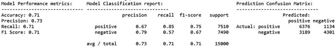

图 7-1.

基于 AFINN 词典的模型性能指标

```
In [6]: meu.display_model_performance_metrics(true_labels=test_sentiments,
predicted_labels=predicted_sentiments,
classes=['positive', 'negative'])
```

我们得到了 71% 的整体 F1 分数，考虑到这是一个无监督模型，这个结果相当不错。查看混淆矩阵，我们可以清楚地看到，相当多的负面情感评论被错误分类为正面（3,189 条），这导致负面情感类别的召回率较低，为 57%。正面类别的性能在召回率或命中率方面更好，我们在 7,510 条正面评论中正确预测了 6,376 条，但由于在负面情感评论的情况下做出了许多错误的正面预测，精确率为 67%。

SentiWordNet 词典

WordNet 语料库无疑是英语中最流行的语料库之一，广泛应用于自然语言处理和语义分析。WordNet 为我们提供了同义词集（synsets）的概念。SentiWordNet 词典基于 WordNet 同义词集，可用于情感分析和意见挖掘。SentiWordNet 词典通常为每个 WordNet 同义词集分配三个情感分数。这些分数包括正面极性分数、负面极性分数和客观性分数。更多详细信息可在官方网站 [`http://sentiwordnet.isti.cnr.it`](http://sentiwordnet.isti.cnr.it) 上找到，包括研究论文和词典下载链接。我们将使用 nltk 库，它提供了 SentiWordNet 的 Python 接口。假设我们有形容词 awesome。我们可以使用以下代码片段获取与该词同义词集关联的情感分数。

```
In [8]: from nltk.corpus import sentiwordnet as swn
...:
...: awesome = list(swn.senti_synsets('awesome', 'a'))[0]
...: print('Positive Polarity Score:', awesome.pos_score())
...: print('Negative Polarity Score:', awesome.neg_score())
...: print('Objective Score:', awesome.obj_score())
Positive Polarity Score: 0.875
Negative Polarity Score: 0.125
Objective Score: 0.0
```

现在，让我们构建一个通用函数，基于文档中匹配的同义词集，提取并聚合完整文本文档的情感分数。

```
def analyze_sentiment_sentiwordnet_lexicon(review,
verbose=False):

# tokenize and POS tag text tokens
tagged_text = [(token.text, token.tag_) for token in tn.nlp(review)]
pos_score = neg_score = token_count = obj_score = 0

# get wordnet synsets based on POS tags

# get sentiment scores if synsets are found
for word, tag in tagged_text:
ss_set = None
if 'NN' in tag and list(swn.senti_synsets(word, 'n')):
ss_set = list(swn.senti_synsets(word, 'n'))[0]
elif 'VB' in tag and list(swn.senti_synsets(word, 'v')):
ss_set = list(swn.senti_synsets(word, 'v'))[0]
elif 'JJ' in tag and list(swn.senti_synsets(word, 'a')):
ss_set = list(swn.senti_synsets(word, 'a'))[0]
elif 'RB' in tag and list(swn.senti_synsets(word, 'r')):
ss_set = list(swn.senti_synsets(word, 'r'))[0]

# if senti-synset is found
if ss_set:

# add scores for all found synsets
pos_score += ss_set.pos_score()
neg_score += ss_set.neg_score()
obj_score += ss_set.obj_score()
token_count += 1

# 聚合最终得分
final_score = pos_score - neg_score
norm_final_score = round(float(final_score) / token_count, 2)
final_sentiment = 'positive' if norm_final_score >= 0 else 'negative'
if verbose:
norm_obj_score = round(float(obj_score) / token_count, 2)
norm_pos_score = round(float(pos_score) / token_count, 2)
norm_neg_score = round(float(neg_score) / token_count, 2)

# 以表格形式展示结果
sentiment_frame = pd.DataFrame([[final_sentiment, norm_obj_score, norm_pos_score,
norm_neg_score, norm_final_score]],
columns=pd.MultiIndex(levels=[['情感统计：'],
['预测情感', '客观性',
'正面', '负面', '总体']],
labels=[[0,0,0,0,0],[0,1,2,3,4]]))
print(sentiment_frame)
return final_sentiment
```

我们的函数基本流程是：接收一条电影评论，为每个单词标注其对应的词性标签，根据词性标签为任何匹配的同义词集提取情感得分，最后聚合这些得分。当我们对示例文档运行该函数时，这一点会更加清晰。

```
In [10]: for review, sentiment in zip(test_reviews[sample_review_ids], test_sentiments[sample_review_ids]):
...:     print('评论:', review)
...:     print('实际情感:', sentiment)
...:     pred = analyze_sentiment_sentiwordnet_lexicon(review, verbose=True)
...:     print('-'*60)
评论: no comment - stupid movie, acting average or worse... screenplay - no sense at all... SKIP IT!
实际情感: negative
情感统计:
预测情感 客观性 正面 负面 总体
0            negative        0.76     0.09     0.15   -0.06

评论: I don't care if some people voted this movie to be bad. If you want the Truth this is a Very Good Movie! It has every thing a movie should have. You really should Get this one.
实际情感: positive
情感统计:
预测情感 客观性 正面 负面 总体
0            positive        0.74      0.2     0.06    0.14

评论: Worst horror film ever but funniest film ever rolled in one you have got to see this film it is so cheap it is unbelievable but you have to see it really!!!! P.S. watch the carrot
实际情感: positive
情感统计:
预测情感 客观性 正面 负面 总体
0            positive         0.8     0.14     0.07    0.07

```

我们可以清晰地看到每条示例电影评论的预测情感、情感极性得分以及客观性得分，这些都以格式化数据框的形式呈现。现在，让我们使用这个模型来预测所有测试评论的情感，并评估其性能。我们使用阈值`>=0`将总体情感极性分类为正面，使用`< 0`分类为负面。参见图 7-2。

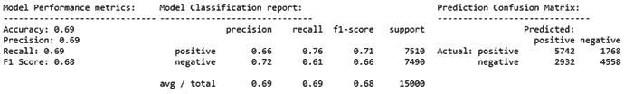

图 7-2.

基于 SentiWordNet 词典的模型性能指标   

```
In [11]: predicted_sentiments = [analyze_sentiment_sentiwordnet_lexicon(review, verbose=False)
for review in norm_test_reviews]
...: meu.display_model_performance_metrics(true_labels=test_sentiments,
predicted_labels=predicted_sentiments,
...:                                      classes=['positive', 'negative'])
```

我们得到了 68% 的总体 F1 分数，这相比我们基于 AFINN 的模型确实有所下降。虽然被误分类为正面情感的负面评论数量减少了，但模型性能的其他方面受到了影响。

VADER 词典

VADER 词典由 C.J. Hutto 开发，是一种基于规则的情感分析框架的词典，专门针对社交媒体中的情感分析进行了调优。VADER 代表 Valence Aware Dictionary and Sentiment Reasoner（情感感知词典与情感推理器）。关于该框架的详细信息，可阅读 Hutto, C.J. 和 Gilbert, E.E. (2014) 的原始论文，标题为“VADER: A Parsimonious Rule-based Model for Sentiment Analysis of Social Media Text”，发表于第八届国际网络日志与社交媒体会议（ICWSM-14）论文集。你可以通过 `nltk.sentiment.vader` 模块下的 `nltk` 接口使用该库。除此之外，你还可以从 [`https://github.com/cjhutto/vaderSentiment`](https://github.com/cjhutto/vaderSentiment) 下载实际的词典或安装该框架，该网站也包含关于 VADER 的详细信息。这个词典位于名为 `vader_lexicon.txt` 的文件中，包含与单词、表情符号和俚语（如 wtf、lol、nah 等）相关的情感得分。该词典总共包含超过 9000 个词汇特征，最终从中精选出超过 7500 个经过验证的词汇特征，并附有经过适当验证的效价分数。每个特征按照从 `"[-4] 极度负面"` 到 `"[4] 极度正面"` 的等级进行评分，并允许 `"[0] 中性（或两者皆非，不适用）"`。选择词汇特征的过程是保留所有平均评分非零且标准差小于 `2.5` 的特征，该标准差由十位独立评分者的聚合结果确定。下面我们展示 `VADER` 词典的一个样本。

```
:(     -1.9     1.13578 [-2, -3, -2, 0, -1, -1, -2, -3, -1, -4]
:)      2.0     1.18322 [2, 2, 1, 1, 1, 1, 4, 3, 4, 1]
...
terrorizing     -3.0    1.0     [-3, -1, -4, -4, -4, -3, -2, -3, -2, -4]
thankful         2.7    0.78102 [4, 2, 2, 3, 2, 4, 3, 3, 2, 2]
```

上述词典样本中的每一行都描述了一个独特的词条，可以是表情符号或单词。第一个标记表示单词/表情符号，第二个标记表示平均情感极性得分，第三个标记表示标准差，最后一个标记表示由十位独立评分者给出的分数列表。现在，让我们使用 `VADER` 来分析我们的电影评论！我们构建自己的建模函数如下。

```
from nltk.sentiment.vader import SentimentIntensityAnalyzer
def analyze_sentiment_vader_lexicon(review,
threshold=0.1,
verbose=False):

# 预处理文本
review = tn.strip_html_tags(review)
review = tn.remove_accented_chars(review)
review = tn.expand_contractions(review)

# 分析评论的情感
analyzer = SentimentIntensityAnalyzer()
scores = analyzer.polarity_scores(review)

# 获取聚合得分和最终情感
agg_score = scores['compound']
final_sentiment = 'positive' if agg_score >= threshold\
else 'negative'
if verbose:

# 显示详细的情感统计信息
positive = str(round(scores['pos'], 2)*100)+'%'
final = round(agg_score, 2)
negative = str(round(scores['neg'], 2)*100)+'%'
neutral = str(round(scores['neu'], 2)*100)+'%'
sentiment_frame = pd.DataFrame([[final_sentiment, final, positive,
negative, neutral]],
columns=pd.MultiIndex(levels=[['情感统计：'],
['预测情感', '极性得分',
'正面', '负面', '中性']],
labels=[[0,0,0,0,0],[0,1,2,3,4]]))
print(sentiment_frame)
return final_sentiment
```

在我们的建模函数中，我们进行了一些基本的预处理，但保留了标点符号和表情符号。除此之外，我们使用`VADER`来获取情感极性以及评论文本在正面、中性和负面情感方面的比例。我们还根据用户输入的聚合情感极性阈值来预测最终情感。通常，`VADER`建议对聚合极性`>= 0.5`使用正面情感，对`[-0.5, 0.5]`之间使用中性情感，对极性`< -0.5`使用负面情感。在我们的语料库中，我们对正面情感使用`>= 0.4`的阈值，对负面情感使用`< 0.4`的阈值。以下是对我们样本评论的分析。

```
In [13]: for review, sentiment in zip(test_reviews[sample_review_ids], test_sentiments[sample_review_ids]):
...:     print('评论:', review)
...:     print('实际情感:', sentiment)
...:     pred = analyze_sentiment_vader_lexicon(review, threshold=0.4, verbose=True)
...:     print('-'*60)
评论: no comment - stupid movie, acting average or worse... screenplay - no sense at all... SKIP IT!
实际情感: negative
情感统计：
预测情感 极性得分 正面 负面 中性
0            negative           -0.8     0.0%    40.0%   60.0%

评论: I don't care if some people voted this movie to be bad. If you want the Truth this is a Very Good Movie! It has every thing a movie should have. You really should Get this one.
实际情感: positive
情感统计：
预测情感 极性得分 正面  负面 中性
0            negative          -0.16    16.0%  14.0%    69.0%

评论: Worst horror film ever but funniest film ever rolled in one you have got to see this film it is so cheap it is unbelievable but you have to see it really!!!! P.S. Watch the carrot
实际情感: positive
情感统计：
预测情感 极性得分 正面 负面 中性
0            positive           0.49    11.0%    11.0%   77.0%

```

我们可以看到每个样本电影评论的情感与极性的详细统计信息。现在让我们在完整的测试电影评论语料库上尝试我们的模型，并评估模型性能。见图 7-3。

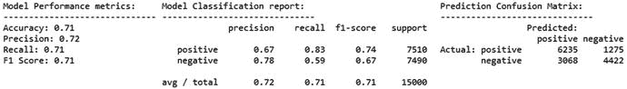

图 7-3.

基于 VADER 词典的模型性能指标

```
In [14]: predicted_sentiments = [analyze_sentiment_vader_lexicon(review, threshold=0.4,
verbose=False) for review in test_reviews]
...: meu.display_model_performance_metrics(true_labels=test_sentiments,
predicted_labels=predicted_sentiments,
...:                                      classes=['positive', 'negative'])
```

我们得到了总体 F1 分数和模型准确率均为 71%，这与基于 AFINN 的模型非常相似。基于 AFINN 的模型仅在平均精度上高出 1%；否则，两个模型的性能相似。

使用监督学习进行情感分类

构建模型以理解文本内容并预测基于文本评论的情感，另一种方法是使用监督机器学习。更具体地说，我们将使用分类模型来解决这个问题。我们已经在第 1 章的“监督学习”部分介绍了与监督学习和分类相关的概念。关于构建和评估分类模型的详细信息，如果需要，您可以前往第 5 章复习。我们将在后续章节中构建一个自动化的情感文本分类系统。实现这一目标的主要步骤如下所述。

1.  准备训练和测试数据集（可选地，一个验证数据集）
2.  预处理和标准化文本文档
3.  特征工程
4.  模型训练
5.  模型预测与评估

这些是构建我们系统的主要步骤。可选地，最后一步是将模型部署到您的服务器或云端。图 7-4 展示了使用监督学习（分类）模型构建标准文本分类系统的详细工作流程。

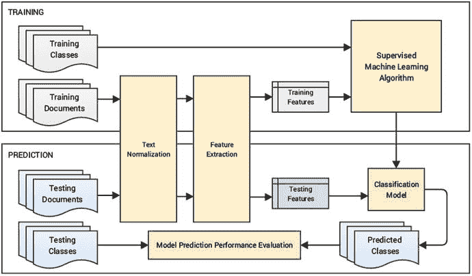

图 7-4.

构建自动化文本分类系统的蓝图（来源：Text Analytics with Python, Apress 2016）

在我们的场景中，文档指的是电影评论，类别指的是评论情感，可以是正面或负面，这使其成为一个二分类问题。我们将在后续章节中使用传统的机器学习方法和更新的深度学习方法构建模型。您可以参考名为 `supervised_sentiment_analysis.py` 的 Python 文件，以获取本节中使用的所有代码，或者使用名为 `Sentiment Analysis - Supervised.ipynb` 的 Jupyter notebook 以获得更具交互性的体验。让我们在开始之前加载必要的依赖项和设置。

```
In [1]: import pandas as pd
...: import numpy as np
...: import text_normalizer as tn
...: import model_evaluation_utils as meu
...:
...: np.set_printoptions(precision=2, linewidth=80)
```

我们现在可以加载我们的 IMDb 电影评论数据集，使用前 35,000 条评论来训练模型，并使用剩余的 15,000 条评论作为测试数据集来评估模型性能。除此之外，我们还将使用我们的标准化模块来标准化我们的评论数据集（工作流程中的步骤 1 和 2）。

```
In [2]: dataset = pd.read_csv(r'movie_reviews.csv')
...:
...: # 快速查看数据
...: print(dataset.head())
...: reviews = np.array(dataset['review'])
...: sentiments = np.array(dataset['sentiment'])
...:
...: # 构建训练和测试数据集
...: train_reviews = reviews[:35000]
...: train_sentiments = sentiments[:35000]
...: test_reviews = reviews[35000:]
...: test_sentiments = sentiments[35000:]
...:
...: # 标准化数据集
...: norm_train_reviews = tn.normalize_corpus(train_reviews)
...: norm_test_reviews = tn.normalize_corpus(test_reviews)
review sentiment
0  One of the other reviewers has mentioned that ...  positive
1  A wonderful little production. The...  positive
2  I thought this was a wonderful way to spend ti...  positive
3  Basically there's a family where a little boy ...  negative
4  Petter Mattei's "Love in the Time of Money" is...  positive
```

我们的数据集现在已经准备好并标准化，因此我们可以从之前描述的文本分类工作流程中的步骤 3 开始，构建我们的分类系统。

传统的监督机器学习模型

在本节中，我们将使用传统的分类模型来对电影评论的情感进行分类。我们的特征工程技术（步骤 3）将基于词袋模型和 TF-IDF 模型，我们在第 4 章的“文本数据特征工程”部分对此进行了广泛讨论。以下代码片段帮助我们使用这两种模型在我们的`训练`和`测试`数据集上构建特征。

```
In [3]: from sklearn.feature_extraction.text import CountVectorizer, TfidfVectorizer
...:
...: # 在训练评论上构建 BOW 特征
...: cv = CountVectorizer(binary=False, min_df=0.0, max_df=1.0, ngram_range=(1,2))
...: cv_train_features = cv.fit_transform(norm_train_reviews)
...: # 在训练评论上构建 TFIDF 特征
...: tv = TfidfVectorizer(use_idf=True, min_df=0.0, max_df=1.0, ngram_range=(1,2),
...:                      sublinear_tf=True)
...: tv_train_features = tv.fit_transform(norm_train_reviews)
...:
...: # 将测试评论转换为特征
...: cv_test_features = cv.transform(norm_test_reviews)
...: tv_test_features = tv.transform(norm_test_reviews)
...:
...: print('BOW 模型:> 训练特征形状:', cv_train_features.shape,
' 测试特征形状:', cv_test_features.shape)
...: print('TFIDF 模型:> 训练特征形状:', tv_train_features.shape,
' 测试特征形状:', tv_test_features.shape)
BOW 模型:> 训练特征形状: (35000, 2114021)  测试特征形状: (15000, 2114021)
TFIDF 模型:> 训练特征形状: (35000, 2114021)  测试特征形状: (15000, 2114021)
```

我们的特征集考虑了单词和二元词组。我们现在可以使用一些在文本分类上表现非常好的传统监督机器学习算法。我们建议您在将来处理自己的数据集时使用逻辑回归、支持向量机和多项式朴素贝叶斯模型。在本章中，我们使用逻辑回归和 SVM 构建了模型。以下代码片段有助于初始化这些分类模型估计器。

```
In [4]: from sklearn.linear_model import SGDClassifier, LogisticRegression
...:
...: lr = LogisticRegression(penalty='l2', max_iter=100, C=1)
...: svm = SGDClassifier(loss='hinge', n_iter=100)
```

在不深入过多理论复杂性的情况下，逻辑回归模型是一种用于分类的监督线性机器学习模型，尽管其名称如此。在该模型中，我们试图预测给定的电影评论属于某个离散类别（在我们的场景中是二分类）的概率。模型用于学习的函数如下所示。

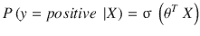

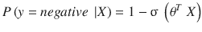

其中，模型试图使用特征向量 和  来预测情感类别， 通常被称为 sigmoid 函数、逻辑函数或 logit 函数。该模型的主要目标是搜索  的最优值，使得当特征向量  对应正面电影评论时，正面情感类别的概率最大，而当其对应负面电影评论时，概率最小。逻辑函数有助于对概率进行建模，以描述最终的预测类别。可以通过使用标准方法（如梯度下降）最小化适当的成本/损失函数来获得  的最优值（如果您对更多细节感兴趣，请参考第 5 章中的“逻辑回归的三个阶段”部分）。逻辑回归也常被称为 logit 回归或最大熵分类器。

我们现在将使用 `model_evaluation_utils` 模块中的实用函数 `train_predict_model(...)` 在我们的训练特征上构建一个逻辑回归模型，并在我们的测试特征上评估模型性能（步骤 4 和 5）。见图 7-5。

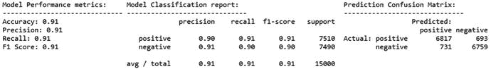

图 7-5.

基于词袋特征的逻辑回归模型性能指标

```
In [5]: # 基于 BOW 特征的逻辑回归模型
...: lr_bow_predictions = meu.train_predict_model(classifier=lr,
...:                        train_features=cv_train_features, train_labels=train_sentiments,
...:                        test_features=cv_test_features, test_labels=test_sentiments)
...: meu.display_model_performance_metrics(true_labels=test_sentiments,
...:                                      predicted_labels=lr_bow_predictions,
...:                                      classes=['positive', 'negative'])
```

如图 7-5 所示，我们得到了总体 F1 分数和模型准确率均为 91%，这非常出色！我们现在可以使用以下代码片段类似地在我们的 TF-IDF 特征上构建一个逻辑回归模型。见图 7-6。

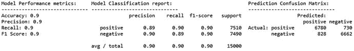

图 7-6.

基于 TF-IDF 特征的逻辑回归模型性能指标

```
In [6]: # 基于 TF-IDF 特征的逻辑回归模型
...: lr_tfidf_predictions = meu.train_predict_model(classifier=lr,
...:                         train_features=tv_train_features, train_labels=train_sentiments,
...:                         test_features=tv_test_features, test_labels=test_sentiments)
...: meu.display_model_performance_metrics(true_labels=test_sentiments,
...:                                      predicted_labels=lr_tfidf_predictions,
...:                                      classes=['positive', 'negative'])
```

如图 7-6 所示，我们得到了总体 F1 分数和模型准确率均为 90%，这很好，但我们之前的模型仍然略胜一筹。您可以类似地使用我们之前创建的支持向量机模型估计器对象 `svm`，并使用相同的代码片段来训练和预测 SVM 模型。我们使用 SVM 模型获得了 90% 的最高准确率和 F1 分数（请参考 Jupyter notebook 获取逐步代码片段）。因此，您可以看到这些监督机器学习分类算法在构建文本情感分类器方面是多么有效和准确。

更新的监督深度学习模型

在前面的章节中，我们已经多次提到深度学习在过去十年中如何彻底改变了机器学习领域。在本节中，我们将构建一些深度神经网络，并基于词嵌入的高级文本特征对其进行训练，以构建一个类似于我们在上一节中所做的文本情感分类系统。让我们在开始分析之前加载以下必要的依赖项。

```
In [7]: import gensim
...: import keras
...: from keras.models import Sequential
...: from keras.layers import Dropout, Activation, Dense
...: from sklearn.preprocessing import LabelEncoder
Using TensorFlow backend.
```

如果您还记得第 4 章，我们讨论了分类类别标签的编码以及独热编码方案。到目前为止，我们在 `scikit-learn` 中的模型直接接受情感类别标签作为 `positive` 和 `negative`，并在内部执行这些操作。然而，对于我们的深度学习模型，我们需要显式地执行此操作。以下代码片段帮助我们标记化我们的电影评论，并将基于文本的情感类别标签转换为独热编码向量（构成步骤 2 的一部分）。

```
In [8]: le = LabelEncoder()
...: num_classes=2
...: # 标记化训练评论并编码训练标签
...: tokenized_train = [tn.tokenizer.tokenize(text)
...:                    for text in norm_train_reviews]
...: y_tr = le.fit_transform(train_sentiments)
...: y_train = keras.utils.to_categorical(y_tr, num_classes)
...: # 标记化测试评论并编码测试标签
...: tokenized_test = [tn.tokenizer.tokenize(text)
...:                    for text in norm_test_reviews]
...: y_ts = le.fit_transform(test_sentiments)
...: y_test = keras.utils.to_categorical(y_ts, num_classes)
...:
...: # 打印类别标签编码映射和编码后的标签
...: print('情感类别标签映射:', dict(zip(le.classes_, le.transform(le.classes_))))
...: print('样本测试标签转换:\n'+'-'*35,
...:       '\n 实际标签:', test_sentiments[:3], '\n 编码标签:', y_ts[:3],
...:       '\n 独热编码标签:\n', y_test[:3])
情感类别标签映射: {'positive': 1, 'negative': 0}
样本测试标签转换:

实际标签: ['negative' 'positive' 'negative']
编码标签: [0 1 0]
独热编码标签:
[[ 1\.  0.]
[ 0\.  1.]
[ 1\.  0.]]
```

因此，从上面的样本输出中，我们可以看到我们的情感类别标签是如何被编码为数值表示，进而被转换为独热编码向量的。我们在本节中使用的特征工程技术（步骤 3）是基于词嵌入概念的更高级的词向量化技术。我们将使用 `word2vec` 和 GloVe 模型来生成嵌入。`word2vec` 模型由 Google 构建，我们在第 4 章的“词嵌入”部分对此进行了详细介绍。在这种情况下，我们将选择大小参数为 500，表示每个词的特征向量大小为 500。

```
In [9]: # 构建 word2vec 模型
...: w2v_num_features = 500
...: w2v_model = gensim.models.Word2Vec(tokenized_train, size=w2v_num_features, window=150,
...:                                    min_count=10, sample=1e-3)
```

我们将使用第 4 章中关于此模型的文档词向量平均方案，将每条电影评论表示为评论中不同词的所有词向量表示的平均向量。以下函数帮助我们计算任何文本文档语料库的平均词向量表示。

```
def averaged_word2vec_vectorizer(corpus, model, num_features):
vocabulary = set(model.wv.index2word)
def average_word_vectors(words, model, vocabulary, num_features):
feature_vector = np.zeros((num_features,), dtype="float64")
nwords = 0.
for word in words:
if word in vocabulary:
nwords = nwords + 1.
feature_vector = np.add(feature_vector, model[word])
if nwords:
feature_vector = np.divide(feature_vector, nwords)
return feature_vector
features = [average_word_vectors(tokenized_sentence, model, vocabulary, num_features)
for tokenized_sentence in corpus]
return np.array(features)
```

我们现在可以使用前面的函数在我们的两个电影评论数据集上生成平均词向量表示。

```
In [10]: # 从 word2vec 模型生成平均词向量特征
...: avg_wv_train_features = averaged_word2vec_vectorizer(corpus=tokenized_train,
...:                                                 model=w2v_model, num_features=500)
...: avg_wv_test_features = averaged_word2vec_vectorizer(corpus=tokenized_test,
...:                                                 model=w2v_model, num_features=500)
```

GloVe 模型，全称为全局向量，是一种用于获取词向量表示的无监督模型。该模型由斯坦福大学创建，在各种语料库（如维基百科、Common Crawl 和 Twitter）上进行训练，并且提供了相应的预训练词向量，可用于我们的分析需求。有关更多详细信息，您可以参考 Jeffrey Pennington、Richard Socher 和 Christopher D. Manning 于 2014 年发表的原始论文，题为 [GloVe: Global Vectors for Word Representation](https://nlp.stanford.edu/pubs/glove.pdf#_blank)。`spacy` 库提供了使用 GloVe 模型在 Common Crawl 语料库上训练的 300 维词向量。它们提供了一个简单的标准接口来获取每个词的 300 维特征向量以及整个文本文档的平均特征向量。以下代码片段利用 `spacy` 为我们的两个数据集获取 GloVe 嵌入。请注意，您也可以通过利用其他预训练模型，或使用 [`https://nlp.stanford.edu/projects/glove`](https://nlp.stanford.edu/projects/glove) 上提供的资源（包含预训练词嵌入、代码和示例）在自己的语料库上构建模型，来构建您自己的 GloVe 模型。

```
In [11]: # 使用 GloVe 模型进行特征工程
...: train_nlp = [tn.nlp(item) for item in norm_train_reviews]
...: train_glove_features = np.array([item.vector for item in train_nlp])
...:
...: test_nlp = [tn.nlp(item) for item in norm_test_reviews]
...: test_glove_features = np.array([item.vector for item in test_nlp])
```

您可以使用以下代码检查基于上述每个模型的数据集的特征向量维度。

```
In [12]: print('Word2Vec 模型:> 训练特征形状:', avg_wv_train_features.shape,
' 测试特征形状:', avg_wv_test_features.shape)
...: print('GloVe 模型:> 训练特征形状:', train_glove_features.shape,
' 测试特征形状:', test_glove_features.shape)
Word2Vec 模型:> 训练特征形状: (35000, 500)  测试特征形状: (15000, 500)
GloVe 模型:> 训练特征形状: (35000, 300)  测试特征形状: (15000, 300)
```

从上面的输出中，我们可以看到，正如预期的那样，`word2vec` 模型特征的大小为 500，而 GloVe 特征的大小为 300。我们现在可以进入分类系统工作流程的步骤 4，在此我们将构建并训练一个基于这些特征的深度神经网络。我们已经在第 1 章的“深度学习”部分简要介绍了深度神经网络的各个方面和架构。我们将使用一个全连接的四层深度神经网络（多层感知器或深度 ANN）作为我们的模型。我们通常不计算任何深度架构中的输入层，因此我们的模型将由三个隐藏层（每层 512 个神经元或单元）和一个输出层（两个单元）组成，输出层将用于根据输入层特征预测正面或负面情感。图 7-7 描绘了我们用于情感分类的深度神经网络模型。

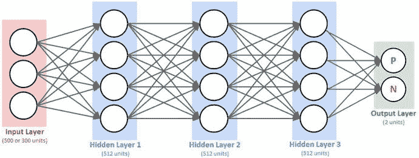

图 7-7.

用于情感分类的全连接深度神经网络模型

我们称之为全连接深度神经网络，因为每对相邻层中的神经元或单元都是完全成对连接的。这些网络也被称为深度人工神经网络或多层感知器，因为它们有多个隐藏层。以下函数利用基于 `tensorflow` 的 `keras` 来构建所需的 DNN 模型。

```
def construct_deepnn_architecture(num_input_features):
dnn_model = Sequential()
dnn_model.add(Dense(512, activation='relu', input_shape=(num_input_features,)))
dnn_model.add(Dropout(0.2))
dnn_model.add(Dense(512, activation='relu'))
dnn_model.add(Dropout(0.2))
dnn_model.add(Dense(512, activation='relu'))
dnn_model.add(Dropout(0.2))
dnn_model.add(Dense(2))
dnn_model.add(Activation('softmax'))
dnn_model.compile(loss='categorical_crossentropy', optimizer='adam',
metrics=['accuracy'])
return dnn_model
```

从前面的函数中，您可以看到我们接受一个参数 `num_input_features`，它决定了输入层所需的单元数量（对于 `word2vec` 特征为 `500`，对于 `glove` 特征为 `300`）。我们构建了一个 `Sequential` 模型，它帮助我们线性地堆叠隐藏层和输出层。

我们为所有隐藏层使用 `512` 个单元，激活函数 `relu` 表示修正线性单元。该函数通常定义为 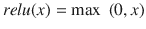，其中 x 通常是神经元的输入。在电子和电气工程中，这也常被称为斜坡函数。与之前流行的 sigmoid 函数相比，现在更倾向于使用此函数，因为它试图解决梯度消失问题。当 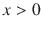 且 x 增加时，sigmoid 函数的梯度变得非常小（几乎消失），但 relu 可以防止这种情况发生。除此之外，它还有助于梯度下降更快地收敛。我们还在网络中以 `Dropout` 层的形式使用正则化。通过添加 `0.2` 的丢弃率，在训练模型期间的每次更新时，它会随机将 `20%` 的输入特征单元设置为 `0`。这种正则化形式有助于防止模型过拟合。

最终的输出层由两个单元组成，使用 `softmax` 激活函数。softmax 函数基本上是我们之前看到的逻辑函数的泛化，可用于表示 n 个可能类别结果上的概率分布。在我们的例子中，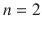，类别可以是正面或负面，softmax 概率将帮助我们确定这一点。二元 softmax 分类器也可以互换地称为二元逻辑回归函数。

`compile(...)` 方法用于在我们实际训练 DNN 模型之前配置其学习或训练过程。这涉及在 loss 参数中提供一个成本或损失函数。这将是模型试图最小化的目标或目的。根据您要解决的问题类型，有多种损失函数，例如用于回归的均方误差和用于分类的分类交叉熵。请查看 [`https://keras.io/losses/`](https://keras.io/losses/) 以获取可能的损失函数列表。

我们将使用 `categorical_crossentropy`，它有助于我们最小化 softmax 输出的误差或损失。我们需要一个优化器来帮助我们收敛模型并最小化损失或误差函数。梯度下降或随机梯度下降是流行的优化器。我们将使用 `adam` 优化器，它只需要一阶梯度且内存占用非常小。Adam 还使用了动量，其基本思想是每次更新不仅基于当前点的梯度计算，还包括前一次更新的一部分。这有助于更快地收敛。您可以参考 [`https://arxiv.org/pdf/1412.6980v8.pdf`](https://arxiv.org/pdf/1412.6980v8.pdf) 上的原始论文，以获取有关 ADAM 优化器的更多详细信息。最后，`metrics` 参数用于指定模型性能指标，这些指标在训练时用于评估模型（但不用于修改训练损失本身）。现在让我们基于我们的 `word2vec` 输入特征表示为我们的训练评论构建一个 DNN 模型。

```
In [13]: w2v_dnn = construct_deepnn_architecture(num_input_features=500)
```

您还可以借助 `keras` 可视化 DNN 模型架构，类似于我们在第 4 章中所做的，使用以下代码。见图 7-8。

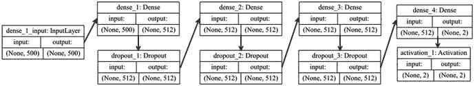

图 7-8.

使用 keras 可视化 DNN 模型架构

```
In [14]: from IPython.display import SVG
...: from keras.utils.vis_utils import model_to_dot
...:
...: SVG(model_to_dot(w2v_dnn, show_shapes=True, show_layer_names=False,
...:                  rankdir='TB').create(prog='dot', format='svg'))
```

我们现在将在我们的训练评论数据集上训练我们的模型，该数据集由 `avg_wv_train_features` 表示的 `word2vec` 特征组成（步骤 4）。我们将使用 `keras` 的 `fit(...)` 函数进行训练过程，并且有一些参数您应该了解。`epoch` 参数表示所有训练示例通过网络进行一次完整的前向和后向传播。`batch_size` 参数表示在训练模型和更新梯度时，一次通过 DNN 模型传播以进行一个后向和前向传播的总样本数。因此，如果您有 1,000 个观测值，并且您的批次大小为 100，则每个 epoch 将包含 10 次迭代，其中每次将 100 个观测值通过网络，并更新隐藏层单元上的权重。我们还指定了 `validation_split` 为 `0.1`，以提取 `10%` 的训练数据并将其用作验证数据集，以评估每个 epoch 的性能。`shuffle` 参数有助于在训练模型时打乱每个 epoch 中的样本。

```
In [18]: batch_size = 100
...: w2v_dnn.fit(avg_wv_train_features, y_train, epochs=5, batch_size=batch_size,
...:             shuffle=True, validation_split=0.1, verbose=1)
Train on 31500 samples, validate on 3500 samples
Epoch 1/5 31500/31500 - 11s - loss: 0.3097 - acc: 0.8720 - val_loss: 0.3159 - val_acc: 0.8646
Epoch 2/5 31500/31500 - 11s - loss: 0.2869 - acc: 0.8819 - val_loss: 0.3024 - val_acc: 0.8743
Epoch 3/5 31500/31500 - 11s - loss: 0.2778 - acc: 0.8857 - val_loss: 0.3012 - val_acc: 0.8763
Epoch 4/5 31500/31500 - 11s - loss: 0.2708 - acc: 0.8901 - val_loss: 0.3041 - val_acc: 0.8734
Epoch 5/5 31500/31500 - 11s - loss: 0.2612 - acc: 0.8920 - val_loss: 0.3023 - val_acc: 0.8763
```

前面的代码片段告诉我们，我们已经在训练数据上训练了 DNN 模型 5 个 epoch，批次大小为 100。我们得到了接近 88% 的验证准确率，这相当不错。现在是时候对我们的模型进行真正的测试了！让我们评估我们的模型在测试评论 `word2vec` 特征上的性能（步骤 5）。


图 7-9.

深度神经网络在 word2vec 特征上的模型性能指标

```
In [19]: y_pred = w2v_dnn.predict_classes(avg_wv_test_features)
...: predictions = le.inverse_transform(y_pred)
...: meu.display_model_performance_metrics(true_labels=test_sentiments,
...:               predicted_labels=predictions, classes=['positive', 'negative'])
```

图 7-9 中显示的结果表明，我们获得了 88% 的模型准确率和 F1 分数，这非常棒！您可以使用类似的工作流程来构建和训练基于 GloVe 特征的 DNN 模型，并评估模型性能。以下代码片段描绘了我们文本分类系统蓝图中步骤 4 和 5 的工作流程。

```

# 构建 DNN 模型
glove_dnn = construct_deepnn_architecture(num_input_features=300)

# 在 GloVe 训练特征上训练 DNN 模型
batch_size = 100
glove_dnn.fit(train_glove_features, y_train, epochs=5, batch_size=batch_size,
shuffle=True, validation_split=0.1, verbose=1)

# 获取对测试评论的预测结果
y_pred = glove_dnn.predict_classes(test_glove_features)
predictions = le.inverse_transform(y_pred)

# 评估模型性能
meu.display_model_performance_metrics(true_labels=test_sentiments, predicted_labels=predictions,
classes=['positive', 'negative'])
```

我们使用 GloVe 特征获得了 85% 的整体模型准确率和 F1 分数，这个结果还算不错，但并未优于使用 `word2vec` 特征所得到的结果。你可以参考 `Sentiment Analysis - Supervised.ipynb` 这个 Jupyter 笔记本，查看前述代码的逐步输出结果。至此，我们关于利用更新的深度学习模型和方法构建文本情感分类系统的讨论就结束了。接下来，让我们学习高级深度学习模型！

高级监督式深度学习模型

在上一节中，我们使用了全连接深度神经网络和词嵌入。另一种新颖且有趣的监督式深度学习方法，是使用循环神经网络（RNN）和长短期记忆网络（LSTM），这些网络同样考虑了数据（词语、事件等）的序列性。这些模型比常规的全连接深度网络更为先进，通常需要更长的训练时间。我们将利用基于 `tensorflow` 的 `keras`，在此构建一个基于 LSTM 的分类模型，并使用词嵌入作为特征。你可以参考名为 `sentiment_analysis_adv_deep_learning.py` 的 Python 文件，获取本节使用的所有代码；或者使用名为 `Sentiment Analysis - Advanced Deep Learning.ipynb` 的 Jupyter 笔记本，以获得更具交互性的体验。

我们将使用之前分析中创建的、经过标准化和预处理的训练及测试评论数据集：`norm_train_reviews` 和 `norm_test_reviews`。假设你已经加载了这些数据集，我们首先需要对这些数据集进行分词处理，使得每条文本评论都被分解成对应的词元（工作流程步骤 2）。

```
In [1]: tokenized_train = [tn.tokenizer.tokenize(text) for text in norm_train_reviews]
...: tokenized_test = [tn.tokenizer.tokenize(text) for text in norm_test_reviews]
```

在特征工程（步骤 3）中，我们将创建词嵌入。不过，我们将使用 `keras` 自行创建，而不是像之前那样使用预构建的 `word2vec` 或 GloVe。词嵌入倾向于将文本文档向量化为固定大小的向量，这些向量试图捕捉上下文和语义信息。

为了生成嵌入，我们将使用 keras 的 `Embedding` 层，该层要求文档被表示为分词后的数值向量。我们的 `tokenized_train` 和 `tokenized_test` 变量中已经有了分词后的文本向量。然而，我们需要将它们转换为数值表示。除此之外，我们还需要这些向量具有统一的大小，尽管由于每条评论中词元数量的差异，分词后的文本评论长度会有所不同。为此，一种策略是取最长评论（具有最大词元/单词数量）的长度，并将其设置为向量大小，我们称之为 `max_len`。较短的评论可以在开头填充一个 `PAD` 项，使其长度增加到 `max_len`。

我们需要创建一个词到索引的词汇映射，以便将每条分词后的文本评论表示为数值形式。请注意，你还需要为填充项创建一个数值映射，我们将其称为 `PAD_INDEX`，并为其分配数值索引 `0`。对于未知词项，如果稍后在测试数据集或新的、之前未见过的评论中遇到它们，我们也需要为其分配一个索引。这是因为我们只会在训练数据上进行向量化、特征工程和模型构建。因此，如果将来出现某个新词（最初并非模型训练的一部分），我们会将其视为词汇表外（OOV）词项，并分配一个常量索引（我们将此词项命名为 `NOT_FOUND_INDEX`，并为其分配索引 `vocab_size+1`）。以下代码片段帮助我们根据训练文本评论语料库 `tokenized_train` 创建此词汇表。

```
In [2]: from collections import Counter
...:
...: # 构建词到索引的词汇映射
...: token_counter = Counter([token for review in tokenized_train for token in review])
...: vocab_map = {item[0]: index+1
for index, item in enumerate(dict(token_counter).items())}
...: max_index = np.max(list(vocab_map.values()))
...: vocab_map['PAD_INDEX'] = 0
...: vocab_map['NOT_FOUND_INDEX'] = max_index+1
...: vocab_size = len(vocab_map)
...: # 查看词汇表大小及部分词汇映射
...: print('词汇表大小:', vocab_size)
...: print('词汇映射示例切片:', dict(list(vocab_map.items())[10:20]))
词汇表大小: 82358
词汇映射示例切片: {'martyrdom': 6, 'palmira': 7, 'servility': 8, 'gardening': 9, 'melodramatically': 73505, 'renfro': 41282, 'carlin': 41283, 'overtly': 41284, 'rend': 47891, 'anticlimactic': 51}
```

在这个例子中，我们使用了词汇表中的所有词项。你可以通过使用 `Counter` 的 `most_common(count)` 函数，并取训练语料库中唯一词项列表的前 `count` 个词项，轻松地过滤并在此处使用更相关的词项（基于它们的频率）。现在，我们将根据之前的 `vocab_map` 对分词后的文本评论进行编码。除此之外，我们还将文本情感类别标签编码为数值表示。

```
In [3]: from keras.preprocessing import sequence
...: from sklearn.preprocessing import LabelEncoder
...:
...: # 获取训练语料库的最大长度并初始化标签编码器
...: le = LabelEncoder()
...: num_classes=2 # 正面 -> 1, 负面 -> 0
...: max_len = np.max([len(review) for review in tokenized_train])
...:
...: ## 训练评论数据语料库
...: # 将分词后的文本评论转换为数值向量
...: train_X = [[vocab_map[token] for token in tokenized_review]
for tokenized_review in tokenized_train]
...: train_X = sequence.pad_sequences(train_X, maxlen=max_len) # 填充
...: ## 训练预测类别标签
...: # 将文本情感标签（负面/正面）转换为二进制编码（0/1）
...: train_y = le.fit_transform(train_sentiments)
...:
...: ## 测试评论数据语料库
...: # 将分词后的文本评论转换为数值向量
...: test_X = [[vocab_map[token] if vocab_map.get(token) else vocab_map['NOT_FOUND_INDEX']
...:            for token in tokenized_review]
...:               for tokenized_review in tokenized_test]
...: test_X = sequence.pad_sequences(test_X, maxlen=max_len)
...: ## 测试预测类别标签
...: # 将文本情感标签（负面/正面）转换为二进制编码（0/1）
...: test_y = le.transform(test_sentiments)
...:
...: # 查看向量形状
...: print('训练评论向量的最大长度:', max_len)
...: print('训练评论向量形状:', train_X.shape, ' 测试评论向量形状:', test_X.shape)
训练评论向量的最大长度: 1442
训练评论向量形状: (35000, 1442)  测试评论向量形状: (15000, 1442)
```

从上述代码片段及其输出可以清楚地看到，我们将每条文本评论编码成了一个数值序列向量，使得每条评论向量的大小为 `1442`，这基本上是训练数据集中评论的最大长度。我们对较短的评论进行填充，并从较长的评论中截断多余的词元，使得每条评论的形状如输出所示保持恒定。现在，我们可以继续进行步骤 3 和分类工作流程步骤 4 的一部分，引入 `Embedding` 层，并将其与基于 LSTM 的深度网络架构相结合。

```
from keras.models import Sequential
from keras.layers import Dense, Embedding, Dropout, SpatialDropout1D
from keras.layers import LSTM
EMBEDDING_DIM = 128 # 每个词元的密集嵌入维度
LSTM_DIM = 64 # LSTM 单元总数
model = Sequential()
model.add(Embedding(input_dim=vocab_size, output_dim=EMBEDDING_DIM, input_length=max_len))
model.add(SpatialDropout1D(0.2))
model.add(LSTM(LSTM_DIM, dropout=0.2, recurrent_dropout=0.2))
model.add(Dense(1, activation="sigmoid"))
model.compile(loss="binary_crossentropy", optimizer="adam",
metrics=["accuracy"])
```

`Embedding` 层帮助我们从头生成词嵌入。该层最初也会用一些权重进行初始化，并且当网络在每个 epoch 中试图最小化损失时，这些权重会像其他层中神经元单元的权重一样，根据我们的优化器进行更新。因此，嵌入层试图优化其权重，以便我们获得最佳的词嵌入，这些嵌入将在模型中产生最小的误差，同时还能捕捉词之间的语义相似性和关系。我们如何获得嵌入呢？假设我们有一条包含 `3` 个词项 `['movie', 'was', 'good']` 的评论，以及一个包含 `82358` 个词的词到索引映射的 `vocab_map`。词嵌入的生成方式大致类似于图 7-10。

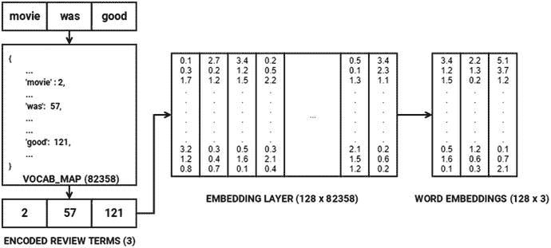

图 7-10.

理解词嵌入是如何生成的

根据我们的模型架构，`Embedding` 层接受三个参数：`input_dim`，等于词汇表大小（`vocab_size`）`82358`；`output_dim`，为 `128`，表示密集嵌入的维度（由图 7-10 中 `EMBEDDING LAYER` 的行表示）；以及 `input_len`，指定输入序列（电影评论序列向量）的长度，即 `1442`。在图 7-10 所示的例子中，由于我们只有一条评论，其维度为 `(1, 3)`。这条评论根据 `VOCAB_MAP` 被转换为数值序列 `[2, 57, 121]`。然后，从 `EMBEDDING LAYER` 中选择代表评论序列中索引的特定列（分别是列索引 `2`、`57` 和 `121` 处的向量），以生成最终的词嵌入。这为我们提供了一个维度为 `(1, 128, 3)` 的嵌入向量，当每一行基于每个序列词嵌入向量表示时，也可以表示为 `(1, 3, 128)`。许多深度学习框架（如 keras）将嵌入维度表示为 (m, n)，其中 m 代表词汇表中所有唯一词项的数量（`82358`），n 代表 `output_dim`，在此例中为 `128`。可以将其视为图 7-10 中所示层的转置版本，这样理解就对了！

通常，如果你将编码后的评论词项序列向量表示为独热编码格式 `(3, 82358)`，并与表示为 `(82358, 128)` 的 `EMBEDDING LAYER`（其中每一行代表词汇表中一个词的嵌入）进行矩阵乘法，你将直接获得评论序列向量的词嵌入，结果为 `(3, 128)`。如前所述，当输入数据通过整个网络传播时，嵌入层中的权重会在每个 epoch 中根据输入数据进行更新和优化，以最小化整体损失和误差，从而获得最大的模型性能。

这些密集的词嵌入随后被传递到具有 `64` 个单元的 `LSTM` 层。我们在第 1 章的“深度学习”部分下的“重要概念”小节中，于“长短期记忆网络”子节中简要介绍了 LSTM 架构。LSTM 基本上试图克服 RNN 模型的缺点，特别是在处理长期依赖关系以及当与单元（神经元）相关的权重矩阵变得过小（导致梯度消失）或过大（导致梯度爆炸）时出现的问题。这些架构比常规的深度网络更复杂，深入探讨其内部细节和数学概念超出了当前范围，但我们将在不涉及过多数学内容的情况下，在此介绍其要点。如果你对研究 LSTM 的内部机制感兴趣，请查阅启发这一切的原始论文：Hochreiter, S., 和 Schmidhuber, J. (1997). Long short-term memory. Neural computation. 9(8), 1735-1780。我们在图 7-11 中描绘了 RNN 的基本架构，并将其与 LSTM 进行了比较。

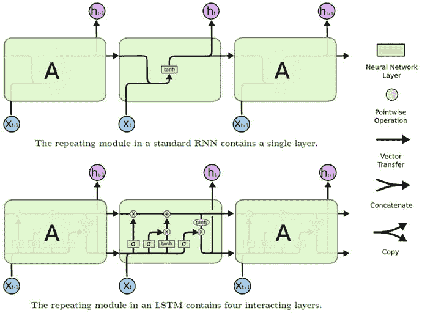

图 7-11.

RNN 和 LSTM 单元的基本结构（来源：Christopher Olah 的博客：colah.github.io）

RNN 单元通常具有一个重复模块的链（当我们展开循环时会发生这种情况；请参考第 1 章中的图 1-13，我们在那里讨论过这一点），使得该模块具有一个简单的结构，可能只有一个使用 `tanh` 激活函数的层。LSTM 是一种特殊类型的 RNN，具有类似的结构，但 LSTM 单元有四个神经网络层，而不是一个。LSTM 单元的详细架构如图 7-12 所示。

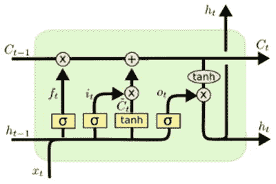

图 7-12.

LSTM 单元的详细架构（来源：Christopher Olah 的博客：colah.github.io）

LSTM 单元的详细架构如图 7-12 所示。符号 t 表示一个时间步，C 表示细胞状态，h 表示隐藏状态。门控 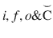 有助于从细胞状态中移除或添加信息。门控 i、f 和 o 分别代表输入门、遗忘门和输出门，它们都由 sigmoid 层调节，该层输出 0 到 1 之间的数字，控制这些门控的输出有多少可以通过。因此，这有助于保护和控制细胞状态。信息如何流经 LSTM 单元的详细工作流程如图 7-13 所示，分为四个步骤。

1.  第一步涉及遗忘门层 f，它帮助我们决定应该从细胞状态中丢弃哪些信息。这是通过查看先前的隐藏状态 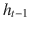 和当前输入 x [t] 来完成的，如公式所示。sigmoid 层有助于控制应保留或遗忘多少信息。

2.  第二步描绘了输入门层 i，它有助于决定哪些信息将被存储在当前细胞状态中。输入门中的 sigmoid 层再次基于  帮助决定哪些值将被更新。tanh 层基于 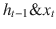 帮助创建一个新的候选值向量 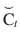，该向量可以添加到当前细胞状态中。因此，tanh 层创建值，而带有 sigmoid 层的输入门帮助选择哪些值应该被更新。

3.  第三步涉及利用前两步获得的结果，将旧的细胞状态 C [t ‐ 1] 更新为新的细胞状态 C [t]。我们将旧的细胞状态乘以遗忘门 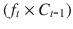，然后加上由带有 sigmoid 层的输入门缩放后的新候选值 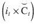。

4.  第四步也是最后一步帮助我们决定最终输出应该是什么，这基本上是细胞状态的一个过滤版本。带有 sigmoid 层的输出门 o 帮助我们选择细胞状态的哪些部分将传递到最终输出。当通过 tanh 层时，这乘以细胞状态值，从而给出最终的隐藏状态值 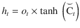。

这个详细工作流程中的所有步骤都在图 7-13 中进行了描绘，并附有必要的注释和公式。我们要感谢我们的好朋友 Christopher Olah 提供了详细的信息以及用于描绘 LSTM 网络内部工作原理的图像。我们建议访问 Christopher 的博客 [`http://colah.github.io/posts/2015-08-Understanding-LSTMs`](http://colah.github.io/posts/2015-08-Understanding-LSTMs) 以获取更多详细信息。同时也要感谢 Edwin Chen，他以易于理解的格式解释了 RNN 和 LSTM。我们建议参考 Edwin 的博客 [`http://blog.echen.me/2017/05/30/exploring-lstms`](http://blog.echen.me/2017/05/30/exploring-lstms) 以获取关于 RNN 和 LSTM 工作原理的信息。

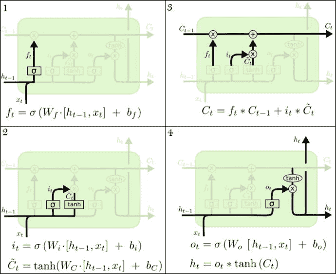

图 7-13.

LSTM 单元中数据流的分步讲解（来源：Christopher Olah 的博客：colah.github.io）

我们深度网络中的最后一层是 `Dense` 层，具有 `1` 个单元和 sigmoid 激活函数。我们基本上使用 `binary_crossentropy` 函数和 `adam` 优化器，因为这是一个二分类问题，模型最终将预测一个 `0` 或 `1`，我们可以使用标签编码器将其解码回负面或正面的情感预测。你也可以在此处使用 `categorical_crossentropy` 损失函数，但那样你需要使用一个具有 `2` 个单元和 `softmax` 函数的 `Dense` 层。现在我们的模型已经编译完毕并准备就绪，我们可以进入分类工作流程的步骤 4，即实际训练模型。我们采用与之前深度网络模型类似的策略，在训练数据上训练我们的模型，设置五个 epoch，批次大小为 100 条评论，并从训练数据中划分出 10% 作为验证集以衡量验证准确率。

```
In [4]: batch_size = 100
...: model.fit(train_X, train_y, epochs=5, batch_size=batch_size,
...:           shuffle=True, validation_split=0.1, verbose=1)
在 31500 个样本上训练，在 3500 个样本上验证
Epoch 1/5 31500/31500 - 2491s - loss: 0.4081 - acc: 0.8184 - val_loss: 0.3006 - val_acc: 0.8751
Epoch 2/5 31500/31500 - 2489s - loss: 0.2253 - acc: 0.9158 - val_loss: 0.3209 - val_acc: 0.8780
Epoch 3/5 31500/31500 - 2656s - loss: 0.1431 - acc: 0.9493 - val_loss: 0.3483 - val_acc: 0.8671
Epoch 4/5 31500/31500 - 2604s - loss: 0.1023 - acc: 0.9658 - val_loss: 0.3803 - val_acc: 0.8729
Epoch 5/5 31500/31500 - 2701s - loss: 0.0694 - acc: 0.9761 - val_loss: 0.4430 - val_acc: 0.8706
```

在 CPU 上训练 LSTM 是出了名的慢，正如你所见，我的模型在配备 8 GB 内存的 i5 第三代 Intel CPU 上仅训练五个 epoch 就花费了大约 3.6 小时。当然，在像 Google Cloud Platform 或 AWS 这样的基于 GPU 的云环境中，训练相同的模型花费了我不到一个小时。因此，我建议你选择基于 GPU 的深度学习环境，尤其是在处理基于 RNN 或 LSTM 的网络架构时。根据上述输出，我们可以看到，仅用五个 epoch，我们就获得了不错的验证准确率，但训练准确率开始飙升，表明可能发生了一些过拟合。克服这个问题的方法包括添加更多数据或增加丢弃率。不妨试一试，看看是否有效！是时候测试我们的模型了！让我们看看它在预测测试评论情感方面的表现如何，并使用我们之前模型所用的相同模型评估框架（步骤 5）。


图 7-14.

基于词嵌入的 LSTM 深度学习模型的性能指标

```
In [5]: # 预测测试数据的情感
...: pred_test = model.predict_classes(test_X)
...: predictions = le.inverse_transform(pred_test.flatten())
...: # 评估模型性能
...: meu.display_model_performance_metrics(true_labels=test_sentiments,
...:                    predicted_labels=predictions, classes=['positive', 'negative'])
```

图 7-14 所示的结果表明，我们获得了 88% 的模型准确率和 F1 分数，这相当不错！有了更多高质量的数据，你可以期待获得更好的结果。尝试使用不同的架构进行实验，看看是否能获得更好的结果！

分析情感成因

我们构建了监督式和无监督式模型，以根据评论文本内容预测电影评论的情感。虽然特征工程和建模无疑是当务之急，但你也需要知道如何分析和解释模型预测背后的根本原因。在本节中，我们将分析情感成因。其思路是确定导致正面或负面情感的根本原因或关键因素。第一个关注领域是模型解释，我们将尝试理解、解释和说明分类模型做出预测背后的机制。第二个关注领域是应用主题建模，从正面和负面情感评论中提取关键主题。

解释预测模型

机器学习模型面临的挑战之一是从试点或概念验证阶段过渡到生产阶段。业务部门和关键利益相关者通常将机器学习模型视为复杂的黑箱，并提出疑问：我为什么要相信你的模型？向他们解释复杂的数学或理论概念并不能达到目的。有没有什么方法可以让我们以易于解释的方式解释这些模型？事实上，这个话题在 2016 年最近获得了广泛关注。请参考 M.T. Ribeiro、S. Singh 和 C. Guestrin 的原始研究论文《Why Should I Trust You?: Explaining the Predictions of Any Classifier》，网址为 [`https://arxiv.org/pdf/1602.04938.pdf`](https://arxiv.org/pdf/1602.04938.pdf)，以了解更多关于模型解释和 LIME 框架的信息。更多关于模型解释的内容，请参阅第 5 章，我们在其中详细介绍了 skater 框架，该框架对各种模型进行了出色的解释。

有多种方法可以解释我们的预测性情感分类模型所做的预测。我们想更深入地了解为什么一条正面评论被正确预测为具有正面情感，或者一条负面评论被正确预测为具有负面情感。除此之外，没有模型是 100% 准确的，因此我们也想了解错误分类或错误预测的原因。本节使用的代码可在名为 `sentiment_causal_model_interpretation.py` 的文件中找到，或者你也可以参考名为 `Sentiment Causal Analysis - Model Interpretation.ipynb` 的 Jupyter 笔记本，以获得交互式体验。

首先，让我们为迄今为止效果最好的模型构建一个基本的文本分类流水线。这是基于词袋特征模型的逻辑回归模型。我们将利用 `scikit-learn` 的流水线模块，使用以下代码构建此机器学习流水线。

```
from sklearn.feature_extraction.text import CountVectorizer
from sklearn.linear_model import LogisticRegression
from sklearn.pipeline import make_pipeline

# 在训练评论上构建词袋特征
cv = CountVectorizer(binary=False, min_df=0.0, max_df=1.0, ngram_range=(1,2))
cv_train_features = cv.fit_transform(norm_train_reviews)

# 构建逻辑回归模型
lr = LogisticRegression()
lr.fit(cv_train_features, train_sentiments)

# 构建文本分类流水线
lr_pipeline = make_pipeline(cv, lr)

# 保存预测类别列表（正面、负面）
classes = list(lr_pipeline.classes_)
```

我们的模型基于 `norm_train_reviews` 构建，该数据集包含我们在之前所有分析中使用的标准化训练评论。现在分类流水线已经准备就绪，你可以通过 pickle 或 joblib 保存分类器和特征对象来实际部署模型，这与我们在第 5 章“模型部署”一节中讨论的方法类似。假设我们的流水线已投入生产，如何将其用于新的电影评论呢？让我们尝试预测两条新样本评论的情感（这些评论未用于模型训练）。

```
In [3]: lr_pipeline.predict(['the lord of the rings is an excellent movie',
...:                      'i hated the recent movie on tv, it was so bad'])
Out[3]: array(['positive', 'negative'], dtype=object)
```

我们的分类流水线正确预测了这两条评论的情感！这是一个良好的开端，但如何解读模型的预测结果呢？一种常见的方法是使用模型预测的类别概率作为置信度的衡量标准。你可以使用以下代码获取样本评论的预测概率。

```
In [4]: pd.DataFrame(lr_pipeline.predict_proba(['the lord of the rings is an excellent movie',
...:                      'i hated the recent movie on tv, it was so bad']), columns=classes)
Out[4]:
negative  positive
0  0.169653  0.830347
1  0.730814  0.269186
```

因此，我们可以说第一条电影评论有 83% 的预测置信度或概率为正面情感，而第二条电影评论有 73% 的概率为负面情感。现在让我们更进一步，不再使用玩具示例，而是对 `test_reviews` 数据集中的真实评论运行相同的分析（我们将使用包含标准化文本评论的 `norm_test_reviews`）。除了预测概率，我们还将使用 `skater` 框架来轻松解读模型决策，这与我们在第 5 章“模型解读”一节中所做的工作类似。首先需要从 `skater` 包中加载以下依赖项。我们还定义了一个辅助函数，该函数接受文档索引、语料库、其响应预测以及一个解释器对象，帮助我们进行模型解读分析。

```
from skater.core.local_interpretation.lime.lime_text import LimeTextExplainer
explainer = LimeTextExplainer(class_names=classes)

# 模型解读的辅助函数
def interpret_classification_model_prediction(doc_index, norm_corpus, corpus,
prediction_labels, explainer_obj):

# 显示模型预测和实际情感
print("测试文档索引: {index}\n 实际情感: {actual}
\n 预测情感: {predicted}"
.format(index=doc_index, actual=prediction_labels[doc_index],
predicted=lr_pipeline.predict([norm_corpus[doc_index]])))

# 显示实际评论内容
print("\n 评论:", corpus[doc_index])

# 显示预测概率
print("\n 模型预测概率:")
for probs in zip(classes, lr_pipeline.predict_proba([norm_corpus[doc_index]])[0]):
print(probs)

# 显示模型预测解读
exp = explainer.explain_instance(norm_corpus[doc_index],
lr_pipeline.predict_proba, num_features=10,
labels=[1])
exp.show_in_notebook()
```

上述代码片段利用 `skater` 来解释我们的文本分类器，以易于理解的形式分析其决策过程。尽管从全局角度看模型可能很复杂，但在局部实例上解释和近似模型行为则更为容易。这是通过在感兴趣的数据点 X 附近学习模型来实现的，具体方法是在 X 周围采样实例，并根据它们与 X 的接近程度分配权重。因此，这些局部学习的线性模型有助于以更易于理解的方式解释复杂模型，包括类别概率以及有助于决策过程的顶级特征对类别概率的贡献。让我们从测试数据集中选取一条实际情感和预测情感均为负面的电影评论，并使用前面代码片段中创建的辅助函数进行分析。

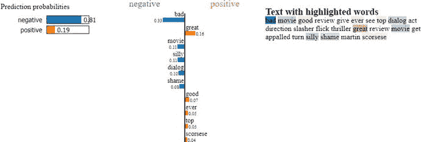

图 7-15.

分类模型正确预测负面评论的模型解读

```
In [6]: doc_index = 100
...: interpret_classification_model_prediction(doc_index=doc_index, corpus=norm_test_reviews,
corpus=test_reviews, prediction_labels=test_sentiments,
explainer_obj=explainer)
测试文档索引: 100
实际情感: negative
预测情感: ['negative']
评论: Worst movie, (with the best reviews given it) I've ever seen. Over the top dialog, acting, and direction. more slasher flick than thriller. With all the great reviews this movie got I'm appalled that it turned out so silly. shame on you Martin Scorsese
模型预测概率:
('negative', 0.8099323456145181)
('positive', 0.19006765438548187)
```

图 7-15 所示的结果向我们展示了类别预测概率，以及对预测决策过程贡献最大的前 10 个特征。这些关键特征也在标准化电影评论文本中突出显示。我们的模型在此场景中表现良好，我们可以看到导致该评论负面情感的关键特征，包括 `bad, silly, dialog` 和 `shame`，这很合理。除此之外，单词 `great` 对 0.19 的正面概率贡献最大，事实上，如果我们从评论文本中删除这个词，正面概率会显著下降。

以下代码对一条实际情感和预测情感均为正面的测试电影评论进行了类似分析。

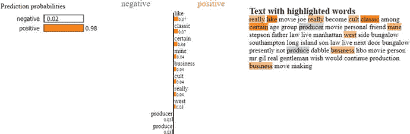

图 7-16.

分类模型正确预测正面评论的模型解读

```
In [7]: doc_index = 2000
...: interpret_classification_model_prediction(doc_index=doc_index, corpus=norm_test_reviews,
corpus=test_reviews, prediction_labels=test_sentiments,
explainer_obj=explainer)
测试文档索引: 2000
实际情感: positive
预测情感: ['positive']
评论: I really liked the Movie "JOE." It has really become a cult classic among certain age groups.The Producer of this movie is a personal friend of mine. He is my Stepsons Father-In-Law. He lives in Manhattan's West side, and has a Bungalow. in Southampton, Long Island. His son-in-law live next door to his Bungalow.Presently, he does not do any Producing, But dabbles in a business with HBO movies.As a person, Mr. Gil is a real gentleman and I wish he would have continued in the production business of move making.
模型预测概率:
('negative', 0.020629181561415355)
('positive', 0.97937081843858464)
```

图 7-16 所示的结果展示了模型判定该评论为正面时起决定性作用的主要特征。根据内容来看，评论者确实非常喜欢这个模型，而且它在特定年龄群体中堪称真正的 cult 经典。在最终分析中，我们将考察模型做出错误预测的案例解读。

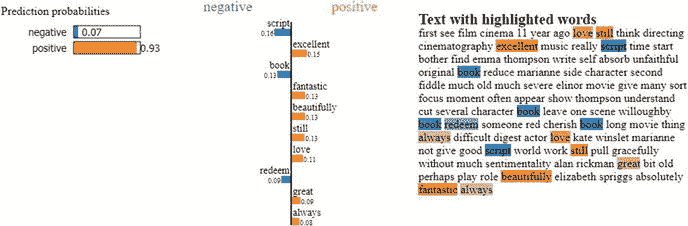

图 7-17.

分类模型错误预测的模型解读

```
In [8]: doc_index = 347
...: interpret_classification_model_prediction(doc_index=doc_index, corpus=norm_test_reviews,
corpus=test_reviews, prediction_labels=test_sentiments,
explainer_obj=explainer)
Test document index: 347
Actual sentiment: negative
Predicted sentiment: ['positive']
Review: When I first saw this film in cinema 11 years ago, I loved it. I still think the directing and cinematography are excellent, as is the music. But it's really the script that has over the time started to bother me more and more. I find Emma Thompson's writing self-absorbed and unfaithful to the original book; she has reduced Marianne to a side-character, a second fiddle to her much too old, much too severe Elinor - she in the movie is given many sort of 'focus moments', and often they appear to be there just to show off Thompson herself.I do understand her cutting off several characters from the book, but leaving out the one scene where Willoughby in the book is redeemed? For someone who red and cherished the book long before the movie, those are the things always difficult to digest.As for the actors, I love Kate Winslet as Marianne. She is not given the best script in the world to work with but she still pulls it up gracefully, without too much sentimentality. Alan Rickman is great, a bit old perhaps, but he plays the role beautifully. And Elizabeth Spriggs, she is absolutely fantastic as always.
Model Prediction Probabilities:
('negative', 0.067198213044844413)
('positive', 0.93280178695515559)
```

上述输出表明，模型将该影评预测为正面情感，而实际上该评论的真实情感标签是负面。图 7-17 所示的结果告诉我们，评论者实际上在影评中表现出正面情感的迹象，尤其是在他/她提到“我很喜欢它。我仍然认为导演和摄影都很出色，音乐也是如此……艾伦·瑞克曼很棒，也许年纪稍大，但他演得很美。还有伊丽莎白·斯普里格斯，她一如既往地绝对出色”的部分，而其中的特征词也被展示在促成正面情感的主要特征中。模型解读也正确识别了评论中促成负面情感的部分，例如“但真正让我越来越困扰的是剧本”。因此，这是一篇较为复杂的评论，同时包含了正面和负面情感，最终解读权在读者手中。你现在可以使用同样的框架，在未来解读你自己的分类模型，了解模型在哪些方面表现良好，哪些方面可能需要改进！

分析主题模型

另一种分析关键术语、概念或情感主题的方法是使用一种不同的方法，称为主题建模。我们在第 4 章“文本数据特征工程”下的“主题模型”一节中已经介绍了一些主题建模的基础知识。主题模型的主要目的是提取并描述关键主题或概念，这些主题或概念通常是潜在的，在庞大的文本文档语料库中并不十分突出。我们在第 4 章中已经看到了使用潜在狄利克雷分配（LDA）进行主题建模的方法。在本节中，我们将使用另一种称为非负矩阵分解的主题建模技术。请参考名为 `sentiment_causal_topic_models.py` 的 Python 文件或名为 `Sentiment Causal Analysis - Topic Models.ipynb` 的 Jupyter Notebook 以获得更具交互性的体验。

此分析的第一步是合并所有归一化的 `train` 和 `test` 评论，并将这些评论分为正面情感评论和负面情感评论。完成这一步后，我们将使用 TF-IDF 特征向量化器从这两个数据集中提取特征。以下代码片段帮助我们实现这一点。

```
In [11]: from sklearn.feature_extraction.text import TfidfVectorizer
...:
...: # consolidate all normalized reviews
...: norm_reviews = norm_train_reviews+norm_test_reviews
...: # get tf-idf features for only positive reviews
...: positive_reviews = [review for review, sentiment in zip(norm_reviews, sentiments)
if sentiment == 'positive']
...: ptvf = TfidfVectorizer(use_idf=True, min_df=0.05, max_df=0.95,
ngram_range=(1,1), sublinear_tf=True)
...: ptvf_features = ptvf.fit_transform(positive_reviews)
...: # get tf-idf features for only negative reviews
...: negative_reviews = [review for review, sentiment in zip(norm_reviews, sentiments)
if sentiment == 'negative']
...: ntvf = TfidfVectorizer(use_idf=True, min_df=0.05, max_df=0.95,
ngram_range=(1,1), sublinear_tf=True)
...: ntvf_features = ntvf.fit_transform(negative_reviews)
...: # view feature set dimensions
...: print(ptvf_features.shape, ntvf_features.shape)
(25000, 331) (25000, 331)
```

从上述输出维度可以看出，通过将 `min_df` 设置为 `0.05`、`max_df` 设置为 `0.95`，我们过滤掉了之前构建分类模型时使用的许多特征。这是为了加快主题建模过程，并移除那些出现频率过高或过低的特征。现在，让我们导入主题建模过程所需的依赖项。

```
In [12]: import pyLDAvis
...: import pyLDAvis.sklearn
...: from sklearn.decomposition import NMF
...: import topic_model_utils as tmu
...:
...: pyLDAvis.enable_notebook()
...: total_topics = 10
```

来自 `scikit-learn` 的 `NMF` 类将帮助我们进行主题建模。我们还使用 `pyLDAvis` 来构建主题模型的交互式可视化。非负矩阵分解（NNMF）的核心原理是对非负特征矩阵 X 应用矩阵分解（类似于 SVD），使得分解可以表示为 X ≈ WH，其中 W 和 H 都是非负矩阵，两者相乘应能近似重构特征矩阵 X。可以使用像 L2 范数这样的代价函数来获得这种近似。现在，让我们应用 NNMF 从正面情感评论中提取 10 个主题。我们还将利用 `topic_model_utils` 模块中的一些实用函数，以清晰的格式显示结果。

```
In [13]: # 基于正面情感评论特征构建主题模型
...: pos_nmf = NMF(n_components=total_topics,
...:           random_state=42, alpha=0.1, l1_ratio=0.2)
...: pos_nmf.fit(ptvf_features)
...: # 提取特征和成分权重
...: pos_feature_names = ptvf.get_feature_names()
...: pos_weights = pos_nmf.components_
...: # 提取并展示主题及其成分
...: pos_topics = tmu.get_topics_terms_weights(pos_weights, pos_feature_names)
...: tmu.print_topics_udf(topics=pos_topics, total_topics=total_topics,
...:                  num_terms=15, display_weights=False)
Topic #1 without weights
['like', 'not', 'think', 'really', 'say', 'would', 'get', 'know', 'thing', 'much', 'bad', 'go', 'lot', 'could', 'even']
Topic #2 without weights
['movie', 'see', 'watch', 'great', 'good', 'one', 'not', 'time', 'ever', 'enjoy', 'recommend', 'make', 'acting', 'like', 'first']
Topic #3 without weights
['show', 'episode', 'series', 'tv', 'watch', 'dvd', 'first', 'see', 'time', 'one', 'good', 'year', 'remember', 'ever', 'would']
Topic #4 without weights
['performance', 'role', 'play', 'actor', 'cast', 'good', 'well', 'great', 'character', 'excellent', 'give', 'also', 'support', 'star', 'job']
...
Topic #10 without weights
['love', 'fall', 'song', 'wonderful', 'beautiful', 'music', 'heart', 'girl', 'would', 'watch', 'great', 'favorite', 'always', 'family', 'woman']
```

我们在前述输出中生成的 10 个主题里选取了部分进行展示。现在你可以利用`pyLDAvis`以交互式可视化方式呈现这些主题。参见图 7-18。

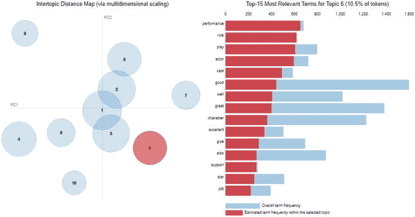

图 7-18.

正面情感电影评论的主题模型可视化

```
In [14]: pyLDAvis.sklearn.prepare(pos_nmf, ptvf_features, ptvf, R=15)
```

图 7-18 所示的可视化结果向我们展示了来自正面电影评论的 10 个主题，我们可以在输出中看到主题 6 的高亮显示的相关性最高的术语。从这些主题和术语中，我们可以看到诸如电影阵容、演员、表演、扮演、角色、音乐、精彩、好等词汇，它们在不同主题中对正面情感做出了贡献。这非常有趣，能让你深入了解评论中哪些成分促成了评论的正面情感。如果你使用的是 Jupyter Notebook，这个可视化是完全交互式的，你可以点击左侧主题间距离图中代表主题的任意气泡，在右侧的条形图中查看每个主题中相关性最高的术语。

左侧的图是使用多维缩放（MDS）绘制的。相似的主题应彼此靠近，而不相似的主题则应相距较远。每个主题气泡的大小取决于该主题及其成分在整个语料库中的出现频率。

右侧的可视化展示了排名靠前的术语。当未选中任何主题时，它会显示语料库中前 15 个最显著的主题。一个术语的显著性定义为该术语在语料库中出现频率的度量，以及它在区分不同主题时的区分因子。当选中某个主题时，图表会发生变化，显示类似于图 7-13 的内容，即该主题下前 15 个最相关的术语。相关性度量由λ控制，可以通过条形图顶部的滑块进行调整（请参考 Notebook 进行交互操作）。如果你对这些可视化背后的数学理论感兴趣，建议查阅[`https://cran.r-project.org/web/packages/LDAvis/vignettes/details.pdf`](https://cran.r-project.org/web/packages/LDAvis/vignettes/details.pdf)了解更多细节，这是 R 包`LDAvis`的说明文档，该包已被移植到 Python 中，即`pyLDAvis`。

现在，让我们提取主题，并对电影评论数据集中的负面情感评论进行同样的分析。

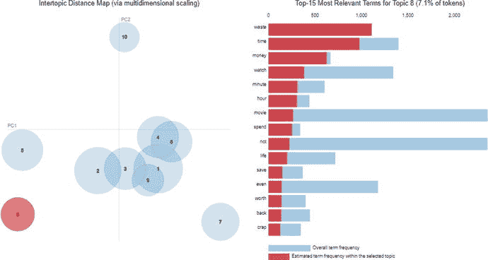

图 7-19.

正面情感电影评论的主题模型可视化

```
In [15]: # 基于负面情感评论特征构建主题模型
...: neg_nmf = NMF(n_components=10,
...:           random_state=42, alpha=0.1, l1_ratio=0.2)
...: neg_nmf.fit(ntvf_features)
...: # 提取特征和成分权重
...: neg_feature_names = ntvf.get_feature_names()
...: neg_weights = neg_nmf.components_
...: # 提取并展示主题及其成分
...: neg_topics = tmu.get_topics_terms_weights(neg_weights, neg_feature_names)
...: tmu.print_topics_udf(topics=neg_topics,
...:                  total_topics=total_topics,
...:                  num_terms=15,
...:                  display_weights=False)
Topic #1 without weights
['get', 'go', 'kill', 'guy', 'scene', 'take', 'end', 'back', 'start', 'around', 'look', 'one', 'thing', 'come', 'first']
Topic #2 without weights
['bad', 'movie', 'ever', 'acting', 'see', 'terrible', 'one', 'plot', 'effect', 'awful', 'not', 'even', 'make', 'horrible', 'special']
...
Topic #10 without weights
['waste', 'time', 'money', 'watch', 'minute', 'hour', 'movie', 'spend', 'not', 'life', 'save', 'even', 'worth', 'back', 'crap']
In [16]: pyLDAvis.sklearn.prepare(neg_nmf, ntvf_features, ntvf, R=15)
```

图 7-19 所示的可视化结果向我们展示了来自负面电影评论的 10 个主题，我们可以在输出中看到主题 8 的高亮显示的相关性最高的术语。从这些主题和术语中，我们可以看到诸如浪费、时间、金钱、垃圾、情节、糟糕、表演等词汇，它们在不同主题中对负面情感做出了贡献。当然，正面和负面情感评论的主题之间有很大概率存在重叠，但也会存在可区分的、独特的主题，这进一步有助于我们进行解释和因果分析。

总结

本章以案例研究为导向，介绍了 IMDb 电影评论数据集，目标是根据文本内容预测评论的情感倾向。在本章中，我们涵盖了自然语言处理（NLP）、文本分析、机器学习和深度学习中的概念与技术。我们涉及了 NLP 的多个方面，包括文本预处理、规范化、特征工程以及文本分类。我们还详细介绍了使用情感词典（如 Afinn、SentiWordNet 和`VADER`）的无监督学习技术，展示了如何在缺乏标注训练数据的情况下分析情感——这在当今的组织中是一个非常现实的问题。将文本分类作为监督式机器学习问题的详细工作流程图，帮助我们建立了 NLP 与机器学习之间的联系，从而在拥有标注数据时，能够运用机器学习技术和方法来解决预测情感倾向的问题。

对监督方法的关注体现在两个方面。这包括传统的机器学习方法及模型，如逻辑回归和支持向量机，以及更新的深度学习模型，包括深度神经网络、RNN 和 LSTM。为了以最佳模型性能从电影评论中预测情感，我们涵盖了详细的概念、工作流程、动手实践示例，以及使用多种监督模型和不同特征工程技术进行的比较分析。本章的最后一部分讨论了机器学习中一个非常重要但经常在分析中被忽视的方面。我们研究了分析和解释正面或负面情感原因的方法。通过多个示例，我们介绍了如何分析和可视化模型解释及主题模型，以便让您深入了解如何在自己的数据集上重用这些框架。本章使用的框架和方法论应有助于您未来在处理自己的文本数据时解决类似问题。

8. 客户细分与
有效的交叉销售

金钱驱动世界运转，而在当前数据密集型商业实践的生态系统中，可以稳妥地说数据同样驱动世界运转。数据科学家一项非常重要的技能是将分析的技术层面与其商业价值（即货币价值）相匹配。这可以通过多种方式实现，并且很大程度上取决于业务类型和可用数据。在前面的章节中，我们介绍了可以构建为业务问题（利用 CRISP-DM 模型）并与收入产生相关联的问题。在本章中，我们将直接关注两个非常重要的问题，它们可以直接对企业和机构（尤其是零售领域）的收入流产生积极影响。本章的独特之处还在于，我们探讨了机器学习算法的一个不同范式，更侧重于与模式识别和无监督学习相关的任务。

在本章中，我们首先偏离通常的技术焦点，尝试收集一些业务和领域知识。这些知识非常重要，因为对于许多数据科学家来说，这往往是绊脚石——在场景中，一个完美开发的机器学习解决方案由于缺乏对基于业务需求从解决方案中获得实际价值的关注而未能投入生产。牢固掌握底层业务（和货币）动机有助于数据科学家定义其解决方案的价值方面，从而确保它们得以部署，并为雇主创造可实现的价值。

为了实现这一目标，我们将从一个来自 UCI 机器学习库的零售交易数据集（[`http://archive.ics.uci.edu/ml/datasets/online+retail`](http://archive.ics.uci.edu/ml/datasets/online+retail)）开始，并将使用该数据集来解决两个相当简单但重要的问题。本章使用的详细代码、笔记本和数据集可在 GitHub 仓库中第 8 章的相应目录中找到，地址为[`https://github.com/dipanjanS/practical-machine-learning-with-python`](https://github.com/dipanjanS/practical-machine-learning-with-python)。

*   **客户细分**：客户细分是根据客户与企业的互动来揭示企业客户群信息的问题。在大多数情况下，这种互动体现在他们的购买行为和模式上。我们将探讨一些可以利用这一点的方法。

*   **购物篮分析**：购物篮分析是一种深入了解客户细微行为的方法。这有助于制定策略，从而更深入地理解客户做出的购买决策。这很有趣，因为很多时候，即使是客户自己也可能没有意识到其购买行为中的此类偏见或趋势。

在线零售交易数据集

在线零售交易数据集可从 UCI 机器学习库获取。我们在前面的章节中已经使用过该库的一些数据集，这应该能突显该库对用户的重要性。我们将用于分析的数据集非常简单。根据 UCI 网站上的描述，它包含一家英国注册的无实体店在线零售商在`01/12/2010`和`09/12/2011`之间发生的所有交易。从网站上我们还了解到，该公司销售独特的万用礼品，其许多客户是批发商。

最后一条信息尤其重要，因为它让我们有机会探索大规模客户的购买行为，而不仅仅是普通零售客户。该数据集没有任何信息可以帮助我们区分批发购买和零售购买。在开始之前，请确保加载以下依赖项。

```
import pandas as pd
import datetime
import math
import numpy as np
import matplotlib.pyplot as plt
import matplotlib.mlab as mlab
%matplotlib inline
```

注意

我们鼓励您查看 UCI 机器学习库以及该特定数据集的页面，地址为[`http://archive.ics.uci.edu/ml/datasets/online+retail`](http://archive.ics.uci.edu/ml/datasets/online+retail)。在该网站上，您可以找到一些使用相同数据集的研究论文。我们相信，这些论文以及本章进行的分析将为所有读者带来有趣的阅读体验。

探索性数据分析

我们一直坚持，无论实际用例或算法如何，我们都打算实施标准的分析工作流程，该流程应始终从探索性数据分析（EDA）开始。因此，遵循传统，我们将从对数据集的 EDA 开始。

您首先应该注意到的是数据集的格式。与本书中处理的大多数数据集不同，该数据集不是 CSV 格式，而是 Excel 文件。在其他一些语言（甚至框架）中，这可能会引起问题，但使用 Python，特别是`pandas`，我们不会遇到任何此类问题，我们可以使用`pandas`库提供的`read_excel`函数读取数据集。我们还查看了数据集中的一些行。

```
In [3]: cs_df = pd.read_excel(io=r'Online Retail.xlsx')
```

数据集中的几行数据提供了关于数据集属性的信息，如图 8-1 所示。

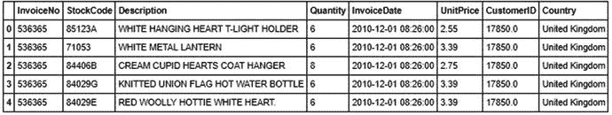

图 8-1.

零售交易数据集中的示例交易

数据集的属性从其名称中很容易识别。我们马上就能知道这些字段可能意味着什么。为完整起见，我们在此包含每个列的描述：

*   **InvoiceNo**：发票的唯一标识符。跨行共享的发票编号意味着这些交易是在单张发票中执行的（多次购买）。

*   **StockCode**：发票中包含的商品的标识符。

*   **Description**：每个库存商品的文本描述。

*   **Quantity**：购买的商品数量。

*   **InvoiceDate**：购买日期。

*   **UnitPrice**：每个商品的价值。

*   **CustomerID**：进行购买的客户的标识符。

*   **Country**：客户所在国家。

让我们分析这些数据，首先确定零售商将商品运往哪些主要国家，以及这些国家的销量情况。

```
In [5]: cs_df.Country.value_counts().reset_index().head(n=10)
Out[5]:
index  Country
0  United Kingdom   495478
1         Germany     9495
2          France     8557
3            EIRE     8196
4           Spain     2533
5     Netherlands     2371
6         Belgium     2069
7     Switzerland     2002
8        Portugal     1519
9       Australia     1259
```

这表明大部分订单都来自其本国，这并不令人意外。我们还注意到一个奇怪的国家名称 `EIRE`，这有点令人担忧。但快速网络搜索表明，这只是爱尔兰的旧称，所以无伤大雅！有趣的是，澳大利亚也位列国家销量前十名。

接下来，我们可能想知道零售商有多少个不同的客户，以及这些客户在订单数量上的分布情况。我们还希望了解前 10 名客户的订单占总订单的百分比。这些信息很有趣，因为它能告诉我们公司的用户群是否分布得相对均匀。

```
In [7]: cs_df.CustomerID.unique().shape
Out[7]: (4373,)
In [8]: (cs_df.CustomerID.value_counts()/sum(cs_df.CustomerID.value_counts())*100).head(n=13).cumsum()
Out[8]:
17841.0    1.962249
14911.0    3.413228
14096.0    4.673708
12748.0    5.814728
14606.0    6.498553
15311.0    7.110850
14646.0    7.623350
13089.0    8.079807
13263.0    8.492020
14298.0    8.895138
15039.0    9.265809
14156.0    9.614850
18118.0    9.930462
Name: CustomerID, dtype: float64
```

这表明我们有 4,373 个不同的客户，但几乎 10%的总销售额仅由 13 个客户贡献（基于上述输出中的累计百分比）。考虑到我们既有批发客户也有零售客户，这是意料之中的。接下来我们要确定公司销售多少种不同的商品，并检查它们的描述数量是否一致。

```
In [9]: cs_df.StockCode.unique().shape
Out[9]: (4070,)
In [10]: cs_df.Description.unique().shape
Out[10]: (4224,)
```

我们发现 `StockCode` 和 `Description` 的数量不匹配，商品描述的数量多于库存代码的数量，这意味着某些库存代码对应多个描述。虽然这不会干扰我们的分析，但我们想深入探究一下，找出可能导致此问题的原因，或者数据中存在何种重复描述。

```
cat_des_df = cs_df.groupby(["StockCode","Description"]).count().reset_index()
cat_des_df.StockCode.value_counts()[cat_des_df.StockCode.value_counts()>1].reset_index().head()
index  StockCode
0  20713          8
1  23084          7
2  85175          6
3  21830          6
4  21181          5
In [13]: cs_df[cs_df['StockCode']
...:       ==cat_des_df.StockCode.value_counts()[cat_des_df.StockCode.value_counts()>1].
...:       reset_index()['index'][6]]['Description'].unique()
Out[13]:
array(['MISTLETOE HEART WREATH CREAM', 'MISTLETOE HEART WREATH WHITE',
'MISTLETOE HEART WREATH CREAM', '?', 'had been put aside', nan], dtype=object)
```

这给出了其中一件商品的多个描述，我们目睹了数据质量在任何数据集中可能被破坏的简单方式。一个简单的拼写错误就可能导致数据质量下降和错误的分析。在企业级场景中，有专门的人员长期致力于手动恢复数据质量。由于本节的重点是客户细分，我们将暂时跳过这项繁琐的工作。现在，让我们验证 `Quantity` 和 `UnitPrice` 属性的准确性，因为这些是我们将在分析中使用的属性。

```
In [14]: cs_df.Quantity.describe()
Out[14]:
count    541909.000000
mean          9.552250
std         218.081158
min      -80995.000000
25%           1.000000
50%           3.000000
75%          10.000000
max       80995.000000
Name: Quantity, dtype: float64
In [15]: cs_df.UnitPrice.describe()
Out[15]:
count    541909.000000
mean          4.611114
std          96.759853
min      -11062.060000
25%           1.250000
50%           2.080000
75%           4.130000
max       38970.000000
Name: UnitPrice, dtype: float64
```

从上述输出中我们可以观察到，这两个属性都存在负值，这可能意味着我们的数据中也包含一些退货交易。这种情况在任何零售商中都很常见，但在我们进行分析之前需要处理这些问题。这些是我们数据集中发现的一些数据质量问题。在现实世界中，数据集通常很混乱，并且存在相当多的数据质量问题，因此在进行任何分析之前，明确验证手头的信息总是一个好习惯。我们鼓励您尝试在将来可能想要分析的任何数据集中发现类似的问题。

客户细分

细分是将任何聚合实体分离成不同部分或组（细分市场）的过程。这些部分之间可能有共同点，也可能没有。客户细分类似地是根据各种客户属性，将组织的客户群划分为不同部分或细分市场的过程。其驱动力在于认为客户本质上是不同的，而这种差异通过他们的行为得以体现。深入了解组织的客户群及其行为通常是任何客户细分项目的重点。客户细分的过程基于发现客户行为和模式之间差异的前提。这些差异可以基于他们的购买行为、人口统计信息、地理信息、心理特征等。

目标

客户细分可以在多方面帮助组织。在我们描述实现它的各种方法之前，我们想列举客户细分动机背后的主要目标和益处。

客户理解

客户细分过程的主要目标之一是更深入地了解公司的客户及其属性和行为。这些对客户群的洞察可以以不同的方式使用，我们稍后将讨论。但信息本身是有用的。最广泛接受的商业范式之一是“了解你的客户”，而对客户群的细分则允许对这一范式进行完美的剖析。这种理解及其利用构成了客户细分其他益处的基础。

目标营销

客户细分最明显的原因是能够有效且高效地集中营销工作。如果一家公司了解其客户群的不同细分市场，它就可以设计出更好的、为这些细分市场量身定制的营销活动。以任何旅游公司为例，如果它知道其主要客户群是预算旅行者和豪华旅行者，它就可以为每个群体开展两个独立的营销活动。一个可以侧重于公司产品中与预算优惠相关的高价值方面，而另一个活动则侧重于豪华产品。虽然这个例子看起来很简单，但同样的逻辑可以以多种方式扩展，以实现更好的营销实践。一个好的细分模型可以更好地理解客户需求，从而增加组织开发的任何营销活动成功的机会。

最优产品布局

良好的客户细分策略还能帮助企业开发或推出新产品。这一优势高度依赖于细分流程的运用方式。设想一个非常简单的例子：某在线零售商发现其大部分客户会同时购买化妆品。这可能会促使他将这些产品捆绑销售，从而提升零售商的销售利润，并使客户的购买流程更加顺畅。

**发现潜在客户群体**

客户细分流程有助于企业了解其客户基础。此类实践的一个明显附带效应是发现企业可能遗漏了哪些客户群体。这有助于通过聚焦营销活动或新产品开发，识别出尚未开发的客户细分市场。

**提高收入**

这是任何客户细分项目最显而易见的目标。原因在于，客户细分能够通过本节所述所有优势的综合效应，带来更高的收入。

**策略**

对于“如何进行客户细分？”这个问题，一个简单的回答是“以你认为合适的任何方式”，而这将是一个完全可以接受的答案。之所以这是正确答案，是因为客户细分的原始定义。它仅仅是一种区分客户的方法。它可以简单到通过手动流程，根据年龄组或其他属性对客户进行分组；也可以复杂到使用精密的算法，以自动化方式找出这些细分群体。由于本书主要围绕机器学习展开，我们将描述如何将客户细分转化为一项核心的机器学习任务。本节详细的代码可在名为 `Customer Segmentation.ipynb` 的笔记本中找到。

**聚类**

我们处理的是一个未标记、无监督的交易数据集，并希望从中找出客户群体。因此，执行客户细分最显而易见的方法是使用无监督的机器学习方法，例如聚类。因此，这将是我们在本章中用于客户细分的方法。该方法简单来说就是，尽可能多地收集客户数据（以特征或属性的形式），然后找出可以从这些数据中获得的不同的簇。最后，我们可以通过分析这些簇的特征来发现客户群体的特征。

**探索性数据分析**

使用探索性数据分析是找出客户群体的另一种方法。这通常由对产品和客户相关领域有深入了解的分析师完成。它可以灵活地纳入分析中的关键决策点。例如，找出客户的消费范围将产生基于消费的客户群体。我们可以继续对客户的重要属性进行类似操作，直到我们获得具有有趣特征的客户群体。

**聚类与客户细分**

在我们的用例中，我们将使用基于聚类的模型来找出有趣的客户群体。在我们继续为模型修改数据之前，有一个有趣的点需要澄清。很多人认为聚类等同于客户细分。虽然聚类确实是用于细分的最合适技术之一，但它并非唯一的技术。除此之外，它只是一种“被应用”来提取细分群体的方法。

客户细分只是细分客户的任务。它可以通过多种方式解决，并不总是一个复杂的模型。聚类提供了一个数学框架，可用于在数据中找出此类细分边界。当我们拥有大量关于客户的属性，并可以据此进行不同细分时，聚类尤其有用。此外，通常观察到，基于聚类的细分将优于任意的细分流程，并且它通常会涵盖通过这种任意流程所能设计出的细分群体。

**聚类策略**

现在，我们对什么是客户细分、各种策略以及它的用处有了一些了解，我们可以开始在我们的在线零售数据集中找出客户群体的过程。我们拥有的数据集仅包含客户的销售交易记录，没有关于他们的其他信息，即没有其他附加属性。通常在较大的组织中，我们通常会有更多关于客户的属性信息，这有助于聚类。然而，使用这个属性有限的数据集进行工作将会很有趣，也绝对是一个挑战！因此，我们将使用基于 RFM——最近一次消费时间、消费频率和消费金额——的客户价值模型来寻找我们的客户群体。

**客户价值的 RFM 模型**

RFM 模型是营销和客户细分领域中用于确定客户价值的流行模型。RFM 模型将获取客户的交易记录，并计算关于每个客户的三个重要信息属性：

*   **最近一次消费时间**：客户最近一次在该商家购物的时间值
*   **消费频率**：客户在该商家进行交易的频繁程度
*   **消费金额**：客户在该商家进行的所有交易的总金额（在我们的案例中为英镑）

这三个值的组合可用于为客户分配一个价值。我们可以直接想到在这种模型下我们想要的一些理想细分群体。例如，高价值客户是指那些购买频繁、最近刚买过东西、并且每次购物或消费时花费金额都很高的客户！

**数据清洗**

我们在“探索性数据分析”一节中提到了数据集中存在的退货交易。在进行分析工作流程之前，我们将找出所有此类交易并将其移除。另一种可能性是也将匹配的购买交易从数据集中移除。但我们将假设这些交易仍然重要，因此我们将保留它们。另一项数据清洗操作是仅分离特定地理区域的交易，因为我们不希望来自德国客户的数据影响到对另一个国家客户的分析。以下代码片段实现了这两个任务。我们将重点放在英国客户身上，他们显然是最大的群体（基于国家而言！）。

```
In [16]: # 分离单一地理区域的数据
...: cs_df = cs_df[cs_df.Country == 'United Kingdom']
...:
...: # 分离总金额属性
...: cs_df['amount'] = cs_df.Quantity*cs_df.UnitPrice
...:
...: # 移除负值或退货交易
...: cs_df = cs_df[∼(cs_df.amount<0)]
...: cs_df.head()
...:
Out[16]:
InvoiceNo StockCode                          Description  Quantity  \
0    536365    85123A   WHITE HANGING HEART T-LIGHT HOLDER         6
1    536365     71053                  WHITE METAL LANTERN         6
2    536365    84406B       CREAM CUPID HEARTS COAT HANGER         8
3    536365    84029G  KNITTED UNION FLAG HOT WATER BOTTLE         6
4    536365    84029E       RED WOOLLY HOTTIE WHITE HEART.         6
InvoiceDate  UnitPrice  CustomerID         Country  amount
0 2010-12-01 08:26:00       2.55     17850.0  United Kingdom   15.30
1 2010-12-01 08:26:00       3.39     17850.0  United Kingdom   20.34
2 2010-12-01 08:26:00       2.75     17850.0  United Kingdom   22.00
3 2010-12-01 08:26:00       3.39     17850.0  United Kingdom   20.34
4 2010-12-01 08:26:00       3.39     17850.0  United Kingdom   20.34
```

现在数据中仅包含来自英国的购买交易。我们将移除所有 `CustomerID` 字段存在缺失值的交易，因为后续所有交易都将基于客户实体进行分析。

```
In [17]: cs_df = cs_df[∼(cs_df.CustomerID.isnull())]
In [18]: cs_df.shape
Out[18]: (354345, 9)
```

下一步是为数据集中存在的每位客户创建**最近一次消费时间（Recency）**、**消费频率（Frequency）**和**消费金额（Monetary Value）**特征。

**最近一次消费时间（Recency）**

为了创建最近一次消费时间特征变量，我们需要确定分析的参考日期。在本案例中，我们将参考日期定义为数据集中最后一笔交易的后一天。

```
In [19]: refrence_date = cs_df.InvoiceDate.max()
...: refrence_date = refrence_date + datetime.timedelta(days = 1)
...: refrence_date
Out[20]: Timestamp('2011-12-10 12:49:00')
```

我们将构建最近一次消费时间变量，表示客户最后一次购买距离参考日期的天数。以下代码片段将为我们创建该变量。

```
In [21]: cs_df['days_since_last_purchase'] = refrence_date - cs_df.InvoiceDate
...: cs_df['days_since_last_purchase_num'] = cs_df['days_since_last_purchase'].astype('timedelta64[D]')
In [22]: customer_history_df = cs_df.groupby("CustomerID").min().reset_index()[['CustomerID', 'days_since_last_purchase_num']]
...: customer_history_df.rename(columns={'days_since_last_purchase_num':'recency'}, inplace=True)
```

在继续之前，让我们查看一下数据中客户最近一次消费时间的分布情况（见图 8-2）。

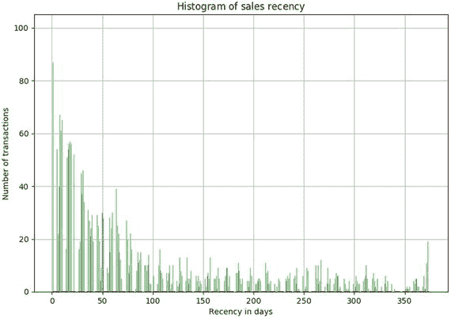

图 8-2.

销售最近一次消费时间分布

```
x = customer_history_df.recency
mu = np.mean(customer_history_df.recency)
sigma = math.sqrt(np.var(customer_history_df.recency))
n, bins, patches = plt.hist(x, 1000, facecolor='green', alpha=0.75)
```

# 添加“最佳拟合”线
y = mlab.normpdf( bins, mu, sigma)
l = plt.plot(bins, y, 'r--', linewidth=2)
plt.xlabel('最近购买天数')
plt.ylabel('交易数量')
plt.title(r'$\mathrm{Histogram\ of\ sales\ recency}\ $')
plt.grid(True)
```

图 8-2 中的直方图告诉我们，销售最近购买时间的分布是偏态的，频繁交易的数量非常高，而不太近期的交易数量则相对均匀。

频率与货币价值

使用类似的方法，我们可以为数据集创建频率和货币价值变量。我们将分别创建这些变量，然后合并所有数据框，最终得到客户价值数据集。我们将在此数据框上执行基于聚类的客户细分。以下代码片段将创建这两个变量以及最终的合并数据框。

```
In [29]: customer_monetary_val = cs_df[['CustomerID',
'amount']].groupby("CustomerID").sum().reset_index()
...: customer_history_df = customer_history_df.merge(customer_monetary_val, how='outer')
...: customer_history_df.amount = customer_history_df.amount+0.001
...:
...: customer_freq = cs_df[['CustomerID',
'amount']].groupby("CustomerID").count().reset_index()
...: customer_freq.rename(columns={'amount':'frequency'},inplace=True)
...: customer_history_df = customer_history_df.merge(customer_freq, how='outer')
```

用于聚类的输入数据框将类似于图 8-3 中所示的数据框。请注意，我们向客户货币价值添加了一个小数值 `0.001`，因为我们将把数值转换为对数尺度，而数据中存在的零值可能导致错误。

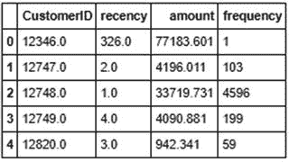

图 8-3.

客户价值数据框

数据预处理

一旦我们创建了客户价值数据框，我们将对数据执行一些预处理。对于聚类，我们将使用之前章节讨论过的 K-means 聚类算法。该算法正常运行的要求之一是变量值的均值中心化。变量值的均值中心化意味着我们将用标准化值替换变量的实际值，使得变量的均值为 1，方差为 0。这确保了所有变量都在相同的范围内，并且数值范围的差异不会导致算法性能不佳。这类似于特征缩放。

你可以研究的另一个问题是每个变量可能取值的巨大范围。这个问题在货币金额变量上尤其明显。为了解决这个问题，我们将对所有变量进行对数尺度转换。这种转换，连同标准化，将确保我们算法的输入是一组同质的缩放和转换后的值。

关于数据预处理步骤的一个重要点是，有时我们需要它是可逆的。在我们的案例中，我们将得到基于对数转换和缩放变量的聚类结果。但是，为了根据原始数据进行推断，我们需要反向转换所有变量，以便恢复实际的 RFM 数值。这可以通过使用 Python 的预处理功能来实现。

```
In [30]: from sklearn import preprocessing
...: import math
...: customer_history_df['recency_log'] = customer_history_df['recency'].apply(math.log)
...: customer_history_df['frequency_log'] = customer_history_df['frequency'].apply(math.log)
...: customer_history_df['amount_log'] = customer_history_df['amount'].apply(math.log)
...: feature_vector = ['amount_log', 'recency_log','frequency_log']
...: X = customer_history_df[feature_vector].as_matrix()
...: scaler = preprocessing.StandardScaler().fit(X)
...: X_scaled = scaler.transform(X)
```

前面的代码片段将创建我们数据集的对数化和均值中心化版本。我们可以通过检查取值范围最宽的变量来可视化预处理的结果。以下代码片段将帮助我们实现可视化。

```
In [31]: x = customer_history_df.amount_log
...: n, bins, patches = plt.hist(x, 1000, facecolor='green', alpha=0.75)
...: plt.xlabel('销售金额的对数')
...: plt.ylabel('概率')
...: plt.title(r'$\mathrm{Histogram\ of\ Log\ transformed\ Customer\ Monetary\ value}\ $')
...: plt.grid(True)
...: plt.show()
```

生成的图形是一个类似于正态分布的分布，均值为 0，方差为 1，如图 8-4 所示。

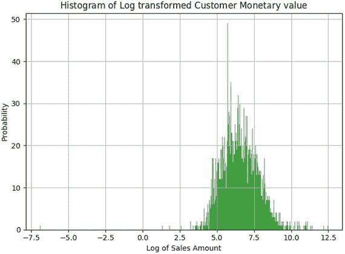

图 8-4.

缩放并经过对数转换的销售金额

让我们尝试在三维图上可视化我们的三个主要特征（R、F 和 M），看看我们是否能理解数据分布所显示的任何有趣模式。

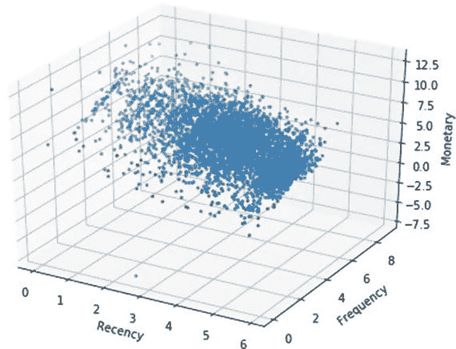

图 8-5.

客户价值数据框

```
from mpl_toolkits.mplot3d import Axes3D
fig = plt.figure(figsize=(8, 6))
ax = fig.add_subplot(111, projection='3d')
xs =customer_history_df.recency_log
ys = customer_history_df.frequency_log
zs = customer_history_df.amount_log
ax.scatter(xs, ys, zs, s=5)
ax.set_xlabel('最近购买时间')
ax.set_ylabel('频率')
ax.set_zlabel('货币价值')
```

从图 8-5 的图中我们可以看到的明显模式是，购买频率更高、购买时间更近的人倾向于花费更多，这基于货币价值随频率增加和最近购买时间减少而相应增加和减少的趋势。你注意到其他有趣的模式了吗？

聚类以发现细分群体

我们将使用 K-means 聚类算法来发现数据中的簇（或细分群体）。这是我们可以采用的最简单的聚类算法之一，因此它在实践中被广泛使用。在继续使用该算法在我们的数据中寻找细分群体之前，我们将先简要介绍该算法。

K-Means 聚类

K-means 聚类属于基于划分/基于质心的聚类算法家族。K-means 算法用于划分数据的步骤如下：

1.  算法从随机初始化所需数量的中心点开始。K-means 中的“K”代表簇的数量。
2.  在下一步中，每个数据点被分配给离它最近的中心点。K-means 聚类中使用的距离度量是标准的欧几里得距离。
3.  数据点分配完成后，通过对属于该簇的点的维度进行平均来重新计算中心点。
4.  使用新的中心点重复此过程，直到分配变得稳定。在这种情况下，算法终止。

我们将改编 `scikit-learn` 文档中给出的代码（位于 [ `http://scikit-learn.org/stable/auto_examples/cluster/plot_kmeans_silhouette_analysis.html` ](http://scikit-learn.org/stable/auto_examples/cluster/plot_kmeans_silhouette_analysis.html)），并使用轮廓系数在我们的聚类过程中找出最佳簇数。我们将其留作练习，让你改编代码并创建图 8-6 中的可视化。我们鼓励你修改文档中的代码，不仅要构建可视化，还要将每个簇的中心点和轮廓系数捕获到字典中，因为我们在分析所获得的客户细分群体时需要引用这些信息。当然，如果你觉得难以应对，你始终可以参考 `Customer Segmentation.ipynb` 笔记本中的详细代码片段。

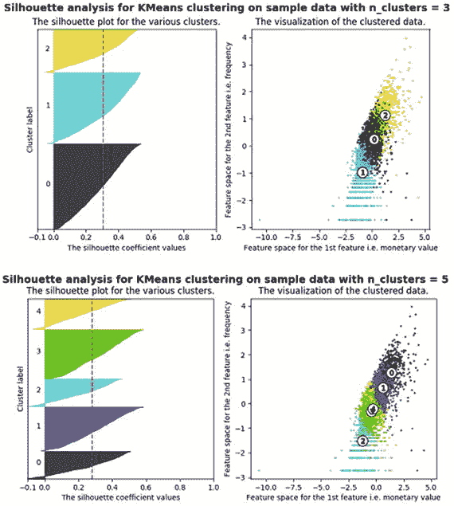

图 8-6.

三个和五个簇的轮廓分析

在图 8-6 所示的可视化中，我们绘制了每个簇的轮廓系数以及发现的每个簇的中心点。我们将在下一节关于聚类分析的内容中使用这些信息。尽管我们必须记住，在许多情况和场景下，有时我们可能不得不放弃算法给出的数学解释，而关注所获结果的业务相关性。

聚类分析

在我们继续分析如此获得的簇之前，让我们先看看将簇中心值从对数化和缩放版本重新转换回正常值后的结果。以下代码帮助我们转换中心值为反向转换后的值。

```
In [38]: for i in range(3,6,2):
...:     print("for {} number of clusters".format(i))
...:     cent_transformed = scaler.inverse_transform(cluster_centers[i]['cluster_center'])
...:     print(pd.DataFrame(np.exp(cent_transformed),columns=feature_vector))
...:     print("Silhouette score for cluster {} is {}". format(i,
cluster_centers[i]['silhouette_score']))
...:     print()
for 3 number of clusters
amount_log  recency_log  frequency_log
0   843.937271    44.083222      53.920633
1   221.236034   121.766072      10.668661
2  3159.294272     7.196647     177.789098
Silhouette score for cluster 3 is 0.30437444714898737
for 5 number of clusters
amount_log  recency_log  frequency_log
0  3905.544371     5.627973     214.465989
1  1502.519606    46.880212      92.306262
2   142.867249   126.546751       5.147370
3   408.235418   139.056216      25.530424
4   464.371885    13.386419      29.581298
Silhouette score for cluster 5 is 0.27958641427323727
```

当我们查看聚类过程的结果时，可以推断出一些有趣的见解。考虑三簇配置，并尝试理解以下见解。

*   我们得到了三个簇，它们在客户的货币价值上存在显著差异。
*   簇 2 是高价值客户群，他们购物频繁，对每个企业来说无疑是一个重要的细分群体。
*   类似地，我们在标签为 1 和 0 的簇中分别获得了低消费和中消费的客户群。
*   根据我们在图 8-3 中讨论的趋势（高货币价值-低最近购买时间-高频率），频率和最近购买时间与货币价值完美相关。

五簇配置的结果更令人惊讶！当我们寻找更多细分群体时，我们发现我们的高价值客户群由两个子群体组成：

*   那些经常购物且消费金额高的人（由簇 0 代表）。
*   那些消费尚可但不够频繁的人（由簇 1 代表）。

这与我们从轮廓系数矩阵获得的结果直接冲突，后者表明五簇细分不如三簇细分优化。当然，请记住，你不能总是严格追求数学指标，也要考虑业务方面。除此之外，当你基于这些细分群体可视化数据时，可能会发现更多见解，这些见解可能证明实际上三簇细分要好得多。例如，如果你检查图 8-6 中的右侧图，你可以看到与三簇细分相比，五簇细分中的群体之间有太多的重叠。

簇描述

基于对簇中心的目测，我们可以发现，在根据最近购买时间、金额和频率定义的细分群体中，客户价值存在良好差异。为了进一步深入探讨这一点并找出这些差异的质量，我们可以用相应的簇标签标记我们的数据，然后可视化这些差异。我们将针对可能最重要的客户价值指标之一——总美元销售额——进行此可视化。

为了得出这种基于区分的汇总计算，我们将首先用聚类算法返回的相应标签标记客户汇总数据框中的每一行数据。请注意，如果你想尝试不同的配置，比如两个或四个簇，则必须修改你正在使用的代码。我们将需要进行更改，以便捕获每个不同簇配置的标签。我们鼓励你尝试其他簇配置，看看是否能获得更好的细分群体！以下代码将提取聚类标签并将其附加到我们的客户汇总数据框中。

```
labels = cluster_centers[5]['labels']
customer_history_df['num_cluster5_labels'] = labels
labels = cluster_centers[3]['labels']
customer_history_df['num_cluster3_labels'] = labels
```

一旦我们为每个客户分配了标签，我们的任务就简单了。现在我们想找出每个组中客户的汇总情况是如何变化的。如果我们能可视化这些信息，我们将能够发现客户簇之间的差异，并且我们可以根据这些差异修改我们的策略。到目前为止，我们已经大量使用了 `matplotlib` 和 `seaborn`；在本节中，我们将使用 `plotly` 来创建一些交互式图表，你可以在你的 jupyter notebook 中随意操作！

注意

虽然 `plotly` 在 jupyter notebook 中提供了出色的交互式可视化，但当你打开 notebook 时，可能会遇到一些以弹出窗口形式出现的 notebook 渲染问题。要解决此问题，请通过运行 `conda update nbformat` 命令升级你的 `nbformat` 库，然后重新打开 notebook。问题应该会消失。

以下代码利用了 `plotly`，将获取我们为五簇配置获得的簇标签，并创建箱线图，显示五个组中的中位数、最小值、最大值、最高值和最低值是如何变化的。请注意，我们希望避免每个组的极高异常值，因为它们会干扰对每个簇中心趋势的良好观察（由于噪声）。因此，我们将限制数据，只使用小于该簇第 80 个百分位数的数据点。这将为我们提供关于该簇细分群体中大多数用户的良好信息。以下代码将帮助我们为总销售额创建此图。

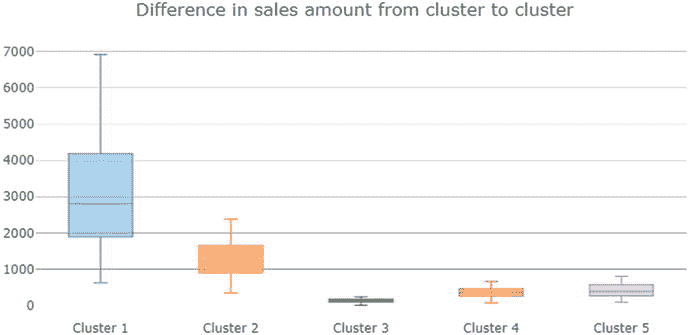

图 8-7.

五个细分群体之间的销售金额值差异

```
import plotly as py
import plotly.graph_objs as go
py.offline.init_notebook_mode()
x_data = ['簇 1','簇 2','簇 3','簇 4', '簇 5']
cutoff_quantile = 80
field_to_plot = 'amount'
y0=customer_history_df[customer_history_df['num_cluster5_labels']==0][field_to_plot].values
y0 = y0[y0<np.percentile(y0, cutoff_quantile)]
y1=customer_history_df[customer_history_df['num_cluster5_labels']==1][field_to_plot].values
y1 = y1[y1<np.percentile(y1, cutoff_quantile)]
y2=customer_history_df[customer_history_df['num_cluster5_labels']==2][field_to_plot].values
y2 = y2[y2<np.percentile(y2, cutoff_quantile)]
y3=customer_history_df[customer_history_df['num_cluster5_labels']==3][field_to_plot].values
y3 = y3[y3<np.percentile(y3, cutoff_quantile)]
y4=customer_history_df[customer_history_df['num_cluster5_labels']==4][field_to_plot].values
y4 = y4[y4<np.percentile(y4, cutoff_quantile)]
y_data = [y0,y1,y2,y3,y4]
colors = ['rgba(93, 164, 214, 0.5)', 'rgba(255, 144, 14, 0.5)', 'rgba(44, 160, 101, 0.5)', 'rgba(255, 65, 54, 0.5)', 'rgba(207, 114, 255, 0.5)', 'rgba(127, 96, 0, 0.5)']
traces = []
for xd, yd, cls in zip(x_data, y_data, colors):
traces.append(go.Box(
y=yd,      name=xd,     boxpoints=False,
jitter=0.5,      whiskerwidth=0.2,
fillcolor=cls,       marker=dict(size=2,),
line=dict(width=1), ))
layout = go.Layout(
title='不同簇之间的销售{}差异'.format(field_to_plot),
yaxis=dict(
autorange=True,        showgrid=True,
zeroline=True,        dtick=1000,
gridcolor='black',        gridwidth=0.1,
zerolinecolor='rgb(255, 255, 255)',
zerolinewidth=2,    ),
margin=dict(l=40,r=30, b=80, t=100,    ),
paper_bgcolor='white',    plot_bgcolor='white',  showlegend=False
)
fig = go.Figure(data=traces, layout=layout)
py.offline.iplot(fig)
```

让我们也看看这段代码片段生成的图。在图 8-7 中，我们可以看到簇 1 和簇 2 具有较高的平均销售金额，因此是最高消费群体。尽管我们没有看到簇 4 和簇 5 在销售价值上有太大差异，但我们确实看到簇 3 的销售金额明显较小。这给我们一个提示，我们可以将簇 4 和簇 5 的候选者合并在一起，至少基于销售金额是这样。你也可以为最近购买时间和频率绘制类似的图，以找出基于这些值的簇差异。详细的代码和可视化内容存在于关于三簇和五簇细分群体的 notebook 中。Plotly 使我们能够与图表进行交互，以查看 notebook 中每个箱线图的中心趋势值。我们展示了基于三簇配置的三个细分群体之间的销售金额差异，以便你可以将其与图 8-7 进行比较。

详细的可视化如图 8-8 所示，它展示了三个细分群体之间的销售/收入差异。很明显，这更容易区分，并且与图 8-7 中簇 4 和簇 5 非常相似的情况相比，重叠也更少。这并不意味着之前的方法是错误的；这只是某些细分群体在某些维度上彼此相似的一个例子。

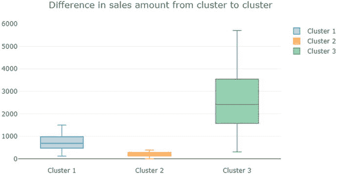

图 8-8.

三个细分群体之间的销售金额值差异

我们可以通过向已创建的数据集添加相关特征来进一步提高聚类质量。公司通常会从外部数据供应商处购买关于其客户的数据，并用它来增强细分过程。我们受限于只有大约一年的交易数据，但即使是中型组织也可能拥有多年的交易数据，这可以改善结果。另一个可以探索的维度是尝试不同的算法来执行细分，例如我们在前面一些章节中探讨过的层次聚类。一个好的细分过程将涵盖所有这些途径，以得出能够提供宝贵见解的最佳细分群体。我们鼓励你在这个过程中发挥创造力，并构建自己的示例。

从这个分析中得到的重要启示是，当涉及到将结果的实际值与数学指标相关联时，我们不能总是依赖指标。我们需要养成将业务指标和领域见解纳入建模过程的习惯，因为通常这将成为实施的高价值项目与被遗忘的以数据为中心的解决方案之间的区别。一旦我们获得这些结果，我们可以进一步与组织的营销团队讨论，为识别出的每个细分群体制定合适的策略。

交叉销售

什么是交叉销售？简单来说，交叉销售是通过分析客户的购物趋势以及与客户购物模式相似的普遍购物趋势和模式，向客户销售更多产品的能力。这个简单的定义抓住了交叉销售的核心思想，但它并不像我们希望的那样具有描述性。

我们将通过一个例子来说明这个想法。假设我们关心自己的健康（每个人都应该如此），并决定在我们最喜欢的电子商务网站上购买蛋白质补充剂。在大多数情况下，当你进入产品页面时，会有一个部分告诉你，除了你选择的产品之外，你还可以购买的其他产品。见图 8-9。

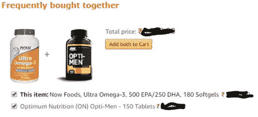

图 8-9.

交叉销售示例

很多时候，这些推荐的产品会非常有吸引力。例如，如果我想购买蛋白质补充剂，那么同时购买维生素补充剂对我来说绝对是个好主意。零售商通常会为你提供捆绑产品，并附带一些有吸引力的优惠，我们很可能会购买捆绑产品，而不仅仅是原始商品。这就是交叉销售简单而强大的概念。我们研究客户交易，找出客户原始需求的潜在附加项，并将其作为建议提供给客户，希望并意图让他们购买，从而使客户和零售机构都受益。

交叉销售在线上和线下零售世界中无处不在。这个想法的简单性和有效性使其成为所有类型零售商必不可少且强大的营销工具。交叉销售的概念可以扩展到任何组织，无论它是线上还是线下零售商，也无论它是向最终用户还是批发商销售产品。

在本节中，我们将探讨关联规则挖掘，这是一种可用于交叉销售的强大技术，然后我们将针对一个玩具数据集说明购物篮分析的概念，最后我们将相同的概念应用于我们的零售交易数据集。

使用关联规则挖掘进行购物篮分析

在我们继续理解如何从交易数据生成关联规则之前，让我们先尝试理解我们将如何使用这些规则。数据分析界有一个著名的故事，即“啤酒与尿布”的故事。这个故事的基本要点是，一家大型零售商在分析其客户交易行为时，发现啤酒和尿布的销售之间存在强关联。该零售商能够利用这种关联，将啤酒区移到尿布区附近，从而提高了销售额（故事的起源可能有一些事实依据，但整个概念是有争议的。我们鼓励你通过 [ `http://www.dssresources.com/newsletters/66.php` ](http://www.dssresources.com/newsletters/66.php) 上的讨论来了解更多关于这个故事的信息）。

尽管啤酒和尿布的故事可能是一个神话，但在客户行为中发现销售关联的概念是重要且鼓舞人心的。假设我们能够数学上捕捉这些关联的重要性，那么尝试利用那些可能正确的规则将是一个好主意。关联规则挖掘的整个概念基于这样一个理念：客户购买行为具有一种模式，可以利用这种模式在未来向客户销售更多商品。关联规则通常具有如下方程所示的结构：

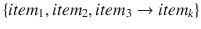

这个规则可以以显而易见的方式解读：当客户购买了规则左侧（LHS）的商品时，他很可能购买商品 [k]。在后面的章节中，我们将定义数学指标来捕捉此类规则的强度。

我们可以以多种方式使用这些规则。最明显的方式是开发产品捆绑包，方便客户一起购买这些商品。另一种使用这些规则的方式是将产品与捆绑包中其他相关产品的折扣捆绑在一起，从而确保客户更有可能购买更多商品。一些不太常见的关联规则用途包括设计更好的网站导航结构、入侵检测、生物信息学等。

关联规则挖掘基础

在继续探索我们数据集中的关联规则之前，我们将介绍一些关联规则挖掘的基本概念。这些术语和概念将帮助你进行后续分析，并理解算法将生成的规则。考虑表 8-1 中的一些玩具交易数据。

表 8-1.

交易集示例

  Trans.ID
 |
  Items
 |

| --- | --- | --- | --- | --- |

 |
  `{milk, bread}`
 |

 |
  `{butter}`
 |

 |
  `{beer, diaper}`
 |

 |
  `{milk, bread, butter}`
 |

 |
  `{bread}`
 |

表中的每一行包含一个交易。例如，客户在第一个交易中购买了牛奶和面包。以下是关联规则挖掘的一些重要概念。

*   项集：项集只是在一个交易中一起出现的一个或多个项目的集合。例如，这里的 `{milk, bread}` 就是一个项集的例子。
*   支持度：支持度定义为项集在数据集中出现的次数。数学上定义为：

    

    在前面的例子中，`support (beer, diaper) = 1/5 = 0.2`。

*   置信度：置信度是衡量规则在数据集中被发现存在的次数。对于一条声明 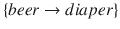 的规则，其置信度数学上定义为：

    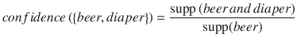

*   提升度：规则提升度定义为观察到的支持度与规则元素独立情况下预期支持度的比率。对于前面的一组交易，如果规则定义为 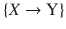，则规则的提升度定义为：

    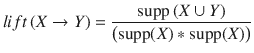

*   频繁项集：频繁项集是其支持度大于用户定义的支持度阈值的项集。

FP 增长

最著名的关联规则挖掘算法是 Apriori 算法，你可以在网络和标准数据挖掘文献中找到大量关于它的代码和资源。然而，这里我们将使用一种不同且更高效的算法，即 FP 增长算法，来发现我们的关联规则。任何关联规则挖掘算法的主要瓶颈都是频繁项集的生成。如果交易数据集有 k 种独特产品，那么潜在的可能项集数量为 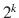。Apriori 算法将首先生成这些项集，然后继续寻找频繁项集。

这个限制是一个巨大的性能瓶颈，因为即使只有大约 100 种独特产品，可能的项集数量也是巨大的。这个限制使得 Apriori 算法的计算成本高得令人望而却步。FP 增长算法优于 Apriori 算法，因为它不需要生成所有候选项目集。该算法使用一种特殊的数据结构来帮助它保留项集关联信息。图 8-10 描绘了这种数据结构的一个例子。

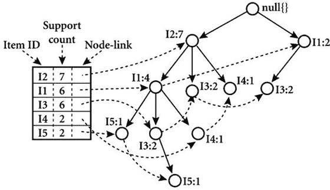

图 8-10.

FP-tree 的一个例子

我们不会在这里深入探讨算法的详细数学描述，因为目的不是让本节充满数学，而是专注于如何利用它来发现数据中的模式。但是，我们将简要解释它，以便你理解此方法的核心概念。FP 增长算法采用分治策略，并利用一种称为 FP-tree 的特殊数据结构（如图 8-10 所示）来发现频繁项集，而无需生成所有项集。该算法的核心步骤如下：

1.  接收交易数据库并创建一个 FP-tree 结构来表示频繁项集。
2.  将此压缩表示划分为多个条件数据集，使得每个数据集都与一个频繁模式相关联。
3.  在每个这样的数据集中挖掘模式，以便可以将较短的模式递归地连接到较长的模式，从而使其更高效。

如果你有兴趣了解更多，可以参考 Wikibooks 链接 [`https://en.wikibooks.org/wiki/Data_Mining_Algorithms_In_R/Frequent_Pattern_Mining/The_FP-Growth_Algorithm`](https://en.wikibooks.org/wiki/Data_Mining_Algorithms_In_R/Frequent_Pattern_Mining/The_FP-Growth_Algorithm) ，其中详细讨论了 FP 增长和 FP 树结构。

关联规则挖掘实战

我们将使用著名的杂货数据集来说明关联规则挖掘。该数据集默认在 R 语言的基础包中可用。要在 Python 中使用它，你可以从 [ `https://github.com/stedy/Machine-Learning-with-R-datasets/blob/master/groceries.csv` ](https://github.com/stedy/Machine-Learning-with-R-datasets/blob/master/groceries.csv) 或从本章开头提到的我们的官方 GitHub 仓库获取。该数据集包含来自一家杂货零售商的交易集合。我们将使用这些数据作为我们分析的基础，并利用这些数据构建我们的规则挖掘工作流程。

一旦我们掌握了在杂货数据集上进行关联规则挖掘的基础知识，我们将把它留作练习，让你将相同的概念应用于我们在客户细分部分使用的交易数据集。请记住在开始之前加载以下依赖项。

```
import csv
import pandas as pd
import matplotlib.pyplot as plt
import Orange
from Orange.data import Domain, DiscreteVariable, ContinuousVariable
from orangecontrib.associate.fpgrowth import *
%matplotlib inline
```

查看“挖掘规则”部分，了解如何安装 `Orange` 框架依赖项的详细信息。本节代码可在 `Cross Selling.ipynb` 笔记本中找到。

探索性数据分析

我们之前提到的杂货数据集是这样安排的：数据集中出现的每一行都是一个交易。每行中给出的项目以逗号分隔，并且是该特定交易中的项目。查看图 8-11 中描绘的数据集的前几行。

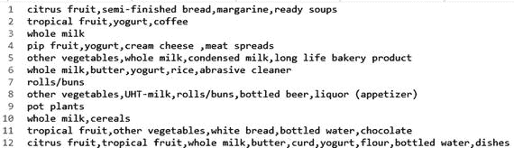

图 8-11.

杂货数据集交易

我们从该数据集中得到的第一个观察结果是，它并非以完全结构化、易于分析的格式提供。这个限制意味着我们首先要做的是编写自定义代码，将原始文件转换为我们可用的数据结构。由于到目前为止我们大部分分析都是使用 `pandas` 数据框完成的，我们将把这些数据转换为类似的数据结构。以下代码片段将为我们执行转换。

```
grocery_items = set()
with open("grocery_dataset.txt") as f:
reader = csv.reader(f, delimiter=",")
for i, line in enumerate(reader):
grocery_items.update(line)
output_list = list()
with open("grocery_dataset.txt") as f:
reader = csv.reader(f, delimiter=",")
for i, line in enumerate(reader):
row_val = {item:0 for item in grocery_items}
row_val.update({item:1 for item in line})
output_list.append(row_val)
grocery_df = pd.DataFrame(output_list)
In [3]: grocery_df.shape
Out[3]: (9835, 169)
```

转换后我们得到一个维度为 (`num_transaction`, `total_items`) 的数据框，其中每个交易行中，其组成项目对应的列值为 1。例如，对于图 8-11 中的第 3 行，`whole milk` 列将为 1，其余列均为 0。尽管这种数据结构是稀疏的，意味着它有很多零，但我们提取关联规则的框架将处理这种稀疏性。

在我们继续在数据集上构建关联规则之前，我们将探索数据集的一些显著特征。我们已经知道数据集中总共有 9,835 笔交易和 169 个项目。但是，数据集中出现的前 10 个项目是什么，它们占总销售额的多少？我们可以绘制一个简单的直方图来帮助我们提取这些信息。

```
In [4]: total_item_count = sum(grocery_df.sum())
...: print(total_item_count)
...: item_summary_df = grocery_df.sum().sort_values(ascending = False).reset
...: _index().head(n=20)
...: item_summary_df.rename(columns={item_summary_df.columns[0]:'item_name',
...: item_summary_df.columns[1]:'item_count'}, inplace=True)
...: item_summary_df.head()

Out[4]:
item_name  item_count
0        whole milk        2513
1  other vegetables        1903
2        rolls/buns        1809
3              soda        1715
4            yogurt        1372
```

为了创建直方图，我们将使用前面的代码创建一个汇总数据框。这告诉我们所有交易中总共出现了 43,000 多个项目，我们还看到了销量前五的项目。让我们使用这个数据框来绘制销量前 20 的项目。以下代码片段将帮助我们创建所需的条形图。

```
objects = (list(item_summary_df['item_name'].head(n=20)))
y_pos = np.arange(len(objects))
performance = list(item_summary_df['item_count'].head(n=20))
plt.bar(y_pos, performance, align='center', alpha=0.5)
plt.xticks(y_pos, objects, rotation='vertical')
plt.ylabel('项目数量')
plt.title('项目销售分布')
```

描绘项目销售的条形图如图 8-12 所示。它表明，仅这 20 个项目就占据了总项目的惊人份额。

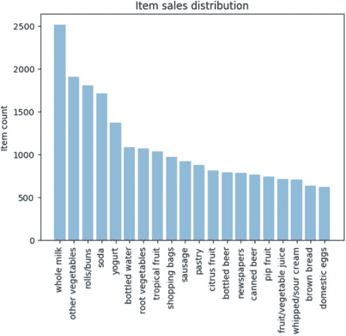

图 8-12.

基于销售额的杂货数据集前 20 个项目

让我们也找出仅这 20 个项目就解释了总销售额的百分比。我们将使用 `pandas` 提供的累积和函数 (`cumsum`) 来找出这一点。我们将在数据框中创建两列。一列将告诉特定项目占总销售额的百分比，另一列将保持此销售百分比的累积和。

```
item_summary_df['item_perc'] = item_summary_df['item_count']/total_item_count
item_summary_df['total_perc'] = item_summary_df.item_perc.cumsum()
item_summary_df.head(10)
item_name  item_count  item_perc  total_perc
0        whole milk        2513   0.057947    0.057947
1  other vegetables        1903   0.043881    0.101829
2        rolls/buns        1809   0.041714    0.143542
3              soda        1715   0.039546    0.183089
4            yogurt        1372   0.031637    0.214725
In [12]: item_summary_df[item_summary_df.total_perc <= 0.5].shape
Out[12]: (19, 4)
```

这表明前五个项目贡献了全部销售额的 21.4%，而仅前 20 个项目就贡献了超过 50% 的销售额！这对我们很重要，因为我们不想为购买频率非常低的项目寻找关联规则。有了这些信息，我们可以限制我们想要探索以创建关联规则的项目。这也有助于我们将可能的项集数量控制在可控范围内。

挖掘规则

我们将使用 `Orange` 和 `Orange3-Associate` 框架，可以使用命令 `conda install orange3` 和 `pip install orange3-associate` 进行安装。`orange3-associate` 包包含了 FP 增长的实现，由开发 `Orange` 数据挖掘包的团队提供，即斯洛文尼亚卢布尔雅那大学的生物信息学实验室（ [`https://fri.uni-lj.si/en/laboratory/biolab`](https://fri.uni-lj.si/en/laboratory/biolab) ）。

注意

我们鼓励你尝试使用 `Orange` 包，该包可在 [`https://orange.biolab.si/`](https://orange.biolab.si/) 获取。它是一个用 Python 编写的、由 GUI 驱动的数据挖掘框架，非常有助于以交互方式学习数据分析。

在我们继续使用该包寻找关联规则之前，我们将讨论 `Orange` 库中数据的表示方式。数据表示有点棘手，但我们将帮助你修改现有数据，使其符合 `Orange` 要求的格式。我们将主要关注如何将我们的 `pandas` 数据框转换为 `Orange Table` 数据结构。

Orange Table 数据结构

`Table` 数据结构是在 `Orange` 中表示任何表格数据的主要方式。尽管它在某些方面类似于 `numpy` 数组或 `pandas` 数据框，但它在存储关于实际数据的元数据的方式上有所不同。在我们的案例中，我们可以通过提供关于我们列的元数据，轻松地将我们的 `pandas` 数据框转换为 `Table` 数据结构。我们需要为每个变量定义域。域意味着每个变量可以使用的可能值集合。这些信息将作为元数据存储，并将在后续的数据转换中使用。由于我们的列只有二进制值——即 0 或 1——我们可以利用这些信息轻松创建域。以下代码片段帮助我们转换数据框为 `Orange` 表。

```
from Orange.data import Domain, DiscreteVariable, ContinuousVariable
from orangecontrib.associate.fpgrowth import *
input_assoc_rules = grocery_df
domain_grocery = Domain([DiscreteVariable.make(name=item, values=['0', '1']) for item in
input_assoc_rules.columns])
data_gro_1 = Orange.data.Table.from_numpy(domain=domain_grocery,
X=input_assoc_rules.as_matrix(),Y= None)
```

这里，我们通过将每个变量指定为具有值 `(0, 1)` 的 `DiscreteVariable` 来定义数据的域。然后，使用这个域，我们为数据创建了 `Table` 结构。

使用 FP 增长算法

现在我们拥有了执行规则挖掘所需的所有部分。但在继续之前，我们想处理分析的另一个重要方面。我们在前面的章节中看到，只有少数项目负责我们的大部分销售额，因此我们想要修剪我们的数据集以反映这些信息。为此，我们创建了一个函数 `prune_dataset`（查看 notebook），它将帮助我们根据需求减少数据集的大小。该函数可用于执行两种类型的修剪：

*   基于总销售额百分比的修剪：参数 `total_sales_perc` 将帮助我们选择能够解释所需销售百分比的项目数量。默认值为 50% 或 0.5。
*   基于项目排名的修剪：执行修剪的另一种方法是指定我们想要修剪数据集的项目起始和结束排名。

默认情况下，我们只会查找至少包含两个项目的交易，因为只有一个项目的交易与关联规则挖掘的整个概念相悖。以下代码片段将帮助我们仅选择那些通过利用我们的修剪函数解释总销售额 40% 的数据子集。

```
output_df, item_counts = prune_dataset(input_df=grocery_df, length_trans=2,total_sales_perc=0.4)
print(output_df.shape)
print(list(output_df.columns))
(4585, 13)
['whole milk', 'other vegetables', 'rolls/buns', 'soda', 'yogurt', 'bottled water', 'root vegetables', 'tropical fruit', 'shopping bags', 'sausage', 'pastry', 'citrus fruit', 'bottled beer']
```

所以我们发现只有 13 个项目贡献了 40% 的销售额，并且有 4585 笔交易包含这些项目以及其他项目，我们还可以看到这些项目是什么。下一步是将这些选定的数据转换为所需的 `Table` 数据结构。

```
input_assoc_rules = output_df
domain_grocery = Domain([DiscreteVariable.make(name=item,values=['0', '1']) for item in
input_assoc_rules.columns])
data_gro_1 = Orange.data.Table.from_numpy(domain=domain_grocery,
X=input_assoc_rules.as_matrix(), Y= None)
data_gro_1_en, mapping = OneHot.encode(data_gro_1, include_class=False)
```

前面代码的新增部分是最后一行。这是为了对我们的输入进行编码，以便整个域表示为二进制变量。这将完成规则挖掘所需的所有解析和数据操作。呼！

最后一步是创建我们的规则。我们需要指定两条信息来生成规则：支持度和置信度。我们之前已经在概念上定义了它们，因此我们不再重复定义。一条重要的信息是从较高的支持度开始，因为较低的支持度意味着更多的频繁项集，从而导致更长的执行时间。我们将指定最小支持度为 0.01——至少 45 笔交易——并在我们指定置信度并生成规则之前，查看我们获得的频繁项集数量。

```
min_support = 0.01
print("num of required transactions = ", int(input_assoc_rules.shape[0]*min_support))
num_trans = input_assoc_rules.shape[0]*min_support
itemsets = dict(frequent_itemsets(data_gro_1_en, min_support=min_support))
num of required transactions =  45
In [25]: len(itemsets)
Out[25]: 166886
```

所以我们得到了惊人的 166,886 个项集，支持度仅为 1%！如果我们降低支持度或增加数据集中的项目数量，这个数字将呈指数级增长。下一步是指定置信度值并生成我们的规则。我们编写了一个代码片段，它将接受一个置信度值，并生成满足我们指定的支持度和置信度标准的规则。然后使用映射和变量名称对生成的规则进行解码。`Orange3-Associate` 还提供了一个辅助函数，帮助我们提取每个规则的指标。以下代码片段将执行规则生成和规则解码，然后将所有内容编译成一个整洁的数据框，我们可以用于进一步分析。

```
confidence = 0.3
rules_df = pd.DataFrame()
if len(itemsets) 1 :
rule_dict = {'support' : ex_rule_frm_rule_stat[2],
'confidence' : ex_rule_frm_rule_stat[3],
'coverage' : ex_rule_frm_rule_stat[4],
'strength' : ex_rule_frm_rule_stat[5],
'lift' : ex_rule_frm_rule_stat[6],
'leverage' : ex_rule_frm_rule_stat[7],
'antecedent': ante_rule,
'consequent':named_cons[:-2] }
rule_list_df.append(rule_dict)
rules_df = pd.DataFrame(rule_list_df)
print("Raw rules data frame of {} rules generated".format(rules_df.shape[0]))
if not rules_df.empty:
pruned_rules_df = rules_df.groupby(['antecedent','consequent']).max().reset_index()
else:
print("Unable to generate any rule")
Raw rules data frame of 16628 rules generated
```

此代码片段的输出包括一个关联规则数据框，我们可以用于分析。你可以调整项目编号、后件、前件、支持度和置信度值来生成不同的规则。让我们看一些使用解释总销售额 40% 的交易、最小支持度为 1%（所需交易数量 >=45）且置信度大于 30% 生成的示例规则。在这里，我们通过使用以下代码，为每个可以作为后件（出现在右侧）的项目收集了具有最大提升度的规则。

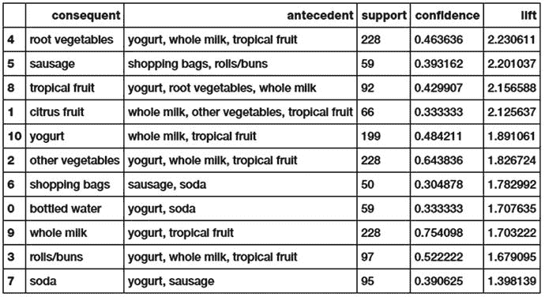

图 8-13.

杂货数据集上的关联规则

```
(pruned_rules_df[['antecedent','consequent',
'support','confidence','lift']].groupby('consequent')
.max()
.reset_index()
.sort_values(['lift', 'support','confidence'],
ascending=False))
```

让我们解释第一条规则，它指出：

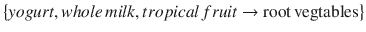

规则在方程中陈述的模式很容易理解——购买酸奶、全脂牛奶和热带水果的人也倾向于购买根茎类蔬菜。让我们尝试理解这些指标。规则的支持度为 228，这意味着所有这些项目一起出现在数据集中的 228 笔交易中。规则的置信度为 46%，这意味着在前件出现的交易中，有 46% 的情况下我们也发现了后件（即，46% 的情况下，购买左侧项目的客户也购买了根茎类蔬菜）。图 8-13 中的另一个重要指标是提升度。提升度意味着在包含酸奶、全脂牛奶和热带水果的交易中发现根茎类蔬菜的概率大于在之前交易中发现根茎类蔬菜的正常概率（2.23）。通常，提升度值为 1 表示前件和后件同时出现的概率彼此独立。因此，我们的想法是寻找提升度远大于 1 的规则。在我们的案例中，前面提到的所有规则都是高质量的规则。

这是一条重要的信息，因为这可以促使零售商将此类特定产品捆绑在一起销售，或者开展一项营销计划，为购买根茎类蔬菜以及这三种其他产品提供折扣。

我们鼓励你在未来使用自己的数据集进行类似的分析，也可以使用我们在市场细分案例研究中使用的在线零售交易数据集。考虑到市场细分中的 `Online Retail` 数据集，该特定分析的工作流程将非常相似。这两个数据集之间的唯一区别在于它们的表示方式。你可以利用以下代码片段来分析该数据集中来自英国的交易模式。

```
cs_mba = pd.read_excel(io=r'Online Retail.xlsx')
cs_mba_uk = cs_mba[cs_mba.Country == 'United Kingdom']

# 移除退货商品
cs_mba_uk = cs_mba_uk[∼(cs_mba_uk.InvoiceNo.str.contains("C") == True)]
cs_mba_uk = cs_mba_uk[∼cs_mba_uk.Quantity<0]

# 创建事务数据库
items = list(cs_mba_uk.Description.unique())
grouped = cs_mba_uk.groupby('InvoiceNo')
transaction_level_df_uk = grouped.aggregate(lambda x: tuple(x)).reset_index()[['InvoiceNo','Description']]
transaction_dict = {item:0 for item in items}
output_dict = dict()
temp = dict()
for rec in transaction_level_df_uk.to_dict('records'):
invoice_num = rec['InvoiceNo']
items_list = rec['Description']
transaction_dict = {item:0 for item in items}
transaction_dict.update({item:1 for item in items if item in items_list})
temp.update({invoice_num:transaction_dict})
new = [v for k,v in temp.items()]
tranasction_df = pd.DataFrame(new)
del(tranasction_df[tranasction_df.columns[0]])
```

构建好事务数据集后，你可以根据自己的需求选择配置来提取和挖掘规则。例如，以下代码挖掘了销量前 15 的产品中，最小支持度为 0.01（最小事务数为 49）且最小置信度为 0.3 的模式。

```
output_df_uk_n, item_counts_n = prune_dataset(input_df=tranasction_df, length_trans=2,
start_item=0, end_item=15)
input_assoc_rules = output_df_uk_n
domain_transac = Domain([DiscreteVariable.make(name=item,values=['0', '1']) for item in
input_assoc_rules.columns])
data_tran_uk = Orange.data.Table.from_numpy(domain=domain_transac,  X=input_assoc_rules.as_matrix(),Y= None)
data_tran_uk_en, mapping = OneHot.encode(data_tran_uk, include_class=True)
support = 0.01
num_trans = input_assoc_rules.shape[0]*support
itemsets = dict(frequent_itemsets(data_tran_uk_en, support))
confidence = 0.3
rules_df = pd.DataFrame()
...  # 其余代码与我们之前所做的类似
```

其余的分析可以使用我们用于杂货数据集相同的工作流程进行。如果遇到困难，请随时查看 `Cross Selling.ipynb` 笔记本。图 8-14 展示了我们之前在 `Online Retail` 数据集上分析得到的一些模式。

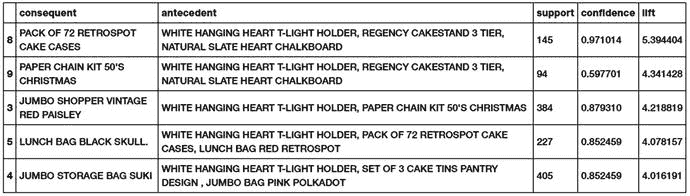

图 8-14.

针对英国客户的在线零售数据集的关联规则

从图 8-14 中的指标可以明显看出，这些都是质量极佳的规则。我们可以看到，与烘焙相关的商品被一起购买，而像包包这样的商品也被一起购买。尝试更改前面提到的参数，看看是否能发现更有趣的模式！

总结

在本章中，我们了解了一些简单但高价值的案例研究。本章的核心是认识到，任何基于分析或机器学习的解决方案，其最重要的部分在于它能为组织带来的价值。作为一名分析或数据科学专业人士，我们必须始终努力平衡工作的价值方面与技术复杂性。我们学习了一些重要的方法，这些方法有潜力直接为组织和零售机构创造收入。我们探讨了与客户细分相关的概念及其影响，并探索了一种使用无监督学习来发现客户细分并查看有趣模式和行为的新颖方法。交叉销售向我们介绍了模式挖掘和基于规则的框架（如关联规则挖掘）以及市场购物篮分析等原理的世界。我们利用了一个与我们之前使用的框架完全不同的框架，并理解了数据解析和预处理在常规建模和分析之外的价值。在本书的后续章节中，我们将增加案例研究的技术复杂性，但我们恳请您始终关注定义这些解决方案的价值和影响。敬请期待！

9. 分析葡萄酒类型与品质

在上一章中，我们研究了利用无监督机器学习技术（如聚类和规则挖掘框架）的具体案例研究。在本章中，我们将重点介绍一些与监督机器学习算法和预测分析相关的案例研究。我们在第 7 章中研究了基于分类的问题，在那里我们基于文本评论构建了情感分类器来预测电影评论的情感。在本章中，我们要解决的问题是使用物理化学属性来分析、建模和预测葡萄酒的类型和品质。葡萄酒是一种口感宜人的酒精饮料，受到全球数百万人的喜爱。事实上，我们很多人都喜欢用一杯葡萄酒来庆祝成就，甚至在艰难的一天结束时放松一下！弗朗西斯·培根的以下名言应该能激起你对葡萄酒及其重要性的兴趣。

“陈年之佳，见于四物：老木可燃，老酒可饮，老友可信，老书可读。”

——弗朗西斯·培根

无论你是否喜欢和饮用葡萄酒，分析葡萄酒的物理化学属性并理解它们与葡萄酒品质和类型之间的关系及重要性，都将是很有趣的。由于我们将尝试预测葡萄酒的类型和品质，这里涉及的监督机器学习任务是分类。在本章中，我们将研究分析和可视化葡萄酒数据属性和特征的各种方法。我们专注于单变量以及多变量分析。为了预测葡萄酒的类型和品质，我们将基于最先进的监督机器学习技术构建分类器，包括逻辑回归、深度神经网络、决策树以及集成模型（如随机森林和梯度提升）等。特别强调分析、可视化和建模数据，以便你将来可以在自己基于分类的实际问题中模仿类似的原理。我们要感谢加州大学欧文分校机器学习库提供的数据集。同时，特别感谢 DataCamp 和著名数据科学记者 Karlijn Willems，她在分析葡萄酒品质数据集方面做了出色的工作，并在 [`https://www.datacamp.com/community/tutorials/deep-learning-python`](https://www.datacamp.com/community/tutorials/deep-learning-python) 上撰写了一篇关于其发现的文章，你可以查看以获取更多详细信息。我们从这篇文章中借鉴了一些分析和解释作为本章的灵感，Karlijn 也非常乐于与我们分享这些内容。

问题陈述

“给定一个数据集，或者在本例中是两个处理葡萄酒物理化学属性的数据集，你能猜出葡萄酒的类型和品质吗？”这是本章的主要目标。当然，这并不意味着全部重点只在于利用机器学习构建预测模型。我们将基于标准的机器学习和数据挖掘工作流模型（如 CRISP-DM 模型）来处理、分析、可视化和建模我们的数据集。

本章使用的数据集可在非常流行的 UCI 机器学习库中找到，名称为葡萄酒品质数据集。你可以在 [`https://archive.ics.uci.edu/ml/datasets/wine+quality`](https://archive.ics.uci.edu/ml/datasets/wine+quality) 访问更多详细信息，该网站提供了原始数据集以及数据集中各种特征的详细信息。有两个数据集，一个用于红葡萄酒，另一个用于白葡萄酒。更具体地说，这些葡萄酒数据集与来自葡萄牙北部的红葡萄酒和白葡萄酒 vinho verde 样品有关。同一网页中的另一个文件讨论了数据集的详细信息，包括属性信息。数据集的功劳归于 P. Cortez、A. Cerdeira、F. Almeida、T. Matos 和 J. Reis，你可以在他们发表于《决策支持系统》（Elsevier, 47(4): 547-553, 2009）的论文“通过数据挖掘物理化学属性来建模葡萄酒偏好”中获取更多详细信息。

总结我们的主要目标，我们将尝试通过利用机器学习和数据分析来解决以下主要问题。

*   预测每个葡萄酒样品是红葡萄酒还是白葡萄酒。
*   预测每个葡萄酒样品的品质，可以是低、中或高。

在继续访问和分析数据之前，让我们先设置必要的依赖项！

设置依赖项

我们将使用几个特定于机器学习和深度学习的 Python 库和框架。就像我们之前的章节一样，你需要确保已安装 `pandas`、`numpy`、`scipy` 和 `scikit-learn`，它们将用于数据处理和机器学习。我们还将广泛使用 `matplotlib` 和 `seaborn` 进行探索性数据分析和可视化。本章使用的深度学习框架包括带有 `tensorflow` 后端的 `keras`，但如果你愿意，也可以使用 `theano` 作为后端。我们还使用 `xgboost` 库进行梯度提升集成模型。与监督模型拟合、预测和评估相关的实用程序位于 `model_evaluation_utils.py` 中，因此请确保你将这些模块以及本章的其他 Python 文件和 jupyter 笔记本放在同一目录中，你可以从 GitHub 上本章的相关目录 [`https://github.com/dipanjanS/practical-machine-learning-with-python`](https://github.com/dipanjanS/practical-machine-learning-with-python) 获取它们。

获取数据

数据集将随本章的代码文件一起提供，位于本书的 GitHub 仓库中，地址为 [ `https://github.com/dipanjanS/practical-machine-learning-with-python` ](https://github.com/dipanjanS/practical-machine-learning-with-python)，位于第 9 章的相应文件夹下。以下文件指的是感兴趣的数据集。

*   名为 `winequality-red.csv` 的文件包含与 1599 条红葡萄酒样品记录相关的数据集
*   名为 `winequality-white.csv` 的文件包含与 4898 条白葡萄酒样品记录相关的数据集
*   名为 `winequality.names` 的文件包含与数据集相关的详细信息和数据字典

如果需要，你也可以从 [ `https://archive.ics.uci.edu/ml/datasets/wine+quality` ](https://archive.ics.uci.edu/ml/datasets/wine+quality) 下载相同的数据。一旦你有了 CSV 文件，就可以使用 `pandas` 中的 `read_csv(...)` 实用函数轻松地在 Python 中加载它。

探索性数据分析

标准的机器学习和分析工作流建议在处理、清理、分析和可视化数据之后，再进入数据建模阶段。我们也将遵循我们在所有其他章节中使用的相同工作流。你可以参考名为 `exploratory_data_analysis.py` 的 Python 文件，了解本节使用的所有代码，或者使用名为 `Exploratory Data Analysis.ipynb` 的 jupyter 笔记本以获得更具交互性的体验。

处理与合并数据集

让我们加载以下必要的依赖项和配置设置。

```
import pandas as pd
import matplotlib.pyplot as plt
import matplotlib as mpl
import numpy as np
import seaborn as sns
%matplotlib inline
```

我们现在将处理数据集（红葡萄酒和白葡萄酒），并添加一些我们将在后续部分中想要预测的额外变量。我们将添加的第一个变量是 `wine_type`，它将根据数据集和葡萄酒样品指示是红葡萄酒还是白葡萄酒。我们将添加的第二个变量是 `quality_label`，它是基于 `quality` 变量分数对葡萄酒样品品质的定性度量。用于将 `quality` 映射到 `quality_label` 的规则描述如下。

*   葡萄酒 `quality` 分数 3、4 和 5 映射到 `quality_label` 属性下的低品质葡萄酒。
*   葡萄酒 `quality` 分数 6 和 7 映射到 `quality_label` 属性下的中等品质葡萄酒。
*   葡萄酒 `quality` 分数 8 和 9 映射到 `quality_label` 属性下的高品质葡萄酒。

添加这些属性后，我们还将红葡萄酒和白葡萄酒的两个数据集合并在一起，创建一个单一数据集，并使用 `pandas` 来合并和打乱数据帧的记录。以下代码片段帮助我们实现这一点。

```
In [3]: white_wine = pd.read_csv('winequality-white.csv', sep=';')
...: red_wine = pd.read_csv('winequality-red.csv', sep=';')
...:
...: # store wine type as an attribute
...: red_wine['wine_type'] = 'red'
...: white_wine['wine_type'] = 'white'
...: # bucket wine quality scores into qualitative quality labels
...: red_wine['quality_label'] = red_wine['quality'].apply(lambda value: 'low'
...:                                                       if value <= 5 else 'medium'
...:                                                        if value <= 7 else 'high')
...: red_wine['quality_label'] = pd.Categorical(red_wine['quality_label'],
...:                                            categories=['low', 'medium', 'high'])
...: white_wine['quality_label'] = white_wine['quality'].apply(lambda value: 'low'
...:                                                            if value <= 5 else 'medium'
...:                                                             if value <= 7 else 'high')
...: white_wine['quality_label'] = pd.Categorical(white_wine['quality_label'],
...:                                              categories=['low', 'medium', 'high'])
...:
...: # merge red and white wine datasets
...: wines = pd.concat([red_wine, white_wine])
...: # re-shuffle records just to randomize data points
...: wines = wines.sample(frac=1, random_state=42).reset_index(drop=True)
```

我们在后续部分的目标是基于 `wines` 数据集中的其他特征来预测 `wine_type` 和 `quality_label`。现在让我们尝试更多地了解我们的数据集及其特征。

理解数据集特征

我们在上一节中获得的 `wines` 数据帧是我们将用于分析和建模的最终数据集。在需要基本探索性分析和可视化时，我们也会使用 `red_wine` 和 `white_wine` 数据帧。让我们首先查看我们正在处理的数据样本总数以及数据集中的不同特征。

```
In [3]: print(white_wine.shape, red_wine.shape)
...: print(wines.info())
(4898, 14) (1599, 14)

RangeIndex: 6497 entries, 0 to 6496
Data columns (total 14 columns):
fixed acidity           6497 non-null float64
volatile acidity        6497 non-null float64
citric acid             6497 non-null float64
residual sugar          6497 non-null float64
chlorides               6497 non-null float64
free sulfur dioxide     6497 non-null float64
total sulfur dioxide    6497 non-null float64
density                 6497 non-null float64
pH                      6497 non-null float64
sulphates               6497 non-null float64
alcohol                 6497 non-null float64
quality                 6497 non-null int64
wine_type               6497 non-null object
quality_label           6497 non-null category
dtypes: category(1), float64(11), int64(1), object(1)
memory usage: 666.4+ KB
```

这些信息告诉我们，我们有 4898 个白葡萄酒数据点和 1599 个红葡萄酒数据点。合并后的数据集总共包含 6497 个数据点，我们也了解了数值属性和分类属性。让我们快速浏览一下我们的数据集，看看一些样本数据点。


图 9-1.

葡萄酒品质数据集的样本数据点

```
In [4]: wines.head()
```

图 9-1 中显示的输出展示了我们葡萄酒品质数据集的样本葡萄酒记录。查看这些值，我们可以了解数值特征和分类特征。现在让我们尝试获取一些关于葡萄酒及其属性的领域知识。领域知识是必不可少的，并且总是被推荐的，特别是当你试图分析和建模来自不同领域的数据时。

葡萄酒是通过葡萄发酵过程制成的酒精饮料，不添加糖、酸、酶、水或其他营养物质。红葡萄酒和白葡萄酒是两种变体。通常，红葡萄酒由深红色和黑色葡萄制成。颜色范围从各种红色、棕色和紫色色调。这是用整颗葡萄（包括果皮）生产的，这增加了红葡萄酒的颜色和风味，使其具有浓郁的风味。白葡萄酒由白葡萄制成，不带果皮或籽。颜色通常是稻草黄色、黄绿色或黄金色。与更浓郁的红葡萄酒相比，大多数白葡萄酒具有清淡和果味的风味。现在让我们深入了解数据集中每个特征的细节。再次感谢 Karlijn 提供的一些属性描述。我们的数据集总共有 14 个属性，描述如下。

*   `fixed acidity:` 酸是葡萄酒的基本属性之一，对葡萄酒的口感有很大贡献。显著减少酸可能会导致葡萄酒味道平淡。固定酸包括酒石酸、苹果酸、柠檬酸和琥珀酸，这些酸存在于葡萄中（琥珀酸除外）。该变量在数据集中通常以  表示。
*   `volatile acidity:` 这些酸在完成生产过程之前需要从葡萄酒中蒸馏出来。它主要由乙酸构成，尽管也可能存在其他酸，如乳酸、甲酸和丁酸。过量的挥发酸是不可取的，会导致不愉快的味道。在美国，挥发酸的法律限制是红葡萄酒为 1.2 g/L，白葡萄酒为 1.1 g/L。挥发酸在数据集中以  表示。
*   `citric acid:` 这是赋予葡萄酒新鲜度的固定酸之一。通常，大部分柠檬酸在发酵过程中被消耗，有时会单独添加以赋予葡萄酒更多新鲜度。它在数据集中通常以  表示。
*   `residual sugar:` 这通常指的是发酵过程停止或被终止后，葡萄中残留的天然糖分。它在数据集中通常以  表示。
*   `chlorides:` 这通常是葡萄酒咸味的主要贡献者。它在数据集中通常以  表示。
*   `free sulfur dioxide:` 这是二氧化硫的一部分，当添加到葡萄酒中时，在剩余部分结合后被认为是游离的。酿酒师总是试图获得最高比例的游离硫来结合。它们也被称为亚硫酸盐，过多是不可取的，会产生刺鼻的气味。该变量在数据集中以  表示。
*   `total sulfur dioxide:` 这是结合态和游离态二氧化硫 (SO²) 的总和。这里以  表示。添加它主要是为了杀死有害细菌并保持品质和新鲜度。葡萄酒中的硫含量通常有法律限制，过量甚至会杀死良好的酵母并产生不良气味。
*   `density:` 这可以表示为特定体积葡萄酒的重量与等体积水的重量的比较。它通常用作衡量糖转化为酒精的指标。这里以  表示。
*   `pH:` 也称为氢离子浓度指数，这是一个数值标度，用于指定葡萄酒的酸度或碱度。固定酸对葡萄酒的 pH 值贡献最大。你可能知道，pH 值小于 7 的溶液是酸性的，而 pH 值大于 7 的溶液是碱性的。纯水的 pH 值为 7，是中性的。大多数葡萄酒的 pH 值在 2.9 到 3.9 之间，因此是酸性的。
*   `sulphates:` 这些是含有硫的矿物盐。硫酸盐之于葡萄酒，就像麸质之于食物。它们是世界各地葡萄酒酿造过程中的常规部分，被认为是必不可少的。它们与发酵过程有关，并影响葡萄酒的香气和风味。这里，它们在数据集中以  表示。
*   `alcohol:` 葡萄酒是一种酒精饮料。酒精是酵母在发酵过程中转化糖的结果。酒精的百分比因葡萄酒而异。因此，该属性成为该数据集的一部分并不奇怪。它通常以 % vol 或体积酒精含量 (ABV) 来衡量。
*   `quality:` 葡萄酒专家将葡萄酒品质评定为 0（非常差）到 10（非常好）。最终的品质分数是至少由同一位葡萄酒专家进行三次评估的中位数。
*   `wine_type:` 由于我们最初有红葡萄酒和白葡萄酒两个数据集，我们在最终的合并数据集中引入了这个属性，它指示每个数据点的葡萄酒类型。葡萄酒可以是红葡萄酒或白葡萄酒。我们将在本章中构建的预测模型之一将是，我们可以通过查看其他葡萄酒属性来预测葡萄酒的类型。
*   `quality_label:` 这是从品质属性派生的属性。我们将葡萄酒品质分数分为三个定性类别，即低、中和高。品质分数为 3、4 和 5 的葡萄酒是低品质；分数为 6 和 7 的是中等品质；分数为 8 和 9 的是高品质葡萄酒。我们还将在此章中构建另一个模型，根据其他葡萄酒属性来预测这个葡萄酒品质标签。

现在你已经对数据集及其特征有了扎实的了解，让我们分析和可视化各种特征及其相互作用。

描述性统计

我们将首先计算数据集中我们感兴趣的各种特征的一些描述性统计。这涉及计算聚合指标，如均值、中位数、标准差等。如果你还记得，我们的主要目标之一是构建一个能够根据属性正确预测葡萄酒是红葡萄酒还是白葡萄酒的模型。让我们构建一个按葡萄酒类型分隔的各种葡萄酒属性的描述性汇总表。


图 9-2.

按葡萄酒类型分隔的葡萄酒属性描述性统计

```
In [5]: subset_attributes = ['residual sugar', 'total sulfur dioxide', 'sulphates',
'alcohol', 'volatile acidity', 'quality']
...: rs = round(red_wine[subset_attributes].describe(),2)
...: ws = round(white_wine[subset_attributes].describe(),2)
...: pd.concat([rs, ws], axis=1, keys=['Red Wine Statistics', 'White Wine Statistics'])
```

图 9-2 中显示的汇总表向我们展示了各种葡萄酒属性的描述性统计。你注意到任何有趣的特性了吗？首先，白葡萄酒中的平均残留糖分和总二氧化硫含量似乎远高于红葡萄酒。此外，与白葡萄酒相比，红葡萄酒中硫酸盐和挥发酸的平均值似乎更高。尝试包含其他特征，看看是否能找到更有趣的比较！将葡萄酒品质等级视为数据子集，让我们使用以下代码片段构建一些描述性汇总统计。


图 9-3.

按葡萄酒品质分隔的葡萄酒属性描述性统计

```
In [6]: subset_attributes = ['alcohol', 'volatile acidity', 'pH', 'quality']
...: ls = round(wines[wines['quality_label'] == 'low'][subset_attributes].describe(),2)
...: ms = round(wines[wines['quality_label'] == 'medium'][subset_attributes].describe(),2)
...: hs = round(wines[wines['quality_label'] == 'high'][subset_attributes].describe(),2)
...: pd.concat([ls, ms, hs], axis=1, keys=['Low Quality Wine', 'Medium Quality Wine',
'High Quality Wine'])
```

图 9-3 中显示的汇总表向我们展示了按葡萄酒品质评级划分的各种葡萄酒属性的描述性统计。有趣的是，平均酒精含量似乎随着葡萄酒品质评级的提高而增加。我们还看到，不同品质的葡萄酒样品的 pH 值几乎一致。有没有办法在统计上证明这一点？我们将在下一节中看到。

推断性统计

推断性统计的一般概念是利用数据样本对总体进行推断和提出命题。其思想是使用统计方法和模型从给定的假设中得出统计推断。每个假设包括一个零假设和一个备择假设。根据统计检验结果，如果结果基于预设的显著性水平（例如，如果获得的 p 值小于 5% 的显著性水平）具有统计显著性，我们拒绝零假设，支持备择假设。否则，如果结果不具有统计显著性，我们得出结论，我们的零假设是正确的。回到上一节的问题，给定基于葡萄酒品质评级的多个数据组或葡萄酒样品子集，有没有办法证明平均酒精含量或 pH 值在数据组之间存在显著差异？

一个证明或反驳数据子集之间均值差异的极好统计模型是使用单因素方差分析检验。ANOVA 代表“方差分析”，这是一个巧妙的统计模型，可用于分析各组均值或平均值之间统计上显著的差异。这基本上是通过一个统计检验来实现的，该检验帮助我们确定几个组的均值是否相等。通常零假设表示为

H [0] : μ [1] = μ [2] = μ [3] = ... = μ [n]

其中 n 是数据组或子集的数量，它表明基于统计显著性水平，各组的组均值彼此之间没有太大差异。备择假设 H [A] 告诉我们，至少存在两个组均值在统计上彼此显著不同。通常使用 F 统计量及其相关的 p 值来确定统计显著性。通常，p 值小于 0.05 被认为是统计上显著的结果，此时我们拒绝零假设，支持备择假设。我们建议阅读一本关于推断性统计的标准书籍，以更深入地了解这些概念。

对于我们的场景，根据葡萄酒品质评级从数据中创建了三个数据子集或组。第一个检验中的均值将基于葡萄酒的酒精含量，第二个检验将基于葡萄酒的 pH 值。同时，让我们假设零假设是低、中、高品质葡萄酒的组均值相同，备择假设是至少两个组均值之间存在差异（统计上显著）。以下代码片段帮助我们执行单因素方差分析检验。

```
In [7]: from scipy import stats
...:
...: F, p = stats.f_oneway(wines[wines['quality_label'] == 'low']['alcohol'],
...:                       wines[wines['quality_label'] == 'medium']['alcohol'],
...:                       wines[wines['quality_label'] == 'high']['alcohol'])
...: print('ANOVA test for mean alcohol levels across wine samples with different quality
ratings')
...: print('F Statistic:', F, '\tp-value:', p)
...:
...: F, p = stats.f_oneway(wines[wines['quality_label'] == 'low']['pH'],
...:                       wines[wines['quality_label'] == 'medium']['pH'],
...:                       wines[wines['quality_label'] == 'high']['pH'])
...: print('\nANOVA test for mean pH levels across wine samples with different quality
ratings')
...: print('F Statistic:', F, '\tp-value:', p)
ANOVA test for mean alcohol levels across wine samples with different quality ratings
F Statistic: 673.074534723      p-value: 2.27153374506e-266
ANOVA test for mean pH levels across wine samples with different quality ratings
F Statistic: 1.23638608035      p-value: 0.290500277977
```

从前面的结果中，我们可以清楚地看到，在第一个检验中，p 值远小于 0.05，而在第二个检验中，p 值大于 0.05。这告诉我们，在三个组中，至少有两个组的酒精含量均值存在统计上显著的差异（拒绝零假设，支持备择假设）。然而，对于 pH 值均值，我们不拒绝零假设，因此我们得出结论，三个组的 pH 值均值在统计上没有显著差异。我们甚至可以使用以下代码片段可视化这两个特征并观察均值。


图 9-4.

基于品质评级可视化葡萄酒酒精含量和 pH 值分布

```
f, (ax1, ax2) = plt.subplots(1, 2, figsize=(10, 4))
f.suptitle('Wine Quality - Alcohol Content/pH', fontsize=14)
f.subplots_adjust(top=0.85, wspace=0.3)
sns.boxplot(x="quality_label", y="alcohol",
data=wines, ax=ax1)
ax1.set_xlabel("Wine Quality Class",size = 12,alpha=0.8)
ax1.set_ylabel("Wine Alcohol %",size = 12,alpha=0.8)
sns.boxplot(x="quality_label", y="pH", data=wines, ax=ax2)
ax2.set_xlabel("Wine Quality Class",size = 12,alpha=0.8)
ax2.set_ylabel("Wine pH",size = 12,alpha=0.8)
```

图 9-4 中显示的箱线图向我们展示了基于葡萄酒品质的葡萄酒酒精含量分布与 pH 值分布的显著差异，pH 值看起来在 3.1 - 3.3 之间，事实上，如果你查看三个组的 pH 值均值和单位数，三个组大约都是 3.2，而酒精百分比则差异显著。你能从这些数据中找到其他更有趣的模式和假设吗？试试看！

单变量分析

这也许是探索性数据分析中最简单但也是核心的基础步骤之一。单变量分析涉及分析数据，使得在分析的任何时刻，我们只处理一个变量或特征。不分析多个变量之间的关系或相关性。轻松可视化数据中所有变量的最简单方法是构建一些直方图。以下代码片段有助于可视化所有特征的数据值分布。虽然直方图在许多情况下可能不是合适的可视化方法，但对于数值数据来说，它是一个很好的起点。


图 9-5.

描绘葡萄酒品质数据集特征分布的单变量图

```
red_wine.hist(bins=15, color='red', edgecolor='black', linewidth=1.0,
xlabelsize=8, ylabelsize=8, grid=False)
plt.tight_layout(rect=(0, 0, 1.2, 1.2))
rt = plt.suptitle('Red Wine Univariate Plots', x=0.65, y=1.25, fontsize=14)
white_wine.hist(bins=15, color='white', edgecolor='black', linewidth=1.0,
xlabelsize=8, ylabelsize=8, grid=False)
plt.tight_layout(rect=(0, 0, 1.2, 1.2))
wt = plt.suptitle('White Wine Univariate Plots', x=0.65, y=1.25, fontsize=14)
```

像 `matplotlib` 和 `pandas` 这样的包的力量使你能够像图 9-5 中所示，用最少的代码轻松绘制变量分布。你注意到两种葡萄酒类型之间有什么有趣的模式吗？让我们以名为 `residual sugar` 的特征为例，绘制红葡萄酒和白葡萄酒样品数据的分布。


图 9-6.

红葡萄酒和白葡萄酒样品的残留糖分分布

```
fig = plt.figure(figsize = (10,4))
title = fig.suptitle("Residual Sugar Content in Wine", fontsize=14)
fig.subplots_adjust(top=0.85, wspace=0.3)
ax1 = fig.add_subplot(1,2, 1)
ax1.set_title("Red Wine")
ax1.set_xlabel("Residual Sugar")
ax1.set_ylabel("Frequency")
ax1.set_ylim([0, 2500])
ax1.text(8, 1000, r'$\mu$='+str(round(red_wine['residual sugar'].mean(),2)),
fontsize=12)
r_freq, r_bins, r_patches = ax1.hist(red_wine['residual sugar'], color='red', bins=15,
edgecolor='black', linewidth=1)
ax2 = fig.add_subplot(1,2, 2)
ax2.set_title("White Wine")
ax2.set_xlabel("Residual Sugar")
ax2.set_ylabel("Frequency")
ax2.set_ylim([0, 2500])
ax2.text(30, 1000, r'$\mu$='+str(round(white_wine['residual sugar'].mean(),2)),
fontsize=12)
w_freq, w_bins, w_patches = ax2.hist(white_wine['residual sugar'], color='white', bins=15,
edgecolor='black', linewidth=1)
```

我们可以很容易地从图 9-6 的可视化中注意到，白葡萄酒样品中的 `residual sugar` 含量似乎比红葡萄酒样品更多。你可以重用前面代码片段中的绘图模板并可视化更多特征。一些图如下所示（详细代码在 jupyter 笔记本中）。


图 9-7.

红葡萄酒和白葡萄酒样品的硫酸盐含量和酒精含量分布

图 9-7 中显示的图向我们展示了，与白葡萄酒样品相比，红葡萄酒样品中的 `sulphate` `content` 略高，而两种类型的平均酒精含量几乎相似。当然，在所有情况下，白葡萄酒的频率计数都更高，因为与红葡萄酒相比，我们有更多的白葡萄酒样品记录。接下来，我们绘制 `quality` 和 `quality_label` 分类特征的分布，以了解类别分布，我们稍后将预测这些类别。


图 9-8.

红葡萄酒和白葡萄酒样品的葡萄酒品质分布

图 9-8 中显示的条形图向我们展示了基于 `type` 和 `quality` 的葡萄酒样品分布。很明显，高品质葡萄酒样品远少于低品质和中等品质葡萄酒样品。

多变量分析

分析多个特征变量及其关系正是多变量分析的内容。我们想看看葡萄酒样品的物理化学属性之间是否存在任何有趣的模式或关系，这可能对我们未来的建模过程有所帮助。分析特征的最佳方法之一是构建成对相关图，描绘数据集中每对特征之间的相关系数。以下代码片段帮助我们构建相关矩阵，并以易于解释的热图形式绘制它。


图 9-9.

葡萄酒品质数据集特征的相关热图

```
f, ax = plt.subplots(figsize=(10, 5))
corr = wines.corr()
hm = sns.heatmap(round(corr,2), annot=True, ax=ax, cmap="coolwarm",fmt='.2f',
linewidths=.05)
f.subplots_adjust(top=0.93)
t= f.suptitle('Wine Attributes Correlation Heatmap', fontsize=12)
```

虽然大多数相关性较弱，如图 9-9 所示，但我们可以看到 `density` 和 `alcohol` 之间存在强烈的负相关，`total` 和 `free sulfur dioxide` 之间存在强烈的正相关，这是意料之中的。你还可以使用成对图来可视化多个变量之间的模式和关系，并为葡萄酒类型使用不同的色调，从而一次绘制三个变量。以下代码片段描绘了数据集中某些特征的样本成对图。


图 9-10.

按葡萄酒类型划分的葡萄酒品质数据集特征成对图

```
cols = ['wine_type', 'quality', 'sulphates', 'volatile acidity']
pp = sns.pairplot(wines[cols], hue='wine_type', size=1.8, aspect=1.8,
palette={"red": "#FF9999", "white": "#FFE888"},
plot_kws=dict(edgecolor="black", linewidth=0.5))
fig = pp.fig
fig.subplots_adjust(top=0.93, wspace=0.3)
t = fig.suptitle('Wine Attributes Pairwise Plots', fontsize=14)
```

从图 9-10 的图中，我们可以注意到几个有趣的模式，这些模式与我们之前获得的一些见解一致。这些观察结果包括：

*   与白葡萄酒相比，红葡萄酒中硫酸盐含量更高
*   高品质评级的葡萄酒中硫酸盐含量较低
*   高品质评级的葡萄酒中挥发酸含量较低
*   与白葡萄酒相比，红葡萄酒中挥发酸含量更高

你可以对其他变量和特征使用类似的图来发现更多的模式和关系。为了以更微观的视角观察特征之间的关系，联合图是特别适用于多变量可视化的优秀可视化工具。以下代码片段描绘了葡萄酒类型、硫酸盐和品质评级之间的关系。


图 9-11.

使用联合图可视化葡萄酒类型、硫酸盐和品质之间的关系

```
rj = sns.jointplot(x='quality', y='sulphates', data=red_wine,
kind='reg', ylim=(0, 2),
color='red', space=0, size=4.5, ratio=4)
rj.ax_joint.set_xticks(list(range(3,9)))
fig = rj.fig
fig.subplots_adjust(top=0.9)
t = fig.suptitle('Red Wine Sulphates - Quality', fontsize=12)
wj = sns.jointplot(x='quality', y='sulphates', data=white_wine,
kind='reg', ylim=(0, 2),
color='#FFE160', space=0, size=4.5, ratio=4)
wj.ax_joint.set_xticks(list(range(3,10)))
fig = wj.fig
fig.subplots_adjust(top=0.9)
t = fig.suptitle('White Wine Sulphates - Quality', fontsize=12)
```

虽然似乎存在某种模式，表明品质评级较高的葡萄酒样品硫酸盐含量较低，但相关性相当弱（见图 9-11）。然而，我们确实清楚地看到，红葡萄酒的硫酸盐含量远高于白葡萄酒。在这种情况下，我们借助两个图可视化了三个特征（类型、品质和硫酸盐）。如果我们想可视化更多数量的特征并从中确定模式呢？`seaborn` 框架提供了分面网格，帮助我们可视化二维图中更多的变量。让我们尝试可视化葡萄酒 `type`、`quality` 评级、`volatile acidity` 和 `alcohol` 体积水平之间的关系。


图 9-12.

可视化葡萄酒类型、酒精、品质和酸度水平之间的关系

```
g = sns.FacetGrid(wines, col="wine_type", hue='quality_label',
col_order=['red', 'white'], hue_order=['low', 'medium', 'high'],
aspect=1.2, size=3.5, palette=sns.light_palette('navy', 3))
g.map(plt.scatter, "volatile acidity", "alcohol", alpha=0.9,
edgecolor='white', linewidth=0.5)
fig = g.fig
fig.subplots_adjust(top=0.8, wspace=0.3)
fig.suptitle('Wine Type - Alcohol - Quality - Acidity', fontsize=14)
l = g.add_legend(title='Wine Quality Class')
```

图 9-12 中的图向我们展示了一些有趣的模式。我们不仅成功地可视化了四个变量，而且还可以看到它们之间有意义的关联。与中等和低评级的葡萄酒样品相比，高品质葡萄酒样品（以较深色调表示）具有较低的挥发酸水平和较高的酒精含量。除此之外，我们还可以看到，与红葡萄酒样品相比，白葡萄酒样品的挥发酸水平略低。

现在让我们构建一个类似的可视化。然而，在这种情况下，我们想要分析葡萄酒 `types`、`quality`、`sulfur dioxide` 和 `acidity` 水平中的模式。我们可以使用与上一个代码片段相同的框架来实现这一点。


图 9-13.

可视化葡萄酒类型、品质、二氧化硫和酸度水平之间的关系

```
g = sns.FacetGrid(wines, col="wine_type", hue='quality_label',
col_order=['red', 'white'], hue_order=['low', 'medium', 'high'],
aspect=1.2, size=3.5, palette=sns.light_palette('green', 3))
g.map(plt.scatter, "volatile acidity", "total sulfur dioxide", alpha=0.9,
edgecolor='white', linewidth=0.5)
fig = g.fig
fig.subplots_adjust(top=0.8, wspace=0.3)
fig.suptitle('Wine Type - Sulfur Dioxide - Acidity - Quality', fontsize=14)
l = g.add_legend(title='Wine Quality Class')
```

我们可以很容易地从图 9-13 中解读出，高品质葡萄酒样品中的 `volatile acidity` 和 `total sulfur dioxide` 都相当低。此外，与红葡萄酒样品相比，白葡萄酒样品中的 `total sulfur dioxide` 含量要高得多。然而，我们在之前的图中也观察到，与红葡萄酒样品相比，白葡萄酒样品的挥发酸水平略低。

一种按组（分类变量）可视化数值特征的好方法是使用箱线图。在我们的数据集中，我们已经在“推断性统计”部分讨论了较高酒精含量与较高品质评级葡萄酒样品之间的关系。让我们尝试可视化按葡萄酒品质评级分组的葡萄酒酒精水平之间的关系。我们将生成两个图，分别显示葡萄酒酒精含量与葡萄酒品质和 `quality_label` 的关系。


图 9-14.

可视化葡萄酒类型、品质和酒精含量之间的关系

```
f, (ax1, ax2) = plt.subplots(1, 2, figsize=(14, 4))
f.suptitle('Wine Type - Quality - Alcohol Content', fontsize=14)
sns.boxplot(x="quality", y="alcohol", hue="wine_type",
data=wines, palette={"red": "#FF9999", "white": "white"}, ax=ax1)
ax1.set_xlabel("Wine Quality",size = 12,alpha=0.8)
ax1.set_ylabel("Wine Alcohol %",size = 12,alpha=0.8)
sns.boxplot(x="quality_label", y="alcohol", hue="wine_type",
data=wines, palette={"red": "#FF9999", "white": "white"}, ax=ax2)
ax2.set_xlabel("Wine Quality Class",size = 12,alpha=0.8)
ax2.set_ylabel("Wine Alcohol %",size = 12,alpha=0.8)
l = plt.legend(loc='best', title='Wine Type')
```

基于我们之前在“推断性统计”部分对葡萄酒 `quality` 与 `alcohol` 体积的分析，这些结果看起来是一致的。图 9-14 中的每个箱线图描绘了按葡萄酒类型分隔的特定葡萄酒品质评级的酒精水平分布。箱体本身描绘了四分位距，内部的线条描绘了酒精的中位数值。须线表示最小值和最大值，异常值通常由单个点表示。我们可以清楚地观察到，基于较高品质评级的葡萄酒样品，葡萄酒体积酒精分布呈上升趋势。类似地，我们也可以使用小提琴图来可视化数值特征在分类特征上的分布。让我们构建一个可视化，分析按品质评级划分的葡萄酒样品的固定酸度。


图 9-15.

可视化葡萄酒类型、品质和酸度之间的关系

```
f, (ax1, ax2) = plt.subplots(1, 2, figsize=(14, 4))
f.suptitle('Wine Type - Quality - Acidity', fontsize=14)
sns.violinplot(x="quality", y="volatile acidity", hue="wine_type",
data=wines, split=True, inner="quart", linewidth=1.3,
palette={"red": "#FF9999", "white": "white"}, ax=ax1)
ax1.set_xlabel("Wine Quality",size = 12,alpha=0.8)
ax1.set_ylabel("Wine Fixed Acidity",size = 12,alpha=0.8)
sns.violinplot(x="quality_label", y="volatile acidity", hue="wine_type",
data=wines, split=True, inner="quart", linewidth=1.3,
palette={"red": "#FF9999", "white": "white"}, ax=ax2)
ax2.set_xlabel("Wine Quality Class",size = 12,alpha=0.8)
ax2.set_ylabel("Wine Fixed Acidity",size = 12,alpha=0.8)
l = plt.legend(loc='upper right', title='Wine Type')
```

在图 9-15 中，每个小提琴图通常描绘了四分位距和中位数，在本图中用虚线表示。你还可以通过密度图可视化数据分布，其中宽度表示频率。因此，除了从箱线图中获得的信息之外，你还可以使用小提琴图可视化数据分布。事实上，我们在这里构建了一个分裂小提琴图，描绘了两种类型的葡萄酒。很明显，与白葡萄酒相比，红葡萄酒样品的酸度更高。此外，我们可以看到，对于红葡萄酒样品，随着品质的提高，酸度总体下降，但对于白葡萄酒样品则不那么明显。这些代码片段和示例应该为你将来在自己的数据集上执行有效的探索性数据分析提供一些好的框架和蓝图。

预测建模

我们现在将专注于构建预测模型的主要目标，以根据其他特征预测葡萄酒的类型和品质评级。在这种情况下，我们将遵循标准的分类机器学习流程。我们将在此部分构建两个主要的分类系统。

*   葡萄酒类型预测系统（红葡萄酒或白葡萄酒）
*   葡萄酒品质评级预测系统（低、中或高）

我们将使用前面章节中的 `wines` 数据帧。本节的全部代码可在名为 `predictive_analytics.py` 的 Python 文件中找到，或者你可以使用名为 `Predictive Analytics.ipynb` 的 jupyter 笔记本以获得更具交互性的体验。首先，让我们加载以下必要的依赖项和设置。

```
import pandas as pd
import numpy as np
import matplotlib.pyplot as plt
import model_evaluation_utils as meu
from sklearn.model_selection import train_test_split
from collections import Counter
from sklearn.preprocessing import StandardScaler
from sklearn.preprocessing import LabelEncoder
%matplotlib inline
```

请记住将 `model_evaluation_utils.py` 模块放在你运行代码的同一目录中，因为我们将使用它来评估我们的预测模型。让我们简要地看一下我们将为预测系统遵循的工作流。我们将重点关注两个主要阶段——模型训练和模型预测与评估。


图 9-16.

葡萄酒类型和品质分类系统的工作流蓝图

从图 9-16 中，我们可以看到训练数据和测试数据指的是葡萄酒品质数据集特征。由于我们已经有了必要的葡萄酒属性，我们不会构建额外的手工特征。标签可以是葡萄酒类型或品质评级，具体取决于分类系统。在训练阶段，特征选择主要涉及选择所有必要的葡萄酒物理化学属性，然后在必要的缩放之后，我们将训练我们的预测模型，以便在预测阶段进行预测和评估。

预测葡萄酒类型

在我们的葡萄酒品质数据集中，我们有两种变体或类型的葡萄酒——红葡萄酒和白葡萄酒。本节中分类系统的主要任务是根据其他特征预测葡萄酒类型。首先，我们将选择必要的特征，分离出预测类别标签，并准备训练和测试数据集。我们在变量中使用前缀 `wtp_` 来轻松识别它们，其中 `wtp` 代表葡萄酒类型预测。

```
In [5]: wtp_features = wines.iloc[:,:-3]
...: wtp_feature_names = wtp_features.columns
...: wtp_class_labels = np.array(wines['wine_type'])
...:
...: wtp_train_X, wtp_test_X, wtp_train_y, wtp_test_y = train_test_split(wtp_features,
...:                                    wtp_class_labels, test_size=0.3, random_state=42)
...:
...: print(Counter(wtp_train_y), Counter(wtp_test_y))
...: print('Features:', list(wtp_feature_names))
Counter({'white': 3418, 'red': 1129}) Counter({'white': 1480, 'red': 470})
Features: ['fixed acidity', 'volatile acidity', 'citric acid', 'residual sugar', 'chlorides', 'free sulfur dioxide', 'total sulfur dioxide', 'density', 'pH', 'sulphates', 'alcohol']
```

这些数字向我们展示了每个类别的葡萄酒样品，我们还可以看到将用于特征集的特征名称。让我们继续缩放特征。在这种情况下，我们将使用标准缩放器。

```
In [6]: # Define the scaler
...: wtp_ss = StandardScaler().fit(wtp_train_X)
...: # Scale the train set
...: wtp_train_SX = wtp_ss.transform(wtp_train_X)
...: # Scale the test set
...: wtp_test_SX = wtp_ss.transform(wtp_test_X)
```

由于我们处理的是一个二分类问题，我们可以使用的传统机器学习算法之一是逻辑回归模型。如果你还记得，我们在第 7 章中详细讨论过它。请随意浏览第 7 章中的“传统监督机器学习模型”部分，以重温逻辑回归的知识，或者你可以参考任何关于分类模型的标准教科书或资料。现在让我们使用逻辑回归在我们的训练数据集和标签上训练一个模型。

```
In [7]: from sklearn.linear_model import LogisticRegression
...:
...: wtp_lr = LogisticRegression()
...: wtp_lr.fit(wtp_train_SX, wtp_train_y)
Out[7]:
LogisticRegression(C=1.0, class_weight=None, dual=False, fit_intercept=True,
intercept_scaling=1, max_iter=100, multi_class='ovr', n_jobs=1,
penalty='l2', random_state=None, solver='liblinear', tol=0.0001,
verbose=0, warm_start=False)
```

现在我们的模型已经准备好了，让我们预测测试数据样本的葡萄酒类型并评估性能。


图 9-17.

葡萄酒类型预测模型的逻辑回归模型性能指标

```
In [8]: wtp_lr_predictions = wtp_lr.predict(wtp_test_SX)
...: meu.display_model_performance_metrics(true_labels=wtp_test_y,
...:                  predicted_labels=wtp_lr_predictions, classes=['red', 'white'])
```

我们获得了 99.2% 的总体 F1 分数和模型准确率，如图 9-17 所示，这真是太棒了！尽管红葡萄酒样本较少，但我们似乎做得相当不错。如果你的模型由于类别不平衡问题在其他数据集上表现不佳，你可以考虑过采样或欠采样技术，包括样本选择以及 SMOTE。回到我们的分类问题，我们有一个非常好的模型，但我们可以做得更好吗？虽然这似乎是一个遥不可及的梦想，但让我们尝试使用一个具有三个隐藏层的全连接深度神经网络 (DNN) 来建模数据。请参考第 7 章中的“较新的监督深度学习模型”部分，以重温全连接 DNN 和 MLP 的知识。像基于 `tensorflow` 的 `keras` 这样的深度学习框架更喜欢将输出响应标签编码为更容易处理的数字形式。以下代码片段对我们的葡萄酒类型类别标签进行编码。

```
In [9]: le = LabelEncoder()
...: le.fit(wtp_train_y)
...: # encode wine type labels
...: wtp_train_ey = le.transform(wtp_train_y)
...: wtp_test_ey = le.transform(wtp_test_y)
```

让我们为我们的三隐藏层 DNN 构建架构，其中每个隐藏层有 16 个单元（输入层有 11 个单元对应 11 个特征），输出层有 1 个单元来预测 0 或 1，这映射回红葡萄酒或白葡萄酒。

```
In [10]: from keras.models import Sequential
...: from keras.layers import Dense
...:
...: wtp_dnn_model = Sequential()
...: wtp_dnn_model.add(Dense(16, activation='relu', input_shape=(11,)))
...: wtp_dnn_model.add(Dense(16, activation='relu'))
...: wtp_dnn_model.add(Dense(16, activation='relu'))
...: wtp_dnn_model.add(Dense(1, activation='sigmoid'))
...:
...: wtp_dnn_model.compile(loss='binary_crossentropy', optimizer='adam', metrics=['accuracy'])
Using TensorFlow backend.
```

你可以看到我们正在使用基于 `tensorflow` 的 `keras`，对于我们的优化器，我们选择了带有二元交叉熵损失的 `adam` 优化器。如果需要，你也可以使用分类交叉熵，这在你有两个以上类别时特别有用。以下代码片段有助于训练我们的 DNN。

```
In [11]: history = wtp_dnn_model.fit(wtp_train_SX, wtp_train_ey, epochs=10, batch_size=5,
...:                             shuffle=True, validation_split=0.1, verbose=1)
Train on 4092 samples, validate on 455 samples
Epoch 1/10  4092/4092 - 1s - loss: 0.1266 - acc: 0.9467 - val_loss: 0.0115 - val_acc: 0.9978
Epoch 2/10  4092/4092 - 1s - loss: 0.0315 - acc: 0.9934 - val_loss: 0.0046 - val_acc: 1.0000
...
Epoch 9/10  4092/4092 - 1s - loss: 0.0112 - acc: 0.9973 - val_loss: 0.0029 - val_acc: 1.0000
Epoch 10/10 4092/4092 - 1s - loss: 0.0098 - acc: 0.9978 - val_loss: 0.0013 - val_acc: 1.0000
```

我们在训练模型时使用 10% 的训练数据作为验证集，以查看它在每个 epoch 的表现。现在让我们在实际测试数据集上预测和评估我们的模型。


图 9-18.

葡萄酒类型预测模型的深度神经网络模型性能指标

```
In [15]: wtp_dnn_ypred = wtp_dnn_model.predict_classes(wtp_test_SX)
...: wtp_dnn_predictions = le.inverse_transform(wtp_dnn_ypred)
...: meu.display_model_performance_metrics(true_labels=wtp_test_y,
...:                      predicted_labels=wtp_dnn_predictions, classes=['red', 'white'])
```

我们获得了 99.5% 的总体 F1 分数和模型准确率，如图 9-18 所示，这甚至比我们之前的模型还要好！这证明了即使对于深度学习模型，你也不总是需要大数据，而是需要高质量的数据和特征。每个 epoch 的损失和准确率指标如图 9-19 所示，详细代码在笔记本中。


图 9-19.

每个 epoch 的 DNN 模型性能指标

现在我们有了一个可用的葡萄酒类型分类系统，让我们尝试解释其中一个预测模型。模型解释的关键方面之一是尝试理解数据集中每个特征的重要性。我们将使用我们在前几章中使用的 `skater` 包来进行模型解释。以下代码有助于可视化我们逻辑回归模型的特征重要性。


图 9-20.

从我们的逻辑回归模型获得的特征重要性

```
In [16]: from skater.core.explanations import Interpretation
...: from skater.model import InMemoryModel
...:
...: wtp_interpreter = Interpretation(wtp_test_SX, feature_names=wtp_features.columns)
...: wtp_im_model = InMemoryModel(wtp_lr.predict_proba, examples=wtp_train_SX,
target_names=wtp_lr.classes_)
...: plots = wtp_interpreter.feature_importance.plot_feature_importance(wtp_im_model,
ascending=False)
```

我们可以在图 9-20 中看到，`density`、`total sulfur dioxide` 和 `residual sugar` 是对将葡萄酒样品分类为红葡萄酒或白葡萄酒贡献最大的前三个特征。除了查看指标之外，另一种理解模型表现好坏的方法是绘制接收者操作特征曲线，通常也称为 ROC 曲线。该曲线可以使用分类器的真正率 (TPR) 和假正率 (FPR) 来绘制。TPR 被称为灵敏度或召回率，它是在数据集中所有正样本中预测出的正确正结果的总数。FPR 被称为误报率或 (1 - 特异度)，它确定了数据集中所有负样本中不正确正预测的总数。ROC 曲线有时也被称为灵敏度与 (1 − 特异度) 图。以下代码使用我们的模型评估工具模块在 ROC 空间中为我们的逻辑回归模型绘制 ROC 曲线。

```
In [17]: meu.plot_model_roc_curve(wtp_lr, wtp_test_SX, wtp_test_y)
```

通常在任何 ROC 曲线中，ROC 空间位于点 (0,0) 和 (1, 1) 之间。混淆矩阵中的每个预测结果占据 ROC 空间中的一个点。理想情况下，最佳预测模型会在左上角 (0,1) 处给出一个点，表示完美的分类（100% 灵敏度和特异度）。对角线表示随机猜测的分类器。理想情况下，如果你的 ROC 曲线出现在图形的上半部分，你有一个不错的分类器，它优于平均水平。图 9-21 使这一点更清晰。


图 9-21.

我们逻辑回归模型的 ROC 曲线

如果你还记得，我们为这个模型实现了几乎 100% 的准确率，因此 ROC 曲线几乎是完美的，我们还看到曲线下面积 (AUC) 为 1，这是完美的。最后，根据我们之前获得的特征重要性排名，让我们看看是否可以可视化模型的决策面或决策边界，这基本上为我们提供了模型能够多好地学习属于每个类别的数据点以及分离属于不同类别的点的视觉描述。这个表面基本上是超曲面，它有助于根据数据样本的特征（特征空间）来分离其底层向量空间。如果这个表面是线性的，那么分类问题是线性的，超曲面也称为超平面。我们的模型评估工具模块借助一个易于使用的函数帮助我们绘制这个（请注意，这目前仅适用于 `scikit` 估计器，因为对于基于 `keras` 的估计器没有 `clone` 函数，并且在撰写本书时它刚刚在上个月发布；我们可能会在将来稳定后推送更改）。

```
In [18]: feature_indices = [i for i, feature in enumerate(wtp_feature_names)
...:                        if feature in ['density', 'total sulfur dioxide']]
...: meu.plot_model_decision_surface(clf=wtp_lr,
...:                                train_features=wtp_train_SX[:, feature_indices],
...:                                train_labels=wtp_train_y, plot_step=0.02,
...:                                cmap=plt.cm.Wistia_r, markers=[',', 'o'],
...:                                alphas=[0.9, 0.6], colors=['r', 'y'])
```

由于我们想要在底层特征空间上绘制决策面，当你有两个以上特征时，可视化变得极其困难。因此，为了简单和易于解释，我们将使用最重要的两个特征（`density` 和 `total sulfur dioxide`）来可视化模型决策面。这是通过将原始模型估计器的克隆模型拟合到这两个特征上，然后根据它学到的内容绘制决策面来完成的。查看 `plot_model_decision_surface(...)` 函数，了解我们如何可视化决策面的更多底层细节。


图 9-22.

可视化我们逻辑回归模型的模型决策面

图 9-22 中显示的图强化了这样一个事实，即我们的模型仅基于两个最重要的特征就很好地学习了底层模式，它使用这些特征将大部分红葡萄酒样品与白葡萄酒样品（由散点表示）分离开来。这里那里有很少的错误分类，这从我们之前在混淆矩阵中获得的统计数据中可以明显看出。

预测葡萄酒品质

在我们的葡萄酒品质数据集中，我们有从 3 到 9 的几个品质评级类别。我们将重点关注的是 `quality_label` 变量，它根据我们在“探索性数据分析”部分创建的映射，基于底层 `quality` 变量将葡萄酒分为低、中、高评级。这样做是因为几个评级分数只有很少的葡萄酒样品，因此相似的品质评级被合并到一个品质类别评级中。我们为所有涉及葡萄酒品质预测的变量和模型使用前缀 `wqp_`，以区别于其他分析。前缀 `wqp` 代表葡萄酒品质预测。在本节中，我们将评估和查看基于树的分类模型以及集成模型。以下代码帮助我们准备用于建模的 `train` 和 `test` 数据集。

```
In [19]: wqp_features = wines.iloc[:,:-3]
...: wqp_class_labels = np.array(wines['quality_label'])
...: wqp_label_names = ['low', 'medium', 'high']
...: wqp_feature_names = list(wqp_features.columns)
...: wqp_train_X, wqp_test_X, wqp_train_y, wqp_test_y = train_test_split(wqp_features,
...:                                      wqp_class_labels, test_size=0.3, random_state=42)
...:
...: print(Counter(wqp_train_y), Counter(wqp_test_y))
...: print('Features:', wqp_feature_names)
Counter({'medium': 2737, 'low': 1666, 'high': 144}) Counter({'medium': 1178, 'low': 718, 'high': 54})
Features: ['fixed acidity', 'volatile acidity', 'citric acid', 'residual sugar', 'chlorides', 'free sulfur dioxide', 'total sulfur dioxide', 'density', 'pH', 'sulphates', 'alcohol']
```

从前面的输出可以看出，我们使用了相同的物理化学葡萄酒特征。还显示了每个品质评级类别中的样本数量。很明显，我们只有很少的高等级评级葡萄酒样品，而有很多中等品质的葡萄酒样品。我们进入下一步特征缩放。

```
In [20]: # Define the scaler
...: wqp_ss = StandardScaler().fit(wqp_train_X)
...: # Scale the train set
...: wqp_train_SX = wqp_ss.transform(wqp_train_X)
...: # Scale the test set
...: wqp_test_SX = wqp_ss.transform(wqp_test_X)
```

让我们在这个数据上训练一个基于树的模型。决策树分类器是经典树模型的一个极好例子。它基于决策树的概念，决策树专注于使用树状图或流程图来建模决策及其可能的结果。树中的每个决策节点代表对特定数据属性的决策测试。来自每个节点的边或分支代表决策测试的可能结果。每个叶节点代表一个预测的类别标签。要获得所有端到端的分类规则，你需要考虑从根节点到叶节点的路径。机器学习背景下的决策树模型是非参数监督学习方法，它使用这些基于决策树的结构进行分类和回归任务。核心目标是构建一个模型，使得我们可以通过利用基于决策树的结构从输入数据特征中学习决策规则来预测目标响应变量的值。基于决策树的模型的主要优点是模型可解释性，因为理解和解释导致特定模型预测的决策规则相当容易。除此之外，其他优点包括模型能够轻松处理分类和数值数据以及多类分类问题。甚至可以可视化树以更好地理解和解释决策规则。以下代码片段利用 `DecisionTreeClassifier` 估计器来构建决策树模型并预测我们葡萄酒样品的葡萄酒品质评级。


图 9-23.

葡萄酒品质预测模型的决策树模型性能指标

```
In [21]: from sklearn.tree import DecisionTreeClassifier
...: # train the model
...: wqp_dt = DecisionTreeClassifier()
...: wqp_dt.fit(wqp_train_SX, wqp_train_y)
...: # predict and evaluate performance
...: wqp_dt_predictions = wqp_dt.predict(wqp_test_SX)
...: meu.display_model_performance_metrics(true_labels=wqp_test_y,
...:                     predicted_labels=wqp_dt_predictions, classes=wqp_label_names)
```

我们获得了大约 73% 的总体 F1 分数和模型准确率，如图 9-23 所示，这对于一个开始来说还不错。查看基于类别的统计数据；我们可以看到高品质葡萄酒样品的召回率相当差，因为很多被错误分类为中等和低品质评级。这有点意料之中，因为如果你还记得我们之前的训练样本大小，我们没有很多高品质葡萄酒的训练样本。考虑到低品质和高品质评级的葡萄酒样品，我们至少应该尝试看看是否可以防止我们的模型将低品质葡萄酒预测为高品质，同样地，防止将高品质葡萄酒预测为低品质。解释这个模型，你可以使用以下代码根据模型学到的模式查看特征重要性分数。


图 9-24.

从我们的决策树模型获得的特征重要性

```
In [22]: wqp_dt_feature_importances = wqp_dt.feature_importances_
...: wqp_dt_feature_names, wqp_dt_feature_scores = zip(*sorted(zip(wqp_feature_names,
...:                                    wqp_dt_feature_importances), key=lambda x: x[1]))
...: y_position = list(range(len(wqp_dt_feature_names)))
...: plt.barh(y_position, wqp_dt_feature_scores, height=0.6, align='center')
...: plt.yticks(y_position , wqp_dt_feature_names)
...: plt.xlabel('Relative Importance Score')
...: plt.ylabel('Feature')
...: t = plt.title('Feature Importances for Decision Tree')
```

我们可以从图 9-24 中清楚地观察到，与我们之前的模型相比，最重要的特征发生了变化。`Alcohol` 和 `volatile acidity` 占据了前两位，而 `total sulfur dioxide` 似乎是分类葡萄酒类型和品质的最重要特征之一（如图 9-20 所示）。如果你还记得，我们之前提到过，你也可以轻松地从决策树模型中可视化决策树结构，并查看它从用于预测新数据样本的底层特征中学到的决策规则。以下代码有助于可视化决策树。


图 9-25.

可视化我们的决策树模型

```
In [23]: from graphviz import Source
...: from sklearn import tree
...: from IPython.display import Image
...:
...: graph = Source(tree.export_graphviz(wqp_dt, out_file=None, class_names=wqp_label_names,
...:                                    filled=True, rounded=True, special_characters=False,
...:                                    feature_names=wqp_feature_names, max_depth=3))
...: png_data = graph.pipe(format='png')
...: with open('dtree_structure.png','wb') as f:
...:     f.write(png_data)
...: Image(png_data)
```

我们的决策树模型有大量的节点和分支，因此我们基于前面的代码片段可视化了最大深度为三的树。你可以开始从图 9-25 中的树观察决策规则，其中起始分割由规则 `alcohol <= -0.1277` 决定，并且随着每个是/否决策分支分割，当我们下降到树的每个深度级别时，我们有进一步的决策节点。类变量是我们试图预测的，即葡萄酒品质是低、中还是高，而 value 决定了当前决策节点在每个实例中每个类别的总样本数。`gini` 参数基本上是用于确定和衡量每个决策节点分割质量的标准。最佳分割可以通过基尼不纯度/基尼指数或信息增益等指标来确定。只是为了给你一些背景信息，基尼不纯度是一个有助于最小化错误分类概率的指标。它在数学上通常表示为：


其中我们有 C 个类别要预测，p [i] 是标记为类别 i 的项目的分数，或者是选择具有类别标签 i 的实例的概率度量，而 (1 - p [i] ) 是对该项目进行分类的错误或错误分类度量。基尼不纯度/指数是通过对 C 个类别中每个类别标签的分类实例分数的平方求和，然后从 1 中减去结果来计算的。感兴趣的读者可以查看一些关于决策树的标准文献，如果对深入理解熵和基尼之间的差异或理解更复杂的数学细节感兴趣的话。

继续我们改进葡萄酒品质预测模型的使命，让我们看看一些集成建模方法。集成模型通常是机器学习模型，它们组合或采用每个单独基础模型估计器预测的加权（平均/多数）投票，这些估计器是使用它们自己的监督方法构建的。与每个单独的基础模型相比，集成模型有望在底层数据上更好地泛化，更稳健，并做出更优越的预测。集成模型可以分为三大类。

*   装袋方法：术语装袋代表自助聚合，其中集成模型试图通过组合在随机生成的训练样本上训练的单个基础模型的预测来提高预测准确性。从原始训练数据集中抽取自助样本，即独立有放回样本，并在这些采样数据集上构建几个基础模型。在任何实例中，取所有单个估计器预测的平均值，作为集成模型做出最终预测。随机抽样试图减少模型方差，减少过拟合，并提高预测准确性。例子包括非常流行的随机森林。
*   提升方法：与基于组合或平均原则的装袋方法相比，在提升方法中，我们通过顺序训练每个基础模型估计器来增量地构建集成模型。训练每个模型涉及特别强调学习它之前错误分类的实例。其思想是组合几个弱基础学习器以形成一个强大的集成。弱学习器在训练数据的多次迭代中顺序训练，每次重新训练阶段都插入权重修改。在每次重新训练弱基础学习器时，那些之前被错误分类的训练实例被分配更高的权重。因此，这些方法试图专注于它在先前训练序列中错误预测的训练实例。提升模型容易过拟合，因此应该非常小心。例子包括梯度提升、AdaBoost 和非常流行的 XGBoost。
*   堆叠方法：在基于堆叠的方法中，我们首先在训练数据上构建多个基础模型。然后，通过将这些模型的输出预测作为其训练的额外输入来构建最终的集成模型，以做出最终预测。

现在让我们尝试使用随机森林（一种非常流行的装袋方法）构建一个模型。在随机森林模型中，每个基础学习器是一个在训练数据的自助样本上训练的决策树模型。除此之外，当我们想要分割树中的决策节点时，分割是从所有特征的随机子集中选择的，而不是从所有特征中获取最佳分割。由于引入了这种随机性，偏差增加，当我们对森林中所有树的结果进行平均时，总体方差减小，为我们提供了一个稳健且泛化良好的集成模型。我们将使用来自 `scikit-learn` 的 `RandomForestClassifier`，它平均森林中所有树的概率预测以进行最终预测，而不是获取实际预测投票然后平均。


图 9-26.

葡萄酒品质预测模型的随机森林模型性能指标

```
In [24]: from sklearn.ensemble import RandomForestClassifier
...: # train the model
...: wqp_rf = RandomForestClassifier()
...: wqp_rf.fit(wqp_train_SX, wqp_train_y)
...: # predict and evaluate performance
...: wqp_rf_predictions = wqp_rf.predict(wqp_test_SX)
...: meu.display_model_performance_metrics(true_labels=wqp_test_y,
...:                                      predicted_labels=wqp_rf_predictions,
...:                                      classes=wqp_label_names)
```

测试数据集上的模型预测结果显示，总体 F1 分数和模型准确率约为 77%，如图 9-26 所示。这比我们仅使用决策树获得的结果提高了 4%，证明集成学习效果更好。

进一步改进此结果的另一种方法是模型调优。更具体地说，模型具有可以调优的超参数，正如我们之前在第 5 章的“模型调优和超参数调优”部分中详细讨论的那样。超参数也称为元参数，通常在我们开始模型训练过程之前设置。这些超参数不依赖于从模型训练所依据的底层数据中推导出来。通常，这些超参数代表一些高级概念或旋钮，可用于在训练期间调整和调优模型以提高其性能。我们的随机森林模型有几个超参数，你可以按如下方式查看其默认值。

```
In [25]: print(wqp_rf.get_params())
{'bootstrap': True, 'random_state': None, 'verbose': 0, 'min_samples_leaf': 1, 'min_weight_fraction_leaf': 0.0, 'max_depth': None, 'class_weight': None, 'max_leaf_nodes': None, 'oob_score': False, 'criterion': 'gini', 'n_estimators': 10, 'max_features': 'auto', 'min_impurity_split': 1e-07, 'n_jobs': 1, 'warm_start': False, 'min_samples_split': 2}
```

从前面的输出中，你可以看到许多超参数。我们建议查看官方文档 [ `http://scikit-learn.org/stable/modules/generated/sklearn.ensemble.RandomForestClassifier.html` ](http://scikit-learn.org/stable/modules/generated/sklearn.ensemble.RandomForestClassifier.html) 以了解每个参数的更多信息。对于超参数调优，我们将保持简单，重点关注 `n_estimators`（表示森林集成模型中基础树模型的总数）和 `max_features`（表示每次最佳分割时要考虑的特征数量）。我们使用标准的网格搜索方法，配合五折交叉验证来选择最佳超参数。

```
In [26]: from sklearn.model_selection import GridSearchCV
...:
...: param_grid = {
...:                 'n_estimators': [100, 200, 300, 500],
...:                 'max_features': ['auto', None, 'log2']
...:               }
...:
...: wqp_clf = GridSearchCV(RandomForestClassifier(random_state=42), param_grid, cv=5,
...:                        scoring='accuracy')
...: wqp_clf.fit(wqp_train_SX, wqp_train_y)
...: print(wqp_clf.best_params_)
{'max_features': 'auto', 'n_estimators': 200}
```

我们可以在前面的输出中看到网格搜索后获得的超参数选定值。我们有 200 个估计器和 `auto` 最大特征，这表示在最佳分割操作中要考虑的总特征数的平方根。评分参数设置为准确率，以评估模型的最佳准确率。你可以将其设置为其他参数，以根据其他指标（如 F1 分数、精确率、召回率等）评估模型。查看 [ `http://scikit-learn.org/stable/modules/model_evaluation.html#scoring-parameter` ](http://scikit-learn.org/stable/modules/model_evaluation.html#scoring-parameter) 了解更多详细信息。你可以按如下方式查看所有超参数组合的网格搜索结果。

```
In [27]: results = wqp_clf.cv_results_
...: for param, score_mean, score_sd in zip(results['params'], results['mean_test_score'],
results['std_test_score']):
...:     print(param, round(score_mean, 4), round(score_sd, 4))
{'max_features': 'auto', 'n_estimators': 100} 0.7928 0.0119
{'max_features': 'auto', 'n_estimators': 200} 0.7955 0.0101
{'max_features': 'auto', 'n_estimators': 300} 0.7941 0.0086
{'max_features': 'auto', 'n_estimators': 500} 0.795 0.0094
{'max_features': None, 'n_estimators': 100} 0.7847 0.0144
{'max_features': None, 'n_estimators': 200} 0.781 0.0149
{'max_features': None, 'n_estimators': 300} 0.784 0.0128
{'max_features': None, 'n_estimators': 500} 0.7858 0.0107
{'max_features': 'log2', 'n_estimators': 100} 0.7928 0.0119
{'max_features': 'log2', 'n_estimators': 200} 0.7955 0.0101
{'max_features': 'log2', 'n_estimators': 300} 0.7941 0.0086
{'max_features': 'log2', 'n_estimators': 500} 0.795 0.0094
```

前面的输出显示了选定的超参数组合及其在网格中的相应平均准确率和标准差。让我们使用调优后的超参数训练一个新的随机森林模型，并评估其在测试数据上的性能。


图 9-27.

葡萄酒品质预测模型的调优后随机森林模型性能指标

```
In [28]: wqp_rf = RandomForestClassifier(n_estimators=200, max_features='auto', random_state=42)
...: wqp_rf.fit(wqp_train_SX, wqp_train_y)
...:
...: wqp_rf_predictions = wqp_rf.predict(wqp_test_SX)
...: meu.display_model_performance_metrics(true_labels=wqp_test_y,
...:                        predicted_labels=wqp_rf_predictions, classes=wqp_label_names)
```

测试数据集上的模型预测结果显示，总体 F1 分数和模型准确率约为 81%，如图 9-27 所示。这相当不错，考虑到我们从调优前的初始随机森林模型获得了 4% 的提升，并且总体比基础决策树模型获得了 8% 的提升。此外，我们可以看到没有低品质葡萄酒样品被错误分类为高品质。同样，也没有高品质葡萄酒样品被错误分类为低品质。中等品质和高/低品质葡萄酒样品之间存在相当大的重叠，但考虑到数据的性质和类别分布，这是意料之中的。

另一种基于集成的方法建模是提升。一种非常流行的方法是 XGBoost，它代表极端梯度提升。它是梯度提升机 (GBM) 模型的一个变体。该模型在数据科学社区中非常受欢迎，因为它在几个数据科学挑战和竞赛中表现出色，尤其是在 Kaggle 上。要使用此模型，你可以在 Python 中安装 `xgboost` 包。有关此框架的详细信息，请随时查看官方网站 [`http://xgboost.readthedocs.io/en/latest`](http://xgboost.readthedocs.io/en/latest)，该网站提供了关于安装、模型调优等的详细文档。功劳归于分布式机器学习社区，通常称为 DMLC，他们创建了 XGBoost 框架以及流行的 MXNet 深度学习框架。梯度提升使用我们之前讨论过的集成提升方法原理，并在添加新的弱基础学习器时使用梯度下降来最小化误差或损失。深入讨论模型内部细节超出了当前范围，但我们建议查看 [ `http://xgboost.readthedocs.io/en/latest/model.html` ](http://xgboost.readthedocs.io/en/latest/model.html) 以了解提升树和 XGBoost 原理的精彩介绍。我们首先在我们的数据上训练了一个基本的 XGBoost 模型，并获得了大约 74% 的总体准确率。在使用网格搜索调优模型后，我们使用以下参数值训练了模型，并评估了其在测试数据上的性能（详细的逐步代码片段可在 jupyter 笔记本中找到）。


图 9-28.

葡萄酒品质预测模型的调优后 XGBoost 模型性能指标

```
In [29]: import os
...: mingw_path = r'C:\mingw-w64\mingw64\bin'
...: os.environ['PATH'] = mingw_path + ';' + os.environ['PATH']
...: import xgboost as xgb
...:
...: # train the model on tuned hyperparameters
...: wqp_xgb_model = xgb.XGBClassifier(seed=42, max_depth=10, learning_rate=0.3,
n_estimators=100)
...: wqp_xgb_model.fit(wqp_train_SX, wqp_train_y)
...: # evaluate and predict performance
...: wqp_xgb_predictions = wqp_xgb_model.predict(wqp_test_SX)
...: meu.display_model_performance_metrics(true_labels=wqp_test_y,
...:                        predicted_labels=wqp_xgb_predictions, classes=wqp_label_names)
```

测试数据集上的模型预测结果显示，总体 F1 分数和模型准确率约为 79%，如图 9-28 所示。尽管随机森林表现稍好，但它肯定比像决策树这样的基础模型表现更好。尝试添加更多超参数来调优模型，看看是否能得到更好的模型。如果你找到了，请随时向我们的仓库发送拉取请求！

我们已经使用几种技术成功构建了一个不错的葡萄酒品质分类器，并且也看到了模型调优和验证的重要性。让我们采用我们最好的模型，并对其执行一些模型解释任务，以尝试更好地理解它。首先，我们可以查看数据集中各种特征的特征重要性排名。以下代码片段显示了使用 `skater` 以及从 `scikit-learn` 模型本身获得的默认特征重要性的比较特征重要性图。我们使用 `skater` 构建了一个 `Interpretation` 和 `InMemoryModel` 对象，这对于我们未来在模型解释中的分析将很有用。


图 9-29.

从我们调优后的随机森林模型获得的比较特征重要性分析

```
In [31]: from skater.core.explanations import Interpretation
...: from skater.model import InMemoryModel
...: # leveraging skater for feature importances
...: interpreter = Interpretation(wqp_test_SX, feature_names=wqp_feature_names)
...: wqp_im_model = InMemoryModel(wqp_rf.predict_proba, examples=wqp_train_SX,
target_names=wqp_rf.classes_)
...: # retrieving feature importances from the scikit-learn estimator
...: wqp_rf_feature_importances = wqp_rf.feature_importances_
...: wqp_rf_feature_names, wqp_rf_feature_scores = zip(*sorted(zip(wqp_feature_names,
wqp_rf_feature_importances), key=lambda x: x[1]))
...: # plot the feature importance plots
...: f, (ax1, ax2) = plt.subplots(1, 2, figsize=(10, 3))
...: t = f.suptitle('Feature Importances for Random Forest', fontsize=12)
...: f.subplots_adjust(top=0.85, wspace=0.6)
...: y_position = list(range(len(wqp_rf_feature_names)))
...: ax1.barh(y_position, wqp_rf_feature_scores, height=0.6, align='center',
tick_label=wqp_rf_feature_names)
...: ax1.set_title("Scikit-Learn")
...: ax1.set_xlabel('Relative Importance Score')
...: ax1.set_ylabel('Feature')
...: plots = interpreter.feature_importance.plot_feature_importance(wqp_im_model,
ascending=False, ax=ax2)
...: ax2.set_title("Skater")
...: ax2.set_xlabel('Relative Importance Score')
...: ax2.set_ylabel('Feature')
```

我们可以从图 9-29 中清楚地观察到，最重要的特征在两个图中是一致的，考虑到我们只是在同一个模型上使用不同的接口，这是意料之中的。前两个特征是体积酒精含量和挥发酸含量。我们稍后将使用它们进行进一步分析。但现在，让我们看看模型的 ROC 曲线和曲线下面积 (AUC) 统计量。绘制二元分类器的 ROC 曲线很容易，但是当你处理多类分类器（在我们的例子中是 3 类）时，你该怎么办？有几种方法可以做到这一点。你需要对输出进行二值化。一旦执行了此操作，你可以为每个类别标签绘制一条 ROC 曲线。除此之外，你还可以遵循两种聚合指标来计算平均 ROC 度量。微平均涉及通过将每个预测元素视为二元预测来在整个预测空间上绘制 ROC 曲线。因此，每个预测分类决策被赋予相等的权重。宏平均涉及在平均时给予每个类别标签相等的权重。我们的 `model_evaluation_utils` 模块有一个漂亮的、可定制的函数 `plot_model_roc_curve(...)`，它可以帮助绘制具有微平均和宏平均功能的多类分类器 ROC 曲线。我们建议你查看代码，它非常不言自明。现在让我们为我们的随机森林分类器绘制 ROC 曲线。


图 9-30.

我们调优后的随机森林模型的 ROC 曲线

```
In [32]: meu.plot_model_roc_curve(wqp_rf, wqp_test_SX, wqp_test_y)
```

你可以在图 9-30 中看到我们调优后的随机森林模型的各种 ROC 图（每个类别和平均）。根据我们所看到的，AUC 相当不错。虚线表示每个类别的 ROC 曲线，粗线是宏平均和微平均 ROC 曲线。现在让我们重新审视我们最重要的两个特征——酒精和挥发酸。让我们使用它们并尝试绘制随机森林模型的决策面/边界，类似于我们之前在 图 9-22 中为基于逻辑回归的葡萄酒类型分类器所做的。


图 9-31.

可视化我们调优后的随机森林模型的模型决策面

```
In [33]: feature_indices = [i for i, feature in enumerate(wqp_feature_names)
...:                        if feature in ['alcohol', 'volatile acidity']]
...: meu.plot_model_decision_surface(clf=wqp_rf,
...:                       train_features=wqp_train_SX[:, feature_indices],
...:                       train_labels=wqp_train_y, plot_step=0.02, cmap=plt.cm.RdYlBu,
...:                       markers=[',', 'd', '+'], alphas=[1.0, 0.8, 0.5],
...:                       colors=['r', 'b', 'y'])
```

图 9-31 中显示的图向我们展示了这三个类别肯定不像我们用于红葡萄酒和白葡萄酒的葡萄酒类型分类器那样容易区分。当然，与使用两个最重要的特征进行可视化相比，使用多个特征可视化超曲面变得困难，但该图应该让你很好地了解模型能够很好地区分类别，尽管存在一定量的重叠，特别是中等品质评级的葡萄酒样品与高和低品质评级的葡萄酒样品之间。

让我们看一些类似于我们在第 7 章中所做的模型预测解释，当时我们分析了电影评论情感。为此，我们将利用 `skater` 并查看模型预测。我们将尝试解释为什么模型预测了一个类别标签，以及哪些特征在其决策中具有影响力。首先，我们使用以下代码片段构建一个 `LimeTabularExplainer` 对象，这将有助于我们解释和说明预测。

```
from skater.core.local_interpretation.lime.lime_tabular import LimeTabularExplainer
exp = LimeTabularExplainer(wqp_train_SX, feature_names=wqp_feature_names,
discretize_continuous=True,
class_names=wqp_rf.classes_)
```

现在让我们查看测试数据集中的两个葡萄酒样品实例。第一个实例是低品质评级的葡萄酒。我们使用 `top_labels` 参数显示具有最大概率/置信度的预测类别的解释。你可以将其设置为 3 以查看所有三个类别标签的相同信息。


图 9-32.

我们葡萄酒品质模型对低品质葡萄酒预测的模型解释

```
exp.explain_instance(wqp_test_SX[10], wqp_rf.predict_proba, top_labels=1).show_in_notebook()
```

图 9-32 中显示的结果向我们展示了主要导致模型将葡萄酒品质预测为低品质的特征。我们可以看到最重要的特征是 `alcohol`，考虑到我们到目前为止从特征重要性和模型决策面解释中获得的结果，这是有道理的。这里描绘的每个相应特征的值是特征缩放后获得的缩放值。让我们解释另一个预测，这次是针对高品质葡萄酒。


图 9-33.

我们葡萄酒品质模型对高品质葡萄酒预测的模型解释

```
exp.explain_instance(wqp_test_SX[747], wqp_rf.predict_proba, top_labels=1).show_in_notebook()
```

从图 9-33 的解释中，我们可以看到导致模型正确预测葡萄酒品质为高品质的特征，主要特征再次是体积酒精含量（除了其他特征，如 `density`、`volatile acidity` 等）。此外，你可以注意到图 9-32 和 9-33 中描绘的两个实例的酒精缩放值存在显著差异。

为了结束我们对模型解释的讨论，我们将讨论部分依赖图以及它们在我们的场景中的用处。通常，部分依赖有助于描述一个特征对模型预测决策的边际影响或影响，同时保持其他特征不变。由于可视化高维特征空间非常困难，通常使用一个或两个有影响且重要的特征来可视化部分依赖图。`scikit-learn` 框架具有诸如 `partial_dependence(...)` 和 `plot_partial_dependence(...)` 之类的函数，但不幸的是，在撰写本书时，这些函数仅适用于像 GBM 这样的提升模型。`skater` 的美妙之处在于，我们可以在任何模型上构建部分依赖图，包括我们调优后的随机森林模型。我们将利用 `skater` 的 `Interpretation` 对象 `interpreter` 和基于我们之前计算特征重要性时创建的随机森林模型的 `InMemoryModel` 对象 `wqp_im_model`。以下代码基于最重要的特征 `alcohol` 描绘了我们模型预测函数的单向部分依赖图。


图 9-34.

基于酒精的随机森林模型预测器的单向部分依赖图

```
In [36]: axes_list = interpreter.partial_dependence.plot_partial_dependence(['alcohol'],
...:               wqp_im_model, grid_resolution=100, with_variance=True, figsize = (4, 3))
...: axs = axes_list[0][3:]
...: [ax.set_ylim(0, 1) for ax in axs];
```

从图 9-34 的图中，我们可以看到，随着酒精含量的增加，模型预测器预测葡萄酒为中等或高品质的置信度/概率增加，同样地，预测葡萄酒为低品质的概率降低。这表明类别预测与酒精含量之间存在一定的关系，并且酒精对 `high` 类别预测的影响相当低，考虑到高品质葡萄酒的训练样本较少，这是意料之中的。现在让我们绘制双向部分依赖图，以解释我们的随机森林预测器对酒精和挥发酸（前两个有影响力的特征）的依赖关系。


图 9-35.

基于酒精和挥发酸的随机森林模型预测器的双向部分依赖图

```
In [42]: plots_list = interpreter.partial_dependence.plot_partial_dependence([('alcohol',
...:                                                               'volatile acidity')],
...:                    wqp_im_model, n_samples=1000, figsize=(10, 5), grid_resolution=100)
...: axs = plots_list[0][3:]
...: [ax.set_zlim(0, 1) for ax in axs];
```

图 9-35 中的图与图 9-34 中的图有一些相似之处。对于预测高品质葡萄酒，由于缺乏训练数据，虽然随着酒精的增加和挥发酸的相应减少，对高品质葡萄酒类别预测存在一些依赖性，但相当弱，正如我们在最左边的图中看到的那样。对于低品质葡萄酒类别预测，似乎也存在很强的依赖性，伴随着酒精的减少和挥发酸水平的增加。这在最右边的图中清晰可见。中间的图讨论了中等品质葡萄酒类别预测。我们可以观察到预测与酒精的相应增加和挥发酸水平的减少有很强的依赖性。这应该为你利用部分依赖图更深入地研究模型解释打下良好的基础。

总结

在这个以案例研究为导向的章节中，我们处理、分析并建模了一个关于葡萄酒样品的数据集，重点关注类型和品质评级。特别强调了探索性数据分析，而这往往是急于构建和部署模型的数据科学家所忽视的。我们探索了与葡萄酒数据集中各种特征相关的一些领域背景，并对其进行了详细解释。我们建议在解决问题时始终探索你所处的领域，并在需要时寻求领域专家的帮助，同时关注数学、机器学习和分析。

我们研究了分析和可视化数据及其特征的多种方法，包括描述性和推断性统计以及单变量和多变量分析。详细解释了可视化分类和多维数据的特殊技术。目的是让你在这些原则的基础上，将来在自己的数据集上重用类似的原理和代码来可视化属性和关系。本章的两个主要目标是构建预测模型，以根据各种物理化学葡萄酒属性预测葡萄酒的类型和品质。我们涵盖了各种预测模型，包括像逻辑回归这样的线性模型和像深度神经网络这样的复杂模型。除此之外，我们还涵盖了基于树的模型，如决策树，以及集成模型，如随机森林和非常流行的极端梯度提升模型。详细介绍了模型训练、预测、评估、调优和解释的各个方面。我们建议你不仅要构建模型，还要使用验证指标对其进行彻底评估，在必要时使用超参数调优，并利用集成建模来构建稳健、泛化且优越的模型。还特别关注了解释模型的概念和技术，包括分析特征重要性、可视化模型 ROC 曲线和决策面、解释模型预测以及可视化部分依赖图。

10. 分析音乐趋势与推荐

推荐引擎可能是最流行和最知名的机器学习应用之一。许多不属于机器学习社区的人通常认为推荐引擎是其唯一用途。尽管我们知道机器学习有一个广阔的子空间，推荐引擎只是其中之一，但不可否认推荐引擎的流行。它们流行的原因之一是其无处不在的性质；任何以任何方式上网的人，都以某种形式接触过推荐引擎。它们用于推荐电子商务网站上的产品、旅游门户网站上的旅行目的地、流媒体网站上的歌曲/视频、食品聚合门户网站上的餐厅等。一个长长的列表强调了它们的普遍应用。

推荐引擎的流行源于关于它们的两个非常重要的点：

*   它们易于实现：推荐引擎很容易集成到现有的工作流中。我们所需要的只是收集一些关于用户趋势和模式的数据，这些数据通常可以从业务的事务数据库中提取。
*   它们有效：这个说法对于我们讨论过的所有其他机器学习解决方案同样适用。但一个重要的区别在于，它们的下行风险非常有限。例如，考虑一个旅游门户网站，它从其数据集中推荐一组最受欢迎的地点。推荐系统可能是一个简单的系统，但仅仅它在用户面前的存在就可能引起用户的兴趣。公司当然可以通过开发复杂的推荐引擎来获益，但即使是一个非常简单的推荐引擎，也保证能以最小的投资带来一些回报。这一点使它们成为一个非常有吸引力的选择。

本章研究如何使用事务数据来开发不同类型的推荐引擎。我们将了解一个非常有趣的数据集的辅助数据集，“百万歌曲数据集”。我们将浏览用户的收听历史，然后使用它来开发多个具有不同复杂程度的推荐引擎。

百万歌曲数据集品味档案

百万歌曲数据集是一个非常流行的数据集，可在 [`https://labrosa.ee.columbia.edu/millionsong/`](https://labrosa.ee.columbia.edu/millionsong/) 获取。原始数据集包含跨越多年的大约一百万首歌曲的量化音频特征。该数据集是 Echonest ( [`http://the.echonest.com/`](http://the.echonest.com/) ) 和 LABRosa ( [`http://labrosa.ee.columbia.edu/`](http://labrosa.ee.columbia.edu/) ) 之间的合作项目。虽然我们不会直接使用这个数据集，但我们将使用它的一部分。

从原始的百万歌曲数据集衍生出了几个其他数据集。其中一个数据集被称为 Echonest 品味档案子集。这个特定的数据集是由 Echonest 与一些未公开的合作伙伴创建的。该数据集包含匿名用户对百万歌曲数据集中包含的歌曲的播放次数。品味档案数据集相当大，因为它包含大约 4800 万行三元组。三元组包含以下信息：

(用户 ID, 歌曲 ID, 播放次数)

每一行给出了由用户 ID 标识的用户对由歌曲 ID 标识的歌曲的播放次数。整个数据集包含大约一百万个唯一用户，并且其中包含来自百万歌曲数据集的大约 384,000 首歌曲。

读者可以从 [`http://labrosa.ee.columbia.edu/millionsong/sites/default/files/challenge/train_triplets.txt.zip`](http://labrosa.ee.columbia.edu/millionsong/sites/default/files/challenge/train_triplets.txt.zip) 下载数据集。压缩数据集的大小约为 500MB，解压缩后，你需要大约 3.5GB 的空间。下载并解压缩数据后，你将看到如何对数据集进行子集化以减小其大小。

百万歌曲数据集还有几个其他有用的辅助数据集。我们不会在这里详细介绍它们，但我们鼓励读者探索这些数据集，并发挥想象力开发创新的用例。

探索性数据分析

探索性数据分析是任何数据分析工作流的重要组成部分。到目前为止，我们已经将这一事实牢固地植入了读者的脑海中。在处理大型数据集时，探索性数据分析变得更加重要，因为它通常会引导我们发现可以用来稍微缩减数据集的信息。正如我们将看到的，有时我们也会超越传统的数据访问工具，以规避大数据量带来的问题。

加载和修剪数据

过程中的第一步是从未压缩的文件中加载数据。由于数据大小约为 3GB，我们不会加载完整的数据，而只会从数据集中加载指定数量的行。这可以通过使用 `pandas` 提供的 `read_csv` 函数的 `nrows` 参数来实现。

```
In [2]: triplet_dataset = pd.read_csv(filepath_or_buffer=data_home+'train_triplets.txt',
...: nrows=10000,sep='\t', header=None, names=['user','song','play_count'])
```

由于数据集没有标题，我们还向函数提供了列名。数据的子集如图 10-1 所示。


图 10-1.

Echonest 品味档案数据集中的样本行

在这种大小的数据集中，我们可能想做的第一件事是确定我们应该考虑多少个唯一用户（或歌曲）。在原始数据集中，我们有大约一百万个用户，但我们想确定我们应该考虑的用户数量。例如，如果所有用户的 20% 占了总播放次数的 80%，那么将我们的分析重点放在那 20% 的用户身上将是一个好主意。通常，这可以通过按用户（或按歌曲）汇总数据集并获得播放次数的累积和来完成。然后我们可以找出多少用户占了 80% 的播放次数等。但由于数据量庞大，`pandas` 提供的累积求和函数会遇到麻烦。因此，我们将编写代码逐行读取文件，并提取用户（或歌曲）的播放次数信息。这也将作为读者在数据集大小超过其系统可用内存时可以使用的可能方法。下面的代码片段将逐行读取文件，提取所有用户的总播放次数，并将该信息持久化以备后用。

```
In [2]: output_dict = {}
...: with open(data_home+'train_triplets.txt') as f:
...: for line_number, line in enumerate(f):
...:      user = line.split('\t')[0]
...:      play_count = int(line.split('\t')[2])
...:      if user in output_dict:
...:          play_count +=output_dict[user]
...:          output_dict.update({user:play_count})
...:      output_dict.update({user:play_count})
...: output_list = [{'user':k,'play_count':v} for k,v in output_dict.items()]
...: play_count_df = pd.DataFrame(output_list)
...: play_count_df = play_count_df.sort_values(by = 'play_count', ascending = False)
...: play_count_df.to_csv(path_or_buf='user_playcount_df.csv', index = False)
```

持久化的数据帧可以根据我们的需要加载和使用。我们可以使用类似的策略来提取每首歌曲的播放次数。数据集中的几行如图 10-2 所示。


图 10-2.

一些用户的播放次数

我们想了解关于数据集的第一个信息是，我们需要多少用户才能占到总播放次数的 40% 左右。我们任意选择了 40% 的值，以保持数据集大小可控；你可以尝试使用这些数字来获得不同大小的数据集，甚至可以利用像 Spark 这样基于 Hadoop 的大数据处理和分析框架来分析完整数据集！以下代码片段将确定占此数据百分比的那部分用户。在我们的例子中，大约 10,0000 个用户占了 40% 的播放次数，因此我们将对这些用户进行子集化。

```
In [2]: total_play_count = sum(song_count_df.play_count)
...: (float(play_count_df.head(n=100000).play_count.sum())/total_play_count)*100
...: play_count_subset = play_count_df.head(n=100000)
```

以类似的方式，我们可以确定解释总播放次数 80% 所需的唯一歌曲数量。在我们的例子中，我们会发现 30,000 首歌曲占了大约 80% 的播放次数。这已经是一个伟大的发现，因为大约 10% 的歌曲贡献了 80% 的播放次数。使用类似于前面给出的代码片段，我们可以确定此类歌曲的子集。利用这些歌曲和用户子集，我们可以对原始数据集进行子集化，使其仅包含过滤后的用户和歌曲。下面的代码片段使用这些数据帧来过滤原始数据集，然后将结果数据集持久化以备将来使用。

```
In [2]: triplet_dataset =
...: pd.read_csv(filepath_or_buffer=data_home+'train_triplets.txt',sep='\t', header=None,
...: names=['user','song','play_count'])
...: triplet_dataset_sub = triplet_dataset[triplet_dataset.user.isin(user_subset) ]
...: del(triplet_dataset)
...: triplet_dataset_sub_song =
...: triplet_dataset_sub[triplet_dataset_sub.song.isin(song_subset)]
...: del(triplet_dataset_sub)
...: triplet_dataset_sub_song.to_csv(path_or_buf=data_home+'triplet_dataset_sub_song.csv', index = False)
```

这种子集化将为我们提供一个包含大约 1000 万行元组的数据帧。我们将把它作为我们所有未来分析的起始数据集。你可以尝试使用这些数字来获得不同的数据集，并可能获得不同的结果。

增强数据

我们加载的数据只是三元组数据，因此我们无法看到歌曲名称、艺术家名称或专辑名称。我们可以通过添加关于这些歌曲的信息来增强我们的数据。这些信息是百万歌曲数据库的一部分。这些数据以 SQLite 数据库文件的形式提供。首先，我们将从网页 [`https://labrosa.ee.columbia.edu/millionsong/pages/getting-dataset#subset`](https://labrosa.ee.columbia.edu/millionsong/pages/getting-dataset#subset) 下载 `track_metadata.db` 文件来下载数据。

下一步是将这个 SQLite 数据库读取到一个数据帧中，并通过将其与我们的三元组数据帧合并来提取曲目信息。我们还将删除一些我们不会用于分析的额外列。下面的代码片段将加载整个数据集，将其与我们子集化的三元组数据连接，并删除额外的列。

```
In [2]: conn = sqlite3.connect(data_home+'track_metadata.db')
...: cur = conn.cursor()
...: cur.execute("SELECT name FROM sqlite_master WHERE type='table'")
...: cur.fetchall()
Out[2]: [('songs',)]
```

上面片段的输出显示数据库包含一个名为 `songs` 的表。我们将获取此表中的所有行并将其读入一个数据帧。

```
In [5]: del(track_metadata_df_sub['track_id'])
...: del(track_metadata_df_sub['artist_mbid'])
...: track_metadata_df_sub = track_metadata_df_sub.drop_duplicates(['song_id'])
...: triplet_dataset_sub_song_merged = pd.merge(triplet_dataset_sub_song, track_metadata_df_sub, how='left', left_on='song', right_o
...: n='song_id')
...: triplet_dataset_sub_song_merged.rename(columns={'play_count':'listen_count'},inplace=True)
...: del(triplet_dataset_sub_song_merged['song_id'])
...: del(triplet_dataset_sub_song_merged['artist_id'])
...: del(triplet_dataset_sub_song_merged['duration'])
...: del(triplet_dataset_sub_song_merged['artist_familiarity'])
...: del(triplet_dataset_sub_song_merged['artist_hotttnesss'])
...: del(triplet_dataset_sub_song_merged['track_7digitalid'])
...: del(triplet_dataset_sub_song_merged['shs_perf'])
...: del(triplet_dataset_sub_song_merged['shs_work'])
```

最终的数据集，与三元组数据帧合并后，看起来类似于图 10-3 中的描述。这将构成我们探索性数据分析的起始数据帧。


图 10-3.

与歌曲元数据合并的播放次数数据集

可视化分析

在我们开始开发各种推荐引擎之前，让我们对我们的数据集进行一些可视化分析。我们将尝试查看关于歌曲、专辑和发行的不同趋势。

最受欢迎的歌曲

我们可以为数据绘制的第一个信息是关于数据集中不同歌曲的流行度。我们将尝试确定数据集中的前 20 首歌曲。这种流行度的一个轻微修改也将作为我们最基本的推荐引擎。

以下代码片段为我们提供了数据集中最受欢迎的歌曲。

```
In [7]: import matplotlib.pyplot as plt; plt.rcdefaults()
...: import numpy as np
...: import matplotlib.pyplot as plt
...:
...: popular_songs = triplet_dataset_sub_song_merged[['title','listen_count']].groupby('title').sum().reset_index()
...: popular_songs_top_20 = popular_songs.sort_values('listen_count', ascending=False).head(n=20)
...: objects = (list(popular_songs_top_20['title']))
...: y_pos = np.arange(len(objects))
...: performance = list(popular_songs_top_20['listen_count'])
...:
...: plt.bar(y_pos, performance, align='center', alpha=0.5)
...: plt.xticks(y_pos, objects, rotation='vertical')
...: plt.ylabel('Item count')
...: plt.title('Most popular songs')
...: plt.show()
```

代码片段生成的图如图 10-4 所示。该图显示，我们数据集中最受欢迎的歌曲是“You're the One”。我们还可以搜索我们的曲目数据帧，看看负责该特定曲目的乐队是 The Black Keys。


图 10-4.

最受欢迎的歌曲

最受欢迎的艺术家

读者可能感兴趣的下一信息是，数据集中最受欢迎的艺术家是谁？绘制此信息的代码与前面给出的代码非常相似，因此我们将不包含确切的代码片段。结果图如图 10-5 所示。


图 10-5.

最受欢迎的艺术家

我们可以从图中看出，根据我们的数据集，Coldplay 是最受欢迎的艺术家之一。一位敏锐的音乐爱好者可以看到，除了 Metallica 和 Radiohead 之外，我们并没有太多来自像 U2 或 The Beatles 这样的经典艺术家的代表。这强调了两个关键点——首先，数据主要来自不仅仅总是在线收听经典艺术家的那一代人；其次，很少有艺术家不是当代的，但在在线播放方面仍然得分很高。令人惊讶的是，在我们的数据集中，这种行为的唯一例子是 Metallica 和 Radiohead。它们起源于 1980 年代，但在在线播放次数方面仍然相当受欢迎。然而，在前十名艺术家中，展示了多样化的音乐流派，包括像 Eminem 这样的流行说唱歌手，像 Linkin Park 和 The Killers 这样的另类摇滚乐队，甚至像 Train 和 OneRepublic 这样的流行/摇滚乐队，以及像 Radiohead 和 Metallica 这样的经典摇滚或金属乐队！

另一个稍微不同的解读是，Coldplay 是最受欢迎的艺术家，但他们在前十名歌曲列表中没有候选者。这间接暗示了这些播放次数在其所有曲目中分布均匀。你可以将其作为练习，确定出现在图 10-5 中的每位艺术家的歌曲播放分布。这将为你提供线索，了解该艺术家是拥有偏斜的还是均匀的流行度。这个想法可以进一步发展成一个成熟的推荐引擎。

用户与歌曲分布

我们可以从数据集中寻求的最后一个信息是关于用户歌曲计数的分布。这些信息将告诉我们用户平均收听的歌曲数量是如何分布的。我们可以利用这些信息创建不同类别的用户，并据此修改推荐引擎。收听非常有限数量歌曲的用户可用于开发简单的推荐引擎，而为我们提供大量关于其行为洞察的用户则可以作为开发复杂推荐引擎的候选者。

在我们绘制该分布之前，让我们尝试找到关于该分布的一些统计信息。以下代码计算该分布，然后显示其汇总统计信息。

```
In [11]: user_song_count_distribution = triplet_dataset_sub_song_merged[['user','title']].groupby('user').count().reset_index().sort_values(by='title', ascending = False)
...: user_song_count_distribution.title.describe()
Out[11]:
count    99996.000000
mean       107.752160
std         79.741555
min          1.000000
25%         53.000000
50%         89.000000
75%        141.000000
max       1189.000000
Name: title, dtype: float64
```

这给了我们一些关于歌曲计数如何在用户之间分布的重要信息。我们看到，平均而言，一个用户会收听 100 多首歌曲，但有些用户对歌曲多样化的胃口更大。让我们尝试可视化这个特定的分布。下面的代码将帮助我们绘制数据集中播放次数的分布。我们有意将箱数保持在一个较小的数量，因为这可以给出关于我们拥有的用户类别数量的近似信息。

```
In [12]: x = user_song_count_distribution.title
...: n, bins, patches = plt.hist(x, 50, facecolor='green', alpha=0.75)
...: plt.xlabel('Play Counts')
...: plt.ylabel('Probability')
...: plt.title(r'$\mathrm{Histogram\ of\ User\ Play\ Count\ Distribution}\ $')
...: plt.grid(True)
...: plt.show()
```

代码生成的分布图如图 10-6 所示。该图清楚地显示，尽管最小和最大播放次数之间存在巨大差异，但分布的大部分质量集中在 100 多首歌曲计数上。


图 10-6.

用户播放次数的分布

鉴于数据的性质，我们可以进行大量很酷的可视化；例如，绘制艺术家的热门曲目是如何被播放的，按年份划分的播放次数分布等。但我们相信，到目前为止，你已经具备了提出相关问题并通过可视化回答这些问题的技能。因此，我们将结束探索性数据分析，并进入本章的主要焦点，即推荐引擎的开发。但请随意尝试对此数据进行额外的分析和可视化，如果你发现了一些很酷的东西，像往常一样，请随时向本书的代码仓库发送拉取请求！

推荐引擎

推荐引擎的工作简洁地体现在其名称中——它需要做的就是提出推荐。但我们必须承认，这种描述过于简单。推荐引擎是一种建模和重新排列关于用户偏好的可用信息，然后利用这些信息基于该信息提供知情推荐的方式。推荐引擎的基础始终是用户与产品之间记录下来的交互。例如，电影推荐引擎将基于用户对不同电影的评分；新闻文章推荐器将考虑用户过去阅读过的文章等。

本节使用用户-歌曲播放次数数据集来揭示我们可以向不同用户推荐新曲目的不同方式。我们将从一个非常基本的系统开始，并尝试线性地演变成一个复杂的推荐系统。在进入构建这些系统之前，我们将检查它们的效用以及推荐引擎的各种类型。

推荐引擎的类型

不同推荐引擎的主要区别在于它们假设在生成推荐过程中最重要的实体。选择中心实体有多种选项，该选择将决定我们将开发的推荐引擎的类型。

*   基于用户的推荐引擎：在这些类型的推荐引擎中，用户是中心实体。算法将寻找用户之间的相似性，并基于这些相似性提出推荐。
*   基于内容的推荐引擎：在推荐引擎光谱的另一端，我们有基于内容的推荐引擎。在这些引擎中，中心实体是我们试图推荐的内容；例如，在我们的例子中，实体将是我们试图推荐的歌曲。这些算法将尝试找到关于内容的特征并找到相似的内容。然后，这些相似性将被用来向最终用户提出推荐。
*   混合推荐引擎：这些类型的推荐引擎将同时考虑用户和内容的特征来开发推荐。它们有时也被称为协同过滤推荐引擎，因为它们通过利用内容和用户的相似性进行“协同”。这些是最有效的推荐引擎类别之一，因为它们吸收了两种推荐引擎类别的最佳特征。

推荐引擎的效用

在上一章中，我们讨论了任何组织的一个重要需求，即了解客户。对于在线业务来说，这一需求变得更加重要，因为它们与客户几乎没有物理互动。推荐引擎为这些组织提供了绝佳的机会，不仅可以了解他们的客户群，还可以利用这些信息来增加收入。推荐引擎的另一个重要优势是它们潜在的下行风险非常有限。用户能做的最坏的事情就是忽略向他们提出的推荐。组织可以轻松地将一个粗糙的推荐引擎集成到与用户的交互中，然后根据其性能决定开发更复杂的版本。尽管关于推荐引擎对 Netflix、Amazon、YouTube 等主要在线服务提供商销售的影响经常有未经证实的说法，但一些论文提供了对其有效性的有趣见解。我们鼓励你阅读一篇这样的论文，网址为 [`http://ai2-s2-pdfs.s3.amazonaws.com/ba21/7822b81c3c9449014cb92e197d8a6baa4914.pdf`](http://ai2-s2-pdfs.s3.amazonaws.com/ba21/7822b81c3c9449014cb92e197d8a6baa4914.pdf) 。该研究声称，一个好的推荐引擎往往会使销售量增加约 35%，并引导客户发现更多产品，这反过来又增加了积极的客户体验。在我们开始讨论各种推荐引擎之前，我们要感谢我们的朋友和 fellow 数据科学家、作者和课程讲师 Siraj Raval，他帮助我们完成了本章中与推荐引擎相关的大部分代码，并分享了他的代码库用于开发我们的推荐引擎（查看 Siraj 的 GitHub 仓库 [`https://github.com/llSourcell`](https://github.com/llSourcell) ）。我们将修改他的一些代码示例，以开发我们在后续章节中讨论的推荐引擎。感兴趣的读者也可以查看 Siraj 的 YouTube 频道 [ `www.youtube.com/c/sirajology` ](http://www.youtube.com/c/sirajology)，他在那里制作了关于机器学习、深度学习、人工智能和其他有趣教育内容的优秀视频。

基于流行度的推荐引擎

最简单的推荐引擎自然是最容易开发的。由于我们可以轻松开发推荐引擎，这种类型的推荐引擎开发起来非常直接。这种推荐引擎的驱动逻辑是，如果某个项目被我们绝大多数用户喜欢（或收听），那么向尚未与该项目交互的用户推荐该项目是一个好主意。

开发这种推荐的代码非常简单，实际上只是一个汇总过程。为了开发这些推荐，我们将确定数据集中哪些歌曲拥有最多的用户收听，然后这将成为我们为每个用户提供的标准推荐集。下面的代码定义了一个函数，该函数将执行此汇总并返回结果数据帧。

```
In [1]:
def create_popularity_recommendation(train_data, user_id, item_id):
#Get a count of user_ids for each unique song as recommendation score
train_data_grouped = train_data.groupby([item_id]).agg({user_id: 'count'}).reset_index()
train_data_grouped.rename(columns = {user_id: 'score'},inplace=True)
#Sort the songs based upon recommendation score
train_data_sort = train_data_grouped.sort_values(['score', item_id], ascending = [0,1])
#Generate a recommendation rank based upon score
train_data_sort['Rank'] = train_data_sort['score'].rank(ascending=0, method='first')
#Get the top 10 recommendations
popularity_recommendations = train_data_sort.head(20)
return popularity_recommendations
In [2]: recommendations = create_popularity_recommendation(triplet_dataset_sub_song_merged,'user','title')
In [3]: recommendations
```

我们可以使用这个函数在我们的数据集上为每个用户生成前 10 条推荐。我们普通推荐系统的输出如图 10-7 所示。在这里，你可以看到推荐与你在上一节中看到的最受欢迎歌曲列表非常相似，这是意料之中的，因为两者背后的逻辑是相同的——只是输出不同。


图 10-7.

基于流行度的推荐引擎的推荐

基于项目相似度的推荐引擎

在上一节中，我们见证了一个最简单的推荐引擎。在本节中，我们将处理一个稍微复杂一点的解决方案。这个推荐引擎基于计算用户项目与数据集中其他项目之间的相似度。

在我们进一步进行开发工作之前，让我们描述一下我们计划如何计算“项目-项目”相似度，这是我们的推荐引擎的核心。通常，为了定义一组项目之间的相似度，我们需要一个特征集，基于该特征集可以描述两个项目。在我们的例子中，这将意味着歌曲的特征，基于这些特征可以区分一首歌和另一首歌。尽管我们无法直接访问这些特征（或者我们可以吗？），我们将根据收听这些歌曲的用户来定义相似度。困惑吗？考虑这个数学公式，它应该能让你对这个指标有更多的了解。

相似度 [ij] = 交集(用户 [i] , 用户 [j] )/并集(用户 [i] , 用户 [j] )

这个相似度度量被称为 Jaccard 指数 ( [`https://en.wikipedia.org/wiki/Jaccard_index`](https://en.wikipedia.org/wiki/Jaccard_index) )，在我们的例子中，我们可以用它来定义两首歌曲之间的相似度。基本思想仍然是，如果两首歌曲被总听众中的很大一部分共同用户收听，那么这两首歌曲可以说是彼此相似的。基于这个相似度度量，我们可以定义算法向用户 k 推荐歌曲所采取的步骤。

1.  确定用户 k 收听的歌曲。
2.  使用先前定义的相似度度量，计算用户列表中每首歌曲与数据集中歌曲的相似度。
3.  确定与用户已经收听的歌曲最相似的歌曲。
4.  根据相似度分数选择这些歌曲的一个子集作为推荐。

由于当我们有大量歌曲时，步骤 2 可能成为一个计算密集型步骤，我们将数据子集化为 5,000 首歌曲，以使计算更可行。我们将选择最受欢迎的 5,000 首歌曲，因此我们不太可能错过任何重要的推荐。

```
In [4]:
song_count_subset = song_count_df.head(n=5000)
user_subset = list(play_count_subset.user)
song_subset = list(song_count_subset.song)
triplet_dataset_sub_song_merged_sub = triplet_dataset_sub_song_merged[triplet_dataset_sub_song_merged.song.isin(song_subset)]
```

这段代码将我们的数据集子集化为仅包含最受欢迎的 5,000 首歌曲。然后，我们将创建基于相似度的推荐引擎，并为随机用户生成推荐。我们在这里利用 Siraj 的 Recommenders 模块来实现基于项目相似度的推荐系统。

```
In [5]:
train_data, test_data = train_test_split(triplet_dataset_sub_song_merged_sub, test_size = 0.30, random_state=0)
is_model = Recommenders.item_similarity_recommender_py()
is_model.create(train_data, 'user', 'title')
user_id = list(train_data.user)[7]
user_items = is_model.get_user_items(user_id)
is_model.recommend(user_id)
```

随机用户的推荐如图 10-8 所示。注意与基于流行度的推荐引擎的显著差异。因此，这个特定的人几乎可以肯定不会喜欢我们数据集中最受欢迎的歌曲。


图 10-8.

基于项目相似度的推荐引擎的推荐

注意

在本节开始时，我们提到我们无法直接访问可用于定义相似度的歌曲特征。作为百万歌曲数据库的一部分，我们可以获得数据集中每首歌曲的这些特征。我们鼓励你用基于歌曲特征的显式相似度替换这种基于共同用户的隐式相似度，并观察推荐如何变化。

基于矩阵分解的推荐引擎

基于矩阵分解的推荐引擎可能是生产中最常用的推荐引擎。在本节中，我们给出一个基于直觉的基于矩阵分解的推荐引擎介绍。我们避免进行过于数学化的讨论，因为从实践者的角度来看，目的是看看我们如何利用它从真实数据中获得有价值的推荐。

矩阵分解指的是从初始矩阵中识别出两个或多个矩阵，使得当这些矩阵相乘时，我们得到原始矩阵。矩阵分解可用于发现两种不同实体之间的潜在特征。这些潜在特征是什么？在我们进行数学解释之前，让我们先讨论一下。

考虑一下你为什么会喜欢某首歌曲——答案可能从深情的歌词，到朗朗上口的音乐，再到旋律优美等等。我们可以尝试通过测量歌曲的节拍、节奏和其他此类特征来用数学术语解释一首歌，然后根据用户定义相似的特征。例如，我们可以根据用户的收听历史知道，他喜欢节拍稍高的歌曲等。一旦我们有意识地定义了这样的“特征”，我们就可以根据一些相似性标准为用户找到匹配项。但通常，这个过程最困难的部分是定义这些特征，因为我们没有手册来指导什么会构成一个好的特征。它主要基于领域专家和一些实验。但正如你将在本节中看到的，你可以使用矩阵分解来发现这些潜在特征，而且它们似乎效果很好。

任何基于矩阵分解的方法的起点都是效用矩阵，如表 10-1 所示。效用矩阵是一个用户 X 项目的矩阵，其中每一行代表一个用户，每一列代表一个项目。

表 10-1.

效用矩阵示例

   |
  项目 1
 |
  项目 2
 |
  项目 3
 |
  项目 4
 |
  项目 5
 |

| --- | --- | --- | --- | --- | --- | --- | --- | --- | --- | --- | --- | --- |

  用户 A
 |

 |
   |
   |
   |

 |

  用户 B
 |
   |

 |
   |

 |
   |

  用户 C
 |

 |

 |
   |
   |
   |

注意，矩阵中有很多缺失值；这些是用户尚未评分的项目，要么是因为他还没有看过，要么是因为他不想看。我们可以马上猜到，比如说，项目 4 是用户 C 的推荐，因为用户 B 和用户 C 不喜欢项目 2，所以他们很可能最终会喜欢相同的项目，在这种情况下是项目 4。

矩阵分解的过程意味着找到效用矩阵的低秩近似。因此，我们希望将效用矩阵 U 分解为两个低秩矩阵，以便我们可以通过将这两个矩阵相乘来重建矩阵 U。数学上，

R = U * I ^t

并且


这里 R 是我们的原始评分矩阵，U 是我们的用户矩阵，I 是我们的项目矩阵。假设该过程帮助我们识别 K 个潜在特征，我们的目标是找到两个矩阵 X 和 Y，使得它们的乘积（矩阵乘法）近似于 R。

X = |U| x K 矩阵（维度为 num_users * factors 的矩阵）

Y = |P| x K 矩阵（维度为 factors * num_movies 的矩阵）


图 10-9.

矩阵分解

我们也可以尝试用图像来解释矩阵分解的概念。基于图 10-9，我们可以通过将两个矩阵相乘来重新生成原始矩阵。为了向用户提出推荐，我们可以将第一个矩阵中相应用户的行与项目矩阵相乘，并从具有最大评分的行中确定项目。这将成为我们对用户的推荐。第一个矩阵表示用户与潜在特征之间的关联，而第二个矩阵处理项目（在我们的例子中是歌曲）与潜在特征之间的关联。图 10-9 描绘了电影推荐系统的典型矩阵分解操作，但其目的是理解方法论并将其扩展到在这种情况下构建音乐推荐系统。

矩阵分解与奇异值分解

有多种算法可用于确定任何矩阵的分解。我们使用最简单的算法之一，即奇异值分解或 SVD。请记住，我们在第 1 章中讨论了 SVD 背后的数学原理。在这里，我们解释 SVD 提供的分解如何用作矩阵分解。

你可能还记得第 1 章中，矩阵的奇异值分解返回三个不同的矩阵：U、S 和 V。你可以按照以下步骤使用 SVD 函数的输出来确定矩阵的分解。

*   分解矩阵以获得 U、S 和 V 矩阵。
*   将矩阵 S 缩减为前 k 个分量。（我们使用的函数只会提供 k 个维度，因此我们可以跳过此步骤。）
*   计算缩减后的矩阵 S [k] 的平方根，以获得矩阵 S [k] ^(1/2) 。
*   计算两个结果矩阵 U*S [k] ^(1/2) 和 S [k] ^(1/2) *V，因为它们将作为我们的两个分解矩阵，如图 10-9 所示。

然后，我们可以通过取第一个矩阵的第 i 行与第二个矩阵的第 j 列的点积来生成用户 i 对项目 j 的预测。这些信息为我们提供了为数据构建基于矩阵分解的推荐引擎所需的所有知识。

构建基于矩阵分解的推荐引擎

在讨论了基于矩阵分解的推荐引擎的机制之后，让我们尝试在我们的数据上创建这样一个推荐引擎。我们注意到的第一件事是，我们的数据中没有“评分”的概念；我们只有各种歌曲的播放次数。这是推荐引擎中一个众所周知的问题，被称为“隐式反馈”问题。有很多方法可以解决这个问题，但我们将研究一个非常简单直观的解决方案。我们将用分数播放次数替换播放次数。其逻辑是，这将衡量对一首歌的“喜欢”程度，范围在 [0,1] 之间。我们可以讨论解决这个问题的更好方法，但这对我们的问题来说是一个可接受的解决方案。以下代码将完成此任务。

```
In [7]:
triplet_dataset_sub_song_merged_sum_df = triplet_dataset_sub_song_merged[['user','listen_count']].groupby('user').sum().rese
t_index()
triplet_dataset_sub_song_merged_sum_df.rename(columns={'listen_count':'total_listen_count'},inplace=True)
triplet_dataset_sub_song_merged = pd.merge(triplet_dataset_sub_song_merged,triplet_dataset_sub_song_merged_sum_df)
triplet_dataset_sub_song_merged['fractional_play_count'] = triplet_dataset_sub_song_merged['listen_count']/triplet_dataset_s
ub_song_merged['total_listen_count']
```

修改后的数据帧如图 10-10 所示。


图 10-10.

带有隐式反馈的数据集

所需的下一个数据转换是将我们的数据帧转换为效用矩阵格式的 numpy 矩阵。我们将把数据帧转换为稀疏矩阵，因为我们将有很多缺失值，而稀疏矩阵适合表示这样的矩阵。由于我们无法将歌曲 ID 和用户 ID 直接转换为 numpy 矩阵，我们将把这些索引转换为数值索引。然后，我们将使用这些转换后的索引来创建我们的稀疏 numpy 矩阵。以下代码将创建这样一个矩阵。

```
In [8]:
from scipy.sparse import coo_matrix
small_set = triplet_dataset_sub_song_merged
user_codes = small_set.user.drop_duplicates().reset_index()
song_codes = small_set.song.drop_duplicates().reset_index()
user_codes.rename(columns={'index':'user_index'}, inplace=True)
song_codes.rename(columns={'index':'song_index'}, inplace=True)
song_codes['so_index_value'] = list(song_codes.index)
user_codes['us_index_value'] = list(user_codes.index)
small_set = pd.merge(small_set,song_codes,how='left')
small_set = pd.merge(small_set,user_codes,how='left')
mat_candidate = small_set[['us_index_value','so_index_value','fractional_play_count']]
data_array = mat_candidate.fractional_play_count.values
row_array = mat_candidate.us_index_value.values
col_array = mat_candidate.so_index_value.values
data_sparse = coo_matrix((data_array, (row_array, col_array)),dtype=float)
In [8]: data_sparse
Out   : '
with 10774785 stored elements in COOrdinate format>
```

一旦我们将矩阵转换为稀疏矩阵，我们将使用 `scipy` 库提供的 `svds` 函数将我们的效用矩阵分解为三个不同的矩阵。我们可以指定要分解数据的潜在因子数量。在示例中，我们将使用 50 个潜在因子，但鼓励用户尝试不同的潜在因子值，并观察推荐结果如何变化。以下代码创建了我们矩阵的分解，并预测了与项目相似度推荐用例中相同用户的推荐。我们利用 `compute_svd(...)` 函数执行 SVD 操作，然后使用 `compute_estimated_matrix(...)` 进行分解后的低秩矩阵近似。详细的步骤和函数实现一如既往地存在于 jupyter 笔记本中。

```
In [9]:
K=50
#Initialize a sample user rating matrix
urm = data_sparse
MAX_PID = urm.shape[1]
MAX_UID = urm.shape[0]
#Compute SVD of the input user ratings matrix
U, S, Vt = compute_svd(urm, K)
uTest = [27513]
#Get estimated rating for test user
print("Predicted ratings:")
uTest_recommended_items = compute_estimated_matrix(urm, U, S, Vt, uTest, K, True)
for user in uTest:
print("Recommendation for user with user id {}". format(user))
rank_value = 1
for i in uTest_recommended_items[user,0:10]:
song_details = small_set[small_set.so_index_value == i].drop_duplicates('so_index_value')[['title','artist_name']]
print("The number {} recommended song is {} BY {}".format(rank_value, list(song_details['title'])[0],list(song_details['artist_name'])[0]))
rank_value+=1
```

基于矩阵分解的系统做出的推荐也如图 10-11 所示。如果你参考代码的 jupyter 笔记本，你会注意到用户 ID 27513 与我们之前执行基于项目相似度推荐的是同一个用户。请参阅笔记本，了解我们之前使用的不同函数是如何实现并用于我们的推荐的更多细节！注意推荐与前两个系统相比发生了怎样的变化。看起来这个用户可能喜欢听一些 Coldplay 和 Radiohead，这绝对很有趣！


图 10-11.

使用基于矩阵分解的推荐器进行推荐

我们为我们的用例使用了最简单的矩阵分解算法之一；你可以尝试找到其他更复杂的矩阵分解例程实现，这将导致不同的推荐系统。我们有点忽略的另一个主题是将歌曲播放次数转换为“隐式反馈”的度量。我们选择的系统是可以接受的，但远非完美。有大量文献讨论了如何处理这个问题。我们鼓励你找到不同的处理方法并尝试各种度量！

关于推荐引擎库的说明

你可能已经注意到，我们没有使用任何现成的包来构建我们的推荐系统。就像每个可能的任务一样，Python 也有多个可用于构建推荐引擎的库。但我们避免使用这些库，因为我们想让你体验一下推荐引擎背后的原理。大多数这些库将接受稀疏矩阵格式作为输入数据，并允许你开发推荐引擎。我们鼓励你继续使用至少其中一个库进行实验，因为它将让你了解探索同一问题的不同可能实现以及这些实现可能带来的差异。你可以用于此类探索的一些库包括 `scikit-surprise`、`lightfm`、`crab`、`rec_sys` 等。

总结

在本章中，我们学习了推荐系统，这是一个重要且广为人知的机器学习应用。我们发现了一个非常流行的数据源，它让我们得以一窥在线音乐听众的一小部分。然后，我们开始了构建不同类型推荐引擎的学习曲线。我们从基于歌曲流行度的简单普通版本开始。之后，我们通过开发基于项目相似度的推荐引擎，提高了推荐引擎的复杂度。我们敦促你使用百万歌曲数据库提供的元数据来扩展该推荐引擎。最后，我们通过构建一个采用完全不同视角的推荐引擎来结束本章。我们探索了矩阵分解的一些基础知识，并学习了如何使用像奇异值分解这样非常基本的分解方法来开发推荐。我们以提及你可以使用哪些不同的库来从我们创建的数据集开发复杂的引擎来结束本章。

我们想通过进一步强调推荐引擎的重要性来结束本章，尤其是在在线内容交付的背景下。一个经常与推荐系统相关的未经证实的事实是，“Netflix 60% 的电影观看是通过推荐进行的”。根据维基百科，Netflix 的年收入约为 80 亿美元。即使其中一半来自电影，即使这个数字是 30% 而不是 60%，也意味着 Netflix 大约 10 亿美元的收入可以归因于推荐引擎。虽然我们永远无法验证这些数字，但它们无疑是推荐引擎及其所能产生的价值的有力论据。

11. 预测股票和商品价格

在迄今为止的章节中，我们涵盖了各种概念并解决了多样化的现实世界问题。在本章中，我们将深入探讨预测/预报用例。预测分析或建模涉及数据挖掘、高级统计学、机器学习等概念，以对历史数据进行建模来预测未来事件。预测建模在金融服务、医疗保健、电信等领域都有用例。

多年来，已经开发了许多技术来理解时间序列数据并对模式进行建模，以对未来事件和行为进行评分。时间序列分析构成了此类数据的描述性方面，这种理解有助于对相同数据进行建模和预测。像回归分析（见第 6 章）和 Box-Jenkins 方法这样的传统方法多年来已被深入研究并应用。最近，计算和机器学习算法的改进使得像神经网络或更具体地说，深度学习这样的机器学习技术在预测用例中取得了进展，并取得了一些惊人的结果。

本章讨论使用股票和商品价格数据集进行预测。我们将利用传统的时间序列模型以及像循环神经网络这样的深度学习模型来预测价格。通过本章，我们将涵盖以下主题：

*   时间序列分析简要概述
*   使用传统方法（如 ARIMA）预测商品价格
*   使用较新的深度学习方法（如 RNN 和 LSTM）预测股票价格

本章的代码示例、jupyter 笔记本和示例数据集可在本书的 GitHub 仓库 [ `https://github.com/dipanjanS/practical-machine-learning-with-python` ](https://github.com/dipanjanS/practical-machine-learning-with-python) 的第 11 章目录/文件夹下找到。

时间序列数据与分析

时间序列是以时间顺序排列的观测值序列。观测值以等间隔的时间间隔记录。时间序列数据在统计学、经济学、金融学、天气建模、模式识别等领域可用并得到利用。

时间序列分析是研究产生观测值的底层结构和力量。它提供了描述性框架来分析数据的特征和其他有意义的统计量。它还提供了利用这些信息来拟合模型以进行预测、监控和控制的技术。

还有另一种思想流派将时间序列的描述性和建模组件分开。在这里，时间序列分析通常只关注时间序列数据的描述性分析，以理解各种组件和底层结构。利用时间序列进行预测/预报用例的建模方面被称为时间序列预测。尽管总的来说，两种思想流派都使用相同的工具和技术集。这更多是关于如何将概念分组以进行结构化学习和应用。

注意 时间序列及其分析本身就是一个完整的研究领域，我们在这里仅为我们的用例讨论某些概念和技术。本章绝不是时间序列及其分析的完整指南。

时间序列可以在频域和时域中进行分析。频域分析包括谱分析和小波分析技术，而时域包括自相关和互相关分析。在本章中，我们主要关注时域中的时间序列预测，并简要讨论时间序列数据的描述性特征。此外，我们专注于单变量时间序列分析（时间是隐式变量）。

为了更好地理解与时间序列相关的概念，我们使用一个样本数据集。以下代码片段使用 `pandas` 加载了一个每日频率的网站访问数据。你可以参考 jupyter 笔记本 `notebook_getting_started_time_series.ipynb` 获取必要的代码片段和示例。该数据集可在 [`http://openmv.net/info/website-traffic`](http://openmv.net/info/website-traffic) 获取。

```
In [1] : import pandas as pd
...:
...: #load data
...: input_df = pd.read_csv(r'website-traffic.csv')
...:
...: input_df['date_of_visit'] = pd.to_datetime(input_df.MonthDay.\
...:                                             str.cat( input_df.Year.astype(str),
...:                                             sep=' '))
```

该代码片段首先使用基础数据框中可用的日、月和年值的组合创建了一个名为 `date_of_visit` 的新属性。由于数据集是关于每日网站访问量的，感兴趣的变量是当天的访问次数，时间维度即 `date_of_visit` 是隐式的。每日访问量的输出图如图 11-1 所示。


图 11-1.

每日网站访问量

时间序列组件

手头的时间序列是与给定网站每日网站访问量相关的数据。如前所述，时间序列分析涉及理解导致我们看到的序列的底层结构和力量。现在让我们尝试解构构成当前时间序列的各种组件。一个时间序列被认为由以下三个主要组件组成：

*   季节性：这是观测数据中的周期性波动。例如，天气模式或销售模式。
*   趋势：这是序列随时间增加或减少的行为。例如，人口增长模式。
*   残差：这是去除季节性和趋势信号后剩下的信号。它可以进一步分解以去除噪声成分。

有趣的是，大多数现实世界的时间序列数据都包含这些组件的组合或全部。然而，噪声几乎总是明显存在，而趋势和季节性在某些情况下是可选的。在以下代码片段中，我们利用 `statsmodels` 将我们的网站访问时间序列分解为其三个组成部分，然后绘制它们。

```
In [2] : from statsmodels.tsa.seasonal import seasonal_decompose
...:
...: # extract visits as series from the dataframe
...: ts_visits = pd.Series(input_df.Visits.values,
...:                         index=pd.date_range(
...:                                         input_df.date_of_visit.min(),
...:                                         input_df.date_of_visit.max(),
...:                                         freq='D')
...:                         )
...:
...:
...: deompose = seasonal_decompose(ts_visits.interpolate(),
...:                               freq=24)
...: deompose.plot()
```

我们首先创建一个 `pandas` `Series` 对象，并特别注意设置时间序列索引的频率。重要的是要注意，`statsmodels` 有许多可用的时间序列建模模块，它们依赖于底层数据结构（如 `pandas`、`numpy` 等）来指定时间序列的频率。在这种情况下，由于数据是每日级别的，我们将 `ts_visits` 对象的频率设置为 '`D`'，表示每日频率。然后，我们只需使用 `statsmodels` 中的 `seasonal_decompose()` 函数来获取所需的组成部分。分解后的序列如图 11-2 中的图所示。


图 11-2.

网站访问时间序列及其组成信号

从图 11-2 可以明显看出，手头的时间序列既有上升趋势也有下降趋势。它显示出逐渐上升的趋势，直到 10 月，之后开始下降。该序列肯定具有月度周期性或季节性。剩下的信号在图 11-2 中被标记为残差。

平滑技术

正如前几章所讨论的，原始数据的预处理取决于数据以及用例需求。然而，对于每种类型的数据，都有某些标准的预处理技术。与我们迄今为止看到的数据集不同，在那些数据集中，我们认为每个观测值独立于其他（过去或未来）观测值，时间序列对历史观测值具有固有的依赖性。从网站访问序列的分解可以看出，每个观测值受到多个因素的影响。时间序列数据的一个固有属性是，除了其他组成部分之外，还存在随机变化。为了更好地理解、建模和利用时间序列进行预测相关任务，我们通常会执行一个预处理步骤，更好地称为平滑。平滑有助于减少随机变化的影响，并有助于清晰地揭示序列的季节性、趋势和残差成分。有多种方法可以平滑时间序列。它们大致分类如下。

移动平均

移动平均不是取整个时间序列的平均值（我们在非时间序列数据的情况下这样做）来汇总，而是利用滚动窗口方法。在这种情况下，我们计算每个连续较小过去数据窗口的平均值，以平滑随机变化的影响。以下是移动平均计算的一般公式。


其中，MA [t] 是时间周期 t 的移动平均，x [t]、x [t-1] 等表示特定时间周期的观测值，n 是窗口大小。例如，以下代码片段计算了窗口大小为 3 的访问量的移动平均。

```
In [3] : # moving average
...: input_df['moving_average'] = input_df['Visits'].rolling(window=3,
...:                                                        center=False).mean()
...:
...: print(input_df[['Visits','moving_average']].head(10))
...:
...: plt.plot(input_df.Visits,'-',color='black',alpha=0.3)
...: plt.plot(input_df.moving_average,color='b')
...: plt.title('Website Visit and Moving Average Smoothening')
...: plt.legend()
...: plt.show()
```

使用窗口大小 3 计算的移动平均具有以下结果。应该很清楚，对于窗口大小 3，前两个观测值不会有任何移动平均值，因此是 `NaN`。


图 11-3.

使用移动平均进行平滑

```
Out[3]:
Visits  moving_average
0      27             NaN
1      31             NaN
2      38       32.000000
3      38       35.666667
4      31       35.666667
5      24       31.000000
6      21       25.333333
7      29       24.666667
8      30       26.666667
9      22       27.000000
```

图 11-3 中的图显示了平滑后的访问量时间序列。平滑后的序列捕捉了原始序列的整体结构，同时减少了其中的随机变化。我们鼓励你探索和尝试不同的窗口大小并比较结果。

根据手头的用例和数据，除了不同的窗口大小之外，我们还会尝试移动平均的不同变体，如居中移动平均、双移动平均等。在本章后续部分处理实际用例时，我们将利用其中一些概念。

指数平滑

基于移动平均的平滑是有效的，但它是一种相当简单的预处理技术。在移动平均的情况下，窗口中的所有过去观测值被赋予相等的权重。与先前方法不同，指数平滑技术对较旧的观测值应用指数递减的权重。简单来说，指数平滑方法给予较近的过去观测值比更旧的观测值更多的权重。根据所需的平滑水平，在指数平滑的情况下，可能需要设置一个或多个平滑参数。

指数平滑也称为指数加权移动平均，简称 EWMA。单指数平滑是最简单的入门方法之一。一般公式如下：


其中，E [t] 是第 t 个平滑观测值，y 是 t-1 时刻的实际观测值，`α` 是介于 0 和 1 之间的平滑常数。有不同方法来引导 E [2] 的值（平滑开始的时间周期）。可以通过将其设置为 y [1] 或前 n 个时间周期的平均值等来实现。此外，α 的值决定了考虑多少过去。接近 1 的值会快速减弱过去观测值的影响，而接近 0 的值则缓慢减弱。以下代码片段使用 `pandas ewm()` 函数来计算访问量的平滑序列。在这种情况下，参数 `halflife` 用于计算 α。

```
In [4] : input_df['ewma'] = input_df['Visits'].ewm(halflife=3,
...:                                                 ignore_na=False,
...:                                                 min_periods=0,
...:                                                 adjust=True).mean()
...:
...: plt.plot(input_df.Visits,'-',color='black',alpha=0.3)
...: plt.plot(input_df.ewma,color='g')
...: plt.title('Website Visit and Exponential Smoothening')
...: plt.legend()
...: plt.show()
```

图 11-4 中描绘的图展示了 EWMA 平滑后的序列以及原始序列。


图 11-4.

使用 EWMA 进行平滑

在接下来的章节中，我们将应用我们对时间序列、预处理技术等的理解，使用不同的预测方法来解决股票和商品价格预测问题。

预测黄金价格

黄金，这种闪亮的黄色金属，自古以来就是人类的珍爱之物。从制作珠宝到用作投资，黄金涵盖了广泛的用例。黄金，像其他金属一样，也在世界各地的商品指数上进行交易。为了更好地理解现实世界场景中的时间序列，我们将使用历史收集的黄金价格数据，并预测其未来价值。让我们首先正式陈述问题。

问题陈述

像黄金这样的金属在世界各地交易多年。黄金的价格每天根据多种因素确定并用于在商品交易所进行金属交易。仅使用这些每日价格水平信息，我们的任务是预测黄金的未来价格。

数据集

对于任何问题，首先也是最重要的是数据。股票和商品交易所在存储和共享每日水平定价数据方面做得非常出色。出于此用例的目的，我们将使用来自 Quandl 的黄金定价数据。Quandl 是一个金融、经济和替代数据集平台。你可以参考 jupyter 笔记本 `notebook_gold_forecast_arima.ipynb` 获取必要的代码片段和示例。

要访问 Quandl 上公开共享的数据集，我们可以使用 `pandas-datareader` 库以及 `quandl`（Quandl 本身的库）。对于此用例，我们将依赖 `quandl`。请使用 `pip` 或 `conda` 安装它。以下代码片段显示了一个快速的一行代码，可以获取自 1970 年代以来的黄金定价信息。

```
In [5]: import quandl
...: gold_df = quandl.get("BUNDESBANK/BBK01_WT5511", end_date="2017-07-31")
```

`get()` 函数将股票/商品标识符作为第一个参数，后跟我们需要数据的截止日期。请注意，并非所有数据集都是公开的，有些需要获取 API 访问权限。

传统方法

时间序列分析和预测已被详细研究很长时间。有成熟且广泛的建模技术可用。其中，以下是一些最常用和探索的技术：

*   基于简单移动平均和指数平滑的预测
*   基于 Holt's、Holt-Winter's 指数平滑的预测
*   Box-Jenkins 方法（AR、MA、ARIMA、S-ARIMA 等）

注意

因果或横截面预测/建模是指目标变量与一个或多个预测变量存在关系的情况，例如回归模型（见第 6 章）。时间序列预测是关于预测随时间变化的变量。这两种技术都被归入定量技术之下。

如前所述，有相当多的技术可用，每一种都是一个深入的研究和学习主题。在本节和本章的范围内，我们将专注于 ARIMA 模型（来自 Box-Jenkins 方法）来预测黄金价格。在我们继续讨论 ARIMA 之前，让我们看几个关键概念。

关键概念

*   平稳性：这是我们接下来要讨论的 ARIMA 模型背后的关键假设之一。平稳性指的是时间序列的均值、方差和自相关不随时间变化的性质。换句话说，均值、方差和自相关不随时间改变。例如，具有上升（或下降）趋势的时间序列是非平稳性的一个明显指标，因为其均值会随时间变化（参见上一节中的网站访问数据示例）。
*   差分：使序列平稳的方法之一。虽然可以有其他变换，但差分被广泛用于稳定时间序列的均值。我们只需计算连续观测值之间的差异来获得差分序列。然后，我们可以应用不同的检验来确认结果序列是否平稳。我们还可以根据手头的时间序列执行二阶差分、季节性差分等。
*   单位根检验：帮助我们理解给定序列是否平稳的统计检验。增广迪基-富勒检验以序列非平稳的零假设开始，而 Kwiatkowski-Phillips-Schmidt-Shin 检验或 KPSS 的零假设是序列是平稳的。然后，我们执行回归拟合以拒绝或无法拒绝零假设。

ARIMA

Box-Jenkins 方法包括广泛的统计模型，这些模型被广泛用于对时间序列进行建模以进行预测。在本节中，我们将专注于一个这样的模型，称为 ARIMA。

ARIMA 代表自回归积分滑动平均模型。听起来很复杂，对吧？让我们看看这个模型的基础和组成部分，然后在此基础上理解以预测黄金价格。

*   自回归或 AR 建模：一个简单的线性回归模型，其中当前观测值对一个或多个先前观测值进行回归。该模型表示为：
    
    其中，X [t] 是时间 t 的观测值，ε[t] 是噪声，并且
    
    对先前值的依赖性由 p 或 AR 模型的阶数表示。
*   移动平均或 MA 建模：同样本质上是一个线性回归模型，它模拟了来自先前观测值的噪声/误差对当前观测值的影响。该模型表示为：
    
    其中，μ 是序列均值，ε [i] 是噪声项，q 是模型的阶数。

AR 和 MA 模型在 Box-Jenkins 方法提出之前很久就已为人所知。然而，该方法提出了一种系统的方法来识别和应用这些模型进行预测。

注意

Box、Jenkins 和 Reinsel 在他们名为《时间序列分析：预测与控制》的书中提出了这种方法。我们鼓励你阅读它以获得更深入的理解。

ARIMA 模型是这两个模型的逻辑进展和组合。然而，如果我们将 AR 和 MA 与差分序列结合起来，我们得到的就是所谓的 ARIMA(p,d,q) 模型。

其中，

*   p 是自回归的阶数
*   q 是移动平均的阶数
*   d 是差分的阶数

因此，对于平稳时间序列，ARIMA 模型结合了自回归和移动平均的概念来模拟长时间运行的时间序列的行为，并有助于预测。现在让我们应用这些概念来模拟黄金价格预测。

建模

在描述数据集时，我们使用 `quandl` 提取了黄金价格信息。让我们首先绘制并查看这个时间序列的样子。以下代码片段使用 `pandas` 来绘制它。

```
In [6]: gold_df.plot(figsize=(15, 6))
...: plt.show()
```

图 11-5 中的图显示了一个总体上升趋势，在 1980 年代和 2010 年左右有突然的上涨。


图 11-5.

历年的黄金价格

由于平稳性是 ARIMA 模型的主要假设之一，我们将利用增广迪基-富勒检验来检查我们序列的平稳性。以下代码片段帮助我们计算 AD Fuller 检验统计量并绘制序列的滚动特征。

```
In [7]: # Dickey Fuller test for Stationarity
...: def ad_fuller_test(ts):
...: dftest = adfuller(ts, autolag='AIC')
...: dfoutput = pd.Series(dftest[0:4], index=['Test Statistic',
...:                                                 'p-value',
...:                                                 '#Lags Used',
...:                                                 'Number of Observations Used'])
...: for key,value in dftest[4].items():
...:         dfoutput['Critical Value (%s)'%key] = value
...: print(dfoutput)
...:
...: # Plot rolling stats for a time series
...: def plot_rolling_stats(ts):
...: rolling_mean = ts.rolling(window=12,center=False).mean()
...: rolling_std = ts.rolling(window=12,center=False).std()
...:
...: #Plot rolling statistics:
...: orig = plt.plot(ts, color='blue',label='Original')
...: mean = plt.plot(rolling_mean, color='red', label='Rolling Mean')
...: std = plt.plot(rolling_std, color='black', label = 'Rolling Std')
...: plt.legend(loc='best')
...: plt.title('Rolling Mean & Standard Deviation')
...: plt.show(block=False)
```

如果 AD Fuller 检验的检验统计量小于临界值，我们拒绝非平稳性的零假设。AD Fuller 检验可作为 `statsmodel` 库的一部分。由于很明显我们的黄金价格原始序列是非平稳的，我们将执行对数变换，看看是否能够获得平稳性。以下代码片段使用滚动统计图 and AD Fuller 检验来检查这一点。

```
In [8]: log_series = np.log(gold_df.Value)
...:
...: ad_fuller_test(log_series)
...: plot_rolling_stats(log_series)
```

检验统计量 -1.8 大于任一临界值，因此我们无法拒绝零假设，即即使在对数变换后，序列也是非平稳的。图 11-6 中显示的输出和图证实了这一点。


图 11-6.

对数变换后黄金价格的滚动均值和标准差图

```
Test Statistic                    -1.849748
p-value                            0.356057
#Lags Used                        29.000000
Number of Observations Used    17520.000000
Critical Value (1%)               -3.430723
Critical Value (5%)               -2.861705
Critical Value (10%)              -2.566858
dtype: float64
```

该图指出了序列随时间变化的均值，因此是非平稳的。正如关键概念中所讨论的，对序列进行差分有助于实现平稳性。在以下代码片段中，我们准备了一阶差分对数序列并执行相同的检验。

```
In [9]: log_series_shift = log_series - log_series.shift()
...: log_series_shift = log_series_shift[∼np.isnan(log_series_shift)]
...:
...: ad_fuller_test(log_series_shift)
...: plot_rolling_stats(log_series_shift)
```

检验统计量为 -23.91，甚至低于 1% 的临界值，因此我们拒绝 AD Fuller 检验的零假设。以下是检验结果。


图 11-7.

对数差分后黄金价格序列的滚动均值和标准差图

```
Test Statistic                   -23.917175
p-value                            0.000000
#Lags Used                        28.000000
Number of Observations Used    17520.000000
Critical Value (1%)               -3.430723
Critical Value (5%)               -2.861705
Critical Value (10%)              -2.566858
dtype: float64
```

这个练习向我们指出，我们需要使用对数差分序列来让 ARIMA 对当前数据集进行建模。见图 11-7。然而，我们仍然需要找出自回归和移动平均分量的阶数，即 p 和 q。

与其他模型相比，构建 ARIMA 模型需要一些经验和直觉。识别模型的 p、d 和 q 参数可以使用不同的方法完成，尽管找到正确的数字集既取决于需求也取决于经验。

一种常用的方法是绘制 ACF 和 PACF 图来确定 p 和 q 值。ACF 或自相关函数图和 PACF 或偏自相关函数图有助于我们缩小确定 p 和 q 值的搜索空间，但有一些注意事项。多年来，已经开发出某些规则或启发式方法来最好地利用这些图，因此这些并不能保证最佳可能值。

ACF 图有助于我们理解观测值与其滞后（或先前值）的相关性。ACF 图用于确定 MA 阶数，即 q。ACF 下降的值是 MA 模型的阶数。

同样，PACF 指向观测值与特定滞后值之间的相关性，排除了其他滞后的影响。PACF 下降的值指向 AR 模型的阶数或 ARIMA(p,d,q) 中的 p。

注意

有关 ACF 和 PACF 的更多详细信息，请访问 [`http://www.itl.nist.gov/div898/handbook/eda/section3/autocopl.htm`](http://www.itl.nist.gov/div898/handbook/eda/section3/autocopl.htm) 。

让我们再次利用 `statsmodels` 为我们的序列生成 ACF 和 PACF 图，并尝试确定 p 和 q 值。以下代码片段使用对数差分序列来生成所需的图。

```
In [10]: fig = plt.figure(figsize=(12,8))
...: ax1 = fig.add_subplot(211)
...: fig = sm.graphics.tsa.plot_acf(log_series_shift.squeeze(), lags=40, ax=ax1)
...: ax2 = fig.add_subplot(212)
...: fig = sm.graphics.tsa.plot_pacf(log_series_shift, lags=40, ax=ax2)
```

输出图（图 11-8）显示 ACF 和 PACF 在滞后 1 处突然下降，因此分别指向 q 和 p 的可能值各为 1。


图 11-8.

ACF 和 PACF 图

ACF 和 PACF 图也有助于我们理解序列是否平稳。如果序列的 ACF 和 PACF 值逐渐减小，则表明序列具有非平稳性。

注意

为任何 ARIMA 模型识别 p、d 和 q 值既是科学也是艺术。更多详细信息请访问 [`https://people.duke.edu/~rnau/411arim.htm`](https://people.duke.edu/%7Ernau/411arim.htm) 。

推导 p、d、q 参数的另一种方法是对参数空间执行网格搜索。这更符合机器学习的超参数调优方式。尽管 statsmodels 不提供这样的实用程序（尽管原因显而易见），但我们可以编写自己的实用程序来识别最佳拟合模型。此外，与任何其他机器学习/数据科学用例非常相似，我们需要将数据集拆分为训练集和测试集。我们利用 `scikit-learn` 的 `TimeSeriesSplit` 实用程序来帮助我们获得适当的训练和测试集。

我们编写了一个实用函数 `arima_grid_search_cv()` 来使用手头的黄金价格进行网格搜索和交叉验证结果。该函数在 `arima_utils.py` 模块中可供参考。以下代码片段执行五折交叉验证，并使用自动 ARIMA 来找到最佳拟合模型。

```
In [11]: results_dict = arima_gridsearch_cv(gold_df.log_series,cv_splits=5)
```

请注意，我们将对数变换后的序列作为输入传递给 `arima_gridsearch_cv()` 函数。正如我们之前看到的，对数差分序列帮助我们实现了平稳性，因此我们使用对数变换作为起点，并拟合一个 d 设置为 1 的 ARIMA 模型。函数调用为每个训练-测试拆分（我们有五个）生成详细的输出，每次迭代对 p、d 和 q 执行网格搜索。图 11-9 显示了第一次迭代的输出，其中训练集仅包含 2924 个观测值。


图 11-9.

自动 ARIMA

与我们使用 ACF-PACF 的发现类似，自动 ARIMA 建议基于 AIC 标准的最佳拟合模型是 ARIMA(1,1,1)。请注意，AIC 或 Akaike 信息准则衡量拟合优度和简约性。它是一个相对指标，并不以绝对意义指向模型的质量，即如果所有被比较的模型都很差，AIC 将无法指出这一点。因此，AIC 应作为启发式方法使用。较低的值指向更好的拟合模型。以下是 ARIMA(1,1,1) 拟合生成的摘要，见图 11-10。


图 11-10.

ARIMA(1,1,1) 摘要

摘要非常不言自明。顶部部分显示了关于训练样本、AIC 和其他指标的详细信息。中间部分讨论了拟合模型的系数。对于迭代 1 的 ARIMA(1,1,1)，AR 和 MA 系数都具有统计显著性。使用 ARIMA(1,1,1) 拟合的迭代 1 的预测图如图 11-11 所示。


图 11-11.

ARIMA(1,1,1) 的预测图

从图 11-11 中的图可以明显看出，该模型捕捉了总体上升趋势，尽管它错过了 1980 年左右值的突然跳跃。然而，它似乎很好地展示了使用这种方法可以实现什么。`arima_gridsearch_cv()` 函数为五个不同的训练-测试拆分生成了类似的统计数据和图。我们观察到 ARIMA(1,1,1) 为我们提供了足够好的拟合，尽管我们可以定义额外的性能和误差标准来选择特定的模型。

在这种情况下，我们为已经有数据的时间段生成了预测。这有助于我们可视化和理解模型的表现。这也被称为回测。`statsmodels` 通过其 `forecast()` 方法也支持样本外预测。此外，图 11-11 中的图展示了变换尺度（即对数尺度）下的值。可以轻松应用逆变换将数据恢复为原始形式。

你还应该注意，商品价格受到许多其他因素的影响，如全球需求、经济状况（如衰退）等。因此，我们在这里展示的在某些方面是对复杂过程的朴素建模。我们需要更多的特征和属性来进行复杂的预测。

股票价格预测

股票和金融工具交易是一个有利可图的选择。世界各地的股票市场促进了此类交易，从而实现了财富交换。股票价格一直在上下波动，拥有预测其走势的能力具有巨大的致富潜力。

股票价格预测长期以来一直让人们感兴趣。有像有效市场假说这样的假说，它认为持续击败市场几乎是不可能的，而其他人则不同意这一点。

有许多已知的方法和正在进行的新研究来寻找让你致富的神奇公式。传统方法之一是时间序列预测，我们在上一节中看到了。基本面分析是另一种方法，其中分析了许多绩效比率来评估给定的股票。在新兴方面，有神经网络、遗传算法和集成技术。

注意 股票价格预测（以及上一节中的黄金价格预测）是解释概念和技术以建模现实世界数据和用例的尝试。本章绝不是算法交易的全面指南。算法交易本身就是一个完整的研究领域，你可以进一步探索。仅凭本章的知识不足以进行任何形式的交易，这超出了本书的范围和意图。

在本节中，我们将学习如何将循环神经网络 (RNN) 应用于股票价格预测问题，并理解其复杂性。

问题陈述

股票价格预测是预测给定股票未来价值的任务。给定 S&P 500 指数的历史每日收盘价，准备并比较预测解决方案。

S&P 500 或标准普尔 500 指数是一个由来自美国经济不同部门的 500 只股票组成的指数，是美国股票的一个指标。其他此类指数有道琼斯 30、NIFTY 50、日经 225 等。为了理解，我们使用 S&P 500 指数，概念和知识也可以应用于其他股票。

数据集

与黄金价格数据集类似，历史股票价格信息也是公开可用的。对于当前的用例，我们将利用 `pandas_datareader` 库使用雅虎财经数据库获取所需的 S&P 500 指数历史数据。我们将使用数据集中可用的收盘价信息，尽管开盘价、调整收盘价等其他信息也可用。

我们准备了一个实用函数 `get_raw_data()` 来将所需信息提取到 `pandas` 数据帧中。该函数将指数代码名称作为输入。对于 S&P 500 指数，代码名称是 ^GSPC。以下代码片段使用该实用函数获取所需数据。

```
In [1]: sp_df = get_raw_data('^GSPC')
...: sp_close_series = sp_df.Close
...: sp_close_series.plot()
```

收盘价的图如图 11-12 所示。


图 11-12.

S&P 500 指数

图 11-12 中的图显示，自 2010 年以来直到最近，我们都有可用的收盘价信息。

请注意，相同的信息也可以通过 `quandl`（我们在上一节中用于获取黄金价格信息）获得。你也可以使用它来获取这些数据。

循环神经网络：LSTM

人工神经网络正被用于解决各种领域的许多用例。循环神经网络是一类具有建模序列数据能力的神经网络。LSTM 或长短期记忆是一种 RNN 架构，对于建模任意时间间隔的信息非常有用。RNN，特别是 LSTM，在第 1 章中讨论过，而在第 7 章中探索了一个实际用例，用于分析来自电影评论的文本数据进行情感分析。


图 11-13.

RNN 和 LSTM 单元的基本结构。（来源：Christopher Olah 的博客：colah.github.io）

作为快速回顾，图 11-13 指出了 RNN 的一般架构以及典型 LSTM 单元的内部结构。LSTM 由三个主要门组成——输入门、输出门和遗忘门。这些门协同工作，学习和存储与序列相关的长短期信息。更多详细信息，请参阅第 7 章的高级监督深度学习模型。

对于股票价格预测，我们将利用 LSTM 单元来实现 RNN 模型。RNN 在序列建模应用中特别有用；其中一些如下：

*   序列分类任务，如给定语料库的情感分析（详细用例见第 7 章）
*   序列标注任务，如给定句子的词性标注
*   序列映射任务，如语音识别

与传统的预测方法（如 ARIMA）不同，后者需要对时间序列信息进行预处理以符合平稳性和其他假设，以及参数识别（例如 p、d、q），神经网络（特别是 RNN）施加的限制要少得多。

由于股票价格信息也是时间序列数据，我们将探索 LSTM 在此用例中的应用并生成预测。有多种方法可以对此问题进行建模以预测值。以下部分涵盖了两种这样的方法。

回归建模

我们在第 6 章中介绍了回归建模，以基于某些预测变量分析自行车需求。本质上，回归建模指的是研究因变量和自变量之间关系的过程。

为了将我们当前的用例建模为回归问题，我们声明时间戳 t+1 的股票价格（因变量）是时间戳 t、t-1、t-2、…、t-n 的股票价格的函数。其中 n 是股票价格的过去窗口。

现在我们有了一个关于如何对时间序列进行建模的框架，我们需要将时间序列数据转换为窗口形式。见图 11-14。


图 11-14.

将股票价格时间序列转换为窗口格式

窗口变换在图 11-15 中概述，其中使用了窗口大小为 4。使用过去四个值来预测时间 t+1 的值。我们有自 2010 年以来的 S&P 500 指数数据，因此我们将以滚动方式应用此窗口变换并创建多个这样的序列。因此，如果我们有一个长度为 M 的时间序列和一个大小为 n 的窗口，则总共会生成 M-n-1 个窗口。


图 11-15.

来自原始时间序列的滚动/滑动窗口

对于本节中的动手示例，你可以参考 jupyter 笔记本 `notebook_stock_prediction_regression_modeling_lstm.ipynb` 获取必要的代码片段和示例。为了使用 LSTM 对我们的时间序列进行建模，我们需要应用另一层变换才能将数据输入。LSTM 接受 3D 张量作为输入，我们将每个窗口（或序列）转换为 (N, W, F) 格式。这里，N 是来自原始时间序列的样本或窗口数量，W 是每个窗口的大小或历史时间步数，F 是每个时间步的特征数量。在我们的例子中，由于我们只使用收盘价，F 等于 1，N 和 W 是可配置的。以下函数使用 `pandas` 和 `numpy` 执行窗口化和 3D 张量变换。

```
def get_reg_train_test(timeseries,sequence_length= 51,
train_size=0.9,roll_mean_window=5,
normalize=True,scale=False):


# 平滑序列
if roll_mean_window:
    timeseries = timeseries.rolling(roll_mean_window).mean().dropna()

# 创建窗口
result = []
for index in range(len(timeseries) - sequence_length):
    result.append(timeseries[index: index + sequence_length])

# 以第 0 个索引为基准进行归一化
if normalize:
    normalised_data = []
    for window in result:
        normalised_window = [((float(p) / float(window[0])) - 1) \
                             for p in window]
        normalised_data.append(normalised_window)
    result = normalised_data

# 划分训练集与测试集
result = np.array(result)
row = round(train_size * result.shape[0])

# 拆分训练集和测试集
train = result[:int(row), :]
test = result[int(row):, :]

# 将数据缩放到 0-1 范围
scaler = None
if scale:
    scaler = MinMaxScaler(feature_range=(0, 1))
    train = scaler.fit_transform(train)
    test = scaler.transform(test)

# 拆分自变量和因变量
x_train = train[:, :-1]
y_train = train[:, -1]
x_test = test[:, :-1]
y_test = test[:, -1]

# LSTM 输入的变换
x_train = np.reshape(x_train, (x_train.shape[0],
x_train.shape[1],
1))
x_test = np.reshape(x_test, (x_test.shape[0],
x_test.shape[1],
1))
return x_train,y_train,x_test,y_test,scaler
```

函数 `get_reg_train_test()` 还执行了许多其他可选的预处理步骤。它允许我们在应用窗口化之前，使用滚动均值对时间序列进行平滑处理。我们还可以根据需求对数据进行归一化和缩放。神经网络对输入值很敏感，通常建议在训练网络之前对输入进行缩放。对于这个用例，我们将对时间序列进行归一化处理，即对于每个窗口，每个时间步都是相对于该窗口第一个值的百分比变化（我们也可以使用缩放，或两者都使用，并重复该过程）。

在我们的案例中，我们从六天的窗口大小开始（你可以尝试更小或更大的窗口，并观察差异）。以下代码片段使用了 `get_reg_train_test()` 函数，并将归一化设置为 true。

```
In [2] : WINDOW = 6
...: PRED_LENGTH = int(window/2)
...: x_train,y_train,x_test,y_test,scaler = get_reg_train_test(sp_close_series,
...:                                                         sequence_length=WINDOW +1,
...:                                                         roll_mean_window=None,
...:                                                         normalize=True,
...:                                                         scale=False)
```

此代码片段创建了一个七天的窗口，其中包含六天的历史数据（`x_train`）和一天的预测值 `y_train`。训练和测试变量的形状如下。

```
In [3] : print("x_train shape={}".format(x_train.shape))
...: print("y_train shape={}".format(y_train.shape))
...: print("x_test shape={}".format(x_test.shape))
...: print("y_test shape={}".format(y_test.shape))
x_train shape=(2516, 6, 1)
y_train shape=(2516,)
x_test shape=(280, 6, 1)
y_test shape=(280,)
```

`x_train` 和 `x_test` 张量符合我们之前讨论过的 (N, W, F) 格式，这也是 RNN 输入所要求的格式。我们的训练集中有 2516 个序列，每个序列有六个时间步和一个待预测的值。同样，测试集中有 280 个序列。

现在我们已经准备好了预处理后的数据集，接下来使用 `keras` 构建一个 RNN 网络。`keras` 框架为我们提供了高级抽象，可以在 `theano` 和 `tensorflow` 后端上处理神经网络。以下代码片段展示了使用 `get_reg_model()` 函数准备的模型。

```
In [4]: lstm_model = get_reg_model(layer_units=[50,100],
...:                         window_size=window)
```

生成的 LSTM 模型架构有两个隐藏的 `LSTM` 层堆叠在一起，第一层有 50 个 LSTM 单元，第二层有 100 个。输出层是一个具有线性激活函数的 `Dense` 层。我们使用均方误差作为损失函数进行优化。由于我们正在堆叠 LSTM 层，我们需要将 `return_sequences` 设置为 true，以便后续层能够获取所需的值。显而易见，`keras` 抽象了大部分繁重的工作，使得仅用几行代码就能构建甚至非常复杂的架构变得非常直观。

下一步是训练我们的 LSTM 网络。我们使用批次大小为 16，训练 20 个周期，并设置 5% 的验证集。以下代码片段使用 `fit()` 函数来训练模型。

```
In [5]: # 使用早停法避免过拟合
...: callbacks = [keras.callbacks.EarlyStopping(monitor='val_loss',
...:                                                 patience=2,
...:                                                 verbose=0)]
...: lstm_model.fit(x_train, y_train,
...:                 epochs=20, batch_size=16,
...:                 verbose=1,validation_split=0.05,
...:                 callbacks=callbacks)
```

模型会生成每个运行周期的训练和验证损失信息。早停回调使我们能够在连续两个周期没有观察到进一步改进时停止训练。我们从批次大小 16 开始；你可以尝试更大的批次大小并观察差异。

模型拟合完成后，下一步是使用 `predict()` 函数进行预测。由于我们将其建模为一个具有固定窗口大小的回归问题，我们将为每个序列生成预测。为此，我们编写了另一个名为 `predict_reg_multiple()` 的实用函数。该函数将 lstm 模型、窗口化数据集、窗口和预测长度作为输入参数，为每个输入窗口返回一个预测列表。`predict_reg_multiple()` 函数的工作方式如下。

1.  对于窗口化序列列表中的每个序列，重复步骤 a-c：

    1.  使用 keras 的 `predict()` 函数生成一个输出值。

    2.  将此输出值附加到输入序列的末尾，并移除第一个值以保持窗口大小。

    3.  然后重复此过程（步骤 a 和 b），直到达到所需的预测长度。

2.  该函数利用预测值来预测后续值。

该函数可在脚本 `lstm_utils.py` 中找到。以下代码片段使用 `predict_reg_multiple()` 函数获取测试集上的预测结果。

```
In [6] : test_pred_seqs = predict_reg_multiple(lstm_model,
...:                                         x_test,
...:                                         window_size=WINDOW,
...:                                         prediction_len=PRED_LENGTH)
```

为了分析性能，我们将计算拟合序列的 RMSE。我们使用 `sklearn` 的 `metrics` 模块来实现。以下代码片段计算了 RMSE 分数。

```
In [7] : test_rmse = math.sqrt(mean_squared_error(y_test[1:],
...:                                                 np.array(test_pred_seqs).\
...:                                                 flatten()))
...: print('Test Score: %.2f RMSE' % (test_rmse))
Test Score: 0.01 RMSE
```

输出 RMSE 为 0.01。作为练习，你可以比较不同窗口大小和预测长度下的 RMSE，并观察整体模型性能。

为了可视化我们的预测，我们将预测值与归一化的测试数据绘制在一起。我们使用 `plot_reg_results()` 函数，该函数也可在 `lstm_utils.py` 中参考。以下代码片段使用相同的函数生成所需的图表。


图 11-16.

使用 LSTM 的预测图，窗口大小为 6，预测长度为 3

```
In [8]: plot_reg_results(test_pred_seqs,y_test,prediction_len=PRED_LENGTH)
```

在图 11-16 中，灰色线是原始/真实的测试数据（归一化后），黑色线表示以三天为周期的预测/预报值。虚线用于解释预测序列的整体趋势。显而易见，预测结果在一定程度上偏离了实际数据趋势，但它们似乎与实际数据有一些相似之处。

在结束本节之前，有几个重要的点需要牢记。LSTM 是具有存储和使用过去信息能力的强大单元。在我们当前的场景中，我们使用了窗口化方法，并采用了堆叠的 LSTM 架构（我们的模型中有两个 LSTM 层）。这也被称为多对一架构，其中使用多个输入值来生成单个输出。这里的另一个重要点是，窗口大小以及网络的其他超参数（如周期数、批次大小、LSTM 单元数等）都会对最终结果产生影响（这留作练习供你探索）。因此，在生产环境中部署此类模型之前，我们应该谨慎行事。

序列建模

在上一节中，我们将时间序列建模为一个回归用例。本质上，问题公式虽然利用了过去的窗口进行预测，但并未使用时间步信息。在本节中，我们将通过将其建模为序列，使用 LSTM 解决相同的股票预测问题。对于本节中的动手示例，你可以参考 jupyter notebook `notebook_stock_prediction_sequence_modeling_lstm.ipynb` 以获取必要的代码片段和示例。

循环神经网络天生适合序列建模任务，如机器翻译、语音识别等。RNN 利用记忆（不同于普通的前馈神经网络）来跟踪上下文，并利用它来生成输出。通常，前馈神经网络假设输入是相互独立的。这种独立性在许多场景下可能不成立（例如时间序列数据）。RNN 对序列的每个元素应用相同的变换，其结果依赖于先前的值。

对于我们的股票价格时间序列，我们现在希望将其建模为一个序列，其中每个时间步的值是先前值的函数。与类似回归的建模不同，这里我们不将时间序列划分为固定大小的窗口，而是利用 LSTM 从数据中学习，并确定使用哪些过去的值进行预测。

为此，我们需要对上一案例中处理数据的方式以及构建 RNN 的方式进行一些调整。在上一节中，我们使用了 (N,W,F) 格式作为输入。在当前设置中，格式保持不变，但有以下变化。

*   N（序列数量）：这将设置为 1，因为我们只处理一只股票的价格信息。

*   W（序列长度）：这将设置为我们拥有的价格信息的总天数。这里我们将整个序列作为一个大序列。

*   F（每个时间戳的特征）：这仍然是 1，因为我们每个时间戳只处理收盘股票价值。

关于输出，在上一节中，我们为每个考虑的窗口/序列生成一个输出。在将数据建模为序列/时间序列时，我们期望输出也是一个序列。因此，输出也是一个遵循与输入张量相同格式的 3D 张量。

我们编写了一个小的实用函数 `get_seq_train_test()` 来帮助我们缩放并从时间序列中生成训练和测试数据集。在这种情况下，我们使用 70-30 的分割。然后我们使用 `numpy` 将时间序列重塑为 3D 张量。以下代码片段使用 `get_seq_train_test()` 函数来完成此操作。

```
In [1]: train,test,scaler = get_seq_train_test(sp_close_series,
...:                                         scaling=True,
...:                                         train_size=TRAIN_PERCENT)
...:
...: train = np.reshape(train,(1,train.shape[0],1))
...: test = np.reshape(test,(1,test.shape[0],1))
...:
...: train_x = train[:,:-1,:]
...: train_y = train[:,1:,:]
...:
...: test_x = test[:,:-1,:]
...: test_y = test[:,1:,:]
...:
...: print("Data Split Complete")
...:
...: print("train_x shape={}".format(train_x.shape))
...: print("train_y shape={}".format(train_y.shape))
...: print("test_x shape={}".format(test_x.shape))
...: print("test_y shape={}".format(test_y.shape))
Data Split Complete
train_x shape=(1, 1964, 1)
train_y shape=(1, 1964, 1)
test_x shape=(1, 842, 1)
test_y shape=(1, 842, 1)
```

准备好数据集后，我们现在继续设置 RNN 网络。由于我们计划生成一个序列作为输出，而不是上一案例中的单个输出，我们需要调整我们的网络架构。

这种情况下的要求是对每个时间步应用类似的变换/处理，并且能够为每个输入时间戳获取输出，而不是等待整个序列处理完毕。为了实现这样的场景，`keras` 提供了一个名为 `TimeDistributed` 的密集层包装器。这个包装器对每个时间步应用相同的任务，并提供钩子以在每个这样的时间步之后获取输出。我们在 `Dense` 层上使用 `TimeDistributed` 包装器，以从正在处理的每个时间步获取输出。以下代码片段展示了 `get_seq_model()` 函数来生成所需的模型。

```
def get_seq_model(hidden_units=4,input_shape=(1,1),verbose=False):

# 创建并拟合 LSTM 网络
model = Sequential()

# 输入形状 = 时间步长*特征数
model.add(LSTM(input_shape=input_shape,
units = hidden_units,
return_sequences=True
))

# TimeDistributedDense 对所有时间步使用相同的处理方式。
model.add(TimeDistributed(Dense(1)))
start = time.time()
model.compile(loss="mse", optimizer="rmsprop")
if verbose:
print("> 编译时间 : ", time.time() - start)
print(model.summary())
return model
```

该函数返回一个单隐藏层的 RNN 网络，包含四个 `LSTM` 单元和一个 `TimeDistributed Dense` 输出层。我们再次使用均方误差作为损失函数。

注意

`TimeDistributed` 是 `keras` 提供的一个强大但棘手的工具。你可以通过 [ `https://github.com/fchollet/keras/issues/1029` ](https://github.com/fchollet/keras/issues/1029) 和 [`https://datascience.stackexchange.com/questions/10836/the-difference-between-dense-and-timedistributeddense-of-keras`](https://datascience.stackexchange.com/questions/10836/the-difference-between-dense-and-timedistributeddense-of-keras) 了解更多信息。

我们已经对数据集进行了预处理，并将其划分为训练集和测试集，同时使用函数 `get_seq_model()` 创建了一个模型对象。下一步就是使用 `fit()` 函数来训练模型。在将股票价格信息建模为序列时，我们假设整个时间序列是一个大的序列。因此，在训练模型时，我们将批次大小设置为 1，因为本例中只有一只股票需要训练。以下代码片段获取模型对象，然后使用 `fit()` 函数对其进行训练。

```
In [2]: # 获取模型
...: seq_lstm_model = get_seq_model(input_shape=(train_x.shape[1],1),
...:                                 verbose=VERBOSE)
...:
...: # 训练模型
...: seq_lstm_model.fit(train_x, train_y,
...:                         epochs=150, batch_size=1,
...:                         verbose=2)
```

此代码片段返回一个模型对象及其摘要。我们还可以看到模型在训练数据上训练时，150 个 epoch 中每个 epoch 的输出。


图 11-17.

RNN 摘要

图 11-17 显示了 RNN 试图学习的总参数，总共 101 个。我们强烈建议您探索上一节中准备的模型摘要，结果应该会让大多数人感到惊讶（提示：这个模型需要学习的参数非常少！）。这个摘要还指向一个重要事实，即第一个 LSTM 层的形状。这清楚地表明，模型期望输入在训练和预测时都符合此形状（训练数据集的形状）。

由于我们的测试数据集较小 `(shape: (1,842,1)`)，我们需要某种方法来匹配所需的形状。在使用 RNN 对序列进行建模时，填充序列以匹配给定形状是一种常见做法。通常，在需要训练多个序列的情况下（例如，文本生成），会使用最长序列的大小，并对较短的序列进行填充以匹配它。我们这样做仅仅是为了编程上的原因，否则会丢弃填充的值（有关更多信息，请参阅 `keras` 的 masking 功能）。填充工具来自 `keras.preprocessing.sequence` 模块。以下代码片段在实际数据之后用 0 填充测试数据集（您可以选择前填充或后填充），然后使用填充后的序列进行预测/预报。我们还计算并打印了预报的 RMSE 分数。

```
In [3]: # 填充输入序列
...: testPredict = pad_sequences(test_x,
...:                                 maxlen=train_x.shape[1],
...:                                 padding='post',
...:                                 dtype='float64')
...:
...: # 预测值
...: testPredict = seq_lstm_model.predict(testPredict)
...:
...: # 评估性能
...: testScore = math.sqrt(mean_squared_error(test_y[0],
...:                         testPredict[0][:test_x.shape[1]]))
...: print('测试分数: %.2f RMSE' % (testScore))
测试分数: 0.07 RMSE
```

我们也可以在训练集上执行相同的步骤并检查性能。在生成训练和测试数据集时，函数 `get_seq_train_test()` 也返回了缩放器对象。接下来，我们使用这个缩放器对象执行逆变换，以获取原始尺度的预测值。以下代码片段执行逆变换，然后绘制序列图。


图 11-18.

使用基于 LSTM 的序列建模对 S&P 500 进行预报

```
In [4]: # 逆变换
...: trainPredict = scaler.inverse_transform(trainPredict.\
...:                                         reshape(trainPredict.shape[1]))
...: testPredict = scaler.inverse_transform(testPredict.\
...:                                         reshape(testPredict.shape[1]))
...:
...: train_size = len(trainPredict)+1
...:
...: # 绘制真实值和预测值
...: plt.plot(sp_close_series.index,
...:                 sp_close_series.values,c='black',
...:                 alpha=0.3,label='真实数据')
...:
...: plt.plot(sp_close_series.index[1:train_size],
...:                 trainPredict,
...:                 label='训练拟合',c='g')
...:
...: plt.plot(sp_close_series.index[train_size+1:],
...:                 testPredict[:test_x.shape[1]],
...:                 label='预报')
...: plt.title('预报图')
...: plt.legend()
...: plt.show()
```

图 11-18 中的预报图展示了一个令人鼓舞的画面。我们可以看到训练拟合几乎是完美的，这在意料之中。测试性能或预报也表现良好。尽管预报在某些地方偏离了实际值，但无论是 RMSE 还是拟合度，整体性能似乎都还不错。

通过使用 `TimeDistributed` 层包装器，我们实现了将此数据建模为时间序列的目标。该模型不仅在整体拟合度方面表现更好，而且需要的特征工程少得多，模型也更简单（就训练参数数量而言）。在这个模型中，我们还真正利用了 LSTM 的能力，让它学习和找出哪些以及多少过去的信息会影响预报（与我们在回归建模中限制窗口大小的情况相比）。

在结束本节之前，有两个重要点需要说明。首先，这两种模型各有优缺点。本节的目标是勾勒出对给定问题进行建模的潜在方法。实际使用主要取决于用例的需求。其次，更重要的是，这两种模型都仅用于学习/演示目的。实际的股票价格预报需要更严谨的态度和更深入的知识；我们只是触及了冰山一角。

即将推出的技术：Prophet

数据科学领域在不断发展，新的算法、调整和工具正在快速涌现。其中一种工具叫做 Prophet。这是一个由 Facebook 数据科学团队开源的分析和预报时间序列的框架。

Prophet 使用一个可以处理趋势和季节性数据的加法模型。该工具的目标是实现大规模预报。它仍处于测试阶段，但已经拥有一些非常有用的功能。更多信息请访问 [`https://facebookincubator.github.io/prophet/`](https://facebookincubator.github.io/prophet/) 。该工具背后的研究和直觉可在 [`https://facebookincubator.github.io/prophet/static/prophet_paper_20170113.pdf`](https://facebookincubator.github.io/prophet/static/prophet_paper_20170113.pdf) 的论文中找到。

安装步骤在网站上已概述，通过 `pip` 和 `conda` 安装非常简单。Prophet 还使用 `scikit` 风格的 `fit()` 和 `predict()` API，并提供了额外的工具来更好地处理时间序列数据。对于本节中的动手示例，您可以参考 jupyter notebook `notebook_stock_prediction_fbprophet.ipynb` 以获取必要的代码片段和示例。

注意

Prophet 仍处于测试阶段，正在不断变化。此外，已知其在 Windows 平台上的安装会导致问题。请使用 Anaconda 发行版中的 `conda install`（网站上提到的步骤）以避免问题。

由于我们已经将 S&P 500 指数价格信息存储在数据框/序列中。我们现在测试如何使用这个工具进行预报。我们首先将时间序列索引转换为其自己的列（这正是 prophet 期望的数据格式），然后将序列拆分为训练集和测试集（90-10 拆分）。以下代码片段执行所需的操作。

```
In [1] : # 重置索引以将日期时间作为一列
...: prophet_df = sp_df.reset_index()
...:
...: # 准备所需的数据框
...: prophet_df.rename(columns={'index':'ds','Close':'y'},inplace=True)
...: prophet_df = prophet_df[['ds','y']]
...:
...: # 准备训练集和测试集
...: train_size = int(prophet_df.shape[0]*0.9)
...: train_df = prophet_df.ix[:train_size]
...: test_df = prophet_df.ix[train_size+1:]
```

准备好数据集后，我们创建一个 `Prophet` 类的对象，然后使用 `fit()` 函数拟合模型。请注意，该模型期望时间序列值位于名为 '`y`' 的列中，时间戳位于名为 '`ds`' 的列中。为了进行预报，prophet 需要一组我们需要预报的日期。为此，它提供了一个简洁的工具，称为 `make_future_dataframe()`，该工具将预报所需的天数作为输入。以下代码片段使用此数据框来预测值。

```
In [2] : # 准备一个未来数据框
...: test_dates = pro_model.make_future_dataframe(periods=test_df.shape[0])
...:
...: # 预测值
...: forecast_df = pro_model.predict(test_dates)
```

`predict()` 函数的输出是一个数据框，其中包含样本内预测值和预报值。该数据框还包括置信区间值。所有这些都可以使用模型对象的 `plot()` 函数轻松绘制。以下代码片段绘制了预报值与原始时间序列及其置信区间的对比图。


图 11-19.

Prophet 的预报值与真实/观测值的对比

```
In [3] : # 与真实数据对比绘图
...: plt.plot(forecast_df.yhat,c='r',label='预报')
...: plt.plot(forecast_df.yhat_lower.iloc[train_size+1:],
...:                 linestyle='--',c='b',alpha=0.3,
...:                 label='置信区间')
...: plt.plot(forecast_df.yhat_upper.iloc[train_size+1:],
...:                 linestyle='--',c='b',alpha=0.3,
...:                 label='置信区间')
...: plt.plot(prophet_df.y,c='g',label='真实数据')
...: plt.legend()
...: plt.title('Prophet 模型预报与真实数据对比')
...: plt.show()
```

该模型的预报有些偏差（见图 11-19），但这个练习清楚地展示了其可能性。预报数据框提供了更多关于季节性、周趋势等的细节。我们鼓励您进一步探索。`Prophet` 基于 Stan。Stan 是一种统计建模语言/框架，它通过接口为所有主流语言（包括 `python`）提供算法。您可以在 [`http://mc-stan.org/`](http://mc-stan.org/) 了解更多信息。

总结

本章介绍了使用股票和商品价格信息进行时间序列预报和分析的概念。通过本章，我们涵盖了时间序列的基本组成部分以及预处理此类数据的常用技术。然后我们研究了黄金价格预测用例。该用例使用了 `quandl` 库来获取每日黄金价格信息。接着，我们讨论了传统的时间序列分析技术，并介绍了与 Box-Jenkins 方法论特别是 ARIMA 相关的关键概念。我们还讨论了使用 AD Fuller 检验、ACF 和 PACF 图来识别非平稳时间序列并将其转换为平稳时间序列的技术。我们基于 statsmodel API 使用 ARIMA 对黄金价格信息进行了建模，同时开发了一些关键实用函数，如 `auto_arima()` 和 `arima_gridsearch_cv()`。还讨论了关键见解和注意事项。本章的下一部分介绍了股票价格预测用例。在这里，我们使用了 `pandas_datareader` 来获取 S&P 500 每日收盘价信息。

为了解决这个用例，我们使用了基于 RNN 的模型。我们主要提供了两种不同的视角来构建预报问题，两者都使用了 LSTM。第一种公式紧密模仿了前面章节讨论的回归概念。使用了一个两层堆叠的 LSTM 网络来预报股票价格信息。第二种视角利用了 `keras` 中的 `TimeDistributed` 层包装器来实现股票价格信息的序列建模。在处理用例时，我们讨论了各种实用工具和关键概念。最后，讨论了一个即将推出的工具（仍处于测试阶段），即 Facebook 的 `Prophet`。该工具由 Facebook 的数据科学团队提供，用于执行大规模预报。我们利用该框架快速评估了其在相同股票价格信息上的性能，并分享了结果。本章介绍了多种技术和概念，以及如何构建某些时间序列问题的直觉。请继续关注下一章中更多激动人心的用例。

12. 计算机视觉深度学习

深度学习不仅仅是业界和学术界热议的关键词，它更开启了一个充满可能性的全新领域。深度学习模型正被应用于各种用例和领域，我们在前几章中已经看到了一些。深度神经网络在学习复杂的非线性函数、模式和表示方面具有巨大的潜力。它们的力量正在推动多个领域的研究，包括计算机视觉、视听分析、聊天机器人和自然语言理解等。在本章中，我们将触及计算机视觉领域的一些高级领域，这些领域随着深度学习的出现而最近变得突出。这包括图像分类和分类等实际应用，以及非常流行的图像艺术风格迁移概念。计算机视觉是关于让机器从图像和视频中理解高级有用模式和表示的艺术和科学，以便它能够像人类观察周围环境后做出智能决策一样。本章以卷积神经网络和迁移学习等核心概念为基础，通过计算机视觉的几个实际案例研究，为您提供深度学习研究前沿的一瞥。

本章通过使用公开可用的数据集（如 CIFAR、ImageNet 和 MNIST）进行图像分类任务来讨论卷积神经网络。我们将利用对 CNN 的理解来承担风格迁移的任务，并理解如何使用神经网络来理解高级特征。通过本章，我们将详细讨论以下主题：

*   卷积神经网络简要概述
*   从头开始使用 CNN 进行图像分类
*   迁移学习：使用预训练模型进行图像分类
*   使用 CNN 进行神经风格迁移

本章的代码示例、jupyter notebook 和示例数据集可在本书的 GitHub 仓库中找到，地址为 [ `https://github.com/dipanjanS/practical-machine-learning-with-python` ](https://github.com/dipanjanS/practical-machine-learning-with-python)，位于第 12 章的目录/文件夹下。

卷积神经网络

卷积神经网络（CNN）类似于我们在本书中讨论过的一般神经网络。额外的显式假设——输入是图像（张量）——使得 CNN 得到优化，并与通常的神经网络不同。正是这个显式假设使我们能够设计深度 CNN，同时控制可训练参数的数量（与一般神经网络相比）。

我们在第 1 章（“深度学习”部分）和第 4 章（“图像数据特征工程”部分）中简要提到了 CNN 的概念。然而，作为快速回顾，以下是值得重申的关键概念：

*   **卷积层**：这是 CNN 与其他神经网络相比的关键区别组件。卷积层或 conv 层是一组可学习的滤波器。这些滤波器有助于捕获空间特征。它们通常很小（沿宽度和高度），但覆盖图像的完整深度（颜色范围）。在前向传播过程中，我们将滤波器滑过图像的宽度和高度，同时计算滤波器属性与任何位置输入之间的点积。输出是来自每个滤波器的二维激活图，然后将它们堆叠起来以获得最终输出。

*   **池化层**：这些基本上是下采样层，用于减少空间大小和参数数量。这些层也有助于控制过拟合。池化层插入在卷积层之间。池化层可以使用诸如最大值、平均值、L2 范数等函数执行下采样。

*   **全连接层**：也称为 FC 层。这些类似于一般神经网络中的全连接层。它们与前一层的所有神经元都有完全连接。该层有助于执行分类任务。

*   **参数共享**：除了卷积层之外，CNN 的独特之处在于参数共享。卷积层在所有滤波器中使用相同的权重集，从而减少了所需的总参数数量。

一个包含所有组件的典型 CNN 架构如图 12-1 所示，这是一个 LeNet CNN 模型（来源：`deeplearning.net`）。


图 12-1.

LeNet CNN 模型（来源：deeplearning.net）

CNN 已被深入研究，并且不断得到改进和实验。要深入了解 CNN，请参考诸如斯坦福大学的课程，网址为 [`http://cs231n.github.io/convolutional-networks`](http://cs231n.github.io/convolutional-networks)。

使用 CNN 进行图像分类

卷积神经网络是神经网络从图像中学习详细特征表示和模式并执行复杂任务（从对象识别到图像分类等等）的潜力和力量的主要例子。CNN 经历了巨大的研究，进步导致了更复杂和强大的架构，如 VGG-16、VGG-19、Inception V3 以及许多其他有趣的模型。

我们首先通过解决一个图像分类问题来获得一些 CNN 的实践经验。我们在第 4 章中通过 notebook `Bonus - Classifying handwritten digits using Deep CNNs.ipynb` 分享了一个基于 CNN 的分类示例，该示例讨论了通过利用基于 CNN 的深度学习来分类和预测人类手写数字。如果您还没有看过，请不要担心，因为我们将在本文中详细介绍一个示例。对于我们的深度学习需求，我们将使用带有 `tensorflow` 后端的 keras 框架，类似于我们在前几章中使用的方式。

问题陈述

给定一组包含真实世界对象的图像，人类很容易识别它们。我们这里的任务是构建一个多类（10 个类或类别）图像分类器，该分类器可以识别给定图像的正确类别标签。对于此任务，我们将使用 `CIFAR10` 数据集。

数据集

`CIFAR10` 数据集是一个包含跨越 10 个不同类别的带标签小图像的集合。该数据集由 Alex Krizhevsky、Vinod Nair 和 Geoffrey Hinton 收集，可在 [ `https://www.cs.toronto.edu/~kriz/cifar.html` ](https://www.cs.toronto.edu/%7Ekriz/cifar.html) 以及通过 keras 中的 datasets 模块获得。

该数据集包含大小为 32 x 32 的小图像，有 50,000 个训练样本和 10,000 个测试样本。每个图像只能属于以下类别之一。

*   汽车
*   飞机
*   鸟
*   猫
*   鹿
*   狗
*   青蛙
*   马
*   船
*   卡车

每个类别是互斥的。还有一个更大的版本称为 `CIFAR100`。出于本节的目的，我们将考虑 `CIFAR10` 数据集。

我们将通过 `keras.datasets` 模块访问 `CIFAR10` 数据集。如果所需文件不存在，请下载它们。

从头开始构建基于 CNN 的深度学习分类器

与任何机器学习算法类似，神经网络也需要输入数据具有特定的形状、大小和类型。因此，在进入建模步骤之前，首先要做的是对数据本身进行预处理。以下代码片段获取数据集，然后对标签执行独热编码。请记住，有 10 个类别需要处理，因此我们处理的是一个多类分类问题。

```
In [1]: import keras
...: from keras.datasets import cifar10
...:
...: num_classes = 10
...:
...: (x_train, y_train), (x_test, y_test) = cifar10.load_data()
...:
...: # 将类别向量转换为二进制类别矩阵
...: y_train = keras.utils.to_categorical(y_train, num_classes)
...: y_test = keras.utils.to_categorical(y_test, num_classes)
```

如果数据集尚未在本地存在，则会自动下载。以下是所获得对象的形状。

```
In [2]: print('x_train 形状:', x_train.shape)
...: print(x_train.shape[0], '训练样本')
...: print(x_test.shape[0], '测试样本')
...:
x_train 形状: (50000, 32, 32, 3)
50000 训练样本
10000 测试样本
```

现在我们有了训练和测试数据集。下一步是构建 CNN 模型。由于我们有二维图像（第三维是通道信息），我们将使用 `Conv2D` 层。正如前一节所讨论的，CNN 使用卷积层和池化层的组合，后跟一个全连接端来识别/分类数据。模型架构构建如下。

```
In [3]: model = Sequential()
...: model.add(Conv2D(32, kernel_size=(3, 3),
...:                         activation='relu',
...:                         input_shape=input_shape))
...: model.add(Conv2D(64, (3, 3), activation='relu'))
...: model.add(MaxPooling2D(pool_size=(2, 2)))
...: model.add(Dropout(0.25))
...: model.add(Flatten())
...: model.add(Dense(128, activation='relu'))
...: model.add(Dropout(0.5))
...: model.add(Dense(num_classes, activation='softmax'))
```

它从一个卷积层开始，总共有 32 个 3 x 3 滤波器，激活函数为修正线性单元（`relu`）。输入形状对应于每个图像的大小，即 32 x 32 x 3（彩色图像有三个通道——RGB）。接着是另一个卷积层和一个最大池化层。最后，我们有全连接密集层。由于我们有 10 个类别可供选择，最终输出层具有 `softmax` 激活函数。

下一步涉及编译。我们使用 `categorical_crossentropy` 作为损失函数，因为我们处理的是多个类别。除此之外，我们使用 Adadelta 优化器，然后在训练数据上训练分类器。以下代码片段展示了这一点。

```
In [4]: model.compile(loss=keras.losses.categorical_crossentropy,
...:                 optimizer=keras.optimizers.Adadelta(),
...:                 metrics=['accuracy'])
...:
...: model.fit(x_train, y_train,
...:                 batch_size=batch_size,
...:                 epochs=epochs,
...:                 verbose=1)
Epoch 1/10
50000/50000 [==============================] - 256s - loss: 7.3118 - acc: 0.1798
Epoch 2/10
50000/50000 [==============================] - 250s - loss: 1.7923 - acc: 0.3564
Epoch 3/10
50000/50000 [==============================] - 252s - loss: 1.5781 - acc: 0.4383
...
Epoch 9/10
50000/50000 [==============================] - 251s - loss: 1.1019 - acc: 0.6163
Epoch 10/10
50000/50000 [==============================] - 254s - loss: 1.0584 - acc: 0.6284
```

从上面的输出可以清楚地看出，我们训练了模型 10 个 epoch。这在 CPU 上需要 200-400 秒，使用 GPU 时性能会成倍提高。根据最后一个 epoch，我们可以看到准确率约为 63%。我们现在将评估测试性能，这使用模型对象的 evaluate 函数进行检查。结果如下。

```
测试损失: 1.10143025074
测试准确率: 0.6354
```

因此，我们可以看到，我们非常简单的基于 CNN 的深度学习模型达到了 63.5% 的准确率，考虑到我们构建了一个非常简单的模型，并且没有进行太多预处理或模型调优。我们鼓励您尝试不同的 CNN 架构，并进行超参数调优实验，看看如何改进结果。

模型的前几个卷积层大致用于特征提取，而最后几层（全连接层）有助于对数据进行分类。因此，看看我们刚刚创建的 `conv-net` 如何处理图像数据将会很有趣。幸运的是，keras 提供了在模型中间步骤提取信息的钩子。它们展示了图像的各个区域如何激活卷积层，以及如何提取相应的特征表示和模式。


图 12-2.

来自 CIFAR10 数据集的示例图像

CNN 如何查看图像的示例流程在 notebook `notebook_cnn_cifar10_classifier.ipynb` 中进行了说明。它包含了本节讨论的其余代码。图 12-2 显示了来自测试数据集的一张图像。它看起来像一艘船，模型也正确地识别了它，如下面的代码片段所示。

```

# 实际图像索引
img_idx = 999

# 实际图像标签
In [5]: y_test[img_idx]
array([ 0.,  0.,  0.,  0.,  0.,  0.,  0.,  0.,  1.,  0.])

# 使用我们的模型预测标签
In [6]: test_image =np.expand_dims(x_test[img_idx], axis=0)
...: model.predict_classes(test_image,batch_size=1)
1/1 [==============================] - 0s
Out[16]:
array([8], dtype=int64)
```

你可以根据卷积层学习并提取的表征，使用笔记本中的 `get_activations(...)` 和 `display_activations(...)` 函数来提取并查看图像的激活图。图 12-3 展示了我们刚刚构建的 CNN 模型初始卷积层的激活情况。


图 12-3.

通过 CNN 层的样本图像

我们还建议你阅读第 4 章中“使用深度学习进行自动化特征工程”一节，以了解更多关于使用卷积层从图像中提取特征表示的内容。

基于 CNN 的深度学习分类器与预训练模型

从头构建分类器有其自身的优缺点。然而，一种更精细的方法是利用在大型复杂数据集上预训练的模型。有许多著名的 CNN 架构，如 LeNet、ResNet、VGG-16、VGG-19 等。这些模型具有深度且复杂的架构，已经在多样化的大型数据集上进行了微调和训练。因此，这些模型已被证明在复杂的物体识别任务上具有出色的性能。

由于获取大型标注数据集并训练高度复杂和深度神经网络是一项耗时的任务（即使使用 GPU，训练像 VGG-19 这样复杂的 CNN 也可能需要几周时间）。在实践中，我们利用一个概念，正式术语称为迁移学习。这种迁移学习的概念帮助我们利用现有模型来完成我们的任务。其核心思想是利用模型从大型数据集中学习到的知识，然后通过重用同一模型从新图像中提取特征表示来迁移这种学习。执行迁移学习有几种策略，其中一些如下所述：

*   **预训练模型作为特征提取器**：使用预训练模型为我们的数据集提取特征。我们在这些特征之上构建一个全连接分类器。在这种情况下，我们只需要训练全连接分类器，这不会花费太多时间。

*   **微调预训练模型**：可以通过固定某些层并允许其他层（除了全连接层）学习/更新权重来微调现有的预训练模型。通常观察到，初始层捕获通用特征，而较深的层在特征提取方面变得更加具体。因此，根据需求，我们固定某些层并微调其余层。

在本节中，我们将看到一个示例，其中我们将利用预训练的卷积网络作为特征提取器，在其上构建基于全连接层的分类器并训练模型。我们不会训练特征提取层，因此通过使用预训练的卷积层进行特征提取来利用迁移学习的原理。

牛津大学视觉几何组的 VGG-19 模型是一种最先进的卷积神经网络。它已被证明在各种基准测试和竞赛中表现极其出色。VGG19 是一个在 `ImageNet` 数据集上训练的 19 层卷积网络。`ImageNet` 是一个包含手工标注图像的视觉数据库，数量达 1000 万，涵盖 9000 多个类别。该模型已被广泛研究并用于迁移学习等任务。

注意

有关 VGG 组此项及其他研究的更多详细信息，请访问 [`http://www.robots.ox.ac.uk/~vgg/research/very_deep/`](http://www.robots.ox.ac.uk/%7Evgg/research/very_deep/)。

这个预训练模型可通过 `keras.applications` 模块获得。如前所述，我们将利用 VGG-19 作为特征提取器，帮助我们构建一个基于 `CIFAR10` 数据集的分类器。

由于我们将使用 VGG-19 进行特征提取，我们不需要该模型的顶层（或全连接层）。keras 使这变得非常简单，只需将单个标志值设置为 `False`。以下代码片段加载了包含卷积层但不包含全连接层的 `VGG-19` 模型架构。

```
In [1]: from keras import applications
...:
...: vgg_model = applications.VGG19(include_top=False, weights='imagenet')
```

现在预训练模型已可用，我们将利用它从我们的训练数据集中提取特征。请记住，VGG-19 是在 `ImageNet` 上训练的，而我们将使用 `CIFAR10` 来构建分类器。由于 ImageNet 包含超过 1000 万张图像，涵盖 9000 多个类别，可以安全地假设 `CIFAR10` 的类别是其子集。在使用 VGG-19 模型进行特征提取之前，最好先查看一下模型的架构。

```
In [1]: vgg_model.summary()
_________________________________________________________________
Layer (type)                 Output Shape              Param #
=================================================================
input_1 (InputLayer)         (None, None, None, 3)     0
_________________________________________________________________
block1_conv1 (Conv2D)        (None, None, None, 64)    1792
_________________________________________________________________
block1_conv2 (Conv2D)        (None, None, None, 64)    36928
_________________________________________________________________
block1_pool (MaxPooling2D)   (None, None, None, 64)    0
_________________________________________________________________
block2_conv1 (Conv2D)        (None, None, None, 128)   73856
_________________________________________________________________
block2_conv2 (Conv2D)        (None, None, None, 128)   147584
_________________________________________________________________
block2_pool (MaxPooling2D)   (None, None, None, 128)   0
_________________________________________________________________
block3_conv1 (Conv2D)        (None, None, None, 256)   295168
_________________________________________________________________
block3_conv2 (Conv2D)        (None, None, None, 256)   590080
_________________________________________________________________
block3_conv3 (Conv2D)        (None, None, None, 256)   590080
_________________________________________________________________
block3_conv4 (Conv2D)        (None, None, None, 256)   590080
_________________________________________________________________
block3_pool (MaxPooling2D)   (None, None, None, 256)   0
_________________________________________________________________
block4_conv1 (Conv2D)        (None, None, None, 512)   1180160
_________________________________________________________________
block4_conv2 (Conv2D)        (None, None, None, 512)   2359808
_________________________________________________________________
block4_conv3 (Conv2D)        (None, None, None, 512)   2359808
_________________________________________________________________
block4_conv4 (Conv2D)        (None, None, None, 512)   2359808
_________________________________________________________________
block4_pool (MaxPooling2D)   (None, None, None, 512)   0
_________________________________________________________________
block5_conv1 (Conv2D)        (None, None, None, 512)   2359808
_________________________________________________________________
block5_conv2 (Conv2D)        (None, None, None, 512)   2359808
_________________________________________________________________
block5_conv3 (Conv2D)        (None, None, None, 512)   2359808
_________________________________________________________________
block5_conv4 (Conv2D)        (None, None, None, 512)   2359808
_________________________________________________________________
block5_pool (MaxPooling2D)   (None, None, None, 512)   0
=================================================================
Total params: 20,024,384
Trainable params: 20,024,384
Non-trainable params: 0
_________________________________________________________________
```

从上面的输出可以看出，该架构非常庞大，包含很多层。图 12-4 以更易于理解的视觉方式描绘了所有层。请记住，我们不使用图 12-4 最右侧描绘的全连接层。我们建议阅读由牛津大学工程科学系视觉几何组的 [Karen Simonyan](https://arxiv.org/find/cs/1/au:+Simonyan_K/0/1/0/all/0/1) 和 [Andrew Zisserman](https://arxiv.org/find/cs/1/au:+Zisserman_A/0/1/0/all/0/1) 撰写的论文《用于大规模图像识别的深度卷积网络》。该论文可在 [`https://arxiv.org/abs/1409.1556`](https://arxiv.org/abs/1409.1556) 获取，并详细讨论了这些模型的架构。


图 12-4.

VGG-19 架构的视觉描绘

加载 `CIFAR10` 训练和测试数据集的方法与上一节讨论的相同。我们也对标签执行类似的独热编码。由于 VGG19 模型是在没有最终全连接层的情况下加载的，模型的 `predict(...)` 函数帮助我们获取数据集上的提取特征。以下代码片段提取了训练和测试数据集的特征。

```
In [2]: bottleneck_features_train = vgg_model.predict(x_train, verbose=1)
...: bottleneck_features_test = vgg_model.predict(x_test, verbose=1)
```

这些特征被广泛称为瓶颈特征，因为输入数据点的总体积有所减少。值得探索模型摘要以了解 VGG 模型如何转换数据。此阶段的输出（瓶颈特征）将用作我们接下来要构建的分类器的输入。以下代码片段构建了一个简单的全连接两层分类器。

```
In [3]: clf_model = Sequential()
...: clf_model.add(Flatten(input_shape=bottleneck_features_train.shape[1:]))
...: clf_model.add(Dense(512, activation='relu'))
...: clf_model.add(Dropout(0.5))
...: clf_model.add(Dense(256, activation='relu'))
...: clf_model.add(Dropout(0.5))
...: clf_model.add(Dense(num_classes, activation='softmax'))
...: clf_model.compile(loss=keras.losses.categorical_crossentropy,
optimizer=keras.optimizers.Adadelta(),
metrics=['accuracy'])
```

模型的输入层匹配瓶颈特征的维度（原因显而易见）。与我们从头构建的 CNN 模型一样，该模型也有一个带有 `softmax` 激活函数的密集输出层。与训练完整的 `VGG19` 相比，训练此模型相当简单且快速，如下面的代码片段所示。

```
In [4]: clf_model.fit(bottleneck_features_train, y_train, batch_size=batch_size,
...:               epochs=epochs, verbose=1)
Epoch 1/50
50000/50000 [==============================] - 8s - loss: 7.2495 - acc: 0.2799
Epoch 2/50
50000/50000 [==============================] - 7s - loss: 2.2513 - acc: 0.2768
Epoch 3/50
50000/50000 [==============================] - 7s - loss: 1.9096 - acc: 0.3521
...
Epoch 48/50
50000/50000 [==============================] - 8s - loss: 0.9368 - acc: 0.6814
Epoch 49/50
50000/50000 [==============================] - 8s - loss: 0.9223 - acc: 0.6832
Epoch 50/50
50000/50000 [==============================] - 8s - loss: 0.9197 - acc: 0.6830
```

我们可以添加钩子，根据提前停止标准等来提前停止训练。但现在，我们保持简单。本节完整代码可在笔记本 `notebook_pretrained_cnn_cifar10_classifier.ipynb` 中找到。总体而言，我们在训练数据集上达到了 68% 的准确率，在测试数据集上达到了约 64% 的准确率。

现在你将看到这个基于预训练模型构建的分类器在测试数据集上的性能。以下代码片段展示了一个实用函数，该函数将测试数据集中图像的索引号作为输入，并比较实际标签和预测标签。

```
def predict_label(img_idx,show_proba=True):
plt.imshow(x_test[img_idx],aspect='auto')
plt.title("Image to be Labeled")
plt.show()
print("Actual Class:{}".format(np.nonzero(y_test[img_idx])[0][0]))
test_image =np.expand_dims(x_test[img_idx], axis=0)
bf = vgg_model.predict(test_image,verbose=0)
pred_label = clf_model.predict_classes(bf,batch_size=1,verbose=0)
print("Predicted Class:{}".format(pred_label[0]))
if show_proba:
print("Predicted Probabilities")
print(clf_model.predict_proba(bf))
```

以下是 `predict_label(...)` 函数在测试数据集中的几张图像上测试时的输出。如图 12-5 所示，我们正确预测了图像属于类别标签 5（狗）和 9（卡车）！


图 12-5.

基于预训练 CNN 的分类器预测的标签

本节展示了迁移学习的强大功能和优势。无需花费时间重新发明轮子，只需几行代码，我们就能够利用最先进的神经网络完成我们的分类任务。

迁移学习的概念构成了神经风格迁移的基础，我们将在下一节中讨论。

使用 CNN 进行艺术风格迁移

绘画（或就此而言的任何艺术形式）需要少数人掌握的特殊技能。绘画呈现出内容与风格的复杂相互作用。而照片则是视角与光线的结合。当两者结合时，结果令人惊叹且出乎意料。图 12-6 展示了这样一个例子。


图 12-6.

左图：描绘德国图宾根内卡河畔的原始照片。右图：为相应生成图像提供风格的画作（插图：文森特·梵高的《星月夜》）。来源：A Neural Algorithm of Artistic Style, Gatys et al. (arXiv:1508.06576v2)

图 12-6 中的结果展示了如何将一幅画作（梵高的《星月夜》）的风格迁移到一张内卡河畔的照片上。乍一看，这个过程似乎从照片中提取了内容，从画作中提取了风格、色彩和笔触模式，并生成了最终结果。结果令人惊叹，但更令人惊讶的是，这是如何做到的？

图 12-6 展示了一个称为艺术风格迁移的过程。该过程是 Gatys 等人研究的成果，并在他们的论文《A Neural Algorithm for Artistic Style》中提出。在本节中，我们从实现的角度讨论这篇论文的细节，并看看如何自己执行这项技术。

注意

 Prisma 是一款使用基于卷积神经网络的**艺术风格迁移**技术将照片转化为艺术作品的应用程序。有关该应用的更多信息，请访问 [`https://prisma-ai.com/`](https://prisma-ai.com/)。

背景

正式地，神经风格迁移是将参考图像的“风格”应用于特定目标图像的过程，在此过程中，目标图像的原始“内容”保持不变。这里，风格定义为参考图像中存在的颜色、图案和纹理，而内容定义为图像的整体结构和高级组件。

这里的主要目标是保留原始目标图像的内容，同时将参考图像的风格叠加或采用到目标图像上。为了在数学上定义这个概念，考虑三个图像——原始内容（记为 c）、参考风格（记为 s）和生成图像（记为 g）。因此，我们需要一种方法来衡量图像 c 和 g 在内容上的差异。如果 c 和 g 完全不同，则趋于 0 的函数，否则增长。这可以简洁地表示为损失函数：

L [内容] = distance(c, g)

其中 distance 是像 L2 这样的范数函数。同样，我们可以定义另一个函数来捕捉图像 s 和 g 在风格上的差异。换句话说，这可以表示为：

L [风格] = distance(s, g)

因此，对于神经风格迁移的整个过程，我们有一个总体损失函数，可以定义为内容损失函数和风格损失函数的组合。

L [风格迁移] = argmin [g] (αL [内容] (c, g) + βL [风格] (s, g))

其中 α 和 β 是用于控制内容和风格组件对总体损失影响的权重。我们将尝试最小化的损失函数由三部分组成，即内容损失、风格损失和总变差损失，我们稍后将讨论这些。

深度学习的美妙之处在于，通过利用深度卷积神经网络（CNN）等架构，我们可以在数学上定义上述风格和内容函数。我们将使用迁移学习的原理来构建我们的神经风格迁移系统。我们之前介绍了使用预训练深度 CNN 模型（如 VGG-19）进行迁移学习的概念。我们将利用相同的预训练模型来完成神经风格迁移的任务。主要步骤如下所述。

*   利用 VGG-19 帮助计算风格图像、内容图像和生成图像的层激活。

*   使用这些激活来定义前面提到的特定损失函数。

*   最后，使用梯度下降来最小化总体损失。

我们建议你跟随本节，使用名为 `Neural Style Transfer.ipynb` 的笔记本，其中包含风格迁移过程的逐步细节。我们还要特别感谢 François Chollet 和 Harish Narayanan 提供了关于风格迁移的一些优秀资源。具体细节将在后面提到。我们还建议你查看以下论文（详细链接将在后面分享）。

*   [Leon A.​ Gatys](https://arxiv.org/find/cs/1/au:+Gatys_L/0/1/0/all/0/1)、[Alexander S.​ Ecker](https://arxiv.org/find/cs/1/au:+Ecker_A/0/1/0/all/0/1) 和 [Matthias Bethge](https://arxiv.org/find/cs/1/au:+Bethge_M/0/1/0/all/0/1) 的《A Neural Algorithm of Artistic Style》

*   [Justin Johnson](https://arxiv.org/find/cs/1/au:+Johnson_J/0/1/0/all/0/1)、[Alexandre Alahi](https://arxiv.org/find/cs/1/au:+Alahi_A/0/1/0/all/0/1) 和 [Li Fei-Fei](https://arxiv.org/find/cs/1/au:+Fei_Fei_L/0/1/0/all/0/1) 的《Perceptual Losses for Real-Time Style Transfer and Super-Resolution》

预处理

实现此类网络的首要步骤是预处理数据（在本例中为图像）。以下是用于调整图像大小和通道的快速预处理工具。

```
import numpy as np
from keras.applications import vgg19
from keras.preprocessing.image import load_img, img_to_array
def preprocess_image(image_path, height=None, width=None):
height = 400 if not height else height
width = width if width else int(width * height / height)
img = load_img(image_path, target_size=(height, width))
img = img_to_array(img)
img = np.expand_dims(img, axis=0)
img = vgg19.preprocess_input(img)
return img
def deprocess_image(x):


# 通过均值像素去除零中心化
x[:, :, 0] += 103.939
x[:, :, 1] += 116.779
x[:, :, 2] += 123.68

# 'BGR'->'RGB'
x = x[:, :, ::-1]
x = np.clip(x, 0, 255).astype('uint8')
return x
```

由于我们需要编写自定义损失函数和操作例程，因此需要定义某些占位符。Keras 是一个高级库，它利用张量操作后端（如 `tensorflow`、`theano` 和 `CNTK`）来执行繁重的工作。因此，这些占位符提供了高级抽象，以便与底层张量对象协同工作。以下代码片段为风格图像、内容图像和生成图像以及神经网络的输入张量准备了占位符。

```
In [1]: # 这是你想要转换的图像路径。
...: TARGET_IMG = 'data/city_road.jpg'
...: # 这是风格图像的路径。
...: REFERENCE_STYLE_IMG = 'data/style2.png'
...:
...: width, height = load_img(TARGET_IMG).size
...: img_height = 320
...: img_width = int(width * img_height / height)
...:
...:
...: target_image = K.constant(preprocess_image(TARGET_IMG,
...:                                                 height=img_height,
...:                                                 width=img_width))
...: style_image = K.constant(preprocess_image(REFERENCE_STYLE_IMG,
...:                                                 height=img_height,
...:                                                 width=img_width))
...:
...: # 我们生成图像的占位符
...: generated_image = K.placeholder((1, img_height, img_width, 3))
...:
...: # 将三张图像合并为一个批次
...: input_tensor = K.concatenate([target_image,
...:                                 style_image,
...:                                 generated_image], axis=0)
```

我们将像上一节那样加载预训练的 VGG-19 模型，即不包含顶部的全连接层。唯一的区别在于，我们需要向模型构造函数提供输入张量的尺寸维度。以下代码片段获取了预训练模型。

```
In [2]: model = vgg19.VGG19(input_tensor=input_tensor,
...:                         weights='imagenet',
...:                         include_top=False)
```

你可以使用 `summary()` 函数来了解预训练模型的架构。

损失
函数

正如背景小节中所讨论的，神经风格迁移问题的核心在于内容损失函数和风格损失函数。在本小节中，我们将讨论并定义所需的损失函数。

内容损失

在任何基于 CNN 的模型中，来自顶层激活包含更多全局和抽象信息（如人脸等高级结构），而底层则包含关于图像的局部信息（如眼睛、鼻子、边缘和角落等低级结构）。我们希望利用 CNN 的顶层来捕获图像内容的正确表征。

因此，对于内容损失，考虑到我们将使用预训练的 VGG-19 CNN，我们可以将损失函数定义为：在目标图像上计算的顶层（提供特征表征）激活与在生成图像上计算的同一层激活之间的 L2 范数（缩放并平方后的欧几里得距离）。假设我们通常从 CNN 的顶层获得与图像内容相关的特征表征，那么生成的图像预计将与基础目标图像相似。以下代码片段展示了计算内容损失的函数。

```
def content_loss(base, combination):
return K.sum(K.square(combination - base))
```

风格损失

关于神经风格迁移的原始论文——Gatys 等人所著的《一种艺术风格的神经算法》——利用了 CNN 中的多个卷积层（而非单个层），从参考风格图像中提取有意义的模式和表征，这些表征捕获了与外观或风格相关的信息，且跨越所有空间尺度，与图像内容无关。

遵循原始论文的思路，我们将利用 Gram 矩阵，并在卷积层生成的特征表征上计算该矩阵。Gram 矩阵计算任意给定卷积层中产生的特征图之间的内积。内积项与相应特征集的协方差成正比，因此能够捕获某一层中倾向于共同激活的特征之间的相关性模式。这些特征相关性有助于捕获特定空间尺度上模式的相关聚合统计信息，这些统计信息对应于风格、纹理和外观，而非图像中的组成部分和物体。

因此，风格损失被定义为参考风格图像与生成图像的 Gram 矩阵之差的缩放并平方后的 Frobenius 范数。最小化此损失有助于确保参考风格图像中不同空间尺度上的纹理在生成图像中相似。

因此，以下代码片段定义了一个基于 Gram 矩阵计算的风格损失函数。

```
def style_loss(style, combination, height, width):
def build_gram_matrix(x):
features = K.batch_flatten(K.permute_dimensions(x, (2, 0, 1)))
gram_matrix = K.dot(features, K.transpose(features))
return gram_matrix
S = build_gram_matrix(style)
C = build_gram_matrix(combination)
channels = 3
size = height * width
return K.sum(K.square(S - C)) / (4\. * (channels ** 2) * (size ** 2))
```

总变差损失

人们观察到，仅优化风格损失和内容损失会导致输出图像高度像素化和充满噪声。为了解决这个问题，引入了总变差损失。

总变差损失类似于正则化损失。引入它是为了确保生成图像的空间连续性和平滑性，避免产生噪声过多或过度像素化的结果。该损失在以下函数中定义。

```
def total_variation_loss(x):
a = K.square(
x[:, :img_height - 1, :img_width - 1, :] - x[:, 1:, :img_width - 1, :])
b = K.square(
x[:, :img_height - 1, :img_width - 1, :] - x[:, :img_height - 1, 1:, :])
return K.sum(K.pow(a + b, 1.25))
```

总体损失函数

在定义了神经风格迁移总体损失函数的各个组成部分之后，下一步是将这些构建块组合起来。由于 CNN 在网络的不同深度捕获内容和风格信息，我们需要在适当的层上为每种类型的损失应用并计算损失。利用 Gatys 等人和 Johnson 等人在各自论文中的见解和研究，我们定义了以下实用函数，用于从 VGG-19 模型中识别内容层和风格层。尽管 Johnson 等人利用 VGG-16 模型以获得更快更好的性能，但为了便于理解和跨运行的一致性，我们仍局限于使用 VGG-19 模型。

```

# 定义函数，根据源论文设置层
def set_cnn_layers(source='gatys'):
if source == 'gatys':

# 来自 Gatys 等人的配置
content_layer = 'block5_conv2'
style_layers = ['block1_conv1', 'block2_conv1', 'block3_conv1',
'block4_conv1', 'block5_conv1']
elif source == 'johnson':

# 来自 Johnson 等人的配置
content_layer = 'block2_conv2'
style_layers = ['block1_conv2', 'block2_conv2', 'block3_conv3',
'block4_conv3', 'block5_conv3']
else:

# 默认使用 Gatys 配置
content_layer = 'block5_conv2'
style_layers = ['block1_conv1', 'block2_conv1', 'block3_conv1',
'block4_conv1', 'block5_conv1']
return content_layer, style_layers
```

以下代码片段
  随后
基于从 `set_cnn_layers()` 函数中选择的内容和风格层，应用整体损失函数。

```
In [2]: # 加权平均损失函数的权重
...: content_weight = 0.025
...: style_weight = 1.0
...: total_variation_weight = 1e-4
...:
...: # 设置所遵循的源研究论文，并设置内容和风格层
...: source_paper = 'gatys'
...: content_layer, style_layers = set_cnn_layers(source=source_paper)
...:
...: ## 构建加权损失函数
...:
...: # 初始化总损失
...: loss = K.variable(0.)
...:
...: # 添加内容损失
...: layer_features = layers[content_layer]
...: target_image_features = layer_features[0, :, :, :]
...: combination_features = layer_features[2, :, :, :]
...: loss += content_weight * content_loss(target_image_features,
...:                                         combination_features)
...:
...: # 添加风格损失
...: for layer_name in style_layers:
...: layer_features = layers[layer_name]
...: style_reference_features = layer_features[1, :, :, :]
...: combination_features = layer_features[2, :, :, :]
...: sl = style_loss(style_reference_features, combination_features,
...:                 height=img_height, width=img_width)
...: loss += (style_weight / len(style_layers)) * sl
...:
...: # 添加总变差损失
...: loss += total_variation_weight * total_variation_loss(generated_image)
```

自定义优化器

目标是通过优化算法迭代地最小化整体损失。在 Gatys 等人的论文中，使用 L-BFGS 算法进行优化，这是一种基于**拟牛顿法**的优化算法，广泛用于解决非线性优化问题和参数估计。该方法通常比**标准梯度下降法**收敛更快。`SciPy` 在 `scipy.optimize.fmin_l_bfgs_b()` 中提供了实现。然而，其局限性包括该函数仅适用于扁平的一维向量，而非我们正在处理的三维图像矩阵，并且损失函数值和梯度需要作为两个独立的函数传递。

我们基于 `keras` 创建者 François Chollet 遵循的模式构建了一个 `Evaluator` 类，以在一次调用中同时计算损失值和梯度值，而不是进行独立且分离的计算。这将在第一次调用时返回损失值，并缓存梯度以供下一次调用。因此，这比独立计算两者更高效。以下代码片段定义了 `Evaluator` 类。

```
class Evaluator(object):
def __init__(self, height=None, width=None):
self.loss_value = None
self.grads_values = None
self.height = height
self.width = width
def loss(self, x):
assert self.loss_value is None
x = x.reshape((1, self.height, self.width, 3))
outs = fetch_loss_and_grads([x])
loss_value = outs[0]
grad_values = outs[1].flatten().astype('float64')
self.loss_value = loss_value
self.grad_values = grad_values
return self.loss_value
def grads(self, x):
assert self.loss_value is not None
grad_values = np.copy(self.grad_values)
self.loss_value = None
self.grad_values = None
return grad_values
```

损失和梯度按如下方式获取。该代码片段还创建了一个 `Evaluator` 类的对象。

```
In [3]: # 获取生成图像相对于损失的梯度
...: grads = K.gradients(loss, generated_image)[0]
...:
...: # 获取当前损失和当前梯度值的函数
...: fetch_loss_and_grads = K.function([generated_image], [loss, grads])
...:
...: # evaluator 对象
...: evaluator = Evaluator(height=img_height, width=img_width)
```

风格迁移实战

最后一步是使用所有构建模块，观察风格迁移的实际效果。艺术/风格图像和内容图像可在数据目录中参考。以下代码片段概述了如何评估损失和梯度。我们还会在固定间隔（例如第 5、10 次迭代等）后写回输出，以便后续理解神经风格迁移过程如何转换所考虑的图像。

```
In [4]: result_prefix = 'style_transfer_result_'+TARGET_IMG.split('.')[0]
...: result_prefix = result_prefix+'_'+source_paper
...: iterations = 20
...:
...: # 在生成图像的像素上运行基于 scipy 的优化（L-BFGS）
...: # 以最小化神经风格损失。
...: # 这是我们的初始状态：目标图像。
...: # 注意 `scipy.optimize.fmin_l_bfgs_b` 只能处理扁平向量。
...: x = preprocess_image(TARGET_IMG, height=img_height, width=img_width)
...: x = x.flatten()
...:
...: for i in range(iterations):
...:         print('开始迭代', (i+1))
...:         start_time = time.time()
...:         x, min_val, info = fmin_l_bfgs_b(evaluator.loss, x,
...:                                 fprime=evaluator.grads, maxfun=20)
...:         print('当前损失值:', min_val)
...:         if (i+1) % 5 == 0 or i == 0:
...:                 # 每 5 次迭代保存一次当前生成的图像
...:                 img = x.copy().reshape((img_height, img_width, 3))
...:                 img = deprocess_image(img)
...:                 fname = result_prefix + '_at_iteration_%d.png' %(i+1)
...:                 imsave(fname, img)
...:                 print('图像已保存为', fname)
...:         end_time = time.time()
...:         print('迭代 %d 在 %ds 内完成' % (i+1, end_time - start_time))
```

现在应该很明显，神经风格迁移是一项计算密集型任务。对于所考虑的这组图像，在配备 8GB RAM 的 Intel i5 CPU 上，每次迭代耗时 500 到 1000 秒。平均而言，每次迭代大约需要 500 秒，但如果同时运行多个网络，每次迭代可能需要长达 1000 秒。如果使用 GPU 执行相同操作，您可能会观察到速度提升。以下是部分迭代的输出。我们打印每次迭代的损失和耗时，并在五次迭代后保存图像。

```
开始迭代 1
当前损失值: 2.4219e+09
图像已保存为 style_transfer_result_city_road_gatys_at_iteration_1.png
迭代 1 在 506s 内完成
开始迭代 2
当前损失值: 9.58614e+08
迭代 2 在 542s 内完成
开始迭代 3
当前损失值: 6.3843e+08
迭代 3 在 854s 内完成
开始迭代 4
当前损失值: 4.91831e+08
迭代 4 在 727s 内完成
开始迭代 5
当前损失值: 4.03013e+08
图像已保存为 style_transfer_result_city_road_gatys_at_iteration_5.png
迭代 5 在 878s 内完成
...
开始迭代 19
当前损失值: 1.62501e+08
迭代 19 在 836s 内完成
开始迭代 20
当前损失值: 1.5698e+08
图像已保存为 style_transfer_result_city_road_gatys_at_iteration_20.png
迭代 20 在 838s 内完成
```

现在您将了解神经风格迁移如何对所考虑的图像发挥作用。请记住，我们为每对风格和内容图像在特定迭代后执行了检查点输出。

注意

我们用于第一张图像的风格，如图 12-7 所示，名为 Edtaonisl。这是弗朗西斯·皮卡比亚于 1913 年创作的杰作。通过这幅油画，弗朗西斯·皮卡比亚开创了一种新的视觉语言。有关这幅画的更多详细信息，请访问 [`http://www.artic.edu/aic/collections/artwork/80062`](http://www.artic.edu/aic/collections/artwork/80062)。

我们利用 `matplotlib` 和 `skimage` 库来加载并理解风格迁移的神奇之处！以下代码片段将城市道路图像加载为我们的内容图像，将 Edtaonisl 画作加载为我们的风格图像。


图 12-7.

用于神经风格迁移的 City Road 图像（内容图像）和 Edtaonisl 画作（风格图像）

```
In [5]: from skimage import io
...: from glob import glob
...: from matplotlib import pyplot as plt
...:
...: cr_content_image = io.imread('results/city road/city_road.jpg')
...: cr_style_image = io.imread('results/city road/style2.png')
...:
...:
...: fig = plt.figure(figsize = (12, 4))
...: ax1 = fig.add_subplot(1,2, 1)
...: ax1.imshow(cr_content_image)
...: t1 = ax1.set_title('City Road Image')
...: ax2 = fig.add_subplot(1,2, 2)
...: ax2.imshow(cr_style_image)
...: t2 = ax2.set_title('Edtaonisl Style')
```

以下代码片段加载了在第 1 次、第 10 次和第 20 次迭代后观察到的生成图像（风格迁移后的图像）。


图 12-8.

City Road 图像在第 1 次、第 10 次和第 20 次迭代时的风格迁移结果

```
In [6]: fig = plt.figure(figsize = (20, 5))
...: ax1 = fig.add_subplot(1,3, 1)
...: ax1.imshow(cr_iter1)
...: t1 = ax1.set_title('Iteration 1')
...: ax2 = fig.add_subplot(1,3, 2)
...: ax2.imshow(cr_iter10)
...: t2 = ax2.set_title('Iteration 10')
...: ax3 = fig.add_subplot(1,3, 3)
...: ax3.imshow(cr_iter20)
...: t3 = ax3.set_title('Iteration 20')
...: t = fig.suptitle('City Road Image after Style Transfer')
```

图 12-8 中展示的结果看起来确实令人愉悦且惊叹。很明显，在初始迭代中生成的图像与内容图像的结构相似，而随着迭代的进行，风格开始越来越多地影响纹理、颜色、笔触等方面。

注意

我们在下一个示例（如图 12-9 所示）中使用的风格是葛饰北斋的著名画作《神奈川冲浪里》。该作品完成于 1830-32 年。看到这些才华横溢的艺术家的风格被迁移到日常照片中，真是令人惊叹。关于这幅作品的更多信息，请访问 [`http://www.metmuseum.org/art/collection/search/36491`](http://www.metmuseum.org/art/collection/search/36491) 。


图 12-9.

用于神经风格迁移的 Italy Street 图像（内容图像）和 Wave Style 画作（风格图像）

我们尝试了更多组图像，结果确实令人惊喜且赏心悦目。对于一幅描绘意大利街道的图像（见图 12-9），其神经风格迁移的输出结果在不同迭代次数下如图 12-10 所示。


图 12-10.

意大利街道图像在第 1 次、第 10 次和第 20 次迭代时的风格迁移结果

图 12-10 中展示的结果无疑令人赏心悦目，并给人一种整座城市都在水下的感觉！我们鼓励您使用自己的图像，并采用同样的框架进行尝试。同时，也欢迎您尝试使用不同的卷积层来提取风格和内容的特征表示，正如 Gatys 等人和 Johnson 等人所提及的那样。

注意

神经风格迁移的概念和细节由 Gatys 等人和 Johnson 等人在他们各自的论文中介绍和解释，论文可在 [ `https://arxiv.org/abs/1508.06576` ](https://arxiv.org/abs/1508.06576) 和 [`https://arxiv.org/abs/1603.08155`](https://arxiv.org/abs/1603.08155) 获取。您也可以查阅 François Chollet 所著的《Python 深度学习》一书，以及 Harish Narayanan 关于神经风格迁移的精彩博客，其中提供了详细的分步指南：[`https://harishnarayanan.org/writing/artistic-style-transfer/`](https://harishnarayanan.org/writing/artistic-style-transfer/) 。

总结

本章介绍了机器学习领域最前沿的主题。通过本章，我们运用了关于机器学习（尤其是深度学习）的知识，来理解图像分类、迁移学习和风格迁移的概念。本章首先快速回顾了与卷积神经网络相关的概念，以及它们为何是处理图像相关数据的优化架构。接着，我们着手开发图像分类器。第一个分类器是从零开始构建的，借助 Keras 我们取得了不错的效果。第二个分类器则利用预训练的 VGG-19 深度 CNN 模型作为图像特征提取器。基于预训练模型的分类器帮助我们理解了迁移学习的概念及其优势。本章的结尾部分介绍了神经风格迁移这一高级主题，这也是本章的主要亮点。风格迁移是将参考图像的风格应用到特定目标图像上的过程，在此过程中，目标图像的原始内容保持不变。该过程利用了 CNN 在不同粒度上理解图像特征的潜力，并结合了迁移学习。基于我们对这些概念的理解，以及 Gatys 等人和 Johnson 等人的研究工作，我们提供了实现神经风格迁移系统的分步指南。最后，我们展示了一些神经风格迁移过程的惊人成果来结束本节。

深度学习每天都在开辟新的可能性。它在不同领域和问题上的应用，正展现出解决以往未知问题的潜力。机器学习是一个不断演进且涉猎广泛的领域。通过本书，我们从机器学习框架和 Python 生态系统的基础知识，一路学习到各种算法和概念。随后，我们在多个章节中介绍了多个用例，展示了使用机器学习工具箱中的工具解决问题的不同场景和方法。机器学习的宇宙正以惊人的速度扩张；我们在此尝试是希望引导你在这段奇妙的旅程中走上正确的轨道。

索引

A

高级监督深度学习模型

密集层

嵌入层

基于 LSTM 的分类模型

LSTM 单元

架构

数据流

模型性能指标，LSTM

most_common(count) 函数

norm_train_reviews 和 norm_test_reviews

PAD_INDEX

嵌入层参数

RNN 和 LSTM 单元，结构

文本情感类别标签

tokenized_train 语料库

词嵌入生成

AFINN 词典

算法交易

注释

异常检测

应用计算机科学

参见实用计算机科学

曲线下面积 (AUC)

数组元素

高级索引

基本索引与切片

布尔索引

整数数组索引

线性代数

运算

人工智能 (AI)

定义

主要方面

自然语言处理 (NLP)

目标

文本分析

人工神经网络 (ANN)

艺术风格迁移，CNN

实际应用

背景

自定义优化器

损失函数

内容损失

总损失函数

风格损失

总变差损失

预处理

关联规则挖掘方法

自编码器

自动特征生成

自回归积分滑动平均 (ARIMA) 模型

轴控制

调整轴

对数刻度

刻度范围

Y 轴

B

反向传播算法

向后消除

装袋方法

N-gram 袋模型

词袋模型

数值向量

可视化

条形图

批量学习方法

贝叶斯定理

偏差与方差

泛化误差

过拟合

权衡

欠拟合

自行车共享数据集

探索性数据分析 (EDA)

相关性

分布与趋势

异常值

预处理

线性回归

建模

参见建模，自行车共享数据集

问题陈述

回归分析

假设

交叉验证

正态性检验

残差分析

R 平方

类型

二分类模型

分箱计数方案

刘冰词典

分箱图像强度分布

提升方法

机器人

参见网络爬虫

Box-Cox 变换

箱线图

构建机器智能

C

Calinski-Harabaz 指数

候选模型

Canny 边缘检测器

分类数据

特征编码

分箱计数方案

虚拟编码方案

效应编码方案

独热编码方案

特征哈希方案

名义型

有序型

分类变量

通道像素

卡方检验

分类模型

二分类

混淆矩阵

准确率

F1 分数

精确率

结构

测试数据集

手写数字

多分类

输出格式

聚类方法

聚类模型

Calinski-Harabaz 指数

完整性

基于密度

数据点间距离

评估

层次化

同质性

基于划分

SC（轮廓系数）

V-measure

聚类策略

数据清洗

聚类分析

CustomerID 字段

数据预处理

频率与货币价值

K-means 聚类

最近消费时间

分离交易、地理区域

RFM 模型、客户价值

聚类与客户细分

逗号分隔值（CSV）

数据框

字典

pandas

读取函数

示例文件

计算理论

计算机科学（CS）

算法

代码

数据结构

定义

实践

编程语言

理论

条件概率

混淆矩阵

准确率

F1 分数

精确率

结构

测试数据集

基于内容的推荐引擎

卷积神经网络（CNN）

架构

艺术风格迁移

参见：艺术风格迁移，CNN

组件

特征图可视化

图像分类

数据集

深度学习分类器，预训练模型

深度学习分类器，从头构建

问题陈述

双层

池化

步长

可视化

跨行业数据挖掘标准流程（CRISP-DM）过程模型

评估阶段

属性生成

构建机器智能

业务背景与需求

业务问题

数据收集

数据描述

数据集成

数据挖掘生命周期

数据挖掘问题

数据准备

数据质量分析

数据理解

数据整理

部署

探索性数据分析（EDA）

评估阶段

机器学习流水线

数据准备

数据处理与整理

数据检索

部署与监控

特征提取与工程

特征缩放与选择

模型评估与调优

建模

标准

监督

无监督

模型评估

项目计划

训练模型

调优模型

交叉销售，关联规则挖掘

依赖关系

EDA

FP 增长

购物篮分析

橙子表数据结构

事务集

交叉验证（CV）

K 折

模型构建与调优

单个数据点

维度灾难

客户细分

聚类策略

参见：聚类策略

目标

客户理解

更高收入

潜在客户群体

最优产品布局

目标营销

策略

聚类

EDA

自定义优化器

D

二维数组

参见：矩阵

数据收集

CSV 文件

定义

HTML

JSON

SQL

网络爬虫

参见：网络爬虫

数据描述

分类

定义

数值

文本

数据驱动决策

数据挖掘

问题

数据整理

参见：数据整理

数据科学

数据集

数据结构

数据汇总

agg()函数

groupby()函数

购买数量

用户类别

数据可视化

定义

matplotlib

注释

坐标轴控制

图形与子图

全局参数

图例

图形格式化

pylab

pyplot

pandas

条形图

箱线图

直方图

折线图

饼图

散点图

数据整理

定义

下游步骤

产品购买交易数据集

属性/特征/性质

分类数据

重复值

数据过滤

缺失值

归一化过程

字符串数据

转换

类型转换

基于日期的特征

决策树

基于决策树的回归

算法

超参数

节点分裂

停止准则

测试

训练

决策树回归器

深度学习

人工神经网络（ANN）

架构

自编码器

反向传播

特征

CNN

比较学习流水线

机器学习与深度学习的比较

分布式表示

分层表示

keras

长短期记忆网络（LSTM）

多层感知机（MLP）

模型构建过程

神经网络

能力

表示学习

循环神经网络（RNN）

tensorflow 包

theano 包

深度神经网络（DNN）

基于密度的聚类模型

部署模型

定制开发

持久化模型

服务

描述性统计

分布式机器学习社区（DMLC）

文档对象模型（DOM）解析器

虚拟编码方案

E

EDA

参见：探索性数据分析（EDA）

效应编码方案

有效市场假说

特征分解

嵌入式方法

集成模型

欧拉数

探索性数据分析（EDA）

相关性

数据增强

分布与趋势

数据加载与修剪

异常值

预处理

可视化分析

热门艺术家

热门歌曲

用户与歌曲分布

可扩展标记语言（XML）

用关键组件进行注释

属性

内容

DOM 解析器

元素

ElementTree 解析器

SAX 解析器

标签

F

假阳性率（FPR）

特征工程

业务与领域

业务问题

数据与数据集 178

数据类型

定义

评估模型

特征

模型准确率

模型

预测模型

原始数据

数据表示

未见数据

特征提取方法

特征哈希方案

特征缩放

Jupyter Notebook

最小-最大

在线视频

稳健

标准化

特征选择方法

Figure 模块

坐标轴对象

余弦曲线

正弦曲线

过滤方法

微调预训练模型

固定宽度分箱

黄金价格预测

数据集

建模

ACF 与 PACF 图

ARIMA(1,1,1)

arima_grid_search_cv()

forecast()方法

均值与标准差图

黄金价格图

平稳性

statsmodel 库

检验统计量

问题陈述

传统方法

ARIMA 模型

差分

平稳性

单位根检验

G

广义线性模型

基尼不纯度/指数

全局参数

全局词向量表示（GloVe）

梯度提升机（GBM）模型

图例

灰度图像像素

网格搜索

乳腺癌数据集

支持向量机

GridSearchCV()方法

H

黑客技能

层次聚类模型

方向梯度直方图（HOG）

直方图，价格分布

混合推荐引擎

超参数

决策树

定义

网格搜索

乳腺癌数据集

支持向量机

随机搜索

超文本标记语言（HTML）

假设模型

I

图像数据

图像强度分布分箱

Canny 边缘检测器

通道像素

EXIF 数据

灰度图像像素

HOG

图像聚合统计

原始图像

SURF

两层 CNN

特征图可视化

池化

步长

可视化

VBOW

推断性统计

信息增益

基于实例的学习方法

互联网电影数据库（IMDb）

模型解释

决策树

逻辑回归模型

无癌症数据点

特征

恶性肿瘤

最差面积特征

Skater

四分位距（IQR）

J

JavaScript 对象表示法（JSON）

字典

嵌套属性

对象结构

Pandas

示例文件

K

K 折交叉验证

K-means 算法

K-means 聚类模型

数据库知识发现（KDD）

L

Lasso 回归

参见最小绝对收缩与选择算子（Lasso）回归

潜在狄利克雷分配（LDA）

潜在语义索引（LSI）

最小绝对收缩与选择算子（Lasso）回归

LeNet CNN 模型

线性代数

线性回归模型

构建过程

候选模型

决定系数

均方误差

多元

非线性

简单

折线图

逻辑回归

算法

评估/代价函数

优化

表示

对数变换

长短期记忆网络（LSTM）

循环网络

损失函数

M

机器学习（ML）

优势

偏差与方差

挑战

与深度学习比较

数据分析

特征

处理与合并数据集

数据集

定义

描述性统计

评估

经验（E）

GitHub 仓库

历史

推断性统计

小批量

多元分析

优化

范式

性能（P）

物理化学性质

预测建模

实际应用

表示

学生表现数据与助学金推荐

属性

部署

评估

特征提取与工程

逻辑回归算法

预测

检索数据

监督学习

任务（T）

异常检测

自动机器翻译

分类/归类

聚类/分组

自然语言

回归

结构化标注

转录

UCI 机器学习库

单变量分析

葡萄酒质量预测

葡萄酒类型

机器学习（ML）流水线

组件

数据准备

数据处理与整理

数据检索

部署与监控

特征工程、缩放与选择

特征提取与工程

特征缩放与选择

模型评估与调优

建模

重新审视

监督学习

无监督学习

边际概率

购物篮分析

参见关联规则挖掘方法

数学

贝叶斯定理

特征分解

线性代数

矩阵

范数

概率

随机变量

标量

奇异值分解

张量

向量

Matplotlib

注释

坐标轴控制

调整坐标轴

对数刻度

刻度范围

y 轴

图形

坐标轴对象

余弦曲线

正弦曲线

全局参数

图例

图形格式化

颜色与透明度属性

线宽与简写符号

标记与线型属性

子图

pyplot 模块

subplot2grid()函数

使用 add_subplot 方法

矩阵

numpy 数组

运算

行与列索引

基于矩阵分解的推荐引擎

平均绝对误差

均方误差

百万歌曲数据集品味档案

最小-最大缩放

基于模型的学习方法

模型评估

模型微调

建模，共享单车数据集

基于决策树的回归

算法

超参数

可解释性

节点分裂

停止准则

测试

训练

编码后的分类属性

fit_transform_ohe()函数

线性回归

测试

训练

model_selection 模块

scikit-learn 的 train_test_split()函数

MPQA 主观性词典

多类分类模型

多标签分类模型

多层感知机

多元回归

多变量回归

参见多元回归

N

自然语言处理

人工智能

应用

文本数据操作

自然语言工具包

神经网络

名义分类变量

非负矩阵分解

非零向量

范数

数值数据

二值化

分箱

自适应

固定宽度

分位数

计数

交互特征

宝可梦

原始度量

舍入操作

统计变换

参见统计变换

O

离线学习方法

参见批量学习方法

独热编码方案

在线学习方法

在线零售交易数据集

优化方法

有序分类变量

普通最小二乘法

P

Pandas

CSV 文件

数据库到数据框

数据框

数据检索

序列

基于划分的聚类方法

模式词典

持久化模型

饼图

图形格式化

颜色与透明度属性

线宽与简写符号

标记与线型属性

宝可梦

攻击与防御

世代属性

世代与传说状态

LabelEncoder 对象

数值数据

原始数据

统计度量

池化层

实用计算机科学

作为特征提取器的预训练模型

主成分分析

概率

条件概率

定义

分布

边际概率

概率密度函数

概率质量函数

概率密度函数

概率质量函数

Python

ABC

高级 API

优势

anaconda python 环境

人工神经网络

方差分析

社区支持

核心 API

数据访问

头部与尾部

数据切片与切块

数据操作

连接数据框

描述性统计函数

与 fillna 函数

values 属性

数据科学

深度神经网络

简单快速的原型设计

易于协作

环境

安装与执行

Jupyter 笔记本

库安装

模块

自然语言处理

神经网络与深度学习

NLTK

Numpy

一站式解决方案

陷阱

强大的包集合

回归模型

scikit-learn

statsmodels

文本分析

Python 包索引

Q

拟牛顿法

R

随机森林模型

随机参数搜索

随机变量

原始图像

原始度量

接收者操作特征曲线

AUC

假正率

样本

评分分类器

步骤

真正率

推荐引擎

基于物品相似度

库

矩阵分解

基于流行度

奇异值分解

类型

效用

循环神经网络

递归特征消除

回归函数

回归方法

广义线性模型

Lasso

多元

非线性

普通最小二乘法

多项式

房价预测

岭回归

scikit-learn

强化学习方法

零售交易数据集

岭回归

鲁棒缩放

S

标量

半监督学习方法

情感分析，电影评论

高级监督深度学习模型

参见高级监督深度学习模型

因果关系

预测模型解释

主题建模

数据获取

问题陈述

设置依赖项

监督深度学习模型

平均词向量表示

compile(…)方法

依赖项

DNN 模型架构

DNN，情感分类

GloVe 嵌入

num_input_features

性能指标，DNN

shuffle 参数

softmax 激活函数

基于文本的情感类别标签

word2vec 特征

word2vec 模型

监督学习

文本规范化流程

传统监督机器学习模型

无监督基于词典的模型

参见无监督基于词典的模型

SentiWordNet 词典

轮廓系数

用于 XML 的简单 API 解析器

奇异值分解

Skater

Softmax 函数

加速鲁棒特征

SQL

堆叠方法

标准梯度下降

统计方法

统计变换

Box-Cox 变换

对数变换

统计学

定义

描述性统计

推断性统计

statsmodels

股票价格预测

数据集

有效市场假说

LSTM 与 RNN

回归建模

序列建模

结构

问题陈述

Prophet 工具

字符串数据

词干提取与词形还原

停用词移除

分词

子图

add_subplot 方法

pyplot 模块

subplot2grid()函数

监督学习方法

分类

目标

回归

广义线性模型

Lasso

多元

非线性

普通最小二乘法

多项式

房价预测

岭回归

训练数据

支持向量机模型

T

时间数据

基于日期的特征

基于时间的特征

张量

文本分析

文本数据

文本规范化

expand_contractions(…)函数

lemmatize_text(…)

模块

normalize_corpus(…)

remove_accented_chars(…)函数

remove_special_characters(…)

remove_stopwords(…)

strip_html_tags(…)函数

文本预处理

TF-IDF 模型

理论计算机科学

基于阈值的方法

基于时间的特征

时间序列数据分析

成分

访问日期

pandas

平滑技术

指数平滑

移动平均

时间序列预测

传统编程范式

传统监督机器学习模型

真正率

模型调优

U

无监督学习方法

异常检测

聚类

定义

降维

无监督基于词典的模型

AFINN 词典

Bing Liu 词典

依赖项与配置设置

MPQA 主观性词典

模式词典

SentiWordNet 词典

VADER 词典

基于用户的推荐引擎

V

VADER 词典

方差缩减

向量

电子游戏类型

视觉词袋模型

K-means 模型

SURF 特征

V-measure

W

网络爬虫

网页抓取

Apress 网站博客页面

BeautifulSoup 库

爬取

正则表达式

抓取

葡萄酒质量预测

酒精与挥发性酸度

装袋方法

提升方法

DecisionTreeClassifier 估计器

gini 参数

超参数

LimeTabularExplainer 对象

微平均

模型解释

随机森林模型

scikit-learn 框架

skater

堆叠方法

训练与测试数据集

树模型

XGBoost 模型

word2vec 嵌入模型

包装方法

X, Y

XML

参见可扩展标记语言

Z

Z-score 缩放

