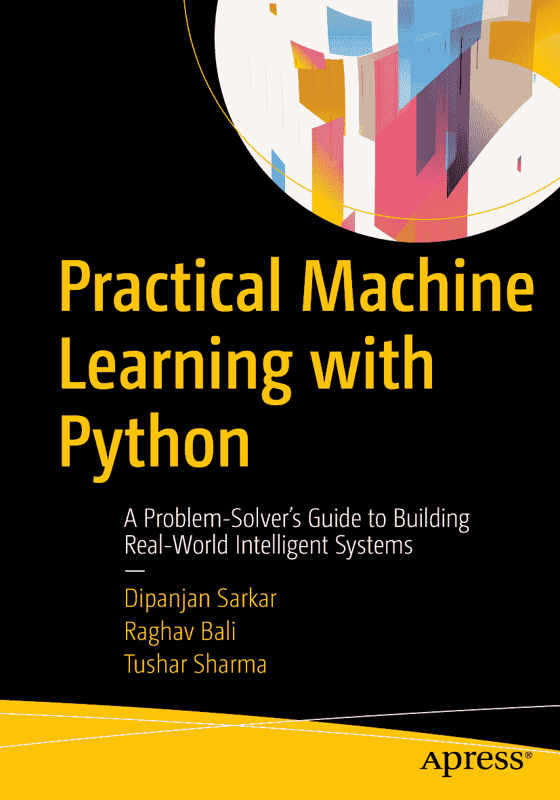

迪潘詹·萨卡尔（Dipanjan Sarkar）、拉加夫·巴厘（Raghav Bali）与图沙尔·夏尔马（Tushar Sharma）合著《Python 机器学习实战：构建真实世界智能系统的问题解决指南》

本书作者引用的任何源代码或其他补充材料，读者均可通过本书产品页面在 GitHub 上获取，该页面位于 [`www.apress.com/978-1-4842-3206-4`](http://www.apress.com/978-1-4842-3206-4)。如需更详细信息，请访问 [`http://www.apress.com/source-code`](http://www.apress.com/source-code)。ISBN 978-1-4842-3206-4 电子书 ISBN 978-1-4842-3207-1 [`doi.org/10.1007/978-1-4842-3207-1`](https://doi.org/10.1007/978-1-4842-3207-1) 美国国会图书馆控制号：2017963290 © 迪潘詹·萨卡尔、拉加夫·巴厘与图沙尔·夏尔马 2018 年版权所有。本作品受版权保护。出版商保留所有权利，无论是整体还是部分内容，具体包括翻译权、重印权、插图复用权、朗诵权、广播权、缩微胶片复制权或任何其他物理形式的复制权，以及信息存储与检索的传输权、电子改编权、计算机软件权，或采用目前已知或未来开发的相似或不同方法学进行的处理。本书中可能出现商标名称、标识和图像。我们仅在编辑风格中使用这些名称、标识和图像，以维护商标所有者的利益，并无意侵犯商标权，因此不会在每次出现商标名称、标识或图像时都使用商标符号。本出版物中使用的商品名称、商标、服务标志及类似术语，即使未明确标识，也不应被视为对其是否受专有权利保护的立场表达。尽管本书中的建议和信息在出版时被认为是真实准确的，但作者、编辑和出版商均不对可能存在的任何错误或遗漏承担法律责任。出版商对本书内容不作任何明示或暗示的担保。本书采用无酸纸印刷。本书通过 Springer Science+Business Media New York 在全球图书贸易中发行，地址：233 Spring Street, 6th Floor, New York, NY 10013。电话：1-800-SPRINGER，传真：(201) 348-4505，电子邮件：orders-ny@springer-sbm.com，或访问 www.springeronline.com。Apress Media, LLC 是一家加利福尼亚有限责任公司，其唯一成员（所有者）是 Springer Science + Business Media Finance Inc (SSBM Finance Inc)。SSBM Finance Inc 是一家特拉华州公司。谨以此书献给我的父母、伴侣、朋友、家人和支持者。——迪潘詹·萨卡尔献给我所有的灵感源泉，虽然他们永远不会读到这本书！——拉加夫·巴厘献给我的家人和朋友。——图沙尔·夏尔马 前言

摩尔定律带来的可负担计算能力的普及，推动了机器学习解决方案的快速发展，并促进了其在各行各业中的采用。通过系统性、易于应用的机器学习解决方案栈，从观测（训练）数据中学习现实世界过程背后的复杂模型，这种能力对企业挖掘有意义的商业价值具有巨大吸引力。机器学习的魅力和机遇催生了大量资源——书籍、教程、在线培训以及面向开发者、分析师、工程师和科学家的课程，供他们学习算法并实现平台和方法论。对于初学者来说，面对如此丰富的材料感到不知所措并不罕见。此外，如果不遵循结构化的工作流程，机器学习解决方案可能无法产生一致且相关的结果。

构建稳健的机器学习应用并获得一致、可操作结果的关键要求，包括投入大量时间和精力来理解项目的目标和核心价值，建立可靠的数据管道，分析和可视化数据，以及进行特征工程、特征选择和建模。这些项目的迭代性质涉及多个“选择 → 应用 → 验证 → 调优”循环，然后才能得出合适的基于机器学习的模型。最后也是重要的一步，是将解决方案（机器学习模型）集成到现有（或新的）组织系统或业务流程中，以维持可操作且相关的结果。因此，构建稳健机器学习解决方案所需要素的广泛要求，需要一个不仅适合机器学习交互式建模，而且在数据摄取、处理、可视化、系统集成以及运行时部署和维护的强生态系统支持方面表现出色的开发平台。Python 是一种极佳的语言选择，因为它凭借其多功能性、易于实现和集成、活跃的开发者社区以及不断增长的机器学习生态系统，满足了当下的需求，导致其在机器学习领域的采用率迅速增长。

本书作者利用他们使用 Python 及其机器学习生态系统解决实际问题的实践经验，帮助读者掌握应用基本概念、方法、工具和技术解决自身实际问题和用例所需的扎实知识。《Python 机器学习实战》旨在满足从初学者到专家等不同技能水平的读者的需求，帮助他们构建结构化的、实用的机器学习解决方案。

拉姆·R·瓦拉 引言

数据是新的石油，而机器学习则是充分利用它的强大概念和框架。在这个自动化和智能系统的时代，机器学习和数据科学成为最热门的关键词之一并不令人意外。各行各业、企业和领域对数据科学领域的巨大兴趣和重新投资，清楚地表明了其巨大的潜力。智能系统和数据驱动的组织正在成为现实，而工具和技术的进步只会进一步推动其发展。随着数据变得至关重要，对机器学习和数据科学从业者的需求从未像现在这样高。事实上，世界正面临数据科学家的短缺。它被称为“21 世纪最性感的职业”，这使得尝试在该领域建立一些宝贵的专业知识更加值得。

《Python 机器学习实战》是一本构建真实世界智能系统的问题解决指南。它采用全面的三层方法，融合了概念、方法、动手示例和代码。本书帮助读者掌握必备技能，通过遵循数据驱动的思维方式，识别并解决机器学习和深度学习中的复杂问题。通过利用流行的 Python 机器学习生态系统的真实案例研究，本书是您学习机器学习艺术与科学、成为成功从业者的完美伴侣。本书中使用的概念、技术、工具、框架和方法将教您如何思考、设计、构建并成功执行机器学习系统和项目。

本书将引导您入门如何利用 Python 机器学习生态系统及其多样化的框架和库。本书采用三层递进式方法：首先专注于围绕机器学习基础以及相关工具和框架构建坚实基础；其次强调构建机器学习管道的核心流程；最后利用这些知识解决来自零售、交通、电影、音乐、计算机视觉、艺术和金融等多个领域的真实案例研究。我们还涵盖了广泛的机器学习模型，包括回归、分类、预测、规则挖掘和聚类。本书还涉及深度学习领域的前沿方法和研究，包括迁移学习等概念以及与计算机视觉相关的案例研究，如图像分类和神经风格迁移。每一章都包含详细的概念、完整的动手示例、代码和深入讨论。本书的主要意图是为广泛的读者——包括 IT 专业人士、分析师、开发者、数据科学家、工程师和研究生——提供一种结构化的方法，以获得与机器学习相关的关键技能，并掌握足够的知识来利用最先进的机器学习技术和框架，从而能够开始解决他们自己的实际问题。本书以应用为重点，因此它不能替代对机器学习算法、方法及其内部实现获得深入概念和理论知识的途径。我们强烈建议您将本书获得的实践知识与一些关于数据挖掘、统计分析以及机器学习算法和方法理论方面的标准书籍相结合，以更深入地了解机器学习的世界。

致谢

如果没有一些优秀人士和组织在这段旅程中给予我们的帮助和支持，这本书肯定无法成为现实。首先，衷心感谢所有读者，不仅阅读我们的书籍，还通过宝贵的反馈和见解支持我们。确实，我们从你们所有人身上学到了很多，并且仍在继续学习。我们要感谢 Apress 的整个团队，他们在幕后不知疲倦地工作，为每个人创作和出版高质量的内容。特别感谢整个 Python 开发者社区，尤其是像 `numpy`、`scipy`、`scikit-learn`、`spacy`、`nltk`、`pandas`、`statsmodels`、`keras` 和 `tensorflow` 等框架的开发者。还要感谢像 Anaconda 这样的组织，它们让数据科学家的生活更轻松，并围绕数据科学和机器学习培育了一个令人惊叹的生态系统，这个生态系统随着时间的推移呈指数级增长。我们也感谢我们的朋友、同事、老师、经理和祝福者，他们以出色的挑战、强大的动力和美好的想法支持我们。特别感谢 Ram Varra，他不仅是我们出色的导师和引路人，还教会我们如何从技术层面以及业务和领域视角，将数据科学作为有效的工具加以利用，以产生真正的影响和价值。我们还要向过去和现在的经理和导师们表达感激之情，包括 Nagendra Venkatesh、Sanjeev Reddy、Tamoghna Ghosh 和 Sailaja Parthasarathy。

本书中的许多内容离不开许多人的帮助和一些优秀的资源。我们要感谢 Christopher Olah 对 LSTM 模型（`http://colah.github.io`）的出色描绘和解释，感谢 Edwin Chen 在他的博客（`http://blog.echen.me`）中对 LSTM 模型的精彩描绘，感谢 Gabriel Moreira 提供关于特征工程技术的优秀指导，感谢 Ian London 关于视觉词袋模型的资源（`https://ianlondon.github.io`），感谢 `DataScience.com` 的各位，特别是 Pramit Choudhary、Ian Swanson 和 Aaron Kramer，帮助我们使用 `skater`（`https://www.datascience.com`）在模型解释方面取得了很多进展，感谢 Karlijn Willems 和 DataCamp 提供关于葡萄酒质量分析的优秀信息来源（`https://www.datacamp.com`），感谢 Siraj Raval 创建了关于时间序列分析和推荐引擎的精彩内容，感谢 Amar Lalwani 为我们提供了关于使用深度学习进行时间序列预测的重要输入，感谢 Harish Narayanan 撰写了一篇关于神经风格迁移的优秀文章（`https://harishnarayanan.org/writing`），最后但同样重要的是，感谢 François Chollet 创建了 `keras` 并撰写了一本关于深度学习的优秀著作。

我还要感谢并表达我对我的父母 Digbijoy 和 Sampa、我的伴侣 Durba 以及我的家人和祝福者的感激之情，是他们持续的爱、支持和鼓励驱使我努力取得更多成就。特别感谢我的同事、朋友和合著者 Raghav 和 Tushar，与我一起日夜奋战，使这段经历变得有价值！最后，我再次感谢 Apress 的整个团队，特别是 Sanchita Mandal、Celestin John、Matthew Moodie 以及我们的技术审阅者 Jojo Moolayil，感谢他们成为这段奇妙旅程的一部分。

> ——Dipanjan Sarkar

我感激多年来激励和鼓励我的家人、老师、朋友、同事和导师。我也想借此机会感谢我的合著者和好朋友 Dipanjan Sarkar 和 Tushar Sharma；你们太棒了。特别感谢 Sanchita Mandal、Celestin John、Matthew Moodie 和 Apress 给予的机会和支持，最后但同样重要的是，感谢 Jojo Moolayil 的反馈和审阅。

> ——Raghav Bali

我想向多年来鼓励、支持和教导我的家人、老师和朋友表达我的感激之情。特别感谢我的同学、朋友和同事 Dipanjan Sarkar 和 Raghav Bali，他们作为合著者，通过宝贵的见解和对细节的关注，使这段旅程变得精彩。

我还要感谢 Matthew Moodie、Sanchita Mandal、Celestin John 和 Apress 给予的机会以及在整个旅程中的支持。特别感谢 Jojo Moolayil 提供的审阅和评论。

> ——Tushar Sharma

目录
第一部分：理解机器学习 1
第 1 章：机器学习基础 3
机器学习的必要性 4
做出数据驱动的决策 4
效率与规模 5
传统编程范式 5
为什么是机器学习？ 6
理解机器学习 8
为什么要让机器学习？ 8
正式定义 9
一个多学科领域 13
计算机科学 14
理论计算机科学 15
实践计算机科学 15
重要概念 15
数据科学 16
数学 18
重要概念 19
统计学 24
数据挖掘 25
人工智能 25
自然语言处理 26
深度学习 28
重要概念 31
机器学习方法 34
监督学习 35
分类 36
回归 37
无监督学习 38
聚类 39
降维 40
异常检测 41
关联规则挖掘 41
半监督学习 42
强化学习 42
批量学习 43
在线学习 44
基于实例的学习 44
基于模型的学习 45
CRISP-DM 过程模型 45
业务理解 46
数据理解 48
数据准备 50
建模 51
评估 52
部署 52
构建机器智能 52
机器学习流水线 52
监督机器学习流水线 54
无监督机器学习流水线 55
真实世界案例研究：预测学生助学金推荐 55
目标 56
数据检索 56
数据准备 57
建模 60
模型评估 61
模型部署 61
实际预测 62
机器学习中的挑战 64
机器学习的实际应用 64
总结 65
第 2 章：Python 机器学习生态系统 67
Python：简介 67
优势 68
陷阱 68
设置 Python 环境 69
为什么选择 Python 进行数据科学？ 71
介绍 Python 机器学习生态系统 72
Jupyter Notebooks 72
NumPy 75
Pandas 84
Scikit-learn 96
神经网络与深度学习 102
文本分析与自然语言处理 112
Statsmodels 116
总结 118
第二部分：机器学习流水线 119
第 3 章：处理、整理和可视化数据 121
数据收集 122
CSV 122
JSON 124
XML 128
HTML 与网页抓取 131
SQL 136
数据描述 137
数值型 137
文本型 137
类别型 137
数据整理 138
理解数据 138
过滤数据 141
类型转换 144
变换 144
缺失值填充 145
处理重复值 147
处理类别数据 147
归一化值 148
字符串操作 149
数据汇总 149
数据可视化 151
使用 Pandas 可视化 152
使用 Matplotlib 可视化 161
Python 可视化生态系统 176
总结 176
第 4 章：特征工程与选择 177
特征：更好地理解你的数据 178
数据与数据集 178
特征 179
模型 179
重温机器学习流水线 179
特征提取与工程 181
什么是特征工程？ 181
为什么需要特征工程？ 183
如何进行特征工程？ 184
数值数据的特征工程 185
原始度量 185
二值化 187
四舍五入 188
交互项 189
分箱 191
统计变换 197
类别数据的特征工程 200
转换名义特征 201
转换有序特征 202
编码类别特征 203
文本数据的特征工程 209
文本预处理 210
词袋模型 211
N-gram 袋模型 212
TF-IDF 模型 213
文档相似度 214
主题模型 216
词嵌入 217
时间数据的特征工程 220
基于日期的特征 221
基于时间的特征 222
图像数据的特征工程 224
图像元数据特征 225
原始图像与通道像素 225
灰度图像像素 227
图像强度分布分箱 227
图像聚合统计 228
边缘检测 229
目标检测 230
局部特征提取 231
视觉词袋模型 233
使用深度学习进行自动化特征工程 236
特征缩放 239
标准化缩放 240
最小-最大缩放 240
鲁棒缩放 241
特征选择 242
基于阈值的方法 243
统计方法 244
递归特征消除 247
基于模型的选择 248
降维 249
主成分分析特征提取 250
总结 252
第 5 章：构建、调优和部署模型 255
构建模型 256
模型类型 257
学习一个模型 260
模型构建示例 263
模型评估 271
评估分类模型 271
评估聚类模型 278
评估回归模型 281
模型调优 282
超参数简介 283
偏差-方差权衡 284
交叉验证 288
超参数调优策略 291
模型解释 295
理解 Skater 297
模型解释实战 298
模型部署 302
模型持久化 302
自定义开发 303
内部模型部署 303
模型即服务部署 304
总结 304
第三部分：真实世界案例研究 305
第 6 章：分析共享单车趋势 307
共享单车数据集 307
问题陈述 308
探索性数据分析 308
预处理 308
分布与趋势 310
异常值 312
相关性 314
回归分析 315
回归类型 315
假设 316
评估标准 316
建模 317
线性回归 319
基于决策树的回归 323
后续步骤 330
总结 330
第 7 章：分析电影评论情感 331
问题陈述 332
设置依赖项 332
获取数据 333
文本预处理与标准化 333
无监督基于词典的模型 336
Bing Liu 词典 337
MPQA 主观性词典 337
Pattern 词典 338
AFINN 词典 338
SentiWordNet 词典 340
VADER 词典 342
使用监督学习进行情感分类 345
传统监督机器学习模型 346
较新的监督深度学习模型 349
高级监督深度学习模型 355
分析情感成因 363
解释预测模型 363
分析主题模型 368
总结 372
第 8 章：客户细分与有效交叉销售 373
在线零售交易数据集 374
探索性数据分析 374
客户细分 378
目标 378
策略 379
聚类策略 380
交叉销售 392
基于关联规则挖掘的市场购物篮分析 393
关联规则挖掘基础 394
关联规则挖掘实战 396
总结 405
第 9 章：分析葡萄酒类型与品质 407
问题陈述 407
设置依赖项 408
获取数据 408
探索性数据分析 409
处理与合并数据集 409
理解数据集特征 410
描述性统计 413
推断性统计 414
单变量分析 416
多变量分析 419
预测建模 426
预测葡萄酒类型 427
预测葡萄酒品质 433
总结 446
第 10 章：分析音乐趋势与推荐 447
百万歌曲数据集品味档案 448
探索性数据分析 448
加载与修剪数据 448
增强数据 451
可视化分析 452
推荐引擎 456
推荐引擎类型 457
推荐引擎的效用 457
基于流行度的推荐引擎 458
基于物品相似度的推荐引擎 459
基于矩阵分解的推荐引擎 461
关于推荐引擎库的说明 466
总结 466
第 11 章：预测股票与商品价格 467
时间序列数据与分析 467
时间序列组件 469
平滑技术 471
预测黄金价格 474
问题陈述 474
数据集 474
传统方法 474
建模 476
股票价格预测 483
问题陈述 484
数据集 484
循环神经网络：LSTM 485
新兴技术：Prophet 495
总结 497
第 12 章：计算机视觉的深度学习 499
卷积神经网络 499
基于 CNN 的图像分类 501
问题陈述 501
数据集 501
从头开始构建基于 CNN 的深度学习分类器 502
使用预训练模型的基于 CNN 的深度学习分类器 505
基于 CNN 的艺术风格迁移 509
背景 510
预处理 511
损失函数 513
自定义优化器 515
风格迁移实战 516
总结 520
索引 521
关于作者与关于技术审校者
关于作者
关于技术审校者

