# 1. 机器学习基础  

制造智能、有感知和具备自我意识的机器这一想法并非近几年才突然出现。事实上，希腊神话中就有许多关于具备自我意识和智能的机器与发明的传说。计算机的起源与演变历经数个世纪，真正具有革命性——从 17 世纪基本的算盘及其衍生品计算尺，到 19 世纪查尔斯·巴贝奇设计的第一台通用计算机。事实上，随着巴贝奇发明分析机以及 1842 年阿达·洛芙莱斯编写出第一个计算机程序，人们开始思考并设想：是否有一天，计算机或机器能真正变得智能，并开始自主思考？著名计算机科学家艾伦·图灵在理论计算机科学、算法和形式语言的发展中影响深远，早在 20 世纪 50 年代就探讨了人工智能和机器学习等概念。这段关于机器学习的简要演变史，旨在让你了解：这一概念虽已存在数百年，但直到最近才获得广泛关注与重视。  

凭借更快的计算机、更强的处理能力、更高的计算性能和更大的存储空间，我们一直生活在所谓的“信息时代”或“数据时代”。日复一日，我们通过数据科学、人工智能、数据挖掘和机器学习的概念与方法，管理大数据并构建智能系统。当然，你们中的大多数人一定听过我刚才提到的许多术语，也见过“数据是新时代的石油”这样的说法。过去十年，企业和组织面临的主要挑战是：如何利用各种方法，从所拥有的数据中提取有价值的信息和洞察，从而做出更明智的决策。事实上，随着技术的巨大进步——包括廉价且大规模的计算资源、硬件（包括 GPU）和存储的普及——我们见证了一个围绕人工智能、机器学习以及最新兴的深度学习等领域蓬勃发展的生态系统。研究人员、开发者、数据科学家和工程师们夜以继日地工作，研究并构建工具、框架、算法、技术和方法论，以打造能够预测事件、自动化任务、执行复杂分析、检测异常、自我修复故障，甚至理解和响应人类输入的智能模型与系统。  

本章将采用结构化方法，涵盖与机器学习相关的各种概念、方法论和思想。核心目标是为你提供足够的背景知识，让你了解为什么需要机器学习、机器学习的基本构建模块，以及机器学习目前能为我们提供什么。这将帮助你学习如何最好地利用机器学习，从数据中获取最大价值。由于这是一本关于实践机器学习的书，虽然后续章节将聚焦于具体用例、问题和真实案例研究，但理解与学习算法、数据管理、模型构建、评估和部署相关的正式定义、概念和基础至关重要。因此，我们将涵盖所有这些方面，包括与数据挖掘和机器学习工作流程相关的行业标准，从而为你提供一个基础框架，用于处理后续章节中解决的所有实际问题。此外，我们还将介绍与机器学习相关的不同跨学科领域，这些领域实际上都属于人工智能这一大范畴。  

本书更侧重于应用型或实践型机器学习，因此大部分章节的主要焦点将是应用机器学习技术和算法来解决实际问题。因此，具备一定的基础数学、统计学和机器学习知识将大有裨益。不过，考虑到不同读者专业水平的差异，本章以及第一、二部分的其他章节将帮助你快速掌握机器学习的关键方面以及构建机器学习流水线的要点。如果你已经熟悉机器学习的基本概念及其重要性，可以快速浏览本章，直接进入第 2 章“Python 机器学习生态系统”，其中我们将讨论 Python 在构建机器学习系统方面的优势，以及通常用于解决机器学习问题的主要工具和框架。  

本书高度重视“做中学”，包含大量代码片段、示例和多个案例研究。我们使用 Python 3，并通过相关的代码文件（`.py`）和 Jupyter Notebook（`.ipynb`）展示所有示例，以提供更具交互性的体验。我们鼓励你访问本书的 GitHub 仓库：[`https://github.com/dipanjanS/practical-machine-learning-with-python`](https://github.com/dipanjanS/practical-machine-learning-with-python)，我们将在其中分享每章所需的代码和数据集。你可以在阅读本书时利用该仓库亲自尝试所有示例，并将其应用于解决自己的实际问题。未来还将分享与机器学习和深度学习相关的额外内容，敬请关注！  

## 机器学习的必要性  

人类或许是当前地球上最先进、最智能的生命形式。我们能够思考、推理、构建、评估并解决复杂问题。人类大脑至今仍有诸多未解之谜，因此人工智能在某些方面尚未超越人类智能。于是你心中可能会产生一个迫切的问题：我们究竟为什么需要机器学习？为何要费时费力去让机器学习和变得智能？答案可以概括为一句话：“大规模地做出数据驱动的决策”。接下来，我们将在后续章节中详细阐述这句话的含义。  


### 做出数据驱动的决策

从数据中获取关键信息或洞察，是企业与组织大力投资优秀人才以及机器学习、人工智能等新兴领域和范式的核心原因。数据驱动决策的概念并不新鲜。运筹学、统计学和管理信息系统等领域已存在数十年，它们试图通过利用数据和分析来做出数据驱动的决策，从而为任何企业或组织提升效率。利用数据获取可执行的洞察并做出更优决策的艺术与科学，被称为数据驱动决策。当然，这说起来容易做起来难，因为我们很少能直接利用原始数据做出有洞察力的决策。这个问题的另一个重要方面是，我们常常会运用推理或直觉的力量，根据一段时间内以及工作中积累的经验来尝试做出决策。我们的大脑是一个极其强大的设备，能够帮助我们做到这一点。试想一下这样的问题：理解同事或朋友在说什么、识别图像中的人、决定批准还是拒绝一笔商业交易等等。虽然我们几乎可以下意识地解决这些问题，但你能向别人解释你是如何解决每一个问题的过程吗？也许在一定程度上可以，但过一会儿就会变成：“嘿！我的大脑替我完成了大部分思考！”这正是让机器像常规计算程序（如计算贷款利息或退税）那样学习解决这些问题的困难所在。那些本质上无法通过编程解决的问题，需要一种不同的方法：我们利用数据本身来驱动决策，而不是使用可编程的逻辑、规则或代码来做出这些决策。我们将在后续章节进一步讨论这一点。

### 效率与规模

虽然获取洞察并做出数据驱动的决策至关重要，但同时也需要高效且大规模地完成。利用机器学习或人工智能技术的核心思想，是通过从数据中学习特定模式来自动化流程或任务。我们都希望计算机或机器能告诉我们股票何时可能上涨或下跌、一张图片是电脑还是电视、我们的产品布局和优惠是否最佳、判断购物价格趋势、在故障或中断发生前进行检测，诸如此类，不胜枚举！虽然人类的智慧和专业知识是我们绝对不可或缺的，但我们仍需以极高的效率大规模地解决现实世界的问题。

一个大规模的现实问题

思考以下现实问题。你是 DSS 公司世界级基础设施团队的经理，该公司以基于云的基础设施和分析平台的形式，为其他企业和消费者提供数据科学服务。作为服务和基础设施的提供者，你希望你的基础设施是一流的，并且能够稳健地应对故障和中断。假设你从圣路易斯的一个小办公室起步，你和你的 10 人经验丰富的团队能够很好地定期监控所有网络设备，包括路由器、交换机、防火墙和负载均衡器。很快，你在提供基于云的深度学习服务和用于开发的 GPU 方面取得了突破，并获得了巨额利润。然而，现在你的客户越来越多。是时候将你的业务扩展到旧金山、纽约和波士顿的办公室了。现在你拥有庞大的互联基础设施，每栋大楼里都有数百台网络设备！你将如何大规模地管理你的基础设施？你是为每个办公室雇佣更多的人手，还是尝试利用机器学习来处理诸如中断预测、自动恢复和设备监控等任务？请从工程师和管理者的角度思考一下这个问题。

### 传统编程范式

计算机虽然是极其精密复杂的设备，但也不过是我们熟知的“傻瓜盒子”——电视的另一个版本！“这怎么可能？”此时提出这个问题非常合理。让我们考虑一下电视，甚至是如今市面上所谓的智能电视。无论在理论上还是实践中，电视都会按照你编程设定的方式运行。它会播放你想看的频道，录制你想稍后观看的节目，并运行你想玩的应用程序！计算机一直在做着完全相同的事情，只是方式不同。传统编程范式基本上涉及用户或程序员使用代码编写一组指令或操作，使计算机对数据执行特定的计算，从而得到期望的结果。图 1-1 描绘了传统编程范式的典型工作流程。

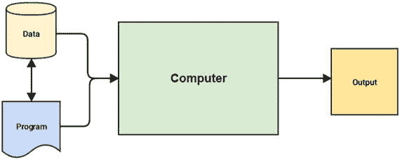

图 1-1.

传统编程范式

从图 1-1 中，你可以了解到，输入计算机的核心是数据以及一个或多个程序，这些程序基本上是用编程语言编写的代码，例如 Java、Python 等高级语言，或者 C 甚至汇编等低级语言。程序使计算机能够处理数据、执行计算并生成输出。传统编程范式能够出色完成的一项任务是计算你的年度税款。

现在，让我们思考一下上一节中讨论的 DSS 公司的现实基础设施问题。你认为传统的编程方法能够解决这个问题吗？嗯，在一定程度上是可以的。我们或许能够接入设备数据、事件流和日志，并访问各种设备属性，如使用率、信号强度、传入和传出连接、内存和处理器使用率、错误日志和事件等。然后，我们可以利用团队中网络和基础设施专家的领域知识，基于这些数据属性，根据特定的决策和规则建立一些事件监控系统。这将为我们提供所谓的基于规则的被动分析解决方案，我们可以监控设备，观察是否发生任何特定的异常或中断，然后采取必要措施快速解决任何潜在问题。我们可能还需要雇佣一些支持和运维人员，根据需要持续监控和解决问题。然而，仍然存在一个紧迫的问题：如何尽可能地在故障或问题实际发生之前就加以预防。机器学习能在某些方面帮助我们吗？


### 为什么需要机器学习？

现在，我们将解答最初引发讨论的问题：为什么需要机器学习。结合你目前所学的内容，虽然传统编程范式相当出色，且人类智能与领域专业知识无疑是数据驱动决策的重要因素，但我们仍需要机器学习来做出更快、更好的决策。机器学习范式试图将数据与预期输出（如果有的话）纳入考量，并利用计算机构建程序，该程序也被称为模型。这个程序或模型未来可用于根据新输入做出必要决策并给出预期输出。图 1-2 展示了机器学习范式与传统编程范式之间的相似之处与不同之处。

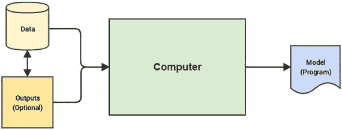

图 1-2.

机器学习范式

图 1-2 强化了一个事实：在机器学习范式中，机器（此处指计算机）试图利用输入数据和预期输出来学习数据中固有的模式，这些模式最终有助于构建一个类似于计算机程序的模型。该模型通过利用从先前数据点学到的知识（其知识或经验），帮助未来针对新的输入数据点做出数据驱动的决策（预测或告知我们输出结果）。你可能开始看到其中的好处了。我们不再需要手工编码的规则、复杂的流程图、case 和 if-then 条件，以及其他通常用于构建任何决策制定系统或决策支持系统的标准。其基本思想是利用机器学习来做出有洞察力的决策。

一旦我们讨论 DSS 公司管理基础设施的实际问题，这一点将更加清晰。在传统编程方法中，我们谈到了招聘新员工、建立基于规则的监控系统等。如果我们在此采用机器学习范式的转变，我们可以通过以下步骤来解决这个问题。

*   利用设备数据和日志，确保我们在某个数据存储（数据库、日志或平面文件）中有足够的历史数据
*   确定可能对构建模型有用的关键数据属性。这可以是设备使用情况、日志、内存、处理器、连接、信号强度、链路等。
*   观察并捕获设备属性及其在不同时间段内的行为，包括正常设备行为和异常设备行为或故障。这些结果就是你的输出，设备数据就是你的输入
*   将这些输入和输出对输入到计算机中的任何特定机器学习算法中，构建一个模型，该模型学习固有的设备模式并观察相应的输出或结果
*   部署此模型，以便对于新的设备属性值，它可以预测特定设备是正常运行还是可能导致潜在故障

因此，一旦你能够构建一个机器学习模型，你就可以轻松地部署它，并围绕它构建一个智能系统，这样你不仅可以被动地监控设备，还可以主动识别潜在问题，甚至在问题出现之前就加以解决。想象一下，构建自愈或自动修复系统，并结合全天候的设备监控。可能性确实是无限的，你无需在每次扩展办公室或购买新基础设施时不断招聘新员工。

当然，前面讨论的构建机器学习模型所需的一系列步骤的工作流程，比描述的要复杂得多，但这只是为了强调并让你从概念上而非技术上思考，在机器学习过程中范式是如何转变的，并且你也需要将思维从传统的基于方法转向更加数据驱动。机器学习的妙处在于它从不局限于领域，你可以使用技术来解决跨多个领域、业务和行业的问题。此外，如图 1-2 所示，构建模型并不总是需要输出数据点；有时输入数据就足够了（或者更确切地说，输出数据可能不存在），适用于更偏向无监督学习的技术（我们将在本章后面深入讨论）。一个简单的例子是，根据过去的交易数据，查看顾客通常在商店一起购买的杂货商品，从而确定顾客的购物模式。在下一节中，我们将更深入地理解机器学习。

## 理解机器学习

到现在为止，你已经看到了一个典型的、适合用机器学习解决的实际问题可能是什么样子。除此之外，你对传统编程和机器学习范式的基础知识也有了很好的掌握。在本节中，我们将更详细地讨论机器学习。更具体地说，我们将从概念和特定领域的角度来审视机器学习。机器学习可能是在 20 世纪 90 年代开始崭露头角，当时研究人员和科学家开始将其作为人工智能的一个子领域给予更多重视，其技术借鉴了人工智能、概率论和统计学的概念，与需要大量人工时间和精力的固定规则模型相比，性能要好得多。当然，正如我们之前指出的，机器学习并非在 20 世纪 90 年代凭空出现。它是一个多学科领域，随着时间的推移逐渐演变，并且在我们讨论的当下仍在不断发展。

简要提及一下演变历史，对于了解机器学习和人工智能发展过程中涉及的各种概念和技术将非常有帮助。可以说，它始于 18 世纪末和 19 世纪初，当时发表了第一批基本上讨论贝叶斯定理的研究成果。事实上，托马斯·贝叶斯的主要著作《论机会学说中一个问题的求解》发表于 1763 年。除此之外，在此期间，概率和数学领域进行了大量的研究和发现。这为 20 世纪更具突破性的研究和发明铺平了道路，包括 20 世纪初安德雷·马尔可夫提出的马尔可夫链、艾伦·图灵提出的学习系统，以及 20 世纪 50 年代弗兰克·罗森布拉特发明的非常著名的感知机。你们中的许多人可能知道，自 20 世纪 50 年代以来，神经网络经历了几次高潮和低谷，最终在 20 世纪 80 年代随着反向传播的发现（感谢鲁梅尔哈特、辛顿和威廉姆斯！）以及其他几项发明（包括 Hopfield 网络、新认知机、卷积和循环神经网络以及 Q 学习）而重新崛起。当然，自 20 世纪 90 年代以来，机器学习也开始了快速演进的步伐，发现了随机森林、支持向量机、长短期记忆网络，并开发和发布了机器学习和深度学习框架，包括 `torch`、`theano`、`tensorflow`、`scikit-learn` 等。我们还看到了智能系统的兴起，包括 IBM Watson、DeepFace 和 AlphaGo。确实，这段旅程就像坐过山车一样，而且前路漫漫。花点时间反思一下这段演进之旅，然后我们来谈谈这段旅程的目的。我们为什么以及何时应该真正让机器去学习？


### 为何要让机器学会学习？

在前一节中，我们已充分讨论了为何需要机器学习——即利用学习算法，在不依赖过多人工干预和固定规则系统的情况下，大规模地基于数据做出数据驱动型决策。本节我们将更详细地探讨为何以及何时应让机器学会学习。人类、企业和组织日复一日地致力于解决诸多现实任务与问题，以造福我们自身。在以下几种场景中，让机器学会学习可能大有裨益：

*   特定领域缺乏足够的人类专业知识（例如，模拟未知地域甚至太空行星的导航）。
*   场景和行为会随时间持续变化（例如，组织内基础设施的可用性、网络连接状况等）。
*   人类虽在该领域拥有足够专业知识，但极难将这些知识正式解释或转化为计算任务（例如，语音识别、翻译、场景识别、认知任务等）。
*   在数据量庞大、条件与约束极其复杂的情况下，大规模解决特定领域问题。

上述场景只是几个例子，说明让机器学会学习比投入时间、精力和金钱去构建那些可能在范围、覆盖度、性能和智能方面都有限的次优智能系统更为有效。我们作为人类和领域专家，对世界及各自领域已拥有足够的知识——这些知识可能是客观的、主观的，有时甚至是直觉性的。借助大量历史数据，我们可以利用机器学习范式，让机器通过在一段时间内观察数据中的模式来积累足够经验，从而执行特定任务，并在未来以最少人工干预的方式运用这些经验解决问题。其核心思想始终是：让机器解决那些可以凭直觉、几乎无意识地轻松定义，却极难正式定义的任务。

### 正式定义

现在，我们可以正式定义机器学习。你可能已经接触过机器学习的多种定义，包括：让机器智能化的技术、增强版自动化、自动化本身的自动化、21 世纪最性感的工作、让计算机自主学习等等！虽然这些说法都是不错的引述，且在某种程度上属实，但定义机器学习的最佳方式，还是从著名教授汤姆·米切尔（Tom Mitchell）在 1997 年给出的机器学习基础定义入手。

机器学习的理念是：存在某种学习算法，能帮助机器从数据中学习。米切尔教授的定义如下：

> “如果一个计算机程序针对某类任务 T，通过性能度量 P 来衡量其在任务 T 上的表现，并且该表现随着经验 E 而提升，那么我们就说这个程序从经验 E 中学习。”

虽然这个定义初看可能令人望而生畏，但我请你慢慢读上几遍，重点关注三个参数——T、P 和 E——它们是任何学习算法的主要组成部分，如图 1-3 所示。

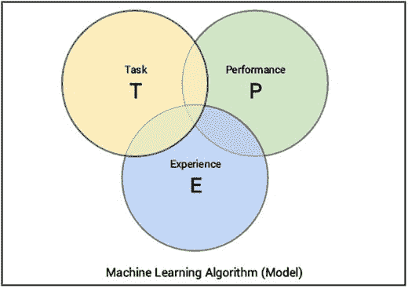

图 1-3.

定义学习算法的组成部分

我们可以将定义简化如下：机器学习是一个由学习算法组成的领域，这些算法能够：

*   提升其性能 P
*   在执行某项任务 T 时
*   随着经验 E 的积累而提升

虽然我们将在后续章节详细讨论这些实体，但不会花时间对它们进行正式或数学上的定义，因为本书更侧重于应用型或实践型机器学习。如果你回想一下我们之前的现实问题，任务 T 之一可能是预测基础设施的故障；经验 E 则是我们的机器学习模型通过观察各种设备数据属性中的模式，随时间积累所得；而模型性能 P 可以通过多种方式衡量，例如模型预测故障的准确度。

#### 定义任务 T

我们在前一节已简要讨论过任务 T，它可以从两个层面来定义。从问题角度来看，任务 T 本质上就是需要解决的实际问题，可以是寻找最佳营销或产品组合，也可以是预测基础设施故障。在机器学习领域，最好能尽可能具体地定义任务，明确你计划解决的确切问题是什么，以及如何将问题定义或转化为特定的机器学习任务。

基于机器学习的任务难以通过传统编程方法解决。任务 T 通常可以根据系统处理数据点或样本时应遵循的流程或工作流，被定义为机器学习任务。通常，一个数据样本或数据点会包含多个数据属性（在机器学习术语中也称为特征），就像我们之前为 DSS 公司的问题中提到的各种设备参数一样。一个典型的数据点可以用一个向量（Python 列表）表示，向量中的每个元素对应一个特定的数据特征或属性。我们将在后续章节以及第 4 章“特征工程与选择”中更详细地讨论特征和数据点。

回到那些可归类为机器学习任务的典型任务，以下列表描述了一些常见的任务。


*   **分类或归类**：这通常涵盖一系列问题或任务，其中机器需要接收数据点或样本，并为每个样本分配特定的类别或种类。一个简单的例子是将动物图像分类为狗、猫和斑马。
*   **回归**：这类任务通常涉及进行预测，其输出是一个真实的数值，而不是输入数据点的类别或种类。理解回归任务的最佳方式是考虑一个现实世界的问题：根据每个数据点的地块面积、楼层数、浴室数、卧室数和厨房等输入属性来预测房价。
*   **异常检测**：这些任务涉及机器检查事件日志、交易日志和其他数据点，以便发现与正常行为不同的异常或反常模式或事件。这方面的例子包括尝试从日志中发现拒绝服务攻击、欺诈迹象等。
*   **结构化标注**：这通常涉及对输入数据点进行一些分析，并将结构化的元数据作为标注添加到原始数据中，以描述数据元素之间的额外信息和关系。简单的例子包括用词性、命名实体、语法和情感来标注文本。标注也可以用于图像，例如为图像像素分配特定类别，根据图像区域的类型、位置等对其进行标注。
*   **翻译**：自动机器翻译任务通常具有这样的性质：如果你有属于特定语言的输入数据样本，你可以将其翻译成另一种目标语言的输出。基于自然语言的翻译无疑是一个处理大量文本数据的巨大领域。
*   **聚类或分组**：聚类或分组通常是通过让机器学习或观察输入数据点本身之间固有的潜在模式、关系和相似性，从输入数据样本中形成的。通常，这些任务缺乏预先标记或预先标注的数据，因此它们构成了无监督机器学习（我们将在后面讨论）的一部分。例子包括对相似产品、事件和实体进行分组。
*   **转录**：这些任务通常涉及处理各种通常是连续和非结构化的数据表示，并将其转换为更结构化和离散的数据元素。例子包括语音转文本、光学字符识别、图像转文本等。

以上内容应该能让您对通常使用机器学习解决的典型任务有一个很好的了解，但这个列表肯定不是详尽无遗的，因为任务的边界确实是无限的，并且随着时间的推移，通过广泛的研究，更多的任务正在被发现。

#### 定义经验，E

至此，您知道任何学习算法通常都需要数据来随时间学习并执行特定任务，我们将其命名为 T。学习算法或模型通过消费一个由数据样本或数据点组成的数据集来学习固有模式的过程，被定义为学习算法获得的经验，E。算法获得的任何经验都来自数据样本或数据点，并且这可以在任何时间点发生。您可以使用历史数据一次性输入数据样本，甚至在获取到新数据样本时随时提供。

因此，模型或算法获得经验的想法通常作为一个迭代过程发生，也称为**训练模型**。您可以将模型视为一个类似于人类的实体，它通过观察和学习数据中存在的各种属性、关系和模式，从数据点中获得知识或经验。当然，学习和获得经验有多种形式和方法，包括监督学习、无监督学习和强化学习，但我们将在后续章节中讨论学习方法。现在，退一步思考我们之前做的类比：当机器真正学习时，它基于不时输入给它的数据，从而使其能够获得关于待解决问题任务的经验和知识，以便它可以使用这种经验 E 来预测或解决未来遇到的、之前未见过的数据点的相同任务 T。

#### 定义性能，P

假设我们有一个机器学习算法，它应该执行任务 T，并且随着时间的推移，通过数据点获得经验 E。但我们如何知道它是否表现良好，或者是否按照预期的方式运行呢？这就是模型的性能 P 发挥作用的地方。性能 P 通常是一种定量度量或指标，用于查看算法或模型在获得经验 E 的情况下执行任务 T 的效果如何。虽然性能指标通常是经过多年研究和开发建立起来的标准指标，但每个指标通常都是针对我们在任何给定时间点试图解决的任务 T 来具体计算的。

典型的性能度量包括准确率、精确率、召回率、F1 分数、灵敏度、特异度、错误率、误分类率等等。性能度量通常在训练数据样本（算法用来获得经验 E）以及算法之前未见或未学习过的数据样本（通常称为验证和测试数据样本）上进行评估。这样做的目的是为了使算法具有泛化能力，使其不会仅仅对训练数据点产生过拟合，并在未来对新数据点也能表现良好。关于训练、验证和测试数据的更多内容，我们将在讨论模型构建和验证时进行。

在解决任何机器学习问题时，大多数情况下，性能度量 P 的选择要么是准确率、F1 分数、精确率，要么是召回率。虽然在大多数情况下确实如此，但您应该始终记住，有时很难选择能够准确让我们了解算法基于其预期实际行为或结果表现如何的性能度量。一个简单的例子是，有时我们希望对误分类或假阳性进行比正确命中或预测更严厉的惩罚。在这种情况下，我们可能需要使用修改后的成本函数或先验概率，以便我们牺牲命中率或整体准确率，来换取更少的假阳性和更准确的预测。一个现实世界的例子是预测是否应向客户发放贷款的智能系统。最好以更谨慎放贷而非拒绝放贷的方式来构建系统。原因很简单，因为向潜在违约者放贷的一个重大错误可能导致巨大损失，而相比之下拒绝向潜在客户发放几笔小额贷款则损失较小。总之，您需要考虑任务 T 中涉及的所有参数和属性，以便为您的系统确定正确的性能度量 P。


### 多学科领域

我们在上一节中正式介绍并定义了机器学习，这应该能让你对任何学习算法所涉及的主要组成部分有清晰的认识。现在，让我们将视角转向机器学习这一领域本身。你可能已经知道，从某些角度来看，机器学习通常被认为是人工智能甚至计算机科学的一个子领域。自诞生以来，机器学习的概念在相当长一段时间内从多个领域衍生和借鉴而来，使其成为一个真正的多学科或跨学科领域。图 1-4 应该能让你清楚地了解与机器学习在概念、方法论、思想和技术上重叠的主要领域。这里需要记住的重要一点是，这绝非领域或学科的详尽列表，但它相当准确地描绘了与机器学习紧密相关的主要学科。

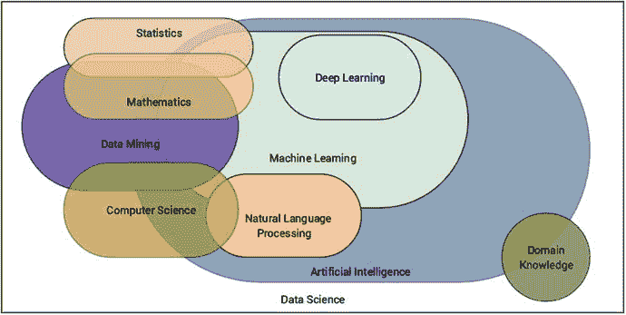

图 1-4.

机器学习：一个真正的多学科领域

如图 1-4 所示，与机器学习相关的主要学科或领域包括以下内容。我们将在后续章节中讨论这些领域中的每一个。

*   人工智能
*   自然语言处理
*   数据挖掘
*   数学
*   统计学
*   计算机科学
*   深度学习
*   数据科学

你可以说数据科学就像一个广泛的跨学科领域，横跨所有其他作为其子领域的学科。当然，这只是一个简单的概括，并非严格表明它是包含所有其他领域的超集，而是从它们那里借鉴了重要的概念和方法论。数据科学的基本思想同样是关于从数据和领域知识中提取信息的流程、方法论和技术。这将是我们在后续章节中更详细讨论数据科学时的一个重要部分。

回到机器学习，模式识别和基本数据挖掘方法论（如数据库知识发现）的思想在关系数据库非常盛行时就已经出现。这些领域更侧重于从大型数据集中挖掘信息的能力和技术，以便你能获得感兴趣的模式、知识和洞察。当然，数据库知识发现本身就是一个完整的过程，包括数据采集、存储、数据仓库、处理和分析。机器学习借鉴了更多与分析阶段相关的概念，尽管你确实需要经历其他步骤才能到达最终阶段。数据挖掘同样是一个跨学科或多学科领域，它借鉴了计算机科学、数学和统计学的概念。其结果是，计算统计学构成了大多数机器学习算法和技术的重要组成部分。

人工智能是包含机器学习作为其专业领域之一的超集。人工智能的基本思想是研究和开发机器基于其对环境的感知、输入参数和属性以及响应所表现出的智能，以便它们能够根据期望执行所需的任务。人工智能本身就是一个真正庞大的领域，它本身也是跨学科的。它借鉴了数学、统计学、计算机科学、认知科学、语言学、神经科学等众多学科的概念。机器学习更关注那些可用于理解数据、构建表示以及执行预测等任务的算法和技术。人工智能下与机器学习相关的另一个主要子领域是自然语言处理，它大量借鉴了计算语言学和计算机科学的概念。文本分析是当今分析师和数据科学家用于提取、处理和理解自然人类语言的一个突出领域。将自然语言处理与人工智能和机器学习相结合，你就得到了聊天机器人、机器翻译器和虚拟个人助理，它们确实是创新和技术的未来！

说到深度学习，它是机器学习本身的一个子领域，更侧重于与表示学习相关的技术，通过获得更多经验，随着数据量的增加而不断改进。它采用分层和层次化的方法，试图使用嵌套的分层概念表示层次来表示给定的输入属性及其当前环境，其中每个复杂层都由另一个更简单的概念层构建而成。神经网络是深度学习大量使用的技术，我们将在未来的章节中更详细地探讨深度学习，并在本书后面解决一些实际问题。

计算机科学几乎是这些领域中大多数的基础，涉及计算机的研究、开发、工程和编程。因此，我们不会对此展开过多讨论，但你一定要记住计算机科学对于机器学习的存在以及轻松应用于解决实际问题的重要性。这应该能让你对机器学习这个多学科领域的广阔图景以及它如何与多个相关和重叠的领域相互关联有一个清晰的认识。我们将在后续章节中更详细地讨论其中一些领域，并在必要时涵盖每个领域的一些基本概念。

让我们在下一节中探讨计算机科学的一些核心基础。

## 计算机科学

计算机科学领域可以定义为理解计算机的科学。这涉及理解、设计、构建和使用计算机相关领域的研究、开发、工程和实验。这也涉及广泛设计和开发可用于使计算机按预期执行计算和任务的算法和程序。计算机科学主要有两个主要领域，如下所示。

*   理论计算机科学
*   应用或实践计算机科学

计算机科学下的这两个主要领域横跨多个领域和学科，其中每个领域构成计算机科学的一部分或一个子领域。计算机科学的主要精髓包括形式语言、自动机与计算理论、算法、数据结构、计算机设计与体系结构、编程语言以及软件工程原理。

### 理论计算机科学

理论计算机科学是研究试图解释计算背后原理和过程的理论与逻辑。这涉及理解计算理论，该理论探讨如何有效地利用计算来解决问题。计算理论包括形式语言、自动机的研究，以及理解计算和算法中涉及的复杂性。信息论与编码理论是理论计算机科学下的另一个主要领域，它为我们带来了信号处理、密码学和数据压缩等领域。编程语言原理及其分析是另一个重要方面，它探讨了各种编程语言的特征、设计、分析和实现，以及编译器和解释器如何理解这些语言。最后但同样重要的是，数据结构和算法是理论计算机科学的两大基本支柱，广泛应用于计算程序和函数中。


### 实用计算机科学

实用计算机科学（也称为应用计算机科学）更侧重于工具、方法论和流程，旨在将计算机科学的概念与原理应用于现实世界，解决日常实际问题。这包括人工智能、机器学习、计算机视觉、深度学习、自然语言处理、数据挖掘和机器人技术等新兴子领域，它们试图基于多重约束和参数解决复杂的现实问题，并尝试模拟需要大量人类智能和经验的任务。除此之外，我们还有成熟的领域，包括计算机体系结构、操作系统、数字逻辑与设计、分布式计算、计算机网络、安全、数据库和软件工程。

### 重要概念

以下是您应该了解并记住的一些计算机科学概念，因为它们将作为基础概念，帮助您更好地理解其他章节、概念和示例。这并非详尽列表，但足以涵盖入门所需的内容。

#### 算法

算法可以描述为一系列可执行以完成特定任务的步骤、操作、计算或函数。它们本质上是通过一系列操作来正式描述和表示计算机程序的方法，这些操作通常使用自然语言、数学符号和图表来描述。流程图、伪代码和自然语言通常被广泛用于表示算法。一个算法可以简单到两个数相加，也可以复杂到计算矩阵的逆。

#### 编程语言

编程语言是一种拥有自己符号、词汇、标记和运算符的语言，这些元素具有各自的意义和含义。因此，语法和语义共同构成了其本身的正式语言。这种语言可用于编写计算机程序，这些程序本质上是算法的现实实现，用于向计算机指定具体指令，使其执行必要的计算和操作。编程语言可以是像 C 和汇编这样的低级语言，也可以是像 Java 和 Python 这样的高级语言。

#### 代码

代码是构成计算机程序基础的源代码。代码使用编程语言编写，包含一系列计算机语句和指令，以使计算机执行特定的期望任务。代码帮助使用编程语言将算法转化为程序。我们将使用 Python 来实现大多数现实世界的机器学习解决方案。

#### 数据结构

数据结构是用于管理数据的专门结构。它们本质上是抽象数据类型规范在现实世界中的实现，可用于高效地存储、检索、管理和操作数据。有一整套数据结构，如数组、列表、元组、记录、结构体、联合体、类等等。我们将广泛使用 Python 数据结构，如列表、数组、数据框和字典，来操作现实世界的数据！

## 数据科学

数据科学领域是一个非常多样化、跨学科的领域，它包含了我们在图 1-4 中描绘的多个领域。数据科学主要涉及从数据（结构化和非结构化）中获取知识或信息的原则、方法论、流程、工具和技术。数据科学更像是流程、技术和方法的集合，旨在培养基于数据驱动的决策文化。事实上，德鲁·康威的“数据科学维恩图”（如图 1-5 所示）展示了数据科学的核心组成部分和精髓，该图曾风靡一时，变得极其流行！

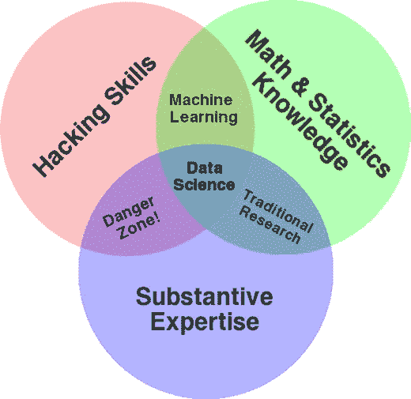

图 1-5.

德鲁·康威的数据科学维恩图

图 1-5 非常直观且易于理解。基本上有三个主要组成部分，而数据科学位于它们的交叉点。数学和统计学知识涉及应用各种计算和定量的数学及统计技术，从数据中提取见解。黑客技能基本上指的是处理、加工、操作和整理数据，使其成为易于理解和可分析格式的能力。实质性专业知识则是实际的现实领域专业知识，这在解决问题时极其重要，因为除了你在数据和算法方面的专长外，你还需要了解与领域相关的各种因素、属性、约束和知识。

因此，德鲁正确地指出，机器学习是数据黑客技能、数学和统计学习方法的专业知识的结合，而对于数据科学，除了机器学习，你还需要一定程度的领域专业知识和知识。你可以在他的文章 [`http://drewconway.com/zia/2013/3/26/the-data-science-venn-diagram`](http://drewconway.com/zia/2013/3/26/the-data-science-venn-diagram) 中查看德鲁的个人见解，他在那里全面讨论了数据科学维恩图。除此之外，还有布伦丹·蒂尔尼，他以自己的描绘方式阐述了数据科学作为一个多学科领域的真实本质，如图 1-6 所示。

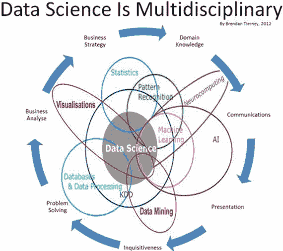

图 1-6.

布伦丹·蒂尔尼将数据科学描绘为一个真正的多学科领域

如果你仔细观察他的描绘，你会看到这里提到的许多领域正是我们在前几节中讨论过的，并且与图 1-4 的很大一部分相匹配。你可以清楚地看到数据科学是关注的中心，并从所有其他领域汲取部分，而机器学习则是一个子领域。

## 数学

数学领域涉及数字、逻辑和形式系统。亚里士多德对数学的最佳定义是“量的科学”。数学作为一个科学领域的范围非常广泛，涵盖代数、三角学、微积分、几何和数论等领域，仅举几个主要领域为例。线性代数和概率是数学下的两个主要子领域，在机器学习中被广泛使用，我们将在本节中介绍它们的一些重要概念。我们的主要重点始终是实践机器学习，而应用数学是其重要方面。线性代数处理数学对象和结构，如向量、矩阵、线、平面、超平面和向量空间。概率论是一个数学领域和框架，用于研究和量化随机与不确定性事件，并从中推导出定理和公理。这些定律和公理帮助我们推理、理解和量化任何现实世界系统或场景中的不确定性及其影响，从而帮助我们利用这个框架构建机器学习模型。

### 重要概念

在本节中，我们讨论应用数学中的一些关键术语和概念，即线性代数和概率论。这些概念在机器学习中被广泛使用，并构成了机器学习算法、模型和流程中的一些基础结构和原理。

#### 标量

标量通常表示单个数字，而不是一组数字。一个简单的例子可能是 x = 5 或 x ∈ R，其中 x 是指向单个数字或实数值的标量元素。


#### 向量

向量被定义为一种结构，它包含一个按顺序排列的数字数组。这基本上意味着集合中数字的顺序或序列很重要。向量在数学上可以表示为 x = [x[1], x[2], …, x[n]]，这告诉我们 x 是一个一维向量，数组中有 n 个元素。每个元素都可以通过数组索引来引用，该索引决定了它在向量中的位置。下面的代码片段展示了我们如何在 Python 中表示简单的向量。

```
In [1]: x = [1, 2, 3, 4, 5]
...: x
Out[1]: [1, 2, 3, 4, 5]
In [2]: import numpy as np
...: x = np.array([1, 2, 3, 4, 5])
...:
...: print(x)
...: print(type(x))
[1 2 3 4 5]

```

因此，你可以看到 Python 列表以及基于 `numpy` 的数组都可以用来表示向量。数据集中的每一行都可以作为一个包含 n 个属性的一维向量，这些属性可以作为学习算法的输入。

#### 矩阵

矩阵是一种基本上包含数字的二维结构。它通常也被称为二维数组。与向量使用单个向量索引不同，矩阵中的每个元素都可以通过行和列索引来引用。在数学上，你可以将矩阵表示为 ![$$ M=\left[\begin{array}{ccc}{m}_{11}& {m}_{12}& {m}_{13}\\ {}{m}_{21}& {m}_{22}& {m}_{23}\\ {}{m}_{31}& {m}_{32}& {m}_{33}\end{array}\right] $$](A448827_1_En_1_Chapter_IEq1.gif)，其中 M 是一个 3 x 3 的矩阵，有三行三列，每个元素由 m[rc] 表示，其中 r 表示行索引，c 表示列索引。矩阵在 Python 中可以很容易地表示为列表的列表，并且我们可以利用 `numpy` 数组结构，如下面的代码片段所示。

```
In [3]: m = np.array([[1, 5, 2],
...:               [4, 7, 4],
...:               [2, 0, 9]])
In [4]: # 查看矩阵
...: print(m)
[[1 5 2]
[4 7 4]
[2 0 9]]
In [5]: # 查看维度
...: print(m.shape)
(3, 3)
```

因此，你可以看到我们如何轻松地利用 `numpy` 数组来表示矩阵。你可以将具有行和列的数据集视为一个矩阵，其中数据特征或属性由列表示，每一行表示一个数据样本。我们将在后续的分析中使用相同的类比。当然，你可以执行矩阵运算，如加法、减法、乘法、逆运算、转置、行列式等等。下面的代码片段展示了一些常用的矩阵运算。

```
In [9]: # 矩阵转置
...: print('矩阵转置:\n', m.transpose(), '\n')
...:
...: # 矩阵行列式
...: print ('矩阵行列式:', np.linalg.det(m), '\n')
...:
...: # 矩阵逆
...: m_inv = np.linalg.inv(m)
...: print ('矩阵逆:\n', m_inv, '\n')
...:
...: # 单位矩阵（矩阵与其逆矩阵相乘的结果）
...: iden_m =  np.dot(m, m_inv)
...: iden_m = np.round(np.abs(iden_m), 0)
...: print ('矩阵与其逆矩阵的乘积:\n', iden_m)
...:
矩阵转置:
[[1 4 2]
[5 7 0]
[2 4 9]]
矩阵行列式: -105.0
矩阵逆:
[[-0.6         0.42857143 -0.05714286]
[ 0.26666667 -0.04761905 -0.03809524]
[ 0.13333333 -0.0952381   0.12380952]]
矩阵与其逆矩阵的乘积:
[[ 1\.  0\.  0.]
[ 0\.  1\.  0.]
[ 0\.  0\.  1.]]
```

这应该能让你对矩阵及其基本运算有一个很好的入门了解。更多内容将在第 2 章“Python 机器学习生态系统”中介绍。

#### 张量

你可以将张量视为一个通用数组。张量本质上是具有可变数量轴的数组。三维张量 T 中的一个元素可以用 T[x, y, z] 表示，其中 x, y, z 表示指定元素 T 的三个轴。

#### 范数

范数是一种用于计算向量大小的度量，通常也被定义为从原点到向量所表示点的距离度量。在数学上，向量的 p 阶范数表示如下。

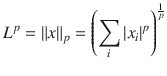

其中 p ≥ 1 且 p ∈ R。机器学习中常用的范数包括 L¹ 范数（广泛用于 Lasso 回归模型）和 L² 范数（也称为欧几里得范数，用于岭回归模型）。

#### 特征分解

这基本上是一个矩阵分解过程，我们将一个矩阵分解为一组特征向量和特征值。矩阵的特征分解在数学上可以表示为 M = V diag(λ) V^(-1)，其中矩阵 M 共有 n 个线性无关的特征向量，表示为 {v^((1)), v^((2)), …, v^((n))}，它们对应的特征值可以表示为 {λ[1], λ[2], …, λ[n]}。矩阵 V 的每一列包含一个特征向量，即 V = [v^((1)), v^((2)), …, v^((n))]，而向量 λ 包含了所有的特征值，即 λ = [λ[1], λ[2], …, λ[n]]。

矩阵的特征向量被定义为一个非零向量，当矩阵乘以该特征向量时，结果仅改变特征向量本身的尺度，即结果是一个标量乘以该特征向量。这个标量被称为与该特征向量对应的特征值。在数学上，这可以表示为 Mv = λv，其中 M 是我们的矩阵，v 是特征向量，λ 是对应的特征值。下面的 Python 代码片段展示了如何从矩阵中提取特征值和特征向量。

```
In [4]: # 特征分解
...: m = np.array([[1, 5, 2],
...:               [4, 7, 4],
...:               [2, 0, 9]])
...:
...: eigen_vals, eigen_vecs = np.linalg.eig(m)
...:
...: print('特征值:', eigen_vals, '\n')
...: print('特征向量:\n', eigen_vecs)
...:
特征值: [ -1.32455532  11.32455532   7\.        ]
特征向量:
[[-0.91761521  0.46120352 -0.46829291]
[ 0.35550789  0.79362022 -0.74926865]
[ 0.17775394  0.39681011  0.46829291]]
```


#### 奇异值分解

奇异值分解（SVD）是另一种矩阵分解过程，通过它我们可以将矩阵分解，从而获得奇异向量和奇异值。任何实数矩阵都可以通过 SVD 进行分解，即使在某些情况下特征分解可能不适用。从数学上讲，SVD 可以定义如下。考虑一个维度为 m x n 的矩阵 M，其中 m 表示总行数，n 表示总列数，该矩阵的 SVD 可以用以下方程表示。

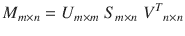

这给出了分解方程的以下主要组成部分。

*   U [m x m] 是一个 m x m 的酉矩阵，其中每一列代表一个左奇异向量
*   S [m x n] 是一个 m x n 的矩阵，对角线上的元素为正数，也可以表示为奇异值向量
*   V ^T [n x n] 是一个 n x n 的酉矩阵，其中每一行代表一个右奇异向量

在某些表示中，行和列可能会互换，但最终结果应该相同，即 U 和 V 总是正交的。以下代码片段展示了在 Python 中一个简单的 SVD 分解。

```
In [7]: # SVD
...: m = np.array([[1, 5, 2],
...:               [4, 7, 4],
...:               [2, 0, 9]])
...:
...: U, S, VT = np.linalg.svd(m)
...:
...: print('Getting SVD outputs:-\n')
...: print('U:\n', U, '\n')
...: print('S:\n', S, '\n')
...: print('VT:\n', VT, '\n')
...:
Getting SVD outputs:-
U:
[[ 0.3831556  -0.39279153  0.83600634]
[ 0.68811254 -0.48239977 -0.54202545]
[ 0.61619228  0.78294653  0.0854506 ]]
S:
[ 12.10668383   6.91783499   1.25370079]
VT:
[[ 0.36079164  0.55610321  0.74871798]
[-0.10935467 -0.7720271   0.62611158]
[-0.92621323  0.30777163  0.21772844]]
```

SVD 作为一种技术，特别是其中的奇异值，在基于摘要的算法以及诸如降维等其他各种方法中非常有用。

#### 随机变量

随机变量在概率和不确定性度量中经常使用，它本质上是一个可以随机取不同值的变量。这些变量通常可以是离散类型或连续类型。

#### 概率分布

概率分布是一种分布或排列，它描述了一个或多个随机变量取每个可能状态的可能性。根据变量是离散的还是连续的，通常有两种主要类型的分布。

#### 概率质量函数

概率质量函数（PMF）是离散随机变量上的概率分布。常见的例子包括泊松分布和二项分布。

#### 概率密度函数

概率密度函数（PDF）是连续随机变量上的概率分布。常见的例子包括正态分布、均匀分布和学生 t 分布。

#### 边际概率

当我们已经拥有一组随机变量的概率分布，并且想要计算这些随机变量子集的概率分布时，会使用边际概率规则。对于离散随机变量，我们可以如下定义边际概率。

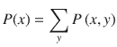

对于连续随机变量，我们可以使用积分运算如下定义它。

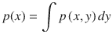

#### 条件概率

当我们想要确定在另一个事件已经发生的情况下，某个事件发生的概率时，会使用条件概率规则。其数学表示如下。

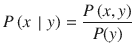

这告诉我们，在 y 已经发生的情况下，x 的条件概率。

#### 贝叶斯定理

这是另一个规则或定理，当我们知道感兴趣事件 P(A) 的概率、基于该感兴趣事件的另一个事件的条件概率 P(B | A)，并且想要确定在另一个事件已经发生的情况下，我们感兴趣事件的条件概率 P(A | B) 时，它非常有用。这可以使用以下表达式在数学上定义。

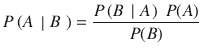

其中 A 和 B 是事件，并且 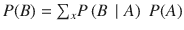。

## 统计学

统计学领域可以定义为数学的一个专门分支，它包含用于收集、组织、分析、解释和呈现数据的框架和方法。通常，这更属于应用数学范畴，并借鉴了线性代数、分布、概率论和推断方法的概念。统计学有两个主要领域，如下所述。

*   描述性统计
*   推断性统计

任何统计过程的核心组成部分都是数据。因此，通常首先进行数据收集，这些数据可以是全局性的（通常称为总体），也可以是因各种限制而更受限制的子集（通常称为样本）。样本通常通过手动方式、调查、实验、数据存储和观察性研究来收集。从这些数据出发，使用统计方法进行各种分析。

描述性统计用于通过使用各种聚合和汇总度量来理解数据的基本特征，从而更好地描述和理解数据。这些度量可以是标准度量，如均值、中位数、众数、偏度、峰度、标准差、方差等。如果你感兴趣，可以参考任何标准的统计学书籍来深入了解这些度量。以下代码片段展示了如何计算一些基本的描述性统计度量。

```
In [74]: # descriptive statistics
...: import scipy as sp
...: import numpy as np
...:
...: # get data
...: nums = np.random.randint(1,20, size=(1,15))[0]
...: print('Data: ', nums)
...:
...: # get descriptive stats
...: print ('Mean:', sp.mean(nums))
...: print ('Median:', sp.median(nums))
...: print ('Mode:', sp.stats.mode(nums))
...: print ('Standard Deviation:', sp.std(nums))
...: print ('Variance:', sp.var(nums))
...: print ('Skew:', sp.stats.skew(nums))
...: print ('Kurtosis:', sp.stats.kurtosis(nums))
...:
Data:  [ 2 19  8 10 17 13 18  9 19 16  4 14 16 15  5]
Mean: 12.3333333333
Median: 14.0
Mode: ModeResult(mode=array([16]), count=array([2]))
Standard Deviation: 5.44875113112
Variance: 29.6888888889
Skew: -0.49820055879944575
Kurtosis: -1.0714842769550714
```

像 `pandas`、`scipy` 和 `numpy` 这样的库和框架通常可以帮助我们在 Python 中轻松计算描述性统计和汇总数据。我们将在第 2 章和第 3 章中介绍这些框架以及基本的数据分析和可视化。

当我们想要检验假设、推断和总结关于数据样本或总体的各种特征时，会使用推断性统计。像假设检验、相关性和回归分析、预测和预报这样的框架和技术通常用于任何形式的推断性统计。我们将在后续章节中详细介绍预测分析和基于时间序列的预测时，深入探讨这一点。


## 数据挖掘

数据挖掘领域涉及从非平凡数据集中发现和提取模式、知识、洞察及有价值信息的过程、方法论、工具和技术。当数据集规模巨大且通常来自数据库和数据仓库时，即被定义为非平凡数据集。同样，数据挖掘本身是一个多学科领域，融合了数学、统计学、计算机科学、数据库、机器学习和数据科学的概念与技术。该术语通常存在误称，因为“挖掘”指的是从数据中挖掘实际洞察或信息，而非数据本身！在 KDD（数据库知识发现）的整个过程中，数据挖掘是执行所有分析的步骤。

总体而言，KDD 和数据挖掘都与机器学习密切相关，因为它们都涉及分析数据以提取有用的模式和洞察。因此，它们共享方法论、概念、技术和流程。业界遵循的标准数据挖掘流程称为 CRISP-DM 模型，我们将在本章后续部分详细讨论。

## 人工智能

人工智能领域涵盖多个子领域，包括机器学习、自然语言处理、数据挖掘等。它可被定义为制造智能体、机器和程序的艺术、科学与工程。该领域旨在为一个简单却极其困难的目标提供解决方案：“机器能否像人类一样思考、推理和行动？”事实上，人工智能早在 14 世纪就已存在，当时人们开始提出此类问题，并研发能够像计算器处理数字一样处理概念的工具。随着艾伦·图灵、麦卡洛克和皮茨人工神经元的发现与发明，人工智能稳步发展。在经历一段停滞期后，人工智能于 20 世纪 80 年代凭借专家系统的成功、霍普菲尔德、鲁梅尔哈特、麦克莱兰、辛顿等人推动的神经网络复兴而再次兴起。得益于摩尔定律带来的更快、更优的计算能力，数据挖掘、机器学习乃至深度学习等领域得以崭露头角，解决传统方法无法解决的复杂问题。图 1-7 展示了人工智能广阔框架下的主要分支。

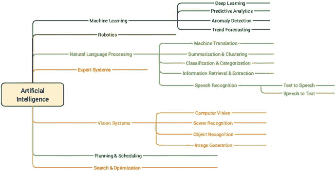

图 1-7. 人工智能框架下的多样化主要分支

人工智能的主要目标包括模拟认知功能（亦称认知学习）、语义与知识表示、学习、推理、问题解决、规划以及自然语言处理。人工智能借鉴了统计学习、应用数学、优化方法、逻辑学、概率论、机器学习、数据挖掘、模式识别和语言学中的工具、概念与技术。人工智能仍在不断发展，该领域涌现了大量创新，包括自动驾驶汽车、聊天机器人、无人机和智能机器人等最新发现与发明。

## 自然语言处理

自然语言处理（NLP）领域是一个多学科领域，融合了计算语言学、计算机科学和人工智能的概念。NLP 涉及使机器能够处理、理解并与自然人类语言交互的能力。基于 NLP 构建的应用或系统的主要目标是实现机器与随时间演变的自然语言之间的交互。这方面的主要挑战包括知识与语义表示、自然语言理解、生成和处理。以下是 NLP 的一些主要应用。

*   机器翻译
*   语音识别
*   问答系统
*   上下文识别与消解
*   文本摘要
*   文本分类
*   信息抽取
*   情感与情绪分析
*   主题分割

利用 NLP 和文本分析技术，您可以处理文本数据，进行标注、分类、聚类、摘要、语义提取、情感判断等操作！以下示例代码片段展示了文本数据上的一些基本 NLP 操作，我们根据其成分语法，用词性、短语级别标签等各种组件对文档（文本句子）进行标注。有关成分分析的更多详情，请参阅《Python 文本分析》（Apress，Dipanjan Sarkar，2016）第 159 页。

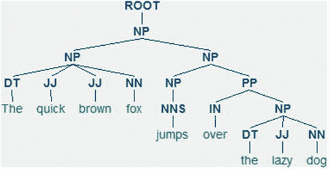

图 1-8. 示例句子的成分分析树

```
from nltk.parse.stanford import StanfordParser
sentence = 'The quick brown fox jumps over the lazy dog'
# 创建解析器对象
scp = StanfordParser(path_to_jar='E:/stanford/stanford-parser-full-2015-04-20/stanford-parser.jar',
path_to_models_jar='E:/stanford/stanford-parser-full-2015-04-20/stanford-parser-3.5.2-models.jar')
# 获取解析树
result = list(scp.raw_parse(sentence))
tree = result[0]
In [98]: # 打印成分分析树
...: print(tree)
(ROOT
(NP
(NP (DT The) (JJ quick) (JJ brown) (NN fox))
(NP
(NP (NNS jumps))
(PP (IN over) (NP (DT the) (JJ lazy) (NN dog))))))
In [99]: # 可视化成分分析树
...: tree.draw()
```

因此，您可以清楚地看到，图 1-8 展示了示例句子的基于成分语法的分析树，其中包含多个名词短语（NP）。每个短语包含多个单词，这些单词也带有各自的词性（POS）标签。我们将在后续章节中更详细地介绍机器学习流程中各个步骤以及实际用例中文本数据的处理与分析。


## 深度学习

如前所述，深度学习领域是机器学习的一个子领域，近年来备受瞩目。其主要目标是让机器学习研究更接近其“让机器智能”的真正目标。深度学习常被称为神经网络的一个华丽新名称。这在某种程度上是正确的，但深度学习绝不仅仅是基本的神经网络。基于深度学习的算法涉及使用表示学习的概念，即在不同的层中学习数据的各种表示，这也有助于从数据中自动提取特征。简单来说，基于深度学习的方法试图通过将数据表示为概念的分层层次结构来构建机器智能，其中每一层概念都由其他更简单的层构建而成。这种分层架构本身就是任何深度学习算法的核心组成部分之一。

在任何基本的监督式机器学习技术中，我们基本上都试图学习数据样本与输出之间的映射，然后尝试为新的数据样本预测输出。表示学习除了学习从输入到输出的映射外，还试图理解数据本身的表示。这使得深度学习算法比常规技术强大得多，因为常规技术需要大量特征提取和工程方面的专业知识。与较旧的机器学习算法相比，深度学习在性能以及随着数据量增加的可扩展性方面也极为有效。这一点如图 1-9 所示，该图基于吴恩达在 Extract Data 会议上的演讲幻灯片。

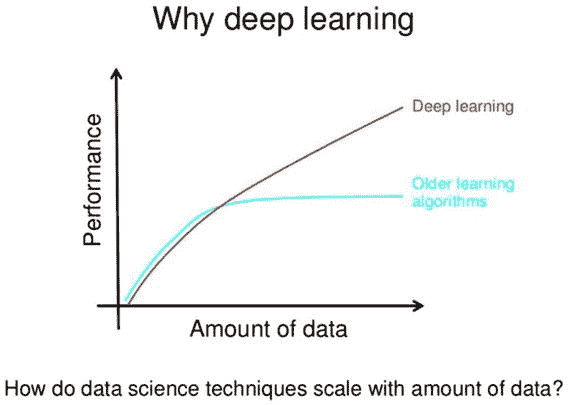

图 1-9.

吴恩达提出的深度学习与传统机器学习的性能对比

确实，正如吴恩达正确指出的那样，过去十年中我们注意到了与深度学习相关的几个显著趋势和特征。总结如下。

*   深度学习算法基于分布式表示学习，并且随着数据量的增加，其性能会随着时间的推移而变得更好。
*   深度学习可以说是神经网络的重塑，但与传统的神经网络相比，它包含的内容要多得多。
*   更好的软件框架，如 `tensorflow`、`theano`、`caffe`、`mxnet` 和 `keras`，结合卓越的硬件，使得构建极其复杂、多层且规模巨大的深度学习模型成为可能。
*   深度学习在自动特征提取以及执行监督学习操作方面具有多重优势，这帮助数据科学家和工程师随着时间的推移解决日益复杂的问题。

以下几点描述了大多数深度学习算法的显著特征，其中一些特征我们将在本书中使用。

*   概念的分层层次表示。在机器学习术语中，这些概念也称为特征（数据属性）。
*   通过多层架构（无监督学习）实现数据的分布式表示学习。
*   更复杂、更高层次的特征和概念源自更简单、低层次的特征。
*   一个“深度”神经网络通常被认为除了输入层和输出层之外，至少还有一个以上的隐藏层。通常它至少包含三到四个隐藏层。
*   深度架构具有多层结构，其中每一层由多个非线性处理单元组成。每一层的输入都是架构中的前一层。第一层通常是输入层，最后一层是输出层。
*   能够执行自动特征提取、分类、异常检测以及许多其他机器学习任务。

这应该能让你对深度学习相关概念有一个良好的基础掌握。假设我们有一个从图像中识别物体的现实世界问题。图 1-10 将让我们很好地了解典型的机器学习与深度学习流程之间的区别（来源：Yann LeCun）。

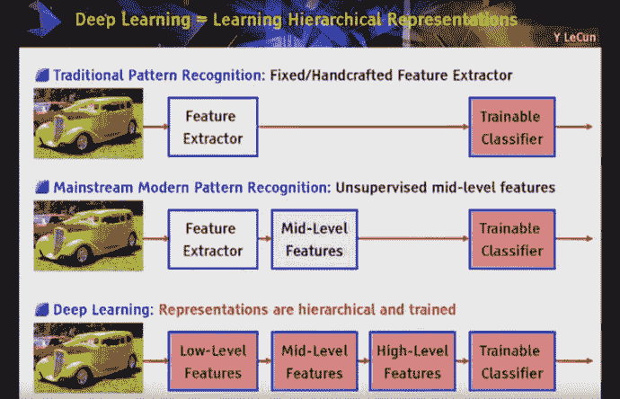

图 1-10.

Yann LeCun 对比各种学习流程

与其他机器学习方法相比，你可以清楚地看到深度学习方法如何涉及从原始数据中提取特征和概念的分层层次表示。我们以简要介绍一些与深度学习相关的基本概念来结束本节。

### 重要概念

在本节中，我们将讨论深度学习算法和架构中的一些关键术语和概念。这在你将来构建自己的深度学习模型时会很有用。

#### 人工神经网络

人工神经网络（ANN）是一种计算模型和架构，它模拟生物神经元及其在我们大脑中的运作方式。通常，ANN 具有由相互连接的节点组成的层。这些节点及其互连类似于我们大脑中的神经元网络。一个典型的 ANN 具有输入层、输出层，以及在输入和输出之间至少一个带有互连的隐藏层，如图 1-11 所示。

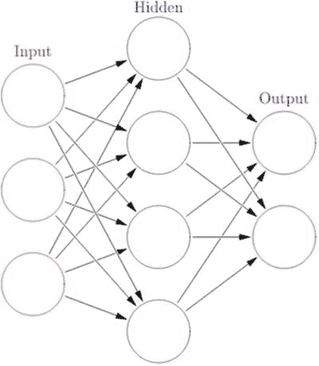

图 1-11.

一个典型的人工神经网络

任何基本的 ANN 总是具有多个节点层、层之间特定的连接模式和链接、连接权重以及将加权输入转换为输出的节点/神经元的激活函数。网络的学习过程通常涉及一个代价函数，目标是优化该代价函数（通常是最小化代价）。权重在学习过程中不断更新。

#### 反向传播

反向传播算法是一种训练 ANN 的流行技术，它导致了神经网络在 20 世纪 80 年代的复兴。该算法通常有两个主要阶段——传播和权重更新。简要描述如下。

1.  传播
    1.  输入数据样本向量通过网络前向传播，从输出层生成输出值。
    2.  将生成的输出向量与该输入数据向量的实际/期望输出向量进行比较。
    3.  计算输出单元上的误差差异。
    4.  反向传播误差值，在每个节点/神经元处生成增量。
2.  权重更新
    1.  通过将输出增量（误差）与输入激活相乘来计算权重梯度。
    2.  使用学习率确定要从原始权重中减去的梯度百分比，并更新节点的权重。

这两个阶段通过多次迭代/周期重复多次，直到获得满意的结果。通常，反向传播与优化算法或函数（如随机梯度下降）一起使用。

#### 多层感知器

多层感知器，也称为 MLP，是一种全连接的前馈人工神经网络，至少具有三层（输入层、输出层和至少一个隐藏层），其中每一层都与相邻层全连接。每个神经元通常是一个非线性功能处理单元。反向传播通常用于训练 MLP，而深度神经网络在具有多个隐藏层时也是 MLP。通常用于监督式机器学习任务，如分类。


#### 卷积神经网络

卷积神经网络，也称为 convnet 或 CNN，是人工神经网络的一种变体，专门用于模拟我们视觉皮层的功能和行为。CNN 通常由以下三个组件构成。

*   多个卷积层，这些层由多个滤波器组成，这些滤波器通过计算点积，在输入数据（例如，图像原始像素）的高度和宽度上进行卷积，从而生成二维激活图。将所有滤波器的激活图堆叠起来，我们就得到了卷积层的最终输出。
*   池化层，这些层本质上执行非线性下采样，以减小输入尺寸和来自卷积层输出的参数数量，从而使模型更具泛化能力，防止过拟合并减少计算时间。滤波器遍历输入的高度和宽度，并通过求和、求平均或取最大值等聚合操作来减小其尺寸。典型的池化组件是平均池化或最大池化。
*   全连接 MLP，用于执行图像分类和物体识别等任务。

一个包含所有组件的典型 CNN 架构如图 1-12 所示，这是一个 LeNet CNN 模型（来源：deeplearning.net）。

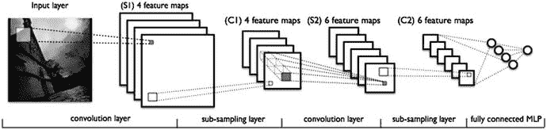

图 1-12.

LeNet CNN 模型（来源：deeplearning.net）

#### 循环神经网络

循环神经网络，也称为 RNN，是一种特殊类型的人工神经网络，它通过使用一种特殊的循环架构，允许基于过去的知识来持久化信息。它们大量用于处理序列数据相关的领域，例如预测句子的下一个单词。这些循环网络之所以被称为循环，是因为它们对输入数据序列中的每一个元素执行相同的操作和计算。RNN 具有记忆能力，有助于从过去的序列中捕获信息。图 1-13（来源：Colah 的博客，网址为 [`http://colah.github.io/posts/2015-08-Understanding-LSTMs/`](http://colah.github.io/posts/2015-08-Understanding-LSTMs/)）展示了 RNN 的典型结构，以及它如何通过根据输入序列长度展开网络，以便在任何时间点进行输入。

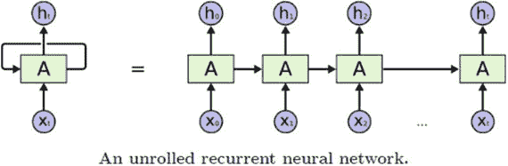

图 1-13.

一个循环神经网络（来源：Colah 的博客）

图 1-13 清晰地展示了展开后的网络如何在每次输入数据传递中接受长度为 t 的序列，并对其进行操作。

#### 长短期记忆网络

RNN 在处理基于序列的数据方面表现出色，但随着序列长度的增加，它们会随着时间的推移逐渐丢失序列中的历史上下文，因此输出并不总是符合预期。这时，长短期记忆网络（俗称 LSTM）就应运而生了！由 Hochreiter 和 Schmidhuber 于 1997 年提出的 LSTM，能够记住来自非常长的序列数据的信息，并防止诸如梯度消失等问题，这些问题通常发生在使用反向传播训练的人工神经网络中。LSTM 通常由三个或四个门组成，包括输入门、输出门和一个特殊的遗忘门。图 1-14 展示了一个单个 LSTM 单元的高级示意图。

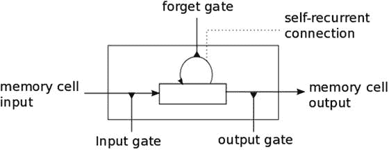

图 1-14.

一个 LSTM 单元（来源：deeplearning.net）

输入门通常可以允许或拒绝传入的信号或输入来改变记忆单元的状态。输出门通常根据需要将值传播给其他神经元。遗忘门控制记忆单元的自循环连接，以便根据需要记住或遗忘先前的状态。在解决诸如序列预测等现实问题时，深度学习网络中通常会堆叠多个 LSTM 单元。

#### 自编码器

自编码器是一种专门的人工神经网络，主要用于执行无监督机器学习任务。其主要目标是学习数据表示、近似和编码。自编码器可用于构建生成模型、执行降维和检测异常。

## 机器学习方法

机器学习拥有多种算法、技术和方法论，可用于构建模型，利用数据解决现实世界的问题。本节尝试将这些机器学习方法归入一些大类，以便对最终用于执行我们在前一节讨论的特定机器学习任务的机器学习方法的整体格局有所了解。通常，同一种机器学习方法可以在多个类别下以多种方式进行分类。以下是机器学习方法的一些主要大类。

1.  基于学习过程中人工监督程度的方法
    1.  监督学习
    2.  无监督学习
    3.  半监督学习
    4.  强化学习
2.  基于从增量数据样本中学习能力的方法
    1.  批量学习
    2.  在线学习
3.  基于从数据样本进行泛化方法的方法
    1.  基于实例的学习
    2.  基于模型的学习

我们将在以下各节中简要介绍各种类型的学习方法，以便为理解机器学习方法及其通常解决的任务类型打下良好基础。这将为您提供足够的知识，以便在本书后续章节处理各种实际用例和问题时，开始理解在何种场景下应应用哪些方法。

 讨论每种机器学习算法的数学细节和内部机制超出了本书当前的范围和意图，因为本书的重点在于通过应用机器学习解决实际问题，而非理论机器学习。因此，建议您参考标准的机器学习参考资料，例如 Christopher Bishop 于 2006 年出版的《模式识别与机器学习》，以及 Robert Tibshirani 等人于 2001 年出版的《统计学习基础》，以获取有关机器学习算法和方法内部机制的更多理论和数学细节。


## 监督学习

监督学习方法或算法包括在模型训练过程中，接收数据样本（称为训练数据）及其相关输出（称为标签或响应）的学习算法。其主要目标是根据多个训练数据实例，学习输入数据样本 x 与其对应输出 y 之间的映射或关联。这种习得的知识将来可用于为任何新的、在模型训练期间未知或未见过的输入数据样本 x′ 预测输出 y′。这些方法之所以被称为监督学习，是因为模型是在训练阶段已预先知道所需输出响应/标签的数据样本上进行学习的。

监督学习基本上试图从训练数据中建立输入与其对应输出之间的关系模型，以便我们能够根据先前获得的关于输入与其目标输出之间关系和映射的知识，为新的数据输入预测输出响应。这正是监督学习方法被广泛用于预测分析的原因，其主要目标是为通常输入到训练好的监督机器学习模型中的某些输入数据预测某种响应。根据要解决的机器学习任务类型，监督学习方法主要分为两大类。

*   分类
*   回归

让我们来看看这两类机器学习任务，并观察最适合解决这些任务的监督学习方法子集。

### 分类

基于分类的任务是监督机器学习下的一个子领域，其关键目标是根据模型在训练阶段学到的知识，为输入数据预测本质上是分类性质的输出标签或响应。这里的输出标签也称为类别或类标签，它们本质上是分类的，意味着它们是无序的离散值。因此，每个输出响应都属于一个特定的离散类别或分类。

假设我们举一个预测天气的真实世界例子。为了简单起见，假设我们试图根据包含湿度、温度、气压和降水量等属性或特征的多个输入数据样本来预测天气是晴天还是雨天。由于预测结果只能是晴天或雨天，因此总共有两个不同的类别；因此这个问题也可以称为二分类问题。图 1-15 描述了天气预测的二分类任务，即通过使用具有特征向量（降水量、湿度、气压和温度）的输入数据样本及其对应的类别标签（晴天或雨天）来训练监督模型，从而预测天气是晴天还是雨天。

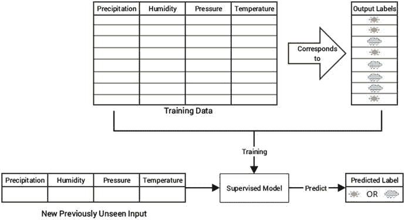

图 1-15.

监督学习：天气预测的二分类

当不同类别的总数超过两个时，该任务就变成了多分类问题，其中每个预测响应可以是该集合中任何一个可能的类别。一个简单的例子是尝试从扫描的手写图像中预测数字。在这种情况下，它变成了一个 10 分类问题，因为任何图像的输出类别标签都可以是 0 到 9 之间的任何数字。在这两种情况下，输出类别都是一个指向特定类别的标量值。多标签分类任务是指，基于任何输入数据样本，输出响应通常是一个包含一个或多个输出类别标签的向量。一个简单的现实世界问题是尝试预测新闻文章的类别，该文章可能具有多个输出类别，如新闻、财经、政治等。

流行的分类算法包括逻辑回归、支持向量机、神经网络、集成方法（如随机森林和梯度提升）、K 近邻、决策树等等。

### 回归

主要目标是值估计的机器学习任务可以称为回归任务。基于回归的方法是在输出响应为连续数值的输入数据样本上进行训练的，这与分类不同，分类中我们处理的是离散的类别或类。回归模型利用输入数据属性或特征（也称为解释变量或自变量）及其对应的连续数值输出值（也称为响应变量、因变量或结果变量）来学习输入与其对应输出之间的特定关系和关联。凭借这些知识，它可以像分类一样为新的、未见过的数据实例预测输出响应，但输出的是连续的数值。

回归最常见的现实世界例子之一是房价预测。你可以根据以平方英尺为单位的土地面积数据，构建一个简单的回归模型来预测房价。图 1-16 展示了基于不同方法预测房价的两种可能的回归模型。

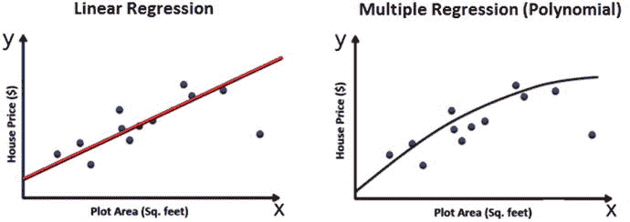

图 1-16.

监督学习：房价预测的回归模型

这里的基本思想是，我们试图确定数据特征“地块面积”与结果变量（即房价，也是我们想要预测的目标）之间是否存在任何关系或关联。因此，一旦我们学习了图 1-16 中描绘的这种趋势或关系，我们就可以预测未来任何给定地块的房价。如果你仔细观察了该图，我们特意描绘了两种类型的模型，以说明构建训练数据模型可以有多种方式。主要目标是在训练和验证模型时最小化误差，以便模型能够很好地泛化，不会过拟合或仅偏向于训练数据，并在未来的预测中表现良好。

简单线性回归模型试图对具有一个特征或解释变量 x 和一个单一响应变量 y 的数据进行关系建模，其目标是预测 y。像普通最小二乘法（OLS）这样的方法通常用于在模型训练期间获得最佳线性拟合。

多元回归也称为多变量回归。这些方法试图对数据进行建模，其中每个观测值有一个响应输出变量 y，但解释变量是以向量 X 形式存在的多个变量，而不是单个解释变量。其思想是基于 X 中存在的不同特征来预测 y。一个现实世界的例子是扩展我们的房价预测模型，构建一个更复杂的模型，在该模型中，我们基于多个特征（而不仅仅是每个数据样本中的地块面积）来预测房价。这些特征可以用向量表示为：地块面积、卧室数量、浴室数量、总楼层数、是否装修。基于所有这些属性，模型试图学习每个特征向量与其对应房价之间的关系，以便将来能够进行预测。

多项式回归是多元回归的一种特殊情况，其中响应变量 y 被建模为输入特征 x 的 n 次多项式。它本质上是多元回归，其中输入特征向量中的每个特征都是 x 的倍数。图 1-16 中右侧用于预测房价的模型是一个 2 次多项式模型。

非线性回归方法试图基于对输入特征和必要模型参数应用非线性函数的组合，来对输入特征和输出之间的关系进行建模。


Lasso 回归是一种特殊的回归形式，它在执行常规回归的同时，通过正则化以及特征或变量选择来很好地泛化模型。Lasso 代表最小绝对收缩和选择算子。在 Lasso 回归中，通常使用 L1 范数作为正则化项。

岭回归是另一种特殊的回归形式，它执行常规回归，并通过正则化来防止模型过拟合，从而泛化模型。在岭回归中，通常使用 L2 范数作为正则化项。

广义线性模型是通用框架，可用于对预测不同类型输出响应（包括连续数据、离散数据和有序数据）的数据进行建模。像逻辑回归这样的算法用于分类数据，而有序概率回归用于有序数据。

## 无监督学习

监督学习方法通常需要一些训练数据，其中我们试图预测的结果已经以离散标签或连续值的形式存在。然而，我们常常没有预先标记训练数据的自由或优势，但仍然希望从数据中提取有用的见解或模式。在这种情况下，无监督学习方法非常强大。这些方法被称为无监督，是因为模型或算法试图从给定数据中学习固有的潜在结构、模式和关系，而没有任何帮助或监督，例如以标记输出或结果的形式提供注释。

无监督学习更关注于试图从数据中提取有意义的见解或信息，而不是基于先前可用的监督训练数据来预测某些结果。无监督学习的结果存在更多不确定性，但你也可以从这些模型中获得大量信息，这些信息仅通过查看原始数据是无法获得的。通常，无监督学习可能是构建大型智能系统所涉及的任务之一。例如，我们可以利用英语词汇知识，通过无监督学习获取推文情感的可能结果标签，然后在类似的数据点及其结果（我们之前通过无监督学习获得的）上训练一个监督模型。对于使用哪种特定技术，并没有硬性规定。只要相关且能解决问题，你总是可以组合多种方法。无监督学习方法可以归类到以下与无监督学习相关的机器学习任务大类中。

*   聚类
*   降维
*   异常检测
*   关联规则挖掘

我们将在以下各节中简要探讨这些任务，以便深入了解无监督学习方法在现实世界中的应用。

### 聚类

聚类方法是机器学习方法，它们试图在我们的数据集中找到数据样本之间的相似性和关系模式，然后根据固有的属性或特征，将这些样本聚类成不同的组，使得每组或每个簇的数据样本具有某种相似性。这些方法完全是无监督的，因为它们通过查看数据特征来聚类数据，而无需任何先前的训练、监督或关于数据属性、关联和关系的知识。

考虑一个现实世界的问题：在数据中心运行多台服务器，并尝试分析日志以查找典型问题或错误。我们的主要任务是确定通常每周频繁出现的各种日志消息。简单来说，我们希望根据某些固有特征将日志消息分组到不同的簇中。一种简单的方法是从日志消息中提取特征（这些特征将是文本格式），然后对其应用聚类，并根据内容相似性将相似的日志消息分组在一起。图 1-17 展示了聚类如何解决这个问题。基本上，我们从原始日志消息开始。我们的聚类系统将采用特征提取，从文本中提取特征，如单词出现、短语出现等。最后，将采用像 K-means 或层次聚类这样的聚类算法，根据消息固有特征的相似性对消息进行分组或聚类。

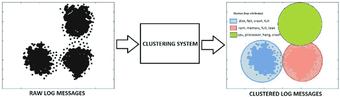

图 1-17.

无监督学习：聚类日志消息

从图 1-17 中可以清楚地看出，我们的系统有三个不同的日志消息簇，其中第一个簇描述磁盘问题，第二个簇是关于内存问题，第三个簇是关于处理器问题。图中还展示了有助于区分簇并将相似数据样本（日志）分组在一起的主要特征词。当然，有时某些特征可能出现在多个数据样本中，因此簇之间也可能存在轻微重叠，因为这是无监督学习。然而，主要目标始终是创建簇，使得每个簇的元素彼此接近，而与其他簇的元素相距较远。

有多种类型的聚类方法，可以归类为以下几种主要方法。

*   基于质心的方法，如 K-means 和 K-medoids
*   层次聚类方法，如凝聚式和分裂式（Ward 法、亲和传播）
*   基于分布的聚类方法，如高斯混合模型
*   基于密度的方法，如 dbscan 和 optics。

除此之外，最近还出现了一些聚类方法，如`birch`和`clarans`。

### 降维

一旦我们开始从原始数据样本中提取属性或特征，有时我们的特征空间会因数量庞大的特征而变得臃肿。这带来了多重挑战，包括分析和可视化具有数千或数百万个特征的数据，这使得特征空间极其复杂，从而在训练模型、内存和空间限制方面带来问题。事实上，这被称为“维度灾难”。在这些场景中，也可以使用无监督方法，即减少每个数据样本的特征或属性数量。这些方法通过提取或选择一组主成分或代表性特征来减少特征变量的数量。有多种流行的降维算法可用，如主成分分析（PCA）、最近邻和判别分析。图 1-18 展示了应用于瑞士卷 3D 结构（具有三个维度）的典型特征降维过程的输出，使用 PCA 为每个数据样本获得一个二维特征空间。

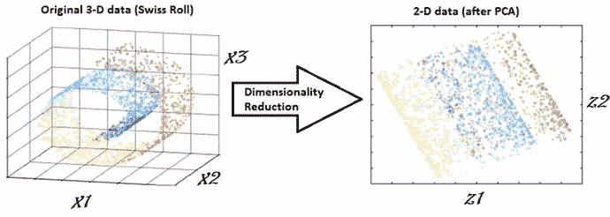

图 1-18.

无监督学习：降维

从图 1-18 中可以清楚地看出，每个数据样本最初具有三个特征或维度，即 D(x1, x2, x3)，在应用 PCA 后，我们将数据集中的每个数据样本降为两个维度，即 D’(z1, z2)。降维技术可以分为以下两种主要方法。

*   特征选择方法：从原始特征列表中为每个数据样本选择特定特征，并丢弃其他特征。此过程中不会生成新特征。
*   特征提取方法：我们从数据中的原始特征列表中设计或提取新特征。因此，降维后的特征子集将包含新生成的特征，这些特征不属于原始特征集。PCA 属于此类别。


### 异常检测

异常检测的过程也被称为离群点检测，其目标是基于历史数据样本，找出通常不会正常发生的罕见事件或观测值。有时异常发生频率很低，因此属于罕见事件；而在其他情况下，异常可能并不罕见，但会在短时间内集中爆发，从而具有特定的模式。无监督学习方法可用于异常检测，即我们在包含正常、非异常数据样本的训练数据集上训练算法。一旦算法学习了正常样本中属性间的必要数据表示、模式和关系，对于任何新的数据样本，它就能利用所学知识将其识别为异常点或正常数据点。图 1-19 描绘了一些典型的基于异常检测的场景，在这些场景中，你可以应用监督方法（如单类支持向量机）和无监督方法（如聚类、K 近邻、自编码器等），根据数据和特征来检测异常。

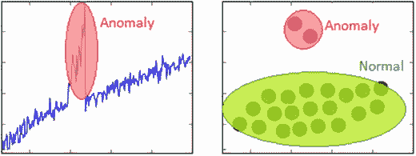

图 1-19.

无监督学习：异常检测

基于异常检测的方法在现实场景中非常流行，例如检测安全攻击或入侵、信用卡欺诈、制造异常、网络问题等等。

### 关联规则挖掘

通常，关联规则挖掘是一种数据挖掘方法，用于检查和分析大型事务数据集，以发现感兴趣的模式和规则。这些模式代表了事务中不同项目之间的有趣关系和关联。关联规则挖掘也常被称为购物篮分析，用于分析客户的购物模式。关联规则有助于基于从训练事务中获得的知识来检测和预测事务模式。利用这项技术，我们可以回答诸如“人们倾向于一起购买哪些商品”之类的问题，从而找出频繁项集。我们还可以关联或关联产品与项目，例如，在酒吧买啤酒的人往往也会买鸡翅。图 1-20 展示了一个典型的关联规则挖掘方法在事务数据集上理想的工作方式。

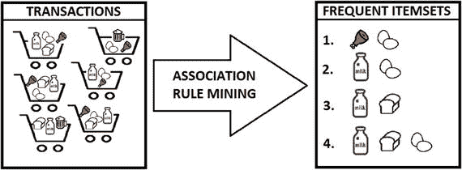

图 1-20.

无监督学习：关联规则挖掘

从图 1-20 可以清楚地看到，基于一段时间内不同客户的交易，我们获得了紧密关联且客户倾向于一起购买的商品。其中一些频繁项集被描绘为 {肉，蛋}、{牛奶，蛋} 等等。判断高质量关联规则或频繁项集的标准通常使用支持度、置信度和提升度等指标。

这是一种无监督方法，因为我们事先不知道频繁项集是什么，也不知道哪些项目与哪些项目关联性更强。只有在应用了诸如 Apriori 算法或 FP-growth 算法之后，我们才能检测和预测彼此紧密关联的产品或项目，并发现条件概率依赖关系。我们将在第 8 章进一步详细介绍关联规则挖掘。

## 半监督学习

半监督学习方法通常介于监督学习和无监督学习方法之间。这些方法通常使用大量未标记的训练数据（构成无监督学习部分）和少量预先标记和注释的数据（构成监督学习部分）。有多种技术可用，包括生成方法、基于图的方法和基于启发式的方法。

一种简单的方法是，基于有限的标记数据构建一个监督模型，然后将该模型应用于大量未标记数据以获取更多标记样本，再在这些样本上训练模型，并重复此过程。另一种方法是使用无监督算法对相似的数据样本进行聚类，通过人工参与的方式手动注释或标记这些分组，然后在未来结合使用这些信息。这种方法被用于许多图像标记系统。介绍半监督方法超出了本书的当前范围。

## 强化学习

强化学习方法与传统的监督或无监督方法略有不同。在此背景下，我们有一个智能体，我们希望在一段时间内训练它，使其能够与特定环境交互，并根据它对环境执行的动作类型，随着时间的推移提高其性能。通常，智能体从一组与环境交互的策略或方针开始。通过观察环境，它根据规则或策略以及当前环境状态采取特定动作。基于该动作，智能体获得一个奖励，该奖励可能是有益的，也可能以惩罚的形式是有害的。它会在必要时更新其当前的策略和方针，这个迭代过程会持续进行，直到它充分了解其环境以获得期望的奖励。强化学习方法的主要步骤如下所述。

1.  为智能体准备一组初始策略和方针
2.  观察环境和当前状态
3.  选择最优策略并执行动作
4.  获得相应的奖励（或惩罚）
5.  必要时更新策略
6.  迭代重复步骤 2 至 5，直到智能体学习到最优策略

考虑一个现实世界的问题：尝试让机器人或机器学会下棋。在这种情况下，智能体是机器人，环境和状态是棋盘和棋子的位置。图 1-21 描绘了一种合适的强化学习方法。

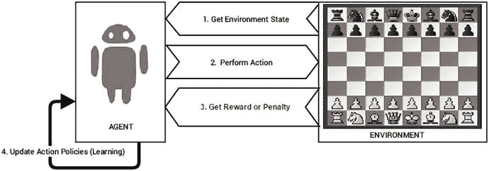

图 1-21.

强化学习：训练机器人下棋

让机器人学会下棋所涉及的主要步骤如图 1-21 所示。这基于前面讨论的任何强化学习方法的基本步骤。事实上，谷歌的 DeepMind 构建的 AlphaGo AI 就包含了强化学习的组件，用于训练系统下围棋。


## 批量学习

批量学习方法也常被称为离线学习方法。这些机器学习方法用于端到端的机器学习系统，其中模型会一次性使用所有可用的训练数据进行训练。一旦训练完成，模型完成了学习过程，并在获得令人满意的性能后，它就会被部署到生产环境中，用于对新数据样本进行预测。然而，模型并不会随着时间的推移持续地利用新数据进行学习。一旦训练完成，模型就停止学习了。因此，由于模型是用单一批次的数据进行训练，并且这通常是一次性的过程，所以被称为批量学习或离线学习。

我们总是可以用新数据来训练模型，但那样我们就必须将新的数据样本与旧的历史训练数据一起添加，然后使用这个新的数据批次重新构建模型。如果大部分模型构建工作流程已经实现，重新训练模型并不会耗费太多精力；然而，随着每个新数据样本的加入，数据规模变得越来越大，重新训练过程会随着时间的推移开始消耗更多的处理器、内存和磁盘资源。当你在构建那些将在资源有限的系统上运行的模型时，这些都是需要考虑的一些要点。

## 在线学习

与批量学习方法不同，在线学习方法以不同的方式工作。训练数据通常以多个增量批次的方式输入给算法。在机器学习术语中，这些数据批次也被称为小批量。然而，与批量学习方法不同，训练过程并不会就此结束。它会根据发送给它进行预测的新数据样本，随着时间的推移持续学习。基本上，它会在处理新数据的过程中即时进行预测和学习，而无需在之前的数据样本上重新运行整个模型。

在线学习有几个优点——它适用于那些模型可能需要随着新数据样本的到来而持续学习和重新训练的现实场景。设备故障或异常预测以及股票市场预测等问题是两个相关的应用场景。除此之外，由于数据是以增量小批量的方式输入给模型，你可以在普通硬件上构建这些模型，而无需担心内存或磁盘限制，因为与批量学习方法不同，你不需要在训练模型之前将整个数据集加载到内存中。此外，一旦模型在数据集上完成训练，你就可以删除这些数据，因为模型是增量学习的，并且会记住过去学到的东西，我们不再需要相同的数据。

在线学习方法的一个主要缺点是，不良的数据样本可能会对模型性能产生不利影响。所有的机器学习方法都遵循“垃圾进，垃圾出”的原则。因此，如果你向一个训练良好的模型提供不良的数据样本，它可能会开始学习那些没有实际意义的关系和模式，这最终会影响模型的整体性能。由于在线学习方法会根据新的数据样本持续学习，你应该确保有适当的检查机制，以便在模型性能突然下降时通知你。同时，应谨慎选择合适的学习率等模型参数，以确保模型不会过拟合或因为特定的数据样本而产生偏差。

## 基于实例的学习

有多种方法可以构建机器学习模型，这些方法试图基于输入数据进行泛化。基于实例的学习涉及那些使用原始数据点本身来为新的、未见过的数据样本找出结果的机器学习系统和方法，而不是在训练数据上构建一个显式模型然后再进行测试。

一个简单的例子是 K 近邻算法。假设 `k = 3`，我们有初始的训练数据。机器学习方法从特征中了解数据的表示，包括其维度、每个数据点的位置等等。对于任何新的数据点，它将使用相似性度量（如余弦距离或欧几里得距离）来找到与该新数据点最近的三个输入数据点。一旦确定了这一点，我们只需取这三个训练点结果的多数值，并将其预测或分配为该新数据点的结果标签/响应。因此，基于实例的学习通过查看输入数据点并使用相似性度量来泛化并对新数据点进行预测。

## 基于模型的学习

基于模型的学习方法是一种更传统的、基于训练数据进行泛化的机器学习方法。通常会发生一个迭代过程，其中输入数据被用于提取特征，并基于各种模型参数（称为超参数）构建模型。这些超参数基于各种模型验证技术进行优化，以选择在训练数据以及部分验证和测试数据（从初始数据集中拆分出来）上泛化能力最好的模型。最后，在需要时使用最佳模型进行预测或决策。

## CRISP-DM 流程模型

CRISP-DM 模型代表“跨行业数据挖掘标准流程”。更广为人知的是其缩写本身，CRISP-DM 是一个经过尝试、测试且稳健的行业标准流程模型，用于数据挖掘和分析项目。CRISP-DM 清晰地描述了执行任何项目所需的步骤、流程和工作流，从正式化业务需求到测试和部署解决方案，以将数据转化为洞察。数据科学、数据挖掘和机器学习都涉及尝试运行多个迭代过程，以从数据中提取洞察和信息。因此，我们可以说分析数据既是一门艺术，也是一门科学，因为它并不总是毫无理由地运行算法；大部分主要工作涉及理解业务、所投入努力的实际价值，以及正确阐述最终结果和洞察的方法。

CRISP-DM 模型告诉我们，要为任何分析项目或系统构建端到端的解决方案，总共有六个主要步骤或阶段，其中一些是迭代的。就像软件开发项目有包含几个主要阶段或步骤的软件开发生命周期一样，在这个场景中，我们有一个数据挖掘或分析生命周期。图 1-22 使用 CRISP-DM 模型描绘了数据挖掘生命周期。

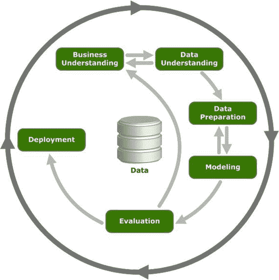

图 1-22.

展示数据挖掘生命周期的 CRISP-DM 模型

图 1-22 清晰地显示，数据挖掘生命周期总共有六个主要阶段，并且用箭头指示了前进的方向。这个模型不是一个僵化的规定，而是一个框架，用于确保你在进行任何分析项目的生命周期时走在正确的轨道上。在某些场景中，比如异常检测或趋势分析，你可能对数据理解、探索和可视化更感兴趣，而不是密集的建模。这六个阶段中的每一个都将在下面详细描述。


### 业务理解

这是在全面启动任何项目之前的初始阶段，但这也是生命周期中最重要的阶段之一！此阶段的主要目标始于理解待解决问题的业务背景和需求。业务需求的定义对于将业务问题转化为数据挖掘或分析问题，以及为客户和解决方案团队设定期望和成功标准至关重要。此阶段的最终交付物将是一份详细计划，包含项目的主要里程碑、预期时间表，以及成功标准、假设、约束、注意事项和挑战。

#### 定义业务问题

此阶段的首要任务是着手理解待解决问题的业务目标，并构建问题的正式定义。以下几点对于清晰阐述和定义业务问题至关重要。

*   获取待解决问题的业务背景，借助领域专家和主题专家（SME）评估问题。
*   描述待解决的业务目标的主要痛点或目标领域。
*   了解当前已有的解决方案、不足之处以及需要改进的地方。
*   根据业务人员、数据科学家、分析师和 SME 的输入，定义业务目标以及相应的交付物和成功标准。

#### 评估与分析场景

一旦业务问题被清晰定义，主要任务就包括根据业务问题定义来分析和评估当前场景。这包括审视当前可用资源，并记录从资源、人员到数据等所需的各种项目。除此之外，还需要讨论对风险和应急计划的适当评估。此评估阶段的主要步骤如下所述。

*   从数据、人员、资源时间和风险等多个角度评估和分析当前可用于解决问题的资源。
*   编写一份关于所需关键资源（包括硬件和软件）及参与人员的简要报告。如有任何不足，务必在必要时指出。
*   逐一讨论业务目标需求，然后在 SME 的帮助下识别并记录每个需求可能存在的假设和约束。
*   根据可用数据验证假设和约束（其中许多可能只有在详细分析后才能回答，因此这取决于待解决的问题和可用数据）。
*   记录并报告项目中可能涉及的风险，包括时间线、资源、人员、数据和财务方面的担忧。为每种可能的情况制定应急计划。
*   讨论成功标准，并在需要时尝试记录一份比较性的投资回报或成本与价值分析。这只需作为一个粗略的基准，以确保项目符合公司或业务愿景。

#### 定义数据挖掘问题

这可以定义为预分析阶段，在成功标准和业务问题被定义，并且所有风险、假设和约束都已记录后开始。此阶段涉及与分析师、数据科学家和开发人员进行详细的技术讨论，并保持与业务利益相关者的同步。以下是此阶段需要完成的关键任务。

*   通过评估可能的工具、算法和技术，讨论并记录适用于解决方案的机器学习和数据挖掘方法。
*   为端到端解决方案架构制定高层设计。
*   记录解决方案的最终输出是什么，以及它将如何与现有业务组件集成。
*   从数据科学的角度记录成功评估标准。一个简单的例子是确保预测准确率至少达到 80%。

#### 项目计划

这是业务理解阶段的最后一步。通常会创建一个项目计划，其中包含 CRISP-DM 模型中的全部六个主要阶段、预估时间线、分配的资源与人员，以及可能的风险和应急计划。需注意确保为每个阶段定义具体的高层交付物和成功标准，并突出显示诸如建模等迭代阶段，例如添加注释说明基于 SME 的反馈可能需要在部署前重建和重新调整模型。

一旦你涵盖了以下几点，就应该为下一步做好准备。

*   问题的业务目标定义
*   业务和数据挖掘工作的成功标准
*   预算分配和资源规划
*   清晰、定义明确的机器学习和数据挖掘方法论，包括从探索到部署的高层工作流程
*   包含 CRISP-DM 模型所有六个阶段的详细项目计划，并定义了预估时间线和风险

### 数据理解

CRISP-DM 流程的第二阶段涉及在开始分析过程之前，深入研究可用数据并进一步了解其细节。这包括收集数据、描述各种属性、对数据进行一些探索性分析，并关注数据质量。此阶段不应被忽视，因为糟糕的数据或对可用数据了解不足，可能会在流程的后续阶段产生级联的不利影响。

#### 数据收集

此任务旨在提取、整理和收集实现业务目标所需的所有必要数据。通常这涉及利用组织的历史数据仓库、数据集市、数据湖等。根据组织中现有的可用数据进行评估，并判断是否需要额外数据。这些数据可以从网络（即开放数据源）获取，也可以通过调查、购买、实验和模拟等其他渠道获得。应使用详细文档记录所有将用于分析的数据集以及任何必要的额外数据源。此文档可与本阶段的后续步骤合并。

#### 数据描述

数据描述涉及对数据进行初步分析，以了解更多关于数据的信息，包括其来源、数量、属性和关系。一旦记录了这些细节，任何发现的不足之处都应通知相关人员。以下因素对于构建一份恰当的数据描述文档至关重要。

*   数据源（SQL、NoSQL、大数据）、来源记录（ROO）、参考记录（ROR）
*   数据量（大小、记录数、总数据库数、表数）
*   数据属性及其描述（变量、数据类型）
*   关系和映射方案（理解属性表示）
*   基本描述性统计（均值、中位数、方差）
*   关注哪些属性对业务重要

#### 探索性数据分析

探索性数据分析，也称为 EDA，是生命周期中第一个主要的分析阶段之一。这里的主要目标是详细探索和理解数据。你可以利用描述性统计、图表和可视化来查看各种数据属性，发现关联和相关性，并记录任何数据质量问题。以下是此阶段的一些主要任务。

*   探索、描述和可视化数据属性
*   选择对问题似乎最重要的数据和属性子集
*   进行广泛分析以发现相关性和关联性，并检验假设
*   记录任何缺失的数据点


#### 数据质量分析

数据质量分析是数据理解阶段的最后一步，在此阶段，我们分析数据集中数据的质量，并记录在进一步分析数据或开始建模工作之前需要解决的潜在错误、缺陷和问题。数据质量分析的主要关注点包括以下内容。

*   缺失值
*   不一致的值
*   因数据错误（手动/自动）导致的错误信息
*   错误的元数据信息

### 数据准备

CRISP-DM 流程的第三阶段是在对业务问题和相关数据集获得足够了解之后进行的。数据准备主要是一系列任务，旨在运行任何分析或机器学习方法以及构建模型之前，对数据进行清洗、整理、管理和准备。在本节中，我们将简要讨论数据准备阶段的一些主要任务。这里需要记住的一个重要点是，数据准备通常是数据挖掘生命周期中最耗时的阶段，通常占整个项目 60% 到 70% 的时间。然而，这个阶段必须非常认真地对待，因为正如我们之前多次讨论过的，糟糕的数据会导致糟糕的模型以及低下的性能和结果。

#### 数据集成

数据集成过程主要在我们有多个可能想要集成或合并的数据集时进行。这可以通过两种方式完成。通过组合多个数据集来追加它们，这通常针对具有相同属性的数据集进行。通过使用公共字段（如键）来合并具有不同属性或列的多个数据集。

#### 数据整理

数据整理或数据清洗的过程涉及数据处理、清洗、规范化和格式化。原始形式的数据很少能被机器学习方法直接用于构建模型。因此，我们需要根据数据的形式对其进行处理，清理潜在的错误和不一致性，并将其格式化为机器学习算法更易使用的格式。以下是数据整理相关的主要任务。

*   处理缺失值（删除行、填充缺失值）
*   处理数据不一致性（删除行、属性，修复不一致性）
*   修复错误的元数据和注释
*   处理模糊的属性值
*   将数据整理并格式化为必要的格式（CSV、Json、关系型）

#### 属性生成与选择

数据由观测值或样本（行）以及属性或特征（列）组成。属性生成的过程在机器学习术语中也称为特征提取和特征工程。属性生成基本上是根据某些规则、逻辑或假设，从现有属性中创建新的属性或变量。一个简单的例子是，根据两个日期时间字段——`current_date` 和 `birth_date`——为一个组织的员工数据集创建一个名为 `age` 的新数值变量。关于属性生成，有几种技术，我们将在后续章节中讨论。

属性选择基本上是根据属性重要性、质量、相关性、假设和约束等参数，从数据集中选择一个特征或属性子集。有时甚至使用机器学习方法根据数据选择相关属性。这在机器学习术语中通常被称为特征选择。

### 建模

CRISP-DM 流程的第四阶段是该流程的核心阶段，大部分分析工作在此进行，涉及使用清洗后的格式化数据及其属性来构建模型以解决业务问题。这是一个迭代过程，如图 1-22 先前所示，包括模型评估以及所有通向建模的前置步骤。基本思想是迭代地构建多个模型，试图找到最能满足我们成功标准、数据挖掘目标和业务目标的模型。在本节中，我们简要讨论与建模相关的一些主要阶段。

#### 选择建模技术

在此阶段，我们挑选出“业务理解”阶段列出的一系列相关的机器学习和数据挖掘工具、框架、技术和算法。通常根据数据分析师和数据科学家的输入和见解，选择那些被证明在解决问题方面稳健且有用的技术。这些主要取决于当前可用的数据、业务目标、数据挖掘目标、算法要求和约束条件。

#### 模型构建

模型构建的过程也称为使用数据集中的数据和特征来训练模型。数据（特征）和机器学习算法的组合共同为我们提供了一个模型，该模型试图在训练数据上进行泛化，并以洞察和/或预测的形式提供必要的结果。通常使用各种算法，在相同数据上尝试多种建模方法来解决相同问题，以获取性能最佳且输出最接近业务成功标准的模型。这里需要跟踪的关键事项是创建的模型、正在使用的模型参数及其结果。

#### 模型评估与调优

在此阶段，我们根据多个指标（如模型准确率、精确率、召回率、F1 分数等）评估每个模型。我们还基于网格搜索和交叉验证等技术调整模型参数，以获得能给我们带来最佳结果的模型。调优后的模型还会与数据挖掘目标进行匹配，以检查我们是否能够获得期望的结果和性能。模型调优在机器学习领域也称为超参数优化。

#### 模型评估

一旦我们有了能够提供理想且相关结果的模型，就会根据以下参数对模型进行详细评估。

*   模型性能符合定义的成功标准
*   模型结果可重现且一致
*   可扩展性、稳健性和易于部署
*   模型未来的可扩展性
*   模型评估给出令人满意的结果

### 评估

CRISP-DM 流程的第五阶段是在我们从建模阶段获得最终模型之后进行的，这些模型满足我们数据挖掘目标的必要成功标准，并且在模型评估指标（如准确率）方面具有期望的性能和结果。评估阶段涉及对最终模型及其获得的结果进行详细评估和审查。本节评估的一些要点如下。

*   根据结果质量及其与业务目标一致性的相关性对最终模型进行排名
*   模型证明无效的任何假设或约束
*   从数据提取和处理到建模和预测的整个机器学习管道的部署成本
*   整个过程中是否存在任何痛点？应该推荐什么？应该避免什么？
*   基于结果的数据充分性报告
*   来自解决方案团队和 SME 的最终建议、反馈和推荐

基于这些要点形成的报告，经过讨论，团队可以决定是继续进入模型部署的下一个阶段，还是需要从业务和数据理解到建模进行完整的重新迭代。


### 部署

CRISP-DM 流程的最后阶段，是将选定的模型部署到生产环境，并确保从开发到生产的过渡无缝衔接。通常，大多数组织会遵循标准的投产方法论。基于所需的资源、服务器、硬件、软件等，制定合适的部署计划。模型经过验证、保存，并部署到必要的系统和服务器上。同时，还需制定定期监控和维护模型的计划，以持续评估其性能，检查结果及其有效性，并在需要时停用、替换和更新模型。

## 构建机器智能

机器学习、数据挖掘或人工智能的目标是让我们的生活更轻松、实现任务自动化并做出更优决策。构建机器智能涉及我们迄今为止学到的所有知识，从机器学习概念开始，到实际实现和构建模型，并在现实世界中使用它们。机器智能可以通过非传统的计算方法（如机器学习）来构建。在本节中，我们将基于 CRISP-DM 模型建立完整的端到端机器学习流水线，这将帮助我们通过结构化流程构建机器智能来解决现实世界的问题。

### 机器学习流水线

解决现实世界机器学习或分析问题的最佳方法是使用机器学习流水线，从获取数据开始，到使用机器学习算法和技术将数据转化为信息和洞察。这更像是一个基于技术或解决方案的流水线，它假设 CRISP-DM 模型的几个方面已经涵盖，包括以下几点。

*   业务与数据理解
*   机器学习/数据挖掘技术选择
*   风险、假设和约束评估

机器学习流水线主要包含与数据检索与提取、准备、建模、评估和部署相关的元素。图 1-23 展示了一个标准机器学习流水线的高级概览，其主要阶段在各自的区块中突出显示。

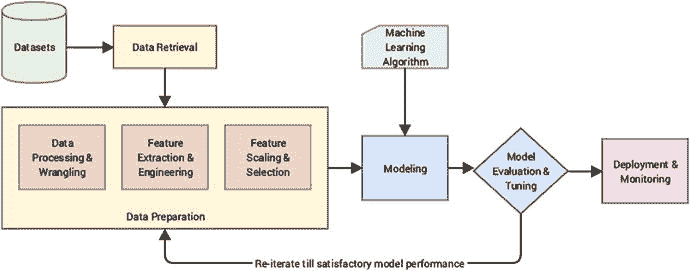

图 1-23.

标准机器学习流水线

从图 1-23 可以明显看出，机器学习流水线中有几个主要阶段，它们与 CRISP-DM 流程模型非常相似，这就是我们之前详细讨论它的原因。此处简要提及流水线中的主要步骤。

*   **数据检索**：这主要是从各种数据源和数据存储中进行数据收集、提取和获取。我们将在第 3 章“处理、整理和可视化数据”中详细介绍数据检索机制。
*   **数据准备**：在此步骤中，我们对数据进行预处理、清洗、整理和按需操作。还会进行初步的探索性数据分析。接下来的步骤涉及从数据中提取、工程化并选择特征/属性。
    *   **数据处理与整理**：主要涉及数据处理、清洗、整理、规整以及执行初步的描述性和探索性数据分析。我们将在第 3 章“处理、整理和可视化数据”中通过动手示例进一步详细介绍这一点。
    *   **特征提取与工程化**：在此，我们从原始数据中提取重要特征或属性，甚至从现有特征中创建或工程化新特征。第 4 章“特征工程与选择”涵盖了各种特征工程技术细节。
    *   **特征缩放与选择**：数据特征通常需要进行归一化和缩放，以防止机器学习算法产生偏差。除此之外，我们通常需要根据特征重要性和质量，从所有可用特征中选择一个子集。这个过程称为特征选择。第 4 章“特征工程与选择”涵盖了这些方面。
*   **建模**：在建模过程中，我们通常将数据特征输入到机器学习方法或算法中，并训练模型，通常是为了优化特定的成本函数，目标是在大多数情况下减少误差并泛化从数据中学到的表示。第 5 章“构建、调优和部署模型”涵盖了构建机器学习模型背后的艺术与科学。
*   **模型评估与调优**：构建的模型在验证数据集上进行评估和测试，并根据准确率、F1 分数等指标评估模型性能。模型具有各种参数，这些参数在一个称为超参数优化的过程中进行调整，以获得具有最佳和最优结果的模型。第 5 章“构建、调优和部署模型”涵盖了这些方面。
*   **部署与监控**：选定的模型部署到生产环境中，并根据其预测和结果进行持续监控。模型部署的细节在第 5 章“构建、调优和部署模型”中介绍。

### 监督机器学习流水线

到目前为止，我们知道监督机器学习方法涉及使用带标签的监督数据来训练模型，然后预测新数据样本的结果。一些过程，如特征工程、缩放和选择，应始终保持一致，以便使用相同的特征来训练模型，并从新数据样本中提取相同的特征以在预测阶段输入模型。基于我们之前通用的机器学习流水线，图 1-24 展示了一个标准的监督机器学习流水线。

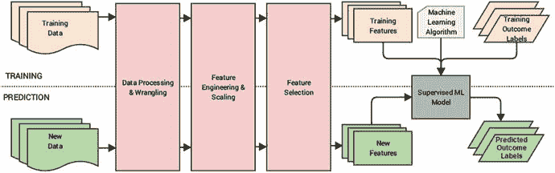

图 1-24.

监督机器学习流水线

在图 1-24 中可以清晰地看到模型训练和预测两个阶段。此外，基于我们之前提到的，相同的数据处理、整理、特征工程、缩放和选择序列，既用于训练模型所用的数据，也用于模型预测结果的未来数据样本。这是你在构建任何监督模型时必须牢记的非常重要的一点。除此之外，如图所示，模型是机器学习（监督）算法与训练数据特征及相应标签的组合。该模型将接收新数据样本的特征，并在预测阶段输出预测标签。


### 无监督机器学习流水线

无监督机器学习旨在从数据中提取模式、关系、关联和聚类。与特征工程、缩放和选择相关的流程与监督学习类似。但这里没有预标记数据的概念。因此，无监督机器学习流水线与监督流水线相比会略有不同。图 1-25 描述了一个标准的无监督机器学习流水线。

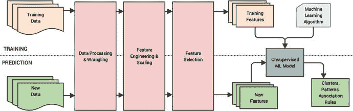

图 1-25.

无监督机器学习流水线

图 1-25 清晰地表明，没有使用监督标记数据来训练模型。由于缺少标签，我们只有训练数据，这些数据会经历与监督学习流水线中相同的数据准备阶段，然后我们使用无监督机器学习算法和训练特征来构建无监督模型。在预测阶段，我们从新的数据样本中提取特征，并将其传递给模型，模型会根据我们试图执行的机器学习任务类型（可以是聚类、模式检测、关联规则或降维）给出相关结果。

## 真实世界案例研究：预测学生助研金推荐

让我们暂时从已学的内容中抽身出来！这里的主要目标是扎实掌握整个机器学习领域，理解关键概念，夯实基础，并了解如何借助机器学习流水线来执行机器学习项目，而 CRISP-DM 流程模型是所有灵感的源泉。让我们将所有这些整合起来，通过在一个玩具数据集上构建一个监督机器学习流水线，来研究一个非常基础的真实世界案例。我们的主要目标如下：假设你有若干名学生，他们具有多个属性，如成绩、表现和分数，你能基于过去的历史数据构建一个模型，来预测该学生获得研究项目助研金推荐的可能性吗？

这将是一个快速演练，主要目的是展示如何构建和部署一个真实的机器学习流水线并执行预测。这也将为你提供良好的动手实践体验，助你入门机器学习。如果你不理解每一行代码的细节，不必过于担心；后续章节将详细介绍这里使用的所有工具、技术和框架。本书将使用 Python 3.5；你可以参考第 2 章“Python 机器学习生态系统”，以了解更多关于 Python 以及机器学习中使用的各种工具和框架的信息。你可以跟随本节中的代码片段进行操作，或者在与本笔记本相同的目录下，通过在命令行/终端中运行 `jupyter notebook` 来打开 `Predicting Student Recommendation Machine Learning Pipeline.ipynb` 的 Jupyter 笔记本。然后，你可以从浏览器中运行笔记本中的相关代码片段。第 2 章将详细介绍 Jupyter 笔记本。

### 目标

你拥有历史学生表现数据及其助研金推荐结果，这些数据存储在一个名为 `student_records.csv` 的逗号分隔值文件中。每个数据样本包含以下属性。

*   `Name`（学生姓名）
*   `OverallGrade`（获得的总体成绩）
*   `Obedient`（他们在学习期间是否勤奋）
*   `ResearchScore`（在研究工作中获得的分数）
*   `ProjectScore`（在项目中获得的分数）
*   `Recommend`（他们是否获得了助研金推荐）

你的主要目标是基于这些数据构建一个预测模型，以便能够根据未来任何学生的表现属性预测他们是否会被推荐获得助研金。

### 数据检索

在这里，我们将利用 `pandas` 框架从 CSV 文件中检索数据。以下代码片段展示了如何检索数据并查看它。

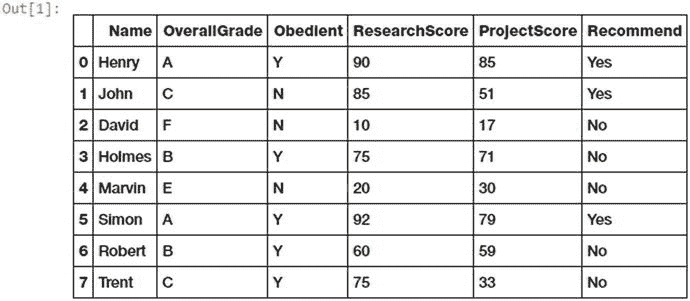

图 1-26.

显示学生记录及其推荐结果的原始数据

```
In [1]: import pandas as pd
...: # 关闭警告信息
...: pd.options.mode.chained_assignment = None  # 默认='warn'
...:
...: # 获取数据
...: df = pd.read_csv('student_records.csv')
...: df
```

现在，我们在图 1-26 中可以看到显示每个学生记录及其相应推荐结果的数据样本，接下来我们将执行与数据准备相关的必要任务。

### 数据准备

基于我们之前看到的数据集，没有任何数据错误或缺失值，因此本节我们将主要关注特征工程和缩放。

#### 特征提取与工程

让我们首先从数据集中提取现有特征和结果，并分别存入不同的变量。以下代码片段展示了这一过程。见图 1-27 和图 1-28。

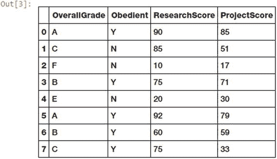

图 1-27.

数据集特征

```
In [2]: # 获取特征和对应的结果
...: feature_names = ['OverallGrade', 'Obedient', 'ResearchScore',
'ProjectScore']
...: training_features = df[feature_names]
...:
...: outcome_name = ['Recommend']
...: outcome_labels = df[outcome_name]
In [3]: # 查看特征
...: training_features
```

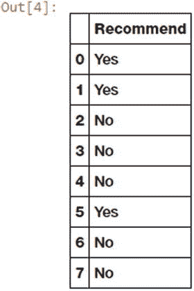

图 1-28.

每个学生的数据集推荐结果标签

```
In [4]: # 查看结果标签
...: outcome_labels
```

现在我们已经从数据中提取了初始可用特征及其对应的结果标签，让我们根据特征的类型（数值型和分类型）将它们分开。特征变量的类型将在第 3 章“处理、整理和可视化数据”中更详细地介绍。

```
In [5]: # 根据类型列出特征
...: numeric_feature_names = ['ResearchScore', 'ProjectScore']
...: categoricial_feature_names = ['OverallGrade', 'Obedient']
```

现在，我们将使用 `scikit-learn` 中的标准缩放器，通过以下代码来缩放或标准化我们的两个基于分数的数值属性。

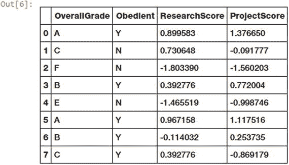

图 1-29.

具有缩放后数值属性的特征集

```
In [6]: from sklearn.preprocessing import StandardScaler
...: ss = StandardScaler()
...:
...: # 在数值特征上拟合缩放器
...: ss.fit(training_features[numeric_feature_names])
...:
...: # 现在缩放数值特征
...: training_features[numeric_feature_names] =
ss.transform(training_features[numeric_feature_names])
...:
...: # 查看更新后的特征集
...: training_features
```

现在我们已经成功缩放了数值特征（见图 1-29），让我们处理分类型特征，并根据以下代码执行必要的特征工程。

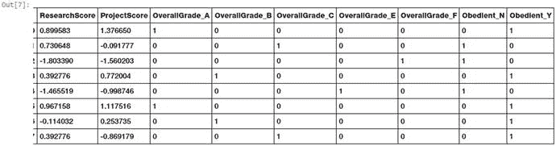

图 1-30.

具有工程化后分类型变量的特征集

```
In [7]: training_features = pd.get_dummies(training_features,
columns=categoricial_feature_names)
...: # 查看新工程化的特征
...: training_features
```

```
In [8]: # 获取新的分类型特征列表
...: categorical_engineered_features = list(set(training_features.columns) -
set(numeric_feature_names))
```

图 1-30 向我们展示了更新后的特征集，其中包含了新工程化的分类型变量。这个过程也称为独热编码。


### 建模

现在，我们将基于特征集，使用逻辑回归算法构建一个简单的分类（监督）模型。以下代码展示了如何构建该监督模型。

```
In [9]: from sklearn.linear_model import LogisticRegression
...: import numpy as np
...:
...: # 拟合模型
...: lr = LogisticRegression()
...: model = lr.fit(training_features,
np.array(outcome_labels['Recommend']))
...: # 查看模型参数
...: model
Out[9]: LogisticRegression(C=1.0, class_weight=None, dual=False,
fit_intercept=True, intercept_scaling=1, max_iter=100,
multi_class='ovr', n_jobs=1, penalty='l2',
random_state=None, solver='liblinear', tol=0.0001,
verbose=0, warm_start=False)
```

因此，从上一输出中的参数可以看出，我们现在拥有了一个基于 L2 正则化逻辑回归模型的监督学习模型。

### 模型评估

通常，模型评估是基于某个与训练数据集不同的保留集或验证数据集进行的，以防止过拟合或模型偏差。由于这是一个基于玩具数据集的示例，让我们使用以下代码片段在训练数据上评估模型的性能。

```
In [10]: # 对训练数据进行简单评估
...: pred_labels = model.predict(training_features)
...: actual_labels = np.array(outcome_labels['Recommend'])
...:
...: # 评估模型性能
...: from sklearn.metrics import accuracy_score
...: from sklearn.metrics import classification_report
...:
...: print('准确率:', float(accuracy_score(actual_labels,
pred_labels))*100, '%')
...: print('分类统计信息:')
...: print(classification_report(actual_labels, pred_labels))
准确率: 100.0 %
分类统计信息:
precision    recall  f1-score   support
No       1.00      1.00      1.00         5
Yes       1.00      1.00      1.00         3
avg / total       1.00      1.00      1.00         8
```

因此，你可以看到我们之前提到的各种指标，如准确率、精确率、召回率和 F1 分数，它们都展示了模型的性能。我们将在第 5 章“构建、调优和部署模型”中详细讨论这些指标。

### 模型部署

我们构建了第一个监督学习模型，为了在系统或服务器上部署该模型，我们需要持久化该模型。我们还需要保存用于缩放数值特征的标量对象，因为我们将使用它来转换新数据样本的数值特征。以下代码片段展示了存储模型和标量对象的一种方法。

```
In [11]: from sklearn.externals import joblib
...: import os
...: # 保存模型以便部署到服务器上
...: if not os.path.exists('Model'):
...:     os.mkdir('Model')
...: if not os.path.exists('Scaler'):
...:     os.mkdir('Scaler')
...:
...: joblib.dump(model, r'Model/model.pickle')
...: joblib.dump(ss, r'Scaler/scaler.pickle')
```

这些文件可以轻松部署到服务器上，并附带必要的代码来重新加载模型并预测新的数据样本，我们将在后续章节中看到这一点。

### 实际预测

现在，我们已经准备好使用新构建并部署的模型开始进行预测！要开始预测，我们需要将模型和标量对象加载到内存中。以下代码帮助我们完成此操作。

```
In [12]: # 加载模型和标量对象
...: model = joblib.load(r'Model/model.pickle')
...: scaler = joblib.load(r'Scaler/scaler.pickle')
```

我们有一些新的学生记录样本（针对两名学生），我们希望模型预测他们是否会获得助学金推荐。让我们使用以下代码检索并查看这些数据。

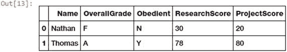

图 1-31.

新学生记录

```
In [13]: ## 数据检索
...: new_data = pd.DataFrame([{'Name': 'Nathan', 'OverallGrade': 'F',
'Obedient': 'N', 'ResearchScore': 30, 'ProjectScore': 20},
...:                          {'Name': 'Thomas', 'OverallGrade': 'A',
'Obedient': 'Y', 'ResearchScore': 78, 'ProjectScore': 80}])
...: new_data = new_data[['Name', 'OverallGrade', 'Obedient',
'ResearchScore', 'ProjectScore']]
...: new_data
```

现在，我们将在以下代码片段中执行与数据准备相关的任务——特征提取、特征工程和特征缩放。

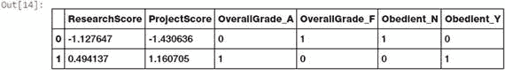

图 1-32.

新学生的更新特征集

```
In [14]: ## 数据准备
...: prediction_features = new_data[feature_names]
...:
...: # 缩放
...: prediction_features[numeric_feature_names] =
scaler.transform(prediction_features[numeric_feature_names])
...:
...: # 对分类变量进行特征工程
...: prediction_features = pd.get_dummies(prediction_features,
columns=categoricial_feature_names)
...:
...: # 查看特征集
...: prediction_features
```

现在，我们拥有了新学生的相关特征！但是，你可以看到，某些分类特征（如 B、C 和 E 等级）缺失了。这是因为这些学生都没有获得这些等级，但我们仍然需要这些属性，因为模型是在包含这些属性的所有属性上训练的。以下代码片段帮助我们识别并添加缺失的分类特征。由于这些学生没有获得这些等级，我们将每个学生的这些特征值都添加为 0。

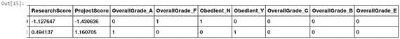

图 1-33.

新学生的最终特征集

```
In [15]: # 添加缺失的分类特征列
...: current_categorical_engineered_features =
set(prediction_features.columns) - set(numeric_feature_names)
...: missing_features = set(categorical_engineered_features) -
current_categorical_engineered_features
...: for feature in missing_features:
...:     # 由于这些数据样本中缺少该特征，因此添加零
...:     prediction_features[feature] = [0] * len(prediction_features)
...:
...: # 查看最终特征集
...: prediction_features
```

我们已经为两名新学生准备好了完整的特征集。让我们测试一下模型，并获得关于助学金推荐的预测结果！

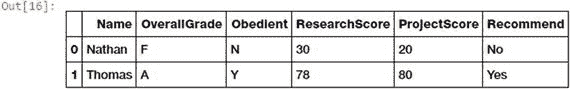

图 1-34.

包含助学金推荐模型预测结果的新学生记录

```
In [16]: ## 使用模型进行预测
...: predictions = model.predict(prediction_features)
...:
...: ## 显示结果
...: new_data['Recommend'] = predictions
...: new_data
```

从图 1-34 中可以清楚地看到，我们的模型已经为两名新学生预测了助学金推荐标签。与 Nathan 相比，Thomas 显然更勤奋，平均成绩全 A 且分数不错，最有可能获得助学金推荐。因此，你可以看到，我们的模型已经学会了如何根据过去的历史学生数据来预测助学金推荐结果。这应该会激发你开始学习机器学习的兴趣。在接下来的章节中，我们将深入探讨更复杂的现实世界问题！


## 机器学习中的挑战

机器学习是一个快速演进、节奏紧凑且令人兴奋的领域，前景广阔、机遇众多、潜力巨大。然而，由于机器学习方法的复杂性、对数据的依赖性以及其并非传统计算范式之一，它也面临着一系列挑战。以下几点涵盖了机器学习中的一些主要挑战。

*   数据质量问题会引发麻烦，尤其是在数据处理和特征提取方面。
*   数据的采集、提取和检索是一个极其繁琐且耗时的过程。
*   在许多场景下缺乏高质量且充足的训练数据。
*   难以用定义明确的目标和目的来清晰地阐述业务问题。
*   特征提取与工程，尤其是手工特征构建，是机器学习中最困难但也是最重要的任务之一。深度学习最近在这方面似乎取得了一些优势。
*   模型的过拟合或欠拟合会导致模型从训练数据中学到糟糕的表示和关系，从而影响性能。
*   维度灾难：过多的特征可能成为真正的障碍。
*   复杂模型难以在实际世界中部署。

这并非当前机器学习所面临挑战的详尽列表，但它绝对是数据科学家或分析师在机器学习项目和任务中通常遇到的主要问题列表。当我们后续章节更详细地讨论机器学习流水线的各个阶段以及解决实际问题时，我们将详细介绍如何处理这些问题。

## 机器学习的实际应用

如今，机器学习在实际世界中得到了广泛应用，用于解决那些基于传统方法和规则系统无法解决的复杂问题。以下列表展示了机器学习的一些实际应用。

*   在线购物平台的产品推荐
*   情感与情绪分析
*   异常检测
*   欺诈检测与预防
*   内容推荐（新闻、音乐、电影等）
*   天气预报
*   股市预测
*   购物篮分析
*   客户细分
*   图像和视频中的物体与场景识别
*   语音识别
*   流失分析
*   点击率预测
*   故障/缺陷检测与预防
*   电子邮件垃圾邮件过滤

## 总结

本章的目的是让你在深入探讨机器学习流水线和解决实际问题之前，熟悉机器学习的基础知识。本章介绍了当今世界对机器学习的需要，重点在于大规模地做出数据驱动的决策。我们还讨论了各种编程范式，以及机器学习如何颠覆了传统的编程范式。接下来，我们从机器学习的正式定义开始，探索了机器学习领域及其相关的各个领域和学科。我们涵盖了数学、统计学、计算机科学、数据科学、数据挖掘、人工智能、自然语言处理和深度学习等领域的基础概念，因为它们都与机器学习相关联，并且在后续章节中我们也将使用这些领域的工具、技术、方法和流程。我们还介绍了与各种机器学习方法相关的概念，包括监督学习、无监督学习、半监督学习和强化学习。还描述了机器学习方法的其他分类，例如批量学习与在线学习方法，以及基于模型的学习与基于实例的学习方法。我们详细解释了 CRISP-DM 流程模型，以概述数据挖掘项目的行业标准流程。从这个模型中借鉴了构建机器学习流水线的思路，我们重点关注监督学习和无监督学习流水线。

我们将本章涵盖的所有内容整合起来，解决了一个小型实际问题——预测学生的助学金推荐，并从零开始构建了一个示例机器学习流水线。这无疑会为你阅读后续章节做好准备，届时你将更详细地探索机器学习流水线的每个阶段，并深入了解 Python 机器学习生态系统。最后但同样重要的是，机器学习的挑战和实际应用将让你对机器学习的广阔范围有很好的认识，并让你意识到与机器学习问题相关的注意事项和陷阱。

