# 4. 特征工程与选择

构建机器学习系统和流水线需要付出巨大的努力，这一点从你在前几章中获得的知识中可见一斑。在第一章中，我们介绍了一些构建机器学习流水线的高级架构。从数据到洞察和信息的过程并非易事，也非一蹴而就。它既困难又具有迭代性，需要数据科学家和分析师多次重复多个步骤，才能找到完美的模型并得出正确的洞察。机器学习算法的一个局限性在于，它们只能将数值作为输入来理解。这是因为，在任何算法的核心，通常都有多个数学方程、约束条件、优化和计算。因此，我们几乎不可能将原始数据直接输入任何算法并期望得到结果。这就是特征和属性在基于数据构建模型时极其有用的原因。

构建机器智能是一个多层次、多方面的过程。在本书中，到目前为止，我们已经探讨了如何检索、处理、整理和可视化数据。探索性数据分析和可视化是更好地理解数据的第一步。理解数据涉及理解包含数据的完整范围，包括领域、约束、注意事项、质量和可用属性。从第 3 章中，你可能还记得数据由多个字段、属性或变量组成。每个属性本身就是数据的一个固有特征。然后，你可以从这些固有特征中推导出更多特征，而这本身就构成了特征工程的主要部分。特征选择是与特征工程相辅相成的另一项重要任务，数据科学家的任务是选择最佳的特征和属性子集，以帮助构建正确的模型。

这里需要记住的一个重要点是，特征工程和选择不是一个可以临时进行的、一次性的过程。构建机器学习系统的本质是迭代的（遵循 CRISP-DM 原则），因此从数据集中提取和工程化特征并非一次性任务。每次构建模型时，你可能都需要提取新特征并尝试多种选择，以便为你的问题找到最佳和最合适的模型。数据科学家通常将数据处理和特征工程描述为构建任何机器学习系统中最困难的任务或步骤。由于既需要领域知识又需要数学变换，特征工程常被认为既是一门艺术，也是一门科学。显而易见的复杂性涉及处理不同类型的数据和变量。除此之外，每个机器学习问题或任务都需要特定的特征，在特征工程中不存在“一刀切”的解决方案。这使得特征工程更加困难和复杂。

因此，我们在本章中采用了一种适当的结构化方法，涵盖了特征工程工作流程中的以下三个主要领域。它们如下所述。

*   特征提取与工程
*   特征缩放
*   特征选择

本章涵盖了上述所有三个主要领域的基本概念。将详细介绍针对多种数据类型（包括数值型、类别型、时间型、文本和图像数据）的特征工程技术。我们要感谢我们的好朋友兼数据科学家 Gabriel Moreira，他帮助我们出色地整理了这些不同数据类型的特征工程技术。我们还将介绍不同的特征缩放方法，这些方法通常作为特征工程过程的一部分，用于归一化数值，防止高值特征占据不必要的主导地位。还将介绍几种特征选择技术，如过滤法、包装法和嵌入法。技术和概念将辅以足够的动手实践示例和代码片段。请务必查看 GitHub 仓库中第 4 章下的相关代码，地址为 [`https://github.com/dipanjanS/practical-machine-learning-with-python`](https://github.com/dipanjanS/practical-machine-learning-with-python)，其中包含必要的代码、笔记本和数据。这将使事情更容易理解，帮助你获得足够的知识，了解在哪种场景下应该使用哪种技术，从而帮助你开启自己的特征工程之旅，以构建机器学习模型！

## 特征：更好地理解你的数据

任何机器学习模型的本质都由两个部分组成，即数据和算法。你可能还记得我们在第 1 章中介绍的机器学习范式。任何机器学习算法本质上都是数学函数、方程和优化的组合，这些通常会根据需要与业务逻辑相结合。这些算法通常不够智能，无法处理原始数据并从中发现用于训练系统的潜在模式。因此，我们需要更好的数据表示来构建机器学习模型，这些表示也称为数据特征或属性。让我们在本节中了解一些与数据和特征相关的重要概念。


### 数据与数据集

数据对于分析和机器学习至关重要。没有数据，我们实际上无法实现任何智能系统。数据的正式定义是：基于观测结果，包含定性和/或定量变量值的集合或集。通常，数据是通过各种观测进行测量和收集的。然后，这些数据以其原始形式存储，之后可以根据需要进一步处理和分析。通常，在任何分析或机器学习系统中，您可能需要多个数据源，并且来自一个组件的处理后的数据可以作为原始数据输入到另一个组件进行进一步处理。数据可以是结构化的，具有明确的表示观测值和属性的行和列；也可以是非结构化的，例如自由文本数据。

数据集可以定义为数据的集合。这通常指以平面文件（如 CSV 文件或 MS Excel 文件）、关系数据库表或视图，甚至是原始数据二维矩阵形式存在的数据。`scikit-learn` 包中提供了在机器学习中非常流行的样本数据集，以便快速入门。`sklearn.datasets` 模块提供了这些现成的样本数据集以及其他与加载和处理数据集相关的实用程序。您可以通过此链接 [`http://scikit-learn.org/stable/datasets/index.html#datasets`](http://scikit-learn.org/stable/datasets/index.html#datasets) 了解更多关于玩具数据集以及处理和加载数据的最佳实践。另一个流行的机器学习数据集资源是加州大学欧文分校（UCI）机器学习库，可在此处找到 [`http://archive.ics.uci.edu/ml/index.php`](http://archive.ics.uci.edu/ml/index.php)，其中包含来自现实世界问题、场景和设备的各种数据集。事实上，流行的机器学习和预测分析竞赛平台 Kaggle 也提供了一些来自 UCI 的数据集以及与各种竞赛相关的其他数据集。请随意查看这些资源，我们将在本章以及后续章节中实际使用其中的一些数据集。

### 特征

原始数据很少直接用于构建机器学习模型，主要是因为算法无法处理未经适当处理和整理成所需格式的数据。特征是原始数据中获得的属性或特性。每个特征都是原始数据之上的一种特定表示。通常，每个特征都是一个独立的可测量属性，通常由二维数据集中的一列表示。每个观测值由一行表示，并且每个特征对于某个观测值都有一个特定的值。因此，每一行通常表示一个特征向量，而所有观测值中的整个特征集形成一个二维特征矩阵，也称为特征集。特征对于构建机器学习模型极其重要，每个特征都代表了模型所使用的数据中的特定表示和信息块。特征的质量和数量都会影响模型的性能。

根据数据集，特征可以分为两大类型。固有原始特征是直接从数据集中获得的，无需额外的数据操作或工程处理。派生特征通常是我们通过特征工程从现有数据属性中提取特征而获得的。一个简单的例子是，从包含出生日期的员工数据集中，通过从当前日期减去出生日期来创建一个新的特征“年龄”。下一主要部分将详细介绍如何根据不同的数据类型处理、提取和工程化特征。

### 模型

特征是底层原始数据的更好表示，它们作为任何机器学习模型的输入。通常，一个模型由数据特征、可选的用于监督学习的类别标签或数值响应，以及一个机器学习算法组成。算法是根据我们想要解决的问题类型（在将其转化为特定的机器学习任务之后）来选择的。模型是在系统上对数据特征进行迭代训练，直到达到期望的性能后才构建完成的。因此，模型基本上用于表示数据中各种特征之间的关系。

通常，建模过程涉及多个主要步骤。模型构建侧重于在数据特征上训练模型。模型调优和优化涉及调整特定的模型参数（称为超参数）并优化模型以获得最佳模型。模型评估涉及使用标准性能评估指标（如准确率）来评估模型性能。模型部署通常是最后一步，一旦我们选择了最合适的模型，就将其部署到生产环境中，这通常涉及基于 CRISP-DM 方法论围绕该模型构建整个系统。第 5 章将进一步详细讨论这些方面。

## 重温机器学习流水线

我们在第 1 章中详细介绍了基于 CRISP-DM 标准的标准机器学习流水线。让我们通过查看图 4-1 来回顾一下，该图描绘了我们的标准通用机器学习流水线，并标明了各个主要组件及其构建模块。

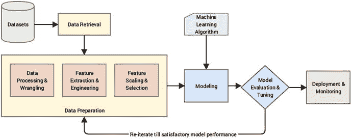

图 4-1.

重温我们的标准机器学习流水线

该图清晰地描绘了流水线中的主要组件，您现在应该已经非常熟悉了。为了便于理解，这里再次列出这些组件。

*   数据检索
*   数据准备
*   建模
*   模型评估与调优
*   模型部署与监控

本章的重点领域属于“数据准备”下的模块。我们已经在第 3 章中详细介绍了数据的处理与整理。在这里，我们将重点讨论处理数据特征所必需的三个主要步骤。具体如下所述。

1.  特征提取与工程化
2.  特征缩放
3.  特征选择

这些模块在图 4-1 中已突出显示，并且对于将处理后的数据转换为特征的过程至关重要。这里所说的“处理后的”，是指原始数据经过了必要的预处理和整理操作。流水线中通常遵循的将处理后的数据转换为特征的步骤顺序，在图 4-2 中以更详细的方式进行了描绘。

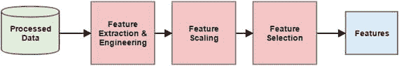

图 4-2.

用于特征工程、缩放和选择的标准流水线

很明显，根据图中描绘的步骤顺序，首先需要设计和工程化特征，然后执行必要的归一化和缩放，最后选择最相关的特征，从而得到最终的特征集。我们将在后续章节中按照图中所示的相同顺序，详细讨论这三个组件。


## 特征提取与工程

特征提取与工程的过程可能是整个机器学习流程中最重要的环节。能够描述数据最合适表征的优秀特征，有助于构建有效的机器学习模型。事实上，决定模型有效性的往往不是算法，而是特征。简而言之，好的特征造就好的模型。一位数据科学家在构建任何机器学习模型时，大约会花费 70% 到 80% 的时间在数据处理、整理和特征工程上。因此，如果你想精通机器学习，深入理解与特征工程相关的所有方面至关重要。

通常，特征提取和特征工程是同义词，指的是结合领域知识、手工技术和数学变换，将数据转换为特征的过程。此后，我们将使用“特征工程”这一术语来指代从数据中提取或创建新特征任务的所有相关方面。虽然在构建模型时，机器学习算法的选择非常重要，但通常情况下，特征的选择和数量对模型性能的影响更大。在本节中，我们将探讨一些关于特征工程的“为什么”、“是什么”和“怎么做”的问题，以便更深入地理解特征工程。

### 什么是特征工程？

我们已经非正式地解释了特征工程背后的核心概念，即利用领域知识中的特定组成部分和特定技术将数据转换为特征。此处的数据是经过必要预处理和整理后的原始数据，我们之前已经提到过。这包括处理不良数据、填补缺失值、转换特定值等。特征是特征工程过程的最终结果，它描述了底层数据的各种表征。

现在，让我们看看数据科学界几位知名人士对特征工程的定义和引述！著名的计算机和数据科学家吴恩达（Andrew Ng）谈到了机器学习和特征工程。

> “提出特征是困难的、耗时的，需要专业知识。‘应用机器学习’基本上就是特征工程。” ——吴恩达教授

这基本上印证了我们之前提到的，数据科学家将近 80% 的时间花在特征工程上，这是一个困难且耗时的过程，既需要领域知识，也需要数学计算。除此之外，实践或应用机器学习主要是特征工程，因为构建和评估模型所花费的时间远少于特征工程所花费的总时间。然而，这并不意味着建模和评估不如特征工程重要。

现在，我们来看看数据科学家和机器学习实践者杰森·布朗利（Jason Brownlee）博士对特征工程的定义，他在 [`http://machinelearningmastery.com`](http://machinelearningmastery.com) 上提供了大量关于机器学习和数据科学的优秀资源。布朗利博士对特征工程的定义如下。

> “特征工程是将原始数据转换为特征的过程，这些特征能更好地向预测模型呈现底层问题，从而在未见数据上提高模型准确性。” ——杰森·布朗利博士

让我们花更多时间来解读这个定义。它告诉我们，特征工程的过程涉及将数据转换为特征，同时考虑到与问题、模型、性能和数据相关的几个方面。这些方面在定义中得到了强调，并在下面进一步详细解释。

*   **原始数据**：这是从数据源检索后，处于原生形式的数据。通常，在实际进行特征工程之前，会进行一定量的数据处理和整理。
*   **特征**：这些是在特征工程过程之后，从原始数据中获得的特定表征。
*   **底层问题**：这指的是我们希望通过机器学习解决的特定业务问题或用例。业务问题通常被转换为一个机器学习任务。
*   **预测模型**：通常，特征工程用于提取特征，以构建机器学习模型，这些模型从这些特征中学习数据和待解决的问题。监督预测模型被广泛用于解决各种问题。
*   **模型准确性**：这指的是用于评估模型的模型性能指标。
*   **未见数据**：这基本上是指之前未用于构建或训练模型的新数据。期望模型能够基于高质量的特征，对未见数据进行良好的学习和泛化。

因此，特征工程是将数据转换为特征，作为机器学习模型输入的过程，以便高质量的特征有助于提高整体模型性能。特征也很大程度上依赖于底层问题。因此，即使在不同场景下机器学习任务可能相同，例如将电子邮件分类为垃圾邮件和非垃圾邮件，或对手写数字进行分类，每个场景中提取的特征也会截然不同。

到现在为止，你一定对特征工程的概念和重要性有了很好的理解。永远记住，解决任何机器学习问题，特征工程都是关键！事实上，华盛顿大学的佩德罗·多明戈斯（Pedro Domingos）教授在其论文《关于机器学习的一些有用知识》（可在 [`http://homes.cs.washington.edu/~pedrod/papers/cacm12.pdf`](http://homes.cs.washington.edu/%7Epedrod/papers/cacm12.pdf) 获取）中也强调了这一点，他告诉我们：

> “归根结底，一些机器学习项目成功了，一些失败了。是什么造成了差异？最重要的因素很容易就是所使用的特征。” ——佩德罗·多明戈斯教授

特征工程确实既是一门艺术，也是一门科学，用于将数据转换为特征以输入模型。有时，你需要结合领域知识、经验、直觉和数学变换来获得你需要的特征。通过随着时间的推移解决更多问题，你将获得所需的经验，知道哪些特征可能最适合某个问题。所以不要不知所措，熟能生巧，你终将掌握特征工程。以下列表展示了一些特征工程的例子。

*   从出生日期和当前日期推导出人的年龄
*   获取特定歌曲和音乐视频的平均和中位数观看次数
*   从文本文档中提取单词和短语的出现次数
*   从原始图像中提取像素信息
*   统计学生获得的各种成绩的出现次数

最后一句能吊起你对特征工程胃口的引述来自著名的 Kaggle 竞赛选手泽维尔·科诺（Xavier Conort）。你们大多数人已经知道，困难的机器学习问题经常定期发布在 Kaggle 上，通常对所有人开放。泽维尔对特征工程的看法如下所述。

> “我们使用的算法对 Kaggle 选手来说非常标准。……我们将大部分精力花在了特征工程上。……我们还非常小心地丢弃那些可能使我们面临模型过拟合风险的特征。” ——泽维尔·科诺

这应该让你对什么是特征工程、围绕它的各个方面以及为什么我们真的需要特征工程有了一个很好的基本了解。在下一节中，我们将进一步阐述为什么我们需要特征工程，以及它的好处和优势。


### 为何要进行特征工程？

我们在上一节中定义了特征工程，并初步探讨了其重要性。现在，让我们来看看为什么需要特征工程，以及它在构建机器学习模型和处理数据时能为我们带来哪些优势。

*   **更好的数据表示**：特征本质上是原始数据的不同表现形式。机器学习算法能够更好地理解这些表示形式。此外，我们通常也能更容易地将这些表示形式可视化。一个简单的例子是，可视化报纸文章中频繁出现的词语，远比面对原始文本时完全不知所措要好得多！
*   **更优的模型性能**：无论算法多么复杂，正确的特征往往能使模型性能超越其他模型。通常，只要拥有正确的特征集，即使是一个简单的模型也能表现良好并给出理想的结果。简而言之，更好的特征造就更好的模型。
*   **模型构建与评估的关键**：我们已经多次提到，原始数据不能直接用于构建机器学习模型。获取数据、提取特征，然后开始构建模型！此外，在评估模型性能和调优模型时，你可以反复审视你的特征集，选择最合适的特征组合以获得最佳模型。
*   **数据类型更灵活**：虽然直接将数值型数据类型用于机器学习算法（几乎无需数据转换）确实更容易，但真正的挑战在于为更复杂的数据类型（如文本、图像，甚至视频）构建模型。特征工程通过应用必要的转换，帮助我们为各种数据类型构建模型，并使我们能够处理复杂的非结构化数据。
*   **强调业务与领域知识**：数据科学家和分析师通常忙于处理、清洗数据和构建模型，这常常导致业务利益相关者与技术/分析团队之间存在脱节。特征工程促使数据科学家退后一步，通过从业务和领域专家那里获取宝贵意见，尝试更好地理解领域和业务。这对于创建和选择有助于构建正确模型以解决问题的特征至关重要。纯粹统计和数学知识通常不足以解决复杂的现实世界问题。因此，特征工程强调在构建特征时要关注业务和问题领域。

这份清单虽然并非详尽无遗，但很好地揭示了特征工程的重要性，以及它为何是构建机器学习模型的关键环节。待解决问题的领域及其重要性在特征工程中也相当重要。

### 如何进行特征工程？

特征工程没有固定的规则。它涉及结合领域知识、业务约束、人工设计的转换以及数学转换，将原始数据转换为所需的特征。不同的数据类型有不同的特征提取技术。因此，在本章中，我们将重点介绍以下主要数据类型的各种特征工程技术及策略。

*   数值型数据
*   类别型数据
*   文本数据
*   时间序列数据
*   图像数据

本章后续部分将重点介绍如何处理这些多样化的数据类型，以及可用于工程化特征的具体技术。你可以将其作为参考和指南，在未来从自己的数据集中进行特征工程。

特征工程的另一个方面最近也日益受到重视。这里，你不再使用人工设计的特征，而是让机器本身尝试从原始数据中检测模式并提取有用的数据表示，这些表示即可用作特征。这个过程也称为**自动特征生成**。深度学习已被证明在该领域极为有效，卷积神经网络（CNN）、循环神经网络（RNN）和长短期记忆网络（LSTM）等神经网络架构被广泛用于自动特征工程和提取。现在，让我们通过一些真实的数据集和示例，深入特征工程的世界。

## 数值型数据的特征工程

数值型数据、字段、变量或特征通常以标量信息的形式表示数据，代表一个观察值、记录或测量值。当然，数值型数据也可以表示为标量向量，其中向量中的每个特定实体本身就是一个数值数据点。整数和浮点数是最常见且广泛使用的数值数据类型。此外，数值型数据可能是最容易处理的，并且经常被机器学习模型直接使用。如果你还记得，我们之前在第三章的“数据描述”部分讨论过数值型数据。

尽管数值型数据可以直接输入机器学习模型，但在构建模型之前，你仍然需要工程化出与场景、问题和领域相关的特征。因此，特征工程的需求依然存在。数值特征的重要方面包括特征尺度和分布，你将在本节示例中观察到其中一些方面。在某些场景下，我们需要应用特定的转换来改变数值的尺度；而在其他场景下，我们需要改变数值的整体分布，例如将偏态分布转换为正态分布。

本节使用的代码可在本章的代码文件中找到。你可以直接加载 `feature_engineering_numeric.py` 并开始运行示例，或者使用 Jupyter Notebook `Feature Engineering on Numeric Data.ipynb` 以获得更具交互性的体验。在开始之前，让我们先加载以下依赖项和配置设置。

```
In [1]: import pandas as pd
...: import matplotlib.pyplot as plt
...: import matplotlib as mpl
...: import numpy as np
...: import scipy.stats as spstats
...:
...: %matplotlib inline
...: mpl.style.reload_library()
...: mpl.style.use('classic')
...: mpl.rcParams['figure.facecolor'] = (1, 1, 1, 0)
...: mpl.rcParams['figure.figsize'] = [6.0, 4.0]
...: mpl.rcParams['figure.dpi'] = 100
```

现在我们已经加载了初始依赖项，接下来让我们看看在以下章节中从数值型数据工程化特征的一些方法。

### 原始度量

正如我们之前提到的，数值特征通常可以直接输入机器学习模型，因为它们是一种易于理解、解释和操作的格式。原始度量通常指直接将数值变量作为特征使用，而不进行任何形式的转换或工程化处理。这些特征通常表示数值或计数。


#### 数值

通常，标量值以其原始形式表示属于特定变量或字段的特定测量值、指标或观测值。该字段的语义通常从字段名称本身或数据字典（如果存在）中获取。现在让我们加载一个关于宝可梦的数据集！该数据集也可以在 Kaggle 上找到。如果你不知道，宝可梦是一个围绕名为“宝可梦”（意为口袋妖怪）的虚构角色的大型媒体特许经营系列。简而言之，你可以把它们想象成拥有超能力的虚构动物！以下代码片段让我们对这个数据集有了初步了解。

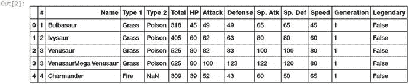

图 4-3.

来自宝可梦数据集的原始数据

```
In [2]: poke_df = pd.read_csv('datasets/Pokemon.csv', encoding='utf-8')
...: poke_df.head()
```

如果你观察图 4-3 中描绘的数据集，会发现其中有几个属性代表可以直接使用的原始数值。以下代码片段更突出地展示了其中一些特征。

```
In [3]: poke_df[['HP', 'Attack', 'Defense']].head()
Out[3]:
HP  Attack  Defense
0  45      49       49
1  60      62       63
2  80      82       83
3  80     100      123
4  39      52       43
```

你可以直接将这些属性用作前一个数据框中展示的特征。这些属性包括每只宝可梦的 HP（体力值）、攻击力和防御力数值。事实上，我们还可以使用以下代码对这些字段计算一些基本的统计指标。

```
In [4]: poke_df[['HP', 'Attack', 'Defense']].describe()
Out[4]:
HP      Attack     Defense
count  800.000000  800.000000  800.000000
mean    69.258750   79.001250   73.842500
std     25.534669   32.457366   31.183501
min      1.000000    5.000000    5.000000
25%     50.000000   55.000000   50.000000
50%     65.000000   75.000000   70.000000
75%     80.000000  100.000000   90.000000
max    255.000000  190.000000  230.000000
```

在这个输出中，我们可以看到每个数值特征的多个统计指标，如计数、平均值、标准差和四分位数。如果可能的话，尝试绘制它们的分布图！

#### 计数

原始数值指标也可以表示特定属性的计数、频率和出现次数。让我们看一下百万歌曲数据集中的一个样本，该样本展示了不同用户听过歌曲的计数或频率。

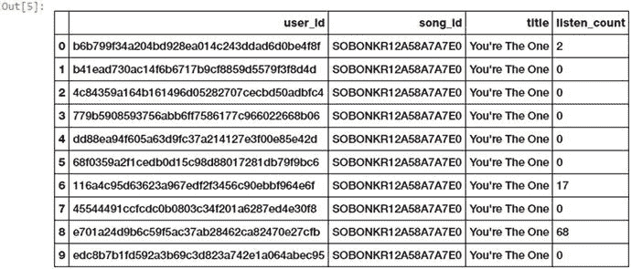

图 4-4.

歌曲收听次数作为数值特征

```
In [5]: popsong_df = pd.read_csv('datasets/song_views.csv', encoding='utf-8')
...: popsong_df.head(10)
```

我们可以看到，图 4-4 所示数据中的 `listen_` `count` 字段可以直接用作基于计数/频率的数值特征。

### 二值化

在构建模型时，尤其是在构建推荐引擎所应用的方法中，原始的数值频率或计数通常并非必需。例如，如果我想知道一个人是否对某首特定歌曲感兴趣或听过它，我不需要知道他/她听过同一首歌的总次数。我更关心的是他/她听过哪些不同的歌曲。在这种情况下，与基于计数的特征相比，二值特征更受青睐。我们可以通过以下方式对我们之前数据集中的 `listen_count` 字段进行二值化处理。

```
In [6]: watched = np.array(popsong_df['listen_count'])
...: watched[watched >= 1] = 1
...: popsong_df['watched'] = watched
```

你也可以使用 `scikit-learn` 预处理模块中的 `Binarizer` 类来执行相同的任务，而不是使用 `numpy` 数组，如下列代码所示。

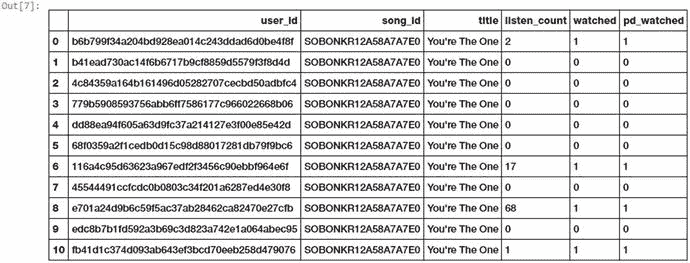

图 4-5.

对歌曲计数进行二值化

```
In [7]: from sklearn.preprocessing import Binarizer
...:
...: bn = Binarizer(threshold=0.9)
...: pd_watched = bn.transform([popsong_df['listen_count']])[0]
...: popsong_df['pd_watched'] = pd_watched
...: popsong_df.head(11)
```

从图 4-5 中可以清楚地看到，两种方法在特征 `watched` 和 `pd_watched` 上产生了相同的结果。因此，我们将歌曲收听次数作为一个二值化特征，用于指示每个用户是否听过该歌曲。

### 四舍五入

在处理比例或百分比等数值属性时，我们通常不需要精度很高的值。因此，将这些高精度百分比四舍五入为数值整数是合理的。然后，这些整数可以直接用作原始数值，甚至可以用作分类（基于离散类）特征。让我们尝试在一个展示商店商品及其流行度百分比的虚拟数据集中应用这个概念。

```
In [8]: items_popularity = pd.read_csv('datasets/item_popularity.csv', encoding='utf-8')
...: # rounding off percentages
...: items_popularity['popularity_scale_10'] =
np.array(np.round((items_popularity['pop_percent'] * 10)), dtype='int')
...: items_popularity['popularity_scale_100'] =
np.array(np.round((items_popularity['pop_percent'] * 100)), dtype='int')
...: items_popularity
Out[8]:
item_id  pop_percent  popularity_scale_10  popularity_scale_100
0  it_01345      0.98324                   10                    98
1  it_03431      0.56123                    6                    56
2  it_04572      0.12098                    1                    12
3  it_98021      0.35476                    4                    35
4  it_01298      0.92101                    9                    92
5  it_90120      0.81212                    8                    81
6  it_10123      0.56502                    6                    57
```

因此，经过四舍五入操作后，你可以在前一个数据框所示的数据中看到新的特征。我们基本上尝试了两种形式的四舍五入。这些特征现在分别以 `1-10` 和 `1-100` 的尺度展示了商品的流行度。你可以根据具体场景和问题，将这些值用作数值特征或分类特征。


### 交互作用

模型的构建方式通常是尝试将输出响应（离散类别或连续值）建模为输入特征变量的函数。例如，一个简单的线性回归方程可以表示为 y = c[1]x[1] + c[2]x[2] + ... + c[n]x[n]，其中输入特征由变量 {x[1], x[2], ... x[n]} 表示，它们分别具有权重或系数 {c[1], c[2], ... c[n]}，目标是预测响应 y。在这种情况下，这个简单的线性模型描述了输出与输入之间的关系，这种关系纯粹基于各个独立的输入特征。

然而，在许多现实世界的数据集和场景中，尝试将这些特征变量之间的交互作用作为输入特征集的一部分来捕获也很有意义。将上述线性回归公式扩展为包含交互特征的一个简单描述是 y = c[1]x[1] + c[2]x[2] + ... + c[n]x[n] + c[11]x[1]² + c[22]x[2]² + c[12]x[1]x[2] + ...，其中像 {x[1]x[2], x[1]², ...} 这样的特征表示交互特征。现在，让我们尝试在我们的宝可梦数据集上构建一些交互特征。

```
In [9]: atk_def = poke_df[['Attack', 'Defense']]
...: atk_def.head()
Out[9]:
Attack  Defense
0      49       49
1      62       63
2      82       83
3     100      123
4      52       43
```

在这个输出中，我们可以看到两个描述宝可梦攻击和防御的数值特征。以下代码帮助我们根据这两个特征构建交互特征。我们将使用 `scikit-learn` API 中的 `PolynomialFeatures` 类来构建最高为二次的特征。

```
In [10]: from sklearn.preprocessing import PolynomialFeatures
...:
...: pf = PolynomialFeatures(degree=2, interaction_only=False, include_bias=False)
...: res = pf.fit_transform(atk_def)
...: res
Out[10]:
array([[    49.,     49.,   2401.,   2401.,   2401.],
[    62.,     63.,   3844.,   3906.,   3969.],
[    82.,     83.,   6724.,   6806.,   6889.],
...,
[   110.,     60.,  12100.,   6600.,   3600.],
[   160.,     60.,  25600.,   9600.,   3600.],
[   110.,    120.,  12100.,  13200.,  14400.]])
```

从这个输出中我们可以清楚地看到，包括新的交互特征在内，我们总共有五个特征。我们可以使用以下代码片段查看矩阵中每个特征的次数。

```
In [11]: pd.DataFrame(pf.powers_, columns=['Attack_degree', 'Defense_degree'])
Out[11]:
Attack_degree  Defense_degree
0              1               0
1              0               1
2              2               0
3              1               1
4              0               2
```

既然我们从所展示的次数中知道了每个特征实际代表什么，我们可以为每个特征分配一个名称，如下所示，以获得更新后的特征集。

```
In [12]: intr_features = pd.DataFrame(res,
...:                              columns=['Attack', 'Defense',
...:                                       'Attack²', 'Attack x Defense', 'Defense²'])
...: intr_features.head(5)
Out[12]:
Attack  Defense  Attack²  Attack x Defense  Defense²
0    49.0     49.0    2401.0            2401.0     2401.0
1    62.0     63.0    3844.0            3906.0     3969.0
2    82.0     83.0    6724.0            6806.0     6889.0
3   100.0    123.0   10000.0           12300.0    15129.0
4    52.0     43.0    2704.0            2236.0     1849.0
```

因此，我们可以在图 4-10 中看到我们的原始特征和交互特征。`scikit-learn` 中的 `fit_transform(...)` API 函数用于在训练数据上构建一个特征工程表示对象，该对象可以在模型预测期间通过调用 `transform(...)` 函数在新的数据上重用。让我们取一些宝可梦攻击和防御特征的新样本观测值，并尝试使用相同的机制对其进行转换。

```
In [13]: new_df = pd.DataFrame([[95, 75],[121, 120], [77, 60]],
...:                       columns=['Attack', 'Defense'])
...: new_df
Out[13]:
Attack  Defense
0      95       75
1     121      120
2      77       60
```

我们现在可以使用之前创建的 `pf` 对象，并如下所示转换这些输入特征，以得到交互特征。

```
In [14]: new_res = pf.transform(new_df)
...: new_intr_features = pd.DataFrame(new_res,
...:                                  columns=['Attack', 'Defense',
...:                                           'Attack²', 'Attack x Defense', 'Defense²'])
...: new_intr_features
Out[14]:
Attack  Defense  Attack²  Attack x Defense  Defense²
0    95.0     75.0    9025.0            7125.0     5625.0
1   121.0    120.0   14641.0           14520.0    14400.0
2    77.0     60.0    5929.0            4620.0     3600.0
```

因此，你可以看到我们已经成功地为新数据集获得了必要的交互特征。现在尝试在三个或更多特征上构建交互特征！

### 分箱

在处理数值数据时，你经常会遇到描述原始度量值（如数值或频率）的特征或属性。在许多情况下，这些属性的分布往往是倾斜的，即某些值集合会出现很多次，而有些则非常罕见。除此之外，还存在这些值范围变化的问题。假设我们讨论的是歌曲或视频的观看次数。在某些情况下，观看次数会异常大，而在某些情况下则非常小。在建模中直接使用这些特征可能会导致问题。如果我们使用值跨越多个数量级的原始数值特征，诸如相似性度量、聚类距离、回归系数等指标可能会受到不利影响。有多种方法可以从这些原始值中构建特征，以便我们解决这些问题。这些方法包括变换、缩放和分箱/量化。

在本节中，我们将讨论分箱，也称为量化。分箱操作用于将连续的数值转换为离散的数值。这些离散的数字可以被视为箱，原始值或数字被分入或分组到这些箱中。每个箱代表一个特定的强度级别，并具有一个必须落入该箱的特定值范围。有多种分箱数据的方法，包括固定宽度分箱和自适应分箱。每种分箱过程都可以采用特定的技术。我们将使用从 2016 年 FreeCodeCamp 开发者/程序员调查中提取的数据集，该调查涉及与程序员和软件开发人员相关的各种属性。你可以自行查看 [`https://github.com/freeCodeCamp/2016-new-coder-survey`](https://github.com/freeCodeCamp/2016-new-coder-survey) 以获取更多详细信息。让我们加载数据集并查看一些有趣的属性。

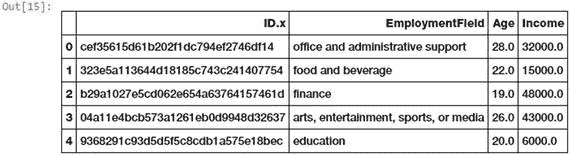

图 4-6.

FCC 程序员调查数据集中的重要属性

```
In [15]: fcc_survey_df = pd.read_csv('datasets/fcc_2016_coder_survey_subset.csv',
encoding='utf-8')
...: fcc_survey_df[['ID.x', 'EmploymentField', 'Age', 'Income']].head()
```

图 4-6 中展示的数据框向我们展示了程序员调查数据集的一些有趣属性，其中一些我们将在本节中进行分析。`ID.x` 变量基本上是每个参与调查的程序员/开发者的唯一标识符，其他字段则不言自明。


#### 固定宽度分箱

顾名思义，在固定宽度分箱中，每个箱体都有特定的固定宽度，这些宽度通常由分析数据的用户预先定义。每个箱体都有一个预先固定的值范围，该范围应基于某些业务或自定义逻辑、规则或必要的转换来分配给该箱体。

基于四舍五入的分箱是一种方法，你可以使用我们之前讨论过的四舍五入操作来对原始值进行分箱。让我们考虑一下编码员调查数据集中的 `Age` 特征。以下代码显示了参与调查的开发者的年龄分布。

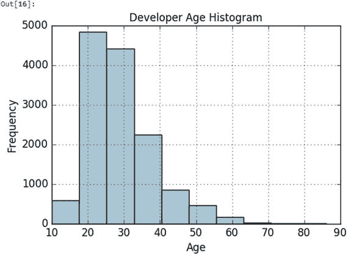

图 4-7.

描述开发者年龄分布的直方图

```
In [16]: fig, ax = plt.subplots()
...: fcc_survey_df['Age'].hist(color='#A9C5D3')
...: ax.set_title('Developer Age Histogram', fontsize=12)
...: ax.set_xlabel('Age', fontsize=12)
...: ax.set_ylabel('Frequency', fontsize=12)
```

图 4-7 中的直方图描述了开发者年龄的分布，正如预期的那样，它略微右偏。让我们尝试根据以下逻辑将这些原始年龄值分配到特定的箱体中。

```
年龄范围: 箱体

0 -  9  : 0
10 - 19  : 1
20 - 29  : 2
30 - 39  : 3
40 - 49  : 4
50 - 59  : 5
60 - 69  : 6
... 以此类推
```

我们可以使用之前在“四舍五入”部分学到的知识轻松做到这一点，即通过将这些原始年龄值除以 10 后取整数值。以下代码展示了这一点。

```
In [17]: fcc_survey_df['Age_bin_round'] = np.array(np.floor(np.array(fcc_survey_df['Age']) /
10.))
...: fcc_survey_df[['ID.x', 'Age', 'Age_bin_round']].iloc[1071:1076]
Out[17]:
ID.x   Age  Age_bin_round
1071  6a02aa4618c99fdb3e24de522a099431  17.0            1.0
1072  f0e5e47278c5f248fe861c5f7214c07a  38.0            3.0
1073  6e14f6d0779b7e424fa3fdd9e4bd3bf9  21.0            2.0
1074  c2654c07dc929cdf3dad4d1aec4ffbb3  53.0            5.0
1075  f07449fc9339b2e57703ec7886232523  35.0            3.0
```

我们取数据集的一个特定切片（第 1071-1076 行）来展示不同年龄的用户。你可以看到每个年龄对应的箱体已根据四舍五入分配。但是，如果我们需要更大的灵活性呢？如果我想自己决定并固定箱体宽度呢？

基于自定义范围的分箱回答了我们关于固定宽度分箱的所有问题，其中一些我刚才已经提到。让我们定义一些自定义年龄范围，使用以下方案对开发者年龄进行分箱。

```
年龄范围 : 箱体

0 -  15  : 1
16 -  30  : 2
31 -  45  : 3
46 -  60  : 4
61 -  75  : 5
75 - 100  : 6
```

基于这个自定义分箱方案，我们现在将借助以下代码为每个开发者年龄值标记箱体。我们将同时存储箱体范围和相应的标签。

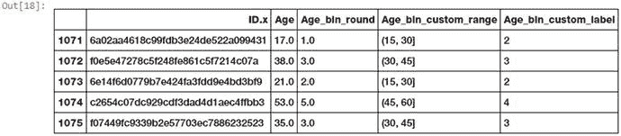

图 4-8.

开发者年龄的自定义分箱

```
In [18]: bin_ranges = [0, 15, 30, 45, 60, 75, 100]
...: bin_names = [1, 2, 3, 4, 5, 6]
...: fcc_survey_df['Age_bin_custom_range'] = pd.cut(np.array(fcc_survey_df['Age']),
...:                                                bins=bin_ranges)
...: fcc_survey_df['Age_bin_custom_label'] = pd.cut(np.array(fcc_survey_df['Age']),
...:                                                bins=bin_ranges, labels=bin_names)
...: fcc_survey_df[['ID.x', 'Age', 'Age_bin_round',
...:                'Age_bin_custom_range', 'Age_bin_custom_label']].iloc[1071:1076]
```

从图 4-8 中的数据框输出中，我们可以看到基于我们方案的自定义箱体已分配给每个开发者的年龄。尝试一些你自己的分箱方案吧！

#### 自适应分箱

到目前为止，我们在固定宽度分箱中决定了箱体的宽度和范围。然而，这种技术可能导致不规则的箱体，这些箱体基于落入每个箱体的数据点或值的数量并不均匀。一些箱体可能数据密集，而另一些可能数据稀疏，甚至可能是空的！自适应分箱是一种更安全、更好的方法，它利用数据分布本身来决定哪些是合适的箱体。

基于分位数的分箱是用于自适应分箱的一个好策略。分位数是特定的值或切点，有助于将特定数值字段的连续值分布划分为离散的连续箱体或区间。因此，q-分位数有助于将数值属性划分为 q 个相等的部分。分位数的常见例子包括 2-分位数（称为中位数），它将数据分布划分为两个相等的箱体；4-分位数（称为四分位数），它将数据划分为四个相等的箱体；以及 10-分位数（也称为十分位数），它创建 10 个等宽的箱体。现在让我们看看编码员调查数据集中与开发者收入值相关的一个数据切片。

```
In [19]: fcc_survey_df[['ID.x', 'Age', 'Income']].iloc[4:9]
Out[19]:
ID.x   Age   Income
4  9368291c93d5d5f5c8cdb1a575e18bec  20.0   6000.0
5  dd0e77eab9270e4b67c19b0d6bbf621b  34.0  40000.0
6  7599c0aa0419b59fd11ffede98a3665d  23.0  32000.0
7  6dff182db452487f07a47596f314bddc  35.0  40000.0
8  9dc233f8ed1c6eb2432672ab4bb39249  33.0  80000.0
```

数据框展示的数据切片显示了数据集中每个开发者的收入值。现在让我们使用以下代码查看这个 `Income` 变量的整个数据分布。

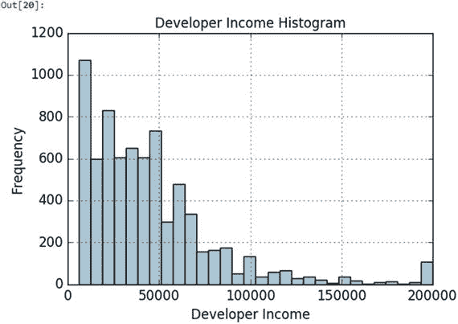

图 4-9.

描述开发者收入分布的直方图

```
In [20]: fig, ax = plt.subplots()
...: fcc_survey_df['Income'].hist(bins=30, color='#A9C5D3')
...: ax.set_title('Developer Income Histogram', fontsize=12)
...: ax.set_xlabel('Developer Income', fontsize=12)
...: ax.set_ylabel('Frequency', fontsize=12)
```

从图 4-9 所示的分布中，我们可以看到，正如预期的那样，存在右偏，即收入较高的开发者较少，反之亦然。让我们采用一个 4-分位数或基于四分位数的自适应分箱方案。以下代码片段帮助我们获取落在分布中四个四分位数上的收入值。

```
In [21]: quantile_list = [0, .25, .5, .75, 1.]
...: quantiles = fcc_survey_df['Income'].quantile(quantile_list)
...: quantiles
Out[21]:
0.00      6000.0
0.25     20000.0
0.50     37000.0
0.75     60000.0
1.00    200000.0
```

为了更好地可视化此输出中获得的四分位数，我们可以使用以下代码片段将它们绘制在我们的数据分布中。

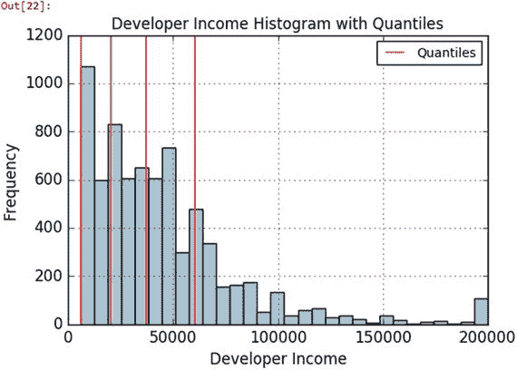

图 4-10.

带有四分位数值的开发者收入分布直方图

```
In [22]: fig, ax = plt.subplots()
...: fcc_survey_df['Income'].hist(bins=30, color='#A9C5D3')
...:
...: for quantile in quantiles:
...:     qvl = plt.axvline(quantile, color='r')
...: ax.legend([qvl], ['Quantiles'], fontsize=10)
...:
...: ax.set_title('Developer Income Histogram with Quantiles', fontsize=12)
...: ax.set_xlabel('Developer Income', fontsize=12)
...: ax.set_ylabel('Frequency', fontsize=12)
```

收入属性的 4-分位数值由图 4-10 中的红色垂直线表示。现在让我们使用以下代码，通过分位数分箱将每个开发者收入值分配到特定的箱体中。

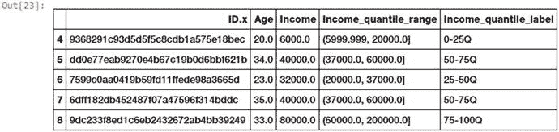

图 4-11.

基于分位数的开发者收入分箱范围和标签


```
In [23]: quantile_labels = ['0-25Q', '25-50Q', '50-75Q', '75-100Q']
...: fcc_survey_df['Income_quantile_range'] = pd.qcut(fcc_survey_df['Income'],
...:                                                  q=quantile_list)
...: fcc_survey_df['Income_quantile_label'] = pd.qcut(fcc_survey_df['Income'],
...:                                                  q=quantile_list,
...:                                                  labels=quantile_labels)
...: fcc_survey_df[['ID.x', 'Age', 'Income',
'Income_quantile_range', 'Income_quantile_label']].iloc[4:9]
```

图 4-11 所示的结果数据框清晰地展示了基于分位数的分箱范围，以及分别为 `Income_quantile_range` 和 `Income_quantile_labels` 特征中每个开发者收入值分配的对应标签。

### 统计变换

让我们来看一种不同的数值型数据特征工程策略，即使用统计或数学变换。在本节中，我们将探讨对数变换和 Box-Cox 变换。这两种变换函数都属于幂变换函数族。这些函数通常用于创建单调数据变换，但它们的主要意义在于有助于稳定方差，使数据紧密服从正态分布，并让数据基于其分布独立于均值。一些变换也作为特征缩放的一部分被使用，我们将在后续章节中介绍。

#### 对数变换

对数变换属于幂变换函数族。该函数可以定义为 y = log [b] (x)，即 x 以 b 为底的对数等于 y。这转化为 b ^y = x，表示底数 b 需要被提升到多少次幂才能得到 x。自然对数使用底数 b = e，其中 e = 2.71828，通常被称为欧拉数。你也可以使用十进制系统中常用的底数 b = 10。对数变换在应用于偏态分布时非常有用，因为它倾向于扩展落在较低量级范围内的值，并压缩或减少落在较高量级范围内的值。这有助于使偏态分布尽可能接近正态分布。让我们对来自编码员调查数据集的开发者收入特征应用对数变换。

```
In [24]: fcc_survey_df['Income_log'] = np.log((1+ fcc_survey_df['Income']))
...: fcc_survey_df[['ID.x', 'Age', 'Income', 'Income_log']].iloc[4:9]
Out[24]:
ID.x   Age   Income  Income_log
4  9368291c93d5d5f5c8cdb1a575e18bec  20.0   6000.0    8.699681
5  dd0e77eab9270e4b67c19b0d6bbf621b  34.0  40000.0   10.596660
6  7599c0aa0419b59fd11ffede98a3665d  23.0  32000.0   10.373522
7  6dff182db452487f07a47596f314bddc  35.0  40000.0   10.596660
8  9dc233f8ed1c6eb2432672ab4bb39249  33.0  80000.0   11.289794
```

此输出中获得的数据框展示了 `Income_log` 字段中对数变换后的收入特征。现在，让我们使用以下代码绘制此变换后特征的数据分布。

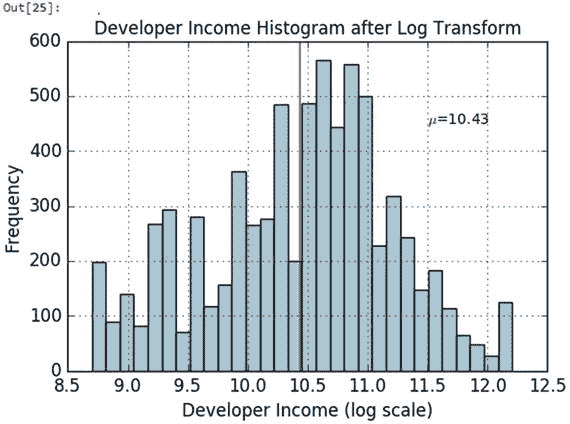

图 4-12.

对数变换后开发者收入分布的直方图

```
In [25]: income_log_mean = np.round(np.mean(fcc_survey_df['Income_log']), 2)
...:
...: fig, ax = plt.subplots()
...: fcc_survey_df['Income_log'].hist(bins=30, color='#A9C5D3')
...: plt.axvline(income_log_mean, color='r')
...: ax.set_title('Developer Income Histogram after Log Transform', fontsize=12)
...: ax.set_xlabel('Developer Income (log scale)', fontsize=12)
...: ax.set_ylabel('Frequency', fontsize=12)
...: ax.text(11.5, 450, r'$\mu$='+str(income_log_mean), fontsize=10)
```

因此，我们可以清楚地看到，图 4-10 中原本右偏的原始开发者收入分布，在应用对数变换后，在图 4-12 中变得更接近高斯分布或正态分布。

#### Box-Cox 变换

现在让我们来看 Box-Cox 变换，这是属于幂变换函数族的另一个流行函数。该函数有一个前提条件，即待变换的数值必须为正（与对数变换的要求类似）。如果数值为负，则可以使用常数进行平移。从数学上讲，Box-Cox 变换函数可以定义为：

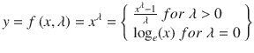

这样，得到的变换输出 y 是输入 x 和变换参数 λ 的函数，当 λ = 0 时，结果变换就是我们之前讨论的自然对数变换。λ 的最优值通常通过最大似然估计或对数似然估计来确定。让我们对开发者收入特征应用 Box-Cox 变换。为此，首先我们通过以下代码从数据分布中移除空值，从而获得最优的 lambda 值。

```
In [26]: # get optimal lambda value from non null income values
...: income = np.array(fcc_survey_df['Income'])
...: income_clean = income[∼np.isnan(income)]
...: l, opt_lambda = spstats.boxcox(income_clean)
...: print('Optimal lambda value:', opt_lambda)
Optimal lambda value: 0.117991239456
```

现在我们已经获得了最优的 λ 值，让我们对 λ = 0 和 λ = λ [最优] 这两个 λ 值使用 Box-Cox 变换，并转换与开发者收入相关的原始数值。

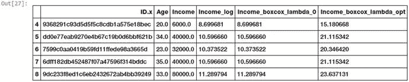

图 4-13.

Box-Cox 变换后开发者收入分布的数据框

```
In [27]: fcc_survey_df['Income_boxcox_lambda_0'] = spstats.boxcox((1+fcc_survey_df['Income']),
...:                                                          lmbda=0)
...: fcc_survey_df['Income_boxcox_lambda_opt'] = spstats.boxcox(fcc_survey_df['Income'],
...:                                                            lmbda=opt_lambda)
...: fcc_survey_df[['ID.x', 'Age', 'Income', 'Income_log',
...:                'Income_boxcox_lambda_0', 'Income_boxcox_lambda_opt']].iloc[4:9]
```

图 4-13 所示输出中获得的数据框展示了在 `Income_boxcox_lambda_0` 和 `Income_boxcox_lambda_opt` 字段中，分别对 λ = 0 和 λ = λ [最优] 应用 Box-Cox 变换后的收入特征。同时，正如预期的那样，`Income_log` 字段的值与 λ = 0 时的 Box-Cox 变换值相同。现在，让我们绘制使用最优 lambda 的 Box-Cox 变换后开发者值的数据分布。见图 4-14。

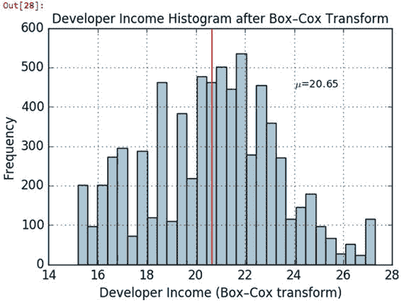

图 4-14.

Box-Cox 变换后（λ = λ[最优]）开发者收入分布的直方图

```
In [30]: income_boxcox_mean = np.round(np.mean(fcc_survey_df['Income_boxcox_lambda_opt']), 2)
...:
...: fig, ax = plt.subplots()
...: fcc_survey_df['Income_boxcox_lambda_opt'].hist(bins=30, color='#A9C5D3')
...: plt.axvline(income_boxcox_mean, color='r')
...: ax.set_title('Developer Income Histogram after Box–Cox Transform', fontsize=12)
...: ax.set_xlabel('Developer Income (Box–Cox transform)', fontsize=12)
...: ax.set_ylabel('Frequency', fontsize=12)
...: ax.text(24, 450, r'$\mu$='+str(income_boxcox_mean), fontsize=10)
```

经过 Box-Cox 分布变换后，开发者收入的变换后数值分布与我们之前通过对数变换得到的分布相似，都更接近正态分布，并且原始数据中存在的极端右偏现象在此处已得到最小化。


## 分类数据的特征工程

到目前为止，我们一直在处理连续数值型数据，并且你也看到了从中进行特征工程的各种技术。现在，我们将研究另一种结构化数据类型，即分类数据。任何本质上是分类的属性或特征，都表示属于特定有限类别或类集合的离散值。类别或类标签本质上可以是文本或数字。通常有两种类型的分类变量——名义变量和有序变量。

名义分类特征是指值之间没有排序概念，即对它们进行排序或排序没有意义。电影或电子游戏类型、天气季节和国家名称是名义属性的一些例子。有序分类变量可以根据其值进行排序和排序，因此这些值具有特定的意义，其顺序是有意义的。有序属性的例子包括服装尺码、教育水平等。

在本节中，我们将研究转换和编码分类特征和属性的各种策略和技术。本节使用的代码可在本章的代码文件中找到。你可以直接加载 `feature_engineering_categorical.py` 并开始运行示例，或者使用 jupyter notebook `Feature Engineering on Categorical Data.ipynb` 以获得更具交互性的体验。在开始之前，让我们加载以下依赖项。

```
In [1]: import pandas as pd
...: import numpy as np
```

加载完这些依赖项后，让我们开始从分类数据中构建一些特征。

### 转换名义特征

名义特征或属性是分类变量，通常具有一组有限的、不同的离散值。通常这些值是字符串或文本格式，机器学习算法无法直接理解它们。因此，你可能需要将这些特征转换为更具代表性的数字格式。让我们看一个关于电子游戏销售的新数据集。该数据集也可以在 Kaggle 上找到（[`https://www.kaggle.com/gregorut/videogamesales`](https://www.kaggle.com/gregorut/videogamesales)）。为了方便起见，我们已经下载了一份副本。以下代码帮助我们加载此数据集并查看我们感兴趣的一些属性。

```
In [2]: vg_df = pd.read_csv('datasets/vgsales.csv', encoding='utf-8')
...: vg_df[['Name', 'Platform', 'Year', 'Genre', 'Publisher']].iloc[1:7]
Out[2]:
Name Platform    Year         Genre Publisher
1         Super Mario Bros.      NES  1985.0      Platform  Nintendo
2            Mario Kart Wii      Wii  2008.0        Racing  Nintendo
3         Wii Sports Resort      Wii  2009.0        Sports  Nintendo
4  Pokemon Red/Pokemon Blue       GB  1996.0  Role-Playing  Nintendo
5                    Tetris       GB  1989.0        Puzzle  Nintendo
6     New Super Mario Bros.       DS  2006.0      Platform  Nintendo
```

此数据框中显示的数据集向我们展示了与电子游戏相关的各种属性。像 `Platform`、`Genre` 和 `Publisher` 这样的特征是名义分类变量。现在让我们尝试将电子游戏 `Genre` 特征转换为数字表示。请注意，这并不表示转换后的特征将成为数值特征。它仍然是一个离散值的分类特征，只是每个类型用数字代替了文本。以下代码描述了电子游戏的不同类型标签总数。

```
In [3]: genres = np.unique(vg_df['Genre'])
...: genres
Out[3]:
array(['Action', 'Adventure', 'Fighting', 'Misc', 'Platform', 'Puzzle',
'Racing', 'Role-Playing', 'Shooter', 'Simulation', 'Sports',
'Strategy'], dtype=object)
```

这个输出告诉我们数据集中有 12 种不同的电子游戏类型。现在让我们使用以下代码中的映射方案来转换此特征。

```
In [4]: from sklearn.preprocessing import LabelEncoder
...:
...: gle = LabelEncoder()
...: genre_labels = gle.fit_transform(vg_df['Genre'])
...: genre_mappings = {index: label for index, label in enumerate(gle.classes_)}
...: genre_mappings
Out[4]:
{0: 'Action', 1: 'Adventure', 2: 'Fighting', 3: 'Misc',
4: 'Platform', 5: 'Puzzle', 6: 'Racing', 7: 'Role-Playing',
8: 'Shooter', 9: 'Simulation', 10: 'Sports', 11: 'Strategy'}
```

从输出中，我们可以看到已经生成了一个映射方案，其中每个类型值都借助 `LabelEncoder` 对象 `gle` 映射到一个数字。转换后的标签存储在 `genre_labels` 值中。让我们将其写回原始数据框并查看结果。

```
In [5]: vg_df['GenreLabel'] = genre_labels
...: vg_df[['Name', 'Platform', 'Year', 'Genre', 'GenreLabel']].iloc[1:7]
Out[5]:
Name Platform    Year         Genre  GenreLabel
1         Super Mario Bros.      NES  1985.0      Platform           4
2            Mario Kart Wii      Wii  2008.0        Racing           6
3         Wii Sports Resort      Wii  2009.0        Sports          10
4  Pokemon Red/Pokemon Blue       GB  1996.0  Role-Playing           7
5                    Tetris       GB  1989.0        Puzzle           5
6     New Super Mario Bros.       DS  2006.0      Platform           4
```

`GenreLabel` 字段描述了每个 `Genre` 标签的映射数字标签，我们可以清楚地看到这符合我们之前生成的映射。

### 转换有序特征

有序特征与名义特征类似，不同之处在于顺序很重要，并且是我们解释这些特征值的内在属性。与名义特征一样，有序特征也可能以文本形式存在，你需要将它们映射并转换为数字表示。现在让我们加载之前使用过的宝可梦数据集，并查看每个宝可梦的 `Generation` 属性的各种值。

```
In [6]: poke_df = pd.read_csv('datasets/Pokemon.csv', encoding='utf-8')
...: poke_df = poke_df.sample(random_state=1, frac=1).reset_index(drop=True)
...:
...: np.unique(poke_df['Generation'])
Out[6]: array(['Gen 1', 'Gen 2', 'Gen 3', 'Gen 4', 'Gen 5', 'Gen 6'], dtype=object)
```

我们在此代码中重新采样数据集，以便稍后获得一个能代表我们正在寻找的所有不同值的好数据切片。从这个输出中，我们可以看到总共有六代宝可梦。这个属性绝对是顺序的，因为属于第一代的宝可梦在电子游戏和电视节目中比第二代更早出现，依此类推。因此，它们之间存在顺序关系。不幸的是，由于每个有序变量都涉及特定的逻辑或规则集，因此没有通用的模块或函数来将这些特征映射并转换为数字表示。因此，我们需要使用自己的逻辑来手工构建，如下面的代码片段所示。

```
In [7]: gen_ord_map = {'Gen 1': 1, 'Gen 2': 2, 'Gen 3': 3,
...:                'Gen 4': 4, 'Gen 5': 5, 'Gen 6': 6}
...:
...: poke_df['GenerationLabel'] = poke_df['Generation'].map(gen_ord_map)
...: poke_df[['Name', 'Generation', 'GenerationLabel']].iloc[4:10]
Out[7]:
Name Generation  GenerationLabel
4            Octillery      Gen 2                2
5           Helioptile      Gen 6                6
6               Dialga      Gen 4                4
7  DeoxysDefense Forme      Gen 3                3
8             Rapidash      Gen 1                1
9               Swanna      Gen 5                5
```

因此，你可以看到，借助 Python 字典并使用 `pandas` 中的 `map(...)` 函数来构建自己的转换映射方案是非常容易的。


### 编码分类特征

我们之前多次提到，机器学习算法通常对数值型数据表现更好。你可能现在会疑惑：既然我们在前面的章节中已经将分类变量转换并映射为数值表示，为什么还需要再次进行编码呢？答案其实很简单。如果我们直接将分类特征转换后的数值表示输入到任何算法中，模型会试图将这些数值解释为原始数值特征，从而错误地将“量级”概念引入系统。

一个简单的例子来自我们之前输出的数据框：如果模型基于 `GenerationLabel` 进行拟合，它会认为数值 `6 > 5 > 4` 等等。虽然对于宝可梦世代（有序变量）来说，顺序是重要的，但这里并没有“量级”的概念。`第 6 世代` 并不比 `第 5 世代` 大，`第 1 世代` 也不比 `第 6 世代` 小。因此，直接使用这些特征构建的模型将是次优且不正确的。有多种方案和策略可以为任何特征中所有不同类别的每个唯一值或标签创建虚拟特征。在接下来的章节中，我们将讨论其中一些方案，包括独热编码、虚拟编码、效应编码和特征哈希方案。

#### 独热编码方案

假设我们有一个包含 m 个标签的分类特征的数值表示，独热编码方案会将该特征编码或转换为 m 个二进制特征，这些特征只能包含值 1 或 0。分类特征中的每个观测值因此被转换为一个大小为 m 的向量，其中只有一个值为 1（表示其为激活状态）。让我们以宝可梦数据集为例，对其中的一些分类特征执行独热编码转换。

```
In [8]: poke_df[['Name', 'Generation', 'Legendary']].iloc[4:10]
Out[8]:
Name Generation  Legendary
4            Octillery      Gen 2      False
5           Helioptile      Gen 6      False
6               Dialga      Gen 4       True
7  DeoxysDefense Forme      Gen 3       True
8             Rapidash      Gen 1      False
9               Swanna      Gen 5      False
```

考虑输出中显示的数据框，我们有两个分类特征：`Generation` 和 `Legendary`，分别表示宝可梦的世代和传说状态。首先，我们需要将这些文本标签转换为数值表示。以下代码可以帮助我们实现这一点。

```
In [9]: from sklearn.preprocessing import OneHotEncoder, LabelEncoder
...:
...: # 转换并映射宝可梦世代
...: gen_le = LabelEncoder()
...: gen_labels = gen_le.fit_transform(poke_df['Generation'])
...: poke_df['Gen_Label'] = gen_labels
...:
...: # 转换并映射宝可梦传说状态
...: leg_le = LabelEncoder()
...: leg_labels = leg_le.fit_transform(poke_df['Legendary'])
...: poke_df['Lgnd_Label'] = leg_labels
...:
...: poke_df_sub = poke_df[['Name', 'Generation', 'Gen_Label', 'Legendary', 'Lgnd_Label']]
...: poke_df_sub.iloc[4:10]
Out[9]:
Name Generation  Gen_Label  Legendary  Lgnd_Label
4            Octillery      Gen 2          1      False           0
5           Helioptile      Gen 6          5      False           0
6               Dialga      Gen 4          3       True           1
7  DeoxysDefense Forme      Gen 3          2       True           1
8             Rapidash      Gen 1          0      False           0
9               Swanna      Gen 5          4      False           0
```

特征 `Gen_Label` 和 `Lgnd_Label` 现在表示我们分类特征的数值表示。接下来，我们使用以下代码对这些特征应用独热编码方案。

```
In [10]: # 使用独热编码方案对世代标签进行编码
...: gen_ohe = OneHotEncoder()
...: gen_feature_arr = gen_ohe.fit_transform(poke_df[['Gen_Label']]).toarray()
...: gen_feature_labels = list(gen_le.classes_)
...: gen_features = pd.DataFrame(gen_feature_arr, columns=gen_feature_labels)
...:
...: # 使用独热编码方案对传说状态标签进行编码
...: leg_ohe = OneHotEncoder()
...: leg_feature_arr = leg_ohe.fit_transform(poke_df[['Lgnd_Label']]).toarray()
...: leg_feature_labels = ['Legendary_'+str(cls_label) for cls_label in leg_le.classes_]
...: leg_features = pd.DataFrame(leg_feature_arr, columns=leg_feature_labels)
```

现在，你应该记住，你总是可以通过向 `fit_transform(...)` 函数传递一个包含两个特征的二维数组来同时编码这两个特征。但我们这里分别展示每个特征的编码，是为了让事情更容易理解。除此之外，我们还可以创建单独的数据框并相应地为其添加标签。现在，让我们将这些特征框连接起来，查看最终结果。

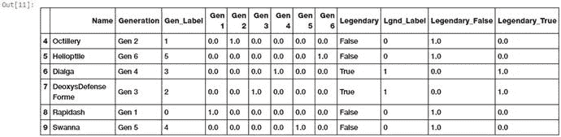

图 4-15.

展示宝可梦世代和传说状态独热编码特征的特征集

```
In [11]: poke_df_ohe = pd.concat([poke_df_sub, gen_features, leg_features], axis=1)
...: columns = sum([['Name', 'Generation', 'Gen_Label'],gen_feature_labels,
...:               ['Legendary', 'Lgnd_Label'],leg_feature_labels], [])
...: poke_df_ohe[columns].iloc[4:10]
```


从图 4-15 所示的结果特征集中，我们可以清晰地看到`Gen_Label`和`Lgnd_Label`的新独热编码特征。这些独热编码特征中的每一个本质上都是二元的，如果它们包含值 1，则表示该特征对于相应的观测值是激活的。例如，第 6 行表明宝可梦帝牙卢卡是一只`Gen 4`宝可梦，其`Gen_Label`为 3（映射从`0`开始），对应的独热编码特征`Gen 4`的值为`1`，而其余独热编码特征为`0`。类似地，它的`Legendary`状态为`True`，对应的`Lgnd_Label`为`1`，独热编码特征`Legendary_True`也为`1`，表示该特征处于激活状态。

假设我们使用这些数据来训练和构建模型，但现在我们有一些新的宝可梦数据，在将其输入训练好的模型之前，需要先对这些数据工程化处理相同的特征。我们可以对我们之前构建的`LabelEncoder`和`OneHotEncoder`对象使用`transform(...)`函数，这些对象曾用于从训练数据中工程化处理特征。以下代码展示了两个与新型宝可梦相关的虚拟数据点。

```
In [12]: new_poke_df = pd.DataFrame([['PikaZoom', 'Gen 3', True],
...:                            ['CharMyToast', 'Gen 4', False]],
...:                            columns=['Name', 'Generation', 'Legendary'])
...: new_poke_df
Out[12]:
Name Generation  Legendary
0     PikaZoom      Gen 3       True
1  CharMyToast      Gen 4      False
```

我们将遵循与之前相同的过程，首先使用我们之前构建的`LabelEncoder`对象将文本类别转换为数值表示，如下列代码所示。

```
In [13]: new_gen_labels = gen_le.transform(new_poke_df['Generation'])
...: new_poke_df['Gen_Label'] = new_gen_labels
...:
...: new_leg_labels = leg_le.transform(new_poke_df['Legendary'])
...: new_poke_df['Lgnd_Label'] = new_leg_labels
...:
...: new_poke_df[['Name', 'Generation', 'Gen_Label', 'Legendary', 'Lgnd_Label']]
Out[13]:
Name Generation  Gen_Label  Legendary  Lgnd_Label
0     PikaZoom      Gen 3          2       True           1
1  CharMyToast      Gen 4          3      False           0
```

现在，我们可以使用之前构建的`LabelEncoder`对象，并通过以下代码对这些新的数据观测值执行独热编码。见图 4-16。

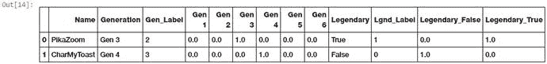

图 4-16.

展示新型宝可梦数据点独热编码特征的特征集

```
In [14]: new_gen_feature_arr = gen_ohe.transform(new_poke_df[['Gen_Label']]).toarray()
...: new_gen_features = pd.DataFrame(new_gen_feature_arr, columns=gen_feature_labels)
...:
...: new_leg_feature_arr = leg_ohe.transform(new_poke_df[['Lgnd_Label']]).toarray()
...: new_leg_features = pd.DataFrame(new_leg_feature_arr, columns=leg_feature_labels)
...:
...: new_poke_ohe = pd.concat([new_poke_df, new_gen_features, new_leg_features], axis=1)
...: columns = sum([['Name', 'Generation', 'Gen_Label'], gen_feature_labels,
...:                ['Legendary', 'Lgnd_Label'], leg_feature_labels], [])
...: new_poke_ohe[columns]
```

因此，你可以看到我们如何使用`fit_transform(...)`函数在我们的数据集上工程化处理特征，然后我们能够使用编码器对象，基于其先前观察到的数据（特别是不同的类别及其对应的标签和独热编码），通过`transform(...)`函数在新数据上工程化处理特征。未来在处理训练集和测试集以构建模型时，对于任何类型的特征工程，你都应始终遵循此工作流程。`Pandas`还提供了一个名为`to_dummies(...)`的出色函数，它可以帮助我们轻松执行独热编码。以下代码展示了如何实现这一点。

```
In [15]: gen_onehot_features = pd.get_dummies(poke_df['Generation'])
...: pd.concat([poke_df[['Name', 'Generation']], gen_onehot_features], axis=1).iloc[4:10]
Out[15]:
Name Generation  Gen 1  Gen 2  Gen 3  Gen 4  Gen 5  Gen 6
4            Octillery      Gen 2      0      1      0      0      0      0
5           Helioptile      Gen 6      0      0      0      0      0      1
6               Dialga      Gen 4      0      0      0      1      0      0
7  DeoxysDefense Forme      Gen 3      0      0      1      0      0      0
8             Rapidash      Gen 1      1      0      0      0      0      0
9               Swanna      Gen 5      0      0      0      0      1      0
```

输出展示了宝可梦世代的独热编码方案，与我们之前分析中展示的类似。

#### 虚拟编码方案

虚拟编码方案与独热编码方案类似，不同之处在于，当应用于具有 m 个不同标签的分类特征时，虚拟编码方案会得到 m-1 个二元特征。因此，分类变量的每个值都会被转换为一个大小为 m-1 的向量。多余的那个特征被完全忽略，因此如果类别值的范围为{0, 1, ..., m-1}，则第 0 个或第 m-1 个特征通常由一个全零（0）向量表示。

以下代码通过在宝可梦`Generation`上丢弃第一个级别的二元编码特征（`Gen 1`）来展示虚拟编码方案。

```
In [16]: gen_dummy_features = pd.get_dummies(poke_df['Generation'], drop_first=True)
...: pd.concat([poke_df[['Name', 'Generation']], gen_dummy_features], axis=1).iloc[4:10]
Out[16]:
Name Generation  Gen 2  Gen 3  Gen 4  Gen 5  Gen 6
4            Octillery      Gen 2      1      0      0      0      0
5           Helioptile      Gen 6      0      0      0      0      1
6               Dialga      Gen 4      0      0      1      0      0
7  DeoxysDefense Forme      Gen 3      0      1      0      0      0
8             Rapidash      Gen 1      0      0      0      0      0
9               Swanna      Gen 5      0      0      0      1      0
```

如果你愿意，你也可以选择通过以下代码丢弃最后一个级别的二元编码特征（`Gen 6`）。

```
In [17]: gen_onehot_features = pd.get_dummies(poke_df['Generation'])
...: gen_dummy_features = gen_onehot_features.iloc[:,:-1]
...: pd.concat([poke_df[['Name', 'Generation']], gen_dummy_features], axis=1).iloc[4:10]
Out[17]:
Name Generation  Gen 1  Gen 2  Gen 3  Gen 4  Gen 5
4            Octillery      Gen 2      0      1      0      0      0
5           Helioptile      Gen 6      0      0      0      0      0
6               Dialga      Gen 4      0      0      0      1      0
7  DeoxysDefense Forme      Gen 3      0      0      1      0      0
8             Rapidash      Gen 1      1      0      0      0      0
9               Swanna      Gen 5      0      0      0      0      1
```

因此，从这些输出中你可以看到，基于我们丢弃的编码级别二元特征，该特定类别值由一个全为`0`的向量/编码特征表示。例如，在前一个结果特征集中，宝可梦 Helioptile 属于`Gen 6`，在编码后的虚拟特征中由全`0`表示。


#### 效应编码方案

效应编码方案在大多数方面与虚拟编码方案非常相似。然而，在虚拟编码方案中代表全`0`的类别值所对应的编码特征或特征向量，在效应编码方案中被替换为`-1`。以下代码展示了在宝可梦`Generation`特征上应用的效应编码方案。

```
In [18]: gen_onehot_features = pd.get_dummies(poke_df['Generation'])
...: gen_effect_features = gen_onehot_features.iloc[:,:-1]
...: gen_effect_features.loc[np.all(gen_effect_features == 0, axis=1)] = -1.
...: pd.concat([poke_df[['Name', 'Generation']], gen_effect_features], axis=1).iloc[4:10]
Out[18]:
Name Generation  Gen 1  Gen 2  Gen 3  Gen 4  Gen 5
4            Octillery      Gen 2    0.0    1.0    0.0    0.0    0.0
5           Helioptile      Gen 6   -1.0   -1.0   -1.0   -1.0   -1.0
6               Dialga      Gen 4    0.0    0.0    0.0    1.0    0.0
7  DeoxysDefense Forme      Gen 3    0.0    0.0    1.0    0.0    0.0
8             Rapidash      Gen 1    1.0    0.0    0.0    0.0    0.0
9               Swanna      Gen 5    0.0    0.0    0.0    0.0    1.0
```

从输出的特征集中可以清晰地看到，在虚拟编码方案中原本全为`0`的值，现在都被替换成了`-1`。

#### 计数分箱方案

到目前为止所介绍的编码方案通常对分类数据效果不错，但当某个特征中不同类别的数量变得非常大时，它们就会开始引发问题。对于任何具有 m 个不同标签的分类特征，你都会得到 m 个独立的特征。这很容易导致特征集规模膨胀，从而引发存储问题，以及模型训练在时间、空间和内存方面的难题。此外，我们还需要应对所谓的“维度灾难”——当特征数量极其庞大而代表性样本不足时，模型性能就会开始受到影响。因此，对于具有大量可能类别（如 IP 地址）的特征，我们需要寻找其他分类数据特征工程方案。

计数分箱方案适用于处理具有众多类别的分类变量。在该方案中，我们并非使用实际的标签值进行编码，而是基于该值以及我们在建模中旨在预测的实际目标值或响应值，利用基于概率的统计信息。一个简单的例子是：根据过去 IP 地址的历史数据以及那些曾用于 DDOS 攻击的地址，我们可以计算出每个 IP 地址引发 DDOS 攻击的概率值。利用这些信息，我们可以对输入特征进行编码，从而表示如果未来出现相同的 IP 地址，其引发 DDOS 攻击的概率值是多少。该方案需要以历史数据为前提，且过程较为复杂。由于篇幅所限，本章无法给出完整示例，但你可以参考网上的多种资源。

#### 特征哈希方案

特征哈希方案是另一种用于处理大规模分类特征的有效特征工程方案。在该方案中，通常使用一个哈希函数，并预先设定编码特征的数量（作为一个预定义长度的向量），使得特征的哈希值被用作该预定义向量中的索引，并据此更新相应的值。由于哈希函数会将大量值映射到一个较小的有限值集合中，多个不同的值可能会产生相同的哈希值，这被称为“冲突”。通常使用带符号的哈希函数，这样从哈希函数获得值的符号，就会被用作最终特征向量中对应索引位置存储值的符号。这有助于减少冲突，并降低因冲突导致的误差累积。

哈希方案适用于字符串、数字以及其他结构（如向量）。你可以将哈希输出视为一组有限的 h 个箱子，当对相同的值应用哈希函数时，它们会根据哈希值被分配到 h 个箱子中的同一个箱子。我们可以设定 h 的值，该值将成为我们使用特征哈希方案编码的每个分类特征所对应的最终编码特征向量的大小。因此，即使一个特征有超过 1000 个不同的类别，而我们设定 h = 10，输出特征集仍然只有 10 个特征，相比之下，如果使用独热编码方案，则会得到 1000 个特征。

让我们看看下面的代码片段，它展示了我们视频游戏数据集中不同游戏类型的数量。

```
In [19]: unique_genres = np.unique(vg_df[['Genre']])
...: print("Total game genres:", len(unique_genres))
...: print(unique_genres)
Total game genres: 12
['Action' 'Adventure' 'Fighting' 'Misc' 'Platform' 'Puzzle' 'Racing'
'Role-Playing' 'Shooter' 'Simulation' 'Sports' 'Strategy']
```

从输出中可以清晰地看到，共有 12 种不同的游戏类型。如果我们在`Genre`特征上使用独热编码方案，最终会得到 12 个二元特征。相反，我们现在将利用`scikit-learn`的`FeatureHasher`类来使用特征哈希方案，该类使用了带符号的 32 位版本的`Murmurhash3`哈希函数。以下代码展示了如何使用特征哈希方案，我们将预先设定特征向量大小为 6（即 6 个特征，而非 12 个）。

```
In [21]: from sklearn.feature_extraction import FeatureHasher
...:
...: fh = FeatureHasher(n_features=6, input_type='string')
...: hashed_features = fh.fit_transform(vg_df['Genre'])
...: hashed_features = hashed_features.toarray()
...: pd.concat([vg_df[['Name', 'Genre']], pd.DataFrame(hashed_features)], axis=1).iloc[1:7]
Out[21]:
Name         Genre    0    1    2    3    4    5
1         Super Mario Bros.      Platform  0.0  2.0  2.0 -1.0  1.0  0.0
2            Mario Kart Wii        Racing -1.0  0.0  0.0  0.0  0.0 -1.0
3         Wii Sports Resort        Sports -2.0  2.0  0.0 -2.0  0.0  0.0
4  Pokemon Red/Pokemon Blue  Role-Playing -1.0  1.0  2.0  0.0  1.0 -1.0
5                    Tetris        Puzzle  0.0  1.0  1.0 -2.0  1.0 -1.0
6     New Super Mario Bros.      Platform  0.0  2.0  2.0 -1.0  1.0  0.0
```

因此，从结果特征集中可以清晰地看到，`Genre`分类特征已通过哈希方案编码为 6 个特征，而非 12 个。我们还可以看到，第 1 行和第 6 行表示相同的游戏类型`Platform`，它们正如预期那样被正确地编码成了相同的特征向量。


## 文本数据的特征工程

处理结构化数据属性（如数值型或类别型变量）通常不像处理非结构化属性（如文本和图像）那样具有挑战性。在处理文本文档这类非结构化数据时，首要挑战是应对文档在语法、格式和内容上不可预测的特性，这使得从中提取有用信息来构建模型变得困难。第二个挑战是将这些文本表示转换为机器学习算法能够理解的数值表示。数据科学家日常会采用多种特征工程技术，从非结构化文本中提取数值特征向量。在本节中，我们将讨论其中几种技术。在开始之前，请记住，对文本数据执行特征工程包含两个方面。

*   文本的预处理与标准化
*   特征提取与工程化

如果没有文本预处理和标准化，特征工程技术将无法发挥其核心效率，因此对文本文档进行预处理至关重要。你可以直接加载 `feature_engineering_text.py` 并运行示例，或者使用 Jupyter Notebook `Feature Engineering on Text Data.ipynb` 以获得更具交互性的体验。在开始之前，我们先加载以下必要的依赖项。

```
In [1]: import pandas as pd
...: import numpy as np
...: import re
...: import nltk
```

现在，让我们加载一些示例文本文档，进行一些基本的预处理，并了解处理文本数据的各种特征工程策略。以下代码创建了我们的示例文本语料库（文本文档的集合），我们将在本节中使用它。

```
In [2]: corpus = ['The sky is blue and beautiful.',
...:           'Love this blue and beautiful sky!',
...:           'The quick brown fox jumps over the lazy dog.',
...:           'The brown fox is quick and the blue dog is lazy!',
...:           'The sky is very blue and the sky is very beautiful today',
...:           'The dog is lazy but the brown fox is quick!'
...: ]
...: labels = ['weather', 'weather', 'animals', 'animals', 'weather', 'animals']
...: corpus = np.array(corpus)
...: corpus_df = pd.DataFrame({'Document': corpus,
...:                           'Category': labels})
...: corpus_df = corpus_df[['Document', 'Category']]
...: corpus_df
Out[2]:
Document Category
0                     The sky is blue and beautiful.  weather
1                  Love this blue and beautiful sky!  weather
2       The quick brown fox jumps over the lazy dog.  animals
3   The brown fox is quick and the blue dog is lazy!  animals
4  The sky is very blue and the sky is very beaut...  weather
5    The dog is lazy but the brown fox is quick!      animals
```

我们可以看到，总共有六个文档，其中三个与天气相关，另外三个则谈论动物，如 `Category` 类别标签所示。

### 文本预处理

在进行特征工程之前，我们需要像之前提到的那样对文本进行预处理、清洗和标准化。有多种预处理技术，其中一些相当复杂。我们不会在本节中深入探讨太多细节，但在后续章节中，当我们处理文本分类和情感分析时，会进一步详细介绍它们。以下是一些流行的预处理技术。

*   文本分词与转小写
*   移除特殊字符
*   缩略词扩展
*   移除停用词
*   拼写纠正
*   词干提取
*   词形还原

关于这些主题的更多细节，你可以直接跳到本书的第 7 章，或参考《Python 文本分析》（Apress；Dipanjan Sarkar，2016）第 3 章第 115 页的“文本标准化”部分，其中详细介绍了每种技术。我们将通过转小写、移除特殊字符、分词和移除停用词来标准化我们的文本。以下代码帮助我们实现这一点。

```
In [3]: wpt = nltk.WordPunctTokenizer()
...: stop_words = nltk.corpus.stopwords.words('english')
...:
...: def normalize_document(doc):
...:     # lower case and remove special characters\whitespaces
...:     doc = re.sub(r'[^a-zA-Z0-9\s]', '', doc, re.I)
...:     doc = doc.lower()
...:     doc = doc.strip()
...:     # tokenize document
...:     tokens = wpt.tokenize(doc)
...:     # filter stopwords out of document
...:     filtered_tokens = [token for token in tokens if token not in stop_words]
...:     # re-create document from filtered tokens
...:     doc = ' '.join(filtered_tokens)
...:     return doc
...:
...: normalize_corpus = np.vectorize(normalize_document)
```

`np.vectorize(...)` 函数帮助我们无需编写循环，即可对 `numpy` 数组的所有元素运行相同的函数。现在，我们将使用此函数来预处理我们的文本语料库。

```
In [4]: norm_corpus = normalize_corpus(corpus)
...: norm_corpus
Out[4]:
array(['sky blue beautiful', 'love blue beautiful sky',
'quick brown fox jumps lazy dog', 'brown fox quick blue dog lazy',
'sky blue sky beautiful today', 'dog lazy brown fox quick'],
dtype='<U32')
```

你可以将每个文本文档与初始数据框中的原始形式进行比较。你会看到每个文档都已转为小写，特殊符号已被移除，停用词（如冠词、代词等意义不大的词）也已被移除。现在，我们可以从这个预处理后的语料库中工程化特征了。

### 词袋模型

这或许是从非结构化文本中向量化特征最简单但最有效的方案之一。该模型的核心原理是将文本文档转换为数值向量。每个向量的维度或大小为 N，其中 N 表示整个文档语料库中所有可能的独特单词。每个文档转换后都是一个大小为 N 的数值向量，向量中的值或权重表示该特定文档中每个单词的频率。以下代码帮助我们文本语料库向量化为数值特征向量。

```
In [5]: from sklearn.feature_extraction.text import CountVectorizer
...:
...: cv = CountVectorizer(min_df=0., max_df=1.)
...: cv_matrix = cv.fit_transform(norm_corpus)
...: cv_matrix = cv_matrix.toarray()
...: cv_matrix
Out[5]:
array([[1, 1, 0, 0, 0, 0, 0, 0, 0, 1, 0],
[1, 1, 0, 0, 0, 0, 0, 1, 0, 1, 0],
[0, 0, 1, 1, 1, 1, 1, 0, 1, 0, 0],
[0, 1, 1, 1, 1, 0, 1, 0, 1, 0, 0],
[1, 1, 0, 0, 0, 0, 0, 0, 0, 2, 1],
[0, 0, 1, 1, 1, 0, 1, 0, 1, 0, 0]], dtype=int64)
```

输出结果表示每个文档的基于词频的特征向量，正如我们之前提到的。为了更好地理解，我们可以使用特征名称来表示它，并将其视为一个数据框。

```
In [6]: vocab = cv.get_feature_names()
...: pd.DataFrame(cv_matrix, columns=vocab)
Out[6]:
beautiful  blue  brown  dog  fox  jumps  lazy  love  quick  sky  today
0          1     1      0    0    0      0     0     0      0    1      0
1          1     1      0    0    0      0     0     1      0    1      0
2          0     0      1    1    1      1     1     0      1    0      0
3          0     1      1    1    1      0     1     0      1    0      0
4          1     1      0    0    0      0     0     0      0    2      1
5          0     0      1    1    1      0     1     0      1    0      0
```

现在我们可以清楚地看到，数据框的每一行都描绘了每个文本文档的词频向量。因此得名“词袋”，因为该模型将非结构化文本表示为一个词袋，而不考虑单词的位置、语法或语义。


### N-元组模型

在上述词袋模型中，我们使用了单个词项作为特征。但如果我们还想考虑按顺序出现的短语或词组集合呢？N-元组就能帮助我们实现这一点。N-元组本质上是从文本文档中提取的一组连续且按顺序出现的词元。二元组（Bi-gram）表示阶数为 2 的 N-元组（两个词），三元组（Tri-gram）表示阶数为 3 的 N-元组（三个词），以此类推。我们可以轻松地将词袋模型扩展为 N-元组袋模型，从而得到基于 N-元组的特征向量。以下代码在我们的语料库上计算了基于二元组的特征。

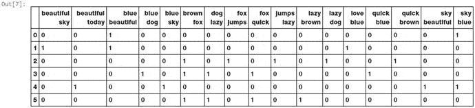

图 4-17.

基于 N-元组袋模型的语料库二元组特征向量

```
In [7]: bv = CountVectorizer(ngram_range=(2,2))
...: bv_matrix = bv.fit_transform(norm_corpus)
...: bv_matrix = bv_matrix.toarray()
...: vocab = bv.get_feature_names()
...: pd.DataFrame(bv_matrix, columns=vocab)
```

图 4-17 清晰地展示了我们的二元组特征向量，其中每个特征都是一个由两个连续词组成的二元组，数值表示该二元组在每个文档中出现的频率。你可以使用`ngram_range`参数来扩展 N-元组的范围，从而获得更高阶的 N-元组。通常，对于机器学习和自然语言处理中的大多数任务，使用到三阶的 N-元组就足够了。

### TF-IDF 模型

当词袋模型应用于大型语料库时，可能会出现一些潜在问题。由于特征向量基于绝对的词频，某些词可能在所有文档中频繁出现，从而在特征集中掩盖其他词。TF-IDF 模型试图通过在其计算中使用缩放或归一化因子来解决这个问题。TF-IDF 代表词频-逆文档频率（Term Frequency-Inverse Document Frequency），它在计算中结合了两个指标，即：词频（tf）和逆文档频率（idf）。该技术最初是为搜索引擎中的查询结果排序而开发的，如今已成为信息检索和文本分析领域不可或缺的模型。

从数学上讲，我们可以将 TF-IDF 定义为 tfidf = tf x idf，进一步展开可表示如下。

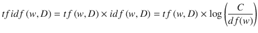

这里，tfidf (w, D) 是词 w 在文档 D 中的 TF-IDF 分数。tf (w, D) 表示词 w 在文档 D 中的词频，可以从词袋模型中获得。idf (w, D) 是词 w 的逆文档频率，可以通过对语料库中文档总数 C 除以词 w 的文档频率（即语料库中包含词 w 的文档数量）的结果取对数变换来计算。以下代码展示了基于 TF-IDF 的特征工程在我们的语料库上的应用。

```
In [8]: from sklearn.feature_extraction.text import TfidfVectorizer
...:
...: tv = TfidfVectorizer(min_df=0., max_df=1., use_idf=True)
...: tv_matrix = tv.fit_transform(norm_corpus)
...: tv_matrix = tv_matrix.toarray()
...:
...: vocab = tv.get_feature_names()
...: pd.DataFrame(np.round(tv_matrix, 2), columns=vocab)
Out[8]:
beautiful  blue  brown   dog   fox  jumps  lazy  love  quick   sky  today
0       0.60  0.52   0.00  0.00  0.00   0.00  0.00  0.00   0.00  0.60   0.00
1       0.46  0.39   0.00  0.00  0.00   0.00  0.00  0.66   0.00  0.46   0.00
2       0.00  0.00   0.38  0.38  0.38   0.54  0.38  0.00   0.38  0.00   0.00
3       0.00  0.36   0.42  0.42  0.42   0.00  0.42  0.00   0.42  0.00   0.00
4       0.36  0.31   0.00  0.00  0.00   0.00  0.00  0.00   0.00  0.72   0.52
5       0.00  0.00   0.45  0.45  0.45   0.00  0.45  0.00   0.45  0.00   0.00
```

因此，上述输出展示了每个文本文档基于 TF-IDF 的特征向量。请注意，与原始的词袋模型相比，这是一个经过缩放和归一化的版本。有兴趣深入了解该模型内部工作原理的读者，可以参考《Text Analytics with Python》（Apress 出版社；Dipanjan Sarkar 著，2016 年）第 181 页。

### 文档相似度

你甚至可以在上一节中构建的基于 tf-idf 的特征之上，利用它们生成可用于多种应用的新特征。计算文档相似度就是一个例子。这在搜索引擎、文档聚类和信息检索等领域非常有用。文档相似度是指使用基于距离或相似度的度量方法，根据从文档中提取的特征（如词袋或 tf-idf）来识别一个文本文档与另一个文档的相似程度。语料库中的成对文档相似度涉及计算语料库中每对文档的相似度。因此，如果语料库中有 C 个文档，你将得到一个 C x C 的矩阵，其中每个行和列代表一对文档的相似度分数，该对文档分别由行和列的索引表示。

有多种相似度和距离度量方法可用于计算文档相似度。这些包括余弦距离/相似度、BM25 距离、Hellinger-Bhattacharya 距离、Jaccard 距离等。在我们的分析中，我们将使用可能最流行且广泛使用的相似度度量方法——余弦相似度。余弦相似度本质上提供了一个度量，表示两个文本文档的特征向量表示之间夹角的余弦值。图 4-18 展示了一些典型的文本文档特征向量对齐情况。

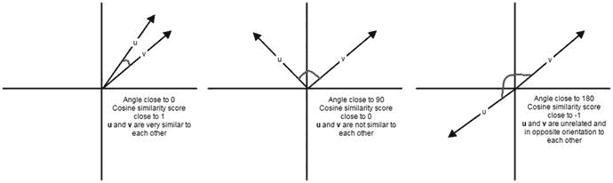

图 4-18.

文本文档特征向量的余弦相似度示意图（来源：《Text Analytics with Python》，Apress 出版社）

从图 4-18 中，我们可以清楚地看到，方向相似的特征向量彼此非常接近，它们之间的夹角接近 0°，因此余弦相似度将为 cos 0° = 1。当余弦相似度接近 cos 90° = 0 时，文档之间的夹角接近 90°，表明它们相距甚远，因此不太相似。接近-1 的相似度分数表示文档具有完全相反的方向，因为它们之间的夹角接近 180°。以下代码帮助我们计算样本语料库中所有文档的成对余弦相似度。

```
In [9]: from sklearn.metrics.pairwise import cosine_similarity
...:
...: similarity_matrix = cosine_similarity(tv_matrix)
...: similarity_df = pd.DataFrame(similarity_matrix)
...: similarity_df
Out[9]:
0         1         2         3         4         5
0  1.000000  0.753128  0.000000  0.185447  0.807539  0.000000
1  0.753128  1.000000  0.000000  0.139665  0.608181  0.000000
2  0.000000  0.000000  1.000000  0.784362  0.000000  0.839987
3  0.185447  0.139665  0.784362  1.000000  0.109653  0.933779
4  0.807539  0.608181  0.000000  0.109653  1.000000  0.000000
5  0.000000  0.000000  0.839987  0.933779  0.000000  1.000000
```

从上述输出中得到的成对相似度矩阵，我们可以清楚地看到，文档 0、1 和 4 彼此之间具有非常强的相似性。同时，文档 2、3 和 5 彼此之间也具有很强的相似性。这一定表明它们都具有一些相似的特征。这是一个可以通过无监督学习解决的分组或聚类的完美示例。


让我们使用 K-means 聚类，尝试利用这些特征来检验是否能够根据文档的特征表示对其进行聚类或分组。在 K-means 聚类中，我们有一个输入参数 k，它指定了使用文档特征输出的聚类数量。这种聚类方法是一种基于质心的聚类方法，它试图将这些文档聚类成方差相等的簇。它通过最小化簇内平方和度量（也称为惯性）来创建这些簇。以下代码片段使用我们的相似性特征构建了一个聚类模型，用于对文本文档进行聚类。

```
In [10]: from sklearn.cluster import KMeans
...:
...: km = KMeans(n_clusters=2)
...: km.fit_transform(similarity_df)
...: cluster_labels = km.labels_
...: cluster_labels = pd.DataFrame(cluster_labels, columns=['ClusterLabel'])
...: pd.concat([corpus_df, cluster_labels], axis=1)
Out[10]:
Document Category  ClusterLabel
0                     The sky is blue and beautiful.  weather             0
1                  Love this blue and beautiful sky!  weather             0
2       The quick brown fox jumps over the lazy dog.  animals             1
3   The brown fox is quick and the blue dog is lazy!  animals             1
4  The sky is very blue and the sky is very beaut...  weather             0
5        The dog is lazy but the brown fox is quick!  animals             1
```

获得的输出清楚地表明，我们的 K-means 聚类模型已将文档标记为两个簇，标签分别为 0 和 1。我们还可以看到这些标签是正确的，其中值为 0 的标签表示与天气相关的文档，值为 1 的标签表示与动物相关的文档。因此，你可以看到这些特征在文档聚类和分类中是多么有用！

### 主题模型

除了文档术语、短语和相似性之外，我们还可以使用一些摘要技术从文本文档中提取基于主题或概念的特征。主题模型的思想围绕着从文档语料库中提取关键主题或概念的过程，这些主题或概念被表示为“主题”。每个主题可以表示为文档语料库中词语/术语的集合或袋子。这些术语共同表示一个特定的主题、主题或概念，并且每个主题可以通过这些术语传达的语义含义轻松地与其他主题区分开来。这些概念可以涵盖从简单事实和陈述到观点和看法的范围。主题模型在总结大型文本文档语料库以提取和描述关键概念方面非常有用。它们也适用于从文本数据中提取特征，以捕获数据中的潜在模式。

主题建模有多种技术，其中大多数涉及某种形式的矩阵分解。一些技术，如潜在语义索引（LSI），使用矩阵分解操作，更具体地说是奇异值分解（请回顾第 1 章中的重要数学概念），将术语-文档矩阵（我们的 TF-IDF 文档-术语特征矩阵的转置）分解为三个矩阵：U、S 和 V^T。你可以使用矩阵 U 中的左奇异向量，并将其与奇异向量 S 相乘，以获得每个主题的术语及其权重（表示重要性）。你可以使用`scikit-learn`或`gensim`来应用基于 LSI 的主题建模。

另一种技术是潜在狄利克雷分配（LDA），它使用生成式概率模型，其中每个文档由多个主题的组合构成，每个术语或单词可以分配给一个特定的主题。这类似于基于 pLSI 的模型（概率 LSI）。在 LDA 的情况下，每个潜在主题上都包含一个狄利克雷先验。其背后的数学原理相当复杂，在当前范围内无法深入探讨。感兴趣的读者可以参考《Text Analytics with Python》（Apress，Dipanjan Sarkar，2016）的第 241 页，以获取有关 LDA 的更多详细信息。出于特征工程的目的，你需要记住，当 LDA 应用于文档-术语矩阵（TF-IDF 特征矩阵）时，它会被分解为两个主要部分：一个是文档-主题矩阵，即我们正在寻找的特征矩阵；另一个是主题-术语矩阵，它帮助我们查看语料库中的潜在主题。以下代码构建了一个 LDA 模型，用于从我们的示例语料库中提取特征和主题。

```
In [11]: from sklearn.decomposition import LatentDirichletAllocation
...:
...: lda = LatentDirichletAllocation(n_topics=2, max_iter=100, random_state=42)
...: dt_matrix = lda.fit_transform(tv_matrix)
...: features = pd.DataFrame(dt_matrix, columns=['T1', 'T2'])
...: features
Out[11]:
T1        T2
0  0.190615  0.809385
1  0.176860  0.823140
2  0.846148  0.153852
3  0.815229  0.184771
4  0.180563  0.819437
5  0.839140  0.160860
```

因此，`dt_matrix`指的是文档-主题矩阵，由于我们选择主题数量为 2，因此它为我们提供了两个特征。你还可以使用分解得到的另一个矩阵，即主题-术语矩阵，通过以下代码查看使用 LDA 模型从语料库中提取的主题。

```
In [12]: tt_matrix = lda.components_
...: for topic_weights in tt_matrix:
...:     topic = [(token, weight) for token, weight in zip(vocab, topic_weights)]
...:     topic = sorted(topic, key=lambda x: -x[1])
...:     topic = [item for item in topic if item[1] > 0.6]
...:     print(topic)
...:     print()
[('fox', 1.7265536238698524), ('quick', 1.7264910761871224), ('dog', 1.7264019823624879), ('brown', 1.7263774760262807), ('lazy', 1.7263567668213813), ('jumps', 1.0326450363521607), ('blue', 0.7770158513472083)]
[('sky', 2.263185143458752), ('beautiful', 1.9057084998062579), ('blue', 1.7954559705805626), ('love', 1.1476805311187976), ('today', 1.0064979209198706)]
```

前面的输出将两个主题分别表示为术语的集合，其重要性由相应的权重表示。通过观察这些术语，可以明显看出这两个主题彼此之间是相当可区分的。第一个主题显示了与动物相关的术语，第二个主题显示了与天气相关的术语。这一点通过使用以下代码片段对我们的文档-主题特征矩阵（`dt_matrix`）应用无监督的 K-means 聚类算法得到了进一步证实。

```
In [13]: km = KMeans(n_clusters=2)
...: km.fit_transform(features)
...: cluster_labels = km.labels_
...: cluster_labels = pd.DataFrame(cluster_labels, columns=['ClusterLabel'])
...: pd.concat([corpus_df, cluster_labels], axis=1)
Out[13]:
Document Category  ClusterLabel
0                     The sky is blue and beautiful.  weather             0
1                  Love this blue and beautiful sky!  weather             0
2       The quick brown fox jumps over the lazy dog.  animals             1
3   The brown fox is quick and the blue dog is lazy!  animals             1
4  The sky is very blue and the sky is very beaut...  weather             0
5        The dog is lazy but the brown fox is quick!  animals             1
```

这显然是有道理的，我们可以看到，仅使用两个基于主题模型的特征，我们仍然能够有效地对文档进行聚类！


### 词嵌入

近期有几种先进的词向量化模型备受瞩目，它们几乎都涉及**词嵌入**的概念。本质上，词嵌入可用于特征提取和语言建模。这种表示方法试图将每个单词或短语映射为一个完整的数值向量，使得语义相似的单词或术语在向量空间中的位置更接近，并且可以通过这些嵌入进行量化。`word2vec` 模型可能是最流行的基于神经网络的概率语言模型之一，可用于学习单词的分布式表示向量。`word2vec` 生成的词嵌入过程是：输入文本语料库，将单词表示在一个高维向量空间中，使得每个单词在该空间中都有一个对应的向量，并且相似（甚至语义相近）的单词彼此位置接近，这类似于我们之前在文档相似度中观察到的现象。

`word2vec` 模型由谷歌于 2013 年发布，它采用基于神经网络的实现，利用连续词袋和跳字等架构来学习语料库中单词的分布式向量表示。我们将使用 `gensim` 框架在我们的语料库上实现相同的模型以提取特征。该模型的一些重要参数简要说明如下。

*   `size`：表示转换后语料库中每个单词的特征向量大小。
*   `window`：设置上下文窗口大小，指定在训练时被视为属于单个相似上下文的单词窗口长度。
*   `min_count`：指定在训练模型时，语料库中单词被视为最终词汇表一部分所需的最低词频值。
*   `sample`：用于对频繁出现的单词的影响进行下采样。

以下代码片段在我们的示例语料库文档上构建了一个 `word2vec` 嵌入模型。请记住在将每个文档传递给模型之前对其进行分词。

```
In [14]: from gensim.models import word2vec
...:
...: wpt = nltk.WordPunctTokenizer()
...: tokenized_corpus = [wpt.tokenize(document) for document in norm_corpus]
...:
...: # 设置各种参数的值
...: feature_size = 10    # 词向量维度
...: window_context = 10          # 上下文窗口大小
...: min_word_count = 1   # 最小词频
...: sample = 1e-3   # 对高频词进行下采样的设置
...:
...: w2v_model = word2vec.Word2Vec(tokenized_corpus, size=feature_size,
...:                           window=window_context, min_count = min_word_count,
...:                           sample=sample)
Using TensorFlow backend.
```

现在，语料库中的每个单词本质上都是一个大小为 10 的向量。我们可以使用以下代码进行验证。

```
In [15]: w2v_model.wv['sky']
Out[15]:
array([ 0.02626196, -0.02171229, -0.04910386,  0.0194816 ,  0.01649994,
0.01200452,  0.04641563,  0.01844106,  0.02693636, -0.02992732], dtype=float32)
```

现在你可能会产生一个疑问：到目前为止，我们拥有的是每个完整文档的特征向量，但现在我们拥有的是每个单词的向量。我们究竟该如何表示整个文档呢？我们可以通过各种聚合和组合方式来实现。一个简单的方案是使用平均词向量表示，即简单地将文档中出现的所有词向量相加，然后除以词向量的数量，从而得到文档的平均词向量。以下代码实现了这一功能。

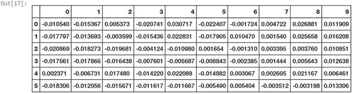

图 4-19.

我们语料库文档的平均词向量特征集

```
In [16]: def average_word_vectors(words, model, vocabulary, num_features):
...:
...:     feature_vector = np.zeros((num_features,),dtype="float64")
...:     nwords = 0.
...:
...:     for word in words:
...:         if word in vocabulary:
...:             nwords = nwords + 1.
...:             feature_vector = np.add(feature_vector, model[word])
...:
...:     if nwords:
...:         feature_vector = np.divide(feature_vector, nwords)
...:
...:     return feature_vector
...:
...:
...: def averaged_word_vectorizer(corpus, model, num_features):
...:     vocabulary = set(model.wv.index2word)
...:     features = [average_word_vectors(tokenized_sentence, model, vocabulary,
num_features)
...:                     for tokenized_sentence in corpus]
...:     return np.array(features)
In [17]: w2v_feature_array = averaged_word_vectorizer(corpus=tokenized_corpus, model=w2v_model,
...:                                              num_features=feature_size)
...: pd.DataFrame(w2v_feature_array)
```

因此，我们得到了所有语料库文档基于平均词向量的特征集，如图 4-19 中的数据框所示。这次我们尝试使用一种不同的聚类算法——亲和传播，来基于这些新特征对文档进行聚类。亲和传播基于消息传递的概念，你无需像在 K-means 聚类中那样预先指定聚类数量。

```
In [18]: from sklearn.cluster import AffinityPropagation
...:
...: ap = AffinityPropagation()
...: ap.fit(w2v_feature_array)
...: cluster_labels = ap.labels_
...: cluster_labels = pd.DataFrame(cluster_labels, columns=['ClusterLabel'])
...: pd.concat([corpus_df, cluster_labels], axis=1)
Out[18]:
Document Category  ClusterLabel
0                     The sky is blue and beautiful.  weather             0
1                  Love this blue and beautiful sky!  weather             0
2       The quick brown fox jumps over the lazy dog.  animals             1
3   The brown fox is quick and the blue dog is lazy!  animals             1
4  The sky is very blue and the sky is very beaut...  weather             0
5        The dog is lazy but the brown fox is quick!  animals             1
```

上述输出使用了基于词嵌入的平均词向量来对语料库中的文档进行聚类，我们可以清楚地看到它得到了正确的聚类结果！还有其他几种聚合词向量的方案，例如将 TF-IDF 权重与词向量表示结合使用。除此之外，深度学习领域近期也取得了进展，诸如 RNN 和 LSTM 等架构也被用于从文本数据中提取特征。


## 时序数据的特征工程

时序数据涉及随时间变化的数据集，而基于时间的属性在这些数据集中至关重要。通常，时序属性包含某种形式的数据、时间和时间戳值，并且通常可选地包含其他元数据，例如时区、夏令时信息等。时序数据，尤其是基于时间序列的数据，广泛应用于股票、商品和天气预报等多个领域。你可以直接加载 `feature_engineering_temporal.py` 并开始运行示例，或者使用 Jupyter Notebook `Feature Engineering on Temporal Data.ipynb` 以获得更具交互性的体验。在获取时序数据之前，我们先加载以下依赖项。

```
In [1]: import datetime
...: import numpy as np
...: import pandas as pd
...: from dateutil.parser import parse
...: import pytz
```

现在，我们将通过将以下值加载到数据框中，使用一些基于时间的样本数据作为我们的时序数据源。

```
In [2]: time_stamps = ['2015-03-08 10:30:00.360000+00:00', '2017-07-13 15:45:05.755000-07:00',
...:                '2012-01-20 22:30:00.254000+05:30', '2016-12-25 00:30:00.000000+10:00']
...: df = pd.DataFrame(time_stamps, columns=['Time'])
...: df
Out[2]:
Time
0  2015-03-08 10:30:00.360000+00:00
1  2017-07-13 15:45:05.755000-07:00
2  2012-01-20 22:30:00.254000+05:30
3  2016-12-25 00:30:00.000000+10:00
```

当然，默认情况下，它们以字符串或文本形式存储在数据框中，因此我们可以使用以下代码片段将时间转换为 `Timestamp` 对象。

```
In [3]: ts_objs = np.array([pd.Timestamp(item) for item in np.array(df.Time)])
...: df['TS_obj'] = ts_objs
...: ts_objs
Out[3]:
array([Timestamp('2015-03-08 10:30:00.360000+0000', tz='UTC'),
Timestamp('2017-07-13 15:45:05.755000-0700', tz='pytz.FixedOffset(-420)'),
Timestamp('2012-01-20 22:30:00.254000+0530', tz='pytz.FixedOffset(330)'),
Timestamp('2016-12-25 00:30:00+1000', tz='pytz.FixedOffset(600)')], dtype=object)
```

从这些时序值中可以清楚地看到，每个 `Timestamp` 对象都有多个组成部分，包括日期、时间，甚至还有基于时间的偏移量，这些偏移量也可用于识别时区。当然，我们无法直接将这些特征直接输入或用于任何机器学习模型。因此，我们需要特定的策略来从这些数据中提取有意义的特征。在接下来的章节中，我们将介绍其中一些策略，你将来可以在自己的时序数据上开始使用。

### 基于日期的特征

每个时序值都有一个日期组成部分，可用于提取与日期相关的有用信息和特征。这些特征和组成部分包括年、月、日、季度、星期几、星期名称、一年中的第几天、一年中的第几周等等。以下代码展示了如何从我们的时序数据中获取其中一些特征。

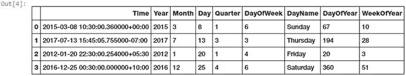

图 4-20.

时序数据中基于日期的特征

```
In [4]: df['Year'] = df['TS_obj'].apply(lambda d: d.year)
...: df['Month'] = df['TS_obj'].apply(lambda d: d.month)
...: df['Day'] = df['TS_obj'].apply(lambda d: d.day)
...: df['DayOfWeek'] = df['TS_obj'].apply(lambda d: d.dayofweek)
...: df['DayName'] = df['TS_obj'].apply(lambda d: d.weekday_name)
...: df['DayOfYear'] = df['TS_obj'].apply(lambda d: d.dayofyear)
...: df['WeekOfYear'] = df['TS_obj'].apply(lambda d: d.weekofyear)
...: df['Quarter'] = df['TS_obj'].apply(lambda d: d.quarter)
...:
...: df[['Time', 'Year', 'Month', 'Day', 'Quarter',
...:     'DayOfWeek', 'DayName', 'DayOfYear', 'WeekOfYear']]
```

图 4-20 中展示的特征显示了我们之前讨论过的一些属性，这些属性完全是从每个时序值的日期部分派生出来的。这些特征中的每一个都可以用作分类特征，并且可以进一步进行特征工程，例如独热编码、聚合、分箱等。

### 基于时间的特征

每个时序值还有一个时间组成部分，可用于提取与时间相关的有用信息和特征。这些属性包括小时、分钟、秒、微秒、UTC 偏移量等。以下代码片段从我们的时序数据中提取了一些前面提到的基于时间的特征。

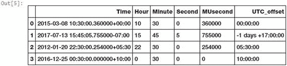

图 4-21.

时序数据中基于时间的特征

```
In [5]: df['Hour'] = df['TS_obj'].apply(lambda d: d.hour)
...: df['Minute'] = df['TS_obj'].apply(lambda d: d.minute)
...: df['Second'] = df['TS_obj'].apply(lambda d: d.second)
...: df['MUsecond'] = df['TS_obj'].apply(lambda d: d.microsecond)
...: df['UTC_offset'] = df['TS_obj'].apply(lambda d: d.utcoffset())
...:
...: df[['Time', 'Hour', 'Minute', 'Second', 'MUsecond', 'UTC_offset']]
```

图 4-21 中展示的特征显示了我们之前讨论过的一些属性，这些属性完全是从每个时序值的时间部分派生出来的。我们可以基于分类特征工程技术进一步处理这些特征，甚至可以派生其他特征，例如提取时区。让我们尝试利用刚刚获得的 `Hour` 特征，通过分箱将每个时序值归入一天中的特定时间段。

```
In [6]: hour_bins = [-1, 5, 11, 16, 21, 23]
...: bin_names = ['Late Night', 'Morning', 'Afternoon', 'Evening', 'Night']
...: df['TimeOfDayBin'] = pd.cut(df['Hour'],
...:                             bins=hour_bins, labels=bin_names)
...: df[['Time', 'Hour', 'TimeOfDayBin']]
Out[6]:
Time  Hour TimeOfDayBin
0  2015-03-08 10:30:00.360000+00:00    10      Morning
1  2017-07-13 15:45:05.755000-07:00    15    Afternoon
2  2012-01-20 22:30:00.254000+05:30    22        Night
3  2016-12-25 00:30:00.000000+10:00     0   Late Night
```

因此，从上述输出中可以看出，根据小时范围（0-5、5-11、11-16、16-21、21-23），我们为每个时序值分配了一个特定的一天中的时间段分箱。时序数据的 UTC 偏移量分量对于了解该时间值比 UTC（协调世界时）提前或落后多少非常有用，UTC 是时钟和时间调节所依据的主要时间标准。此信息还可用于设计新特征，例如每个时序值可能来自的潜在时区。以下代码帮助我们实现这一点。

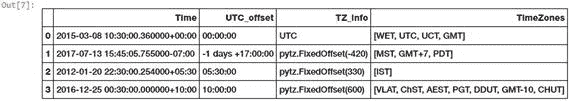

图 4-22.

时序数据中与时区相关的特征

```
In [7]: df['TZ_info'] = df['TS_obj'].apply(lambda d: d.tzinfo)
...: df['TimeZones'] = df['TS_obj'].apply(lambda d: list({d.astimezone(tz).tzname()
...:                                for tz in map(pytz.timezone,
...:                                              pytz.all_timezones_set)
...:                                  if d.astimezone(tz).utcoffset() == d.utcoffset()}))
...:
...: df[['Time', 'UTC_offset', 'TZ_info', 'TimeZones']]
```

因此，正如我们之前提到的，图 4-22 中展示的特征显示了每个时序值与时区相关信息相关的一些属性。我们还可以获取其他格式的时间分量，例如 Epoch（纪元时间），它基本上是从 1970 年 1 月 1 日（UTC 午夜）开始经过的秒数，以及公历序数，其中公元 1 年 1 月 1 日表示为 1，依此类推。以下代码帮助我们提取这些表示形式。参见图 4-23。

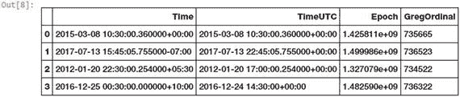

图 4-23.

以各种表示形式描述的时间分量


```
In [8]: df['TimeUTC'] = df['TS_obj'].apply(lambda d: d.tz_convert(pytz.utc))
...: df['Epoch'] = df['TimeUTC'].apply(lambda d: d.timestamp())
...: df['GregOrdinal'] = df['TimeUTC'].apply(lambda d: d.toordinal())
...:
...: df[['Time', 'TimeUTC', 'Epoch', 'GregOrdinal']]
```

请注意，我们在推导其他特征之前，先将每个时间值转换为 UTC。这些时间的替代表示形式可进一步用于简化日期运算。纪元（Epoch）表示以秒为单位的时间流逝，而格里高利序数（Gregorian ordinal）则表示以天为单位的时间流逝。我们可以利用这些来推导更多特征，例如从当前时间开始经过的时间，或者根据我们试图解决的问题，从重要事件开始经过的时间。现在，我们来计算每个时间值从当前时间开始经过的时间。见图 4-24。

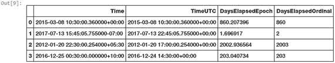

图 4-24.

推导从当前时间开始经过的时间差

```
In [9]: curr_ts = datetime.datetime.now(pytz.utc)
...: # 计算从今天起经过的天数
...: df['DaysElapsedEpoch'] = (curr_ts.timestamp() - df['Epoch']) / (3600*24)
...: df['DaysElapsedOrdinal'] = (curr_ts.toordinal() - df['GregOrdinal'])
...:
...: df[['Time', 'TimeUTC', 'DaysElapsedEpoch', 'DaysElapsedOrdinal']]
```

根据我们的计算，每个新推导出的特征都应给出当前时间与 `Time` 列（实际上是 `TimeUTC`，因为需要转换为 UTC）中时间值之间的经过时间差。这两个值几乎相等，这是符合预期的。因此，你可以利用时间和日期运算来提取和设计更多特征，这有助于构建更好的模型。时间的替代表示形式使你能够直接进行日期时间运算，而无需处理 Python 中 `Timestamp` 和 `datetime` 对象的特定 API 方法。不过，你可以使用任何方法来获得你想要的结果。关键在于易用性和效率！

## 图像数据的特征工程

另一种非常流行的非结构化数据格式是图像。以图像、视频和音频形式存在的声像数据是非常流行的数据源，它们在处理、存储、特征提取和建模方面给数据科学家带来了诸多挑战。然而，它们作为数据源的优势也相当显著，尤其是在人工智能和计算机视觉领域。由于数据的非结构化特性，无法直接使用图像来训练模型。如果给你一张原始图像，你可能会很难想出如何表示它，以便任何机器学习算法都能利用它进行模型训练。在这种情况下，有多种策略和技术可用于从图像中设计出合适的特征。处理图像时需要记住的核心原则之一是，任何图像都可以表示为数值像素值的矩阵。带着这个想法，让我们开始吧！你可以直接加载 `feature_engineering_image.py` 并开始运行示例，或者使用 jupyter notebook `Feature Engineering on Image Data.ipynb` 以获得更具交互性的体验。首先，让我们加载必要的依赖项和配置设置。

```
In [1]: import skimage
...: import numpy as np
...: import pandas as pd
...: import matplotlib.pyplot as plt
...: from skimage import io
...:
...: %matplotlib inline
```

`scikit-image`（`skimage`）库是一个优秀的框架，包含多个用于图像处理和特征提取的有用接口和算法。除此之外，我们还将利用 `mahotas` 框架，该框架在计算机视觉和图像处理中非常有用。Open CV 是另一个有用的框架，如果你对计算机视觉相关的方面感兴趣，可以了解一下。现在，让我们来看看将图像表示为有用特征向量表示形式的方法。

### 图像元数据特征

即使不处理图像本身，也能从图像元数据中获取大量有用的特征。这些信息大部分可以从 EXIF 数据中找到，设备在拍摄照片时通常会为每张图像记录这些数据。以下是从图像 EXIF 数据中可以获得的一些常见特征。

*   图像创建日期和时间
*   图像尺寸
*   图像压缩格式
*   设备品牌和型号
*   图像分辨率和宽高比
*   图像作者
*   闪光灯、光圈、焦距和曝光度

有关哪些其他数据点可以作为图像 EXIF 元数据特征的更多详细信息，你可以参考 [`https://sno.phy.queensu.ca/~phil/exiftool/TagNames/EXIF.html`](https://sno.phy.queensu.ca/%7Ephil/exiftool/TagNames/EXIF.html) ，该页面列出了可能的 EXIF 标签。

### 原始图像与通道像素

图像可以通过其每个像素的值表示为一个二维数组。我们可以利用 numpy 数组来实现这一点。然而，彩色图像通常有三个分量，也称为通道。`R`、`G` 和 `B` 通道分别代表红色、绿色和蓝色通道。这可以表示为一个三维数组 `(m, n, c)`，其中 `m` 表示图像的行数，`n` 表示图像的列数。这些由图像尺寸决定。`c` 表示它代表哪个通道（`R`、`G` 或 `B`）。现在，让我们加载一些示例彩色图像，并尝试理解它们的表示形式。

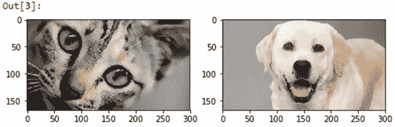

图 4-25.

我们的两个示例彩色图像

```
In [2]: cat = io.imread('datasets/cat.png')
...: dog = io.imread('datasets/dog.png')
...: df = pd.DataFrame(['Cat', 'Dog'], columns=['Image'])
...:
...: print(cat.shape, dog.shape)
(168, 300, 3) (168, 300, 3)
In [3]: fig = plt.figure(figsize = (8,4))
...: ax1 = fig.add_subplot(1,2, 1)
...: ax1.imshow(cat)
...: ax2 = fig.add_subplot(1,2, 2)
...: ax2.imshow(dog)
```

从图 4-25 中可以清楚地看到，我们有两张猫和狗的图像，尺寸为 `168x300` 像素，其中每一行和每一列代表图像的一个特定像素。第三个维度表明这些是彩色图像，具有三个颜色通道。现在，让我们尝试使用 `numpy` 索引来切片并分别提取狗图像的三个颜色通道。

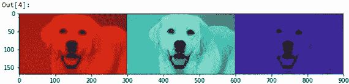

图 4-26.

从彩色 RGB 图像中提取红色、绿色和蓝色通道

```
In [4]: dog_r = dog.copy() # 红色通道
...: dog_r[:,:,1] = dog_r[:,:,2] = 0 # 将 G、B 像素设为 0
...: dog_g = dog.copy() # 绿色通道
...: dog_g[:,:,0] = dog_r[:,:,2] = 0 # 将 R、B 像素设为 0
...: dog_b = dog.copy() # 蓝色通道
...: dog_b[:,:,0] = dog_b[:,:,1] = 0 # 将 R、G 像素设为 0
...:
...: plot_image = np.concatenate((dog_r, dog_g, dog_b), axis=1)
...: plt.figure(figsize = (10,4))
...: plt.imshow(plot_image)
```

从图 4-26 中可以清楚地看到，我们如何轻松地使用 `numpy` 索引从示例图像中提取出三个颜色通道。现在，你可以引用这些通道中任何一个的原始图像像素矩阵，甚至可以在需要时将其展平以形成特征向量。

```
In [5]: dog_r[:,:,0]
Out[5]:
array([[160, 160, 160, ..., 113, 113, 112],
[160, 160, 160, ..., 113, 113, 112],
...,
[165, 165, 165, ..., 212, 211, 210],
[165, 165, 165, ..., 210, 210, 209],
[164, 164, 164, ..., 209, 209, 209]], dtype=uint8)
```

这个图像像素矩阵是一个二维矩阵，因此你可以从中进一步提取特征，甚至将其展平为一维向量，用作任何机器学习算法的输入。


### 灰度图像像素

如果你在处理彩色图像，处理多个通道和三维数组可能会变得困难。因此，将图像转换为灰度是一种很好的方法，既能保留必要的像素强度值，又能获得易于处理的二维图像。灰度图像通常捕获每个像素的亮度或强度，这样每个像素值就可以使用以下公式计算：

Y = 0.2125 x R + 0.7154 x G + 0.0721 x B

其中，R、G、B 是三个通道的像素值，Y 捕获最终的像素强度信息，其范围通常从 `0`（完全没有强度 - 黑色）到 `1`（完全有强度 - 白色）。下面的代码片段向我们展示了如何将 `RGB` 彩色图像转换为灰度并提取原始像素值，这些值可以用作特征。

```
In [6]: from skimage.color import rgb2gray
...:
...: cgs = rgb2gray(cat)
...: dgs = rgb2gray(dog)
...:
...: print('Image shape:', cgs.shape, '\n')
...:
...: # 2D pixel map
...: print('2D image pixel map')
...: print(np.round(cgs, 2), '\n')
...:
...: # flattened pixel feature vector
...: print('Flattened pixel map:', (np.round(cgs.flatten(), 2)))
Image shape: (168, 300)
2D image pixel map
[[ 0.42  0.41  0.41 ...,  0.5   0.52  0.53]
[ 0.41  0.41  0.4  ...,  0.51  0.52  0.54]
...,
[ 0.11  0.11  0.1  ...,  0.51  0.51  0.51]
[ 0.11  0.11  0.1  ...,  0.51  0.51  0.51]]
Flattened pixel map: [ 0.42  0.41  0.41 ...,  0.51  0.51  0.51]
```

### 图像强度分布分箱

我们在上一节中已经获得了灰度图像的原始图像强度值。一种方法是直接将这些原始像素值本身用作特征。另一种方法是使用直方图，根据强度值对图像强度分布进行分箱，并将这些分箱用作特征。下面的代码片段向我们展示了两个示例图像的图像强度分布情况。

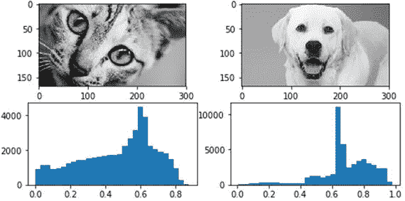

图 4-27.

使用直方图对图像强度分布进行分箱

```
In [7]: fig = plt.figure(figsize = (8,4))
...: ax1 = fig.add_subplot(2,2, 1)
...: ax1.imshow(cgs, cmap="gray")
...: ax2 = fig.add_subplot(2,2, 2)
...: ax2.imshow(dgs, cmap='gray')
...: ax3 = fig.add_subplot(2,2, 3)
...: c_freq, c_bins, c_patches = ax3.hist(cgs.flatten(), bins=30)
...: ax4 = fig.add_subplot(2,2, 4)
...: d_freq, d_bins, d_patches = ax4.hist(dgs.flatten(), bins=30)
```

正如我们提到的，图像强度范围从 `0` 到 `1`，这在图 4-27 中显示的 x 轴上显而易见。y 轴表示各个分箱的频率。我们可以清楚地看到，狗图像的分箱频率更集中在 `0.6 - 0.8` 附近，表明强度更高，其原因是拉布拉多犬是白色的，而白色具有高强度值，正如我们在上一节中提到的。变量 `c_freq`、`c_bins` 以及 `d_freq`、`d_bins` 可用于获取与分箱相关的数值，并用作特征。

### 图像聚合统计

我们在上一节中已经获得了灰度图像的原始图像强度值。一种方法是直接将它们用作特征，或者使用某种程度的聚合和统计度量，这些可以从像素和强度中获得。我们已经看到了一种使用直方图对强度值进行分箱的方法。在本节中，我们使用描述性统计度量和聚合方法，从图像像素值中计算特定特征。

我们可以通过将每个通道中像素值的最大值减去最小值来计算每个图像的 RGB 范围。以下代码帮助我们实现这一点。

```
In [8]: from scipy.stats import describe
...:
...: cat_rgb = cat.reshape((168*300), 3).T
...: dog_rgb = dog.reshape((168*300), 3).T
...:
...: cs = describe(cat_rgb, axis=1)
...: ds = describe(dog_rgb, axis=1)
...:
...: cat_rgb_range = cs.minmax[1] - cs.minmax[0]
...: dog_rgb_range = ds.minmax[1] - ds.minmax[0]
...: rgb_range_df = pd.DataFrame([cat_rgb_range, dog_rgb_range],
...:                             columns=['R_range', 'G_range', 'B_range'])
...: pd.concat([df, rgb_range_df], axis=1)
Out[8]:
Image  R_range  G_range  B_range
0   Cat      240      223      235
1   Dog      246      250      246
```

然后，我们可以将这些范围特征用作每个图像的特定特征属性。除此之外，我们还可以为每个图像通道计算其他指标，如均值、中位数、方差、偏度和峰度，如下所示。

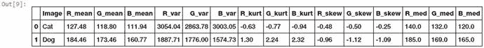

图 4-28.

图像通道聚合统计特征

```
In [9]: cat_stats= np.array([np.round(cs.mean, 2),np.round(cs.variance, 2),
...:                      np.round(cs.kurtosis, 2),np.round(cs.skewness, 2),
...:                      np.round(np.median(cat_rgb, axis=1), 2)]).flatten()
...: dog_stats= np.array([np.round(ds.mean, 2),np.round(ds.variance, 2),
...:                         np.round(ds.kurtosis, 2),np.round(ds.skewness, 2),
...:                         np.round(np.median(dog_rgb, axis=1), 2)]).flatten()
...:
...: stats_df = pd.DataFrame([cat_stats, dog_stats],
...:                         columns=['R_mean', 'G_mean', 'B_mean', 'R_var', 'G_var',
...:                                  'B_var', 'R_kurt', 'G_kurt', 'B_kurt', 'R_skew',
...:                                  'G_skew', 'B_skew', 'R_med', 'G_med', 'B_med'])
...: pd.concat([df, stats_df], axis=1)
```

从图 4-28 中获得的特征，我们可以观察到，狗图像各个通道的均值、中位数和峰度值大多大于猫图像中对应的值。然而，猫图像的方差和偏度更大。

### 边缘检测

一种更有趣且复杂的技术涉及检测图像中的边缘。边缘检测算法可用于检测图像中剧烈的强度和亮度变化，并找到感兴趣的区域。由 John Canny 开发的 Canny 边缘检测算法是当今使用最广泛的边缘检测算法之一。该算法通常涉及使用具有特定标准差 σ（sigma）的高斯分布来平滑和去噪图像。然后，我们应用 Sobel 滤波器来提取图像强度梯度。该梯度的范数值用于确定边缘强度。潜在的边缘被细化到宽度为 `1` 像素的曲线，并使用基于滞后的阈值处理，将高于特定高阈值的所有点标记为边缘，然后递归地使用低阈值来标记高于低阈值且与任何先前标记的点相连的点。以下代码将 Canny 边缘检测器应用于我们的示例图像。

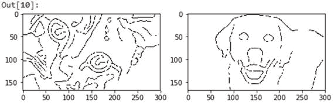

图 4-29.

Canny 边缘检测以提取基于边缘的特征

```
In [10]: from skimage.feature import canny
...:
...: cat_edges = canny(cgs, sigma=3)
...: dog_edges = canny(dgs, sigma=3)
...:
...: fig = plt.figure(figsize = (8,4))
...: ax1 = fig.add_subplot(1,2, 1)
...: ax1.imshow(cat_edges, cmap='binary')
...: ax2 = fig.add_subplot(1,2, 2)
...: ax2.imshow(dog_edges, cmap='binary')
```

基于图 4-29 中描绘的边缘特征数组的图像图清晰地显示了我们的猫和狗的突出边缘。你可以通过展平这些边缘特征数组（`cat_edges` 和 `dog_edges`）、提取与边缘相关的像素值和位置（非零值），甚至通过聚合它们（例如找出构成边缘的像素总数、平均值等）来使用它们。


### 目标检测

计算机视觉领域中另一项有趣的技术是目标检测，该技术能够检测并提取图像中用于突出特定物体的特征。方向梯度直方图（HOG）是目标检测中广泛使用的技术之一。在当前范围内无法深入探讨该技术的细节，但在特征工程过程中，你需要记住，HOG 算法遵循一系列与边缘检测类似的步骤。图像经过归一化和去噪处理，以消除多余的照明影响。计算一阶图像梯度，以捕获轮廓、纹理等图像属性。基于这些梯度，在称为“细胞单元”的特定窗口上构建梯度直方图。最后，对这些细胞单元进行归一化，得到一个扁平化的特征描述符，该描述符可作为我们模型的特征向量。以下代码展示了在示例图像上应用 HOG 目标检测技术的过程。

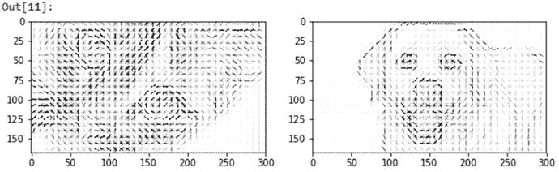

图 4-30.

基于目标检测提取特征的 HOG 目标检测器

```
In [11]: from skimage.feature import hog
...: from skimage import exposure
...:
...: fd_cat, cat_hog = hog(cgs, orientations=8, pixels_per_cell=(8, 8),
...:                     cells_per_block=(3, 3), visualise=True)
...: fd_dog, dog_hog = hog(dgs, orientations=8, pixels_per_cell=(8, 8),
...:                     cells_per_block=(3, 3), visualise=True)
...:
...: # rescaling intensity to get better plots
...: cat_hogs = exposure.rescale_intensity(cat_hog, in_range=(0, 0.04))
...: dog_hogs = exposure.rescale_intensity(dog_hog, in_range=(0, 0.04))
...:
...: fig = plt.figure(figsize = (10,4))
...: ax1 = fig.add_subplot(1,2, 1)
...: ax1.imshow(cat_hogs, cmap='binary')
...: ax2 = fig.add_subplot(1,2, 2)
...: ax2.imshow(dog_hogs, cmap='binary')
```

图 4-30 中的图像展示了 HOG 检测器如何识别示例图像中的物体。你也可以按如下方式获取扁平化的特征描述符。

```
In [12]: print(fd_cat, fd_cat.shape)
[ 0.00288784  0.00301086  0.0255757  ...,  0\.          0\.          0\.        ] (47880,)
```

### 局部特征提取

我们已经讨论了从二维图像或特征矩阵中聚合像素值，并将其展平为特征向量的方法。基于局部特征提取的技术是稍好一些的方法，它尝试在输入图像的各个小局部区域上检测并提取局部特征描述符。因此，这被恰当地命名为局部特征提取。我们将使用由[赫伯特·贝](https://en.wikipedia.org/wiki/Herbert_Bay#Herbert%20Bay)等人发明并获得专利的流行 SURF 算法。SURF 代表加速稳健特征。其主要思想是从图像中获取尺度不变的局部特征描述符，这些描述符随后可用作图像特征。该算法类似于流行的 SIFT 算法。该算法主要包含两个阶段。第一阶段是使用方形滤波器和海森矩阵检测兴趣点。第二阶段是通过提取这些兴趣点周围的局部特征来构建特征描述符。通常，这是通过围绕一个兴趣点取一个局部方形图像区域，然后在特定间隔的采样点上聚合哈尔小波响应来计算的。我们使用 `mahotas` Python 框架从示例图像中提取 SURF 特征描述符。

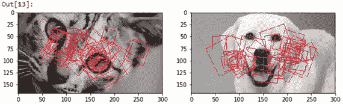

图 4-31.

使用 SURF 进行局部特征提取

```
In [13]: from mahotas.features import surf
...: import mahotas as mh
...:
...: cat_mh = mh.colors.rgb2gray(cat)
...: dog_mh = mh.colors.rgb2gray(dog)
...:
...: cat_surf = surf.surf(cat_mh, nr_octaves=8, nr_scales=16, initial_step_size=1,
threshold=0.1, max_points=50)
...: dog_surf = surf.surf(dog_mh, nr_octaves=8, nr_scales=16, initial_step_size=1,
threshold=0.1, max_points=54)
...:
...: fig = plt.figure(figsize = (10,4))
...: ax1 = fig.add_subplot(1,2, 1)
...: ax1.imshow(surf.show_surf(cat_mh, cat_surf))
...: ax2 = fig.add_subplot(1,2, 2)
...: ax2.imshow(surf.show_surf(dog_mh, dog_surf))
```

图 4-31 图像中的方框描绘了兴趣点周围的方形图像区域，这些区域用于局部特征提取。你也可以使用 `surf.dense(...)` 函数，在像素间隔均匀的密集点上提取维度统一的特征描述符。以下代码展示了如何实现这一点。

```
In [14]: cat_surf_fds = surf.dense(cat_mh, spacing=10)
...: dog_surf_fds = surf.dense(dog_mh, spacing=10)
...: cat_surf_fds.shape
Out[14]: (140, 64)
```

从上述输出中，我们看到获得了 `140` 个大小为 `64`（元素）的特征描述符。你可以在此基础上应用其他方案，如聚合、展平等，以进一步推导特征。另一种可用于在这些 SURF 特征描述符上提取特征的复杂技术是视觉词袋模型，我们将在下一节中讨论。


### 视觉词袋模型

我们已经看到，流行的词袋模型在从非结构化文本文档中提取有意义的特征方面非常有效。词袋指的是将文档分解为其组成部分——单词，并计算词频或其他度量（如 tf-idf）。类似地，对于图像的原始像素矩阵或从其他算法导出的特征描述符，我们也可以应用词袋原理。不过，在这种情况下，其组成部分不再是单词，而是从图像中提取的、彼此相似的子集特征或像素。

想象一下，你有许多张章鱼的图片，并且能够从中提取出 `140` 个密集的 SURF 特征，每个特征向量包含 `64` 个值。现在，你可以使用像聚类这样的无监督学习算法来提取相似特征描述符的聚类。每个聚类可以被标记为一个视觉单词或视觉特征。随后，每个特征描述符可以被分配到这些聚类或视觉单词中的一个。这样，对于 `140x64` 的特征描述符矩阵，你最终会得到一个一维的视觉词袋向量，其中包含分配给每个视觉单词的特征描述符的数量。每个特征或视觉单词倾向于捕捉图像中彼此相似的某些部分，例如章鱼的眼睛、触手、吸盘等，如图 4-32 所示。

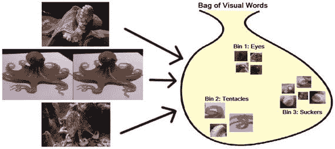

图 4-32.

视觉词袋（图片由 Ian London 提供，出自《使用 Python 进行视觉词袋图像分类》）

因此，基本思路是：首先使用任何算法（如 SURF）获取特征描述符矩阵，然后应用无监督算法（如 K-means 聚类），提取出 k 个容器或视觉特征/单词及其计数（基于分配给每个容器的特征描述符数量）。然后，对于后续的每一张图像，一旦提取出特征描述符，就可以使用 K-means 模型将每个特征描述符分配到一个视觉特征聚类中，并得到一个一维的计数向量。图 4-33 以一张示例章鱼图像展示了这一过程，假设我们的 VBOW（视觉词袋）模型有三个容器，分别对应眼睛、触手和吸盘。

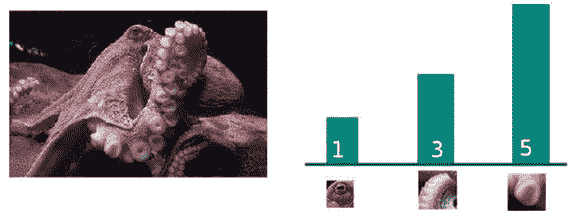

图 4-33.

将图像转换为 VBOW 向量（图片由 Ian London 提供，出自《使用 Python 进行视觉词袋图像分类》）

因此，从图 4-33 中你可以看到，一张二维图像及其对应的特征描述符是如何被轻松转换为一个一维 VBOW 向量 `[1, 3, 5]` 的。在当前范围内详细讨论 VBOW 模型是不可能的，但我要感谢我的朋友兼数据科学家同事 Ian London，他为我提供了关于 VBOW 模型的两张图。我也建议你去看看他精彩的博客文章 [`https://ianlondon.github.io/blog/visual-bag-of-words/`](https://ianlondon.github.io/blog/visual-bag-of-words/) ，该文章讨论了如何使用 VBOW 模型进行图像分类。

现在，我们将对我们的两张示例图像使用 `140x64` 的 SURF 特征描述符，对它们应用 K-means 聚类，并通过将每个特征描述符分配到一个容器中来计算每张图像的 VBOW 向量。在本例中，我们将取 `k=20`。见图 4-34。

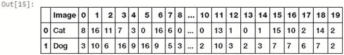

图 4-34.

将示例图像的 SURF 描述符转换为 VBOW 向量

```
In [15]: from sklearn.cluster import KMeans
...:
...: k = 20
...: km = KMeans(k, n_init=100, max_iter=100)
...:
...: surf_fd_features = np.array([cat_surf_fds, dog_surf_fds])
...: km.fit(np.concatenate(surf_fd_features))
...:
...: vbow_features = []
...: for feature_desc in surf_fd_features:
...:     labels = km.predict(feature_desc)
...:     vbow = np.bincount(labels, minlength=k)
...:     vbow_features.append(vbow)
...:
...: vbow_df = pd.DataFrame(vbow_features)
...: pd.concat([df, vbow_df], axis=1)
```

你可以看到，将复杂的二维 SURF 特征描述符矩阵转换为易于解释的 VBOW 向量是多么容易。现在，让我们拿一张新图像，思考一下如何应用 VBOW 流程。首先，我们需要使用以下代码片段从图像中提取 SURF 特征描述符（这仅用于展示 SURF 中使用的局部化图像子集，实际上我们将像之前一样使用密集特征）。见图 4-35。

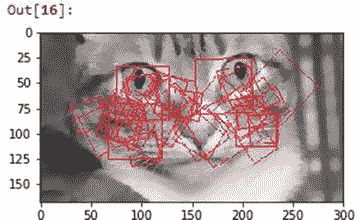

图 4-35.

使用 SURF 对新图像进行局部化特征提取

```
In [16]: new_cat = io.imread('datasets/new_cat.png')
...: newcat_mh = mh.colors.rgb2gray(new_cat)
...: newcat_surf = surf.surf(newcat_mh, nr_octaves=8, nr_scales=16, initial_step_size=1,
threshold=0.1, max_points=50)
...:
...: fig = plt.figure(figsize = (10,4))
...: ax1 = fig.add_subplot(1,2, 1)
...: ax1.imshow(surf.show_surf(newcat_mh, newcat_surf))
```

现在，让我们提取密集的 SURF 特征，并使用我们之前训练好的 VBOW 模型将它们转换为 VBOW 向量。以下代码帮助我们实现这一点。见图 4-36。

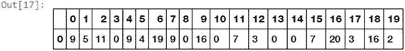

图 4-36.

将新图像的 SURF 描述符转换为 VBOW 向量

```
In [17]: new_surf_fds = surf.dense(newcat_mh, spacing=10)
...:
...: labels = km.predict(new_surf_fds)
...: new_vbow = np.bincount(labels, minlength=k)
...: pd.DataFrame([new_vbow])
```

因此，你可以看到基于 SURF 特征描述符得到的新图像的最终 VBOW 特征向量。这也是一个使用无监督机器学习模型进行特征工程的例子。现在，你可以使用一些相似性度量来比较这张新图像与另外两张示例图像的相似度。

```
In [18]: from sklearn.metrics.pairwise import euclidean_distances, cosine_similarity
...:
...: eucdis = euclidean_distances(new_vbow.reshape(1,-1) , vbow_features)
...: cossim = cosine_similarity(new_vbow.reshape(1,-1) , vbow_features)
...:
...: result_df = pd.DataFrame({'EuclideanDistance': eucdis[0],
...:               'CosineSimilarity': cossim[0]})
...: pd.concat([df, result_df], axis=1)
Out[18]:
Image  CosineSimilarity  EuclideanDistance
0   Cat          0.871609          21.260292
1   Dog          0.722096          30.000000
```

基于距离和相似性度量，我们可以看到我们的新图像（一张猫的图像）确实比狗的图像更接近猫的图像。尝试在更大的数据集上运行此方法，以获得更好的结果！


### 基于深度学习的自动化特征工程

在本节中，我们已经使用了许多简单和复杂的特征工程技术。构建复杂的特征工程系统和流水线非常耗时，而为这些系统构建算法则更具挑战性。深度学习是一种新颖的方法，它通过让机器自动学习底层原始数据的多层复杂表示，来自动化特征工程这一复杂任务。

卷积神经网络（CNN）被广泛用于图像中的自动特征提取。我们已经在第 1 章中介绍了 CNN 的基本原理。在进入第 1 章“深度学习”部分下的“重要概念”小节之前，请先回顾一下相关知识。正如我们之前提到的，CNN 的理念除了常规的激活函数层之外，还基于卷积和池化的原理。

卷积层通常会在输入图像像素的整个宽度和高度上滑动或卷积可学习的滤波器（也称为核或卷积矩阵）。在滑动滤波器的每个位置，计算输入像素与滤波器之间的点积。滤波器会生成二维激活图，当网络在检测特定特征（如边缘、角点等）时激活这些滤波器，从而能够学习它们。如果我们使用 n 个滤波器，就会得到 n 个独立的二维激活图，这些激活图可以沿着深度维度堆叠，从而得到输出体积。

池化是一种聚合或下采样层，通常会在卷积层之间插入一个非线性下采样操作。这里也会应用滤波器。它们沿着卷积输出矩阵滑动，对于每次滑动操作（也称为步长），池化滤波器覆盖的矩阵切片中的元素会被求和（求和池化）、求平均（平均池化）或选取最大值（最大池化）。在多种实际场景中，最大池化通常效果很好。池化有助于降低特征维度并控制模型过拟合。现在，让我们尝试使用深度学习，通过 CNN 对示例图像进行自动特征提取。加载构建深度网络所需的以下依赖项。

```
In [19]: from keras.models import Sequential
...: from keras.layers.convolutional import Conv2D
...: from keras.layers.convolutional import MaxPooling2D
...: from keras import backend as K
Using TensorFlow backend.
```

你可以使用 Theano 或 TensorFlow 作为`keras`运行的后端深度学习框架。在此场景中，我使用的是`tensorflow`。现在，让我们构建一个基本的两层 CNN，并在它们之间添加一个最大池化层。

```
In [20]: model = Sequential()
...: model.add(Conv2D(4, (4, 4), input_shape=(168, 300, 3), activation='relu',
...:                  kernel_initializer='glorot_uniform'))
...: model.add(MaxPooling2D(pool_size=(2, 2)))
...: model.add(Conv2D(4, (4, 4), activation='relu',
...:                 kernel_initializer='glorot_uniform'))
```

实际上，我们可以使用以下代码片段来可视化这个网络架构，以便更好地理解该网络中使用的各层。

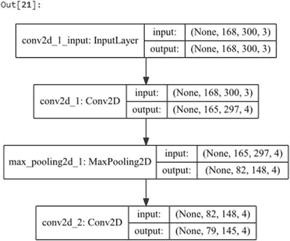

图 4-37.

可视化我们的两层卷积神经网络架构

```
In [21]: from IPython.display import SVG
...: from keras.utils.vis_utils import model_to_dot
...:
...: SVG(model_to_dot(model, show_shapes=True,
...:                  show_layer_names=True, rankdir='TB').create(prog='dot', format='svg'))
```

现在，从图 4-37 的描绘中你可以理解，我们使用了两个包含四个`(4x4)`滤波器的二维卷积层。我们还在它们之间添加了一个大小为`(2x2)`的最大池化层，用于进行一些下采样。现在，让我们构建一些函数，从这些中间网络层中提取特征。

```
In [22]: first_conv_layer = K.function([model.layers[0].input, K.learning_phase()],
...:                               [model.layers[0].output])
...: second_conv_layer = K.function([model.layers[0].input, K.learning_phase()],
...:                                [model.layers[2].output])
```

现在，让我们使用这些函数来提取卷积层中学到的特征表示，并可视化这些特征，以了解网络试图从图像中学习什么。

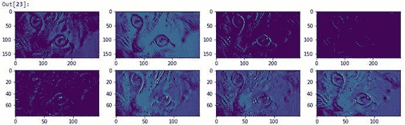

图 4-38.

经过卷积层后获得的中间特征图

```
In [23]: catr = cat.reshape(1, 168, 300,3)
...:
...: # 提取特征
...: first_conv_features = first_conv_layer([catr])[0][0]
...: second_conv_features = second_conv_layer([catr])[0][0]
...:
...: # 查看特征表示
...: fig = plt.figure(figsize = (14,4))
...: ax1 = fig.add_subplot(2,4, 1)
...: ax1.imshow(first_conv_features[:,:,0])
...: ax2 = fig.add_subplot(2,4, 2)
...: ax2.imshow(first_conv_features[:,:,1])
...: ax3 = fig.add_subplot(2,4, 3)
...: ax3.imshow(first_conv_features[:,:,2])
...: ax4 = fig.add_subplot(2,4, 4)
...: ax4.imshow(first_conv_features[:,:,3])
...:
...: ax5 = fig.add_subplot(2,4, 5)
...: ax5.imshow(second_conv_features[:,:,0])
...: ax6 = fig.add_subplot(2,4, 6)
...: ax6.imshow(second_conv_features[:,:,1])
...: ax7 = fig.add_subplot(2,4, 7)
...: ax7.imshow(second_conv_features[:,:,2])
...: ax8 = fig.add_subplot(2,4, 8)
...: ax8.imshow(second_conv_features[:,:,3])
```

图 4-38 中展示的特征图可视化确实很有趣。你可以清楚地看到，卷积神经网络生成的每个特征矩阵都在试图学习图像的某些信息，比如纹理、角点、边缘、光照、色调、亮度等。这应该能让你了解这些激活特征图如何被用作图像的特征。实际上，你可以将 CNN 的输出堆叠起来，如果需要的话进行展平，然后将其作为输入层传递给一个多层全连接感知器神经网络，并用于解决图像分类问题。这将为你利用深度学习进行自动特征提取提供一个良好的开端！

如果你对本节中提到的某些术语不理解，也不必担心；我们将在后续章节中更深入地介绍深度学习和 CNN。如果你迫不及待地想开始学习深度学习，可以打开本章附带的奖励笔记本，名为`Bonus - Classifying handwritten digits using Deep CNNs.ipynb`，这是一个将 CNN 和深度学习应用于手写数字分类的完整真实示例！


## 特征缩放

在处理数值型特征时，我们可能会遇到一些本质上完全无界的属性，例如视频的观看次数或网页的点击量。使用原始值作为输入特征可能会使模型偏向于那些数值量级非常高的特征。这些模型（如线性回归或逻辑回归）通常对特征的量级或尺度很敏感。其他模型，如基于树的方法，即使不进行特征缩放也能正常工作。然而，仍然建议通过特征缩放来归一化和缩小特征值，特别是当你打算在输入特征上尝试多种机器学习算法时。在本章前面，我们已经看到了一些使用对数变换和 Box-Cox 变换来缩放和转换特征的例子。在本节中，我们将介绍一些流行的特征缩放技术。你可以直接加载 `feature_scaling.py` 并运行示例，或者使用 Jupyter Notebook `Feature Scaling.ipynb` 以获得更具交互性的体验。让我们从加载以下依赖项和配置开始。

```
In [1]: from sklearn.preprocessing import StandardScaler, MinMaxScaler, RobustScaler
...: import numpy as np
...: import pandas as pd
...: np.set_printoptions(suppress=True)
```

现在，让我们加载一些关于在线视频用户观看次数的样本数据。以下代码片段创建了这个样本数据集。

```
In [2]: views = pd.DataFrame([1295., 25., 19000., 5., 1., 300.], columns=['views'])
...: views
Out[2]:
views
0   1295.0
1     25.0
2  19000.0
3      5.0
4      1.0
5    300.0
```

从上面的数据框可以看出，我们有五个被用户观看过的视频，每个视频的总观看次数由 `views` 这个特征表示。很明显，有些视频的观看次数远高于其他视频，从而产生了高量级和大数值。让我们看看如何使用几种便捷的技术来缩放这个特征。

### 标准化缩放

标准缩放器试图通过从特征列的每个值中减去均值，并将其方差缩放为 1 来标准化每个值。这也被称为中心化和缩放，可以用数学公式表示为

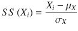

其中，特征 X 中的每个值都减去均值 μ [X]，然后将结果除以标准差 σ [X]。这也通常被称为 Z 分数缩放。如果需要，你也可以将结果除以方差而不是标准差。以下代码片段帮助我们实现了这一点。

```
In [3]: ss = StandardScaler()
...: views['zscore'] = ss.fit_transform(views[['views']])
...: views
Out[3]:
views    zscore
0   1295.0 -0.307214
1     25.0 -0.489306
2  19000.0  2.231317
3      5.0 -0.492173
4      1.0 -0.492747
5    300.0 -0.449877
```

我们可以在上面数据框的 `zscore` 列中看到标准化和缩放后的值。实际上，你可以手动使用我们之前使用的公式来计算相同的结果。下面的例子用数学方法计算了 Z 分数。

```
In [4]: vw = np.array(views['views'])
...: (vw[0] - np.mean(vw)) / np.std(vw)
Out[4]: -0.30721413311687235
```

### 最小-最大缩放

通过最小-最大缩放，我们可以转换和缩放特征值，使得每个值都落在 [0, 1] 范围内。然而，`scikit-learn` 中的 `MinMaxScaler` 类也允许你使用 `feature_range` 变量在缩放后的值范围内指定自己的上下界。从数学上，我们可以将这个缩放器表示为

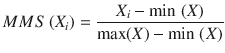

其中，我们通过从特征 X 中的每个值减去该特征的最小值 min (X)，然后将结果除以特征的最大值与最小值之差 max(X) - min (X) 来进行缩放。以下代码片段帮助我们计算这个值。

```
In [5]: mms = MinMaxScaler()
...: views['minmax'] = mms.fit_transform(views[['views']])
...: views
Out[5]:
views    zscore    minmax
0   1295.0 -0.307214  0.068109
1     25.0 -0.489306  0.001263
2  19000.0  2.231317  1.000000
3      5.0 -0.492173  0.000211
4      1.0 -0.492747  0.000000
5    300.0 -0.449877  0.015738
```

上面的输出显示了 `minmax` 列中的最小-最大缩放值，正如预期的那样，索引为 2 的行中观看次数最多的视频值为 1，索引为 4 的行中观看次数最少的视频值为 0。你也可以使用以下代码（第一行的示例计算）通过数学方式计算这个值。

```
In [6]: (vw[0] - np.min(vw)) / (np.max(vw) - np.min(vw))
Out[6]: 0.068108847834096528
```

### 鲁棒缩放

最小-最大缩放的缺点是，异常值的存在常常会影响任何特征的缩放值。鲁棒缩放试图使用特定的统计度量来缩放特征，而不受异常值的影响。从数学上，这个缩放器可以表示为

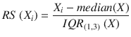

其中，我们通过减去 X 的中位数，然后将结果除以 X 的 IQR（也称为四分位距，即第一四分位数（25% 分位数）和第三四分位数（75% 分位数）之间的范围（差值））来缩放特征 X 的每个值。以下代码对我们的样本特征执行了鲁棒缩放。

```
In [7]: rs = RobustScaler()
...: views['robust'] = rs.fit_transform(views[['views']])
...: views
Out[7]:
views    zscore    minmax     robust
0   1295.0 -0.307214  0.068109   1.092883
1     25.0 -0.489306  0.001263  -0.132690
2  19000.0  2.231317  1.000000  18.178528
3      5.0 -0.492173  0.000211  -0.151990
4      1.0 -0.492747  0.000000  -0.155850
5    300.0 -0.449877  0.015738   0.132690

```

缩放后的值显示在 `robust` 列中，你可以将它们与其他列中的缩放特征进行比较。你也可以使用我们为鲁棒缩放器制定的数学方程来计算相同的结果，如下面的代码片段所示（针对第一行索引值）。

```
In [8]: quartiles = np.percentile(vw, (25., 75.))
...: iqr = quartiles[1] - quartiles[0]
...: (vw[0] - np.median(vw)) / iqr
Out[8]: 1.0928829915560916
```

还有其他几种特征缩放和归一化技术，但这些应该足以让你入门，并且在构建机器学习系统时被广泛使用。请始终记住，在处理数值特征时，检查是否需要缩放和标准化特征。


## 特征选择

虽然尝试设计能够捕捉底层数据中潜在表示和模式的特征是件好事，但处理包含数千个甚至更多特征的特征集并不总是有益的。处理大量特征引出了我们之前在“分类数据特征工程”的“分箱计数”部分提到的“维度灾难”概念。特征越多，往往会使模型更复杂且难以解释。除此之外，它还常常导致模型在训练数据上过拟合。这基本上会生成一个高度特化的模型，仅针对用于训练的数据进行调整，因此即使你获得了很高的模型性能，它在新的、未见过的数据上表现也会非常差。最终目标是选择最佳数量的特征来训练和构建模型，使其在数据上具有良好的泛化能力并防止过拟合。

根据所采用的策略和技术类型，特征选择策略可以分为三个主要领域。简要描述如下。

*   **过滤方法**：这些技术纯粹基于相关性、互信息等指标来选择特征。这些方法不依赖于任何模型得出的结果，通常检查每个特征与待预测响应变量之间的关系。流行的方法包括基于阈值的方法和统计检验。
*   **包装方法**：这些技术尝试通过使用递归方法，利用特征子集构建多个模型，并选择能给我们带来最佳性能模型的最佳特征子集，来捕捉多个特征之间的交互。像后向选择和前向消除等方法都是流行的基于包装的方法。
*   **嵌入方法**：这些技术尝试通过利用机器学习模型本身根据特征变量的重要性对其进行排序和评分，来结合前两种方法的优点。基于树的方法（如决策树）和集成方法（如随机森林）是嵌入方法的流行示例。

特征选择的好处包括：模型性能更佳、过拟合更少、模型泛化能力更强、计算和模型训练时间更短，以及能深入了解数据中各种特征的重要性。在本节中，我们将介绍一些最广泛使用的特征选择技术。你可以直接加载 `feature_selection.py` 并开始运行示例，或者使用 Jupyter notebook `Feature Selection.ipynb` 以获得更具交互性的体验。让我们从加载以下依赖项和配置开始。

```
In [1]: import numpy as np
...: import pandas as pd
...: np.set_printoptions(suppress=True)
...: pt = np.get_printoptions()['threshold']
```

现在，我们将通过使用一些样本数据集，来了解各种特征选择方法，包括基于统计和基于模型的技术。

### 基于阈值的方法

这是一种基于过滤的特征选择策略，你可以在特征选择过程中使用某种形式的截断或阈值来限制特征的总数。阈值可以有多种形式。其中一些可以在特征工程过程中直接使用，你可以指定阈值参数。一个简单的例子是在词袋模型中限制特征词条，我们之前在进行基于文本的特征工程时使用过它。`scikit-learn` 框架提供了像 `min_df` 和 `max_df` 这样的参数，可用于指定阈值，以忽略文档频率高于或低于用户指定阈值的词条。以下代码片段展示了一种实现方法。

```
In [2]: from sklearn.feature_extraction.text import CountVectorizer
...:
...: cv = CountVectorizer(min_df=0.1, max_df=0.85, max_features=2000)
...: cv
Out[2]:
CountVectorizer(analyzer='word', binary=False, decode_error='strict',
dtype=, encoding='utf-8', input='content',
lowercase=True, max_df=0.85, max_features=2000, min_df=0.1,
ngram_range=(1, 1), preprocessor=None, stop_words=None,
strip_accents=None, token_pattern='(?u)\\b\\w\\w+\\b',
tokenizer=None, vocabulary=None)
```

这基本上构建了一个计数向量化器，它会忽略出现在整个语料库中少于 10% 的特征词条，同时也忽略出现在整个语料库中超过 85% 的词条。除此之外，我们还对特征集设置了最多 2000 个特征的硬性限制。

另一种使用阈值的方法是使用基于方差的阈值处理，即移除方差较低（低于用户指定的阈值）的特征。这意味着我们希望移除那些在数据集中所有观测值上取值几乎恒定的特征。我们可以将其应用于本章前面使用过的宝可梦数据集。首先，我们将 `Generation` 特征转换为分类特征，如下所示。

```
In [3]: df = pd.read_csv('datasets/Pokemon.csv')
...: poke_gen = pd.get_dummies(df['Generation'])
...: poke_gen.head()
Out[3]:
Gen 1  Gen 2  Gen 3  Gen 4  Gen 5  Gen 6
0      1      0      0      0      0      0
1      1      0      0      0      0      0
2      1      0      0      0      0      0
3      1      0      0      0      0      0
4      1      0      0      0      0      0
```

接下来，我们想要从独热编码的特征中移除方差小于 `0.15` 的特征。我们可以使用以下代码片段来实现。

```
In [4]: from sklearn.feature_selection import VarianceThreshold
...:
...: vt = VarianceThreshold(threshold=.15)
...: vt.fit(poke_gen)
Out[4]: VarianceThreshold(threshold=0.15)
```

要查看方差以及该算法最终选择了哪些特征，我们可以分别使用 `variances_` 属性和 `get_support(...)` 函数。以下代码片段在一个格式化的数据框中清晰地展示了这一点。

```
In [5]: pd.DataFrame({'variance': vt.variances_,
...:               'select_feature': vt.get_support()},
...:              index=poke_gen.columns).T
Out[5]:
Gen 1     Gen 2 Gen 3     Gen 4     Gen 5      Gen 6
select_feature      True     False  True     False      True      False
variance        0.164444  0.114944  0.16  0.128373  0.163711  0.0919937
```

我们可以根据 `True` 值以及方差高于 `0.15` 来清晰地看到哪些特征被选中了。要获取最终选定的特征子集，你可以使用以下代码。

```
In [6]: poke_gen_subset = poke_gen.iloc[:,vt.get_support()].head()
...: poke_gen_subset
Out[6]:
Gen 1  Gen 3  Gen 5
0      1      0      0
1      1      0      0
2      1      0      0
3      1      0      0
4      1      0      0
```

上述特征子集表明，从最初的六个特征中，最终选定了 `Gen 1`、`Gen 3` 和 `Gen 5` 这三个特征。


### 统计方法

另一种广泛使用的基于过滤器的特征选择方法，其原理稍显复杂，是根据单变量统计检验来选择特征。你可以使用多种统计检验方法用于回归和分类模型，包括互信息、ANOVA（方差分析）和卡方检验。根据这些统计检验得出的分数，你可以依据分数选择最佳特征。现在，让我们加载一个包含 30 个特征的示例数据集。该数据集被称为威斯康星州诊断乳腺癌数据集，其原生或原始格式也可在 UCI 机器学习库的[`https://archive.ics.uci.edu/ml/datasets/Breast+Cancer+Wisconsin+(Diagnostic`](https://archive.ics.uci.edu/ml/datasets/Breast+Cancer+Wisconsin+(Diagnostic) `) 获取。我们将使用 `scikit-learn` 来加载数据特征和响应类别变量。

```
In [7]: from sklearn.datasets import load_breast_cancer
...:
...: bc_data = load_breast_cancer()
...: bc_features = pd.DataFrame(bc_data.data, columns=bc_data.feature_names)
...: bc_classes = pd.DataFrame(bc_data.target, columns=['IsMalignant'])
...:
...: # 构建特征集和响应类别标签
...: bc_X = np.array(bc_features)
...: bc_y = np.array(bc_classes).T[0]
...: print('特征集形状:', bc_X.shape)
...: print('响应类别形状:', bc_y.shape)
Feature set shape: (569, 30)
Response class shape: (569,)
```

我们可以清楚地看到，正如之前所述，该数据集共有 30 个特征和 569 行观测数据。要更详细地了解特征名称并查看数据点，你可以使用以下代码。

```
In [8]: np.set_printoptions(threshold=30)
...: print('特征集数据 [形状: '+str(bc_X.shape)+']')
...: print(np.round(bc_X, 2), '\n')
...: print('特征名称:')
...: print(np.array(bc_features.columns), '\n')
...: print('响应类别标签数据 [形状: '+str(bc_y.shape)+']')
...: print(bc_y, '\n')
...: print('响应变量名称:', np.array(bc_classes.columns))
...: np.set_printoptions(threshold=pt)
Feature set data [shape: (569, 30)]
[[  17.99   10.38  122.8  ...,    0.27    0.46    0.12]
[  20.57   17.77  132.9  ...,    0.19    0.28    0.09]
[  19.69   21.25  130\.   ...,    0.24    0.36    0.09]
...,
[  16.6    28.08  108.3  ...,    0.14    0.22    0.08]
[  20.6    29.33  140.1  ...,    0.26    0.41    0.12]
[   7.76   24.54   47.92 ...,    0\.      0.29    0.07]]
Feature names:
['mean radius' 'mean texture' 'mean perimeter' 'mean area'
'mean smoothness' 'mean compactness' 'mean concavity'
'mean concave points' 'mean symmetry' 'mean fractal dimension'
'radius error' 'texture error' 'perimeter error' 'area error'
'smoothness error' 'compactness error' 'concavity error'
'concave points error' 'symmetry error' 'fractal dimension error'
'worst radius' 'worst texture' 'worst perimeter' 'worst area'
'worst smoothness' 'worst compactness' 'worst concavity'
'worst concave points' 'worst symmetry' 'worst fractal dimension']
Response Class label data [shape: (569,)]
[0 0 0 ..., 0 0 1]
Response variable name: ['IsMalignant']
```

这让我们对正在处理的数据有了更清晰的认识。响应类别变量是一个二元类别，其中 1 表示检测到的肿瘤是良性的，0 表示是恶性的。我们还可以看到 30 个实数值特征，它们描述了乳腺肿块数字化图像中细胞核的特征。现在，让我们对这个特征集使用卡方检验，并从 30 个特征中选出最佳的 15 个特征。以下代码片段可以帮助我们实现这一点。

```
In [9]: from sklearn.feature_selection import chi2, SelectKBest
...:
...: skb = SelectKBest(score_func=chi2, k=15)
...: skb.fit(bc_X, bc_y)
Out[9]: SelectKBest(k=15, score_func=)
```

你可以看到，在计算必要的指标时，我们将输入特征（`bc_X`）和相应的响应类别输出（`bc_y`）传递给了 `fit(...)` 函数。卡方检验将计算每个特征与类别变量之间的统计量（单变量检验）。选择前 K 个特征很可能会移除得分较低的特征，这些特征很可能与类别变量独立，因此对构建模型没有用处。我们使用以下代码对得分进行排序，以查看最相关的特征。

```
In [10]: feature_scores = [(item, score) for item, score in zip(bc_data.feature_names,
skb.scores_)]
...: sorted(feature_scores, key=lambda x: -x[1])[:10]
Out[10]:
[('worst area', 112598.43156405364),
('mean area', 53991.655923750892),
('area error', 8758.5047053344697),
('worst perimeter', 3665.0354163405909),
('mean perimeter', 2011.1028637679051),
('worst radius', 491.68915743332195),
('mean radius', 266.10491719517802),
('perimeter error', 250.57189635982184),
('worst texture', 174.44939960571074),
('mean texture', 93.897508098633352)]
```

现在，我们可以借助卡方检验，使用以下代码从包含 30 个特征的原始特征集中创建一个包含 15 个选定特征的子集。

```
In [11]: select_features_kbest = skb.get_support()
...: feature_names_kbest = bc_data.feature_names[select_features_kbest]
...: feature_subset_df = bc_features[feature_names_kbest]
...: bc_SX = np.array(feature_subset_df)
...: print(bc_SX.shape)
...: print(feature_names_kbest)
(569, 15)
['mean radius' 'mean texture' 'mean perimeter' 'mean area' 'mean concavity'
'radius error' 'perimeter error' 'area error' 'worst radius'
'worst texture' 'worst perimeter' 'worst area' 'worst compactness'
'worst concavity' 'worst concave points']
```

因此，从上述输出可以看出，我们的新特征子集 `bc_SX` 包含 569 个观测值，每个观测值有 15 个特征，而不是 30 个。我们还打印了所选特征的名称，以便于理解。要查看新的特征集，你可以使用以下代码片段。

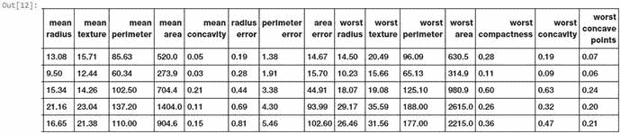

图 4-39.

使用卡方检验选择的威斯康星州诊断乳腺癌数据集特征子集

```
In [12]: np.round(feature_subset_df.iloc[20:25], 2)
```

包含得分最高特征的数据框如图 4-39 所示。现在，让我们使用逻辑回归在包含 30 个特征的原始特征集上构建一个简单的分类模型，并将其模型准确率性能与使用我们选定的 15 个特征构建的另一个模型进行比较。对于模型评估，我们将使用准确率指标（正确预测的百分比）并采用五折交叉验证方案。我们将在第 5 章详细介绍模型评估和调优策略，所以如果你现在无法理解某些术语，请不要灰心。这里的主要目的是比较在不同特征集上训练的模型之间的预测性能。


```
In [13]: from sklearn.linear_model import LogisticRegression
...: from sklearn.model_selection import cross_val_score
...:
...: # 构建逻辑回归模型
...: lr = LogisticRegression()
...:
...: # 评估基于完整特征集构建的模型准确率
...: full_feat_acc = np.average(cross_val_score(lr, bc_X, bc_y, scoring='accuracy', cv=5))
...: # 评估基于选定特征集构建的模型准确率
...: sel_feat_acc = np.average(cross_val_score(lr, bc_SX, bc_y, scoring='accuracy', cv=5))
...:
...: print('使用 5 折交叉验证的模型准确率统计')
...: print('使用完整特征集的模型准确率', bc_X.shape, ':', full_feat_acc)
...: print('使用选定特征集的模型准确率', bc_SX.shape, ':', sel_feat_acc)
Model accuracy statistics with 5-fold cross validation
Model accuracy with complete feature set (569, 30) : 0.950904193921
Model accuracy with selected feature set (569, 15) : 0.952643324356
```

准确率指标清晰地表明，我们实际上构建了一个更好的模型：使用选定的 15 个特征子集训练时，准确率达到 95.26%，而使用原始 30 个特征构建的模型准确率为 95.09%。在自己的数据集上试试看吧！你是否看到了任何改进？

### 递归特征消除

你还可以借助基于机器学习的模型估计器对特征进行排序和评分，从而递归地消除得分较低的特征，直到达到特定的特征子集数量。递归特征消除（Recursive Feature Elimination，简称 RFE）是一种流行的基于包装器的特征选择技术，它允许你使用这种策略。基本思路是，首先使用一个特定的机器学习估计器（例如我们用于分类需求的逻辑回归算法）。接下来，我们采用包含 30 个特征的完整特征集以及相应的响应类别变量。RFE 旨在根据模型拟合结果为这些特征分配权重。权重最小的特征被剔除，然后对剩余特征重新拟合模型，以获得新的权重或分数。这一过程会递归执行多次，每次都会消除得分/权重最低的特征，直到修剪后的特征子集包含用户希望选择的特征数量（这在开始时作为一个输入参数传入）。这种策略也常被称为**后向消除**。现在，让我们使用 RFE 在乳腺癌数据集上选择前 15 个特征。

```
In [14]: from sklearn.feature_selection import RFE
...:
...: lr = LogisticRegression()
...: rfe = RFE(estimator=lr, n_features_to_select=15, step=1)
...: rfe.fit(bc_X, bc_y)
Out[14]:
RFE(estimator=LogisticRegression(C=1.0, class_weight=None, dual=False, fit_intercept=True,
intercept_scaling=1, max_iter=100, multi_class='ovr', n_jobs=1,
penalty='l2', random_state=None, solver='liblinear', tol=0.0001,
verbose=0, warm_start=False),
n_features_to_select=15, step=1, verbose=0)
```

现在我们可以使用`get_support(...)`函数来获取最终选定的 15 个特征。如下代码片段所示。

```
In [15]: select_features_rfe = rfe.get_support()
...: feature_names_rfe = bc_data.feature_names[select_features_rfe]
...: print(feature_names_rfe)
['mean radius' 'mean texture' 'mean perimeter' 'mean smoothness'
'mean concavity' 'mean concave points' 'mean symmetry' 'texture error'
'worst radius' 'worst texture' 'worst smoothness' 'worst concavity'
'worst concave points' 'worst symmetry' 'worst fractal dimension']
```

我们能否将这个特征子集与上一节中使用统计检验得到的特征子集进行比较，看看这两个子集中有哪些共同特征？当然可以！让我们使用集合运算来获取这两种技术都选中的特征列表。

```
In [16]: set(feature_names_kbest) & set(feature_names_rfe)
Out[16]:
{'mean concavity', 'mean perimeter', 'mean radius', 'mean texture',
'worst concave points', 'worst concavity', 'worst radius', 'worst texture'}
```

因此，我们可以看到 15 个特征中有 8 个是共同的，并且被两种特征选择技术都选中了，这无疑非常有趣！

### 基于模型的选择

基于树的模型（如决策树）和集成模型（如随机森林，即树的集成）不仅可以用于建模，还可以用于特征选择。这些模型可以在构建模型时用于计算特征重要性，进而用于选择最佳特征，并丢弃得分较低的不相关特征。随机森林是一种集成模型。它可以作为一种嵌入式特征选择方法使用，其中集成中的每个决策树模型都是通过从整个数据集中抽取一个训练数据样本来构建的。这个样本是一个自助样本（有放回抽样）。任何节点上的分裂都是通过从特征的随机子集中选择最佳分裂来进行的，而不是考虑所有特征。这种随机性倾向于以略微增加偏差为代价来降低模型的方差。总体而言，这会产生一个更好、更泛化的模型。我们将在第 5 章中更详细地介绍偏差-方差权衡。现在，让我们使用随机森林模型根据特征的重要性对其进行评分和排序。

```
In [17]: from sklearn.ensemble import RandomForestClassifier
...:
...: rfc = RandomForestClassifier()
...: rfc.fit(bc_X, bc_y)
Out[17]:
RandomForestClassifier(bootstrap=True, class_weight=None, criterion='gini',
max_depth=None, max_features='auto', max_leaf_nodes=None,
min_impurity_split=1e-07, min_samples_leaf=1,
min_samples_split=2, min_weight_fraction_leaf=0.0,
n_estimators=10, n_jobs=1, oob_score=False, random_state=None,
verbose=0, warm_start=False)
```

以下代码使用这个随机森林估计器根据特征的重要性对其进行评分，并显示基于该评分的前 10 个最重要的特征。

```
In [18]: importance_scores = rfc.feature_importances_
...: feature_importances = [(feature, score) for feature, score in zip(bc_data.feature_names, importance_scores)]
...: sorted(feature_importances, key=lambda x: -x[1])[:10]
Out[18]:
[('worst area', 0.25116985146898885),
('worst radius', 0.16995187376059454),
('worst concavity', 0.1164662504282163),
('worst concave points', 0.11253251729478526),
('mean concave points', 0.10839170432994949),
('mean concavity', 0.063554137255925847),
('mean area', 0.023771318604377804),
('worst perimeter', 0.020636790800076958),
('worst texture', 0.019171556030722112),
('mean radius', 0.014908508522792335)]
```

现在，你可以使用基于阈值的参数根据需要过滤出前 n 个特征，或者你甚至可以利用`scikit-learn`提供的`SelectFromModel`元转换器，将其作为包装器封装在该模型之上。你能找出随机森林模型中排名较高的特征中有多少个与之前两个特征选择器选中的特征相同吗？


## 降维

处理大量特征可能导致模型过拟合、模型复杂化等诸多问题，这些最终都归结为我们之前提到的“维度灾难”。请参考第 1 章中“降维”一节来回顾相关知识。降维是指通过特征选择或特征提取等策略，减少特征集中特征总数的过程。我们在上一节已经详细讨论了特征选择。现在我们来介绍特征提取，其基本目标是从现有特征集中提取新特征，从而将包含众多特征的高维数据集降维到由这些新特征构成的低维数据集。一种非常流行的将高维数据线性变换到低维的技术是主成分分析，也称为 PCA。让我们在接下来的章节中进一步了解 PCA 以及如何将其用于特征提取。

### 使用主成分分析进行特征提取

主成分分析，通常称为 PCA，是一种统计方法，它利用线性正交变换的过程，将一组可能相关的高维特征转换为一组线性不相关的低维特征。这些经过变换后新创建的特征也被称为主成分或 PC。在任何 PCA 变换中，主成分的总数总是小于或等于初始特征的数量。第一个主成分试图捕获原始特征集的最大方差。随后的每个主成分都试图捕获更多的方差，并且它们与前面的主成分正交。需要记住的一个重要点是，PCA 对特征缩放很敏感。

我们的主要任务是将一组初始特征（假设其维度为 D）降维到由提取出的主成分构成的、维度更低的子集（维度为 L<D）。奇异值分解的矩阵分解过程对于帮助我们获取主成分极为有用。你可以参考第 1 章“数学”部分“重要概念”下的“奇异值分解”小节，快速回顾 SVD 的相关知识，查看必要的数学公式和概念。假设我们有一个数据矩阵 F [(n x D)]，其中有 n 个观测值和 D 个维度（特征），我们可以将特征矩阵的 SVD 表示为(F [(n x D)]) = USV^T，其中所有主成分都包含在分量 V^T 中，可以表示如下：

![$$ {V^T}_{\left(D\times D\right)}=\left[\begin{array}{c}P{C_1}_{\left(1\times D\right)}\\ {}P{C_2}_{\left(1\times D\right)}\\ {}\dots \\ {}P{C_D}_{\left(1\times D\right)}\end{array}\right] $$](A448827_1_En_4_Chapter_Equf.gif)

主成分由{PC [1], PC [2], ... PC [D]}表示，它们都是维度为(1 x D)的一维向量。为了提取前 d 个主成分，我们可以先对这个矩阵进行转置，得到如下表示。

![$$ P{C}_{\left(D\times D\right)}={\left({V}^T\right)}^T=\left[P{C_1}_{\left(D\kern0.24em \mathrm{x}\;1\right)}\;\left|P{C_2}_{\left(D\kern0.24em \mathrm{x}\;1\right)}\;\left|\dots \left|P{C_D}_{\left(D\kern0.24em \mathrm{x}\;1\right)}\right.\right.\right.\right] $$](A448827_1_En_4_Chapter_Equg.gif)

现在我们可以提取前 d 个主成分，其中 d ≤ D，降维后的主成分集可以表示如下。

![$$ P{C}_{\left(D\times D\right)}={\left({V}^T\right)}^T=\left[P{C_1}_{\left(D\kern0.24em \mathrm{x}\;1\right)}\;\left|P{C_2}_{\left(D\kern0.24em \mathrm{x}\;1\right)}\;\left|\dots \left|P{C_D}_{\left(D\kern0.24em \mathrm{x}\;1\right)}\right.\right.\right.\right] $$](A448827_1_En_4_Chapter_Equh.gif)

最后，为了执行降维，我们可以使用以下数学变换得到降维后的特征集：F [(n x d)] = F [(n x D)]⋅PC [(D x d)]，其中原始特征矩阵与主成分降维子集之间的点积运算为我们提供了一个包含 d 个特征的降维特征集。这里需要记住的一个非常重要点是，你可能需要通过减去均值来对初始特征矩阵进行中心化，因为 PCA 默认你的数据是围绕原点分布的。

现在，让我们尝试使用 SVD 从包含 30 个特征的乳腺癌特征集中提取前三个主成分。我们首先对特征矩阵进行中心化，然后使用 SVD 和子集提取来获取前三个主成分，代码如下。

```
In [19]: # 对特征集进行中心化
...: bc_XC = bc_X - bc_X.mean(axis=0)
...:
...: # 使用 SVD 进行分解
...: U, S, VT = np.linalg.svd(bc_XC)
...:
...: # 获取主成分
...: PC = VT.T
...:
...: # 获取前 3 个主成分
...: PC3 = PC[:, 0:3]
...: PC3.shape
Out[19]: (30, 3)
```

现在，我们可以使用前面讨论的点积运算来获取包含三个特征的降维特征集。以下代码片段给出了最终可用于建模的降维特征集。

```
# 降低特征集维度
np.round(bc_XC.dot(PC3), 2)
Out[20]:
array([[-1160.14,  -293.92,   -48.58],
[-1269.12,    15.63,    35.39],
[ -995.79,    39.16,     1.71],
...,
[ -314.5 ,    47.55,    10.44],
[-1124.86,    34.13,    19.74],
[  771.53,   -88.64,   -23.89]])
```

因此，你可以看到 SVD 和 PCA 在通过提取必要特征来帮助我们降维方面是多么强大。当然，在机器学习系统和流程中，你可以使用`scikit-learn`中的工具，而不是编写不必要的代码和公式。以下代码使我们能够利用`scikit-learn`的 API 对乳腺癌特征集执行 PCA。

```
In [21]: from sklearn.decomposition import PCA
...: pca = PCA(n_components=3)
...: pca.fit(bc_X)
Out[21]:
PCA(copy=True, iterated_power='auto', n_components=3, random_state=None,
svd_solver='auto', tol=0.0, whiten=False)
```

要了解每个主成分解释了多大比例的方差，可以使用以下代码。

```
In [22]: pca.explained_variance_ratio_
Out[22]: array([ 0.98204467,  0.01617649,  0.00155751])
```

从上面的输出可以看出，正如预期的那样，第一个主成分解释了最大比例的方差。要获取降维后的特征集，可以使用以下代码片段。

```
In [23]: bc_pca = pca.transform(bc_X)
...: np.round(bc_pca, 2)
Out[23]:
array([[ 1160.14,  -293.92,    48.58],
[ 1269.12,    15.63,   -35.39],
[  995.79,    39.16,    -1.71],
...,
[  314.5 ,    47.55,   -10.44],
[ 1124.86,    34.13,   -19.74],
[ -771.53,   -88.64,    23.89]])
```

如果你将这个降维特征集的值与我们基于数学实现代码获得的值进行比较，你会发现它们完全相同，只是在某些情况下符号相反。

主成分中某些值符号相反的原因在于这些主成分的方向是不稳定的。符号表示方向。因此，即使主成分指向相反的方向，它们仍然应该位于同一个平面上，因此在用这些数据建模时不应产生影响。

现在，让我们像之前一样快速构建一个逻辑回归模型，并使用模型准确率和五折交叉验证来评估使用这三个特征时的模型质量。

```
In [24]: np.average(cross_val_score(lr, bc_pca, bc_y, scoring='accuracy', cv=5))
Out[24]: 0.92808003078106949
```

从上面的输出可以看出，尽管我们只使用了从主成分中提取的三个特征，而不是原始的 30 个特征，但我们仍然获得了接近 93%的模型准确率，这相当不错！


## 摘要

本章内容充实，包含大量基于真实数据集的动手实践示例。本章的主要目的是让你熟悉用于特征提取、特征工程、特征缩放和特征选择的基本概念、工具、技术和策略。数据科学家日复一日面临的最艰巨任务之一就是数据处理和特征工程。因此，深入理解从原始数据中衍生特征所涉及的各个方面至关重要。本章旨在作为入门指南和参考手册，帮助你理解在尝试为自己的数据集进行特征工程时应采用何种技术和策略。我们涵盖了特征工程、特征缩放和特征选择的基本概念，以及每个过程背后的重要性。针对数值型、类别型、文本型、时间序列和图像等多种数据类型，我们详细介绍了特征工程技术。此外，还介绍了多种特征缩放技术，这些技术有助于在建模前降低特征的尺度和量级。最后，我们详细介绍了特征选择技术，重点阐述了特征选择的三种不同策略：过滤法、包装法和嵌入法。由于降维和基于深度学习的自动特征提取在研究和工业界都备受关注，本章也包含了相关专题。我想引用著名计算机科学家、谷歌总监彼得·诺维格的一句话来结束本章，这句话应该能强化特征工程的重要性。

> “更多的数据胜过更聪明的算法，但更好的数据胜过更多的数据。” ——彼得·诺维格

