# 5. 构建、调优与部署模型

机器学习界有一句广为流传的话：“机器学习中 70%的工作是数据处理”，从本书的结构来看，这句话非常贴切。在前面的章节中，你已经了解了如何提取、处理和转换数据，使其转化为适合机器学习算法学习的形式。本章将探讨如何利用处理后的数据来学习一个模型，进而解决实际问题。你还学习了用于开发数据解决方案和项目的 CRISP-DM 方法论——构建和调优模型这一步是机器学习迭代循环中的最后一步。

如果你遵循了前面章节中规定的所有步骤，那么现在你应该已经拥有一个经过清洗和处理的数据/特征集。这些数据大多以数组或数据框（特征集）的数值形式存在。大多数机器学习算法要求数据为数值格式，因为任何机器学习算法的核心都是一些数学方程和一个优化问题，目标是最小化误差/损失或最大化收益。因此，机器学习算法始终处理数值型数据。请参阅第 4 章，了解将结构化及非结构化数据转换为可直接使用的数值格式的特征工程技术。本章首先介绍你可以使用的不同类型的算法。然后，你将学习如何为手头的数据选择合适的算法，接着会介绍超参数的概念，并学习如何调优任何算法的超参数。本章还涵盖了一种使用开源框架解释模型的新颖方法。除此之外，你还将学习如何持久化和部署已开发的模型，以便你能根据自己的需求和利益开始使用它们。

基于上述主题，本章分为以下五个主要部分：

*   构建模型
*   模型评估技术
*   模型调优
*   模型解释
*   部署模型实战

你应该充分熟悉前面章节的内容，这将有助于更好地理解本章的各个方面。本章中使用的所有代码片段和示例均可在本书的 GitHub 仓库中找到，地址为 [`https://github.com/dipanjanS/practical-machine-learning-with-python`](https://github.com/dipanjanS/practical-machine-learning-with-python)，位于第 5 章的 `directory/folder` 目录下。你可以参考名为 `model_build_tune_deploy.py` 的 Python 文件，获取本章使用的所有示例，并在阅读本章时尝试这些示例；或者，你也可以参考名为 `Building, Tuning and Deploying Models.ipynb` 的 Jupyter 笔记本，以获得更具交互性的体验。

## 构建模型

在开始构建模型之前，我们应该先理解模型代表什么。简单来说，模型可以描述为数据集中输出变量或响应变量与其对应的输入变量或自变量之间的关系。有时，这种关系可能仅存在于输入变量之间（对于没有定义输出或因变量的数据集而言）。变量之间的关系可以用数学方程、函数和规则来表达，这些方程、函数和规则将模型的输出与其输入联系起来。

以线性回归分析为例，其输出是一组参数，也称为权重或系数（我们将在本章后面探讨），这些参数定义了输入变量和输出变量之间的关系。其思想是通过学习过程构建一个模型，以便你能学习到模型中必要的参数（系数），这些参数有助于将输入变量（自变量）转化为相应的输出变量（因变量），并且对于数据集而言误差最小（利用均方误差等验证指标）。其目的不是为每个输入数据点预测一个正确的输出值（这会导致模型过拟合），而是在大量数据点上良好地泛化，使得误差最小，并且当你将模型应用于新数据点时，这种低误差性能得以保持。这是通过在模型构建过程中学习系数/参数的正确值来实现的。因此，当我们说我们在学习一个线性回归模型时，这句话隐含着一系列重要的考量。见图 5-1。

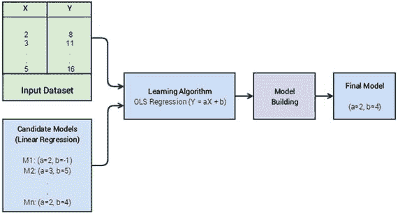

图 5-1.

模型构建的高级表示

当我们指定线性回归作为候选模型时，我们定义了因变量和自变量之间关系的性质。候选模型随后变成了我们模型所有可能的参数组合（稍后会详细介绍）。学习算法是通过某种优化过程来确定这些参数的最优值，并使用某些指标（如均方误差以降低整体误差）来验证性能的方法。最终模型无非就是我们的学习算法所选出的参数的最优值。因此，在简单线性回归的情况下，它就是一个包含两个参数 a 和 b 值的元组。这里需要记住的一点是，术语“参数”与模型中的系数或权重类似。还有另一类参数称为超参数，它们代表模型更高层次的元参数，不依赖于底层数据。它们通常需要在开始构建或学习过程之前设置好。通常，这些超参数会被调优以获得最优值，这是模型调优阶段（学习阶段本身的一部分）的一部分。另一个需要记住的重要点是，输出的模型通常取决于我们为数据选择的学习算法。


### 模型类型

模型可以根据多种类别和命名法进行区分。其中很多都基于用于构建模型的学习算法或方法本身。例如，模型是线性还是非线性，模型的输出是什么，是参数模型还是非参数模型，是监督学习、无监督学习还是半监督学习，是集成模型还是基于深度学习的模型。请参考第 1 章中的“机器学习方法”一节，以回顾可用于在数据集上构建模型的机器学习方法。在本节中，我们将重点介绍监督学习和无监督学习方法中一些最流行的模型。

#### 分类模型

分类是最容易识别的机器学习任务之一，在第 1 章中有详细讨论。它是更广泛的机器学习问题（称为监督学习）的一个子集。监督学习是一类机器学习问题/任务，其中我们拥有一个带有输入属性和相应输出标签或类别（离散值）的标记数据集。然后，这些输入和相应的输出被用于学习一个通用系统，该系统可用于预测之前未见过的数据点的结果（输出类别标签）。分类是整个监督学习领域的主要组成部分。

分类模型的输出通常是输入数据点可能属于的标签或类别。解决分类（或一般的任何监督学习）问题涉及一个训练数据集，其中数据点被标记了正确的类别/分类。然后，我们使用特定于分类问题的监督学习算法，为我们的问题泛化出一个类似于分类函数的东西。这个分类函数的输入与我们用于训练模型的数据完全相同。这个输入通常是特征工程步骤中生成的数据属性或特征。

典型的分类模型包括以下主要方法类型，但此列表并非详尽无遗。

*   线性模型，如逻辑回归、朴素贝叶斯和支持向量机
*   非参数模型，如 K 近邻
*   基于树的方法，如决策树
*   集成方法，如随机森林（装袋法）和梯度提升机（提升法）
*   神经网络（多层感知器）

分类模型还可以根据其产生的输出变量类型和输出变量数量进一步细分。这种命名法对于通过查看数据集属性和待解决的目标来理解你所处理的分类问题类型至关重要。

*   **二分类**：当数据中的输出响应变量总共只有两个类别需要区分时，该问题被称为二分类问题。因此，你需要一个能够执行二分类的适当模型（称为二分类模型）。一个流行的二分类问题是“电子邮件分类问题”。在此问题中，候选电子邮件需要被分类并标记为两个不同类别之一：“垃圾邮件”或“非垃圾邮件”（也称为“正常邮件”）。
*   **多类分类**：这是二分类问题的扩展。在这种情况下，我们的数据可以被分类为两个以上的类别或分类。多类分类问题的一个例子是预测手写数字，其中响应变量可以取 0 到 9 之间的任何值。这就变成了一个 10 类分类问题。多类分类是一个难以解决的问题，解决多类问题的通用方案主要涉及对二分类问题进行一些修改。
*   **多标签分类**：这类分类问题通常涉及输出变量不总是单个值，而是一个包含多个值或标签的向量的数据。一个简单的例子是预测新闻文章的类别，每篇新闻文章可以有多个标签，如科学、政治、宗教等。

分类模型通常输出实际的类别标签，或每个可能类别标签的概率，这些概率给出了预测中每个类别的置信水平。以下是分类模型的主要输出格式。

*   **类别分类输出**：在某些分类模型中，任何未知数据点的输出是预测的类别或分类标签。这些模型通常会计算所有类别的概率，但只报告具有最大概率或置信度的那个类别标签。
*   **类别概率分类输出**：在这些分类模型中，输出是每个可能类别标签的概率值。当我们想要进一步使用分类模型产生的输出进行详细分析或做出复杂决策时，这些模型非常重要。一个非常简单的例子是典型的营销候选对象选择问题。在此问题中，通过获取潜在转化的概率输出，我们可以缩小营销开支范围。


#### 回归模型

在分类模型中，我们看到模型预测的输出变量是离散值；即使我们得到概率值作为输出，这些概率值也与可能类别的离散类标签值相关联。回归模型是监督学习模型家族中的另一个子集。在这些模型中，输入数据通常使用实值输出变量（连续而非离散）进行标记。回归分析是统计学习的重要组成部分，并且在机器学习领域具有非常相似的用途。

在统计学习中，回归分析用于寻找因变量与自变量（可以是一个或多个）之间的关系。对于回归模型，当我们将新的数据点输入到已学习/训练好的回归模型时，模型的输出是一个连续值。根据变量的数量、输出变量的概率分布以及关系形式（线性与非线性），我们有不同类型的回归模型。以下是回归模型的一些主要类别。

*   **简单线性回归**：这是所有回归模型中最简单的一种，但它非常有效，并广泛应用于实际场景。在这种情况下，我们只有一个自变量和一个因变量。因变量是一个实数值，并假设服从正态分布。在线性回归中，开发模型时我们假设自变量和因变量之间存在线性关系。
*   **多元线性回归**：这是简单线性回归模型的扩展，用于包含多个自变量。其他假设保持不变，即因变量仍然是实数值并服从正态分布。
*   **非线性回归**：因变量依赖于参数/系数的非线性变换的回归模型，被称为非线性回归模型。这与使用自变量非线性变换的模型略有不同。让我们考虑一个例子来阐明这一点。考虑模型 y = β[0] + β[1]x² + Î。在前一个模型中，我们使用了自变量的平方，但模型的参数（β，或系数）仍然是线性的。因此，该模型仍然是线性回归模型的一个例子，或者更具体地说，是一个多项式回归模型。系数非线性的模型可以被称为非线性回归模型。考虑一个满足此标准并因此可称为非线性回归模型的例子：y = β[0] + (log β[1])x² + Î。这类模型很难学习，因此在实践中并不常用。在大多数情况下，对输入变量应用非线性变换的线性模型通常就足够了。

回归模型是统计学和机器学习中非常重要的一部分，我们鼓励您通过查看第 1 章的“回归”部分来复习相关知识，并根据需要阅读一些关于回归模型的标准文献，以深入探讨更详细的概念。我们将在未来涉及真实世界案例研究的章节中探讨回归问题。

#### 聚类模型

我们在第 1 章中简要讨论过聚类，以防您需要复习。聚类属于另一类机器学习方法，即无监督学习。聚类最简单的定义是将没有预先标记类别或标签的相似数据点分组在一起的过程。典型聚类过程的输出是分离的数据点组，使得同一组中的数据点彼此相似，但与其它组的成员（数据点）不相似。这两种方法的主要区别在于，与监督学习不同，我们没有预先标记的数据集可以用来训练和构建模型。无监督学习问题的输入集通常是整个数据集本身。无监督学习问题的另一个重要特征是它们很难评估，正如我们将在本章后面部分看到的那样。

根据聚类方法和原理，聚类模型可以分为不同类型。我们将简要介绍不同类型的聚类算法，如下所示。

*   **基于划分的聚类**：基于划分的聚类方法是想象聚类过程最自然的方式。基于划分的聚类方法会定义一个相似性概念。这可以是任何通过对数据点属性（特征）应用数学函数而导出的度量。然后，基于这个相似性度量，我们可以将彼此相似的数据点归入同一组，并将不同的数据点分开。基于划分的聚类模型通常使用递归技术开发，即我们从数据的任意划分开始，并根据相似性度量不断重新分配数据点，直到达到稳定的停止标准。示例包括 K-means、K-medoids、CLARANS 等技术。
*   **层次聚类**：层次聚类模型在开发方式和工作原理上与基于划分的聚类模型不同。在层次聚类范式中，我们要么从所有数据点都在一个组中开始（分裂聚类），要么从所有数据点都在不同的组中开始（凝聚聚类）。根据起始点，我们可以基于某些公认的相似性标准，不断将大组划分为更小的组或簇，或者基于相同的标准，不断将不同的组或簇合并成更大的组。这个过程通常在达到设定的停止条件时停止。相似性标准可以是簇内数据点之间的距离与其它簇数据点之间的比较。示例包括基于 Ward 最小方差准则的凝聚层次聚类。
*   **基于密度的聚类**：前面提到的两种聚类模型都非常依赖于距离的概念。这导致这些算法主要发现球形的数据簇。当数据中存在任意形状的簇时，这可能会成为一个问题。通过摒弃基于距离度量的聚类概念，可以解决这个局限性。我们可以定义数据的“密度”概念，并利用它来开发我们的簇。然后，聚类开发方法从寻找某些点附近的点转变为寻找存在一些数据点的区域。这种方法不像距离度量方法那样易于解释，但它产生的簇不一定是球形的。这是一个非常理想的特性，因为并非所有感兴趣的簇都必然是球形的。示例包括 DBSCAN 和 OPTICS。


### 学习模型

从本章一开始，我们就在讨论构建模型、学习参数等内容。在本节中，我们将从机器学习的角度解释“构建模型”这一术语的实际含义。在下一节中，我们将以特定模型为例简要讨论学习模型的数学方面，以使内容更清晰。我们尽量在本节中简化数学内容，以免你被过多信息淹没。不过，建议感兴趣的读者查阅任何关于机器学习模型理论概念及其实现的标准书籍（我们推荐 Tibshirani 等人所著的《统计学习导论》[`http://www.springer.com/in/book/9781461471370`](http://www.springer.com/in/book/9781461471370)）。

#### 机器学习的三个阶段

机器学习通常是一个复杂的领域。我们有不同类型的问题和任务，以及不同的算法来解决它们。我们还有构成这个多样化领域核心基础的复杂数学、统计学和逻辑学。如果你还记得，在第一章中你学到机器学习是统计学、数学、优化、线性代数以及其他一系列主题的结合。但别担心，你不需要立刻开始学习所有内容！这些多样化的机器学习实践大多可以通过一个简单的三阶段范式统一起来。这三个阶段是：

*   表示
*   评估
*   优化

现在，我们分别讨论每个步骤，以理解几乎所有机器学习算法或方法的工作原理。

##### 表示

任何机器学习问题的第一阶段都是用形式化语言表示问题。通常，我们在此阶段根据数据和业务目标或待解决问题来定义要执行的机器学习任务。通常，问题的这一阶段被掩盖为另一个阶段，即选择一种或多种机器学习算法（在此阶段你可能拥有多种可能的模型表示）。当我们选择目标算法时，我们实际上是在隐式决定要用于问题的表示。这一阶段类似于决定一组假设模型，其中任何一个都可能成为我们问题的解决方案。例如，当我们根据数据集确定要执行的机器学习任务是回归，并选择线性回归作为回归模型时，我们就决定了因变量和自变量之间基于线性组合的关系。此阶段做出的另一个隐式选择是决定我们需要学习的模型参数/权重/系数。

##### 评估

一旦我们决定了问题的表示和可能的模型集合，就需要一个或多个评判标准来帮助我们选择一个模型而非其他模型，或从一组候选模型中选出最佳模型。其思路是定义一个评估指标或评分函数/损失函数来帮助实现这一点。这个评估指标通常以目标函数或评估函数（也可称为损失函数）的形式提供。这些目标函数通常的作用是提供一个数值性能值，帮助我们判断任何候选模型的有效性。目标函数取决于我们正在解决的问题类型、选择的表示以及其他因素。一个简单的例子是：损失或错误率越低，模型性能越好。

##### 优化

学习过程的最后阶段是优化。此处的优化可以简单描述为：搜索所有假设模型空间表示，以找到能为我们提供评估函数最优值的那个模型。虽然这种对优化的描述掩盖了该过程中涉及的大部分复杂性，但它是理解核心原理的好方法。我们通常使用的优化方法取决于表示的选择以及一个或多个评估函数。幸运的是，一旦我们决定了表示和评估方面，就已经有大量强大的优化器可供使用。优化方法可以是梯度下降等方法，甚至可以是元启发式方法，如遗传算法。

#### 逻辑回归的三个阶段

理解复杂过程细微差别的最佳方式是用例子来解释。在本节中，我们以逻辑回归模型为例，追溯机器学习过程的三个阶段。逻辑回归是线性回归的扩展，用于解决分类问题。我们将看到如何使用基于梯度下降的优化（最流行的优化方法之一）来解决一个简单的逻辑回归问题。

##### 表示

逻辑回归的表示是通过将 logit 函数应用于线性回归模型的表示而得到的。线性回归表示由以下假设函数给出：

h(θ) = θ ^(T x)

这里，θ 表示模型的参数，x 是输入向量。logit 函数由下式给出：

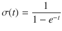

将 logit 函数应用于线性回归的表示，就得到了逻辑回归的表示。

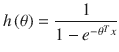

这就是我们逻辑回归模型的表示。由于 logit 函数的值在 0 到 1 之间，我们可以通过提供输入向量 x 和一组参数 θ 并计算 h(θ) 的值，在两个类别之间做出决定。如果该值小于 0.5，则标签通常为 0；否则标签为 1（二分类问题利用了这一特性）。

##### 评估

该过程的下一步是指定一个评估函数或代价函数。在我们的例子中，代价函数取决于数据点的实际类别。假设对于某个类别为 1 的数据点，logit 函数的输出为 0.75，那么该案例的误差或损失为 0.25。但如果该数据点属于类别 0，则误差为 0.75。利用这个类比，我们可以将单个数据点的代价函数定义如下。

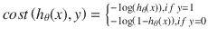

基于上述逻辑，整个数据集的代价函数由下式给出：

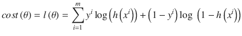


##### 优化

我们之前描述的成本函数是θ的函数，因此我们需要最大化该函数，并找到能给出最大值的θ集合（通常我们会最小化成本函数，但这里我们取了对数，因此将最大化对数函数）。我们通过该过程得到的θ值，代表了想要学习的模型（参数）。

最大化或最小化函数的基本思想是：对函数求导，找到梯度为零的点。该点就是函数取最小值或最大值的点。但我们必须记住，我们拥有的函数是关于参数θ的非线性函数。因此，我们无法直接求解出θ的最优值。这时，我们就引入了梯度下降法的概念。

简单来说，梯度下降就是这样一个过程：我们在每个点上计算要优化的函数的梯度，然后持续沿着负梯度值的方向移动。这里的“移动”，是指根据计算出的梯度来更新θ的值。

我们可以按如下方式计算成本函数关于参数向量每个分量的梯度：

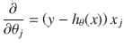

通过对参数向量的每个分量重复此计算，我们可以计算出函数关于整个参数向量的梯度。一旦得到梯度，下一步就是使用以下方程更新新的参数向量值集合。

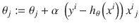

这里，α 表示我们想要沿着梯度方向迈出的小步幅。α 是优化过程的一个超参数（你可以将其视为学习率或学习步长），它的值可以决定我们是达到全局最小值还是局部最小值。

如果我们不断重复这个过程，最终会达到一个点，即无论我们对θ的值进行多么微小的更新，成本函数都不会有太大变化。使用这种方法，我们可以获得最优的参数值集合。

请记住，这只是为了便于理解和解释而对梯度进行的简单描述。通常，解决优化问题还涉及许多其他考虑因素和大量挑战。本节的主要目的是让你认识到优化在任何机器学习问题中都是至关重要的部分。

### 模型构建示例

本书后续章节将致力于在真实世界数据集上构建和调优模型。因此，我们总体上会进行大量的模型构建、调优和评估工作。在本节中，我们想展示上一节讨论的每类模型的一些示例。这将为我们后续的模型构建工作提供一个现成的入门指南。

#### 分类

在所有分类（或监督学习）问题中，准备完整个数据集后的第一步就是将数据划分为测试集和训练集，以及可选的验证集。其思想是：通过在`train`数据集上训练模型来使其学习，在`validation`数据集上评估和调优模型，或使用交叉验证等技术，最后在`test`数据集上检查其性能。你将在本章的模型评估部分了解到，评估模型是任何机器学习解决方案的关键部分。因此，作为经验法则，我们必须始终牢记：对机器学习算法的实际评估，总是在它之前未见过的数据上进行（即使在训练数据集上进行交叉验证，也会使用一部分`train`数据来构建模型，其余部分用于评估）。

有时我们会使用整个数据集来训练模型，然后将其中的某个子集用作测试集。这是我们在机器学习中经常犯的一个常见错误。为了准确分析一个模型，它必须具有良好的泛化能力，并在从未见过的数据上表现良好。在训练数据上评估指标良好，但在未见数据（验证集或测试集）上表现不佳，意味着该算法未能为问题生成一个泛化的解决方案（更多内容将在后文讨论）。

对于我们的分类示例，我们将使用之前讨论过的一个流行的多类分类问题：手写数字识别。该问题的数据作为`scikit-learn`库的一部分提供。这里的问题是从手写数字图像中预测出实际的数字值。在其原始形式中，该问题属于基于图像的分类和计算机视觉领域。我们拥有的数据集是一个`1x64`的特征向量，它代表了手写数字灰度图像的图像表示。

在开始构建任何模型之前，让我们先看看我们打算分析的数据和图像是什么样的。以下代码将加载索引为 10 的图像数据并绘制它。

```
In [2]: from sklearn import datasets
...: import matplotlib.pyplot as plt
...: %matplotlib inline
...: digits = datasets.load_digits()
...:
...: plt.figure(figsize=(3, 3))
...: plt.imshow(digits.images[10], cmap=plt.cm.gray_r)
```

该代码生成的图像如图 5-2 所示。猜猜它代表哪个数字？

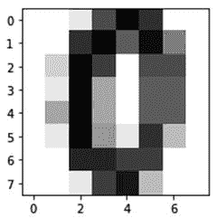

图 5-2.

代表数字零的手写数字数据

我们可以通过以下代码确定原始像素数据（即展平的向量表示）以及图像所代表的数字（类别标签）的样子。

```
# 实际图像像素矩阵
In [3]: digits.images[10]
Out[3]:
array([[  0.,   0.,   1.,   9.,  15.,  11.,   0.,   0.],
[  0.,   0.,  11.,  16.,   8.,  14.,   6.,   0.],
[  0.,   2.,  16.,  10.,   0.,   9.,   9.,   0.],
[  0.,   1.,  16.,   4.,   0.,   8.,   8.,   0.],
[  0.,   4.,  16.,   4.,   0.,   8.,   8.,   0.],
[  0.,   1.,  16.,   5.,   1.,  11.,   3.,   0.],
[  0.,   0.,  12.,  12.,  10.,  10.,   0.,   0.],
[  0.,   0.,   1.,  10.,  13.,   3.,   0.,   0.]])
# 展平向量
In [4]: digits.data[10]
Out[4]:
array([  0.,   0.,   1.,   9.,  15.,  11.,   0.,   0.,   0.,   0.,  11., 16.,   8.,  14.,
6.,   0.,   0.,   2.,  16.,  10.,   0.,   9.,   9.,   0.,   0.,   1.,  16.,   4.,
0.,   8.,   8.,   0.,   0.,   4.,  16.,   4.,   0.,   8.,   8.,   0.,   0.,   1.,
16.,   5.,  1.,  11.,   3.,   0.,   0.,   0.,  12.,  12.,  10.,  10.,   0.,   0.,
0.,   0.,   1.,  10.,  13.,   3.,   0.,   0.])
# 图像类别标签
In [5]: digits.target[10]
Out[5]: 0
```


我们稍后会看到，这个问题可以通过多种方式来构建。但在本教程中，我们将使用逻辑回归模型来进行分类。在开始构建模型之前，我们会先将数据集拆分为独立的`test`（测试集）和`train`（训练集）。`test`集的大小通常取决于可用数据的总量。在我们的示例中，将使用占整个数据集 30%的`test`集。为了方便理解，每个数据集中的数据点总数都会被打印出来。

```
In [12]: X_digits = digits.data
...: y_digits = digits.target
...:
...: num_data_points = len(X_digits)
...:
...: X_train = X_digits[:int(.7 * num_data_points)]
...: y_train = y_digits[:int(.7 * num_data_points)]
...: X_test = X_digits[int(.7 * num_data_points):]
...: y_test = y_digits[int(.7 * num_data_points):]
...: print(X_train.shape, X_test.shape)
(1257, 64) (540, 64)
```

从上面的输出可以看出，我们的`train`数据集有 1257 个数据点，`test`数据集有 540 个数据点。流程的下一步是指定我们将要使用的模型以及想要使用的超参数值。这些超参数的值不依赖于底层数据，通常在模型训练之前设置，并进行微调以提取最佳模型。你将在本章后面学习调优。目前，我们将使用初始化模型估计器并在训练集上拟合模型时显示的默认值。

```
In [14]: from sklearn import linear_model
...:
...: logistic = linear_model.LogisticRegression()
...: logistic.fit(X_train, y_train)
LogisticRegression(C=1.0, class_weight=None, dual=False, fit_intercept=True,
intercept_scaling=1, max_iter=100, multi_class='ovr', n_jobs=1,
penalty='l2', random_state=None, solver='liblinear', tol=0.0001,
verbose=0, warm_start=False)
```

你可以在上面的输出中看到模型的各种超参数和参数。现在，让我们在`test`数据集上测试这个模型的准确率。

```
In [15]: print('Logistic Regression mean accuracy: %f' % logistic.score(X_test, y_test))
Logistic Regression mean accuracy: 0.900000
```

在`scikit-learn`中，拟合像逻辑回归这样的模型就是这么简单。第一步，我们确定了想要使用的模型，在本例中是一个线性模型，称为逻辑回归。然后，我们使用训练数据及其输出标签调用了该对象的`fit`方法。`fit`方法使用学习到的模型参数更新模型对象。接着，我们使用该对象的`score`方法来确定拟合模型在测试集上的准确率。因此，我们未经任何密集调优开发的模型在预测手写数字方面的准确率达到了 90%。

至此，我们关于在数据集上拟合分类模型的基本示例就结束了。请注意，我们的数据集是经过完全处理和清洗的格式。在解决任何问题时，你需要确保数据在拟合任何模型之前也处于同样的状态。

#### 聚类

在本节中，你将学习如何在另一个数据集上拟合聚类模型。在我们选择的示例中，将使用一个带标签的数据集来帮助我们查看聚类模型的结果，并将其与实际标签进行比较。这里需要记住的一点是，在现实世界中通常没有带标签的数据，这就是我们选择使用聚类等无监督方法的原因。我们将尝试介绍两种不同的算法，分别来自基于划分的聚类和层次聚类。

我们用于聚类示例的数据将是广受欢迎的威斯康星州乳腺癌诊断数据集，我们在第 4 章的“特征选择与降维”部分详细介绍了该数据集。请查看那些部分以重温记忆。该数据集有 30 个属性或特征，以及每个数据点（乳腺肿块）对应的标签，标明它是癌症（恶性：标签值 0）还是非癌症（良性：标签值 1）。让我们使用以下代码加载数据。

```
import numpy as np
from sklearn.datasets import load_breast_cancer
# 加载数据
data = load_breast_cancer()
X = data.data
y = data.target
print(X.shape, data.feature_names)
(569, 30) ['mean radius' 'mean texture' 'mean perimeter' ... 'worst fractal dimension']
```

很明显，我们总共有 569 个观测值，每个观测值有 30 个属性或特征。

##### 基于划分的聚类

在我们的示例中，将选择最简单但最流行的基于划分的聚类模型，即 K-means 算法。该算法是一种基于质心的聚类算法，它从对数据中总簇数的一些假设开始，并为每个簇分配随机中心。然后，它使用欧几里得距离作为距离度量，将每个数据点重新分配到离它最近的中心。每次重新分配后，它会重新计算该簇的中心。整个过程迭代重复，当数据点的重新分配不再改变簇中心时停止。其变体包括 K-medoids 等算法。

由于我们已经从数据标签中知道有两种可能的类别类型（0 或 1），以下代码尝试通过利用 K-means 聚类从数据中确定这两个簇。在现实世界中，情况并非总是如此，因为我们通常不知道可能的簇数。这是 K-means 聚类最重要的缺点之一。

```
from sklearn.cluster import KMeans
km = KMeans(n_clusters=2)
km.fit(X)
labels = km.labels_
centers = km.cluster_centers_
print(labels[:10])
[0 0 0 1 0 1 0 1 1 1]
```

一旦`fit`过程完成，我们可以通过使用上述属性获取数据集中两个簇的中心和标签。这里的中心指的是数据维度（数据集中的 30 个属性）的一些数值，数据围绕这些数值进行聚类。

但是，我们能否将簇与实际标签进行可视化比较？请记住，我们处理的是 30 个特征，在 30 维的特征空间上可视化簇将是无法解释甚至无法执行的。因此，我们将利用 PCA 将输入维度减少到两个主成分，并在其上可视化簇。请参阅第 4 章了解更多关于主成分分析的信息。

```
from sklearn.decomposition import PCA
pca = PCA(n_components=2)
bc_pca = pca.fit_transform(X)
```

以下代码有助于在缩减后的二维特征空间上可视化实际标签以及聚类输出标签的簇。

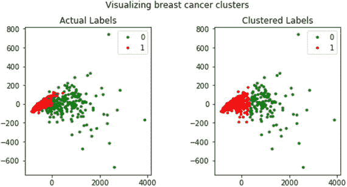

图 5-3.

乳腺癌数据集中的簇可视化

```
fig, (ax1, ax2) = plt.subplots(1, 2, figsize=(8, 4))
fig.suptitle('可视化乳腺癌簇')
fig.subplots_adjust(top=0.85, wspace=0.5)
ax1.set_title('实际标签')
ax2.set_title('聚类标签')
for i in range(len(y)):
if y[i] == 0:
c1 = ax1.scatter(bc_pca[i,0], bc_pca[i,1],c='g', marker='.')
if y[i] == 1:
c2 = ax1.scatter(bc_pca[i,0], bc_pca[i,1],c='r', marker='.')
if labels[i] == 0:
c3 = ax2.scatter(bc_pca[i,0], bc_pca[i,1],c='g', marker='.')
if labels[i] == 1:
c4 = ax2.scatter(bc_pca[i,0], bc_pca[i,1],c='r', marker='.')
l1 = ax1.legend([c1, c2], ['0', '1'])
l2 = ax2.legend([c3, c4], ['0', '1'])
```


从图 5-3 可以清晰看出，聚类效果相当不错，标签为 0 和 1 的簇之间呈现出明显的分离，且与实际标签非常相似。不过，确实存在一些重叠区域，导致部分实例被错误标记，这在右侧的图中显而易见。请记住，在真实场景中，你并没有实际标签可供对比，核心思想是通过这些簇的形式在数据中发现结构或模式。另一个需要牢记的重要点是：簇标签值本身没有实际意义。标签 0 和 1 仅仅是用来区分不同簇数据点的数值。如果你再次运行此过程，很容易得到标签值互换的相同图形。因此，即使处理的是带标签的数据并进行聚类，也不要将聚类标签值与实际标签进行比较并试图衡量准确率。此外，还有一个重要说明：如果我们要求生成两个以上的簇，算法会轻易给出更多簇，但这些簇可能难以解释，且其中许多簇可能毫无意义。因此，使用 K-means 算法的一个注意事项是：仅在你对数据中可能存在的总簇数有一定了解时使用它。

##### 层次聚类

我们可以使用相同的数据进行层次聚类，观察其结果与 K-means 聚类及实际标签相比是否有显著变化。在`scikit-learn`中，我们有多种接口（如`AgglomerativeClustering`类）来执行层次聚类。基于本章前面以及第 1 章讨论的内容，凝聚聚类是一种采用自下而上方法的层次聚类，即每个观测值最初自成一簇，然后簇之间依次合并。合并标准可以从一组候选连接方式中选择；连接方式的选择决定了合并策略。连接标准的示例包括 Ward 法、完全连接法、平均连接法等。不过，我们将利用`scipy`中的底层函数，因为我们仍需在`AgglomerativeClustering`接口中指定簇的数量，而这正是我们希望避免的。由于变量`X`中已包含乳腺癌特征集，以下代码帮助我们使用 Ward 最小方差准则计算连接矩阵。

```
from scipy.cluster.hierarchy import dendrogram, linkage
import numpy as np
np.set_printoptions(suppress=True)
Z = linkage(X, 'ward')
print(Z)
[[   287\.            336\.              3.81596727      2\.        ]
[   106\.            420\.              4.11664267      2\.        ]
[    55\.            251\.              4.93361024      2\.        ]
...,
[  1130\.           1132\.           6196.07482529     86\.        ]
[  1131\.           1133\.           8368.99225244    483\.        ]
[  1134\.           1135\.          18371.10293626    569\.        ]]
```

看到上述输出，你可能会想：这个连接矩阵表示什么？你可以将连接矩阵视为一张完整的历史地图，记录每次迭代中哪些数据点被合并到了哪个簇。如果你有 n 个数据点，连接矩阵 Z 的形状将为(n - 1) x 4，其中 Z[i]会告诉我们第 i 次迭代时哪些簇被合并。每一行包含四个元素：前两个元素是数据点标识符或簇标签（在矩阵后续部分，当多个数据点合并后），第三个元素是前两个元素（数据点或簇）之间的簇距离，最后一个元素是合并完成后该簇中元素/数据点的总数。我们建议你参考[`https://docs.scipy.org/doc/scipy/reference/generated/scipy.cluster.hierarchy.linkage.html`](https://docs.scipy.org/doc/scipy/reference/generated/scipy.cluster.hierarchy.linkage.html)，该页面对此有详细解释。可视化这些基于距离的合并的最佳方法是使用树状图，如图 5-4 所示。

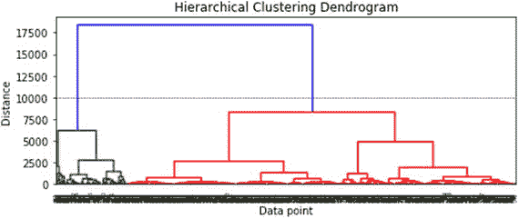

图 5-4.

可视化层次聚类树状图

```
plt.figure(figsize=(8, 3))
plt.title('Hierarchical Clustering Dendrogram')
plt.xlabel('Data point')
plt.ylabel('Distance')
dendrogram(Z)
plt.axhline(y=10000, c='k', ls='--', lw=0.5)
plt.show()
```

在图 5-4 所示的树状图中，我们可以看到每个数据点最初都是独立的簇，然后逐渐与其他数据点合并形成簇。从颜色和树状图的宏观层面来看，如果你考虑距离度量大约为`10000`或以上，模型已正确识别出两个主要簇。利用这个距离，我们可以通过以下代码获取簇标签。

```
from scipy.cluster.hierarchy import fcluster
max_dist = 10000
hc_labels = fcluster(Z, max_dist, criterion='distance')
```

让我们基于 PCA 降维后的维度，比较簇输出与原始标签分布的情况（详细代码见笔记本）。见图 5-5。

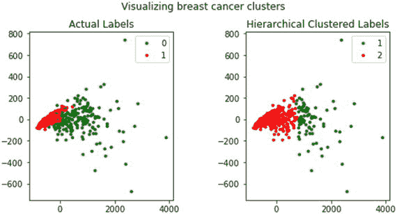

图 5-5.

乳腺癌数据集中层次聚类的可视化

我们确实看到了两个不同的簇，但与 K-means 方法相比，这两个簇之间的重叠更多，并且有更多实例被错误标记。不过，请注意标签编号：这里我们使用 1 和 2 作为标签值。这仅仅是为了强调标签值只是用来区分簇，并不代表任何含义。这种方法的优势在于，你无需预先输入簇的数量，模型会尝试从底层数据中自行发现簇的数量。


## 模型评估

我们已经了解了基于不同需求进行数据检索、处理、整理和建模的过程。随之而来的一个逻辑问题是：我们如何判断一个模型是好是坏？仅仅因为我们使用知名算法开发出了某种花哨的东西，并不能保证其性能会很好。模型评估就是这些问题的答案，并且是整个机器学习流程中必不可少的一部分。我们在过去多次提到，模型开发是一个迭代过程。模型评估正是定义迭代过程、使其具有迭代性质的关键部分。基于模型评估及后续的比较，我们可以决定是继续努力改进模型，还是停止改进，以及应该选择哪个模型作为最终使用或部署的模型。模型评估还在调整模型超参数这一非常重要的过程中提供帮助，并且有助于判断诸如我们刚刚开发的智能特性是否为模型增加了价值等场景。综合所有这些论点，我们就有充分的理由为模型评估建立一个明确的流程，并确定可以使用哪些指标来衡量和评估模型。

那么，我们如何评估一个模型呢？我们如何判断模型 A 更好还是模型 B 性能更优？理想的方法是拥有一些衡量模型有效性的数值度量或指标，并使用这些度量来对模型进行排序和选择。这将是我们评估模型的主要方式之一，但我们也应牢记，很多时候这些评估指标可能无法捕捉到我们试图解决的问题所需的成功标准。在这些情况下，我们需要发挥想象力，使这些指标适应我们的问题，并利用诸如业务约束和目标等因素。

模型评估指标高度依赖于我们拥有的模型类型，因此回归模型的指标将不同于分类模型或聚类模型的指标。考虑到这种依赖性，我们将本节分为三个小节。我们将介绍三类模型的主要模型评估指标。

### 评估分类模型

分类模型是机器学习从业者中最流行的模型之一。由于其流行性，了解如何构建高质量、泛化能力强的模型至关重要。它们有一系列不同的指标可用于评估分类模型。在本节中，我们将重点介绍这些指标中必不可少的一小部分。我们将使用上一节中开发的模型来详细说明它们。为此，我们首先准备 `train` 和 `test` 数据集来构建我们的分类模型。我们将利用之前的 `X` 和 `y` 变量，它们保存了乳腺癌数据集观测值的数据和标签。

```
from sklearn.model_selection import train_test_split
X_train, X_test, y_train, y_test = train_test_split(X, y, test_size=0.3, random_state=42)
print(X_train.shape, X_test.shape)
(398, 30) (171, 30)
```

从上面的输出可以清楚地看到，我们的 `train` 数据集中有 398 个观测值，`test` 数据集中有 171 个观测值。我们将利用一个为模型评估创建的便捷模块。它名为 `model_evaluation_utils`，你可以与本章的代码文件和笔记本一起找到它。我们建议你查看一下代码，该代码利用 `scikit-learn metrics` 模块来计算大部分评估指标和图表。

#### 混淆矩阵

混淆矩阵是评估分类模型最流行的方法之一。虽然矩阵本身不是一个指标，但矩阵表示可用于定义各种指标，所有这些指标在某个特定情况或场景下都变得很重要。可以为二分类模型以及多分类模型创建混淆矩阵。

混淆矩阵是通过将数据点的预测类别标签与其实际类别标签进行比较来创建的。对整个数据集重复此比较，并将比较结果编译成矩阵或表格格式。这个结果矩阵就是我们的混淆矩阵。在进一步讨论之前，让我们在乳腺癌数据集上构建一个逻辑回归模型，并查看模型在 `test` 数据集上的预测结果的混淆矩阵。

```
from sklearn import linear_model
# 训练并构建模型
logistic = linear_model.LogisticRegression()
logistic.fit(X_train,y_train)
# 在测试数据上进行预测并查看混淆矩阵
import model_evaluation_utils as meu
y_pred = logistic.predict(X_test)
meu.display_confusion_matrix(true_labels=y_test, predicted_labels=y_pred, classes=[0, 1])
Predicted:
0    1
Actual: 0         59    4
1          2  106
```

上面的输出展示了带有必要注释的混淆矩阵。我们可以看到，在标签为 0（恶性）的 63 个观测值中，我们的模型正确预测了 59 个。同样，在标签为 1（良性）的 108 个观测值中，我们的模型正确预测了 106 个。更详细的分析即将呈现！


##### 理解混淆矩阵

虽然这个名字听起来相当令人望而生畏，但一旦你掌握了基础知识，理解混淆矩阵其实并不那么令人困惑！重申你在上一节学到的内容，混淆矩阵是一种表格结构，用于跟踪正确分类和错误分类。这对于评估分类模型的性能非常有用，因为我们知道真实的数据标签，并可以与预测的数据标签进行比较。混淆矩阵中的每一列代表基于模型预测的分类实例计数，而矩阵的每一行代表基于实际/真实类别标签的实例计数。这种结构也可以反过来，即用行表示预测，用列表示真实标签。在一个典型的二分类问题中，我们通常有一个被定义为正类的类别标签，这基本上是我们感兴趣的类别。例如，在我们的乳腺癌数据集中，假设我们感兴趣的是检测或预测患者没有乳腺癌（良性）的情况。那么标签 1 就是我们的正类。然而，假设我们感兴趣的类别是检测癌症（恶性），那么我们可以选择标签 0 作为我们的正类。图 5-6 展示了一个典型的二分类问题混淆矩阵，其中 p 表示正类，n 表示负类。

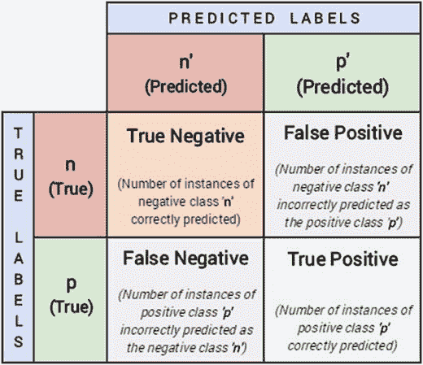

图 5-6.

混淆矩阵的典型结构

图 5-6 应该能让混淆矩阵的结构更加清晰。通常，正如我们之前讨论的，我们有一个正类，另一个类别是负类。基于这种结构，我们可以清楚地看到四个重要的术语。

*   **真正例 (TP)**：这是来自正类的实例总数，其中真实类别标签等于预测类别标签，即我们使用模型正确预测正类标签的实例总数。
*   **假正例 (FP)**：这是来自负类的实例总数，我们的模型将它们错误地预测为正类。因此得名假正例。
*   **真负例 (TN)**：这是来自负类的实例总数，其中真实类别标签等于预测类别标签，即我们使用模型正确预测负类标签的实例总数。
*   **假负例 (FN)**：这是来自正类的实例总数，我们的模型将它们错误地预测为负类。因此得名假负例。

因此，基于这些信息，你能根据模型对乳腺癌测试数据的预测结果，为我们上面的混淆矩阵计算之前提到的指标吗？

```
positive_class = 1
TP = 106
FP = 4
TN = 59
FN = 2
```

##### 性能指标

混淆矩阵本身并不是分类模型的性能度量标准。但它可以用来计算几个在不同场景下有用的指标。我们将描述如何从混淆矩阵计算主要指标，使用必要的公式手动计算它们，然后将结果与 `scikit-learn` 在我们预测结果上提供的函数进行比较，并直观地说明每个指标可以用于哪些场景。

准确率：这是衡量分类器性能最常用的指标之一。它被定义为模型的整体准确率或正确预测的比例。从混淆矩阵计算准确率的公式是：

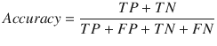

当我们的类别几乎平衡，并且对这些类别的正确预测同等重要时，通常使用准确率指标。以下代码计算了我们模型预测的准确率。

```
fw_acc = round(meu.metrics.accuracy_score(y_true=y_test, y_pred=y_pred), 5)
mc_acc = round((TP + TN) / (TP + TN + FP + FN), 5)
print('Framework Accuracy:', fw_acc)
print('Manually Computed Accuracy:', mc_acc)
Framework Accuracy: 0.96491
Manually Computed Accuracy: 0.96491
```

精确率：精确率，也称为阳性预测值，是另一个可以从混淆矩阵中推导出的指标。它被定义为在所有基于正类的预测中，实际正确或相关的预测数量。精确率的公式如下：

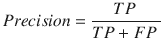

与精确率较低的模型相比，高精确率的模型将识别出更高比例的正类。在我们更关心找到最大数量的正类，即使总准确率降低的情况下，精确率就变得很重要。以下代码计算了我们模型预测的精确率。

```
fw_prec = round(meu.metrics.precision_score(y_true=y_test, y_pred=y_pred), 5)
mc_prec = round((TP) / (TP + FP), 5)
print('Framework Precision:', fw_prec)
print('Manually Computed Precision:', mc_prec)
Framework Precision: 0.96364
Manually Computed Precision: 0.96364
```

召回率：召回率，也称为灵敏度，是衡量模型识别相关数据点百分比的指标。它被定义为被正确预测的正类实例数量。这也被称为命中率、覆盖率或灵敏度。召回率的公式是：

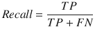

在我们希望捕获某个特定类别的大多数实例，即使这会增加我们的假正例时，召回率就成为分类器性能的一个重要衡量指标。例如，考虑银行欺诈的情况，高召回率的模型会给我们带来更多潜在的欺诈案例。但它也会帮助我们为大多数可疑案例发出警报。以下代码计算了我们模型预测的召回率。

```
fw_rec = round(meu.metrics.recall_score(y_true=y_test, y_pred=y_pred), 5)
mc_rec = round((TP) / (TP + FN), 5)
print('Framework Recall:', fw_rec)
print('Manually Computed Recall:', mc_rec)
Framework Recall: 0.98148
Manually Computed Recall: 0.98148
```

F1 分数：在某些情况下，我们希望精确率和召回率达到平衡优化。F1 分数是精确率和召回率的调和平均数，它帮助我们优化分类器，使其在精确率和召回率性能上达到平衡。

F1 分数的公式是：

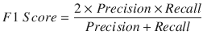

让我们使用以下代码计算我们模型预测的 F1 分数。

```
fw_f1 = round(meu.metrics.f1_score(y_true=y_test, y_pred=y_pred), 5)
mc_f1 = round((2*mc_prec*mc_rec) / (mc_prec+mc_rec), 5)
print('Framework F1-Score:', fw_f1)
print('Manually Computed F1-Score:', mc_f1)
Framework F1-Score: 0.97248
Manually Computed F1-Score: 0.97248
```

因此，你可以看到我们手动计算的指标与从 `scikit-learn` 函数获得的结果相匹配。这应该能让你很好地了解如何使用这些指标来评估分类模型。


#### 受试者工作特征曲线

ROC（受试者工作特征）这一概念源于早期的雷达技术。该概念可扩展应用于二分类器以及多分类器的评估（注意，为了将 ROC 曲线适配到多分类器，我们必须采用一对多方案以及宏平均和微平均等平均技术）。它可以解释为模型区分数据中真实信号与噪声的有效性。

ROC 曲线可以通过绘制真正例比例与假正例比例来生成，即它是真正例率（TPR）与假正例率（FPR）的关系图。它主要适用于评分型分类器。评分型分类器是指那种会为每个类别标签返回一个概率值或分数，并据此（基于最大概率值）推断出类别标签的分类器。该曲线可以利用分类器的真正例率（TPR）和假正例率（FPR）来绘制。TPR 被称为灵敏度或召回率，表示在所有正样本中，被正确预测为正例的结果总数。FPR 被称为误报率或（1 - 特异度），用于确定数据集中所有负样本中被错误预测为正例的结果总数。虽然我们很少手动绘制 ROC 曲线，但了解其绘制方法总是有益的。给定每个数据点的类别标签概率及其正确或真实标签，可以按照以下步骤绘制 ROC 曲线：

1.  根据分类器的分数（或属于正类的概率）对其输出进行排序。
2.  从坐标 (0, 0) 开始。
3.  对于排序后的每个样本 x：
    *   如果 x 是正例，则向上移动 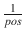
    *   如果 x 是负例，则向右移动 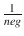

这里 pos 和 neg 分别代表正例和负例的比例。其核心思想是，在典型的 ROC 曲线中，ROC 空间位于点 (0, 0) 和 (1, 1) 之间。混淆矩阵中的每个预测结果都在此 ROC 空间中占据一个点。理想情况下，最佳预测模型会在左上角 (0, 1) 处产生一个点，表示完美的分类（100% 灵敏度与特异度）。对角线表示一个随机猜测的分类器。理想情况下，如果你的 ROC 曲线位于图形的上半部分，那么你的分类器表现不错，优于平均水平。你可以随时利用 `scikit-learn` 提供的 `roc_curve` 函数来生成绘制 ROC 曲线所需的数据。更多详情请参考 [`http://scikit-learn.org/stable/auto_examples/model_selection/plot_roc.html`](http://scikit-learn.org/stable/auto_examples/model_selection/plot_roc.html)。图 5-7 展示了我们刚刚提到的链接中的一个 ROC 曲线示例。

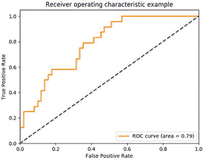

图 5-7.

ROC 曲线示例（来源：[`http://scikit-learn.org/stable/modules/model_evaluation.html#roc-metrics`](http://scikit-learn.org/stable/modules/model_evaluation.html#roc-metrics)）

图 5-7 展示了一个 ROC 曲线示例。总的来说，ROC 曲线是直观解释分类模型的重要工具。但它并不能直接为我们提供一个可用于比较模型的数值。完成这项任务的指标是曲线下面积，通常称为 AUC。在图 5-7 的 ROC 图中，橙色线下的面积就是该分类器 ROC 曲线的曲线下面积。理想分类器的曲线下面积为单位面积。基于这个值，我们可以比较两个模型，通常 AUC 分数更高的模型更好。我们在 `model_evaluation_utils` 模块中构建了一个通用函数，用于绘制二分类和多分类问题的 ROC 曲线及 AUC 分数。请务必查看 `plot_model_roc_curve(...)` 函数以了解更多信息。以下代码利用该函数绘制了我们乳腺癌逻辑回归模型的 ROC 曲线。

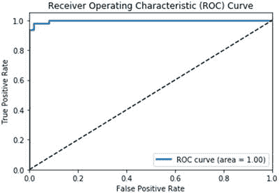

图 5-8.

我们逻辑回归模型的 ROC 曲线

```
meu.plot_model_roc_curve(clf=logistic, features=X_test, true_labels=y_test)
```

考虑到我们的模型准确率和 F1 分数约为 97%，图 5-8 中我们看到一条近乎完美的 ROC 曲线，这是合理的！请查看第 9 章，了解多分类器 ROC 曲线的实际应用！

### 评估聚类模型

在前一节中，我们讨论了一些评估分类模型的常用方法。仅混淆矩阵就为我们提供了一系列可用于比较分类模型的指标。然而，在评估聚类（或一般的无监督模型）时，情况发生了根本性的转变。这种困难源于无监督模型缺乏经过验证的真实基准，即数据中缺少真实标签。在本节中，你将学习一些可用于评估聚类模型性能的方法/指标。

为了通过实际示例说明评估指标，我们将利用乳腺癌数据集，其中变量 `X` 代表数据，`y` 代表观测标签。我们还将使用 K-means 算法在该数据上拟合两个模型——一个包含两个簇，另一个包含五个簇——然后评估它们的性能。

```
km2 = KMeans(n_clusters=2, random_state=42).fit(X)
km2_labels = km2.labels_
km5 = KMeans(n_clusters=5, random_state=42).fit(X)
km5_labels = km5.labels_
```


#### 外部验证

外部验证是指在拥有标记数据作为真实标签时，对聚类模型进行验证。外部标签的存在大大降低了模型评估的复杂性，因为聚类（无监督）模型可以像分类模型一样进行验证。回想一下本章第一部分提到的乳腺癌数据集示例，我们将带标签的数据输入聚类算法。在那个例子中，我们有两个类别，算法也生成了两个聚类。然而，评估性能并不像分类算法那样直接。

如果你还记得我们之前关于聚类标签的讨论，它们只是用于根据数据点所属的聚类或组来区分数据点的指标。因此，我们不能直接将标签为 0 的聚类与真实类别标签 0 进行比较。有可能所有真实类别标签为 0 的数据点在聚类过程中实际上被分配到了标签为 1 的聚类中。基于这一点，当我们拥有真实标签时，可以利用几种指标来验证聚类性能。在这种情况下，可以使用三种常用的指标：

*   **同质性**：如果一个聚类模型的所有聚类都只包含属于单一类别（基于真实类别标签）的数据点，则该模型的预测结果满足同质性。
*   **完整性**：如果一个特定真实类别标签的所有数据点都属于同一个聚类，则该聚类模型的预测结果满足完整性。
*   **V-measure**：同质性和完整性分数的调和平均数即为 V-measure 值。

这些值通常介于 0 和 1 之间，通常数值越高越好。让我们在两个 K-means 聚类模型上计算这些指标。

```
km2_hcv = np.round(metrics.homogeneity_completeness_v_measure(y, km2_labels), 3)
km5_hcv = np.round(metrics.homogeneity_completeness_v_measure(y, km5_labels), 3)
print('Homogeneity, Completeness, V-measure metrics for num clusters=2: ', km2_hcv)
print('Homogeneity, Completeness, V-measure metrics for num clusters=5: ', km5_hcv)
Homogeneity, Completeness, V-measure metrics for num clusters=2:  [ 0.422  0.517  0.465]
Homogeneity, Completeness, V-measure metrics for num clusters=5:  [ 0.602  0.298  0.398]
```

我们可以看到，第一个具有两个聚类的模型的 V-measure 优于具有五个聚类的模型，原因是其完整性得分更高。另一个可以尝试的指标包括 Fowlkes-Mallows 分数。

#### 内部验证

内部验证是指通过定义能够捕捉良好聚类模型预期行为的指标来验证聚类模型。一个好的聚类模型可以通过两个非常理想的特性来识别：

*   **紧凑的组**，即一个聚类中的数据点彼此靠近。
*   **分离良好的组**，即两个组/聚类之间的距离尽可能大。

我们可以定义一些指标，从数学上计算这两个主要特性的优劣，并用它们来评估聚类模型。大多数此类指标都会使用数据点之间的某种距离概念。数据点之间的距离可以使用任何候选距离度量来定义，范围从欧几里得距离、曼哈顿距离，到任何符合距离度量标准的度量。

##### 轮廓系数

轮廓系数是一种试图结合良好聚类模型两个要求的指标。轮廓系数是为每个样本定义的，它结合了该样本与其自身聚类中数据点的相似性，以及与其非自身聚类中数据点的相异性。

对于具有 n 个数据点的聚类模型，轮廓系数的数学公式如下：

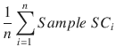

这里，样本 SC 是每个样本的轮廓系数。单个样本轮廓系数的公式为：

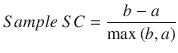

其中，

a = 一个样本与同一类别中所有其他点的平均距离

b = 一个样本与下一个最近聚类中所有其他点的平均距离

轮廓系数通常介于 -1（错误聚类）和 +1（高质量密集聚类）之间。轮廓系数值越高，通常意味着聚类模型产生的聚类更密集、分离更好且彼此可区分。分数越低则表示聚类重叠。在 `scikit-learn` 中，我们可以使用 `silhouette_score` 函数来计算轮廓系数。该函数还支持不同的距离度量选项。

```
from sklearn import metrics
km2_silc = metrics.silhouette_score(X, km2_labels, metric='euclidean')
km5_silc = metrics.silhouette_score(X, km5_labels, metric='euclidean')
print('Silhouette Coefficient for num clusters=2: ', km2_silc)
print('Silhouette Coefficient for num clusters=5: ', km5_silc)
Silhouette Coefficient for num clusters=2:  0.697264615606
Silhouette Coefficient for num clusters=5:  0.510229299791
```

根据上述输出，我们可以观察到，从指标结果来看，两个聚类的聚类质量似乎优于五个聚类。

##### Calinski-Harabaz 指数

Calinski-Harabaz 指数是另一种在真实标签未知时可用于评估聚类模型的指标。Calinski-Harabaz 分数定义为聚类间离散度均值与聚类内离散度之比。对于 k 个聚类的分数，其数学公式如下：

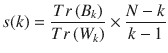

其中，

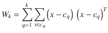

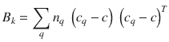

这里，Tr 是矩阵的迹算子，N 是数据中的数据点数量，C[q] 是聚类 q 中的点集，c[q] 是聚类 q 的中心，c 是 E 的中心，n[q] 是聚类 q 中的点数。

幸运的是，我们可以利用 `scikit-learn` 来计算这个指数，而无需手动计算这个复杂的公式。分数越高通常表示聚类更密集且分离更好，这与聚类模型的一般原则相符。

```
km2_chi = metrics.calinski_harabaz_score(X, km2_labels)
km5_chi = metrics.calinski_harabaz_score(X, km5_labels)
print('Calinski-Harabaz Index for num clusters=2: ', km2_chi)
print('Calinski-Harabaz Index for num clusters=5: ', km5_chi)
Calinski-Harabaz Index for num clusters=2:  1300.20822689
Calinski-Harabaz Index for num clusters=5:  1621.01105301
```

我们可以看到，两个分数都相当高，其中五个聚类的结果甚至更高。这表明仅依赖指标数值是不够的，必须尝试多种评估方法，并结合数据科学家以及领域专家的反馈。

### 评估回归模型

回归模型是监督学习方法的一个例子，由于有正确度量（实值数值响应变量）可用，它们的评估相对无监督模型更容易。通常在监督模型的情况下，我们有多种指标可供选择，关键决策是为我们的用例选择正确的指标。回归模型与分类模型一样，有一系列不同的指标可用于评估。在本节中，我们将介绍这些指标中一小部分必不可少的指标。


#### 决定系数（R²）

决定系数衡量了因变量中被自变量解释的方差比例。决定系数为 1 表示完美的回归模型，即所有方差都被自变量所解释。该指标还能评估模型对未来样本的预测效果。

计算 R²的数学公式如下所示，其中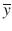是因变量的均值，y[i]表示实际真实响应值，表示模型预测输出。

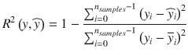

在`scikit-learn`包中，可以通过向`r2_score`函数提供真实值和预测值（输出/响应变量）来计算该指标。

#### 均方误差

均方误差计算的是回归模型预测值与实际值之间误差平方的平均值（即偏差）。均方误差（MSE）可用于评估回归模型，其值越低表示模型误差越小、性能越好。对 MSE 取平方根可得到均方根误差（RMSE），它同样可作为回归模型的评估指标。

计算 MSE 和 RMSE 的数学公式非常简单，如下所示：

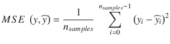

在`scikit-learn`包中，可以通过调用`metrics`模块中的`mean_squared_error`函数来计算 MSE。

回归模型还有许多其他评估指标，包括中位数绝对误差、平均绝对误差、可解释方差得分等。利用`scikit-learn`库提供的函数可以轻松计算这些指标。它们的数学公式易于理解，且具有直观的解读意义。我们仅介绍了其中两种，但鼓励大家探索更多可用于回归模型的评估指标。下一章我们将更详细地探讨回归模型。

## 模型调优

在本章前两节中，你学习了如何在处理后的数据上拟合模型以及如何评估这些模型。我们将在此基础上进一步深化已介绍的概念。在本节中，你将了解所有机器学习算法的一个重要特性（我们此前一直略过未提）、其重要性，以及如何为这些实体找到最优值。模型调优是机器学习中最核心的概念之一，它需要对所关注算法的底层数学原理和逻辑有一定了解。虽然我们无法深入探讨所讨论算法的广泛理论层面，但会尽量提供一些直观理解，以便你能够更好地进行调优，并掌握所需的核心概念。

到目前为止，我们开发的模型大多是`scikit-learn`包提供的默认模型。所谓默认，指的是采用默认配置和设置的模型——如果你还记得一些模型估计器对象的参数的话。由于我们分析的数据集本质上并非难以分析的数据集，即使是默认配置的模型也能给出不错的解决方案。但当面对具有大量特征、噪声和缺失数据的真实世界数据集时，情况就不那么乐观了。在后续章节中，你将看到实际数据集往往难以处理、整理，甚至更难建模。因此，我们不太可能总是直接使用默认配置的模型。相反，我们将更深入地研究目标模型，审视那些可以调整和设置的参数，以从任何给定模型中提取最佳性能。这种对数据集、模型参数和特征进行迭代实验的过程，正是模型调优流程的核心。本节首先介绍与机器学习算法相关的所谓参数，然后尝试解释为何难以获得完美模型，最后讨论一些可用于调优模型的策略。

### 超参数简介

什么是超参数？最简单的定义是：超参数是与任何机器学习算法相关的元参数，通常在模型训练和构建过程之前设置。之所以这样做，是因为模型超参数不依赖于从训练模型的基础数据集中推导得出。超参数对于调整学习算法的性能至关重要。超参数常与模型参数混淆，但我们必须牢记，超参数与模型参数不同，因为它们不依赖于数据。简单来说，模型超参数代表了一些高层次的概念或旋钮，数据科学家可以在模型训练和构建过程中对其进行调整和优化，以提升模型性能。如果你仍然难以理解，我们通过一个例子来说明。


#### 决策树

决策树是最简单且易于解释的分类算法之一（有时也用于回归；请参阅 CART 模型）。首先，你将学习决策树是如何创建的，因为超参数通常与算法的实际细节紧密相关。决策树算法基于对初始数据集（特征）进行贪婪递归划分。它利用基于决策树的结构来决定如何进行划分。学习决策树所涉及的步骤如下：

1.  从整个数据集开始，找出最能区分不同类别的属性（特征）。这个最佳属性是通过信息增益或基尼不纯度等指标来确定的。
2.  一旦找到最佳属性，就根据该属性的值将数据集分成两个（或更多）部分。
3.  如果数据集的任何一部分只包含一个类别的标签，我们就可以停止对该部分的处理，并将其标记为该类别的叶节点。
4.  重复整个过程，直到所有部分都成为叶节点，且每个叶节点只包含一个类别的数据点。

决策树算法返回的最终模型可以表示为一个流程图（核心的决策树结构）。考虑图 5-9 中描绘的用于泰坦尼克号生存预测问题的示例决策树。

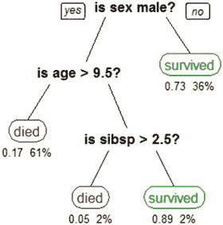

图 5-9.

一个示例决策树模型

通过沿着未知数据点的值路径，决策树很容易解释。最终到达的叶节点就是该数据点的预测类别。在这种情况下，模型参数是我们进行分裂所依据的属性（这里是 `sex`、`age` 和 `sibsp`）以及这些属性的值。例如，如果一个人是女性，根据这个模型，她很可能幸存了下来。然而，年龄小于 9 岁 6 个月的男性婴儿则很可能遇难。

在该算法中，决定是否在某个节点继续分裂数据集或停止分裂过程，是由算法的一个名为 `min_samples_leaf` 的超参数控制的。这是与决策树算法相关联的一个超参数。该参数的默认值是 1，这意味着我们可能会持续分裂数据，直到每个叶节点只包含一个数据点（具有唯一的类别标签）。这会导致严重的过拟合，因为每个数据点都可能最终位于自己的叶节点中，模型将无法学到任何有用的东西。假设我们希望当叶节点中包含整个数据集的 3-4%时停止分裂过程，并用该节点中的多数类别来标记该节点。这可以通过为该指定超参数设置不同的值来实现。这使我们能够控制过拟合，并帮助开发一个泛化能力更强的模型。这只是与该算法相关的超参数之一；还有更多，例如分裂准则（`criterion`）、树的最大深度（`max_depth`）、特征数量（`max_features`）等等，它们都会对整体模型的质量产生不同的影响。

每个学习算法都存在类似的超参数。例如，逻辑回归中的学习率、支持向量机中的核函数、以及神经网络中的丢弃率。超参数通常与学习算法密切相关。因此，我们需要对算法有一定程度的理解，才能凭直觉设置特定超参数的值。在本章及本书的后续章节中，我们将处理一些需要进行一定程度超参数调优的数据集和模型。

### 偏差-方差权衡

到目前为止，我们学习了关于调整模型所需的基本概念。但在我们将所有内容整合起来并实际调整模型之前，我们必须理解一个潜在的权衡，它对我们能够开发出的最佳模型施加了一些限制。这种权衡被称为偏差与方差的权衡。随之而来的一个明显问题是：在机器学习模型的背景下，偏差和方差是什么？

*   **偏差**：这是由于模型（学习算法）对底层数据中的参数做出了错误假设而产生的误差。偏差误差是模型估计量的期望值或预测值与我们要预测的真实值或实际值之间的差异。如果你还记得，模型构建是一个迭代过程。想象一下，每次获得一些新观测值时，你都在数据集上多次构建模型。由于数据中潜在的噪声和随机性，预测结果并不总是符合预期，而偏差试图衡量实际值与预测值之间的差异/误差。它也可以被定义为模型在所有可能的训练数据集上的平均近似误差。这里的最后一部分，“所有可能的训练数据集”，需要一些解释。我们观察并开发模型的数据集是存在的所有可能数据组合之一。我们数据中每个属性/特征的所有可能组合都会产生一个不同的数据集。例如，假设我们有一个包含 50 个二元（分类）特征的数据集，那么整个数据集的大小将是 2⁵⁰个数据点。我们建模所用的数据集显然只是这个庞大数据的子集。因此，偏差是我们在这个整个数据集的子集上可以预期的平均近似误差。偏差主要受我们对底层数据和模式的假设（或模型的假设）影响。例如，考虑一个简单的线性回归模型；它假设因变量与自变量呈线性关系。而考虑决策树模型的情况，它对数据的结构没有这样的假设，纯粹从数据中学习模式。因此，相对而言，线性模型可能比决策树模型具有更高的偏差。高偏差会使模型遗漏数据中特征与输出变量之间的重要关系。
*   **方差**：这种误差是由于模型对数据集中因新数据点、特征、随机性、噪声等引起的波动敏感而产生的。它是我们的近似函数在所有可能数据集上的方差。它代表了模型预测结果对特定数据点集的敏感性。假设你可以在所有可能数据集的不同子集上学习模型，那么方差将量化模型结果如何随数据集的变化而变化。如果结果保持相当稳定，则称该模型具有低方差；但如果结果每次变化很大，则称该模型具有高方差。考虑同样的例子，对比线性模型和决策树模型，假设因变量和自变量之间存在清晰的线性关系。那么对于一个足够大的数据集，我们的线性模型将始终捕捉到这种关系。而决策树模型的能力取决于数据集，如果我们得到一个包含大量异常值的数据集，我们很可能会得到一个糟糕的决策树模型。因此，我们可以断言，基于数据和潜在的噪声/随机性，决策树模型将比线性回归模型具有更高的方差。高方差会使模型对异常值或随机噪声过于敏感，而不是很好地泛化。


要更清晰地理解这个略显复杂的概念，一种有效的方法是通过偏差与方差的视觉化表示，如图 5-10 所示。

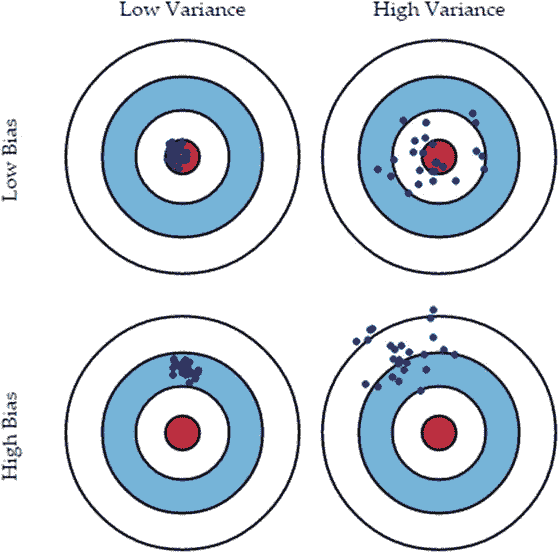

图 5-10.

偏差-方差权衡

在图 5-10 中，内部的红色圆圈代表我们基于所能获得的所有数据组合而可能拥有的完美模型。每个蓝点 (⋅) 代表我们基于所获得的数据集和特征组合而学习到的一个模型。

*   **低偏差、低方差**的模型（如左上图所示）能够学习到底层数据模式和关系的良好通用结构，使其接近假设模型，预测结果一致且能正中靶心！
*   **低偏差、高方差**的模型（如右上图所示）能在一定程度上进行泛化（学习到恰当的关系/模式），由于低偏差，其平均表现尚可，但对训练数据敏感，导致高方差，因此预测结果会持续波动。
*   **高偏差、低方差**的模型（如左下图所示）无论基于哪个数据集构建，都会倾向于做出一致的预测，从而导致低方差。但由于高偏差，它无法学习到正确预测所需的数据中的必要模式/关系，因此平均而言会因高偏差误差而偏离目标。
*   **高偏差、高方差**的模型是最糟糕的模型类型，因为它们无法学习到与输出响应相关性至关重要的必要数据属性关系。同时，它们对数据、异常值和噪声极其敏感，导致预测结果剧烈波动，从而产生高方差，如右下图所示。

#### 偏差-方差的极端情况

在实际建模中，我们总是需要在同时降低偏差和方差之间进行权衡。要理解为何存在这种权衡，我们首先必须考虑偏差和方差的两种可能的极端情况。

##### 欠拟合

考虑一个懒惰的线性模型，它总是预测一个常数值。这个模型将具有极低的方差（实际上是一个零方差模型），因为模型完全不依赖于它获得的是哪个数据子集。它总是预测一个常数，因此性能稳定。但另一方面，它将具有极高的偏差，因为它没有从数据中学到任何东西，并对数据做出了非常僵化和错误的假设。这就是模型欠拟合的情况，在这种情况下，我们未能学到关于数据、其底层模式和关系的任何信息。

##### 过拟合

考虑相反的情况：我们有一个试图拟合它遇到的每一个数据点的模型（最接近的例子是为一个包含 n 个观测值的数据集拟合一个 n 次多项式曲线，使得曲线穿过每个点）。在这种情况下，我们将得到一个低偏差的模型，因为没有对数据结构做出任何假设（即使存在某种结构），但方差会非常高，因为我们已将模型紧密拟合到数据的一个可能子集上（过于关注训练数据）。任何与训练集不同的子集都会导致大量误差。这就是过拟合的情况，我们将模型构建得过于针对手头的数据，以至于无法对其他数据子集进行任何泛化。

#### 权衡

任何模型的总泛化误差都是其偏差误差、方差误差和不可约误差之和，如下式所示。

泛化误差 = 偏差误差 + 方差误差 + 不可约误差

其中，不可约误差是由于训练数据本身的噪声而引入的误差，这在现实世界的数据集中很常见，并且对此我们能做的并不多。关键在于关注另外两种误差。每个模型都需要在两种选择之间进行权衡：对数据结构做出假设，或者使模型过于贴合手头的数据。任何一种极端选择都会导致上述极端情况之一。关键在于通过优化偏差和方差之间的权衡来平衡模型复杂度，如图 5-11 所示。

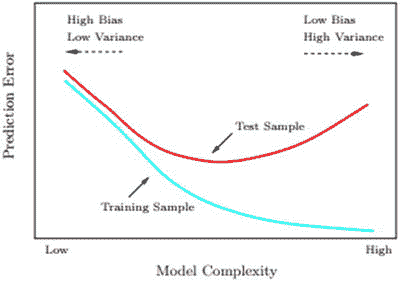

图 5-11.

测试误差和训练误差作为模型复杂度的函数（来源：《统计学习基础》，Tibshirani 等人，Springer 出版社）

图 5-11 应该能让您更清楚地了解需要进行的权衡，以防止模型误差增加。我们需要对数据中的底层结构做出一些假设，但这些假设必须合理。同时，模型必须确保能从手头的数据中学习并良好泛化，而不是过度拟合每一个数据点。这种权衡可以通过确保我们的模型不是非常复杂的模型，并确保在未见过的验证数据上获得合理性能来控制。我们将在下一节中详细介绍交叉验证。我们建议您查阅关于模型选择的章节以及《统计学习基础》（Tibshirani 等人，Springer 出版社）中关于偏差-方差权衡的章节。


### 交叉验证

在本章最初学习拟合不同模型的部分，我们遵循了将数据划分为训练集和测试集的做法。我们在训练集上构建模型，并在测试集上报告其性能。虽然这种建模方式可行，但在密集调整模型时，我们需要考虑一些关于`验证`数据集的其他策略。在本节中，我们将讨论如何使用相同的数据构建不同的模型，并通过一种简单的数据划分策略来调整它们的超参数。无论模型类型如何，这种策略都是数据科学领域最普遍的做法之一，它被称为交叉验证，或简称为 CV。当你的数据观测值较少，无法划分出特定的数据分区作为验证集时（稍后会详细说明！），这种方法尤其有用。然后，你可以利用交叉验证策略，以这样一种方式使用训练数据本身的部分数据进行验证，从而避免最终导致模型过拟合。

任何模型构建活动的主要意图都是在现有数据上开发一个泛化模型，使其在未见过的数据上表现良好。但为了估计模型在未见数据上的性能，我们需要利用现有数据来模拟这些未见数据。这通过将可用数据划分为训练集和测试集来实现。遵循这一简单原则，我们确保不会在模型已经见过并训练过的数据上评估模型。如果我们对开发的模型完全满意，故事到这里就结束了。但初始模型很少能令人满意到可以部署的程度。

理论上，我们可以将相同的原则扩展到调整算法上。我们可以在测试集上评估模型超参数特定值的性能。然后使用不同的训练集和测试集划分以及不同的超参数值重新训练模型。如果新参数比旧参数表现更好，我们就采用它们，并重复相同的过程，直到获得超参数的最优值。这种方案虽然简单，但存在一个严重缺陷。它会在模型开发过程中引入偏差。尽管每次迭代都会更改测试集，但模型在开发过程中（当我们调整和构建模型时）会看到这些数据，从而做出一些关于模型开发过程的选择。因此，我们开发的模型最终会存在偏差且泛化能力不佳，其性能可能无法反映其在未见数据上的表现。

对数据划分过程进行一个简单的更改，可以帮助我们避免这种未见数据的泄露。假设我们最初将数据划分为三个不同的子集，而不是原来的两个。一个是通常的训练集，第二个是测试集，最后一个称为验证集。因此，我们可以在`训练`数据上训练模型，在验证数据上评估其性能，以调整模型参数（甚至在不同模型之间进行选择）。一旦完成调整过程，我们就可以在真正未见过的测试集上评估最终模型，并将测试集上的性能报告为模型在真实世界未见数据上的近似性能。从本质上讲，这就是交叉验证过程背后的基本原理，如图 5-12 所示。

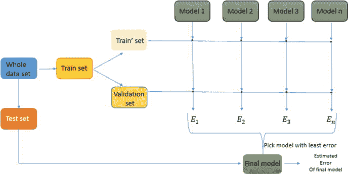

图 5-12.

构建用于模型构建和调整的交叉验证过程

图 5-12 让我们了解了整个过程是如何运作的。我们将原始数据集划分为训练集和测试集。测试集完全从学习过程中分离出来。这样得到的`训练`集再次被划分为一个实际的`训练`集和一个`验证`集。然后我们在`训练`集上学习不同的模型。这里值得注意的一点是，这些模型是通用的，即它们可以是单一类型（例如逻辑回归）但具有不同超参数的模型。它们也可以是使用其他算法（如基于树的方法、支持向量机等）的模型。无论我们是在评估完全不同的模型，还是在尝试同一类型模型的不同超参数值，模型选择的过程都是相似的。一旦我们开发出模型，我们就在验证集上评估它们的性能，并选择性能最佳的模型作为最终模型。为此，我们根据模型类型（准确率、F1 分数、均方根误差、轮廓系数等）利用模型评估指标。

前面描述的过程似乎不错。我们已经描述了过程中的验证部分，但还没有涉及交叉部分。那么，交叉验证体现在哪里呢？要理解 CV 过程的这一精妙之处，我们必须首先讨论为什么需要它。之所以需要它，是因为将数据划分为测试集和验证集，使我们损失了大量本可用于进一步完善建模过程的数据。另一个重要点是，如果我们将模型单次迭代的误差视为其整体误差，那将是一个严重的错误。相反，我们希望通过构建同一模型的多次迭代来获取某种平均误差度量。但是，如果我们一直在相同的数据集上重建模型，模型性能不会有太大差异。我们通过引入交叉验证中的`交叉`概念来解决这两个问题。

`交叉`验证的思想是，使用某种策略（我们稍后将详细阐述）获得不同的训练集和验证集划分（每次划分中每个集合的观测值不同），然后在这些不同的划分上构建每个模型的多次迭代。然后将这些划分上的平均误差报告为该模型的误差，并基于这个平均误差指标做出最终决策。这种策略对每个模型的估计误差有着显著的影响，因为它确保了平均误差能够紧密逼近模型在真正未见数据（此处指我们的测试集）上的误差，并且我们还可以利用完整的训练数据集来构建模型。图 5-13 以图形方式解释了这一过程。

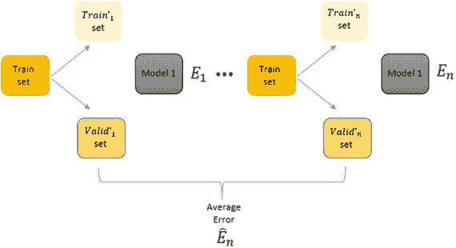

图 5-13.

用于模型构建和调整的最终交叉验证过程

生成这些不同的`训练`集和`验证`集的各种策略，衍生出了不同类型的交叉验证策略。每种策略的共同思想保持不变。唯一的区别在于，在模型构建的每次迭代中，将原始`训练`集划分为`训练`集和`验证`集的方式不同。

#### 交叉验证策略

我们在上一节解释了交叉验证的基本原理。在本节中，我们将看到将训练数据划分为训练数据和验证数据的不同策略。如前所述，除了划分方式之外，每种策略的过程保持不变。主要的交叉验证策略类型描述如下。


##### 留一法交叉验证

在这种交叉验证策略中，我们从初始训练数据集中随机选择一个数据点作为验证集。因此，验证集中只有一个数据点，其余 n-1 个观测值构成训练集。这意味着，如果训练集中有 1000 个数据点，那么我们将为每个模型开发 1000 次迭代，每次使用不同的训练集和验证集，使得验证集包含一个观测值，其余 999 个观测值进入训练集。如果数据集规模很大，这种方法可能变得不可行。但在实践中，可以通过执行少量迭代来估计误差。由于这种方法的计算复杂度较高，它主要适用于小型数据集，在实际中很少使用。

##### K 折交叉验证

另一种交叉验证策略是将训练数据集分成 k 个相等的子集。在这 k 个子集中，我们在 k-1 个子集上训练模型，并保留一个子集作为验证集。这个过程重复 k 次，并对通过开发模型的不同迭代而获得的 k 个模型的误差进行平均。我们在每次迭代中不断更换验证集，这确保了在每次迭代中，模型都在不同的数据子集上进行训练。这种交叉验证方法在实践中非常有效，无论是用于模型选择还是超参数优化。

对于这种策略，一个自然的问题是选择适当的折数，因为它将同时控制我们的误差近似值和交叉验证过程的计算运行时间。虽然有数学方法可以选择最合适的 k 值，但在实践中，k 的良好选择范围是 5 到 10。因此，在大多数情况下，我们可以进行 5 折或 10 折验证，并对获得的结果充满信心。

### 超参数调优策略

根据我们到目前为止的讨论，我们已经具备了调优模型的所有先决条件。我们知道了什么是超参数，如何评估模型的性能，以及如何使用交叉验证在参数空间中搜索算法超参数的最优值。在本节中，我们将讨论两种主要的策略，它们将所有这些结合起来，以确定最优的超参数。幸运的是，`scikit-learn` 库内置了出色的支持，可以结合交叉验证执行超参数搜索。

有两种主要方法可以在参数空间中搜索最优模型。这两种方法的区别在于搜索方式：系统搜索与随机搜索。在本节中，我们将通过动手示例讨论这两种方法。本节的重点是理解这些过程，以便您可以开始在自己的数据集上加以利用。另请注意，即使我们没有明确提及，我们也将始终使用交叉验证来执行任何这些搜索。

#### 网格搜索

这是最简单的超参数优化方法。在这种方法中，我们将指定想要尝试并优化的超参数值网格，以获取最佳参数组合。然后，我们将针对这些值（多个参数值的组合）中的每一个构建模型（当然会使用交叉验证），并报告整个网格中的最佳参数组合。输出将是使用网格中最佳组合的模型。虽然这种方法非常简单，但它有一个严重的缺点：用户必须手动提供实际参数，而这些参数可能包含也可能不包含最优参数。

在 `scikit-learn` 中，可以使用 `GridSearchCV` 类进行网格搜索。我们通过一个示例来演示，对之前乳腺癌数据集上的支持向量机（SVM）模型执行网格搜索。SVM 模型是另一种可用于分类的监督式机器学习算法。它是一个最大间隔分类器的例子，它试图学习所有数据点的表示，使得不同的类别/标签被一个尽可能大的清晰间隔分开。这里我们不会深入探讨更多细节，因为我们的目的是运行网格搜索，但如果您感兴趣，我们建议您查阅一些关于 SVM 的标准文献。

首先，我们将乳腺癌数据集变量 `X` 和 `y` 分割成 `train` 和 `test` 数据集，并使用默认参数构建一个 SVM 模型。然后，我们将利用 `model_evaluation_utils` 模块评估其在 `test` 数据集上的性能。

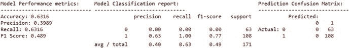

图 5-14.

乳腺癌数据集上默认 SVM 模型的性能指标

```
from sklearn.model_selection import train_test_split
from sklearn.svm import SVC
# 准备数据集
X_train, X_test, y_train, y_test = train_test_split(X, y, test_size=0.3, random_state=42)
# 构建默认 SVM 模型
def_svc = SVC(random_state=42)
def_svc.fit(X_train, y_train)
# 预测并评估性能
def_y_pred = def_svc.predict(X_test)
print('默认模型统计信息:')
meu.display_model_performance_metrics(true_labels=y_test, predicted_labels=def_y_pred,
classes=[0,1])
```

您看，如图 5-14 所示，我们的模型总体 F1 分数仅为 49%，模型准确率为 63%。此外，通过查看混淆矩阵，您可以清楚地看到它正在将每个数据点预测为良性（标签 1）。基本上，我们的模型什么也没学到！让我们尝试调优这个模型，看看是否能得到更好的结果。由于我们选择了 SVM 模型，我们指定了一些特定于它的超参数，包括参数 C（处理 SVM 中的间隔参数）、核函数（用于将数据转换到更高维的特征空间）和 gamma（决定单个训练数据点的影响力）。还有很多其他超参数可以调优，您可以在 [`http://scikit-learn.org/stable/modules/generated/sklearn.svm.SVC.html`](http://scikit-learn.org/stable/modules/generated/sklearn.svm.SVC.html) 查看详细信息。我们通过提供一些预设值来构建一个网格。下一个选择是选择我们想要最大化的分数或指标，这里我们选择最大化模型的准确率。完成后，我们将使用五折交叉验证在此网格上构建多个模型，并评估它们以获得最佳模型。详细代码和输出如下所示。


```
from sklearn.model_selection import GridSearchCV
# 设置参数网格
grid_parameters = {'kernel': ['linear', 'rbf'],
'gamma': [1e-3, 1e-4],
'C': [1, 10, 50, 100]}
# 执行超参数调优
print("# 为准确率调优超参数\n")
clf = GridSearchCV(SVC(random_state=42), grid_parameters, cv=5, scoring='accuracy')
clf.fit(X_train, y_train)
# 查看所有模型的准确率分数
print("基于交叉验证的所有模型网格分数：\n")
means = clf.cv_results_['mean_test_score']
stds = clf.cv_results_['std_test_score']
for mean, std, params in zip(means, stds, clf.cv_results_['params']):
print("%0.5f (+/-%0.05f) for %r" % (mean, std * 2, params))
# 查看最佳模型性能
print("\n 在开发集上找到的最佳参数组合：", clf.best_params_)
print("最佳模型验证准确率：", clf.best_score_)
# 为准确率调优超参数
基于交叉验证的所有模型网格分数：
0.95226 (+/-0.06310) for {'C': 1, 'gamma': 0.001, 'kernel': 'linear'}
0.91206 (+/-0.04540) for {'C': 1, 'gamma': 0.001, 'kernel': 'rbf'}
0.95226 (+/-0.06310) for {'C': 1, 'gamma': 0.0001, 'kernel': 'linear'}
0.92462 (+/-0.02338) for {'C': 1, 'gamma': 0.0001, 'kernel': 'rbf'}
0.96231 (+/-0.04297) for {'C': 10, 'gamma': 0.001, 'kernel': 'linear'}
0.90201 (+/-0.04734) for {'C': 10, 'gamma': 0.001, 'kernel': 'rbf'}
0.96231 (+/-0.04297) for {'C': 10, 'gamma': 0.0001, 'kernel': 'linear'}
0.92965 (+/-0.03425) for {'C': 10, 'gamma': 0.0001, 'kernel': 'rbf'}
0.95729 (+/-0.05989) for {'C': 50, 'gamma': 0.001, 'kernel': 'linear'}
0.90201 (+/-0.04734) for {'C': 50, 'gamma': 0.001, 'kernel': 'rbf'}
0.95729 (+/-0.05989) for {'C': 50, 'gamma': 0.0001, 'kernel': 'linear'}
0.93467 (+/-0.02975) for {'C': 50, 'gamma': 0.0001, 'kernel': 'rbf'}
0.95477 (+/-0.05772) for {'C': 100, 'gamma': 0.001, 'kernel': 'linear'}
0.90201 (+/-0.04734) for {'C': 100, 'gamma': 0.001, 'kernel': 'rbf'}
0.95477 (+/-0.05772) for {'C': 100, 'gamma': 0.0001, 'kernel': 'linear'}
0.93216 (+/-0.04674) for {'C': 100, 'gamma': 0.0001, 'kernel': 'rbf'}
在开发集上找到的最佳参数组合：{'C': 10, 'gamma': 0.001, 'kernel': 'linear'}
最佳模型验证准确率：0.962311557789
```

因此，从上述输出和代码中，你可以看到如何基于交叉验证准确率获得最佳模型参数，并且我们得到了一个相当出色的验证准确率——96%。让我们将这个经过优化和调优的模型应用到测试数据上进行检验！

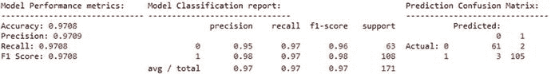

图 5-15.

乳腺癌数据集上调优 SVM 模型的性能指标

```
gs_best = clf.best_estimator_
tuned_y_pred = gs_best.predict(X_test)
print('\n\n 调优模型统计信息：')
meu.display_model_performance_metrics(true_labels=y_test, predicted_labels=tuned_y_pred,
classes=[0,1])
```

现在情况看起来确实很棒！如图 5-14 所示，我们的模型在`test`数据集上也给出了 97% 的整体 F1 分数和模型准确率。这应该能让你清楚地认识到超参数调优的强大之处！这种方案可以扩展到不同的模型及其各自的超参数上。我们还可以调整想要优化的评估指标。`scikit-learn`框架为我们提供了多种可优化的指标，例如`adjusted_rand_score`、`average_precision`、`f1`、`average_recall`等。

#### 随机搜索

网格搜索在实践中是一种非常流行的超参数优化方法。这得益于它的简单性以及它极易并行化的特点。当我们处理的数据集规模较大时，这一点尤为重要。但它也存在一些主要缺陷，其中最重要的是需要手动指定网格的限制。这在一个本可以从纯自动化机制中受益的过程中引入了人为因素。

随机参数搜索是对传统网格搜索的一种改进。它像普通网格搜索一样接收网格元素的输入，但也可以接收分布作为输入。例如，考虑参数 gamma，上一节中我们显式地提供了它的值，而这里我们可以提供一个分布来从中采样 gamma 值。随机参数搜索的有效性基于一个已被证明（经验上和数学上）的结果：超参数优化函数通常具有低维度，并且某些参数的影响比其他参数更大。我们通过指定要运行的迭代次数（`n_iter`）来控制随机参数采样的次数。通常，迭代次数越高意味着参数搜索越精细，但计算时间也越长。

为了说明随机参数搜索的用法，我们将使用之前的例子，但将 gamma 和 C 的值替换为分布。在我们的示例中，结果可能与网格搜索没有太大区别，但我们建立了一个可供将来参考的流程。

```
import scipy
from sklearn.model_selection import RandomizedSearchCV
param_grid = {'C': scipy.stats.expon(scale=10),
'gamma': scipy.stats.expon(scale=.1),
'kernel': ['rbf', 'linear']}
random_search = RandomizedSearchCV(SVC(random_state=42), param_distributions=param_grid,
n_iter=50, cv=5)
random_search.fit(X_train, y_train)
print("在开发集上找到的最佳参数组合：")
random_search.best_params_
在开发集上找到的最佳参数组合：
Out[183]:
{'C': 12.020578954763398, 'gamma': 0.036384519279056469, 'kernel': 'linear'}
# 获取最佳模型，进行预测并评估性能
rs_best = random_search.best_estimator_
rs_y_pred = rs_best.predict(X_test)
meu.get_metrics(true_labels=y_test, predicted_labels=rs_y_pred)
准确率: 0.9649
精确率: 0.9649
召回率: 0.9649
F1 分数: 0.9649
```

在这个例子中，我们从指数分布中获取参数 C 和 gamma 的值，并通过参数`n_iter`控制模型搜索的迭代次数。虽然整体模型性能与网格搜索相似，但目的是让你了解模型调优中的不同策略。


## 模型解释

数据科学或机器学习的目标是解决现实世界的问题，自动化复杂任务，让我们的生活更轻松、更美好。尽管数据科学家花费大量时间构建、调优和部署模型，但我们必须问一些问题：“这将被用于什么？”以及“这到底是如何工作的？”，而最重要的问题是：“我为什么要相信你的模型？”。企业或组织更关心的是通过利用分析和机器学习来实现业务目标、创造利润和最小化损失。因此，在解释模型实际工作原理时，分析团队与关键利益相关者、客户、用户或管理层之间常常存在脱节。大多数时候，向那些可能不了解、甚至更糟的是，对了解所有繁琐细节不感兴趣的非专业人士解释复杂的理论和数学概念，确实非常困难。这让我们回到了主要目标：“我们能否以一种易于理解的方式解释和诠释机器学习模型？”，这样即使没有机器学习深厚知识的人也能理解它们。这样做的好处是双重的——机器学习模型将不再仅仅停留在研究项目或概念验证阶段，它将为企业更广泛地采用基于机器学习的解决方案铺平道路。

一些机器学习模型使用可解释的算法，例如决策树会输出所有变量的重要性。此外，任何新数据点的预测路径都可以通过决策树进行分析，因此我们可以了解哪个变量在预测中发挥了关键作用。不幸的是，对于许多模型来说，尤其是那些没有变量重要性概念的模型，情况并非如此。

有些机器学习模型天生就是可解释的——例如，生成模型如贝叶斯规则列表（Letham 等人，[`arxiv.org/abs/1511.01644`](https://arxiv.org/abs/1511.01644)），而其他简单的黑箱模型，如简单决策树，可以通过将特征重要性作为输出来使其可解释。此外，从树根到叶子的单棵树的预测路径可以被可视化，捕捉特征对估计器决策策略的贡献。但是，对于复杂的非线性模型——随机森林、深度神经网络——卷积神经网络（CNN）、循环神经网络（RNN），这种直观性可能无法实现。对机器学习决策策略复杂本质缺乏理解，使得预测模型仍被视为黑箱。模型解释可以在多个方面帮助数据科学家和最终用户。它将有助于弥合技术团队与业务之间经常存在的鸿沟。例如，它可以帮助识别做出特定预测的原因，并且可以通过利用易于理解的解释，借助最终用户的领域知识进行验证。它还可以帮助数据科学家理解特征之间的交互作用，从而带来更好的特征工程和性能提升。它还有助于模型比较，并更好地向业务利益相关者解释结果。

虽然让模型可解释的最简单方法是使用能产生可解释模型的算法，如决策树、逻辑回归等。但我们不能保证可解释模型能提供最佳性能。因此，我们不能总是依赖这类模型。最近一种更好的方法是通过在预测周围局部学习一个可解释模型，以易于解释的方式来解释模型预测。这个话题实际上在 2016 年就获得了广泛关注。请参考 M.T. Ribeiro、S. Singh 和 C. Guestrin 的原始研究论文《“我为什么要相信你？”：解释任何分类器的预测》（来自 [`https://arxiv.org/pdf/1602.04938.pdf`](https://arxiv.org/pdf/1602.04938.pdf)），以了解更多关于模型解释和 LIME 框架的信息，该框架旨在解决这个问题。LIME 框架试图成功地在局部解释任何黑箱模型（我们需要在某处定义解释的范围——全局和局部），你可以查看其 GitHub 仓库：[`https://github.com/marcotcr/lime`](https://github.com/marcotcr/lime)。

我们将利用另一个名为 `Skater` 的库，这是一个开源的 Python 库，旨在揭示预测模型的内部工作原理。Skater 定义了模型解释的范围：1. 全局解释（基于完整数据集）和 2. 局部解释（基于单个预测）。对于全局解释，Skater 使用模型无关的变量重要性和部分依赖图来判断模型的偏差并理解其一般行为。另一方面，为了验证模型对单个预测的决策策略，该库目前采用了一种称为局部可解释模型无关解释（LIME，Ribeiro 等人，2016）的新技术，该技术使用局部替代模型来评估性能。该库由 Aaron Kramer、Pramit Choudhary 和 DataScience.com 团队编写，`Skater` 现在是一个主流项目，也是一个优秀的模型解释框架。我们要感谢 DataScience.com 的 Ian Swanson、Pramit Choudhary 和 Aaron Kramer 开发了这个出色的框架，特别感谢 Pramit 抽出时间向我们详细解释 `Skater` 项目的功能和愿景。使用 `Skater` 的一些优势如下所述，其中一些功能仍在积极开发和改进中。

*   使用函数式编程风格（声明式编程范式）的生产级代码
*   首先支持监督学习问题中基于分类和回归的模型的解释，然后逐步扩展到也支持无监督学习问题的解释。这包括计算高效的部分依赖图和模型无关的特征重要性图。
*   工作流抽象：为内存中的模型（正在开发中）以及已部署的模型（已投入生产）提供执行局部解释的通用接口。
*   扩展 LIME——增加了对解释基于回归的模型的支持，改进了在局部预测周围生成样本的采样分布，研究在局部评估中包含非线性模型的能力。
*   支持基于规则的可解释模型——例如 Letham 等人（[`https://arxiv.org/abs/1511.01644`](https://arxiv.org/abs/1511.01644)）
*   更好地支持基于 NLP 的模型评估——例如 Bach 等人的逐层相关性传播（[`http://journals.plos.org/plosone/article?id=10.1371/journal.pone.0130140`](http://journals.plos.org/plosone/article?id=10.1371/journal.pone.0130140)）
*   更好地支持图像可解释性——Batra 等人的梯度加权类激活映射（[`https://arxiv.org/abs/1610.02391`](https://arxiv.org/abs/1610.02391)）

除此之外，自该项目启动以来，他们已承诺进行一些改进，例如将回归支持回馈到原始的 LIME 仓库中，并且他们的路线图中还有其他解释方面的内容，以及未来对 LIME 的进一步改进。你可以通过在命令提示符或终端中运行 `pip install -U Skater` 命令轻松安装 `skater`。有关更多信息，你可以查看 GitHub 仓库：[`https://github.com/datascienceinc/Skater`](https://github.com/datascienceinc/Skater)，或加入这里的聊天群组：[`https://gitter.im/datascienceinc-skater/Lobby`](https://gitter.im/datascienceinc-skater/Lobby)。


### 理解 Skater

`Skater` 是一个开源 Python 框架，旨在提供与模型无关的预测模型解释。它是 GitHub 上的一个活跃项目，地址为 [`https://github.com/datascienceinc/Skater`](https://github.com/datascienceinc/Skater)，许多前述功能正在积极开发中。`skater` 的理念是通过查询黑盒机器学习模型并解释其学到的决策策略来理解它们。`skater` 的哲学是，所有模型都应作为黑盒进行评估，模型的决策标准通过输入扰动并观察相应的输出预测来推断和解释。利用 skater 进行模型解释的范围使我们能够进行全局和局部解释，如图 5-16 所示。

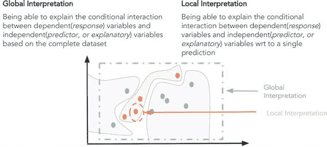

图 5-16.

模型解释的范围（来源：[DataScience.​com](http://www.DataScience.com)）

使用 `skater` 库，我们可以探索特征重要性、特征的部分依赖图，以及模型预测的全局和局部保真度。模型的保真度可以描述为模型计算并预测特定类别所依据的原因。例如，假设我们有一个模型，用于预测某个特定用户交易是否可以被标记为欺诈交易。如果我们能够识别、解释并描述模型将预测标记为欺诈的原因，是因为该金额大于用户过去六个月的最大交易额，且交易地点距离用户正常交易区域 1000 公里，那么模型的输出将更加可信。这与我们仅获得一个预测标签而没有任何合理解释的情况形成了对比。

`skater` 包中的一般工作流程是创建一个解释对象，创建一个模型对象，然后运行解释算法。此外，`Interpretation` 对象接收一个数据集作为输入，并可选择接收一些元数据，如特征名称和行标识符。在内部，`Interpretation` 对象会生成一个 `DataManager` 来处理数据请求和采样。虽然我们可以通过利用模型估计器对象来解释任何模型，但为了确保 `skater` 所有接口的一致性和正常功能，模型对象需要包装在 `skater` 的 `Model` 对象中，该对象可以是实际模型上的 `InMemoryModel` 对象，甚至可以是 `DeployedModel` 对象，用于处理 API 或 Web 服务背后的模型。图 5-17 展示了一个标准的机器学习工作流程，以及如何利用 skater 解释我们刚刚提到的两种不同类型的模型。让我们使用之前的逻辑回归模型，对我们的乳腺癌数据集进行一些模型解释！

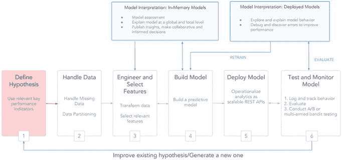

图 5-17.

标准机器学习工作流程中的模型解释（来源：[DataScience.​com](http://www.DataScience.com)）

### 模型解释实战

为了保持一致性，我们将使用本章一直在使用的乳腺癌数据集中的 `训练` 和 `测试` 数据集。我们将利用 `X_train` 和 `X_test` 变量，以及我们之前创建的 `logistic` 模型对象（逻辑回归模型）。我们将尝试对这个模型对象运行一些模型解释。模型解释的标准工作流程是创建一个 `skater` 解释对象和模型对象。

```
from skater.core.explanations import Interpretation
from skater.model import InMemoryModel
interpreter = Interpretation(X_test, feature_names=data.feature_names)
model = InMemoryModel(logistic.predict_proba, examples=X_train, target_names=logistic.classes_)
```

完成后，我们就可以运行模型解释算法了。我们将从尝试生成特征重要性开始。这将让我们了解我们的预测模型在多大程度上依赖于特定特征。`skater` 框架的特征重要性实现基于信息论准则，它衡量在给定特定特征扰动的情况下，预测变化中的熵。其思想是，模型的决策标准越依赖某个特征，预测结果随该特征扰动而变化就越大。

```
plots = interpreter.feature_importance.plot_feature_importance(model, ascending=False)
```

从图 5-18 中我们可以清楚地观察到，我们模型中最重要的是特征是 `最差面积`，其次是 `平均周长` 和 `面积误差`。现在让我们考虑最重要的特征 `最差面积`，并思考它在预测过程中可能影响模型决策的方式。部分依赖图是利用这一点进行可视化的绝佳工具。通常，部分依赖图通过保持模型中其他特征不变，帮助描述特定特征对模型预测的边际影响。部分依赖的导数描述了特征的影响。以下代码帮助我们为模型中的 `最差面积` 特征构建部分依赖图。

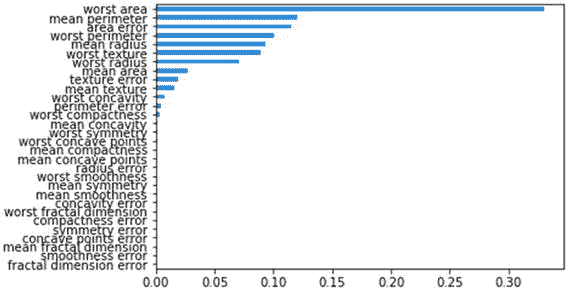

图 5-18.

从我们的逻辑回归模型获得的特征重要性

```
p = interpreter.partial_dependence.plot_partial_dependence(['worst area'], model,
grid_resolution=50,
with_variance=True, figsize = (6, 4))
```

从图 5-19 的图中，我们可以看到 `最差面积` 特征对模型决策过程有很强的影响。根据该图，如果最差面积值从 800 开始减小，模型更倾向于将数据点分类为良性（标签 1），这表明没有癌症。这绝对很有趣！现在让我们尝试解释一些实际的预测。我们将预测两个数据点，一个没有癌症（标签 1），一个有癌症（标签 0），并尝试解释预测过程。

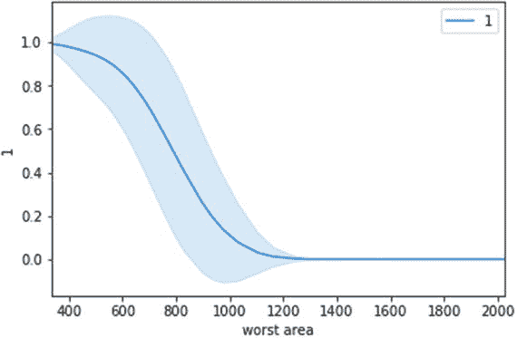

图 5-19.

基于最差面积的逻辑回归模型预测器的单向部分依赖图

```
from skater.core.local_interpretation.lime.lime_tabular import LimeTabularExplainer
exp = LimeTabularExplainer(X_train, feature_names=data.feature_names,
discretize_continuous=True, class_names=['0', '1'])
# 解释没有癌症的数据点的预测，即标签 1
exp.explain_instance(X_test[0], logistic.predict_proba).show_in_notebook()
```

图 5-20 中显示的结果展示了导致模型将数据点预测为标签 1（即没有癌症）的主要特征。我们还可以看到，在这个决策中影响最大的特征是 `最差面积`！现在让我们对恶性癌症的数据点进行类似的解释。


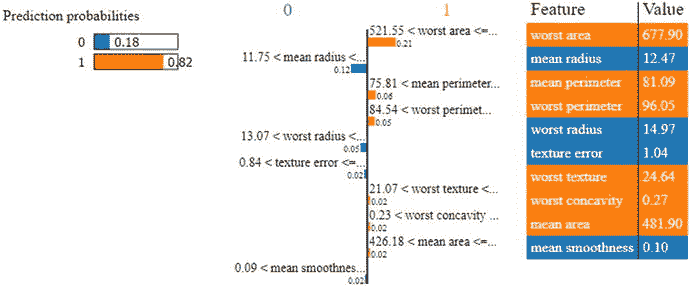

图 5-20.

逻辑回归模型对无癌症（良性）数据点预测结果的模型解释

```
# 解释对恶性癌症数据点（即标签 0）的预测结果
exp.explain_instance(X_test[1], logistic.predict_proba).show_in_notebook()
```

图 5-21 所示的结果再次向我们展示了模型预测该数据点为标签 0（即患有恶性癌症）时起主要作用的特征。特征 `worst area` 再次成为影响最大的特征，并且你可以注意到其值与之前的数据点相比存在显著差异。希望这能让你对模型解释的工作原理有所了解。这里需要记住的一点是，我们才刚刚开始基于 2016 年以来兴起的兴趣进行模型解释，但这将是一段美好且值得的旅程，旨在让任何人都能轻松理解模型！

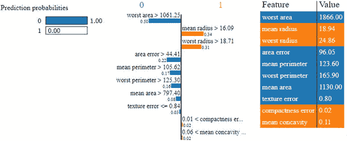

图 5-21.

逻辑回归模型对患有癌症（恶性）数据点预测结果的模型解释

## 模型部署

整个建模过程中最困难的部分通常是特征工程、模型构建、调优和评估的迭代过程。一旦我们完成了模型开发的这个迭代过程，就可以松一口气了——但别高兴得太早！机器学习建模拼图的最后一块是将模型部署到生产环境中，以便我们真正开始使用它。在本节中，你将了解将模型投入实际使用的各种方法，以及在此过程中必须处理好的必要依赖项。

### 模型持久化

模型持久化是最简单的模型部署方式。在这种方案中，我们将最终模型持久化到永久存储介质（如硬盘）上，并在未来使用这个持久化版本进行预测。这种简单的方案是一种以最少工作量部署模型的好方法。模型开发通常基于静态数据源，但一旦部署，模型通常用于处理持续不断的数据流，无论是实时/近实时还是批量处理。例如，考虑一个银行欺诈检测模型；在模型开发时，我们将拥有在某个历史时间跨度内收集的数据。我们将使用这些数据进行模型开发过程，并得到一个性能良好的模型，即一个非常擅长标记潜在欺诈交易的模型。然后，该模型需要部署到银行（或任何其他金融实体）进行的所有未来交易中。这意味着，对于所有交易，我们需要提取模型所需的数据，并将这些数据输入模型。模型预测结果会附加到交易上，并据此将交易标记为欺诈交易或正常交易。

在最简单的方案中，我们可以编写一个独立的 Python 脚本，在新数据到达时立即接收它。它对原始数据执行必要的数据转换，然后从永久数据存储中读取我们的模型。一旦我们有了数据和模型，就可以进行预测，并且可以将此预测通信与所需的操作集成。这些所需的操作通常与模型的业务需求相关联。在我们标记欺诈交易的案例中，可能涉及通知欺诈部门或直接拒绝交易。此过程中涉及的大多数步骤，如数据采集/检索、提取、特征工程以及根据预测采取的行动，都与软件或数据工程流程相关，需要定制软件开发和对 ETL（提取-转换-加载）等数据工程流程的调整。

为了将模型持久化到磁盘，我们可以利用 `pickle` 或 `joblib` 等库，`scikit-learn` 也提供了 `joblib`。这使我们能够部署并在未来使用模型，而无需在每次使用时都重新训练它。

```
from sklearn.externals import joblib
joblib.dump(logistic, 'lr_model.pkl')
```

这段代码会将我们的模型以 `lr_model.pkl` 文件的形式持久化到磁盘上。因此，每当我们再次将此对象加载到内存中时，都会得到逻辑回归模型对象。

```
lr = joblib.load('lr_model.pkl')
lr
LogisticRegression(C=1.0, class_weight=None, dual=False, fit_intercept=True,
intercept_scaling=1, max_iter=100, multi_class='ovr', n_jobs=1,
penalty='l2', random_state=None, solver='liblinear', tol=0.0001,
verbose=0, warm_start=False)
```

我们现在可以使用这个 `lr` 对象（即从磁盘加载的模型）进行预测。示例如下。

```
print(lr.predict(X_test[10:11]), y_test[10:11])
[1] [1]
```

请记住，一旦你有了持久化的模型，就可以轻松地将其集成到基于 Python 的脚本或应用程序中，这些脚本或应用程序可以被调度以实时或批量处理新数据。然而，需要对解决方案进行适当的工程化，以确保正确的数据到达模型，并且预测输出也应广播到正确的渠道。

### 定制开发

部署模型的另一种选择是单独开发模型预测方法的实现。大多数机器学习算法的输出仅仅是学习到的参数值。一旦我们提取了这些参数值，预测过程就相当直接了。例如，逻辑回归的预测可以通过将系数向量与输入数据向量相乘来完成。这个简单的计算将为我们提供数据向量的分数，我们可以将其输入到 sigmoid/逻辑函数中，并提取输入数据的预测结果。

这种方法更根植于软件开发过程，因为开发的模型被简化为一组配置和参数，主要焦点将放在使用某种编程语言对数据和必要的数学计算进行工程化上。此配置可用于开发定制的实现管道，其中预测过程只是一个简单的数学运算。

### 内部模型部署

许多企业和组织不希望暴露其需要构建和部署模型的私密和机密数据。因此，他们将利用自己的软件和数据科学专业知识，在自己的基础设施上构建和部署定制解决方案。这可能涉及利用商业现成工具来部署模型，或使用定制的开源工具和框架。基于 Python 的模型可以轻松地与 Flask 或 Django 等框架集成，以在预测模型之上创建 REST API 或微服务，然后这些 API 端点可以被暴露出来，并与任何可能需要它的其他解决方案或应用程序集成。


### 模型部署即服务

计算领域正经历着云服务和 XAAS（一切皆服务）模式的全面兴起。这在模型开发与部署领域同样如此。谷歌、微软、亚马逊云服务（AWS）等主要提供商都提供了利用其云服务开发机器学习模型的功能，以及将这些模型作为云服务进行部署的功能。由于这些服务提供商所提供的可靠性和易于扩展的特性，这对最终用户非常有利。自行开发或内部部署模型的一个主要缺点是所需的额外工作和维护。解决方案的可扩展性也是某些模型（如欺诈预测）可能存在的另一个问题，因为所需的预测量非常庞大。

模型部署即服务解决了这些问题，因为在大多数情况下，可以通过向基于云的 API 端点发起请求（当然需要提供必要的数据）来获取模型预测结果。这种能力减轻了将使用我们模型输出的应用程序开发人员维护额外系统的负担。在大多数情况下，如果开发人员能够负责将所需数据传递给模型部署 API，他们就无需处理预测系统的计算需求及其维护工作。

云部署的另一个优势在于更新模型非常容易。模型开发是一个迭代过程，部署的模型需要不时更新以保持其相关性。通过在云端维护单一端点的模型，我们简化了模型更新的过程，因为只需要进行一次替换，这实际上只需按一下按钮即可完成，并且会同步到所有下游应用程序。

## 总结

本章结束了本书的第二部分，该部分聚焦于机器学习流水线。我们学习了模型构建过程中最重要的方面，包括模型训练、调优、评估、解释和部署。在模型构建部分，我们讨论了各种类型模型的细节，包括分类、回归和聚类模型。我们还通过逻辑回归模型的示例介绍了任何机器学习过程的三个关键阶段，以及梯度下降作为一种重要优化过程的重要性。我们通过真实数据集展示了分类和聚类模型构建过程的动手实践示例。我们还涵盖了评估分类、回归和聚类模型的各种策略，并为每种策略提供了详细的指标，并通过真实示例进行了说明。本书有一节专门讨论了模型调优，包括超参数调优和交叉验证的策略，并详细展示了在真实模型上的调优过程。机器学习中的一个新兴领域是模型解释，我们试图理解和解释模型预测的实际工作原理。我们还详细介绍了模型解释的各个方面，包括特征重要性、部分依赖图和预测解释。最后，我们还探讨了与模型部署相关的一些方面以及部署模型的各种选项。这应该能让您很好地了解如何开始构建和调优模型。我们将在本书的第三部分中强化这些概念和方法论，届时我们将处理真实世界的案例研究。

