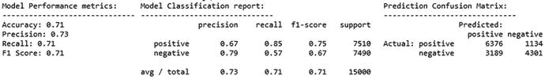

# 7. 分析电影评论情感

在本章中，我们将继续关注以案例研究为导向的章节，重点研究特定的现实世界问题和场景，以及如何使用机器学习来解决它们。本章将涵盖自然语言处理（NLP）、文本分析和机器学习相关的方面。当前的问题是情感分析或观点挖掘，我们希望分析一些文本文档，并根据这些文档的内容预测其情感或观点。情感分析可能是自然语言处理和文本分析最流行的应用之一，有大量关于此主题的网站、书籍和教程。通常，情感分析在主观文本上效果最佳，因为人们会在其中表达观点、感受和情绪。从现实世界的行业角度来看，情感分析被广泛用于分析企业调查、反馈调查、社交媒体数据，以及电影、地点、商品等的评论。其理念是分析和理解人们对特定实体的反应，并根据他们的情感采取有洞察力的行动。

一个文本语料库由多个文本文档组成，每个文档可以简单到单个句子，也可以复杂到包含多个段落的完整文档。尽管文本数据高度非结构化，但可以将其分为两大类文档。事实性文档通常描述某种形式的陈述或事实，不附带特定的感受或情感。这些也被称为客观文档。另一方面，主观文档包含表达感受、情绪、情感和观点的文本。

情感分析也常被称为观点分析或观点挖掘。其核心思想是利用文本分析、NLP、机器学习和语言学中的技术，从非结构化文本中提取重要信息或数据点。这反过来可以帮助我们推导出定性输出，例如整体情感处于正面、中性或负面等级，以及定量输出，例如情感极性、主观性和客观性比例。情感极性通常是一个数值分数，根据表达感受和情感的特定词语和短语等主观参数，分配给文本文档的正面和负面方面。中性情感通常具有 `0` 极性，因为它不表达任何特定情感；正面情感的极性 `> 0`，负面情感的极性 `< 0`。当然，你可以根据所处理文本的类型随时更改这些阈值；对此没有硬性约束。

在本章中，我们重点分析一个大型电影评论语料库并推导出情感。我们将涵盖多种用于分析情感的技术，包括以下内容。

*   无监督的基于词典的模型
*   传统的监督式机器学习模型
*   较新的监督式深度学习模型
*   先进的监督式深度学习模型

除了研究各种方法和模型外，我们还关注机器学习流程中的重要方面，包括文本预处理、规范化以及模型的深入分析，包括模型解释和主题模型。这里的核心思想是理解我们如何解决像非结构化文本情感分析这样的问题，学习各种技术、模型，并理解如何解释结果。这将使您将来能够在自己的数据集上使用这些方法。让我们开始吧！

## 问题陈述

本章的主要目标是预测从互联网电影数据库（IMDb）获取的大量电影评论的情感。该数据集包含 50,000 条电影评论，这些评论已根据评论内容预先标记了“正面”和“负面”情感类别标签。除此之外，还有一些未标记的电影评论。该数据集可从 [`http://ai.stanford.edu/~amaas/data/sentiment/`](http://ai.stanford.edu/%7Eamaas/data/sentiment/) 获取，感谢斯坦福大学以及 Andrew L. Maas、Raymond E. Daly、Peter T. Pham、Dan Huang、Andrew Y. Ng 和 Christopher Potts。该数据集也用于他们著名的论文《为情感分析学习词向量》（[Learning Word Vectors for Sentiment Analysis](http://ai.stanford.edu/%7Eamaas/papers/wvSent_acl2011.pdf)），该论文发表于第 49 届计算语言学协会年会（ACL 2011）论文集。他们提供了原始文本格式以及已处理的词袋格式的数据集。在本章的分析中，我们将仅使用原始标记的电影评论。因此，我们的任务是预测 15,000 条标记电影评论的情感，并使用剩余的 35,000 条评论来训练我们的监督模型。对于无监督模型，为了保持一致性并便于比较，我们仍将仅预测 15,000 条评论的情感。


## 设置依赖项

我们将使用多个专门用于文本分析、自然语言处理和机器学习的 Python 库和框架。虽然大部分内容会在各章节中提及，但你需要确保已安装 `pandas`、`numpy`、`scipy` 和 `scikit-learn`，它们将用于数据处理和机器学习。本章使用的深度学习框架包括以 `tensorflow` 为后端的 keras，但如果你愿意，也可以使用 `theano` 作为后端。将用到的自然语言处理库包括 `spacy`、`nltk` 和 `gensim`。请务必检查你安装的 `nltk` 版本至少为 `>= 3.2.4`，否则 `ToktokTokenizer` 类可能不存在。如果出于某种原因你想使用更低的 `nltk` 版本，你可以使用任何其他分词器，例如基于 `TreebankWordTokenizer` 的默认 `word_tokenize()`。`gensim` 的版本应至少为 `2.3.0`，而 `spacy` 使用的版本是 `1.9.0`。我们建议使用最近发布的 spacy 最新版本（2.x 版），因为它修复了几个错误并增加了多项改进。如果你是首次安装 `spacy` 和 `nltk`，还需要下载必要的依赖项和语料库。以下代码片段可以完成此操作。对于 `nltk`，在使用 `pip` 或 `conda` 安装 `nltk` 后，你需要在 Python 或 ipython shell 中输入以下代码。

```
import nltk
nltk.download('all', halt_on_error=False)
```

对于 `spacy`，你需要在 Unix shell\Windows 命令提示符中输入以下代码来安装该库（如果你不想使用 `conda`，可以使用 `pip install spacy`），并获取英文模型依赖项。

```
$ conda config --add channels conda-forge
$ conda install spacy
$ python -m spacy download en
```

我们还会使用自定义开发的文本预处理和标准化模块，你可以在名为 `contractions.py` 和 `text_normalizer.py` 的文件中找到它们。与监督模型拟合、预测和评估相关的工具函数位于 `model_evaluation_utils.py` 中，因此请确保将这些模块与本章的其他 Python 文件和 jupyter notebook 放在同一目录下。

## 获取数据

该数据集将随本章的代码文件一起，存放在本书的 GitHub 仓库中，地址为 [`https://github.com/dipanjanS/practical-machine-learning-with-python`](https://github.com/dipanjanS/practical-machine-learning-with-python)，文件名为 `movie_reviews.csv`，包含 50,000 条已标注的 IMDb 电影评论。如果需要，你也可以从 [`http://ai.stanford.edu/~amaas/data/sentiment/`](http://ai.stanford.edu/%7Eamaas/data/sentiment/) 下载相同的数据。获取 CSV 文件后，你可以使用 `pandas` 中的 `read_csv(...)` 工具函数轻松将其加载到 Python 中。

## 文本预处理与标准化

在深入进行特征工程和建模过程之前，关键步骤之一包括清洗、预处理和标准化文本，以便将短语和单词等文本组件转换为某种标准格式。这有助于在整个文档语料库中实现标准化，从而构建有意义的特征，并减少因无关符号、特殊字符、XML 和 HTML 标签等多种因素引入的噪声。名为 `text_normalizer.py` 的文件包含了我们进行文本标准化所需的所有工具函数。你也可以参考名为 `Text Normalization Demo.ipynb` 的 jupyter notebook 以获得更具交互性的体验。本节将描述文本标准化流程中的主要组件。

*   **清洗文本**：我们的文本通常包含 HTML 标签等不必要的内容，这些内容在分析情感时价值不大。因此，我们需要在提取特征之前确保将其移除。`BeautifulSoup` 库在这方面提供了出色的函数。我们的 `strip_html_tags(...)` 函数能够清洗和剥离 HTML 代码。
*   **去除重音字符**：在我们的数据集中，处理的是英文评论，因此我们需要确保任何其他格式的字符，尤其是重音字符，被转换并标准化为 ASCII 字符。一个简单的例子是将 é 转换为 e。我们的 `remove_accented_chars(...)` 函数在这方面提供了帮助。
*   **扩展缩略词**：在英语中，缩略词基本上是单词或音节的缩写形式。这些现有单词或短语的缩写形式是通过移除特定字母和发音来创建的。通常，单词中的元音会被移除。例如，do not 变为 don’t，I would 变为 I’d。缩略词在文本标准化中会带来问题，因为我们需要处理撇号等特殊字符，并且必须将每个缩略词转换为其扩展的原始形式。我们的 `expand_contractions(...)` 函数使用正则表达式以及 `contractions.py` 模块中映射的各种缩略词，来扩展文本语料库中的所有缩略词。
*   **去除特殊字符**：文本清洗和标准化的另一项重要任务是去除特殊字符和符号，这些字符和符号常常会增加非结构化文本中的额外噪声。可以使用简单的正则表达式来实现这一点。我们的函数 `remove_special_characters(...)` 帮助我们去除特殊字符。在我们的代码中，我们保留了数字，但如果你不希望标准化后的语料库中包含数字，也可以将其移除。
*   **词干提取与词形还原**：词干通常是单词的基本形式，可以通过向词干附加前缀和后缀等词缀来创建新单词。这被称为屈折变化。获取单词基本形式的逆向过程被称为词干提取。一个简单的例子是单词 WATCHES、WATCHING 和 WATCHED，它们都以单词词根词干 WATCH 作为基本形式。`nltk` 包提供了多种词干提取器，例如 `PorterStemmer` 和 `LancasterStemmer`。词形还原与词干提取非常相似，都是移除单词词缀以获取单词的基本形式。然而，在这种情况下，基本形式被称为根词，而不是词根词干。区别在于根词始终是一个在词典中存在的、拼写正确的单词，而词根词干则可能不是。我们将在标准化流程中仅使用词形还原来保留拼写正确的单词。函数 `lemmatize_text(...)` 在这方面提供了帮助。
*   **去除停用词**：在从文本构建有意义的特征时，那些意义不大或没有意义的词也被称为停用词。如果你在文档语料库中进行简单的词项或词频统计，这些词通常是频率最高的词。像 a、an、the 等词被认为是停用词。没有通用的停用词列表，但我们使用了来自 `nltk` 的标准英文停用词列表。如果需要，你也可以添加特定领域的停用词。函数 `remove_stopwords(...)` 帮助我们移除停用词，并保留语料库中最具意义和上下文的词。

我们将所有这些组件整合到以下名为 `normalize_corpus(...)` 的函数中，该函数可以将文档语料库作为输入，并返回经过清洗和标准化文本处理的同一语料库。


```
def normalize_corpus(corpus, html_stripping=True, contraction_expansion=True,
accented_char_removal=True, text_lower_case=True,
text_lemmatization=True, special_char_removal=True,
stopword_removal=True):
normalized_corpus = []
# 对语料库中的每个文档进行标准化
for doc in corpus:
# 去除 HTML 标签
if html_stripping:
doc = strip_html_tags(doc)
# 去除重音字符
if accented_char_removal:
doc = remove_accented_chars(doc)
# 展开缩写
if contraction_expansion:
doc = expand_contractions(doc)
# 将文本转换为小写
if text_lower_case:
doc = doc.lower()
# 去除多余的换行符
doc = re.sub(r'[\r|\n|\r\n]+', ' ',doc)
# 在特殊字符之间插入空格以将其隔离
special_char_pattern = re.compile(r'([{.(-)!}])')
doc = special_char_pattern.sub(" \\1 ", doc)
# 词形还原
if text_lemmatization:
doc = lemmatize_text(doc)
# 去除特殊字符
if special_char_removal:
doc = remove_special_characters(doc)
# 去除多余空白
doc = re.sub(' +', ' ', doc)
# 去除停用词
if stopword_removal:
doc = remove_stopwords(doc, is_lower_case=text_lower_case)
normalized_corpus.append(doc)
return normalized_corpus
```

以下代码片段展示了使用我们的标准化模块对示例文档进行文本标准化的小型演示。

```
In [1]: from text_normalizer import normalize_corpus
In [2]: document = """Héllo! Héllo! can you hear me! I just heard about Python!\r\n
...: It's an amazing language which can be used for Scripting, Web development,\r\n\r\n
...: Information Retrieval, Natural Language Processing, Machine Learning & Artificial Intelligence!\n
...: What are you waiting for? Go and get started. He's learning, she's learning, they've already\n\n
...: got a headstart!
...:            """
In [3]: document
Out[3]: "Héllo! Héllo! can you hear me! I just heard about Python!\r\n \n              It's an amazing language which can be used for Scripting, Web development,\r\n\r\n\n              Information Retrieval, Natural Language Processing, Machine Learning & Artificial Intelligence!\n\n              What are you waiting for? Go and get started. He's learning, she's learning, they've already\n\n\n              got a headstart!\n           "
In [4]: normalize_corpus([document], text_lemmatization=False, stopword_removal=False,
text_lower_case=False)
Out[4]: ['Hello Hello can you hear me I just heard about Python It is an amazing language which can be used for Scripting Web development Information Retrieval Natural Language Processing Machine Learning Artificial Intelligence What are you waiting for Go and get started He is learning she is learning they have already got a headstart ']
In [5]: normalize_corpus([document])
Out[5]: ['hello hello hear hear python amazing language use scripting web development information retrieval natural language processing machine learning artificial intelligence wait go get start learn learn already get headstart']
```

现在我们已经准备好了标准化模块，可以开始对语料库进行建模和分析。对文本标准化更深入细节感兴趣的 NLP 和文本分析爱好者，可以参考《Python 文本分析》（Apress 出版社；Dipanjan Sarkar 著，2016 年）一书第 115 页第 3 章的“文本标准化”部分。

## 基于无监督词典的模型

我们之前讨论过无监督学习方法，这些方法指的是可以直接应用于数据特征而无需标注数据的特定建模方法。在任何组织中，主要挑战之一是由于缺乏时间和资源来完成标注数据这项繁琐任务，导致难以获得标注数据集。在这种情况下，无监督方法非常有用，我们将在本节中探讨其中一些方法。即使我们有标注数据，本节也能让您很好地了解基于词典的模型是如何工作的，并且您可以在没有标注数据时将其应用于自己的数据集。

无监督情感分析模型使用精心策划的知识库、本体、词典和数据库，这些资源包含关于主观词汇、短语的详细信息，包括情感、情绪、极性、客观性、主观性等。词典模型通常使用一个专门针对情感分析的词典，也称为字典或词汇表。通常，这些词典包含与正面和负面情感相关的词汇列表、极性（负面或正面分数的幅度）、词性（POS）标签、主观性分类器（强、弱、中性）、情绪、情态等。您可以使用这些词典，通过匹配词典中特定词汇的出现情况来计算文本文档的情感，同时考虑其他附加因素，如否定词的存在、周围词汇、整体上下文和短语，并汇总整体情感极性分数，以决定最终的情感分数。有几种流行的词典模型用于情感分析。其中一些列举如下。

*   刘冰词典
*   MPQA 主观性词典
*   Pattern 词典
*   AFINN 词典
*   SentiWordNet 词典
*   VADER 词典

这并不是词典模型的详尽列表，但绝对列出了当今最流行的一些模型。我们将更详细地介绍最后三种词典模型，并使用我们的电影评论数据集提供动手代码和示例。我们将使用最后 15,000 条评论来预测其情感，并根据模型评估指标（如准确率、精确率、召回率和 F1 分数）来评估模型的表现，这些指标我们在第 5 章中已详细介绍。由于我们有标注数据，因此很容易看出这些电影评论的实际情感值与基于词典模型预测的情感值的匹配程度。您可以参考名为`unsupervised_sentiment_analysis.py`的 Python 文件，获取本节中使用的所有代码，或者使用名为`Sentiment Analysis - Unsupervised Lexical.ipynb`的 Jupyter 笔记本以获得更互动的体验。在开始分析之前，让我们使用以下代码片段加载必要的依赖项和配置设置。

```
In [1]: import pandas as pd
...: import numpy as np
...: import text_normalizer as tn
...: import model_evaluation_utils as meu
...:
...: np.set_printoptions(precision=2, linewidth=80)
```

现在，我们可以加载 IMDb 评论数据集，提取出最后 15,000 条评论用于分析，并使用以下代码片段对其进行标准化。

```
In [2]: dataset = pd.read_csv(r'movie_reviews.csv')
...:
...: reviews = np.array(dataset['review'])
...: sentiments = np.array(dataset['sentiment'])
...:
...: # 提取用于模型评估的数据
...: test_reviews = reviews[35000:]
...: test_sentiments = sentiments[35000:]
...: sample_review_ids = [7626, 3533, 13010]
...:
...: # 标准化数据集
...: norm_test_reviews = tn.normalize_corpus(test_reviews)
```

我们还提取了一些示例评论，以便在其上运行模型并详细解释结果。

### 刘冰词典

该词典包含超过 6,800 个词汇，分为两个文件：`positive-words.txt`（包含约 2,000 多个词汇/短语）和`negative-words.txt`（包含 4,800 多个词汇/短语）。该词典由刘冰历经数年开发和整理，并在其原始论文（Nitin Jindal 和刘冰合著，《识别文本文档中的比较句》，第 29 届 ACM SIGIR 国际年会论文集，西雅图，2006 年）中进行了详细说明。如果您想使用此词典，可以从`https://` [`www.cs.uic.edu/~liub/FBS/sentiment-analysis.html#lexicon`](http://www.cs.uic.edu/%7Eliub/FBS/sentiment-analysis.html%23lexicon) 获取，该页面还提供了将其作为压缩包（RAR 格式）下载的链接。


### MPQA 主观性词典

术语 MPQA 代表多视角问答（Multi-Perspective Question Answering），它包含一系列与意见语料库、主观性词典、主观性语义标注、论证词典、辩论语料库、意见挖掘器等多种资源相关的多样化数据集。该资源由匹兹堡大学开发并维护，其官方网站 [`http://mpqa.cs.pitt.edu/`](http://mpqa.cs.pitt.edu/) 包含了所有必要信息。主观性词典是其意见挖掘器框架的一部分，包含了主观性线索和上下文极性。有关详细信息，可参阅 Theresa Wilson、Janyce Wiebe 和 Paul Hoffmann 的论文《[识别短语级情感分析中的上下文极性](http://www.cs.pitt.edu/%7Ewiebe/pubs/papers/emnlp05polarity.pdf)》（HLT-EMNLP-2005 会议论文集）。

你可以从其官方网站 [`http://mpqa.cs.pitt.edu/lexicons/subj_lexicon/`](http://mpqa.cs.pitt.edu/lexicons/subj_lexicon/) 下载主观性词典，其中包含数据集 `subjclueslen1-HLTEMNLP05.tff` 中呈现的主观性线索。以下片段展示了该词典中的一些示例行。

```
type=weaksubj len=1 word1=abandonment pos1=noun stemmed1=n priorpolarity=negative
type=weaksubj len=1 word1=abandon pos1=verb stemmed1=y priorpolarity=negative
...
...
type=strongsubj len=1 word1=zenith pos1=noun stemmed1=n priorpolarity=positive
type=strongsubj len=1 word1=zest pos1=noun stemmed1=n priorpolarity=positive
```

每一行包含一个特定单词及其关联的极性、词性标注信息、长度（目前仅包含长度为 1 的单词）、主观性上下文以及词干信息。


### 模式词典

Pattern 包是 Python 中一个完整的自然语言处理框架，可用于文本处理、情感分析等。它由 CLiPS（计算语言学与心理语言学）开发，该研究中心隶属于安特卫普大学文学院语言学系。Pattern 使用其自身的情感模块，该模块内部使用一个词典，你可以从其官方 GitHub 仓库 [`https://github.com/clips/pattern/blob/master/pattern/text/en/en-sentiment.xml`](https://github.com/clips/pattern/blob/master/pattern/text/en/en-sentiment.xml) 访问该词典，其中包含完整的主观性词典数据库。词典中的每一行通常类似于以下示例。

```

因此，你可以获得重要的元数据信息，如 WordNet 语料库标识符、极性分数、词义、词性标注、强度、主观性分数等。这些信息反过来可用于基于极性和主观性分数计算文本文档的情感。遗憾的是，Pattern 仍未正式移植到 Python `3.x`，它目前适用于 Python `2.7.x`。不过，你仍然可以加载此词典并根据需要进行自己的建模。

AFINN 词典

AFINN 词典
  可能是最简单、最流行的词典之一，可广泛用于情感分析。该词典由 Finn Årup Nielsen 开发并维护，你可以在 Finn Årup Nielsen 的论文《A new ANEW: evaluation of a word list for sentiment analysis in microblogs》（ESWC2011 研讨会论文集）中找到关于此词典的更多详细信息。该词典的当前版本是 `AFINN-en-165.txt`，包含超过 3300 个单词，每个单词都关联一个极性分数。你可以在作者的官方 GitHub 仓库中找到此词典及其早期版本（包括 `AFINN-111`），地址为 [`https://github.com/fnielsen/afinn/blob/master/afinn/data/`](https://github.com/fnielsen/afinn/blob/master/afinn/data/) 。作者还在此基础上创建了一个名为 `afinn` 的 Python 封装库，我们将使用它进行分析。你可以使用以下代码导入该库并实例化一个对象。

```
In [3]: from afinn import Afinn
...:
...: afn = Afinn(emoticons=True)
```

现在，我们可以使用此对象，通过以下代码片段计算我们选定的四个示例评论的极性。

```
In [4]: for review, sentiment in zip(test_reviews[sample_review_ids], test_sentiments[sample_review_ids]):
...:     print('REVIEW:', review)
...:     print('Actual Sentiment:', sentiment)
...:     print('Predicted Sentiment polarity:', afn.score(review))
...:     print('-'*60)
REVIEW: no comment - stupid movie, acting average or worse... screenplay - no sense at all... SKIP IT!
Actual Sentiment: negative
Predicted Sentiment polarity: -7.0

REVIEW: I don't care if some people voted this movie to be bad. If you want the Truth this is a Very Good Movie! It has every thing a movie should have. You really should Get this one.
Actual Sentiment: positive
Predicted Sentiment polarity: 3.0

REVIEW: Worst horror film ever but funniest film ever rolled in one you have got to see this film it is so cheap it is unbelievable but you have to see it really!!!! P.S. Watch the carrot
Actual Sentiment: positive
Predicted Sentiment polarity: -3.0

```

我们可以比较每条评论的实际情感标签，并查看预测的情感极性分数。负极性通常表示负面情感。为了对我们包含 15,000 条评论的完整测试数据集（我使用了原始文本文档，因为 AFINN 会考虑表情符号和感叹号等其他方面）进行情感预测，我们现在可以使用以下代码片段。我使用阈值 `>= 1.0` 来判断整体情感是正面还是负面。将来你可以根据自己的语料库分析选择自己的阈值。

```
In [5]: sentiment_polarity = [afn.score(review) for review in test_reviews]
...: predicted_sentiments = ['positive' if score >= 1.0 else 'negative' for score in
sentiment_polarity]
```

现在我们有了预测的情感标签，我们可以使用效用函数，基于标准性能指标来评估模型性能。参见图 7-1。



图 7-1.

基于 AFINN 词典的模型性能指标

```
In [6]: meu.display_model_performance_metrics(true_labels=test_sentiments,
predicted_labels=predicted_sentiments,
classes=['positive', 'negative'])
```

我们得到了 71% 的整体 F1 分数，考虑到这是一个无监督模型，这个结果相当不错。查看混淆矩阵，我们可以清楚地看到，相当多的负面情感评论被错误分类为正面（3,189 条），这导致负面情感类别的召回率较低，为 57%。正面类别的性能在召回率或命中率方面更好，我们在 7,510 条正面评论中正确预测了 6,376 条，但由于在负面情感评论的情况下做出了许多错误的正面预测，精确率为 67%。

SentiWordNet 词典

WordNet 语料库无疑是英语中最流行的语料库之一，广泛应用于自然语言处理和语义分析。WordNet 为我们提供了同义词集（synsets）的概念。SentiWordNet 词典基于 WordNet 同义词集，可用于情感分析和意见挖掘。SentiWordNet 词典通常为每个 WordNet 同义词集分配三个情感分数。这些分数包括正面极性分数、负面极性分数和客观性分数。更多详细信息可在官方网站 [`http://sentiwordnet.isti.cnr.it`](http://sentiwordnet.isti.cnr.it) 上找到，包括研究论文和词典下载链接。我们将使用 nltk 库，它提供了 SentiWordNet 的 Python 接口。假设我们有形容词 awesome。我们可以使用以下代码片段获取与该词同义词集关联的情感分数。

```
In [8]: from nltk.corpus import sentiwordnet as swn
...:
...: awesome = list(swn.senti_synsets('awesome', 'a'))[0]
...: print('Positive Polarity Score:', awesome.pos_score())
...: print('Negative Polarity Score:', awesome.neg_score())
...: print('Objective Score:', awesome.obj_score())
Positive Polarity Score: 0.875
Negative Polarity Score: 0.125
Objective Score: 0.0
```

现在，让我们构建一个通用函数，基于文档中匹配的同义词集，提取并聚合完整文本文档的情感分数。

```
def analyze_sentiment_sentiwordnet_lexicon(review,
verbose=False):

