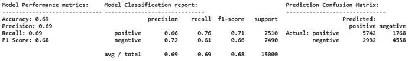

# 以表格形式展示结果
sentiment_frame = pd.DataFrame([[final_sentiment, norm_obj_score, norm_pos_score,
norm_neg_score, norm_final_score]],
columns=pd.MultiIndex(levels=[['情感统计：'],
['预测情感', '客观性',
'正面', '负面', '总体']],
labels=[[0,0,0,0,0],[0,1,2,3,4]]))
print(sentiment_frame)
return final_sentiment
```

我们的函数基本流程是：接收一条电影评论，为每个单词标注其对应的词性标签，根据词性标签为任何匹配的同义词集提取情感得分，最后聚合这些得分。当我们对示例文档运行该函数时，这一点会更加清晰。

```
In [10]: for review, sentiment in zip(test_reviews[sample_review_ids], test_sentiments[sample_review_ids]):
...:     print('评论:', review)
...:     print('实际情感:', sentiment)
...:     pred = analyze_sentiment_sentiwordnet_lexicon(review, verbose=True)
...:     print('-'*60)
评论: no comment - stupid movie, acting average or worse... screenplay - no sense at all... SKIP IT!
实际情感: negative
情感统计:
预测情感 客观性 正面 负面 总体
0            negative        0.76     0.09     0.15   -0.06

评论: I don't care if some people voted this movie to be bad. If you want the Truth this is a Very Good Movie! It has every thing a movie should have. You really should Get this one.
实际情感: positive
情感统计:
预测情感 客观性 正面 负面 总体
0            positive        0.74      0.2     0.06    0.14

评论: Worst horror film ever but funniest film ever rolled in one you have got to see this film it is so cheap it is unbelievable but you have to see it really!!!! P.S. watch the carrot
实际情感: positive
情感统计:
预测情感 客观性 正面 负面 总体
0            positive         0.8     0.14     0.07    0.07

```

我们可以清晰地看到每条示例电影评论的预测情感、情感极性得分以及客观性得分，这些都以格式化数据框的形式呈现。现在，让我们使用这个模型来预测所有测试评论的情感，并评估其性能。我们使用阈值`>=0`将总体情感极性分类为正面，使用`< 0`分类为负面。参见图 7-2。



图 7-2.

基于 SentiWordNet 词典的模型性能指标   

```
In [11]: predicted_sentiments = [analyze_sentiment_sentiwordnet_lexicon(review, verbose=False)
for review in norm_test_reviews]
...: meu.display_model_performance_metrics(true_labels=test_sentiments,
predicted_labels=predicted_sentiments,
...:                                      classes=['positive', 'negative'])
```

我们得到了 68% 的总体 F1 分数，这相比我们基于 AFINN 的模型确实有所下降。虽然被误分类为正面情感的负面评论数量减少了，但模型性能的其他方面受到了影响。

VADER 词典

VADER 词典由 C.J. Hutto 开发，是一种基于规则的情感分析框架的词典，专门针对社交媒体中的情感分析进行了调优。VADER 代表 Valence Aware Dictionary and Sentiment Reasoner（情感感知词典与情感推理器）。关于该框架的详细信息，可阅读 Hutto, C.J. 和 Gilbert, E.E. (2014) 的原始论文，标题为“VADER: A Parsimonious Rule-based Model for Sentiment Analysis of Social Media Text”，发表于第八届国际网络日志与社交媒体会议（ICWSM-14）论文集。你可以通过 `nltk.sentiment.vader` 模块下的 `nltk` 接口使用该库。除此之外，你还可以从 [`https://github.com/cjhutto/vaderSentiment`](https://github.com/cjhutto/vaderSentiment) 下载实际的词典或安装该框架，该网站也包含关于 VADER 的详细信息。这个词典位于名为 `vader_lexicon.txt` 的文件中，包含与单词、表情符号和俚语（如 wtf、lol、nah 等）相关的情感得分。该词典总共包含超过 9000 个词汇特征，最终从中精选出超过 7500 个经过验证的词汇特征，并附有经过适当验证的效价分数。每个特征按照从 `"[-4] 极度负面"` 到 `"[4] 极度正面"` 的等级进行评分，并允许 `"[0] 中性（或两者皆非，不适用）"`。选择词汇特征的过程是保留所有平均评分非零且标准差小于 `2.5` 的特征，该标准差由十位独立评分者的聚合结果确定。下面我们展示 `VADER` 词典的一个样本。

```
:(     -1.9     1.13578 [-2, -3, -2, 0, -1, -1, -2, -3, -1, -4]
:)      2.0     1.18322 [2, 2, 1, 1, 1, 1, 4, 3, 4, 1]
...
terrorizing     -3.0    1.0     [-3, -1, -4, -4, -4, -3, -2, -3, -2, -4]
thankful         2.7    0.78102 [4, 2, 2, 3, 2, 4, 3, 3, 2, 2]
```

上述词典样本中的每一行都描述了一个独特的词条，可以是表情符号或单词。第一个标记表示单词/表情符号，第二个标记表示平均情感极性得分，第三个标记表示标准差，最后一个标记表示由十位独立评分者给出的分数列表。现在，让我们使用 `VADER` 来分析我们的电影评论！我们构建自己的建模函数如下。

```
from nltk.sentiment.vader import SentimentIntensityAnalyzer
def analyze_sentiment_vader_lexicon(review,
threshold=0.1,
verbose=False):

