# 显示详细的情感统计信息
positive = str(round(scores['pos'], 2)*100)+'%'
final = round(agg_score, 2)
negative = str(round(scores['neg'], 2)*100)+'%'
neutral = str(round(scores['neu'], 2)*100)+'%'
sentiment_frame = pd.DataFrame([[final_sentiment, final, positive,
negative, neutral]],
columns=pd.MultiIndex(levels=[['情感统计：'],
['预测情感', '极性得分',
'正面', '负面', '中性']],
labels=[[0,0,0,0,0],[0,1,2,3,4]]))
print(sentiment_frame)
return final_sentiment
```

在我们的建模函数中，我们进行了一些基本的预处理，但保留了标点符号和表情符号。除此之外，我们使用`VADER`来获取情感极性以及评论文本在正面、中性和负面情感方面的比例。我们还根据用户输入的聚合情感极性阈值来预测最终情感。通常，`VADER`建议对聚合极性`>= 0.5`使用正面情感，对`[-0.5, 0.5]`之间使用中性情感，对极性`< -0.5`使用负面情感。在我们的语料库中，我们对正面情感使用`>= 0.4`的阈值，对负面情感使用`< 0.4`的阈值。以下是对我们样本评论的分析。

```
In [13]: for review, sentiment in zip(test_reviews[sample_review_ids], test_sentiments[sample_review_ids]):
...:     print('评论:', review)
...:     print('实际情感:', sentiment)
...:     pred = analyze_sentiment_vader_lexicon(review, threshold=0.4, verbose=True)
...:     print('-'*60)
评论: no comment - stupid movie, acting average or worse... screenplay - no sense at all... SKIP IT!
实际情感: negative
情感统计：
预测情感 极性得分 正面 负面 中性
0            negative           -0.8     0.0%    40.0%   60.0%

评论: I don't care if some people voted this movie to be bad. If you want the Truth this is a Very Good Movie! It has every thing a movie should have. You really should Get this one.
实际情感: positive
情感统计：
预测情感 极性得分 正面  负面 中性
0            negative          -0.16    16.0%  14.0%    69.0%

评论: Worst horror film ever but funniest film ever rolled in one you have got to see this film it is so cheap it is unbelievable but you have to see it really!!!! P.S. Watch the carrot
实际情感: positive
情感统计：
预测情感 极性得分 正面 负面 中性
0            positive           0.49    11.0%    11.0%   77.0%

```

我们可以看到每个样本电影评论的情感与极性的详细统计信息。现在让我们在完整的测试电影评论语料库上尝试我们的模型，并评估模型性能。见图 7-3。

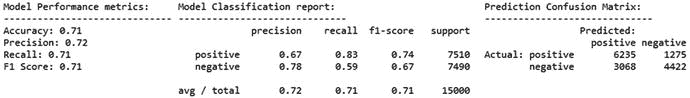

图 7-3.

基于 VADER 词典的模型性能指标

```
In [14]: predicted_sentiments = [analyze_sentiment_vader_lexicon(review, threshold=0.4,
verbose=False) for review in test_reviews]
...: meu.display_model_performance_metrics(true_labels=test_sentiments,
predicted_labels=predicted_sentiments,
...:                                      classes=['positive', 'negative'])
```

我们得到了总体 F1 分数和模型准确率均为 71%，这与基于 AFINN 的模型非常相似。基于 AFINN 的模型仅在平均精度上高出 1%；否则，两个模型的性能相似。

使用监督学习进行情感分类

构建模型以理解文本内容并预测基于文本评论的情感，另一种方法是使用监督机器学习。更具体地说，我们将使用分类模型来解决这个问题。我们已经在第 1 章的“监督学习”部分介绍了与监督学习和分类相关的概念。关于构建和评估分类模型的详细信息，如果需要，您可以前往第 5 章复习。我们将在后续章节中构建一个自动化的情感文本分类系统。实现这一目标的主要步骤如下所述。

1.  准备训练和测试数据集（可选地，一个验证数据集）
2.  预处理和标准化文本文档
3.  特征工程
4.  模型训练
5.  模型预测与评估

这些是构建我们系统的主要步骤。可选地，最后一步是将模型部署到您的服务器或云端。图 7-4 展示了使用监督学习（分类）模型构建标准文本分类系统的详细工作流程。

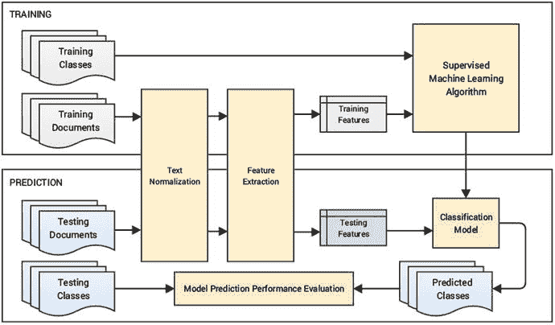

图 7-4.

构建自动化文本分类系统的蓝图（来源：Text Analytics with Python, Apress 2016）

在我们的场景中，文档指的是电影评论，类别指的是评论情感，可以是正面或负面，这使其成为一个二分类问题。我们将在后续章节中使用传统的机器学习方法和更新的深度学习方法构建模型。您可以参考名为 `supervised_sentiment_analysis.py` 的 Python 文件，以获取本节中使用的所有代码，或者使用名为 `Sentiment Analysis - Supervised.ipynb` 的 Jupyter notebook 以获得更具交互性的体验。让我们在开始之前加载必要的依赖项和设置。

```
In [1]: import pandas as pd
...: import numpy as np
...: import text_normalizer as tn
...: import model_evaluation_utils as meu
...:
...: np.set_printoptions(precision=2, linewidth=80)
```

我们现在可以加载我们的 IMDb 电影评论数据集，使用前 35,000 条评论来训练模型，并使用剩余的 15,000 条评论作为测试数据集来评估模型性能。除此之外，我们还将使用我们的标准化模块来标准化我们的评论数据集（工作流程中的步骤 1 和 2）。

```
In [2]: dataset = pd.read_csv(r'movie_reviews.csv')
...:
...: # 快速查看数据
...: print(dataset.head())
...: reviews = np.array(dataset['review'])
...: sentiments = np.array(dataset['sentiment'])
...:
...: # 构建训练和测试数据集
...: train_reviews = reviews[:35000]
...: train_sentiments = sentiments[:35000]
...: test_reviews = reviews[35000:]
...: test_sentiments = sentiments[35000:]
...:
...: # 标准化数据集
...: norm_train_reviews = tn.normalize_corpus(train_reviews)
...: norm_test_reviews = tn.normalize_corpus(test_reviews)
review sentiment
0  One of the other reviewers has mentioned that ...  positive
1  A wonderful little production. The...  positive
2  I thought this was a wonderful way to spend ti...  positive
3  Basically there's a family where a little boy ...  negative
4  Petter Mattei's "Love in the Time of Money" is...  positive
```

我们的数据集现在已经准备好并标准化，因此我们可以从之前描述的文本分类工作流程中的步骤 3 开始，构建我们的分类系统。

传统的监督机器学习模型

在本节中，我们将使用传统的分类模型来对电影评论的情感进行分类。我们的特征工程技术（步骤 3）将基于词袋模型和 TF-IDF 模型，我们在第 4 章的“文本数据特征工程”部分对此进行了广泛讨论。以下代码片段帮助我们使用这两种模型在我们的`训练`和`测试`数据集上构建特征。

```
In [3]: from sklearn.feature_extraction.text import CountVectorizer, TfidfVectorizer
...:
...: # 在训练评论上构建 BOW 特征
...: cv = CountVectorizer(binary=False, min_df=0.0, max_df=1.0, ngram_range=(1,2))
...: cv_train_features = cv.fit_transform(norm_train_reviews)
...: # 在训练评论上构建 TFIDF 特征
...: tv = TfidfVectorizer(use_idf=True, min_df=0.0, max_df=1.0, ngram_range=(1,2),
...:                      sublinear_tf=True)
...: tv_train_features = tv.fit_transform(norm_train_reviews)
...:
...: # 将测试评论转换为特征
...: cv_test_features = cv.transform(norm_test_reviews)
...: tv_test_features = tv.transform(norm_test_reviews)
...:
...: print('BOW 模型:> 训练特征形状:', cv_train_features.shape,
' 测试特征形状:', cv_test_features.shape)
...: print('TFIDF 模型:> 训练特征形状:', tv_train_features.shape,
' 测试特征形状:', tv_test_features.shape)
BOW 模型:> 训练特征形状: (35000, 2114021)  测试特征形状: (15000, 2114021)
TFIDF 模型:> 训练特征形状: (35000, 2114021)  测试特征形状: (15000, 2114021)
```

我们的特征集考虑了单词和二元词组。我们现在可以使用一些在文本分类上表现非常好的传统监督机器学习算法。我们建议您在将来处理自己的数据集时使用逻辑回归、支持向量机和多项式朴素贝叶斯模型。在本章中，我们使用逻辑回归和 SVM 构建了模型。以下代码片段有助于初始化这些分类模型估计器。

```
In [4]: from sklearn.linear_model import SGDClassifier, LogisticRegression
...:
...: lr = LogisticRegression(penalty='l2', max_iter=100, C=1)
...: svm = SGDClassifier(loss='hinge', n_iter=100)
```

在不深入过多理论复杂性的情况下，逻辑回归模型是一种用于分类的监督线性机器学习模型，尽管其名称如此。在该模型中，我们试图预测给定的电影评论属于某个离散类别（在我们的场景中是二分类）的概率。模型用于学习的函数如下所示。

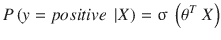

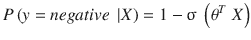

其中，模型试图使用特征向量 和  来预测情感类别， 通常被称为 sigmoid 函数、逻辑函数或 logit 函数。该模型的主要目标是搜索  的最优值，使得当特征向量  对应正面电影评论时，正面情感类别的概率最大，而当其对应负面电影评论时，概率最小。逻辑函数有助于对概率进行建模，以描述最终的预测类别。可以通过使用标准方法（如梯度下降）最小化适当的成本/损失函数来获得  的最优值（如果您对更多细节感兴趣，请参考第 5 章中的“逻辑回归的三个阶段”部分）。逻辑回归也常被称为 logit 回归或最大熵分类器。

我们现在将使用 `model_evaluation_utils` 模块中的实用函数 `train_predict_model(...)` 在我们的训练特征上构建一个逻辑回归模型，并在我们的测试特征上评估模型性能（步骤 4 和 5）。见图 7-5。

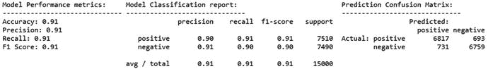

图 7-5.

基于词袋特征的逻辑回归模型性能指标

```
In [5]: # 基于 BOW 特征的逻辑回归模型
...: lr_bow_predictions = meu.train_predict_model(classifier=lr,
...:                        train_features=cv_train_features, train_labels=train_sentiments,
...:                        test_features=cv_test_features, test_labels=test_sentiments)
...: meu.display_model_performance_metrics(true_labels=test_sentiments,
...:                                      predicted_labels=lr_bow_predictions,
...:                                      classes=['positive', 'negative'])
```

如图 7-5 所示，我们得到了总体 F1 分数和模型准确率均为 91%，这非常出色！我们现在可以使用以下代码片段类似地在我们的 TF-IDF 特征上构建一个逻辑回归模型。见图 7-6。

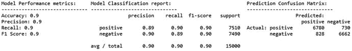

图 7-6.

基于 TF-IDF 特征的逻辑回归模型性能指标

```
In [6]: # 基于 TF-IDF 特征的逻辑回归模型
...: lr_tfidf_predictions = meu.train_predict_model(classifier=lr,
...:                         train_features=tv_train_features, train_labels=train_sentiments,
...:                         test_features=tv_test_features, test_labels=test_sentiments)
...: meu.display_model_performance_metrics(true_labels=test_sentiments,
...:                                      predicted_labels=lr_tfidf_predictions,
...:                                      classes=['positive', 'negative'])
```

如图 7-6 所示，我们得到了总体 F1 分数和模型准确率均为 90%，这很好，但我们之前的模型仍然略胜一筹。您可以类似地使用我们之前创建的支持向量机模型估计器对象 `svm`，并使用相同的代码片段来训练和预测 SVM 模型。我们使用 SVM 模型获得了 90% 的最高准确率和 F1 分数（请参考 Jupyter notebook 获取逐步代码片段）。因此，您可以看到这些监督机器学习分类算法在构建文本情感分类器方面是多么有效和准确。

更新的监督深度学习模型

在前面的章节中，我们已经多次提到深度学习在过去十年中如何彻底改变了机器学习领域。在本节中，我们将构建一些深度神经网络，并基于词嵌入的高级文本特征对其进行训练，以构建一个类似于我们在上一节中所做的文本情感分类系统。让我们在开始分析之前加载以下必要的依赖项。

```
In [7]: import gensim
...: import keras
...: from keras.models import Sequential
...: from keras.layers import Dropout, Activation, Dense
...: from sklearn.preprocessing import LabelEncoder
Using TensorFlow backend.
```

如果您还记得第 4 章，我们讨论了分类类别标签的编码以及独热编码方案。到目前为止，我们在 `scikit-learn` 中的模型直接接受情感类别标签作为 `positive` 和 `negative`，并在内部执行这些操作。然而，对于我们的深度学习模型，我们需要显式地执行此操作。以下代码片段帮助我们标记化我们的电影评论，并将基于文本的情感类别标签转换为独热编码向量（构成步骤 2 的一部分）。

```
In [8]: le = LabelEncoder()
...: num_classes=2
...: # 标记化训练评论并编码训练标签
...: tokenized_train = [tn.tokenizer.tokenize(text)
...:                    for text in norm_train_reviews]
...: y_tr = le.fit_transform(train_sentiments)
...: y_train = keras.utils.to_categorical(y_tr, num_classes)
...: # 标记化测试评论并编码测试标签
...: tokenized_test = [tn.tokenizer.tokenize(text)
...:                    for text in norm_test_reviews]
...: y_ts = le.fit_transform(test_sentiments)
...: y_test = keras.utils.to_categorical(y_ts, num_classes)
...:
...: # 打印类别标签编码映射和编码后的标签
...: print('情感类别标签映射:', dict(zip(le.classes_, le.transform(le.classes_))))
...: print('样本测试标签转换:\n'+'-'*35,
...:       '\n 实际标签:', test_sentiments[:3], '\n 编码标签:', y_ts[:3],
...:       '\n 独热编码标签:\n', y_test[:3])
情感类别标签映射: {'positive': 1, 'negative': 0}
样本测试标签转换:

实际标签: ['negative' 'positive' 'negative']
编码标签: [0 1 0]
独热编码标签:
[[ 1\.  0.]
[ 0\.  1.]
[ 1\.  0.]]
```

因此，从上面的样本输出中，我们可以看到我们的情感类别标签是如何被编码为数值表示，进而被转换为独热编码向量的。我们在本节中使用的特征工程技术（步骤 3）是基于词嵌入概念的更高级的词向量化技术。我们将使用 `word2vec` 和 GloVe 模型来生成嵌入。`word2vec` 模型由 Google 构建，我们在第 4 章的“词嵌入”部分对此进行了详细介绍。在这种情况下，我们将选择大小参数为 500，表示每个词的特征向量大小为 500。

```
In [9]: # 构建 word2vec 模型
...: w2v_num_features = 500
...: w2v_model = gensim.models.Word2Vec(tokenized_train, size=w2v_num_features, window=150,
...:                                    min_count=10, sample=1e-3)
```

我们将使用第 4 章中关于此模型的文档词向量平均方案，将每条电影评论表示为评论中不同词的所有词向量表示的平均向量。以下函数帮助我们计算任何文本文档语料库的平均词向量表示。

```
def averaged_word2vec_vectorizer(corpus, model, num_features):
vocabulary = set(model.wv.index2word)
def average_word_vectors(words, model, vocabulary, num_features):
feature_vector = np.zeros((num_features,), dtype="float64")
nwords = 0.
for word in words:
if word in vocabulary:
nwords = nwords + 1.
feature_vector = np.add(feature_vector, model[word])
if nwords:
feature_vector = np.divide(feature_vector, nwords)
return feature_vector
features = [average_word_vectors(tokenized_sentence, model, vocabulary, num_features)
for tokenized_sentence in corpus]
return np.array(features)
```

我们现在可以使用前面的函数在我们的两个电影评论数据集上生成平均词向量表示。

```
In [10]: # 从 word2vec 模型生成平均词向量特征
...: avg_wv_train_features = averaged_word2vec_vectorizer(corpus=tokenized_train,
...:                                                 model=w2v_model, num_features=500)
...: avg_wv_test_features = averaged_word2vec_vectorizer(corpus=tokenized_test,
...:                                                 model=w2v_model, num_features=500)
```

GloVe 模型，全称为全局向量，是一种用于获取词向量表示的无监督模型。该模型由斯坦福大学创建，在各种语料库（如维基百科、Common Crawl 和 Twitter）上进行训练，并且提供了相应的预训练词向量，可用于我们的分析需求。有关更多详细信息，您可以参考 Jeffrey Pennington、Richard Socher 和 Christopher D. Manning 于 2014 年发表的原始论文，题为 [GloVe: Global Vectors for Word Representation](https://nlp.stanford.edu/pubs/glove.pdf#_blank)。`spacy` 库提供了使用 GloVe 模型在 Common Crawl 语料库上训练的 300 维词向量。它们提供了一个简单的标准接口来获取每个词的 300 维特征向量以及整个文本文档的平均特征向量。以下代码片段利用 `spacy` 为我们的两个数据集获取 GloVe 嵌入。请注意，您也可以通过利用其他预训练模型，或使用 [`https://nlp.stanford.edu/projects/glove`](https://nlp.stanford.edu/projects/glove) 上提供的资源（包含预训练词嵌入、代码和示例）在自己的语料库上构建模型，来构建您自己的 GloVe 模型。

```
In [11]: # 使用 GloVe 模型进行特征工程
...: train_nlp = [tn.nlp(item) for item in norm_train_reviews]
...: train_glove_features = np.array([item.vector for item in train_nlp])
...:
...: test_nlp = [tn.nlp(item) for item in norm_test_reviews]
...: test_glove_features = np.array([item.vector for item in test_nlp])
```

您可以使用以下代码检查基于上述每个模型的数据集的特征向量维度。

```
In [12]: print('Word2Vec 模型:> 训练特征形状:', avg_wv_train_features.shape,
' 测试特征形状:', avg_wv_test_features.shape)
...: print('GloVe 模型:> 训练特征形状:', train_glove_features.shape,
' 测试特征形状:', test_glove_features.shape)
Word2Vec 模型:> 训练特征形状: (35000, 500)  测试特征形状: (15000, 500)
GloVe 模型:> 训练特征形状: (35000, 300)  测试特征形状: (15000, 300)
```

从上面的输出中，我们可以看到，正如预期的那样，`word2vec` 模型特征的大小为 500，而 GloVe 特征的大小为 300。我们现在可以进入分类系统工作流程的步骤 4，在此我们将构建并训练一个基于这些特征的深度神经网络。我们已经在第 1 章的“深度学习”部分简要介绍了深度神经网络的各个方面和架构。我们将使用一个全连接的四层深度神经网络（多层感知器或深度 ANN）作为我们的模型。我们通常不计算任何深度架构中的输入层，因此我们的模型将由三个隐藏层（每层 512 个神经元或单元）和一个输出层（两个单元）组成，输出层将用于根据输入层特征预测正面或负面情感。图 7-7 描绘了我们用于情感分类的深度神经网络模型。

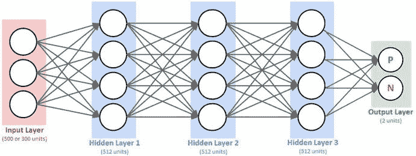

图 7-7.

用于情感分类的全连接深度神经网络模型

我们称之为全连接深度神经网络，因为每对相邻层中的神经元或单元都是完全成对连接的。这些网络也被称为深度人工神经网络或多层感知器，因为它们有多个隐藏层。以下函数利用基于 `tensorflow` 的 `keras` 来构建所需的 DNN 模型。

```
def construct_deepnn_architecture(num_input_features):
dnn_model = Sequential()
dnn_model.add(Dense(512, activation='relu', input_shape=(num_input_features,)))
dnn_model.add(Dropout(0.2))
dnn_model.add(Dense(512, activation='relu'))
dnn_model.add(Dropout(0.2))
dnn_model.add(Dense(512, activation='relu'))
dnn_model.add(Dropout(0.2))
dnn_model.add(Dense(2))
dnn_model.add(Activation('softmax'))
dnn_model.compile(loss='categorical_crossentropy', optimizer='adam',
metrics=['accuracy'])
return dnn_model
```

从前面的函数中，您可以看到我们接受一个参数 `num_input_features`，它决定了输入层所需的单元数量（对于 `word2vec` 特征为 `500`，对于 `glove` 特征为 `300`）。我们构建了一个 `Sequential` 模型，它帮助我们线性地堆叠隐藏层和输出层。

我们为所有隐藏层使用 `512` 个单元，激活函数 `relu` 表示修正线性单元。该函数通常定义为 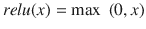，其中 x 通常是神经元的输入。在电子和电气工程中，这也常被称为斜坡函数。与之前流行的 sigmoid 函数相比，现在更倾向于使用此函数，因为它试图解决梯度消失问题。当 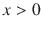 且 x 增加时，sigmoid 函数的梯度变得非常小（几乎消失），但 relu 可以防止这种情况发生。除此之外，它还有助于梯度下降更快地收敛。我们还在网络中以 `Dropout` 层的形式使用正则化。通过添加 `0.2` 的丢弃率，在训练模型期间的每次更新时，它会随机将 `20%` 的输入特征单元设置为 `0`。这种正则化形式有助于防止模型过拟合。

最终的输出层由两个单元组成，使用 `softmax` 激活函数。softmax 函数基本上是我们之前看到的逻辑函数的泛化，可用于表示 n 个可能类别结果上的概率分布。在我们的例子中，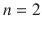，类别可以是正面或负面，softmax 概率将帮助我们确定这一点。二元 softmax 分类器也可以互换地称为二元逻辑回归函数。

`compile(...)` 方法用于在我们实际训练 DNN 模型之前配置其学习或训练过程。这涉及在 loss 参数中提供一个成本或损失函数。这将是模型试图最小化的目标或目的。根据您要解决的问题类型，有多种损失函数，例如用于回归的均方误差和用于分类的分类交叉熵。请查看 [`https://keras.io/losses/`](https://keras.io/losses/) 以获取可能的损失函数列表。

我们将使用 `categorical_crossentropy`，它有助于我们最小化 softmax 输出的误差或损失。我们需要一个优化器来帮助我们收敛模型并最小化损失或误差函数。梯度下降或随机梯度下降是流行的优化器。我们将使用 `adam` 优化器，它只需要一阶梯度且内存占用非常小。Adam 还使用了动量，其基本思想是每次更新不仅基于当前点的梯度计算，还包括前一次更新的一部分。这有助于更快地收敛。您可以参考 [`https://arxiv.org/pdf/1412.6980v8.pdf`](https://arxiv.org/pdf/1412.6980v8.pdf) 上的原始论文，以获取有关 ADAM 优化器的更多详细信息。最后，`metrics` 参数用于指定模型性能指标，这些指标在训练时用于评估模型（但不用于修改训练损失本身）。现在让我们基于我们的 `word2vec` 输入特征表示为我们的训练评论构建一个 DNN 模型。

```
In [13]: w2v_dnn = construct_deepnn_architecture(num_input_features=500)
```

您还可以借助 `keras` 可视化 DNN 模型架构，类似于我们在第 4 章中所做的，使用以下代码。见图 7-8。

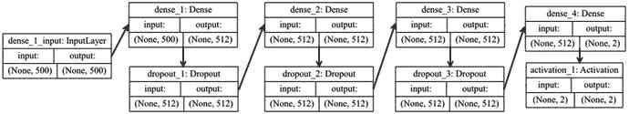

图 7-8.

使用 keras 可视化 DNN 模型架构

```
In [14]: from IPython.display import SVG
...: from keras.utils.vis_utils import model_to_dot
...:
...: SVG(model_to_dot(w2v_dnn, show_shapes=True, show_layer_names=False,
...:                  rankdir='TB').create(prog='dot', format='svg'))
```

我们现在将在我们的训练评论数据集上训练我们的模型，该数据集由 `avg_wv_train_features` 表示的 `word2vec` 特征组成（步骤 4）。我们将使用 `keras` 的 `fit(...)` 函数进行训练过程，并且有一些参数您应该了解。`epoch` 参数表示所有训练示例通过网络进行一次完整的前向和后向传播。`batch_size` 参数表示在训练模型和更新梯度时，一次通过 DNN 模型传播以进行一个后向和前向传播的总样本数。因此，如果您有 1,000 个观测值，并且您的批次大小为 100，则每个 epoch 将包含 10 次迭代，其中每次将 100 个观测值通过网络，并更新隐藏层单元上的权重。我们还指定了 `validation_split` 为 `0.1`，以提取 `10%` 的训练数据并将其用作验证数据集，以评估每个 epoch 的性能。`shuffle` 参数有助于在训练模型时打乱每个 epoch 中的样本。

```
In [18]: batch_size = 100
...: w2v_dnn.fit(avg_wv_train_features, y_train, epochs=5, batch_size=batch_size,
...:             shuffle=True, validation_split=0.1, verbose=1)
Train on 31500 samples, validate on 3500 samples
Epoch 1/5 31500/31500 - 11s - loss: 0.3097 - acc: 0.8720 - val_loss: 0.3159 - val_acc: 0.8646
Epoch 2/5 31500/31500 - 11s - loss: 0.2869 - acc: 0.8819 - val_loss: 0.3024 - val_acc: 0.8743
Epoch 3/5 31500/31500 - 11s - loss: 0.2778 - acc: 0.8857 - val_loss: 0.3012 - val_acc: 0.8763
Epoch 4/5 31500/31500 - 11s - loss: 0.2708 - acc: 0.8901 - val_loss: 0.3041 - val_acc: 0.8734
Epoch 5/5 31500/31500 - 11s - loss: 0.2612 - acc: 0.8920 - val_loss: 0.3023 - val_acc: 0.8763
```

前面的代码片段告诉我们，我们已经在训练数据上训练了 DNN 模型 5 个 epoch，批次大小为 100。我们得到了接近 88% 的验证准确率，这相当不错。现在是时候对我们的模型进行真正的测试了！让我们评估我们的模型在测试评论 `word2vec` 特征上的性能（步骤 5）。


图 7-9.

深度神经网络在 word2vec 特征上的模型性能指标

```
In [19]: y_pred = w2v_dnn.predict_classes(avg_wv_test_features)
...: predictions = le.inverse_transform(y_pred)
...: meu.display_model_performance_metrics(true_labels=test_sentiments,
...:               predicted_labels=predictions, classes=['positive', 'negative'])
```

图 7-9 中显示的结果表明，我们获得了 88% 的模型准确率和 F1 分数，这非常棒！您可以使用类似的工作流程来构建和训练基于 GloVe 特征的 DNN 模型，并评估模型性能。以下代码片段描绘了我们文本分类系统蓝图中步骤 4 和 5 的工作流程。

```


