# 评估模型性能
meu.display_model_performance_metrics(true_labels=test_sentiments, predicted_labels=predictions,
classes=['positive', 'negative'])
```

我们使用 GloVe 特征获得了 85% 的整体模型准确率和 F1 分数，这个结果还算不错，但并未优于使用 `word2vec` 特征所得到的结果。你可以参考 `Sentiment Analysis - Supervised.ipynb` 这个 Jupyter 笔记本，查看前述代码的逐步输出结果。至此，我们关于利用更新的深度学习模型和方法构建文本情感分类系统的讨论就结束了。接下来，让我们学习高级深度学习模型！

高级监督式深度学习模型

在上一节中，我们使用了全连接深度神经网络和词嵌入。另一种新颖且有趣的监督式深度学习方法，是使用循环神经网络（RNN）和长短期记忆网络（LSTM），这些网络同样考虑了数据（词语、事件等）的序列性。这些模型比常规的全连接深度网络更为先进，通常需要更长的训练时间。我们将利用基于 `tensorflow` 的 `keras`，在此构建一个基于 LSTM 的分类模型，并使用词嵌入作为特征。你可以参考名为 `sentiment_analysis_adv_deep_learning.py` 的 Python 文件，获取本节使用的所有代码；或者使用名为 `Sentiment Analysis - Advanced Deep Learning.ipynb` 的 Jupyter 笔记本，以获得更具交互性的体验。

我们将使用之前分析中创建的、经过标准化和预处理的训练及测试评论数据集：`norm_train_reviews` 和 `norm_test_reviews`。假设你已经加载了这些数据集，我们首先需要对这些数据集进行分词处理，使得每条文本评论都被分解成对应的词元（工作流程步骤 2）。

```
In [1]: tokenized_train = [tn.tokenizer.tokenize(text) for text in norm_train_reviews]
...: tokenized_test = [tn.tokenizer.tokenize(text) for text in norm_test_reviews]
```

在特征工程（步骤 3）中，我们将创建词嵌入。不过，我们将使用 `keras` 自行创建，而不是像之前那样使用预构建的 `word2vec` 或 GloVe。词嵌入倾向于将文本文档向量化为固定大小的向量，这些向量试图捕捉上下文和语义信息。

为了生成嵌入，我们将使用 keras 的 `Embedding` 层，该层要求文档被表示为分词后的数值向量。我们的 `tokenized_train` 和 `tokenized_test` 变量中已经有了分词后的文本向量。然而，我们需要将它们转换为数值表示。除此之外，我们还需要这些向量具有统一的大小，尽管由于每条评论中词元数量的差异，分词后的文本评论长度会有所不同。为此，一种策略是取最长评论（具有最大词元/单词数量）的长度，并将其设置为向量大小，我们称之为 `max_len`。较短的评论可以在开头填充一个 `PAD` 项，使其长度增加到 `max_len`。

我们需要创建一个词到索引的词汇映射，以便将每条分词后的文本评论表示为数值形式。请注意，你还需要为填充项创建一个数值映射，我们将其称为 `PAD_INDEX`，并为其分配数值索引 `0`。对于未知词项，如果稍后在测试数据集或新的、之前未见过的评论中遇到它们，我们也需要为其分配一个索引。这是因为我们只会在训练数据上进行向量化、特征工程和模型构建。因此，如果将来出现某个新词（最初并非模型训练的一部分），我们会将其视为词汇表外（OOV）词项，并分配一个常量索引（我们将此词项命名为 `NOT_FOUND_INDEX`，并为其分配索引 `vocab_size+1`）。以下代码片段帮助我们根据训练文本评论语料库 `tokenized_train` 创建此词汇表。

```
In [2]: from collections import Counter
...:
...: # 构建词到索引的词汇映射
...: token_counter = Counter([token for review in tokenized_train for token in review])
...: vocab_map = {item[0]: index+1
for index, item in enumerate(dict(token_counter).items())}
...: max_index = np.max(list(vocab_map.values()))
...: vocab_map['PAD_INDEX'] = 0
...: vocab_map['NOT_FOUND_INDEX'] = max_index+1
...: vocab_size = len(vocab_map)
...: # 查看词汇表大小及部分词汇映射
...: print('词汇表大小:', vocab_size)
...: print('词汇映射示例切片:', dict(list(vocab_map.items())[10:20]))
词汇表大小: 82358
词汇映射示例切片: {'martyrdom': 6, 'palmira': 7, 'servility': 8, 'gardening': 9, 'melodramatically': 73505, 'renfro': 41282, 'carlin': 41283, 'overtly': 41284, 'rend': 47891, 'anticlimactic': 51}
```

在这个例子中，我们使用了词汇表中的所有词项。你可以通过使用 `Counter` 的 `most_common(count)` 函数，并取训练语料库中唯一词项列表的前 `count` 个词项，轻松地过滤并在此处使用更相关的词项（基于它们的频率）。现在，我们将根据之前的 `vocab_map` 对分词后的文本评论进行编码。除此之外，我们还将文本情感类别标签编码为数值表示。

```
In [3]: from keras.preprocessing import sequence
...: from sklearn.preprocessing import LabelEncoder
...:
...: # 获取训练语料库的最大长度并初始化标签编码器
...: le = LabelEncoder()
...: num_classes=2 # 正面 -> 1, 负面 -> 0
...: max_len = np.max([len(review) for review in tokenized_train])
...:
...: ## 训练评论数据语料库
...: # 将分词后的文本评论转换为数值向量
...: train_X = [[vocab_map[token] for token in tokenized_review]
for tokenized_review in tokenized_train]
...: train_X = sequence.pad_sequences(train_X, maxlen=max_len) # 填充
...: ## 训练预测类别标签
...: # 将文本情感标签（负面/正面）转换为二进制编码（0/1）
...: train_y = le.fit_transform(train_sentiments)
...:
...: ## 测试评论数据语料库
...: # 将分词后的文本评论转换为数值向量
...: test_X = [[vocab_map[token] if vocab_map.get(token) else vocab_map['NOT_FOUND_INDEX']
...:            for token in tokenized_review]
...:               for tokenized_review in tokenized_test]
...: test_X = sequence.pad_sequences(test_X, maxlen=max_len)
...: ## 测试预测类别标签
...: # 将文本情感标签（负面/正面）转换为二进制编码（0/1）
...: test_y = le.transform(test_sentiments)
...:
...: # 查看向量形状
...: print('训练评论向量的最大长度:', max_len)
...: print('训练评论向量形状:', train_X.shape, ' 测试评论向量形状:', test_X.shape)
训练评论向量的最大长度: 1442
训练评论向量形状: (35000, 1442)  测试评论向量形状: (15000, 1442)
```

从上述代码片段及其输出可以清楚地看到，我们将每条文本评论编码成了一个数值序列向量，使得每条评论向量的大小为 `1442`，这基本上是训练数据集中评论的最大长度。我们对较短的评论进行填充，并从较长的评论中截断多余的词元，使得每条评论的形状如输出所示保持恒定。现在，我们可以继续进行步骤 3 和分类工作流程步骤 4 的一部分，引入 `Embedding` 层，并将其与基于 LSTM 的深度网络架构相结合。

```
from keras.models import Sequential
from keras.layers import Dense, Embedding, Dropout, SpatialDropout1D
from keras.layers import LSTM
EMBEDDING_DIM = 128 # 每个词元的密集嵌入维度
LSTM_DIM = 64 # LSTM 单元总数
model = Sequential()
model.add(Embedding(input_dim=vocab_size, output_dim=EMBEDDING_DIM, input_length=max_len))
model.add(SpatialDropout1D(0.2))
model.add(LSTM(LSTM_DIM, dropout=0.2, recurrent_dropout=0.2))
model.add(Dense(1, activation="sigmoid"))
model.compile(loss="binary_crossentropy", optimizer="adam",
metrics=["accuracy"])
```

`Embedding` 层帮助我们从头生成词嵌入。该层最初也会用一些权重进行初始化，并且当网络在每个 epoch 中试图最小化损失时，这些权重会像其他层中神经元单元的权重一样，根据我们的优化器进行更新。因此，嵌入层试图优化其权重，以便我们获得最佳的词嵌入，这些嵌入将在模型中产生最小的误差，同时还能捕捉词之间的语义相似性和关系。我们如何获得嵌入呢？假设我们有一条包含 `3` 个词项 `['movie', 'was', 'good']` 的评论，以及一个包含 `82358` 个词的词到索引映射的 `vocab_map`。词嵌入的生成方式大致类似于图 7-10。

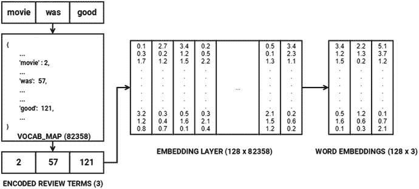

图 7-10.

理解词嵌入是如何生成的

根据我们的模型架构，`Embedding` 层接受三个参数：`input_dim`，等于词汇表大小（`vocab_size`）`82358`；`output_dim`，为 `128`，表示密集嵌入的维度（由图 7-10 中 `EMBEDDING LAYER` 的行表示）；以及 `input_len`，指定输入序列（电影评论序列向量）的长度，即 `1442`。在图 7-10 所示的例子中，由于我们只有一条评论，其维度为 `(1, 3)`。这条评论根据 `VOCAB_MAP` 被转换为数值序列 `[2, 57, 121]`。然后，从 `EMBEDDING LAYER` 中选择代表评论序列中索引的特定列（分别是列索引 `2`、`57` 和 `121` 处的向量），以生成最终的词嵌入。这为我们提供了一个维度为 `(1, 128, 3)` 的嵌入向量，当每一行基于每个序列词嵌入向量表示时，也可以表示为 `(1, 3, 128)`。许多深度学习框架（如 keras）将嵌入维度表示为 (m, n)，其中 m 代表词汇表中所有唯一词项的数量（`82358`），n 代表 `output_dim`，在此例中为 `128`。可以将其视为图 7-10 中所示层的转置版本，这样理解就对了！

通常，如果你将编码后的评论词项序列向量表示为独热编码格式 `(3, 82358)`，并与表示为 `(82358, 128)` 的 `EMBEDDING LAYER`（其中每一行代表词汇表中一个词的嵌入）进行矩阵乘法，你将直接获得评论序列向量的词嵌入，结果为 `(3, 128)`。如前所述，当输入数据通过整个网络传播时，嵌入层中的权重会在每个 epoch 中根据输入数据进行更新和优化，以最小化整体损失和误差，从而获得最大的模型性能。

这些密集的词嵌入随后被传递到具有 `64` 个单元的 `LSTM` 层。我们在第 1 章的“深度学习”部分下的“重要概念”小节中，于“长短期记忆网络”子节中简要介绍了 LSTM 架构。LSTM 基本上试图克服 RNN 模型的缺点，特别是在处理长期依赖关系以及当与单元（神经元）相关的权重矩阵变得过小（导致梯度消失）或过大（导致梯度爆炸）时出现的问题。这些架构比常规的深度网络更复杂，深入探讨其内部细节和数学概念超出了当前范围，但我们将在不涉及过多数学内容的情况下，在此介绍其要点。如果你对研究 LSTM 的内部机制感兴趣，请查阅启发这一切的原始论文：Hochreiter, S., 和 Schmidhuber, J. (1997). Long short-term memory. Neural computation. 9(8), 1735-1780。我们在图 7-11 中描绘了 RNN 的基本架构，并将其与 LSTM 进行了比较。

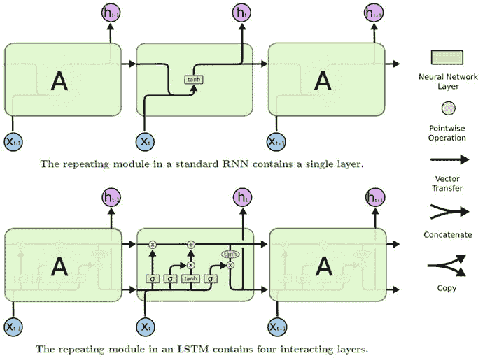

图 7-11.

RNN 和 LSTM 单元的基本结构（来源：Christopher Olah 的博客：colah.github.io）

RNN 单元通常具有一个重复模块的链（当我们展开循环时会发生这种情况；请参考第 1 章中的图 1-13，我们在那里讨论过这一点），使得该模块具有一个简单的结构，可能只有一个使用 `tanh` 激活函数的层。LSTM 是一种特殊类型的 RNN，具有类似的结构，但 LSTM 单元有四个神经网络层，而不是一个。LSTM 单元的详细架构如图 7-12 所示。

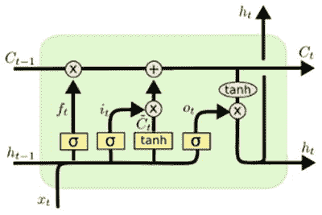

图 7-12.

LSTM 单元的详细架构（来源：Christopher Olah 的博客：colah.github.io）

LSTM 单元的详细架构如图 7-12 所示。符号 t 表示一个时间步，C 表示细胞状态，h 表示隐藏状态。门控 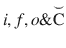 有助于从细胞状态中移除或添加信息。门控 i、f 和 o 分别代表输入门、遗忘门和输出门，它们都由 sigmoid 层调节，该层输出 0 到 1 之间的数字，控制这些门控的输出有多少可以通过。因此，这有助于保护和控制细胞状态。信息如何流经 LSTM 单元的详细工作流程如图 7-13 所示，分为四个步骤。

1.  第一步涉及遗忘门层 f，它帮助我们决定应该从细胞状态中丢弃哪些信息。这是通过查看先前的隐藏状态 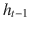 和当前输入 x [t] 来完成的，如公式所示。sigmoid 层有助于控制应保留或遗忘多少信息。

2.  第二步描绘了输入门层 i，它有助于决定哪些信息将被存储在当前细胞状态中。输入门中的 sigmoid 层再次基于 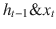 帮助决定哪些值将被更新。tanh 层基于  帮助创建一个新的候选值向量 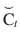，该向量可以添加到当前细胞状态中。因此，tanh 层创建值，而带有 sigmoid 层的输入门帮助选择哪些值应该被更新。

3.  第三步涉及利用前两步获得的结果，将旧的细胞状态 C [t ‐ 1] 更新为新的细胞状态 C [t]。我们将旧的细胞状态乘以遗忘门 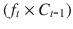，然后加上由带有 sigmoid 层的输入门缩放后的新候选值 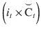。

4.  第四步也是最后一步帮助我们决定最终输出应该是什么，这基本上是细胞状态的一个过滤版本。带有 sigmoid 层的输出门 o 帮助我们选择细胞状态的哪些部分将传递到最终输出。当通过 tanh 层时，这乘以细胞状态值，从而给出最终的隐藏状态值 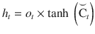。

这个详细工作流程中的所有步骤都在图 7-13 中进行了描绘，并附有必要的注释和公式。我们要感谢我们的好朋友 Christopher Olah 提供了详细的信息以及用于描绘 LSTM 网络内部工作原理的图像。我们建议访问 Christopher 的博客 [`http://colah.github.io/posts/2015-08-Understanding-LSTMs`](http://colah.github.io/posts/2015-08-Understanding-LSTMs) 以获取更多详细信息。同时也要感谢 Edwin Chen，他以易于理解的格式解释了 RNN 和 LSTM。我们建议参考 Edwin 的博客 [`http://blog.echen.me/2017/05/30/exploring-lstms`](http://blog.echen.me/2017/05/30/exploring-lstms) 以获取关于 RNN 和 LSTM 工作原理的信息。

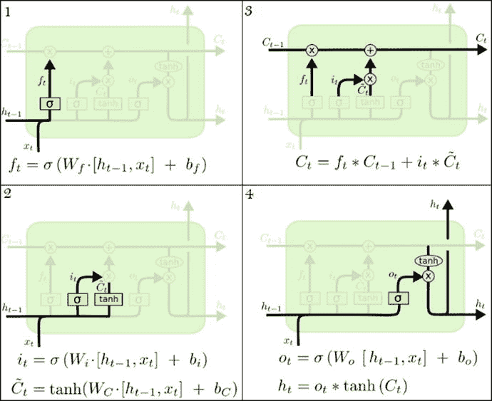

图 7-13.

LSTM 单元中数据流的分步讲解（来源：Christopher Olah 的博客：colah.github.io）

我们深度网络中的最后一层是 `Dense` 层，具有 `1` 个单元和 sigmoid 激活函数。我们基本上使用 `binary_crossentropy` 函数和 `adam` 优化器，因为这是一个二分类问题，模型最终将预测一个 `0` 或 `1`，我们可以使用标签编码器将其解码回负面或正面的情感预测。你也可以在此处使用 `categorical_crossentropy` 损失函数，但那样你需要使用一个具有 `2` 个单元和 `softmax` 函数的 `Dense` 层。现在我们的模型已经编译完毕并准备就绪，我们可以进入分类工作流程的步骤 4，即实际训练模型。我们采用与之前深度网络模型类似的策略，在训练数据上训练我们的模型，设置五个 epoch，批次大小为 100 条评论，并从训练数据中划分出 10% 作为验证集以衡量验证准确率。

```
In [4]: batch_size = 100
...: model.fit(train_X, train_y, epochs=5, batch_size=batch_size,
...:           shuffle=True, validation_split=0.1, verbose=1)
在 31500 个样本上训练，在 3500 个样本上验证
Epoch 1/5 31500/31500 - 2491s - loss: 0.4081 - acc: 0.8184 - val_loss: 0.3006 - val_acc: 0.8751
Epoch 2/5 31500/31500 - 2489s - loss: 0.2253 - acc: 0.9158 - val_loss: 0.3209 - val_acc: 0.8780
Epoch 3/5 31500/31500 - 2656s - loss: 0.1431 - acc: 0.9493 - val_loss: 0.3483 - val_acc: 0.8671
Epoch 4/5 31500/31500 - 2604s - loss: 0.1023 - acc: 0.9658 - val_loss: 0.3803 - val_acc: 0.8729
Epoch 5/5 31500/31500 - 2701s - loss: 0.0694 - acc: 0.9761 - val_loss: 0.4430 - val_acc: 0.8706
```

在 CPU 上训练 LSTM 是出了名的慢，正如你所见，我的模型在配备 8 GB 内存的 i5 第三代 Intel CPU 上仅训练五个 epoch 就花费了大约 3.6 小时。当然，在像 Google Cloud Platform 或 AWS 这样的基于 GPU 的云环境中，训练相同的模型花费了我不到一个小时。因此，我建议你选择基于 GPU 的深度学习环境，尤其是在处理基于 RNN 或 LSTM 的网络架构时。根据上述输出，我们可以看到，仅用五个 epoch，我们就获得了不错的验证准确率，但训练准确率开始飙升，表明可能发生了一些过拟合。克服这个问题的方法包括添加更多数据或增加丢弃率。不妨试一试，看看是否有效！是时候测试我们的模型了！让我们看看它在预测测试评论情感方面的表现如何，并使用我们之前模型所用的相同模型评估框架（步骤 5）。

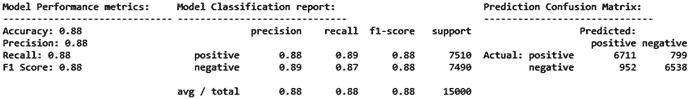

图 7-14.

基于词嵌入的 LSTM 深度学习模型的性能指标

```
In [5]: # 预测测试数据的情感
...: pred_test = model.predict_classes(test_X)
...: predictions = le.inverse_transform(pred_test.flatten())
...: # 评估模型性能
...: meu.display_model_performance_metrics(true_labels=test_sentiments,
...:                    predicted_labels=predictions, classes=['positive', 'negative'])
```

图 7-14 所示的结果表明，我们获得了 88% 的模型准确率和 F1 分数，这相当不错！有了更多高质量的数据，你可以期待获得更好的结果。尝试使用不同的架构进行实验，看看是否能获得更好的结果！

分析情感成因

我们构建了监督式和无监督式模型，以根据评论文本内容预测电影评论的情感。虽然特征工程和建模无疑是当务之急，但你也需要知道如何分析和解释模型预测背后的根本原因。在本节中，我们将分析情感成因。其思路是确定导致正面或负面情感的根本原因或关键因素。第一个关注领域是模型解释，我们将尝试理解、解释和说明分类模型做出预测背后的机制。第二个关注领域是应用主题建模，从正面和负面情感评论中提取关键主题。

解释预测模型

机器学习模型面临的挑战之一是从试点或概念验证阶段过渡到生产阶段。业务部门和关键利益相关者通常将机器学习模型视为复杂的黑箱，并提出疑问：我为什么要相信你的模型？向他们解释复杂的数学或理论概念并不能达到目的。有没有什么方法可以让我们以易于解释的方式解释这些模型？事实上，这个话题在 2016 年最近获得了广泛关注。请参考 M.T. Ribeiro、S. Singh 和 C. Guestrin 的原始研究论文《Why Should I Trust You?: Explaining the Predictions of Any Classifier》，网址为 [`https://arxiv.org/pdf/1602.04938.pdf`](https://arxiv.org/pdf/1602.04938.pdf)，以了解更多关于模型解释和 LIME 框架的信息。更多关于模型解释的内容，请参阅第 5 章，我们在其中详细介绍了 skater 框架，该框架对各种模型进行了出色的解释。

有多种方法可以解释我们的预测性情感分类模型所做的预测。我们想更深入地了解为什么一条正面评论被正确预测为具有正面情感，或者一条负面评论被正确预测为具有负面情感。除此之外，没有模型是 100% 准确的，因此我们也想了解错误分类或错误预测的原因。本节使用的代码可在名为 `sentiment_causal_model_interpretation.py` 的文件中找到，或者你也可以参考名为 `Sentiment Causal Analysis - Model Interpretation.ipynb` 的 Jupyter 笔记本，以获得交互式体验。

首先，让我们为迄今为止效果最好的模型构建一个基本的文本分类流水线。这是基于词袋特征模型的逻辑回归模型。我们将利用 `scikit-learn` 的流水线模块，使用以下代码构建此机器学习流水线。

```
from sklearn.feature_extraction.text import CountVectorizer
from sklearn.linear_model import LogisticRegression
from sklearn.pipeline import make_pipeline


