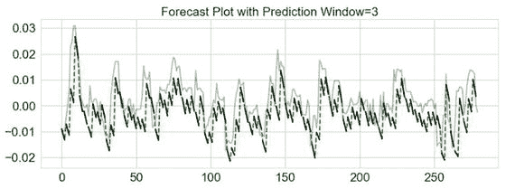

# LSTM 输入的变换
x_train = np.reshape(x_train, (x_train.shape[0],
x_train.shape[1],
1))
x_test = np.reshape(x_test, (x_test.shape[0],
x_test.shape[1],
1))
return x_train,y_train,x_test,y_test,scaler
```

函数 `get_reg_train_test()` 还执行了许多其他可选的预处理步骤。它允许我们在应用窗口化之前，使用滚动均值对时间序列进行平滑处理。我们还可以根据需求对数据进行归一化和缩放。神经网络对输入值很敏感，通常建议在训练网络之前对输入进行缩放。对于这个用例，我们将对时间序列进行归一化处理，即对于每个窗口，每个时间步都是相对于该窗口第一个值的百分比变化（我们也可以使用缩放，或两者都使用，并重复该过程）。

在我们的案例中，我们从六天的窗口大小开始（你可以尝试更小或更大的窗口，并观察差异）。以下代码片段使用了 `get_reg_train_test()` 函数，并将归一化设置为 true。

```
In [2] : WINDOW = 6
...: PRED_LENGTH = int(window/2)
...: x_train,y_train,x_test,y_test,scaler = get_reg_train_test(sp_close_series,
...:                                                         sequence_length=WINDOW +1,
...:                                                         roll_mean_window=None,
...:                                                         normalize=True,
...:                                                         scale=False)
```

此代码片段创建了一个七天的窗口，其中包含六天的历史数据（`x_train`）和一天的预测值 `y_train`。训练和测试变量的形状如下。

```
In [3] : print("x_train shape={}".format(x_train.shape))
...: print("y_train shape={}".format(y_train.shape))
...: print("x_test shape={}".format(x_test.shape))
...: print("y_test shape={}".format(y_test.shape))
x_train shape=(2516, 6, 1)
y_train shape=(2516,)
x_test shape=(280, 6, 1)
y_test shape=(280,)
```

`x_train` 和 `x_test` 张量符合我们之前讨论过的 (N, W, F) 格式，这也是 RNN 输入所要求的格式。我们的训练集中有 2516 个序列，每个序列有六个时间步和一个待预测的值。同样，测试集中有 280 个序列。

现在我们已经准备好了预处理后的数据集，接下来使用 `keras` 构建一个 RNN 网络。`keras` 框架为我们提供了高级抽象，可以在 `theano` 和 `tensorflow` 后端上处理神经网络。以下代码片段展示了使用 `get_reg_model()` 函数准备的模型。

```
In [4]: lstm_model = get_reg_model(layer_units=[50,100],
...:                         window_size=window)
```

生成的 LSTM 模型架构有两个隐藏的 `LSTM` 层堆叠在一起，第一层有 50 个 LSTM 单元，第二层有 100 个。输出层是一个具有线性激活函数的 `Dense` 层。我们使用均方误差作为损失函数进行优化。由于我们正在堆叠 LSTM 层，我们需要将 `return_sequences` 设置为 true，以便后续层能够获取所需的值。显而易见，`keras` 抽象了大部分繁重的工作，使得仅用几行代码就能构建甚至非常复杂的架构变得非常直观。

下一步是训练我们的 LSTM 网络。我们使用批次大小为 16，训练 20 个周期，并设置 5% 的验证集。以下代码片段使用 `fit()` 函数来训练模型。

```
In [5]: # 使用早停法避免过拟合
...: callbacks = [keras.callbacks.EarlyStopping(monitor='val_loss',
...:                                                 patience=2,
...:                                                 verbose=0)]
...: lstm_model.fit(x_train, y_train,
...:                 epochs=20, batch_size=16,
...:                 verbose=1,validation_split=0.05,
...:                 callbacks=callbacks)
```

模型会生成每个运行周期的训练和验证损失信息。早停回调使我们能够在连续两个周期没有观察到进一步改进时停止训练。我们从批次大小 16 开始；你可以尝试更大的批次大小并观察差异。

模型拟合完成后，下一步是使用 `predict()` 函数进行预测。由于我们将其建模为一个具有固定窗口大小的回归问题，我们将为每个序列生成预测。为此，我们编写了另一个名为 `predict_reg_multiple()` 的实用函数。该函数将 lstm 模型、窗口化数据集、窗口和预测长度作为输入参数，为每个输入窗口返回一个预测列表。`predict_reg_multiple()` 函数的工作方式如下。

1.  对于窗口化序列列表中的每个序列，重复步骤 a-c：

    1.  使用 keras 的 `predict()` 函数生成一个输出值。

    2.  将此输出值附加到输入序列的末尾，并移除第一个值以保持窗口大小。

    3.  然后重复此过程（步骤 a 和 b），直到达到所需的预测长度。

2.  该函数利用预测值来预测后续值。

该函数可在脚本 `lstm_utils.py` 中找到。以下代码片段使用 `predict_reg_multiple()` 函数获取测试集上的预测结果。

```
In [6] : test_pred_seqs = predict_reg_multiple(lstm_model,
...:                                         x_test,
...:                                         window_size=WINDOW,
...:                                         prediction_len=PRED_LENGTH)
```

为了分析性能，我们将计算拟合序列的 RMSE。我们使用 `sklearn` 的 `metrics` 模块来实现。以下代码片段计算了 RMSE 分数。

```
In [7] : test_rmse = math.sqrt(mean_squared_error(y_test[1:],
...:                                                 np.array(test_pred_seqs).\
...:                                                 flatten()))
...: print('Test Score: %.2f RMSE' % (test_rmse))
Test Score: 0.01 RMSE
```

输出 RMSE 为 0.01。作为练习，你可以比较不同窗口大小和预测长度下的 RMSE，并观察整体模型性能。

为了可视化我们的预测，我们将预测值与归一化的测试数据绘制在一起。我们使用 `plot_reg_results()` 函数，该函数也可在 `lstm_utils.py` 中参考。以下代码片段使用相同的函数生成所需的图表。



图 11-16.

使用 LSTM 的预测图，窗口大小为 6，预测长度为 3

```
In [8]: plot_reg_results(test_pred_seqs,y_test,prediction_len=PRED_LENGTH)
```

在图 11-16 中，灰色线是原始/真实的测试数据（归一化后），黑色线表示以三天为周期的预测/预报值。虚线用于解释预测序列的整体趋势。显而易见，预测结果在一定程度上偏离了实际数据趋势，但它们似乎与实际数据有一些相似之处。

在结束本节之前，有几个重要的点需要牢记。LSTM 是具有存储和使用过去信息能力的强大单元。在我们当前的场景中，我们使用了窗口化方法，并采用了堆叠的 LSTM 架构（我们的模型中有两个 LSTM 层）。这也被称为多对一架构，其中使用多个输入值来生成单个输出。这里的另一个重要点是，窗口大小以及网络的其他超参数（如周期数、批次大小、LSTM 单元数等）都会对最终结果产生影响（这留作练习供你探索）。因此，在生产环境中部署此类模型之前，我们应该谨慎行事。

序列建模

在上一节中，我们将时间序列建模为一个回归用例。本质上，问题公式虽然利用了过去的窗口进行预测，但并未使用时间步信息。在本节中，我们将通过将其建模为序列，使用 LSTM 解决相同的股票预测问题。对于本节中的动手示例，你可以参考 jupyter notebook `notebook_stock_prediction_sequence_modeling_lstm.ipynb` 以获取必要的代码片段和示例。

循环神经网络天生适合序列建模任务，如机器翻译、语音识别等。RNN 利用记忆（不同于普通的前馈神经网络）来跟踪上下文，并利用它来生成输出。通常，前馈神经网络假设输入是相互独立的。这种独立性在许多场景下可能不成立（例如时间序列数据）。RNN 对序列的每个元素应用相同的变换，其结果依赖于先前的值。

对于我们的股票价格时间序列，我们现在希望将其建模为一个序列，其中每个时间步的值是先前值的函数。与类似回归的建模不同，这里我们不将时间序列划分为固定大小的窗口，而是利用 LSTM 从数据中学习，并确定使用哪些过去的值进行预测。

为此，我们需要对上一案例中处理数据的方式以及构建 RNN 的方式进行一些调整。在上一节中，我们使用了 (N,W,F) 格式作为输入。在当前设置中，格式保持不变，但有以下变化。

*   N（序列数量）：这将设置为 1，因为我们只处理一只股票的价格信息。

*   W（序列长度）：这将设置为我们拥有的价格信息的总天数。这里我们将整个序列作为一个大序列。

*   F（每个时间戳的特征）：这仍然是 1，因为我们每个时间戳只处理收盘股票价值。

关于输出，在上一节中，我们为每个考虑的窗口/序列生成一个输出。在将数据建模为序列/时间序列时，我们期望输出也是一个序列。因此，输出也是一个遵循与输入张量相同格式的 3D 张量。

我们编写了一个小的实用函数 `get_seq_train_test()` 来帮助我们缩放并从时间序列中生成训练和测试数据集。在这种情况下，我们使用 70-30 的分割。然后我们使用 `numpy` 将时间序列重塑为 3D 张量。以下代码片段使用 `get_seq_train_test()` 函数来完成此操作。

```
In [1]: train,test,scaler = get_seq_train_test(sp_close_series,
...:                                         scaling=True,
...:                                         train_size=TRAIN_PERCENT)
...:
...: train = np.reshape(train,(1,train.shape[0],1))
...: test = np.reshape(test,(1,test.shape[0],1))
...:
...: train_x = train[:,:-1,:]
...: train_y = train[:,1:,:]
...:
...: test_x = test[:,:-1,:]
...: test_y = test[:,1:,:]
...:
...: print("Data Split Complete")
...:
...: print("train_x shape={}".format(train_x.shape))
...: print("train_y shape={}".format(train_y.shape))
...: print("test_x shape={}".format(test_x.shape))
...: print("test_y shape={}".format(test_y.shape))
Data Split Complete
train_x shape=(1, 1964, 1)
train_y shape=(1, 1964, 1)
test_x shape=(1, 842, 1)
test_y shape=(1, 842, 1)
```

准备好数据集后，我们现在继续设置 RNN 网络。由于我们计划生成一个序列作为输出，而不是上一案例中的单个输出，我们需要调整我们的网络架构。

这种情况下的要求是对每个时间步应用类似的变换/处理，并且能够为每个输入时间戳获取输出，而不是等待整个序列处理完毕。为了实现这样的场景，`keras` 提供了一个名为 `TimeDistributed` 的密集层包装器。这个包装器对每个时间步应用相同的任务，并提供钩子以在每个这样的时间步之后获取输出。我们在 `Dense` 层上使用 `TimeDistributed` 包装器，以从正在处理的每个时间步获取输出。以下代码片段展示了 `get_seq_model()` 函数来生成所需的模型。

```
def get_seq_model(hidden_units=4,input_shape=(1,1),verbose=False):


