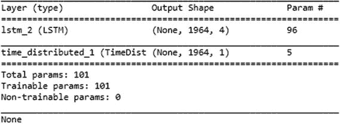
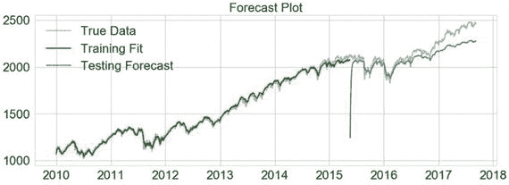
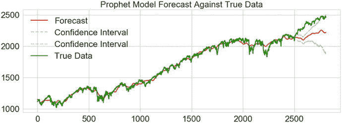
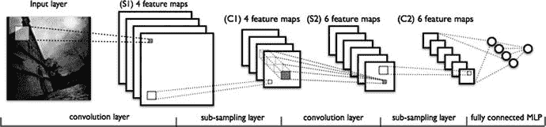
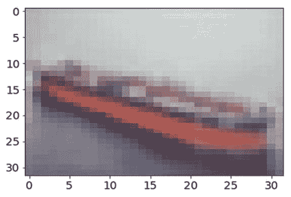

# TimeDistributedDense 对所有时间步使用相同的处理方式。
model.add(TimeDistributed(Dense(1)))
start = time.time()
model.compile(loss="mse", optimizer="rmsprop")
if verbose:
print("> 编译时间 : ", time.time() - start)
print(model.summary())
return model
```

该函数返回一个单隐藏层的 RNN 网络，包含四个 `LSTM` 单元和一个 `TimeDistributed Dense` 输出层。我们再次使用均方误差作为损失函数。

注意

`TimeDistributed` 是 `keras` 提供的一个强大但棘手的工具。你可以通过 [ `https://github.com/fchollet/keras/issues/1029` ](https://github.com/fchollet/keras/issues/1029) 和 [`https://datascience.stackexchange.com/questions/10836/the-difference-between-dense-and-timedistributeddense-of-keras`](https://datascience.stackexchange.com/questions/10836/the-difference-between-dense-and-timedistributeddense-of-keras) 了解更多信息。

我们已经对数据集进行了预处理，并将其划分为训练集和测试集，同时使用函数 `get_seq_model()` 创建了一个模型对象。下一步就是使用 `fit()` 函数来训练模型。在将股票价格信息建模为序列时，我们假设整个时间序列是一个大的序列。因此，在训练模型时，我们将批次大小设置为 1，因为本例中只有一只股票需要训练。以下代码片段获取模型对象，然后使用 `fit()` 函数对其进行训练。

```
In [2]: # 获取模型
...: seq_lstm_model = get_seq_model(input_shape=(train_x.shape[1],1),
...:                                 verbose=VERBOSE)
...:
...: # 训练模型
...: seq_lstm_model.fit(train_x, train_y,
...:                         epochs=150, batch_size=1,
...:                         verbose=2)
```

此代码片段返回一个模型对象及其摘要。我们还可以看到模型在训练数据上训练时，150 个 epoch 中每个 epoch 的输出。



图 11-17.

RNN 摘要

图 11-17 显示了 RNN 试图学习的总参数，总共 101 个。我们强烈建议您探索上一节中准备的模型摘要，结果应该会让大多数人感到惊讶（提示：这个模型需要学习的参数非常少！）。这个摘要还指向一个重要事实，即第一个 LSTM 层的形状。这清楚地表明，模型期望输入在训练和预测时都符合此形状（训练数据集的形状）。

由于我们的测试数据集较小 `(shape: (1,842,1)`)，我们需要某种方法来匹配所需的形状。在使用 RNN 对序列进行建模时，填充序列以匹配给定形状是一种常见做法。通常，在需要训练多个序列的情况下（例如，文本生成），会使用最长序列的大小，并对较短的序列进行填充以匹配它。我们这样做仅仅是为了编程上的原因，否则会丢弃填充的值（有关更多信息，请参阅 `keras` 的 masking 功能）。填充工具来自 `keras.preprocessing.sequence` 模块。以下代码片段在实际数据之后用 0 填充测试数据集（您可以选择前填充或后填充），然后使用填充后的序列进行预测/预报。我们还计算并打印了预报的 RMSE 分数。

```
In [3]: # 填充输入序列
...: testPredict = pad_sequences(test_x,
...:                                 maxlen=train_x.shape[1],
...:                                 padding='post',
...:                                 dtype='float64')
...:
...: # 预测值
...: testPredict = seq_lstm_model.predict(testPredict)
...:
...: # 评估性能
...: testScore = math.sqrt(mean_squared_error(test_y[0],
...:                         testPredict[0][:test_x.shape[1]]))
...: print('测试分数: %.2f RMSE' % (testScore))
测试分数: 0.07 RMSE
```

我们也可以在训练集上执行相同的步骤并检查性能。在生成训练和测试数据集时，函数 `get_seq_train_test()` 也返回了缩放器对象。接下来，我们使用这个缩放器对象执行逆变换，以获取原始尺度的预测值。以下代码片段执行逆变换，然后绘制序列图。



图 11-18.

使用基于 LSTM 的序列建模对 S&P 500 进行预报

```
In [4]: # 逆变换
...: trainPredict = scaler.inverse_transform(trainPredict.\
...:                                         reshape(trainPredict.shape[1]))
...: testPredict = scaler.inverse_transform(testPredict.\
...:                                         reshape(testPredict.shape[1]))
...:
...: train_size = len(trainPredict)+1
...:
...: # 绘制真实值和预测值
...: plt.plot(sp_close_series.index,
...:                 sp_close_series.values,c='black',
...:                 alpha=0.3,label='真实数据')
...:
...: plt.plot(sp_close_series.index[1:train_size],
...:                 trainPredict,
...:                 label='训练拟合',c='g')
...:
...: plt.plot(sp_close_series.index[train_size+1:],
...:                 testPredict[:test_x.shape[1]],
...:                 label='预报')
...: plt.title('预报图')
...: plt.legend()
...: plt.show()
```

图 11-18 中的预报图展示了一个令人鼓舞的画面。我们可以看到训练拟合几乎是完美的，这在意料之中。测试性能或预报也表现良好。尽管预报在某些地方偏离了实际值，但无论是 RMSE 还是拟合度，整体性能似乎都还不错。

通过使用 `TimeDistributed` 层包装器，我们实现了将此数据建模为时间序列的目标。该模型不仅在整体拟合度方面表现更好，而且需要的特征工程少得多，模型也更简单（就训练参数数量而言）。在这个模型中，我们还真正利用了 LSTM 的能力，让它学习和找出哪些以及多少过去的信息会影响预报（与我们在回归建模中限制窗口大小的情况相比）。

在结束本节之前，有两个重要点需要说明。首先，这两种模型各有优缺点。本节的目标是勾勒出对给定问题进行建模的潜在方法。实际使用主要取决于用例的需求。其次，更重要的是，这两种模型都仅用于学习/演示目的。实际的股票价格预报需要更严谨的态度和更深入的知识；我们只是触及了冰山一角。

即将推出的技术：Prophet

数据科学领域在不断发展，新的算法、调整和工具正在快速涌现。其中一种工具叫做 Prophet。这是一个由 Facebook 数据科学团队开源的分析和预报时间序列的框架。

Prophet 使用一个可以处理趋势和季节性数据的加法模型。该工具的目标是实现大规模预报。它仍处于测试阶段，但已经拥有一些非常有用的功能。更多信息请访问 [`https://facebookincubator.github.io/prophet/`](https://facebookincubator.github.io/prophet/) 。该工具背后的研究和直觉可在 [`https://facebookincubator.github.io/prophet/static/prophet_paper_20170113.pdf`](https://facebookincubator.github.io/prophet/static/prophet_paper_20170113.pdf) 的论文中找到。

安装步骤在网站上已概述，通过 `pip` 和 `conda` 安装非常简单。Prophet 还使用 `scikit` 风格的 `fit()` 和 `predict()` API，并提供了额外的工具来更好地处理时间序列数据。对于本节中的动手示例，您可以参考 jupyter notebook `notebook_stock_prediction_fbprophet.ipynb` 以获取必要的代码片段和示例。

注意

Prophet 仍处于测试阶段，正在不断变化。此外，已知其在 Windows 平台上的安装会导致问题。请使用 Anaconda 发行版中的 `conda install`（网站上提到的步骤）以避免问题。

由于我们已经将 S&P 500 指数价格信息存储在数据框/序列中。我们现在测试如何使用这个工具进行预报。我们首先将时间序列索引转换为其自己的列（这正是 prophet 期望的数据格式），然后将序列拆分为训练集和测试集（90-10 拆分）。以下代码片段执行所需的操作。

```
In [1] : # 重置索引以将日期时间作为一列
...: prophet_df = sp_df.reset_index()
...:
...: # 准备所需的数据框
...: prophet_df.rename(columns={'index':'ds','Close':'y'},inplace=True)
...: prophet_df = prophet_df[['ds','y']]
...:
...: # 准备训练集和测试集
...: train_size = int(prophet_df.shape[0]*0.9)
...: train_df = prophet_df.ix[:train_size]
...: test_df = prophet_df.ix[train_size+1:]
```

准备好数据集后，我们创建一个 `Prophet` 类的对象，然后使用 `fit()` 函数拟合模型。请注意，该模型期望时间序列值位于名为 '`y`' 的列中，时间戳位于名为 '`ds`' 的列中。为了进行预报，prophet 需要一组我们需要预报的日期。为此，它提供了一个简洁的工具，称为 `make_future_dataframe()`，该工具将预报所需的天数作为输入。以下代码片段使用此数据框来预测值。

```
In [2] : # 准备一个未来数据框
...: test_dates = pro_model.make_future_dataframe(periods=test_df.shape[0])
...:
...: # 预测值
...: forecast_df = pro_model.predict(test_dates)
```

`predict()` 函数的输出是一个数据框，其中包含样本内预测值和预报值。该数据框还包括置信区间值。所有这些都可以使用模型对象的 `plot()` 函数轻松绘制。以下代码片段绘制了预报值与原始时间序列及其置信区间的对比图。



图 11-19.

Prophet 的预报值与真实/观测值的对比

```
In [3] : # 与真实数据对比绘图
...: plt.plot(forecast_df.yhat,c='r',label='预报')
...: plt.plot(forecast_df.yhat_lower.iloc[train_size+1:],
...:                 linestyle='--',c='b',alpha=0.3,
...:                 label='置信区间')
...: plt.plot(forecast_df.yhat_upper.iloc[train_size+1:],
...:                 linestyle='--',c='b',alpha=0.3,
...:                 label='置信区间')
...: plt.plot(prophet_df.y,c='g',label='真实数据')
...: plt.legend()
...: plt.title('Prophet 模型预报与真实数据对比')
...: plt.show()
```

该模型的预报有些偏差（见图 11-19），但这个练习清楚地展示了其可能性。预报数据框提供了更多关于季节性、周趋势等的细节。我们鼓励您进一步探索。`Prophet` 基于 Stan。Stan 是一种统计建模语言/框架，它通过接口为所有主流语言（包括 `python`）提供算法。您可以在 [`http://mc-stan.org/`](http://mc-stan.org/) 了解更多信息。

总结

本章介绍了使用股票和商品价格信息进行时间序列预报和分析的概念。通过本章，我们涵盖了时间序列的基本组成部分以及预处理此类数据的常用技术。然后我们研究了黄金价格预测用例。该用例使用了 `quandl` 库来获取每日黄金价格信息。接着，我们讨论了传统的时间序列分析技术，并介绍了与 Box-Jenkins 方法论特别是 ARIMA 相关的关键概念。我们还讨论了使用 AD Fuller 检验、ACF 和 PACF 图来识别非平稳时间序列并将其转换为平稳时间序列的技术。我们基于 statsmodel API 使用 ARIMA 对黄金价格信息进行了建模，同时开发了一些关键实用函数，如 `auto_arima()` 和 `arima_gridsearch_cv()`。还讨论了关键见解和注意事项。本章的下一部分介绍了股票价格预测用例。在这里，我们使用了 `pandas_datareader` 来获取 S&P 500 每日收盘价信息。

为了解决这个用例，我们使用了基于 RNN 的模型。我们主要提供了两种不同的视角来构建预报问题，两者都使用了 LSTM。第一种公式紧密模仿了前面章节讨论的回归概念。使用了一个两层堆叠的 LSTM 网络来预报股票价格信息。第二种视角利用了 `keras` 中的 `TimeDistributed` 层包装器来实现股票价格信息的序列建模。在处理用例时，我们讨论了各种实用工具和关键概念。最后，讨论了一个即将推出的工具（仍处于测试阶段），即 Facebook 的 `Prophet`。该工具由 Facebook 的数据科学团队提供，用于执行大规模预报。我们利用该框架快速评估了其在相同股票价格信息上的性能，并分享了结果。本章介绍了多种技术和概念，以及如何构建某些时间序列问题的直觉。请继续关注下一章中更多激动人心的用例。

12. 计算机视觉深度学习

深度学习不仅仅是业界和学术界热议的关键词，它更开启了一个充满可能性的全新领域。深度学习模型正被应用于各种用例和领域，我们在前几章中已经看到了一些。深度神经网络在学习复杂的非线性函数、模式和表示方面具有巨大的潜力。它们的力量正在推动多个领域的研究，包括计算机视觉、视听分析、聊天机器人和自然语言理解等。在本章中，我们将触及计算机视觉领域的一些高级领域，这些领域随着深度学习的出现而最近变得突出。这包括图像分类和分类等实际应用，以及非常流行的图像艺术风格迁移概念。计算机视觉是关于让机器从图像和视频中理解高级有用模式和表示的艺术和科学，以便它能够像人类观察周围环境后做出智能决策一样。本章以卷积神经网络和迁移学习等核心概念为基础，通过计算机视觉的几个实际案例研究，为您提供深度学习研究前沿的一瞥。

本章通过使用公开可用的数据集（如 CIFAR、ImageNet 和 MNIST）进行图像分类任务来讨论卷积神经网络。我们将利用对 CNN 的理解来承担风格迁移的任务，并理解如何使用神经网络来理解高级特征。通过本章，我们将详细讨论以下主题：

*   卷积神经网络简要概述
*   从头开始使用 CNN 进行图像分类
*   迁移学习：使用预训练模型进行图像分类
*   使用 CNN 进行神经风格迁移

本章的代码示例、jupyter notebook 和示例数据集可在本书的 GitHub 仓库中找到，地址为 [ `https://github.com/dipanjanS/practical-machine-learning-with-python` ](https://github.com/dipanjanS/practical-machine-learning-with-python)，位于第 12 章的目录/文件夹下。

卷积神经网络

卷积神经网络（CNN）类似于我们在本书中讨论过的一般神经网络。额外的显式假设——输入是图像（张量）——使得 CNN 得到优化，并与通常的神经网络不同。正是这个显式假设使我们能够设计深度 CNN，同时控制可训练参数的数量（与一般神经网络相比）。

我们在第 1 章（“深度学习”部分）和第 4 章（“图像数据特征工程”部分）中简要提到了 CNN 的概念。然而，作为快速回顾，以下是值得重申的关键概念：

*   **卷积层**：这是 CNN 与其他神经网络相比的关键区别组件。卷积层或 conv 层是一组可学习的滤波器。这些滤波器有助于捕获空间特征。它们通常很小（沿宽度和高度），但覆盖图像的完整深度（颜色范围）。在前向传播过程中，我们将滤波器滑过图像的宽度和高度，同时计算滤波器属性与任何位置输入之间的点积。输出是来自每个滤波器的二维激活图，然后将它们堆叠起来以获得最终输出。

*   **池化层**：这些基本上是下采样层，用于减少空间大小和参数数量。这些层也有助于控制过拟合。池化层插入在卷积层之间。池化层可以使用诸如最大值、平均值、L2 范数等函数执行下采样。

*   **全连接层**：也称为 FC 层。这些类似于一般神经网络中的全连接层。它们与前一层的所有神经元都有完全连接。该层有助于执行分类任务。

*   **参数共享**：除了卷积层之外，CNN 的独特之处在于参数共享。卷积层在所有滤波器中使用相同的权重集，从而减少了所需的总参数数量。

一个包含所有组件的典型 CNN 架构如图 12-1 所示，这是一个 LeNet CNN 模型（来源：`deeplearning.net`）。



图 12-1.

LeNet CNN 模型（来源：deeplearning.net）

CNN 已被深入研究，并且不断得到改进和实验。要深入了解 CNN，请参考诸如斯坦福大学的课程，网址为 [`http://cs231n.github.io/convolutional-networks`](http://cs231n.github.io/convolutional-networks)。

使用 CNN 进行图像分类

卷积神经网络是神经网络从图像中学习详细特征表示和模式并执行复杂任务（从对象识别到图像分类等等）的潜力和力量的主要例子。CNN 经历了巨大的研究，进步导致了更复杂和强大的架构，如 VGG-16、VGG-19、Inception V3 以及许多其他有趣的模型。

我们首先通过解决一个图像分类问题来获得一些 CNN 的实践经验。我们在第 4 章中通过 notebook `Bonus - Classifying handwritten digits using Deep CNNs.ipynb` 分享了一个基于 CNN 的分类示例，该示例讨论了通过利用基于 CNN 的深度学习来分类和预测人类手写数字。如果您还没有看过，请不要担心，因为我们将在本文中详细介绍一个示例。对于我们的深度学习需求，我们将使用带有 `tensorflow` 后端的 keras 框架，类似于我们在前几章中使用的方式。

问题陈述

给定一组包含真实世界对象的图像，人类很容易识别它们。我们这里的任务是构建一个多类（10 个类或类别）图像分类器，该分类器可以识别给定图像的正确类别标签。对于此任务，我们将使用 `CIFAR10` 数据集。

数据集

`CIFAR10` 数据集是一个包含跨越 10 个不同类别的带标签小图像的集合。该数据集由 Alex Krizhevsky、Vinod Nair 和 Geoffrey Hinton 收集，可在 [ `https://www.cs.toronto.edu/~kriz/cifar.html` ](https://www.cs.toronto.edu/%7Ekriz/cifar.html) 以及通过 keras 中的 datasets 模块获得。

该数据集包含大小为 32 x 32 的小图像，有 50,000 个训练样本和 10,000 个测试样本。每个图像只能属于以下类别之一。

*   汽车
*   飞机
*   鸟
*   猫
*   鹿
*   狗
*   青蛙
*   马
*   船
*   卡车

每个类别是互斥的。还有一个更大的版本称为 `CIFAR100`。出于本节的目的，我们将考虑 `CIFAR10` 数据集。

我们将通过 `keras.datasets` 模块访问 `CIFAR10` 数据集。如果所需文件不存在，请下载它们。

从头开始构建基于 CNN 的深度学习分类器

与任何机器学习算法类似，神经网络也需要输入数据具有特定的形状、大小和类型。因此，在进入建模步骤之前，首先要做的是对数据本身进行预处理。以下代码片段获取数据集，然后对标签执行独热编码。请记住，有 10 个类别需要处理，因此我们处理的是一个多类分类问题。

```
In [1]: import keras
...: from keras.datasets import cifar10
...:
...: num_classes = 10
...:
...: (x_train, y_train), (x_test, y_test) = cifar10.load_data()
...:
...: # 将类别向量转换为二进制类别矩阵
...: y_train = keras.utils.to_categorical(y_train, num_classes)
...: y_test = keras.utils.to_categorical(y_test, num_classes)
```

如果数据集尚未在本地存在，则会自动下载。以下是所获得对象的形状。

```
In [2]: print('x_train 形状:', x_train.shape)
...: print(x_train.shape[0], '训练样本')
...: print(x_test.shape[0], '测试样本')
...:
x_train 形状: (50000, 32, 32, 3)
50000 训练样本
10000 测试样本
```

现在我们有了训练和测试数据集。下一步是构建 CNN 模型。由于我们有二维图像（第三维是通道信息），我们将使用 `Conv2D` 层。正如前一节所讨论的，CNN 使用卷积层和池化层的组合，后跟一个全连接端来识别/分类数据。模型架构构建如下。

```
In [3]: model = Sequential()
...: model.add(Conv2D(32, kernel_size=(3, 3),
...:                         activation='relu',
...:                         input_shape=input_shape))
...: model.add(Conv2D(64, (3, 3), activation='relu'))
...: model.add(MaxPooling2D(pool_size=(2, 2)))
...: model.add(Dropout(0.25))
...: model.add(Flatten())
...: model.add(Dense(128, activation='relu'))
...: model.add(Dropout(0.5))
...: model.add(Dense(num_classes, activation='softmax'))
```

它从一个卷积层开始，总共有 32 个 3 x 3 滤波器，激活函数为修正线性单元（`relu`）。输入形状对应于每个图像的大小，即 32 x 32 x 3（彩色图像有三个通道——RGB）。接着是另一个卷积层和一个最大池化层。最后，我们有全连接密集层。由于我们有 10 个类别可供选择，最终输出层具有 `softmax` 激活函数。

下一步涉及编译。我们使用 `categorical_crossentropy` 作为损失函数，因为我们处理的是多个类别。除此之外，我们使用 Adadelta 优化器，然后在训练数据上训练分类器。以下代码片段展示了这一点。

```
In [4]: model.compile(loss=keras.losses.categorical_crossentropy,
...:                 optimizer=keras.optimizers.Adadelta(),
...:                 metrics=['accuracy'])
...:
...: model.fit(x_train, y_train,
...:                 batch_size=batch_size,
...:                 epochs=epochs,
...:                 verbose=1)
Epoch 1/10
50000/50000 [==============================] - 256s - loss: 7.3118 - acc: 0.1798
Epoch 2/10
50000/50000 [==============================] - 250s - loss: 1.7923 - acc: 0.3564
Epoch 3/10
50000/50000 [==============================] - 252s - loss: 1.5781 - acc: 0.4383
...
Epoch 9/10
50000/50000 [==============================] - 251s - loss: 1.1019 - acc: 0.6163
Epoch 10/10
50000/50000 [==============================] - 254s - loss: 1.0584 - acc: 0.6284
```

从上面的输出可以清楚地看出，我们训练了模型 10 个 epoch。这在 CPU 上需要 200-400 秒，使用 GPU 时性能会成倍提高。根据最后一个 epoch，我们可以看到准确率约为 63%。我们现在将评估测试性能，这使用模型对象的 evaluate 函数进行检查。结果如下。

```
测试损失: 1.10143025074
测试准确率: 0.6354
```

因此，我们可以看到，我们非常简单的基于 CNN 的深度学习模型达到了 63.5% 的准确率，考虑到我们构建了一个非常简单的模型，并且没有进行太多预处理或模型调优。我们鼓励您尝试不同的 CNN 架构，并进行超参数调优实验，看看如何改进结果。

模型的前几个卷积层大致用于特征提取，而最后几层（全连接层）有助于对数据进行分类。因此，看看我们刚刚创建的 `conv-net` 如何处理图像数据将会很有趣。幸运的是，keras 提供了在模型中间步骤提取信息的钩子。它们展示了图像的各个区域如何激活卷积层，以及如何提取相应的特征表示和模式。



图 12-2.

来自 CIFAR10 数据集的示例图像

CNN 如何查看图像的示例流程在 notebook `notebook_cnn_cifar10_classifier.ipynb` 中进行了说明。它包含了本节讨论的其余代码。图 12-2 显示了来自测试数据集的一张图像。它看起来像一艘船，模型也正确地识别了它，如下面的代码片段所示。

```


