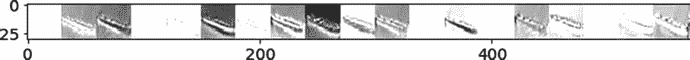
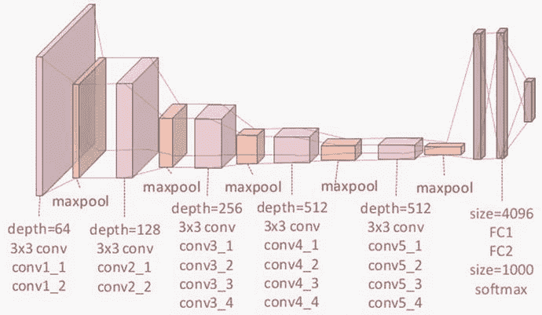
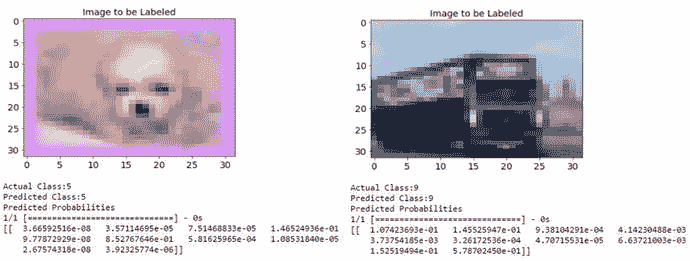
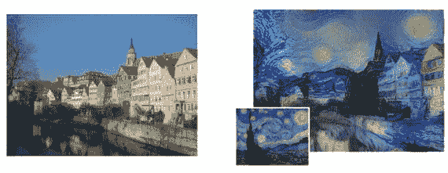
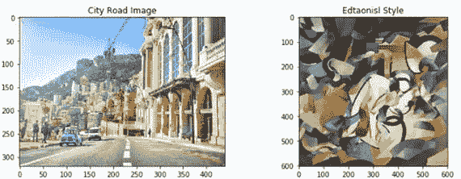
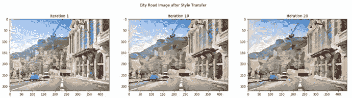
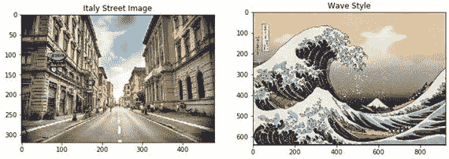
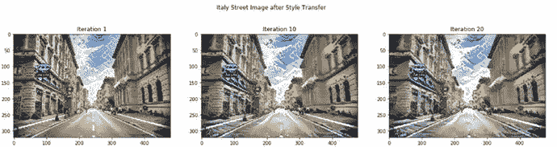

# 使用我们的模型预测标签
In [6]: test_image =np.expand_dims(x_test[img_idx], axis=0)
...: model.predict_classes(test_image,batch_size=1)
1/1 [==============================] - 0s
Out[16]:
array([8], dtype=int64)
```

你可以根据卷积层学习并提取的表征，使用笔记本中的 `get_activations(...)` 和 `display_activations(...)` 函数来提取并查看图像的激活图。图 12-3 展示了我们刚刚构建的 CNN 模型初始卷积层的激活情况。



图 12-3.

通过 CNN 层的样本图像

我们还建议你阅读第 4 章中“使用深度学习进行自动化特征工程”一节，以了解更多关于使用卷积层从图像中提取特征表示的内容。

基于 CNN 的深度学习分类器与预训练模型

从头构建分类器有其自身的优缺点。然而，一种更精细的方法是利用在大型复杂数据集上预训练的模型。有许多著名的 CNN 架构，如 LeNet、ResNet、VGG-16、VGG-19 等。这些模型具有深度且复杂的架构，已经在多样化的大型数据集上进行了微调和训练。因此，这些模型已被证明在复杂的物体识别任务上具有出色的性能。

由于获取大型标注数据集并训练高度复杂和深度神经网络是一项耗时的任务（即使使用 GPU，训练像 VGG-19 这样复杂的 CNN 也可能需要几周时间）。在实践中，我们利用一个概念，正式术语称为迁移学习。这种迁移学习的概念帮助我们利用现有模型来完成我们的任务。其核心思想是利用模型从大型数据集中学习到的知识，然后通过重用同一模型从新图像中提取特征表示来迁移这种学习。执行迁移学习有几种策略，其中一些如下所述：

*   **预训练模型作为特征提取器**：使用预训练模型为我们的数据集提取特征。我们在这些特征之上构建一个全连接分类器。在这种情况下，我们只需要训练全连接分类器，这不会花费太多时间。

*   **微调预训练模型**：可以通过固定某些层并允许其他层（除了全连接层）学习/更新权重来微调现有的预训练模型。通常观察到，初始层捕获通用特征，而较深的层在特征提取方面变得更加具体。因此，根据需求，我们固定某些层并微调其余层。

在本节中，我们将看到一个示例，其中我们将利用预训练的卷积网络作为特征提取器，在其上构建基于全连接层的分类器并训练模型。我们不会训练特征提取层，因此通过使用预训练的卷积层进行特征提取来利用迁移学习的原理。

牛津大学视觉几何组的 VGG-19 模型是一种最先进的卷积神经网络。它已被证明在各种基准测试和竞赛中表现极其出色。VGG19 是一个在 `ImageNet` 数据集上训练的 19 层卷积网络。`ImageNet` 是一个包含手工标注图像的视觉数据库，数量达 1000 万，涵盖 9000 多个类别。该模型已被广泛研究并用于迁移学习等任务。

注意

有关 VGG 组此项及其他研究的更多详细信息，请访问 [`http://www.robots.ox.ac.uk/~vgg/research/very_deep/`](http://www.robots.ox.ac.uk/%7Evgg/research/very_deep/)。

这个预训练模型可通过 `keras.applications` 模块获得。如前所述，我们将利用 VGG-19 作为特征提取器，帮助我们构建一个基于 `CIFAR10` 数据集的分类器。

由于我们将使用 VGG-19 进行特征提取，我们不需要该模型的顶层（或全连接层）。keras 使这变得非常简单，只需将单个标志值设置为 `False`。以下代码片段加载了包含卷积层但不包含全连接层的 `VGG-19` 模型架构。

```
In [1]: from keras import applications
...:
...: vgg_model = applications.VGG19(include_top=False, weights='imagenet')
```

现在预训练模型已可用，我们将利用它从我们的训练数据集中提取特征。请记住，VGG-19 是在 `ImageNet` 上训练的，而我们将使用 `CIFAR10` 来构建分类器。由于 ImageNet 包含超过 1000 万张图像，涵盖 9000 多个类别，可以安全地假设 `CIFAR10` 的类别是其子集。在使用 VGG-19 模型进行特征提取之前，最好先查看一下模型的架构。

```
In [1]: vgg_model.summary()
_________________________________________________________________
Layer (type)                 Output Shape              Param #
=================================================================
input_1 (InputLayer)         (None, None, None, 3)     0
_________________________________________________________________
block1_conv1 (Conv2D)        (None, None, None, 64)    1792
_________________________________________________________________
block1_conv2 (Conv2D)        (None, None, None, 64)    36928
_________________________________________________________________
block1_pool (MaxPooling2D)   (None, None, None, 64)    0
_________________________________________________________________
block2_conv1 (Conv2D)        (None, None, None, 128)   73856
_________________________________________________________________
block2_conv2 (Conv2D)        (None, None, None, 128)   147584
_________________________________________________________________
block2_pool (MaxPooling2D)   (None, None, None, 128)   0
_________________________________________________________________
block3_conv1 (Conv2D)        (None, None, None, 256)   295168
_________________________________________________________________
block3_conv2 (Conv2D)        (None, None, None, 256)   590080
_________________________________________________________________
block3_conv3 (Conv2D)        (None, None, None, 256)   590080
_________________________________________________________________
block3_conv4 (Conv2D)        (None, None, None, 256)   590080
_________________________________________________________________
block3_pool (MaxPooling2D)   (None, None, None, 256)   0
_________________________________________________________________
block4_conv1 (Conv2D)        (None, None, None, 512)   1180160
_________________________________________________________________
block4_conv2 (Conv2D)        (None, None, None, 512)   2359808
_________________________________________________________________
block4_conv3 (Conv2D)        (None, None, None, 512)   2359808
_________________________________________________________________
block4_conv4 (Conv2D)        (None, None, None, 512)   2359808
_________________________________________________________________
block4_pool (MaxPooling2D)   (None, None, None, 512)   0
_________________________________________________________________
block5_conv1 (Conv2D)        (None, None, None, 512)   2359808
_________________________________________________________________
block5_conv2 (Conv2D)        (None, None, None, 512)   2359808
_________________________________________________________________
block5_conv3 (Conv2D)        (None, None, None, 512)   2359808
_________________________________________________________________
block5_conv4 (Conv2D)        (None, None, None, 512)   2359808
_________________________________________________________________
block5_pool (MaxPooling2D)   (None, None, None, 512)   0
=================================================================
Total params: 20,024,384
Trainable params: 20,024,384
Non-trainable params: 0
_________________________________________________________________
```

从上面的输出可以看出，该架构非常庞大，包含很多层。图 12-4 以更易于理解的视觉方式描绘了所有层。请记住，我们不使用图 12-4 最右侧描绘的全连接层。我们建议阅读由牛津大学工程科学系视觉几何组的 [Karen Simonyan](https://arxiv.org/find/cs/1/au:+Simonyan_K/0/1/0/all/0/1) 和 [Andrew Zisserman](https://arxiv.org/find/cs/1/au:+Zisserman_A/0/1/0/all/0/1) 撰写的论文《用于大规模图像识别的深度卷积网络》。该论文可在 [`https://arxiv.org/abs/1409.1556`](https://arxiv.org/abs/1409.1556) 获取，并详细讨论了这些模型的架构。



图 12-4.

VGG-19 架构的视觉描绘

加载 `CIFAR10` 训练和测试数据集的方法与上一节讨论的相同。我们也对标签执行类似的独热编码。由于 VGG19 模型是在没有最终全连接层的情况下加载的，模型的 `predict(...)` 函数帮助我们获取数据集上的提取特征。以下代码片段提取了训练和测试数据集的特征。

```
In [2]: bottleneck_features_train = vgg_model.predict(x_train, verbose=1)
...: bottleneck_features_test = vgg_model.predict(x_test, verbose=1)
```

这些特征被广泛称为瓶颈特征，因为输入数据点的总体积有所减少。值得探索模型摘要以了解 VGG 模型如何转换数据。此阶段的输出（瓶颈特征）将用作我们接下来要构建的分类器的输入。以下代码片段构建了一个简单的全连接两层分类器。

```
In [3]: clf_model = Sequential()
...: clf_model.add(Flatten(input_shape=bottleneck_features_train.shape[1:]))
...: clf_model.add(Dense(512, activation='relu'))
...: clf_model.add(Dropout(0.5))
...: clf_model.add(Dense(256, activation='relu'))
...: clf_model.add(Dropout(0.5))
...: clf_model.add(Dense(num_classes, activation='softmax'))
...: clf_model.compile(loss=keras.losses.categorical_crossentropy,
optimizer=keras.optimizers.Adadelta(),
metrics=['accuracy'])
```

模型的输入层匹配瓶颈特征的维度（原因显而易见）。与我们从头构建的 CNN 模型一样，该模型也有一个带有 `softmax` 激活函数的密集输出层。与训练完整的 `VGG19` 相比，训练此模型相当简单且快速，如下面的代码片段所示。

```
In [4]: clf_model.fit(bottleneck_features_train, y_train, batch_size=batch_size,
...:               epochs=epochs, verbose=1)
Epoch 1/50
50000/50000 [==============================] - 8s - loss: 7.2495 - acc: 0.2799
Epoch 2/50
50000/50000 [==============================] - 7s - loss: 2.2513 - acc: 0.2768
Epoch 3/50
50000/50000 [==============================] - 7s - loss: 1.9096 - acc: 0.3521
...
Epoch 48/50
50000/50000 [==============================] - 8s - loss: 0.9368 - acc: 0.6814
Epoch 49/50
50000/50000 [==============================] - 8s - loss: 0.9223 - acc: 0.6832
Epoch 50/50
50000/50000 [==============================] - 8s - loss: 0.9197 - acc: 0.6830
```

我们可以添加钩子，根据提前停止标准等来提前停止训练。但现在，我们保持简单。本节完整代码可在笔记本 `notebook_pretrained_cnn_cifar10_classifier.ipynb` 中找到。总体而言，我们在训练数据集上达到了 68% 的准确率，在测试数据集上达到了约 64% 的准确率。

现在你将看到这个基于预训练模型构建的分类器在测试数据集上的性能。以下代码片段展示了一个实用函数，该函数将测试数据集中图像的索引号作为输入，并比较实际标签和预测标签。

```
def predict_label(img_idx,show_proba=True):
plt.imshow(x_test[img_idx],aspect='auto')
plt.title("Image to be Labeled")
plt.show()
print("Actual Class:{}".format(np.nonzero(y_test[img_idx])[0][0]))
test_image =np.expand_dims(x_test[img_idx], axis=0)
bf = vgg_model.predict(test_image,verbose=0)
pred_label = clf_model.predict_classes(bf,batch_size=1,verbose=0)
print("Predicted Class:{}".format(pred_label[0]))
if show_proba:
print("Predicted Probabilities")
print(clf_model.predict_proba(bf))
```

以下是 `predict_label(...)` 函数在测试数据集中的几张图像上测试时的输出。如图 12-5 所示，我们正确预测了图像属于类别标签 5（狗）和 9（卡车）！



图 12-5.

基于预训练 CNN 的分类器预测的标签

本节展示了迁移学习的强大功能和优势。无需花费时间重新发明轮子，只需几行代码，我们就能够利用最先进的神经网络完成我们的分类任务。

迁移学习的概念构成了神经风格迁移的基础，我们将在下一节中讨论。

使用 CNN 进行艺术风格迁移

绘画（或就此而言的任何艺术形式）需要少数人掌握的特殊技能。绘画呈现出内容与风格的复杂相互作用。而照片则是视角与光线的结合。当两者结合时，结果令人惊叹且出乎意料。图 12-6 展示了这样一个例子。



图 12-6.

左图：描绘德国图宾根内卡河畔的原始照片。右图：为相应生成图像提供风格的画作（插图：文森特·梵高的《星月夜》）。来源：A Neural Algorithm of Artistic Style, Gatys et al. (arXiv:1508.06576v2)

图 12-6 中的结果展示了如何将一幅画作（梵高的《星月夜》）的风格迁移到一张内卡河畔的照片上。乍一看，这个过程似乎从照片中提取了内容，从画作中提取了风格、色彩和笔触模式，并生成了最终结果。结果令人惊叹，但更令人惊讶的是，这是如何做到的？

图 12-6 展示了一个称为艺术风格迁移的过程。该过程是 Gatys 等人研究的成果，并在他们的论文《A Neural Algorithm for Artistic Style》中提出。在本节中，我们从实现的角度讨论这篇论文的细节，并看看如何自己执行这项技术。

注意

 Prisma 是一款使用基于卷积神经网络的**艺术风格迁移**技术将照片转化为艺术作品的应用程序。有关该应用的更多信息，请访问 [`https://prisma-ai.com/`](https://prisma-ai.com/)。

背景

正式地，神经风格迁移是将参考图像的“风格”应用于特定目标图像的过程，在此过程中，目标图像的原始“内容”保持不变。这里，风格定义为参考图像中存在的颜色、图案和纹理，而内容定义为图像的整体结构和高级组件。

这里的主要目标是保留原始目标图像的内容，同时将参考图像的风格叠加或采用到目标图像上。为了在数学上定义这个概念，考虑三个图像——原始内容（记为 c）、参考风格（记为 s）和生成图像（记为 g）。因此，我们需要一种方法来衡量图像 c 和 g 在内容上的差异。如果 c 和 g 完全不同，则趋于 0 的函数，否则增长。这可以简洁地表示为损失函数：

L [内容] = distance(c, g)

其中 distance 是像 L2 这样的范数函数。同样，我们可以定义另一个函数来捕捉图像 s 和 g 在风格上的差异。换句话说，这可以表示为：

L [风格] = distance(s, g)

因此，对于神经风格迁移的整个过程，我们有一个总体损失函数，可以定义为内容损失函数和风格损失函数的组合。

L [风格迁移] = argmin [g] (αL [内容] (c, g) + βL [风格] (s, g))

其中 α 和 β 是用于控制内容和风格组件对总体损失影响的权重。我们将尝试最小化的损失函数由三部分组成，即内容损失、风格损失和总变差损失，我们稍后将讨论这些。

深度学习的美妙之处在于，通过利用深度卷积神经网络（CNN）等架构，我们可以在数学上定义上述风格和内容函数。我们将使用迁移学习的原理来构建我们的神经风格迁移系统。我们之前介绍了使用预训练深度 CNN 模型（如 VGG-19）进行迁移学习的概念。我们将利用相同的预训练模型来完成神经风格迁移的任务。主要步骤如下所述。

*   利用 VGG-19 帮助计算风格图像、内容图像和生成图像的层激活。

*   使用这些激活来定义前面提到的特定损失函数。

*   最后，使用梯度下降来最小化总体损失。

我们建议你跟随本节，使用名为 `Neural Style Transfer.ipynb` 的笔记本，其中包含风格迁移过程的逐步细节。我们还要特别感谢 François Chollet 和 Harish Narayanan 提供了关于风格迁移的一些优秀资源。具体细节将在后面提到。我们还建议你查看以下论文（详细链接将在后面分享）。

*   [Leon A.​ Gatys](https://arxiv.org/find/cs/1/au:+Gatys_L/0/1/0/all/0/1)、[Alexander S.​ Ecker](https://arxiv.org/find/cs/1/au:+Ecker_A/0/1/0/all/0/1) 和 [Matthias Bethge](https://arxiv.org/find/cs/1/au:+Bethge_M/0/1/0/all/0/1) 的《A Neural Algorithm of Artistic Style》

*   [Justin Johnson](https://arxiv.org/find/cs/1/au:+Johnson_J/0/1/0/all/0/1)、[Alexandre Alahi](https://arxiv.org/find/cs/1/au:+Alahi_A/0/1/0/all/0/1) 和 [Li Fei-Fei](https://arxiv.org/find/cs/1/au:+Fei_Fei_L/0/1/0/all/0/1) 的《Perceptual Losses for Real-Time Style Transfer and Super-Resolution》

预处理

实现此类网络的首要步骤是预处理数据（在本例中为图像）。以下是用于调整图像大小和通道的快速预处理工具。

```
import numpy as np
from keras.applications import vgg19
from keras.preprocessing.image import load_img, img_to_array
def preprocess_image(image_path, height=None, width=None):
height = 400 if not height else height
width = width if width else int(width * height / height)
img = load_img(image_path, target_size=(height, width))
img = img_to_array(img)
img = np.expand_dims(img, axis=0)
img = vgg19.preprocess_input(img)
return img
def deprocess_image(x):
```


# 通过均值像素去除零中心化
x[:, :, 0] += 103.939
x[:, :, 1] += 116.779
x[:, :, 2] += 123.68

# 'BGR'->'RGB'
x = x[:, :, ::-1]
x = np.clip(x, 0, 255).astype('uint8')
return x
```

由于我们需要编写自定义损失函数和操作例程，因此需要定义某些占位符。Keras 是一个高级库，它利用张量操作后端（如 `tensorflow`、`theano` 和 `CNTK`）来执行繁重的工作。因此，这些占位符提供了高级抽象，以便与底层张量对象协同工作。以下代码片段为风格图像、内容图像和生成图像以及神经网络的输入张量准备了占位符。

```
In [1]: # 这是你想要转换的图像路径。
...: TARGET_IMG = 'data/city_road.jpg'
...: # 这是风格图像的路径。
...: REFERENCE_STYLE_IMG = 'data/style2.png'
...:
...: width, height = load_img(TARGET_IMG).size
...: img_height = 320
...: img_width = int(width * img_height / height)
...:
...:
...: target_image = K.constant(preprocess_image(TARGET_IMG,
...:                                                 height=img_height,
...:                                                 width=img_width))
...: style_image = K.constant(preprocess_image(REFERENCE_STYLE_IMG,
...:                                                 height=img_height,
...:                                                 width=img_width))
...:
...: # 我们生成图像的占位符
...: generated_image = K.placeholder((1, img_height, img_width, 3))
...:
...: # 将三张图像合并为一个批次
...: input_tensor = K.concatenate([target_image,
...:                                 style_image,
...:                                 generated_image], axis=0)
```

我们将像上一节那样加载预训练的 VGG-19 模型，即不包含顶部的全连接层。唯一的区别在于，我们需要向模型构造函数提供输入张量的尺寸维度。以下代码片段获取了预训练模型。

```
In [2]: model = vgg19.VGG19(input_tensor=input_tensor,
...:                         weights='imagenet',
...:                         include_top=False)
```

你可以使用 `summary()` 函数来了解预训练模型的架构。

损失
函数

正如背景小节中所讨论的，神经风格迁移问题的核心在于内容损失函数和风格损失函数。在本小节中，我们将讨论并定义所需的损失函数。

内容损失

在任何基于 CNN 的模型中，来自顶层激活包含更多全局和抽象信息（如人脸等高级结构），而底层则包含关于图像的局部信息（如眼睛、鼻子、边缘和角落等低级结构）。我们希望利用 CNN 的顶层来捕获图像内容的正确表征。

因此，对于内容损失，考虑到我们将使用预训练的 VGG-19 CNN，我们可以将损失函数定义为：在目标图像上计算的顶层（提供特征表征）激活与在生成图像上计算的同一层激活之间的 L2 范数（缩放并平方后的欧几里得距离）。假设我们通常从 CNN 的顶层获得与图像内容相关的特征表征，那么生成的图像预计将与基础目标图像相似。以下代码片段展示了计算内容损失的函数。

```
def content_loss(base, combination):
return K.sum(K.square(combination - base))
```

风格损失

关于神经风格迁移的原始论文——Gatys 等人所著的《一种艺术风格的神经算法》——利用了 CNN 中的多个卷积层（而非单个层），从参考风格图像中提取有意义的模式和表征，这些表征捕获了与外观或风格相关的信息，且跨越所有空间尺度，与图像内容无关。

遵循原始论文的思路，我们将利用 Gram 矩阵，并在卷积层生成的特征表征上计算该矩阵。Gram 矩阵计算任意给定卷积层中产生的特征图之间的内积。内积项与相应特征集的协方差成正比，因此能够捕获某一层中倾向于共同激活的特征之间的相关性模式。这些特征相关性有助于捕获特定空间尺度上模式的相关聚合统计信息，这些统计信息对应于风格、纹理和外观，而非图像中的组成部分和物体。

因此，风格损失被定义为参考风格图像与生成图像的 Gram 矩阵之差的缩放并平方后的 Frobenius 范数。最小化此损失有助于确保参考风格图像中不同空间尺度上的纹理在生成图像中相似。

因此，以下代码片段定义了一个基于 Gram 矩阵计算的风格损失函数。

```
def style_loss(style, combination, height, width):
def build_gram_matrix(x):
features = K.batch_flatten(K.permute_dimensions(x, (2, 0, 1)))
gram_matrix = K.dot(features, K.transpose(features))
return gram_matrix
S = build_gram_matrix(style)
C = build_gram_matrix(combination)
channels = 3
size = height * width
return K.sum(K.square(S - C)) / (4\. * (channels ** 2) * (size ** 2))
```

总变差损失

人们观察到，仅优化风格损失和内容损失会导致输出图像高度像素化和充满噪声。为了解决这个问题，引入了总变差损失。

总变差损失类似于正则化损失。引入它是为了确保生成图像的空间连续性和平滑性，避免产生噪声过多或过度像素化的结果。该损失在以下函数中定义。

```
def total_variation_loss(x):
a = K.square(
x[:, :img_height - 1, :img_width - 1, :] - x[:, 1:, :img_width - 1, :])
b = K.square(
x[:, :img_height - 1, :img_width - 1, :] - x[:, :img_height - 1, 1:, :])
return K.sum(K.pow(a + b, 1.25))
```

总体损失函数

在定义了神经风格迁移总体损失函数的各个组成部分之后，下一步是将这些构建块组合起来。由于 CNN 在网络的不同深度捕获内容和风格信息，我们需要在适当的层上为每种类型的损失应用并计算损失。利用 Gatys 等人和 Johnson 等人在各自论文中的见解和研究，我们定义了以下实用函数，用于从 VGG-19 模型中识别内容层和风格层。尽管 Johnson 等人利用 VGG-16 模型以获得更快更好的性能，但为了便于理解和跨运行的一致性，我们仍局限于使用 VGG-19 模型。

```

# 定义函数，根据源论文设置层
def set_cnn_layers(source='gatys'):
if source == 'gatys':

# 来自 Gatys 等人的配置
content_layer = 'block5_conv2'
style_layers = ['block1_conv1', 'block2_conv1', 'block3_conv1',
'block4_conv1', 'block5_conv1']
elif source == 'johnson':

# 来自 Johnson 等人的配置
content_layer = 'block2_conv2'
style_layers = ['block1_conv2', 'block2_conv2', 'block3_conv3',
'block4_conv3', 'block5_conv3']
else:


# 默认使用 Gatys 配置
content_layer = 'block5_conv2'
style_layers = ['block1_conv1', 'block2_conv1', 'block3_conv1',
'block4_conv1', 'block5_conv1']
return content_layer, style_layers
```

以下代码片段
  随后
基于从 `set_cnn_layers()` 函数中选择的内容和风格层，应用整体损失函数。

```
In [2]: # 加权平均损失函数的权重
...: content_weight = 0.025
...: style_weight = 1.0
...: total_variation_weight = 1e-4
...:
...: # 设置所遵循的源研究论文，并设置内容和风格层
...: source_paper = 'gatys'
...: content_layer, style_layers = set_cnn_layers(source=source_paper)
...:
...: ## 构建加权损失函数
...:
...: # 初始化总损失
...: loss = K.variable(0.)
...:
...: # 添加内容损失
...: layer_features = layers[content_layer]
...: target_image_features = layer_features[0, :, :, :]
...: combination_features = layer_features[2, :, :, :]
...: loss += content_weight * content_loss(target_image_features,
...:                                         combination_features)
...:
...: # 添加风格损失
...: for layer_name in style_layers:
...: layer_features = layers[layer_name]
...: style_reference_features = layer_features[1, :, :, :]
...: combination_features = layer_features[2, :, :, :]
...: sl = style_loss(style_reference_features, combination_features,
...:                 height=img_height, width=img_width)
...: loss += (style_weight / len(style_layers)) * sl
...:
...: # 添加总变差损失
...: loss += total_variation_weight * total_variation_loss(generated_image)
```

自定义优化器

目标是通过优化算法迭代地最小化整体损失。在 Gatys 等人的论文中，使用 L-BFGS 算法进行优化，这是一种基于**拟牛顿法**的优化算法，广泛用于解决非线性优化问题和参数估计。该方法通常比**标准梯度下降法**收敛更快。`SciPy` 在 `scipy.optimize.fmin_l_bfgs_b()` 中提供了实现。然而，其局限性包括该函数仅适用于扁平的一维向量，而非我们正在处理的三维图像矩阵，并且损失函数值和梯度需要作为两个独立的函数传递。

我们基于 `keras` 创建者 François Chollet 遵循的模式构建了一个 `Evaluator` 类，以在一次调用中同时计算损失值和梯度值，而不是进行独立且分离的计算。这将在第一次调用时返回损失值，并缓存梯度以供下一次调用。因此，这比独立计算两者更高效。以下代码片段定义了 `Evaluator` 类。

```
class Evaluator(object):
def __init__(self, height=None, width=None):
self.loss_value = None
self.grads_values = None
self.height = height
self.width = width
def loss(self, x):
assert self.loss_value is None
x = x.reshape((1, self.height, self.width, 3))
outs = fetch_loss_and_grads([x])
loss_value = outs[0]
grad_values = outs[1].flatten().astype('float64')
self.loss_value = loss_value
self.grad_values = grad_values
return self.loss_value
def grads(self, x):
assert self.loss_value is not None
grad_values = np.copy(self.grad_values)
self.loss_value = None
self.grad_values = None
return grad_values
```

损失和梯度按如下方式获取。该代码片段还创建了一个 `Evaluator` 类的对象。

```
In [3]: # 获取生成图像相对于损失的梯度
...: grads = K.gradients(loss, generated_image)[0]
...:
...: # 获取当前损失和当前梯度值的函数
...: fetch_loss_and_grads = K.function([generated_image], [loss, grads])
...:
...: # evaluator 对象
...: evaluator = Evaluator(height=img_height, width=img_width)
```

风格迁移实战

最后一步是使用所有构建模块，观察风格迁移的实际效果。艺术/风格图像和内容图像可在数据目录中参考。以下代码片段概述了如何评估损失和梯度。我们还会在固定间隔（例如第 5、10 次迭代等）后写回输出，以便后续理解神经风格迁移过程如何转换所考虑的图像。

```
In [4]: result_prefix = 'style_transfer_result_'+TARGET_IMG.split('.')[0]
...: result_prefix = result_prefix+'_'+source_paper
...: iterations = 20
...:
...: # 在生成图像的像素上运行基于 scipy 的优化（L-BFGS）
...: # 以最小化神经风格损失。
...: # 这是我们的初始状态：目标图像。
...: # 注意 `scipy.optimize.fmin_l_bfgs_b` 只能处理扁平向量。
...: x = preprocess_image(TARGET_IMG, height=img_height, width=img_width)
...: x = x.flatten()
...:
...: for i in range(iterations):
...:         print('开始迭代', (i+1))
...:         start_time = time.time()
...:         x, min_val, info = fmin_l_bfgs_b(evaluator.loss, x,
...:                                 fprime=evaluator.grads, maxfun=20)
...:         print('当前损失值:', min_val)
...:         if (i+1) % 5 == 0 or i == 0:
...:                 # 每 5 次迭代保存一次当前生成的图像
...:                 img = x.copy().reshape((img_height, img_width, 3))
...:                 img = deprocess_image(img)
...:                 fname = result_prefix + '_at_iteration_%d.png' %(i+1)
...:                 imsave(fname, img)
...:                 print('图像已保存为', fname)
...:         end_time = time.time()
...:         print('迭代 %d 在 %ds 内完成' % (i+1, end_time - start_time))
```

现在应该很明显，神经风格迁移是一项计算密集型任务。对于所考虑的这组图像，在配备 8GB RAM 的 Intel i5 CPU 上，每次迭代耗时 500 到 1000 秒。平均而言，每次迭代大约需要 500 秒，但如果同时运行多个网络，每次迭代可能需要长达 1000 秒。如果使用 GPU 执行相同操作，您可能会观察到速度提升。以下是部分迭代的输出。我们打印每次迭代的损失和耗时，并在五次迭代后保存图像。

```
开始迭代 1
当前损失值: 2.4219e+09
图像已保存为 style_transfer_result_city_road_gatys_at_iteration_1.png
迭代 1 在 506s 内完成
开始迭代 2
当前损失值: 9.58614e+08
迭代 2 在 542s 内完成
开始迭代 3
当前损失值: 6.3843e+08
迭代 3 在 854s 内完成
开始迭代 4
当前损失值: 4.91831e+08
迭代 4 在 727s 内完成
开始迭代 5
当前损失值: 4.03013e+08
图像已保存为 style_transfer_result_city_road_gatys_at_iteration_5.png
迭代 5 在 878s 内完成
...
开始迭代 19
当前损失值: 1.62501e+08
迭代 19 在 836s 内完成
开始迭代 20
当前损失值: 1.5698e+08
图像已保存为 style_transfer_result_city_road_gatys_at_iteration_20.png
迭代 20 在 838s 内完成
```

现在您将了解神经风格迁移如何对所考虑的图像发挥作用。请记住，我们为每对风格和内容图像在特定迭代后执行了检查点输出。

注意

我们用于第一张图像的风格，如图 12-7 所示，名为 Edtaonisl。这是弗朗西斯·皮卡比亚于 1913 年创作的杰作。通过这幅油画，弗朗西斯·皮卡比亚开创了一种新的视觉语言。有关这幅画的更多详细信息，请访问 [`http://www.artic.edu/aic/collections/artwork/80062`](http://www.artic.edu/aic/collections/artwork/80062)。

我们利用 `matplotlib` 和 `skimage` 库来加载并理解风格迁移的神奇之处！以下代码片段将城市道路图像加载为我们的内容图像，将 Edtaonisl 画作加载为我们的风格图像。




图 12-7.

用于神经风格迁移的 City Road 图像（内容图像）和 Edtaonisl 画作（风格图像）

```
In [5]: from skimage import io
...: from glob import glob
...: from matplotlib import pyplot as plt
...:
...: cr_content_image = io.imread('results/city road/city_road.jpg')
...: cr_style_image = io.imread('results/city road/style2.png')
...:
...:
...: fig = plt.figure(figsize = (12, 4))
...: ax1 = fig.add_subplot(1,2, 1)
...: ax1.imshow(cr_content_image)
...: t1 = ax1.set_title('City Road Image')
...: ax2 = fig.add_subplot(1,2, 2)
...: ax2.imshow(cr_style_image)
...: t2 = ax2.set_title('Edtaonisl Style')
```

以下代码片段加载了在第 1 次、第 10 次和第 20 次迭代后观察到的生成图像（风格迁移后的图像）。



图 12-8.

City Road 图像在第 1 次、第 10 次和第 20 次迭代时的风格迁移结果

```
In [6]: fig = plt.figure(figsize = (20, 5))
...: ax1 = fig.add_subplot(1,3, 1)
...: ax1.imshow(cr_iter1)
...: t1 = ax1.set_title('Iteration 1')
...: ax2 = fig.add_subplot(1,3, 2)
...: ax2.imshow(cr_iter10)
...: t2 = ax2.set_title('Iteration 10')
...: ax3 = fig.add_subplot(1,3, 3)
...: ax3.imshow(cr_iter20)
...: t3 = ax3.set_title('Iteration 20')
...: t = fig.suptitle('City Road Image after Style Transfer')
```

图 12-8 中展示的结果看起来确实令人愉悦且惊叹。很明显，在初始迭代中生成的图像与内容图像的结构相似，而随着迭代的进行，风格开始越来越多地影响纹理、颜色、笔触等方面。

注意

我们在下一个示例（如图 12-9 所示）中使用的风格是葛饰北斋的著名画作《神奈川冲浪里》。该作品完成于 1830-32 年。看到这些才华横溢的艺术家的风格被迁移到日常照片中，真是令人惊叹。关于这幅作品的更多信息，请访问 [`http://www.metmuseum.org/art/collection/search/36491`](http://www.metmuseum.org/art/collection/search/36491) 。



图 12-9.

用于神经风格迁移的 Italy Street 图像（内容图像）和 Wave Style 画作（风格图像）

我们尝试了更多组图像，结果确实令人惊喜且赏心悦目。对于一幅描绘意大利街道的图像（见图 12-9），其神经风格迁移的输出结果在不同迭代次数下如图 12-10 所示。



图 12-10.

意大利街道图像在第 1 次、第 10 次和第 20 次迭代时的风格迁移结果

图 12-10 中展示的结果无疑令人赏心悦目，并给人一种整座城市都在水下的感觉！我们鼓励您使用自己的图像，并采用同样的框架进行尝试。同时，也欢迎您尝试使用不同的卷积层来提取风格和内容的特征表示，正如 Gatys 等人和 Johnson 等人所提及的那样。

注意

神经风格迁移的概念和细节由 Gatys 等人和 Johnson 等人在他们各自的论文中介绍和解释，论文可在 [ `https://arxiv.org/abs/1508.06576` ](https://arxiv.org/abs/1508.06576) 和 [`https://arxiv.org/abs/1603.08155`](https://arxiv.org/abs/1603.08155) 获取。您也可以查阅 François Chollet 所著的《Python 深度学习》一书，以及 Harish Narayanan 关于神经风格迁移的精彩博客，其中提供了详细的分步指南：[`https://harishnarayanan.org/writing/artistic-style-transfer/`](https://harishnarayanan.org/writing/artistic-style-transfer/) 。

总结


本章介绍了机器学习领域最前沿的主题。通过本章，我们运用了关于机器学习（尤其是深度学习）的知识，来理解图像分类、迁移学习和风格迁移的概念。本章首先快速回顾了与卷积神经网络相关的概念，以及它们为何是处理图像相关数据的优化架构。接着，我们着手开发图像分类器。第一个分类器是从零开始构建的，借助 Keras 我们取得了不错的效果。第二个分类器则利用预训练的 VGG-19 深度 CNN 模型作为图像特征提取器。基于预训练模型的分类器帮助我们理解了迁移学习的概念及其优势。本章的结尾部分介绍了神经风格迁移这一高级主题，这也是本章的主要亮点。风格迁移是将参考图像的风格应用到特定目标图像上的过程，在此过程中，目标图像的原始内容保持不变。该过程利用了 CNN 在不同粒度上理解图像特征的潜力，并结合了迁移学习。基于我们对这些概念的理解，以及 Gatys 等人和 Johnson 等人的研究工作，我们提供了实现神经风格迁移系统的分步指南。最后，我们展示了一些神经风格迁移过程的惊人成果来结束本节。

深度学习每天都在开辟新的可能性。它在不同领域和问题上的应用，正展现出解决以往未知问题的潜力。机器学习是一个不断演进且涉猎广泛的领域。通过本书，我们从机器学习框架和 Python 生态系统的基础知识，一路学习到各种算法和概念。随后，我们在多个章节中介绍了多个用例，展示了使用机器学习工具箱中的工具解决问题的不同场景和方法。机器学习的宇宙正以惊人的速度扩张；我们在此尝试是希望引导你在这段奇妙的旅程中走上正确的轨道。

索引

A

高级监督深度学习模型

密集层

嵌入层

基于 LSTM 的分类模型

LSTM 单元

架构

数据流

模型性能指标，LSTM

most_common(count) 函数

norm_train_reviews 和 norm_test_reviews

PAD_INDEX

嵌入层参数

RNN 和 LSTM 单元，结构

文本情感类别标签

tokenized_train 语料库

词嵌入生成

AFINN 词典

算法交易

注释

异常检测

应用计算机科学

参见实用计算机科学

曲线下面积 (AUC)

数组元素

高级索引

基本索引与切片

布尔索引

整数数组索引

线性代数

运算

人工智能 (AI)

定义

主要方面

自然语言处理 (NLP)

目标

文本分析

人工神经网络 (ANN)

艺术风格迁移，CNN

实际应用

背景

自定义优化器

损失函数

内容损失

总损失函数

风格损失

总变差损失

预处理

关联规则挖掘方法

自编码器

自动特征生成

自回归积分滑动平均 (ARIMA) 模型

轴控制

调整轴

对数刻度

刻度范围

Y 轴

B

反向传播算法

向后消除

装袋方法

N-gram 袋模型

词袋模型

数值向量

可视化

条形图

批量学习方法

贝叶斯定理

偏差与方差

泛化误差

过拟合

权衡

欠拟合

自行车共享数据集

探索性数据分析 (EDA)

相关性

分布与趋势

异常值

预处理

线性回归

建模

参见建模，自行车共享数据集

问题陈述

回归分析

假设

交叉验证

正态性检验

残差分析

R 平方

类型

二分类模型

分箱计数方案

刘冰词典

分箱图像强度分布

提升方法

机器人

参见网络爬虫

Box-Cox 变换

箱线图

构建机器智能

C

Calinski-Harabaz 指数


候选模型

Canny 边缘检测器

分类数据

特征编码

分箱计数方案

虚拟编码方案

效应编码方案

独热编码方案

特征哈希方案

名义型

有序型

分类变量

通道像素

卡方检验

分类模型

二分类

混淆矩阵

准确率

F1 分数

精确率

结构

测试数据集

手写数字

多分类

输出格式

聚类方法

聚类模型

Calinski-Harabaz 指数

完整性

基于密度

数据点间距离

评估

层次化

同质性

基于划分

SC（轮廓系数）

V-measure

聚类策略

数据清洗

聚类分析

CustomerID 字段

数据预处理

频率与货币价值

K-means 聚类

最近消费时间

分离交易、地理区域

RFM 模型、客户价值

聚类与客户细分

逗号分隔值（CSV）

数据框

字典

pandas

读取函数

示例文件

计算理论

计算机科学（CS）

算法

代码

数据结构

定义

实践

编程语言

理论

条件概率

混淆矩阵

准确率

F1 分数

精确率

结构

测试数据集

基于内容的推荐引擎

卷积神经网络（CNN）

架构

艺术风格迁移

参见：艺术风格迁移，CNN

组件

特征图可视化

图像分类

数据集

深度学习分类器，预训练模型

深度学习分类器，从头构建

问题陈述

双层

池化

步长

可视化

跨行业数据挖掘标准流程（CRISP-DM）过程模型

评估阶段

属性生成

构建机器智能

业务背景与需求

业务问题

数据收集

数据描述

数据集成

数据挖掘生命周期

数据挖掘问题

数据准备

数据质量分析

数据理解

数据整理

部署

探索性数据分析（EDA）

评估阶段

机器学习流水线

数据准备

数据处理与整理

数据检索

部署与监控

特征提取与工程

特征缩放与选择

模型评估与调优

建模

标准

监督

无监督

模型评估

项目计划

训练模型

调优模型

交叉销售，关联规则挖掘

依赖关系

EDA

FP 增长

购物篮分析

橙子表数据结构

事务集

交叉验证（CV）

K 折

模型构建与调优

单个数据点

维度灾难

客户细分

聚类策略

参见：聚类策略

目标

客户理解

更高收入

潜在客户群体

最优产品布局

目标营销

策略

聚类

EDA

自定义优化器

D

二维数组

参见：矩阵

数据收集

CSV 文件

定义

HTML

JSON

SQL

网络爬虫

参见：网络爬虫

数据描述

分类

定义

数值

文本

数据驱动决策

数据挖掘

问题

数据整理

参见：数据整理

数据科学

数据集

数据结构

数据汇总

agg()函数

groupby()函数

购买数量

用户类别

数据可视化

定义

matplotlib

注释

坐标轴控制

图形与子图

全局参数

图例

图形格式化

pylab

pyplot

pandas

条形图

箱线图

直方图

折线图

饼图

散点图

数据整理

定义

下游步骤

产品购买交易数据集

属性/特征/性质

分类数据

重复值

数据过滤

缺失值

归一化过程

字符串数据

转换

类型转换

基于日期的特征

决策树

基于决策树的回归

算法

超参数

节点分裂

停止准则

测试

训练

决策树回归器

深度学习

人工神经网络（ANN）

架构

自编码器

反向传播

特征

CNN

比较学习流水线

机器学习与深度学习的比较

分布式表示

分层表示

keras

长短期记忆网络（LSTM）

多层感知机（MLP）

模型构建过程

神经网络

能力

表示学习

循环神经网络（RNN）

tensorflow 包

theano 包

深度神经网络（DNN）

基于密度的聚类模型

部署模型

定制开发

持久化模型

服务

描述性统计

分布式机器学习社区（DMLC）

文档对象模型（DOM）解析器

虚拟编码方案

E

EDA

参见：探索性数据分析（EDA）

效应编码方案


有效市场假说

特征分解

嵌入式方法

集成模型

欧拉数

探索性数据分析（EDA）

相关性

数据增强

分布与趋势

数据加载与修剪

异常值

预处理

可视化分析

热门艺术家

热门歌曲

用户与歌曲分布

可扩展标记语言（XML）

用关键组件进行注释

属性

内容

DOM 解析器

元素

ElementTree 解析器

SAX 解析器

标签

F

假阳性率（FPR）

特征工程

业务与领域

业务问题

数据与数据集 178

数据类型

定义

评估模型

特征

模型准确率

模型

预测模型

原始数据

数据表示

未见数据

特征提取方法

特征哈希方案

特征缩放

Jupyter Notebook

最小-最大

在线视频

稳健

标准化

特征选择方法

Figure 模块

坐标轴对象

余弦曲线

正弦曲线

过滤方法

微调预训练模型

固定宽度分箱

黄金价格预测

数据集

建模

ACF 与 PACF 图

ARIMA(1,1,1)

arima_grid_search_cv()

forecast()方法

均值与标准差图

黄金价格图

平稳性

statsmodel 库

检验统计量

问题陈述

传统方法

ARIMA 模型

差分

平稳性

单位根检验

G

广义线性模型

基尼不纯度/指数

全局参数

全局词向量表示（GloVe）

梯度提升机（GBM）模型

图例

灰度图像像素

网格搜索

乳腺癌数据集

支持向量机

GridSearchCV()方法

H

黑客技能

层次聚类模型

方向梯度直方图（HOG）

直方图，价格分布

混合推荐引擎

超参数

决策树

定义

网格搜索

乳腺癌数据集

支持向量机

随机搜索

超文本标记语言（HTML）

假设模型

I

图像数据

图像强度分布分箱

Canny 边缘检测器

通道像素

EXIF 数据

灰度图像像素

HOG

图像聚合统计

原始图像

SURF

两层 CNN

特征图可视化

池化

步长

可视化

VBOW

推断性统计

信息增益

基于实例的学习方法

互联网电影数据库（IMDb）

模型解释

决策树

逻辑回归模型

无癌症数据点

特征

恶性肿瘤

最差面积特征

Skater

四分位距（IQR）

J

JavaScript 对象表示法（JSON）

字典

嵌套属性

对象结构

Pandas

示例文件

K

K 折交叉验证

K-means 算法

K-means 聚类模型

数据库知识发现（KDD）

L

Lasso 回归

参见最小绝对收缩与选择算子（Lasso）回归

潜在狄利克雷分配（LDA）

潜在语义索引（LSI）

最小绝对收缩与选择算子（Lasso）回归

LeNet CNN 模型

线性代数

线性回归模型

构建过程

候选模型

决定系数

均方误差

多元

非线性

简单

折线图

逻辑回归

算法

评估/代价函数

优化

表示

对数变换

长短期记忆网络（LSTM）

循环网络

损失函数

M

机器学习（ML）

优势

偏差与方差

挑战

与深度学习比较

数据分析

特征

处理与合并数据集

数据集

定义

描述性统计

评估

经验（E）

GitHub 仓库

历史

推断性统计

小批量

多元分析

优化

范式

性能（P）

物理化学性质

预测建模

实际应用

表示

学生表现数据与助学金推荐

属性

部署

评估

特征提取与工程

逻辑回归算法

预测

检索数据

监督学习

任务（T）

异常检测

自动机器翻译

分类/归类

聚类/分组

自然语言

回归

结构化标注

转录

UCI 机器学习库

单变量分析

葡萄酒质量预测

葡萄酒类型

机器学习（ML）流水线

组件

数据准备

数据处理与整理

数据检索

部署与监控

特征工程、缩放与选择

特征提取与工程

特征缩放与选择

模型评估与调优

建模

重新审视

监督学习

无监督学习


边际概率

购物篮分析

参见关联规则挖掘方法

数学

贝叶斯定理

特征分解

线性代数

矩阵

范数

概率

随机变量

标量

奇异值分解

张量

向量

Matplotlib

注释

坐标轴控制

调整坐标轴

对数刻度

刻度范围

y 轴

图形

坐标轴对象

余弦曲线

正弦曲线

全局参数

图例

图形格式化

颜色与透明度属性

线宽与简写符号

标记与线型属性

子图

pyplot 模块

subplot2grid()函数

使用 add_subplot 方法

矩阵

numpy 数组

运算

行与列索引

基于矩阵分解的推荐引擎

平均绝对误差

均方误差

百万歌曲数据集品味档案

最小-最大缩放

基于模型的学习方法

模型评估

模型微调

建模，共享单车数据集

基于决策树的回归

算法

超参数

可解释性

节点分裂

停止准则

测试

训练

编码后的分类属性

fit_transform_ohe()函数

线性回归

测试

训练

model_selection 模块

scikit-learn 的 train_test_split()函数

MPQA 主观性词典

多类分类模型

多标签分类模型

多层感知机

多元回归

多变量回归

参见多元回归

N

自然语言处理

人工智能

应用

文本数据操作

自然语言工具包

神经网络

名义分类变量

非负矩阵分解

非零向量

范数

数值数据

二值化

分箱

自适应

固定宽度

分位数

计数

交互特征

宝可梦

原始度量

舍入操作

统计变换

参见统计变换

O

离线学习方法

参见批量学习方法

独热编码方案

在线学习方法

在线零售交易数据集

优化方法

有序分类变量

普通最小二乘法

P

Pandas

CSV 文件

数据库到数据框

数据框

数据检索

序列

基于划分的聚类方法

模式词典

持久化模型

饼图

图形格式化

颜色与透明度属性

线宽与简写符号

标记与线型属性

宝可梦

攻击与防御

世代属性

世代与传说状态

LabelEncoder 对象

数值数据

原始数据

统计度量

池化层

实用计算机科学

作为特征提取器的预训练模型

主成分分析

概率

条件概率

定义

分布

边际概率

概率密度函数

概率质量函数

概率密度函数

概率质量函数

Python

ABC

高级 API

优势

anaconda python 环境

人工神经网络

方差分析

社区支持

核心 API

数据访问

头部与尾部

数据切片与切块

数据操作

连接数据框

描述性统计函数

与 fillna 函数

values 属性

数据科学

深度神经网络

简单快速的原型设计

易于协作

环境

安装与执行

Jupyter 笔记本

库安装

模块

自然语言处理

神经网络与深度学习

NLTK

Numpy

一站式解决方案

陷阱

强大的包集合

回归模型

scikit-learn

statsmodels

文本分析

Python 包索引

Q

拟牛顿法

R

随机森林模型

随机参数搜索

随机变量

原始图像

原始度量

接收者操作特征曲线

AUC

假正率

样本

评分分类器

步骤

真正率

推荐引擎

基于物品相似度

库

矩阵分解

基于流行度

奇异值分解

类型

效用

循环神经网络

递归特征消除

回归函数

回归方法

广义线性模型

Lasso

多元

非线性

普通最小二乘法

多项式

房价预测

岭回归

scikit-learn

强化学习方法

零售交易数据集

岭回归

鲁棒缩放

S

标量

半监督学习方法

情感分析，电影评论

高级监督深度学习模型

参见高级监督深度学习模型

因果关系

预测模型解释

主题建模

数据获取

问题陈述

设置依赖项

监督深度学习模型

平均词向量表示

compile(…)方法

依赖项

DNN 模型架构

DNN，情感分类

GloVe 嵌入

num_input_features

性能指标，DNN

shuffle 参数

softmax 激活函数

基于文本的情感类别标签

word2vec 特征

word2vec 模型

监督学习

文本规范化流程

传统监督机器学习模型

无监督基于词典的模型

参见无监督基于词典的模型

SentiWordNet 词典

轮廓系数

用于 XML 的简单 API 解析器

奇异值分解

Skater

Softmax 函数

加速鲁棒特征

SQL

堆叠方法

标准梯度下降

统计方法

统计变换

Box-Cox 变换

对数变换

统计学

定义

描述性统计

推断性统计

statsmodels

股票价格预测

数据集

有效市场假说

LSTM 与 RNN

回归建模

序列建模

结构

问题陈述

Prophet 工具

字符串数据

词干提取与词形还原

停用词移除

分词

子图

add_subplot 方法

pyplot 模块

subplot2grid()函数

监督学习方法

分类

目标

回归

广义线性模型

Lasso

多元

非线性

普通最小二乘法

多项式

房价预测

岭回归

训练数据

支持向量机模型

T

时间数据

基于日期的特征

基于时间的特征

张量

文本分析

文本数据

文本规范化

expand_contractions(…)函数

lemmatize_text(…)

模块

normalize_corpus(…)

remove_accented_chars(…)函数

remove_special_characters(…)

remove_stopwords(…)

strip_html_tags(…)函数

文本预处理

TF-IDF 模型

理论计算机科学

基于阈值的方法

基于时间的特征

时间序列数据分析

成分

访问日期

pandas

平滑技术

指数平滑

移动平均

时间序列预测

传统编程范式

传统监督机器学习模型

真正率

模型调优

U

无监督学习方法

异常检测

聚类

定义

降维

无监督基于词典的模型

AFINN 词典

Bing Liu 词典

依赖项与配置设置

MPQA 主观性词典

模式词典

SentiWordNet 词典

VADER 词典

基于用户的推荐引擎

V

VADER 词典

方差缩减

向量

电子游戏类型

视觉词袋模型

K-means 模型

SURF 特征

V-measure

W

网络爬虫

网页抓取

Apress 网站博客页面

BeautifulSoup 库

爬取

正则表达式

抓取

葡萄酒质量预测

酒精与挥发性酸度

装袋方法

提升方法

DecisionTreeClassifier 估计器

gini 参数

超参数

LimeTabularExplainer 对象

微平均

模型解释

随机森林模型

scikit-learn 框架

skater

堆叠方法

训练与测试数据集

树模型

XGBoost 模型

word2vec 嵌入模型

包装方法

X, Y

XML

参见可扩展标记语言

Z

Z-score 缩放

```