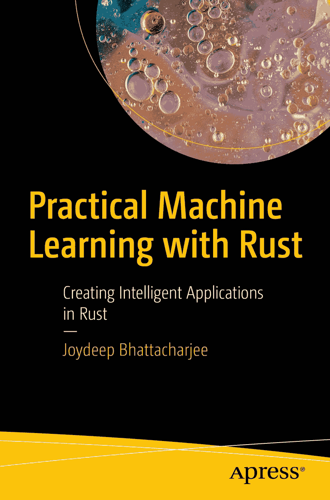

<!--

ISBN 978-1-4842-5120-1 e-ISBN 978-1-4842-5121-8 [`doi.org/10.1007/978-1-4842-5121-8`](https://doi.org/10.1007/978-1-4842-5121-8) © Joydeep Bhattacharjee 2020 Apress 标准 本书中可能出现商标名称、标识和图片。为避免在每次出现商标名称、标识或图片时都使用商标符号，我们仅在编辑风格下使用这些名称、标识和图片，以维护商标所有者的利益，且无意侵犯商标权。本出版物中使用的商品名称、商标、服务标志及类似术语，即使未明确标识，也不应被视为对其是否受专有权利保护的立场表达。尽管本书中的建议和信息在出版时被认为是真实准确的，但作者、编辑和出版商均不对可能存在的任何错误或遗漏承担法律责任。出版商对本书所含内容不作任何明示或暗示的担保。本书通过 Springer Science+Business Media New York 在全球图书贸易中发行，地址：233 Spring Street, 6th Floor, New York, NY 10013。电话：1-800-SPRINGER，传真：(201) 348-4505，电子邮件：orders-ny@springer-sbm.com，或访问 www.springeronline.com。Apress Media, LLC 是一家加利福尼亚有限责任公司，其唯一成员（所有者）是 Springer Science + Business Media Finance Inc (SSBM Finance Inc)。SSBM Finance Inc 是一家特拉华州公司。

*献给我的妻子 Saionee，感谢她耐心倾听我的想法，并给予我建议、支持和动力。献给我的母亲、岳父和岳母，感谢他们多年来一直相信我。*
-->

# 引言

本书旨在探索使用 Rust 语言进行机器学习。我们将学习创建机器学习应用程序的复杂性，以及它们如何融入 Rust 的世界观。我们将从理解机器学习的一些重要概念以及 Rust 语言的基础知识开始。在后续章节中，我们将深入探讨机器学习的更具体领域，例如数据处理、计算机视觉和自然语言处理；并介绍那些能简化这些领域应用程序创建的 Rust 库。我们还将探讨如何将这些应用程序部署到本地或云端。通过阅读本书，读者将对使用 Rust 创建高计算量库有扎实的理解。掌握了这门神奇语言的知识后，他们可以开始着手创建性能更高、内存更安全、资源消耗更少的应用程序。

## 目标读者是谁？

本书最适合从事工业优化问题、并寻求编写更好代码和创建更好应用程序的程序员。尽管本书不假设读者具备机器学习经验，并会解释所有概念，但最好能有一些机器学习经验，特别是使用 Python 等主流编程语言的经验。本书不假设读者具备 Rust 知识，因此非常适合对机器学习感兴趣的 Rust 新手开发者，或者对当前生态系统不满意、希望了解其他可用选项的人。

### 关于作者