# 2. 监督学习

## 2.1 什么是机器学习？

机器学习是一门让计算机无需明确编程即可行动的学科。这是通过实现能够检测数据中模式的特殊算法来完成的。从开发者的角度来看，这意味着创建一个能够访问相关数据、将数据馈送给机器学习算法、并能够获取输出并将其重定向到下游流程和任务的系统。

`监督学习` 当您将输入和期望的输出都传递给系统，并且希望生成的机器学习模型能够捕捉它们之间的关系时，就属于监督学习。根据标签的类型，监督学习又分为两个子类。

当目标变量是连续值时，监督任务被称为回归问题。例如，产品的价格可以是任何值。当需要对某种数量进行预测时，我们通常应该采用回归技术。回归模型的质量通常使用某种形式的误差度量来衡量，即目标值与预测值之间的差异。

分类问题与回归问题的不同之处在于，其标签是离散且有限的。例如，我们可以将电子邮件分类为垃圾邮件或正常邮件。因此，当我们关心一组特定特征读数将落入哪个结果类别时，该问题就是一个分类问题。分类模型的质量通常使用准确率度量来衡量，该度量本质上是模型预测正确的次数。

`无监督学习` 在无监督算法中，不提供标签或目标类别。因此，无监督学习的目标是尝试找到数据的自然划分。

无监督学习的最佳应用场景是当期望结果的数据未知时，例如创建一个企业从未销售过的新产品类别。

`强化学习` 在强化学习中，专门设计的智能体被释放到一个环境中，它们在该环境中学习根据某种奖励和惩罚的概念来采取行动。强化学习已成功应用于机器人运动和不同类别的游戏。

在本章中，我们将研究如何使用 Rust 为不同的机器学习算法创建模型。我们首先从一个 CSV 文件中读取数据集。这是一个常见的数据集，将代表现实世界中的数据类型。然后，我们将研究流行算法的逻辑、它们为何有效，以及如何使用一些 Rust 机器学习包（如 `rusty_machine`）来实现它们。我们还将研究如何评估每个模型的准确率。

到本章结束时，您应该对如何创建常见的机器学习模型并在 Rust 中实现它们有了相当的理解。

## 2.2 数据集特定代码

在进入回归算法和相关代码之前，让我们先构建周围的样板代码。查看本书附带的代码中的 `rusty_machine_regression` 包。

为了演示回归的用法，我们将使用波士顿房价数据集。^(²) 您也可以从 Kaggle 的波士顿数据集页面下载该数据。^(³) 该数据集有 14 个特征和 506 个样本。以下是该数据集的描述。

*   `CRIM` - 城镇人均犯罪率

*   `ZN` - 占地面积超过 25,000 平方英尺的住宅用地比例

*   `INDUS` - 每个城镇非零售商业英亩数的比例

*   `CHAS` - 查尔斯河虚拟变量（如果区域边界临河则为 1；否则为 0）

*   `NOX` - 一氧化氮浓度（每千万分之一）

*   `RM` - 每栋住宅的平均房间数

*   `AGE` - 1940 年之前建造的自住单位比例

*   `DIS` - 到波士顿五个就业中心的加权距离

*   `RAD` - 通往径向高速公路的便利性指数

*   `TAX` - 每 10,000 美元的全额财产税率

*   `PTRATIO` - 城镇的师生比

*   `B` - `1000(Bk - 0.63)`，其中 `Bk` 是城镇黑人人口比例

*   `LSTAT` - 人口中较低地位阶层的百分比

*   `MEDV` - 自住房屋的中位价值（单位：千美元）

现在让我们先创建项目。我们可以使用 `cargo` 命令创建项目，如下面的清单 2-1 所示。

```
$ cargo new rustymachine-regression --bin
$ cd rustymachine-regression
清单 2-1
创建新包
```

我们可以看到，目录中已创建了一个 `src/main.rs` 文件和一个 `Cargo.toml` 文件。我们可以使用命令 `mkdir data` 创建额外的 `data` 目录，以便将波士顿房价数据集保存在那里。

数据保存在文件 `data/housing.csv` 中。快速查看 CSV 文件表明它是一个没有标题的固定宽度文件（清单 2-2）。

```
$ head -n1 data/housing.csv \
| grep -Eo '[0-9]*[.]?[0-9]*' \
| wc -l

$ head -n2 data/housing.csv
0.00632  18.00   ...   4.98  24.00
0.02731   0.00   ...   9.14  21.60
清单 2-2
住房数据
```

为了解析文件并创建我们的模型，我们需要依赖各种外部依赖项。Rust 包通常被称为 `crate`。要访问不同 `crate` 中的代码，我们需要将它们添加到 `Cargo.toml` 文件中。`crate csv` 借助额外的 `crate serde` 和 `serde-derive` 来解析 CSV 文件。我们稍后会讨论 `rusty-machine` crate，所以现在只需将它们添加到 toml 文件中。请注意，我们使用的是 Rust 2018 版本。这是本书将全程使用的版本（清单 2-3）。

```
[package]
name = "rustymachine_regression"
version = "0.1.0"
edition = "2018"
[dependencies]
rusty-machine = "0.5.4"
serde = "1"
serde_derive = "1"
rand = "0.6.5"
csv = "1.0.7"
清单 2-3
chapter2/rustymachine_regression/Cargo.toml
```

对于您的应用程序，请访问 `crates.io` 页面以查找相应依赖项的可用版本。在该网站上，您可以看到一个搜索栏，您可以在其中输入搜索词。在图 2-1 中，显示了 `csv` 页面。

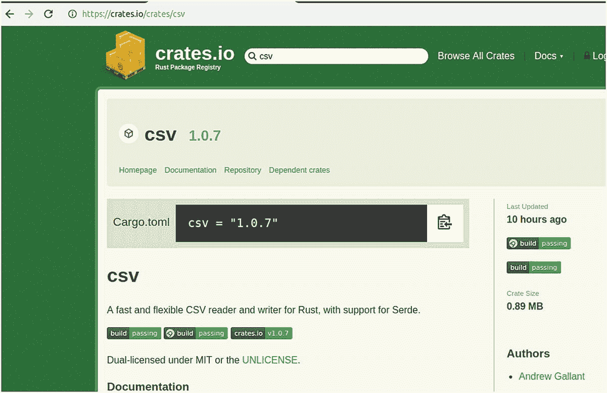

图 2-1

Crates 页面

现在我们将开始编写本书中第一个模块的代码。除非另有说明，本书中的大部分代码都将写在 `src/main.rs` 文件中。此外，您可以通过代码块的标签了解代码所在的文件。我们将继续添加需要使用 `use` 语句导入的必要模块（清单 2-4）。

```
extern crate serde;
#[macro_use]
extern crate serde_derive;
use std::io::prelude::*;
use std::io::BufReader;
use std::path::Path;
use std::fs::File;
use std::vec::Vec;
use std::error::Error;
use rand::thread_rng;
use rand::seq::SliceRandom;
清单 2-4
chapter2/rustymachine_regression/src/lin_reg.rs
```

为了解析文件并与相应的记录匹配，我们创建了一个 `struct`，其中每个值都是 `float64` 类型（清单 2-5）。^(⁴) 由于我们将使用稍后在本节介绍的 Rust 机器学习库，因此需要将它们初始化为 `float64`。

```
pub struct BostonHousing {
crim: f64, zn: f64, indus: f64, chas: f64, nox: f64,
rm: f64, age: f64, dis: f64, rad: f64, tax: f64,
ptratio: f64, black: f64, lstat: f64, medv: f64,
}
清单 2-5
chapter2/ml-utils/src/datasets.rs
```

将文件转换为记录的一种方法是逐行读取文件并构建 `BostonHousing` 记录。这使我们能够实现将预测变量与响应变量或目标变量分离的方法。在此案例中，我们将房屋的中位数价格（房价）视为目标，并尝试根据可用的预测变量来预测房价。

清单 2-6 展示了实现构建 `BostonHousing` 记录以及构建特征向量和目标值方法的代码。

现在我们可以继续使用`get_boston_records_from_file`函数逐行读取文件。每一行将被传递给`get_boston_record`函数，该函数将字符串分割成字符串向量，以便由`BostonRecord`进行适当解析（清单 `2-7`）。

```rust
fn get_boston_record(s: String) -> BostonHousing {
    let v: Vec<&str> = s.split_whitespace().collect();
    let b: BostonHousing = BostonHousing::new(v);
    b
}

fn get_boston_records_from_file(
    fl: impl AsRef<Path>
) -> Vec<BostonHousing> {
    let file = File::open(fl).expect("no such file");
    let buf = BufReader::new(file);
    buf.lines().enumerate()
        .map(|(n, l)| l.expect(
            &format!("Could not parse line no {}", n)))
        .map(|r| get_boston_record(r))
        .collect()
}
```

清单 2-7
`chapter2/ml-utils/src/datasets.rs`

`get_boston_records_from_file`的输出现在将存储在一个可变的`data`变量中，以供后续使用（清单 2-8）。

### 注意

由于`get_boston_record`和`get_boston_records_from_file`等函数以及其他数据集解析函数都保存在`chapter2`目录下创建的`ml-utils`包中，因此为这些函数单独创建了一个包，因为我们在本书中会将这些数据集用于各种机器学习模型。模型的代码将保存在相应的章节和包中。因此，我们还会在 cargo 文件和代码的模块导入部分看到对`ml-utils`路径的引用。请查阅本书附带的代码以获得更深入的理解。

```rust
use ml_utils::datasets::get_boston_records_from_file;

pub fn run() -> Result<(), Box<dyn Error>> {
    let fl = "data/housing.csv";
    let mut data = get_boston_records_from_file(&fl);
    // 函数剩余部分
```

清单 2-8
`chapter2/rustymachine_regression/src/lin_reg.rs`

在机器学习任务中，对输入数据集进行打乱是一个好习惯。打乱数据有助于减少方差，并确保模型保持泛化能力，减少过拟合。打乱有助于确保数据集的训练/测试/验证样本能够代表数据的整体分布。

在清单 2-9 中，我们对数据进行打乱，将其拆分为 80% 的训练集和 20% 的测试集，并将它们转换为`f64`向量。

```rust
pub fn run() -> Result<(), Box<dyn Error>> {
    // 之前的代码
    data.shuffle(&mut thread_rng());
    // 分离出训练集和测试集。
    let test_size: f64 = 0.2;
    let test_size: usize = data.len() as f64 * test_size;
    let test_size = test_size.round() as usize;
    let (test_data, train_data) = data.split_at(test_size);
    let train_size = train_data.len();
    let test_size = test_data.len();
    // 区分预测变量和目标变量。
    let boston_x_train: Vec<f64> = train_data.iter()
        .flat_map(|r| r.into_feature_vector())
        .collect();
    let boston_y_train: Vec<f64> = train_data.iter()
        .map(|r| r.into_targets()).collect();
    let boston_x_test: Vec<f64> = test_data.iter()
        .flat_map(|r| r.into_feature_vector()).collect();
    let boston_y_test: Vec<f64> = test_data.iter()
        .map(|r| r.into_targets()).collect();
    // 函数剩余部分
```

清单 2-9
`chapter2/rustymachine_regression/src/lin_reg.rs`

数据已加载并拆分为训练集和测试集。清单 2-9 中的代码是通用的，并且将出现在本章回归模型的大多数 run 方法中。

## 2.3 Rusty_Machine 库

Rusty_machine 是一个完全用 Rust 编写的通用机器学习库。其主要目标是易用性和速度，同时无需依赖大量外部库。API 的一致性通过 Rust 的 trait 系统实现。它目前使用 `rulinalg` 作为其线性代数后端。在本书中，我们将重点使用这个核心库之一来满足我们的机器学习需求。

要使用 rusty_machine 库，我们需要将数据向量转换为 `rulinalg` 支持的矩阵。将上述向量转换为清单 2-10 中所示的形式。

```rust
use rusty_machine;
use rusty_machine::linalg::Matrix;
use rusty_machine::linalg::Vector;

pub fn run() -> Result<(), Box<dyn Error>> {
    // 之前的代码 ...
    let boston_x_train = Matrix::new(train_size, 13, boston_x_train);
    let boston_y_train = Vector::new(boston_y_train);
    let boston_x_test = Matrix::new(test_size, 13, boston_x_test);
    let boston_y_test = Matrix::new(test_size, 1, boston_y_test);
    // 剩余部分 ...
```

清单 2-10
`chapter2/rustymachine_regression/src/lin_reg.rs`

在清单 2-10 所示的代码中，`boston_y_train` 是一个向量，而 `boston_y_test` 是一个维度为 1 的矩阵。理论上它们是相同的，但数据类型被处理为不同，因为稍后我们将使用 `neg_mean_squared_error` 函数，该函数期望输入为矩阵格式，如清单 2-11 所示。由于我们尚未到达那个阶段，你可以选择暂时将 `boston_y_test` 保留为向量。

```
error[E0308]: mismatched types
--> src/lin_reg.rs:79:52
|
79 |     let acc = neg_mean_squared_error(&predictions, &boston_y_test);
|                                             ^^^^^^^^^^^^^^
expected struct `rulinalg::matrix::Matrix`, found struct `rulinalg::vector::Vector`
|
= note: expected type `&rulinalg::matrix::Matrix`
found type `&rulinalg::vector::Vector`
error: aborting due to previous error
```

清单 2-11 `lin_reg.rs` 中的错误

在 rusty_machine 中，所有模型类中实现的两个关键方法是`train`和`predict`方法。熟悉 scikit-learn API 的读者可能会感到舒适。顾名思义，我们需要将训练数据传递给相应模型的`train`方法，并将测试数据传递给相应模型的`predict`方法。

## 2.4 线性回归

普通最小二乘线性回归是一种方法，其中优化具有系数 *w* = (*w*1,*w*2,…,*wp*) 的线性模型，以最小化数据集中观察到的响应与线性近似预测的响应之间的残差平方和。数学上，它解决以下形式的问题：

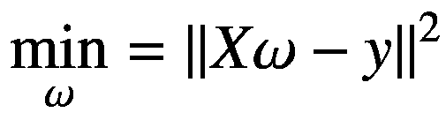

(1)

**使用 Rusty_Machine** 优化模型的方法之一是梯度下降。使用清单 2-12 中的代码训练线性回归模型。

```
pub fn run() -> Result> {
    // 之前的代码...
    let mut lin_model = LinRegressor::default();
    lin_model.train(&boston_x_train, &boston_y_train)?;
    let predictions = lin_model.predict(&boston_x_test).unwrap();
    let predictions = Matrix::new(test_size, 1, predictions);
    let acc = neg_mean_squared_error(&predictions, &boston_y_test);
    println!("线性回归误差: {:?}", acc);
    println!("线性回归 R2 分数: {:?}", r_squared_score(
        &boston_y_test.data(), &predictions.data()));
    Ok(())
}
```

清单 2-12 `chapter2/rustymachine_regression/src/lin_reg.rs`

清单 2-12 中代码的输出应与清单 2-13 中的类似。

```
$ cargo run lr < ../datasets/housing.csv
LinRegressor { parameters: None }
线性回归误差: -23.242663146907553
线性回归 R2 分数: 0.7627858374713654
```

清单 2-13 `lin_reg.rs` 输出

创建类似于清单 2-13 的线性回归模型保存在`chapter2/rustymachine_regression/src/lin_reg.rs`模块中。

**使用 Tensorflow** 一个有趣的回归实现可以使用回归方程的闭式解，通过 Tensorflow 完成。在本节中，我们将使用 Tensorflow 的 Rust 实现来实现闭式解。

Tensorflow 的设计方式是，要实现计算，我们本质上需要创建图。一个 Tensorflow 程序基本上分为两部分。一部分我们创建计算图，然后编写在会话中运行该图的代码。它使用正规方程求解线性回归，其中我们求解 theta 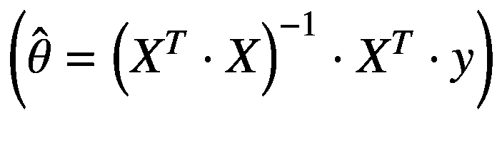，其中  是权重。

为了创建计算图，我们首先将向量加载到具有适当维度的张量中（清单 2-14）。

```
pub fn run() -> Result> {
    // 之前的代码 ...
    let dim = (boston_y_train.len() as u64, 13);
    let test_dim = (boston_y_test.len() as u64, dim.1);
    let X_train = >::new(&[dim.0, dim.1])
        .with_values(&boston_x_train)?;
    let y_train = >::new(&[dim.0, 1])
        .with_values(&boston_y_train)?;
    let X_test = >::new(&[test_dim.0,
                           test_dim.1])
        .with_values(&boston_x_test)?;
    // 其余代码 ...
```

清单 2-14 `chapter/rust_and_tf/src/linear_regression.rs`

请注意，在前一个清单中，函数的开头与我们在线性回归部分清单 2-9 及之前看到的类似。

从闭式解中可以看出，我们还需要计算转置。使用 Tensorflow 进行转置并不容易，因此我们可以借助转置库，其版本为`transpose = "0.2.0"`。完整的 cargo 依赖关系如代码清单 2-15 所示。`serde`和`serde-derive` crate 用于数据序列化和反序列化；`rand` crate 用于生成随机数；`mnist` crate 用于方便地访问 MNIST 数据集；`random` crate 提供了一些我们将要在代码中使用的优秀随机函数；`mnist`是我们将要开发的 crate，可在本书代码中找到。本节中重要的 crate 是`transpose` crate，我们将用它来转置矩阵，以及`tensorflow` crate，用于访问 Tensorflow 函数。

```
[package]
name = "rust_and_tf"
version = "0.1.0"
edition = "2018"
[dependencies]
tensorflow = { version = "0.13.0", features = ["tensorflow_unstable"] }
serde = "1"
serde_derive = "1"
rand = "0.6.5"
transpose = "0.2.0"
mnist = "0.4.0"
ml-utils = { path = "../ml-utils" }
random = "0.12.2"
```

代码清单 2-15 `chapter2/rust_and_tf/Cargo.toml`

然后使用`transpose` crate 来转置`boston_x_train`（代码清单 `2-16`）。

```
pub fn run() -> Result> {
    // 之前的代码 ...
    let mut output_array = vec![0.0; (dim.0 * dim.1) as usize];
    transpose::transpose(&boston_x_train,
                         &mut output_array,
                         dim.1 as usize, dim.0 as usize);
    let XT =  >::new(&[dim.1, dim.0]).with_values(&output_array[..])?;
    // 剩余的代码 ...
```

代码清单 2-16 `chapter2/rust_and_tf/src/linear_regression.rs`

现在我们应该能够创建计算图了（代码清单 2-17）。Tensorflow 计算图代表了计算的数据流。我们可以编写将作为图一部分的特定计算，如代码清单 2-17 所示。

```
## 代码清单 2-17
```rust
pub fn run() -> Result<()> {
// 之前的代码 ...
let mut graph = Graph::new();
let XT_const = {
let mut op = graph.new_operation("Const", "XT")?;
op.set_attr_tensor("value", XT)?;
op.set_attr_type("dtype", DataType::Double)?;
op.finish()?
};
let X_const = {
let mut op = graph.new_operation("Const", "X_train")?;
op.set_attr_tensor("value", X_train)?;
op.set_attr_type("dtype", DataType::Double)?;
op.finish()?
};
let y_const = {
let mut op = graph.new_operation("Const", "y_train")?;
op.set_attr_tensor("value", y_train)?;
op.set_attr_type("dtype", DataType::Double)?;
op.finish()?
};
let mul = {
let mut op = graph.new_operation("MatMul", "mul")?;
op.add_input(XT_const.clone());
op.add_input(X_const);
op.finish()?
};
let inverse = {
let mut op = graph.new_operation("MatrixInverse", "mul_inv")?;
op.add_input(mul);
op.finish()?
};
let mul2 = {
let mut op = graph.new_operation("MatMul", "mul2")?;
op.add_input(inverse);
op.add_input(XT_const.clone());
op.finish()?
};
let theta = {
let mut op = graph.new_operation("MatMul", "theta")?;
op.add_input(mul2);
op.add_input(y_const);
op.finish()?
};
// 剩余的代码 ...
}
// chapter2/rust_and_tf/src/linear_regression.rs
```

请注意，在代码清单 2-17 的代码中，不同的操作是通过 `graph` 上的 `new_operation` 方法定义的。输入被定义，任何其他相关属性也可以被定义。本质上，我们是在代码中直接调用 C++ API。要获取 API 中定义的操作列表，请查看 Tensorflow 的 array-ops 页面：[`https://www.tensorflow.org/api_docs/cc/group/array-ops`](https://www.tensorflow.org/api_docs/cc/group/array-ops)。

这只是图的一部分。在上面的图中，方程已被定义，并且正在计算 `θ` 值。现在我们找到预测值，如代码清单 2-18 所示。

## 代码清单 2-18
```rust
pub fn run() -> Result<()> {
// 之前的代码 ...
let X_test_const = {
let mut op = graph.new_operation("Const", "X_test")?;
op.set_attr_tensor("value", X_test)?;
op.set_attr_type("dtype", DataType::Double)?;
op.finish()?
};
let predictions = {
let mut op = graph.new_operation("MatMul", "preds")?;
op.add_input(X_test_const);
op.add_input(theta);
op.finish()?
};
// 剩余的代码 ...
}
// chapter2/rust_and_tf/src/linear_regression.rs
```

现在，由于整个图已经构建完成，我们可以创建一个图会话来执行实际的计算（代码清单 2-19）。

## 代码清单 2-19
```rust
pub fn run() -> Result<()> {
// 之前的代码 ...
let session = Session::new(&SessionOptions::new(),
&graph)?;
let mut args = SessionRunArgs::new();
let preds_token = args
.request_fetch(&predictions, 0);
session.run(&mut args)?;
let preds_token_res: Tensor<f64> = args.fetch(preds_token)?;
println!("r-squared error score: {:?}",
r_squared_score(&preds_token_res.to_vec(), &boston_y_test));
Ok(())
}
// chapter2/rust_and_tf/src/linear_regression.rs
```

`r_squared_score` 函数取自 `ml-utils` 库，我们将在模型评估部分讨论该函数。

代码清单 2-19 中代码的输出应类似于代码清单 2-20。

## 代码清单 2-20
```
$ cd chapter2/rust_and_tf
$ cargo run lr
r-squared error score: 0.6779404103641853
```
// chapter2/rust_and_tf 输出

请注意，在这段代码中，我们创建了一个会话，传递了相关参数，然后从输出张量中获取了值。

我们可以使用 `cargo run lr` 运行此模块，它应该会给出输出。

Rust Tensorflow 团队推荐的另一种方法是使用 Python 创建计算图，并将模型保存为 pb 文件。完成后，您可以在 Rust 程序中加载模型，然后运行计算。一旦创建了计算图，我们可以使用类似于代码清单 2-21 的代码来保存它。

## 代码清单 2-21
```python
directory = 'boston_regression'
builder = SavedModelBuilder(directory)
with tf.Session(graph=tf.get_default_graph()) as sess:
sess.run(init)
signature_inputs = {
"x": build_tensor_info(X),
"y": build_tensor_info(Y)
}
signature_outputs = {
"out": build_tensor_info(y_preds)
}
signature_def = build_signature_def(
signature_inputs, signature_outputs,
REGRESS_METHOD_NAME)
builder.add_meta_graph_and_variables(
sess, [TRAINING, SERVING],
signature_def_map={
REGRESS_METHOD_NAME: signature_def
},
assets_collection=tf.get_collection(
tf.GraphKeys.ASSET_FILEPATHS))
builder.save(as_text=False)
```
// chapter2/rust_and_tf/tensorflow%20create%20model.ipynb

现在，一旦模型被保存，我们应该能够在 Rust 程序中加载并运行该模型。请注意，该函数将具有类似于我们在代码清单 2-9 及之前看到的类似的数据加载和训练测试划分过程。
```

# 2.5 高斯过程

高斯过程可用于回归问题。可以将高斯过程视为在函数上定义分布，并且推理直接在函数空间（即函数空间视角）中进行。高斯过程模型的预测结果采用完整预测分布的形式。因此，高斯过程是一个随机变量的集合，其中任意有限数量的随机变量都服从联合高斯分布。

一个高斯过程完全由其均值函数和协方差函数确定。因此，在高斯过程中，需要指定先验。通常，先验均值被假定为零，而协方差则通过传递一个核对象来指定。

高斯过程的噪声水平也可以传递。适度的噪声水平有助于处理拟合时的数值问题，因为它实际上是以吉洪诺夫正则化的方式实现的，即通过将其添加到核矩阵的对角线上。

创建一个高斯过程模型，用于在上述波士顿数据集的训练部分进行训练。这里，定义一个长度尺度为 2、振幅为 1 的核作为协方差函数。定义一个零函数作为均值函数，并将噪声水平限制在 10.0。然后，我们将训练用的 `x` 和 `y` 传递给训练方法。这将根据训练值优化模型（列表 2-22）。

```rust
use rusty_machine::learning::gp::GaussianProcess;
use rusty_machine::learning::gp::ConstMean;
use rusty_machine::learning::toolkit::kernel;
use rusty_machine::learning::SupModel;

pub fn run() -> Result<(), Box<dyn std::error::Error>> {
    // 之前的数据加载和划分代码...
    // 核函数
    let ker = kernel::SquaredExp::new(2., 1.);
    // 均值函数
    let zero_mean = ConstMean::default();
    // 模型定义
    let mut gaus_model = GaussianProcess::new(ker, zero_mean, 10f64);
    gaus_model.train(&boston_x_train, &boston_y_train)?;
    let predictions = gaus_model.predict(&boston_x_test).unwrap();
    let predictions = Matrix::new(test_size, 1, predictions);
    let acc = neg_mean_squared_error(&predictions, &boston_y_test);
    println!("高斯过程回归误差: {:?}", acc);
    println!("高斯过程回归 R2 分数: {:?}", r_squared_score(
        &boston_y_test.data(), &predictions.data()));
    Ok(())
}
```

列表 2-22 `chapter2/rustymachine_regression/src/gaussian_process_reg.rs`

如果这段代码运行无误，意味着我们能够成功创建模型。我们应该会得到类似于列表 2-23 的输出。

```
$ cd chapter2/rustymachine_regression
$ cargo run gp
高斯过程回归误差: -593.9085507602914
高斯过程回归 R2 分数: -5.578006698530541
```

列表 2-23 `chapter2/rustymachine_regression/src/gaussian_process_reg.rs` 输出

# 2.6 广义线性模型

普通线性回归假设未知量是预测变量集的线性组合。如果响应变量是输入变量的正态分布，这个假设是可行的。这类数据可以是任何相对稳定且变化幅度较小的数据。这在许多自然分布中都能看到，例如人类的身高，其中一个值与另一个值相互独立，因此中心极限定理能够发挥作用。然而，在现实生活中，许多分布并非正态分布。

广义线性模型是 OLS 回归模型的一种灵活变体，它允许响应变量具有除正态分布以外的误差分布模型。在这些模型中，响应变量 `y[i]` 被假定服从均值为 `μ[i]` 的指数族分布，而该均值被假定为 `$ {x}_i^T\beta $` 的某个（线性或非线性）函数 [1]。

GLM 包含三个要素 [2]。

1. 一个类似于 OLS 的线性预测器

`$ {\eta}_i={\beta}_0+{\beta}_1{x}_{1i}+\dots +{\beta}_p{x}_{pi} $`

(2)

2. 一个链接函数，描述均值 `E(Y[i]) = μ[i]` 如何依赖于线性预测器

或者用矩阵形式表示 `η = Xβ`

`$ g\left({\mu}_i\right)={\eta}_i $`

(3)

3. 一个方差函数，描述方差 `var(Y[i])` 如何依赖于均值

`$ \operatorname{var}\left({Y}_i\right)=\phi V\left(\mu \right) $`

(4)

如果 `V` 服从指数族分布，则非常方便。未知参数 `β` 通常使用最大似然估计、最大拟似然估计或贝叶斯方法进行估计。可以证明，一般线性模型是 GLM 的一个特例，其中链接函数为 `g(μ[i]) = μ[i]`，方差函数为 `V(μ[i]) = 1`。

在 `rusty_machine` 中，我们可以使用列表 2-24 中所示的代码创建一个线性回归模型。

```
use rusty_machine::learning::glm::{GenLinearModel, Normal};
pub fn run() -> Result<()> {
// 数据加载和划分的起始代码...
// 创建一个正态广义线性模型
let mut normal_model = GenLinearModel::new(Normal);
normal_model.train(
&boston_x_train, &boston_y_train)?;
let predictions = normal_model.predict(
&boston_x_test).unwrap();
let predictions = Matrix::new(
test_size, 1, predictions);
let acc = neg_mean_squared_error(
&predictions, &boston_y_test);
println!("GLM 泊松精度: {:?}", acc);
println!("GLM 泊松 R2 分数: {:?}", r_squared_score(
&boston_y_test.data(), &predictions.data()));
Ok(())
}
列表 2-24
chapter2/rustymachine_regression/src/glms.rs
```

这段代码的输出应类似于列表 2-25。

```
$ cargo run glms
GLM 泊松精度: -36.55900309522449
GLM 泊松 R2 分数: 0.6478692745681216
列表 2-25
glms.rs 输出
```

其他已实现的模型包括伯努利模型和二项式模型，它们主要用于分类。我们也可以使用泊松回归作为准则。泊松回归与多元回归类似，不同之处在于因变量是服从泊松分布的观测计数。因此，`Y` 的可能值为非负整数：0, 1, ... 等等。假设大计数值是罕见的。

## 2.7 回归模型的评估

到目前为止，在我们讨论的所有机器学习模型代码中，我们已经使用了一些函数，例如 `neg_mean_squared_error` 或 `r_squared_score`，但我们一直避免讨论它们。这些函数用于评估所创建模型的好坏，在本节中，我们将详细讨论这些函数、它们的创建以及用法。

评估模型对于了解它是否能在新的和未来的数据上很好地预测目标变量至关重要。由于未来实例的目标值是未知的，我们需要在已知数据上检查机器学习模型的准确度指标。这就是为什么在训练之前，我们要将数据集拆分为训练集和测试集。这种评估作为衡量机器学习模型模拟真实世界用例接近程度的代理。

### 2.7.1 平均绝对误差和均方误差

对于连续变量，两种最流行的评估指标方法是平均绝对误差和均方误差 [3]。平均绝对误差是预测值与观测值之间绝对差值的平均值。对于从 `n` 个数据点样本生成的 `n` 个预测值向量 ，如果 `y` 是这些数据点的观测值，那么

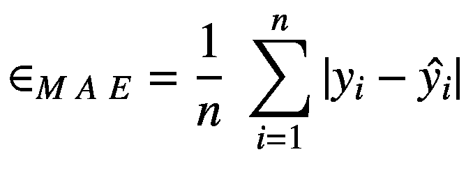

(5)

均方误差是预测值与观测值（也称为残差）之间差值的平方和。

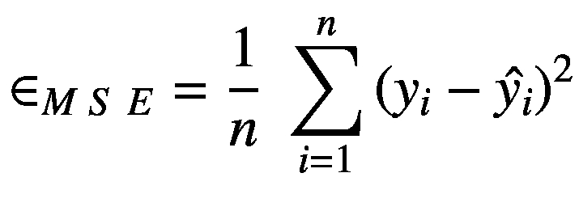

(6)

在许多情况下，也会取上述结果的平方根，即 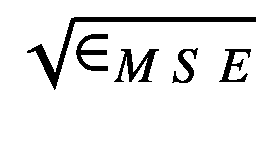。这本质上将其转换为样本标准差，并称为均方根误差。

对于高斯分布而言，RMSE 是最佳的误差估计量。遗憾的是，大多数真实世界的用例并非严格的高斯分布。它们仅在有限的空间内表现得像高斯分布。结果是，由于对残差进行平方，我们过度重视了异常值。MAE 更容易理解，并且不会过分强调异常值。然而，RMSE 是许多模型的默认指标，因为以 RMSE 定义的损失函数是平滑可微的，这使得执行机器学习所需的数学运算更加容易。

在 `rusty_machine` 中，要获取这些模型的均方误差，一旦训练完成，我们将 `boston_x_test` 作为参考传递给模型的预测方法以获取预测值。这些预测值与实际值进行比较，得到 `neg_mean_squared_error` 函数。该函数返回均方误差的相反数。均方误差是预测值与实际观测值之间差值的平方的平均值（列表 2-26）。

```rust
use rusty_machine::analysis::score::neg_mean_squared_error;
pub fn run() -> Result<()> {
// 前面的部分 ...
let predictions = lin_model.predict(&boston_x_test).unwrap();
let predictions = Matrix::new(test_size, 1, predictions);
let acc = neg_mean_squared_error(&predictions, &boston_y_test);
println!("线性回归误差: {:?}", acc);
let predictions = gaus_model.predict(&boston_x_test).unwrap();
let predictions = Matrix::new(test_size, 1, predictions);
let acc = neg_mean_squared_error(&predictions, &boston_y_test);
println!("高斯过程回归误差: {:?}", acc);
// 剩余代码...
```

列表 2-26
chapter2/rustymachine_regression/src/lin_reg.rs

### 2.7.2 R 平方误差

R 平方评估数据点围绕拟合回归线的离散程度。它也被称为决定系数。对于相同的数据集，较高的 R 平方值表示观测值与拟合值之间的差异较小。

R 平方是线性模型解释的因变量变异的百分比。

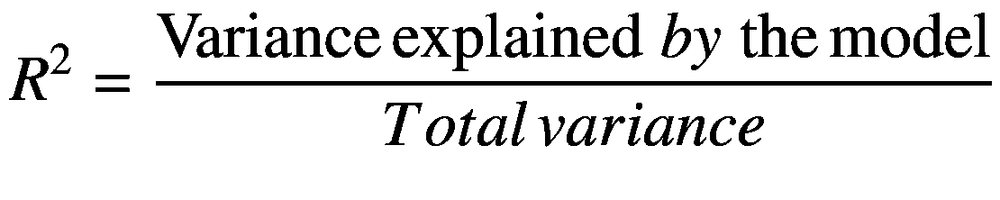

(7)

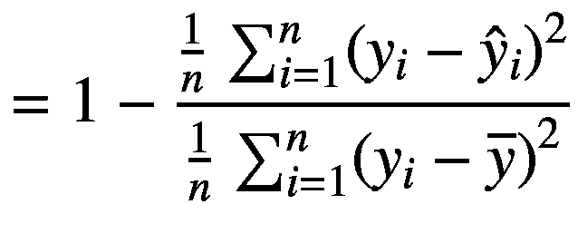

(8)

在图 2-2 中，我们可以通过两个样本数据点直观地看到 R 平方值如何表示回归线周围的离散程度。

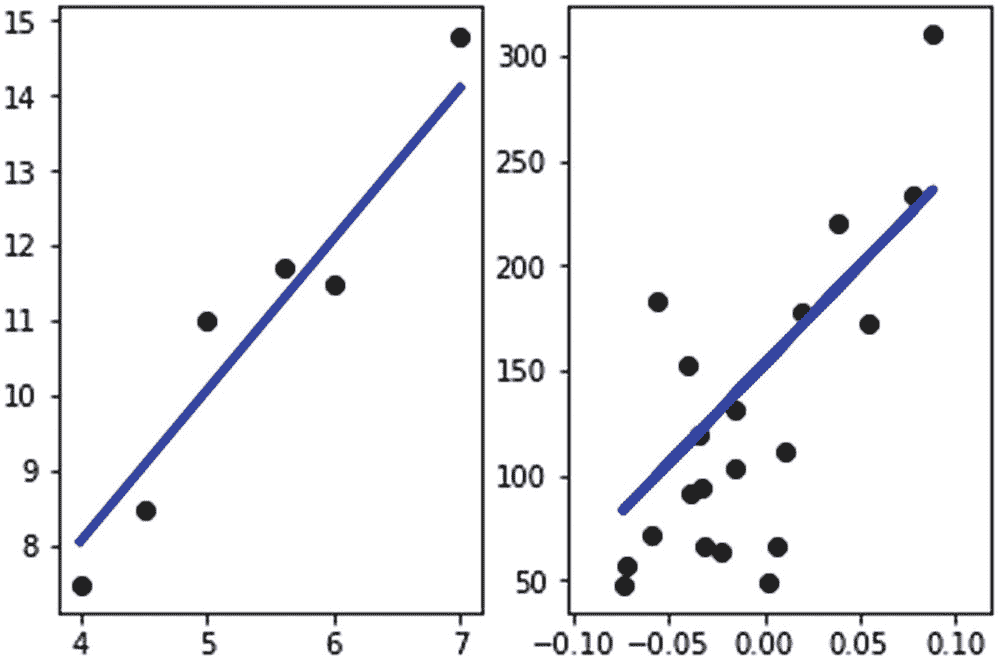

图 2-2

样本回归拟合

左侧回归模型的 R 平方为 93%，右侧模型为 47%。当回归模型解释了更多的方差时，数据点更接近回归线。在实践中，从未观察到 `R`² 为 100% 的回归模型。在这种情况下，拟合值等于数据值，因此所有观测值都恰好落在回归线上。

下一个函数可以用作在 Rust 中实现 R 平方的参考。我们首先获取模型方差，即实际值与预测值之间连续差值的平方和。然后我们获取实际分布的均值，并用它来计算测试分布的方差。然后我们通过 R 平方公式运行它（列表 2-27）。

```rust
fn r_squared_score(y_test: &Vec<f64>, y_preds: &Vec<f64>) -> f64 {
let mv: f64 = y_test.iter().zip(y_preds.iter()).fold(
0., |v, (y_i, y_i_hat)| {
v + (y_i - y_i_hat).powi(2)
}
);
let mean = y_test.iter().sum::<f64>() as f64
/ y_test.len() as f64;
let var = y_test.iter().fold(
0., |v, &x| {v + (x - mean).powi(2)}
);
let r2: f64 = 1.0 - (mv / var);
r2
}
```

列表 2-27
ml-utils/src/sup_metrics.rs

这个函数应该可以通过传递 `y_test` 和 `y_pred` 来获取分数。由于在本章的示例中，`y_test` 和预测值位于 `rusty machine` 的矩阵中，我们可能需要像列表 2-28 所示那样操作。

```rust
pub fn run() -> Result<()> {
    // 函数的前面部分...
    println!("GLM 泊松 R2 分数: {:?}", r_squared_score(
        &boston_y_test.data(), &predictions.data()));
}
// 列表 2-28
// chapter2/rustymachine_regression/src/glms.rs
```

## 2.8 分类算法

机器学习算法被任务将输入变量分配到预定义桶中的场景称为分类问题。在本节中，我们将使用 Rust 创建分类模型。

在 Rust 中，我们可以使用 `rustlearn` 包创建分类器。这个 crate 包含了许多常见机器学习算法的有效实现。为了能够使用 `rustlearn`，我们需要将浮点数实现为 `float32`。

### 2.8.1 鸢尾花数据集

为了展示分类算法的用法，我们将使用鸢尾花数据集。^(⁵) 请从网站下载该数据集，或在本节配套代码的 `datasets` 文件夹中找到它。这是一个包含以下特征的多变量数据集。

*   花萼长度（厘米）。
*   花萼宽度（厘米）。
*   花瓣长度（厘米）。
*   花瓣宽度（厘米）。
*   类别：`setosa`、`versicolor` 和 `virginica`。

此处讲解的代码保存在 `rustlearn_classification_tasks` 文件夹中。在该包内，创建一个 `data` 文件夹，并将 csv 文件放入其中（列表 2-29）。

```bash
$ head -n2 data/iris.csv
sepal_length,sepal_width,petal_length,petal_width,species
5.1,3.5,1.4,0.2,setosa
$ wc -l data/iris.csv
151 data/iris.csv # 数据集中有 150 个样本。
# 列表 2-29
# 鸢尾花数据
```

与之前类似，我们将使用 `rustlearn`、`csv`、`rand` 和 `serde` 这些库。`rustlearn` crate 是你现在看到的一个新依赖项。我们将使用这个 crate 来完成分类任务，稍后会详细介绍。请在 `Cargo.toml` 文件中找到这些依赖项（列表 2-30）。

```toml
[package]
name = "rustlearn_classification_tasks"
version = "0.1.0"
edition = "2018"
[dependencies]
rustlearn = "0.5.0"
csv = "1.0.5"
serde = "1.0.89"
serde_derive = "1.0.89"
rand = "0.6"
ml-utils = { path = "../ml-utils" }
# 列表 2-30
# chapter2/rustlearn_classification_tasks/Cargo.toml
```

回想一下，在回归案例中，我们创建了一个 `BostonHousing` 结构体。在这个案例中，我们将继续创建一个 `Flower` 结构体。请注意，代码结构将大体相似（列表 2-31）。

```rust
extern crate serde;
#[macro_use]
extern crate serde_derive;
#[derive(Debug, Deserialize)]
pub struct Flower {
    sepal_length: f32, sepal_width: f32,
    petal_length: f32, petal_width: f32,
    species: String,
}
// 列表 2-31
// chapter2/ml-utils/src/datasets.rs
```

我们现在使用 `f32` 数据类型，因为我们将使用 `rustlearn` 包，它要求输入为 `f32` 浮点数。

这里 `species` 是标签，其他列是特征。因此，为了解析出特征和标签，我们将为 `Flower` 结构体实现 `into_feature_vector` 和 `into_labels` 方法。请注意，在定义特征向量时，csv 文件中的列顺序得以保留。而在标签编码时，会为不同的标签分配一些数字（这些数字是任意的）。理想情况下，除了标签编码方法外，还应为最终响应实现一个标签解码器。此处为简洁起见，未展示该部分（列表 2-32）。

```rust
use std::io; use std::vec::Vec; use csv;
impl Flower {
    pub fn into_feature_vector(&self) -> Vec<f32> {
        vec![self.sepal_length, self.sepal_width,
             self.petal_length, self.petal_width]
    }
    pub fn into_labels(&self) -> f32 {
        match self.species.as_str() {
            "setosa" => 0., "versicolor" => 1.,
            "virginica" => 2.,
            some_other => panic!("无法解析标签。
                传入了其他标签。{:?}", some_other),
        }
    }
}
// 列表 2-32
// ml-utils/src/datasets.rs
```

我们将使用强大的 `stdin`，并通过类似 `cargo run lr < data/iris.csv` 的命令来读取包。这里 `cargo run` 会编译并运行二进制文件，`lr` 是其后的参数，该参数在包中已启用。请查看 `main.rs` 了解所有选项。因此，为了实现这一点，我们将使用 `std::io` 包，并通过 `csv::Reader` 将其传递给 `rdr` 变量。现在，我们将每条记录序列化为 `Flower` 结构体，并将其推送到一个数据向量中，这与我们在回归部分看到的数据向量类似。同时，为了确保数据质量，我们还会对数据进行打乱（列表 2-33）。

```rust
use ml_utils::datasets::Flower;
use csv; use rand::thread_rng;
use rand::seq::SliceRandom;
pub fn run() -> Result<()> {
    let mut rdr = csv::Reader::from_reader(io::stdin());
    let mut data = Vec::new();
    for result in rdr.deserialize() {
        let r: Flower = result?; // 定义中应有 Box。
        data.push(r);
    }
    data.shuffle(&mut thread_rng());
    // 其余代码...
// 列表 2-33
// chapter3/rustlearn_classification_tasks/src/logistic_reg.rs
```

现在我们将分离出训练集和测试集。代码与回归部分类似，只是在这里我们需要将向量转换为 `rustlearn` 的稀疏或稠密向量（列表 2-34）。

# rustlearn分类任务实战

## 模型训练准备

首先，加载必要的库并准备好训练和测试数据。以下是数据加载、分离和预处理的代码：

```rust
use rustlearn::prelude::*;
pub fn run() -> Result<()> {
    // 函数的前面部分 ...
    // 分离出训练集和测试集。
    let test_size: f32 = 0.2;
    let test_size: f32 = data.len() as f32 * test_size;
    let test_size = test_size.round() as usize;
    let (test_data, train_data) = data.split_at(test_size);
    let train_size = train_data.len();
    let test_size = test_data.len();
    // 区分特征和标签。
    let flower_x_train: Vec<f32> = train_data.iter()
        .flat_map(|r| r.into_feature_vector()).collect();
    let flower_y_train: Vec<u32> = train_data.iter()
        .map(|r| r.into_labels()).collect();
    let flower_x_test: Vec<f32> = test_data.iter()
        .flat_map(|r| r.into_feature_vector()).collect();
    let flower_y_test: Vec<u32> = test_data.iter()
        .map(|r| r.into_labels()).collect();
    // 将向量转换为稠密矩阵或稀疏矩阵
    let mut flower_x_train = Array::from(flower_x_train);
    // 重塑，使读取的训练向量不再是扁平的错误。
    flower_x_train.reshape(train_size, 4);
    let flower_y_train = Array::from(flower_y_train);
    let mut flower_x_test = Array::from(flower_x_test);
    // 同样，测试向量也需要重塑。
    flower_x_test.reshape(test_size, 4);
    // 其余函数 ...
```

列表 2-34
`chapter3/rustlearn_classification_tasks/src/logistic_reg.rs`

现在我们应该能够在 `rustlearn` 模型上训练数据了。

### 2.8.2 逻辑回归

逻辑回归是一种流行的分类技术，它使用 `logit` 函数对二元因变量进行建模。其假设是因变量服从伯努利分布。虽然 OLS 回归是一种距离最小化的近似方法，但逻辑回归的参数估计是使用最大似然法完成的。最大化似然函数可以确定最有可能产生观测数据的参数。

与回归不同，对于正态分布的残差，无法找到最大化该函数的闭式解。因此，必须使用迭代方法。一种流行的迭代方法是随机梯度下降法（`SGD`）。`rustlearn` 中实现了 `SGD`，要在 `rustlearn` 中实现模型训练，我们从 `linear_models` 模块调用 `Hyperparameter` 模块，并可以传递各种参数，例如学习率、L1 和 L2 惩罚项，以及是进行多标签分类还是二分类（列表 2-35）。

```rust
pub fn run() -> Result<()> {
    // fn 的前面部分 ..
    let mut model = lr::new(4)
        .learning_rate(0.1).l2_penalty(0.5)
        .l1_penalty(0.0).one_vs_rest();

    for _ in 0..100 { // 训练 100 个周期
        model.fit(&flower_x_train, &flower_y_train).unwrap();
        let prediction = model.predict(&flower_x_test).unwrap();
        let acc1 = accuracy_score(&flower_y_test, &prediction);
        println!("逻辑回归：准确率：{:?}", acc1);
        Ok(())
```

列表 2-35
`chapter3/rustlearn_classification_tasks/src/logistic_reg.rs`

在模型上运行 `for` 循环相当于对模型进行多个周期的训练。

运行列表 2-35 中的模型应产生类似于列表 2-36 所示的输出。

```
$ cargo run lr < ../datasets/iris.csv
逻辑回归：准确率：0.36666667
```

列表 2-36
`logistic_reg.rs` 输出

### 2.8.3 决策树

让我们尝试重新定义分类问题，并从不同的角度来理解它。在分类问题中，我们有一个包含 *n* 个观测值的训练样本，这些观测值对应一个取值为 1, 2, ..., *k* 的类别变量 *Y*，以及 *p* 个预测变量 *X*[1], *X*[2], …, *X*[*p*]。其中 *x*[*m*] 是节点 *m* 中的训练数据。我们的目标是找到一个模型，用于预测新 *X* 值对应的 *Y* 值。我们可以将这个问题简单地视为将 *X* 空间划分为 *k* 个不相交的集合 *A*[1], *A*[2], …, *A*[*k*]，使得如果 *X* 属于 *A*[*j*]，则 *Y* 的预测值为 j，其中 *j* = 1, 2, ..., *k*。分类树就采用了这种方法。它们通过每次递归地划分一个 *X* 变量来生成矩形集合 *A*[*j*]。这使得这些集合更易于解释。树结构的一个关键优势是它适用于任意数量的变量。

其核心思想如下：

1. 通过前向选择生长一棵过大的树。在每一步中，找到最佳分割点。持续生长，直到所有终端节点满足以下任一条件：
    1. 数据点数量 < *n*，
    2. 节点中的所有数据点具有相同的结果。如果发生这种情况，则该节点被称为“纯节点”。
2. 对树进行剪枝，创建一个嵌套的树序列，其复杂度逐渐降低。

在 `rustlearn` 中实现决策树可以使用清单 2-37 所示的代码。它支持针对稠密和稀疏数据的 `CART` 算法，并使用基尼不纯度减少量 [4] 来选择特征。

```rust
use rustlearn::trees::decision_tree;
pub fn run() -> Result<()> {
    // 数据加载和转换部分...
    // 类似于上面的逻辑回归部分...
    let mut decision_tree_model = decision_tree::Hyperparameters::new(
        flower_x_train.cols()).one_vs_rest();

    decision_tree_model.fit(&flower_x_train, &flower_y_train).unwrap();
    let prediction = decision_tree_model.predict(
        &flower_x_test).unwrap();
    let acc = accuracy_score(
        &flower_y_test, &prediction);
    println!("DecisionTree model accuracy: {:?}", acc);
    Ok(())
}
```

清单 2-37
`chapter3/rustlearn_classification_tasks/src/trees.rs`

运行上述代码应产生类似于清单 2-38 所示的输出。

```
$ cargo run trees < ../datasets/iris.csv
Finished dev [unoptimized + debuginfo] target(s) in 0.03s
Running `target/debug/rustlearn_classification_tasks trees`
DecisionTree model accuracy: 0.96666664
```

清单 2-38
`chapter3/rustlearn_classification_tasks/src/trees.rs` 输出

### 2.8.4 随机森林

决策树的一个改进是随机森林。在这种情况下，会生长一组树，并在它们之间进行投票以获取最受欢迎的类别。这些树是树预测器的组合，每棵树都依赖于一个随机向量的值，该向量是独立采样的，并且对于森林中的所有树具有相同的分布。随着森林中树木数量的增加，森林的泛化能力会收敛到一个极限 [4]。

要在 `rustlearn` 中实现随机森林，我们需要将之前的决策树变量及其参数传递给随机森林的 `hyperparameter` 模块，以便构建一组树（清单 2-39）。


```
use rustlearn::ensemble::random_forest::Hyperparameters as rf;
pub fn run() -> Result<(), Box<dyn std::error::Error>> {
// 函数的前面部分...
let mut tree_params = decision_tree::Hyperparameters::new(
    flower_x_train.cols());
tree_params.min_samples_split(10)
    .max_features(4);
let mut model = randomforest::new(
    tree_params, 10).one_vs_rest();
model.fit(&flower_x_train,
    &flower_y_train).unwrap();
let prediction = random_forest_model
    .predict(&flower_x_test).unwrap();
let acc = accuracy_score(
    &flower_y_test, &prediction);
println!("Random Forest: accuracy: {:?}", acc);
Ok(())
}
清单 2-39
chapter3/rustlearn_classification_tasks/src/trees.rs
```

在这个例子中，上述代码位于决策树代码的下方，因此在输出中我们将看到两个代码的结果（清单 2-40）。

```
$ cargo run trees < ../datasets/iris.csv
Finished dev [unoptimized + debuginfo] target(s) in 0.03s
Running `target/debug/rustlearn_classification_tasks trees`
DecisionTree model accuracy: 1.0
Random Forest: accuracy: 1.0
清单 2-40
chapter3/rustlearn_classification_tasks/src/trees.rs 输出
```

### 注意

请注意，当我们刚开始使用逻辑回归和其他更简单的算法时，准确率相当低，大约在 30% 左右；但随着我们逐步使用基于树的模型，准确率已经达到了 95-100%。请记住，这些都是玩具数据集，之所以选择它们，是因为它们众所周知、简单，并且本书的重点是展示 Rust 在机器学习方面的能力。在现实世界的问题中，要警惕这样的准确率水平。

### 2.8.5 XGBoost

为了在使用决策树构建优秀分类模型时表现更佳，一种思路是集成一系列弱学习器，并将其转化为强分类器。XGBoost 代表极端梯度提升（Extreme Gradient Boosting），让我们逐一解析这些术语。在提升方法中，决策树是顺序构建的，每棵后续树都旨在减少前一棵树的误差。每棵树都从前面的树中学习并更新残差。因此，序列中接下来学习的树将基于更新后的残差版本进行学习。这最终产生了非常强大的分类器 [5]。

与随机森林（其中决策树生长到最大程度）相反，提升方法使用的是分裂次数较少的树。这种深度不大的小树具有很高的可解释性。交叉验证是提升方法中的一个重要步骤，因为它用于寻找最优参数，例如树的数量（或迭代次数）、梯度提升的学习速率以及树的深度。

**参数** 在运行 XGBoost 之前，我们必须设置三种类型的参数：通用参数、提升器参数和任务参数 [6]。

在本例中，我们将使用 `rust-xgboost` 库，而不是 `rustlearn`。^(⁶) 完整代码保存在 `iris_classification_xgboost` 包中，供参考。该库是对 XGBoost 库的一个封装。^(⁷)

在本例中，我们需要使用 `xgboost = "0.1.4"`，这是对 `XGBoost-v0.82` 的一个封装。在 `main.rs` 中，我们将调用相关模块（清单 2-41）。

```
use xgboost;
use xgboost::{parameters, DMatrix, Booster};
Listing 2-41
chapter3/iris_classification_xgboost/src/main.rs
```

其他的数据预处理步骤与我们之前在鸢尾花数据集逻辑回归部分使用的相同。一旦创建了向量 `flower_x_train`、`flower_y_train`、`flower_x_test` 和 `flower_y_test`，我们需要将它们转换为 XGBoost 兼容的向量。`x` 向量被转换为 `DMatrix`，并设置相应的标签（清单 2-42）。

```
fn read_csv() -> Result<()> {
// 之前的数据加载和分割代码 ...
let mut dtrain = DMatrix::from_dense(&flower_x_train, train_size).unwrap();
dtrain.set_labels(&flower_y_train).unwrap();
let mut dtest = DMatrix::from_dense(&flower_x_test, test_size).unwrap();
dtest.set_labels(&flower_y_test).unwrap();
// 代码的剩余部分 ...
Listing 2-42
chapter3/iris_classification_xgboost/src/main.rs
```

现在我们将设置 XGBoost 参数。首先，由于标签数量超过两个，目标函数将设置为多标签 Softmax。然后，我们将设置基于树的模型参数。这些参数用于配置提升器（清单 2-43）。

```
fn read_csv() -> Result<()> {
// 函数的前面部分 ..
let lps = parameters::learning::LearningTaskParametersBuilder::default()
    .objective(parameters::learning::Objective::MultiSoftmax(3))
    .build().unwrap();
let tps = parameters::tree::TreeBoosterParametersBuilder::default()
    .max_depth(2).eta(1.0)
    .build().unwrap();
let bst_parms = parameters::BoosterParametersBuilder::default()
    .booster_type(parameters::BoosterType::Tree(tps))
    .learning_params(lps)
    .verbose(true).build().unwrap();
// 函数的剩余部分 ...
Listing 2-43
chapter3/iris_classification_xgboost/src/main.rs
```

之后，我们将指定哪些矩阵用于训练，哪些用于测试。这些信息将被传递给一个配置对象，该对象将在训练过程中使用（清单 2-44）。

```
fn read_csv() -> Result<()> {
// 之前的代码 ...
let ev = &[(&dtrain, "train"), (&dtest, "test")];
let params = parameters::TrainingParametersBuilder::default()
    .dtrain(&dtrain).boost_rounds(2)
    .booster_params(bst_parms)
    .evaluation_sets(Some(ev))
    .build().unwrap();
let booster = Booster::train(&params).unwrap();
// 剩余的代码 ...
Listing 2-44
chapter3/iris_classification_xgboost/src/main.rs
```

现在可以进行预测并与实际值进行比较（清单 2-45）。


### 2.8.5 XGBoost 分类模型评估

```rust
fn read_csv() -> Result> {
    // 之前的代码 ...
    let preds = booster.predict(&dtest).unwrap();
    let labels = dtest.get_labels().unwrap();
    // 计算准确率
    let mut hits = 0;
    let mut correct_hits = 0;
    for (predicted, actual) in preds.iter().zip(labels.iter()) {
        if predicted == actual {
            correct_hits += 1;
        }
        hits += 1;
    }
    assert_eq!(hits, preds.len());
    println!("accuracy={} ({}/{} correct)",
             correct_hits as f32 / hits as f32, correct_hits, preds.len());
}
```
`Listing 2-45` - `chapter3/iris_classification_xgboost/src/main.rs`

上述代码的输出应与以下内容类似，准确率大约在 93–96% 之间（清单 2-46）。

```bash
$ cd chapter2/iris_classification_xgboost
$ cargo run < ../datasets/iris.csv
Finished dev [unoptimized + debuginfo] target(s) in 0.05s
Running `target/debug/iris_classification_xgboost`
[08:26:11] DANGER AHEAD: You have manually specified `updater` parameter. The `tree_method` parameter will be ignored. Incorrect sequence of updaters will produce undefined behavior. For common uses, we recommend using `tree_method` parameter instead.
[08:26:11] src/tree/updater_prune.cc:74: tree pruning end, 1 roots, 2 extra nodes, 0 pruned nodes, max_depth=1
[08:26:11] src/tree/updater_prune.cc:74: tree pruning end, 1 roots, 4 extra nodes, 0 pruned nodes, max_depth=2
```
`Listing 2-46` - `chapter3/iris_classification_xgboost/src/main.rs`

```text
[08:26:11] src/tree/updater_prune.cc:74: tree pruning end, 1 roots, 6 extra nodes, 0 pruned nodes, max_depth=2
[0]     test-merror:0  train-merror:0.033333
[08:26:11] src/tree/updater_prune.cc:74: tree pruning end, 1 roots, 2 extra nodes, 0 pruned nodes, max_depth=1
[08:26:11] src/tree/updater_prune.cc:74: tree pruning end, 1 roots, 6 extra nodes, 0 pruned nodes, max_depth=2
[08:26:11] src/tree/updater_prune.cc:74: tree pruning end, 1 roots, 6 extra nodes, 0 pruned nodes, max_depth=2
[1]     test-merror:0  train-merror:0.011111
preds: [1.0, 2.0, 0.0, 2.0, 1.0, 0.0, 0.0, 0.0, 0.0, 1.0, 2.0, 0.0, 2.0, 0.0, 1.0, 0.0, 2.0, 2.0, 0.0, 1.0, 2.0, 0.0, 1.0, 1.0, 1.0, 2.0, 0.0, 2.0, 0.0, 0.0]
[1.0, 2.0, 0.0, 2.0, 1.0, 0.0, 0.0, 0.0, 0.0, 1.0, 2.0, 0.0, 2.0, 0.0, 2.0, 0.0, 2.0, 2.0, 0.0, 2.0, 2.0, 0.0, 1.0, 1.0, 1.0, 2.0, 0.0, 2.0, 0.0, 0.0]
accuracy=0.93333334 (28/30 correct)
```

### 2.8.6 支持向量机

支持向量机（SVM）是一种判别式分类器，其正式定义基于一个分离超平面。图 2-3 展示了可能的超平面。换句话说，给定带标签的训练数据，该算法会输出一个最优超平面，用于对新样本进行分类。在二维空间中，这个超平面是一条将平面分成两部分的直线，每一类数据分布在两侧。定义该超平面的向量被称为支持向量。

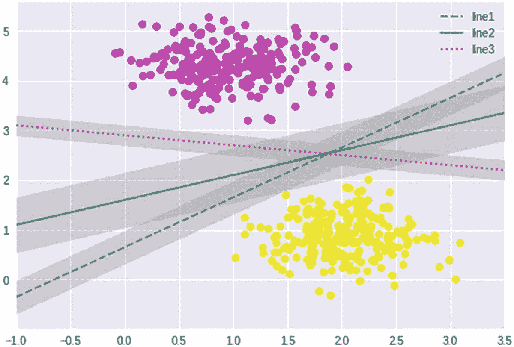

图 2-3

SVM

核函数改变了线性公式中点积的定义。常见的点积类型包括线性、多项式、径向基函数和 Sigmoid 函数。通常，RBF 函数被用作大多数 SVM 模型的默认核函数 [7]。

在图 2-1 中，针对不同的数据点，我们尝试了多个超平面，但最终选择了超平面（直线 2），因为它具有最大的间隔。

要在 `rustlearn` 中实现 SVM，我们需要首先使用合适的核函数创建模型，然后在训练数据集上拟合模型。`rustlearn` 中的 SVM 模块只是对 `libsvm` 包的一个封装。^(⁸) 请观察清单 2-47 中的代码片段，其中展示了不同核函数的模型。

```rust
use rustlearn::svm::libsvm::svc::{
    Hyperparameters as libsvm_svc, KernelType};
pub fn run() -> Result> {
    // 之前的代码 ...
    let svm_linear_model = libsvm_svc::new(
        4, KernelType::Linear, 3)
        .C(0.3).build();
    let svm_poly_model = libsvm_svc::new(4, KernelType::Polynomial, 3)
        .C(0.3) .build();
    let svm_rbf_model = libsvm_svc::new(4, KernelType::RBF, 3)
        .C(0.3).build();
    let svm_sigmoid_model = libsvm_svc::new(4, KernelType::Sigmoid, 3)
        .C(0.3).build();
    let svm_kernel_types = ["linear", "polynomial", "rbf", "sigmoid"];
    let mut svm_model_types = [svm_linear_model, svm_poly_model, svm_rbf_model, svm_sigmoid_model];
    for (kernel_type, svm_model) in svm_kernel_types.iter().zip(svm_model_types.iter_mut()) {
        svm_model.fit(&flower_x_train, &flower_y_train).unwrap();
        let prediction = svm_model.predict(&flower_x_test).unwrap();
        let acc = accuracy_score(&flower_y_test, &prediction);
        println!("Lib svm {kernel}: accuracy: {accuracy}", accuracy=acc, kernel=kernel_type);
    };
    // 剩余代码 ...
```
`清单 2-47` - `chapter3/rustlearn_classification_tasks/src/svm.rs`

我们应该会得到类似于清单 2-48 所示的输出。

```text
Lib svm linear: accuracy: 0.9
Lib svm polynomial: accuracy: 0.9
Lib svm rbf: accuracy: 0.8666667
Lib svm sigmoid: accuracy: 0.26666668
```
`清单 2-48` - 输出

### 2.8.7 K 近邻算法

### 2.8.8 神经网络

在 Rust 中进行分类时，我们主要关注`rustlearn`；进行回归时，我们使用了`rusty machine`。但`rusty machine`中有一个流行分类器是`rustlearn`所没有的，那就是K近邻算法。KNN算法的假设是“物以类聚”，或者说，相似的事物往往会产生相同的结果。因此，一个对象是通过其邻居的多数投票来分类的。

在`rusty machine`中，KNN分类器尚未发布到 crate 上，因此我们需要克隆仓库并从本地路径构建，或者使用 GitHub 引用（清单 2-49）。

```
[package]
name = "rusty_machine_classification"
version = "0.1.0"
edition = "2018"
[dependencies]
rusty-machine = { path = "../rusty-machine" }
ml-utils = { path = "../ml-utils" }
rand = "0.6.5"
csv = "1.0.7"
```
清单 2-49 `chapter2/rusty_machine_classification/Cargo.toml`

由于这是一个分类算法，我们将使用`Flower`结构体和鸢尾花数据集。`Flower`结构体已为`rustlearn`的使用而实现，因此我们需要进行一些额外的调整（清单 2-50）。

```
use rusty_machine as rm;
use rm::linalg::Matrix;
use rm::linalg::Vector;
use ml_utils;
use ml_utils::datasets::Flower;
fn main() -> Result<(), Box<dyn std::error::Error>> {
// 之前的数据加载和分割代码 ...
// 区分特征和标签。
let flower_x_train: Vec<f64> = train_data.iter().flat_map(|r| {
    let features = r.into_feature_vector();
    let features: Vec<f64> = features.iter().map(
        |&x| x as f64).collect();
    features
}).collect();
let flower_y_train: Vec<usize> = train_data.iter().map(
    |r| r.into_int_labels() as usize).collect();
let flower_x_test: Vec<f64> = test_data.iter().flat_map(|r| {
    let features = r.into_feature_vector();
    let features: Vec<f64> = features.iter().map(
        |&x| x as f64).collect();
    features
}).collect();
let flower_y_test: Vec<u32> = test_data.iter().map(
    |r| r.into_int_labels() as u32).collect();
// 将数据转换为 rusty machine 所需的矩阵
let flower_x_train = Matrix::new(train_size, 4, flower_x_train);
let flower_y_train = Vector::new(flower_y_train);
let flower_x_test = Matrix::new(test_size, 4, flower_x_test);
// 剩余代码 ...
```
清单 2-50 `chapter2/rusty_machine_classification/src/main.rs`

请记住，`rustlearn`需要`f32`类型的向量，而在`rusty machine`中，我们需要创建`f64`类型的`rulinalg`矩阵，因此我们需要在以上代码中将这些`f32`向量转换为`f64`，然后再创建矩阵。此外，`Flower`结构体的`into_int_labels`方法与`into_labels`相同，但此处是为`u64`实现的，因为我们处理的是特定的标签（清单 2-51）。

```
impl Flower {
    // ... Flower 的之前代码
    pub fn into_int_labels(&self) -> u64 {
        match self.species.as_str() {
            "setosa" => 0,
            "versicolor" => 1,
            "virginica" => 2,
            l => panic!(
                "无法解析目标。传入了其他目标。{:?}", l),
        }
    }
}
```
清单 2-51 `chapter2/rust-lang/ml-utils/src/datasets.rs`

这被转换为`usize`类型，因为我们稍后要使用的KNN `struct`将标签实现为`usize`类型。

现在，我们应该能够创建一个简单的KNN分类器，并在鸢尾花数据集上训练它（清单 2-52）。

```
use rm::learning::knn::KNNClassifier;
use rusty_machine::learning::knn::{KDTree, BallTree, BruteForce};
use rm::learning::SupModel;
use ml_utils::sup_metrics::accuracy;
fn main() -> Result<(), Box<dyn std::error::Error>> {
    // 之前的代码 ...
    let mut knn = KNNClassifier::new(2); // 模型初始化
    knn.train(&flower_x_train, &flower_y_train).unwrap(); // 训练
    let preds = knn.predict(&flower_x_test).unwrap(); // 预测
    let preds: Vec<u32> = preds.data().iter().map(|&x| x as u32).collect();
    println!("accuracy {:?}",
        accuracy(preds.as_slice(), &flower_y_test)); // 准确率
    Ok(())
}
```
清单 2-52 `chapter2/rusty_machine_classification/src/main.rs`

报告的准确率应该在 93% 到 100% 之间。

在`rusty-machine`中，除了默认的KDTree算法外，我们还可以使用不同的KNN模型。我们可以使用Ball tree算法（适用于维度非常高的情况），或者Brute force算法，其优势在于可以轻松并行化（清单 2-53）。

```
use rusty_machine::learning::knn::{KDTree, BallTree, BruteForce};
fn main() -> Result<(), Box<dyn std::error::Error>> {
    // 之前的代码 ...
    let mut knn = KNNClassifier::new_specified(2, BallTree::new(30));
    let mut knn = KNNClassifier::new_specified(2, KDTree::default());
    let mut knn = KNNClassifier::new_specified(2, BruteForce::default());
    // 剩余代码 ...
```
清单 2-53 `chapter2/rusty_machine_classification/src/main.rs`

完整的代码，请查看`chapter2`文件夹中的`rusty_machine_classification`包。

神经网络是一组算法，其设计灵感来源于人脑，主要用于识别模式。使用神经网络最流行的方法之一是将它们堆叠成组。可用的有效网络通常由多个层组成，这些层又由节点构成。节点是进行计算的地方。节点将数据输入与一组系数或权重相结合，这些系数或权重会放大或抑制输入，从而根据算法试图学习的任务（例如，哪个输入最有助于无误差地对数据进行分类）为输入分配重要性。这些输入与权重的乘积被求和，然后通过一个“激活函数”。激活函数通常是非线性的，它们用于确定信号是否以及以何种程度在网络中进一步传播，以影响最终结果，例如分类任务。如果信号通过，则神经元被“激活”。请参见图 2-4 以了解节点可能的样子。

节点层是一排类似神经元的开关，当输入通过网络时，这些开关会打开或关闭。从接收数据的初始输入层开始，每一层的输出同时是下一层的输入。将模型的可调整权重与输入特征配对，是我们根据神经网络如何对输入进行分类和聚类来为这些特征分配重要性的方式。

具有多个隐藏层的神经网络，其每一层节点都基于前一层的输出，在一组不同的特征上进行训练。更深的层能够学习训练数据中更复杂的特征，因为它们能够聚合和重组来自前一层的特征。示例如图 2-5 所示。

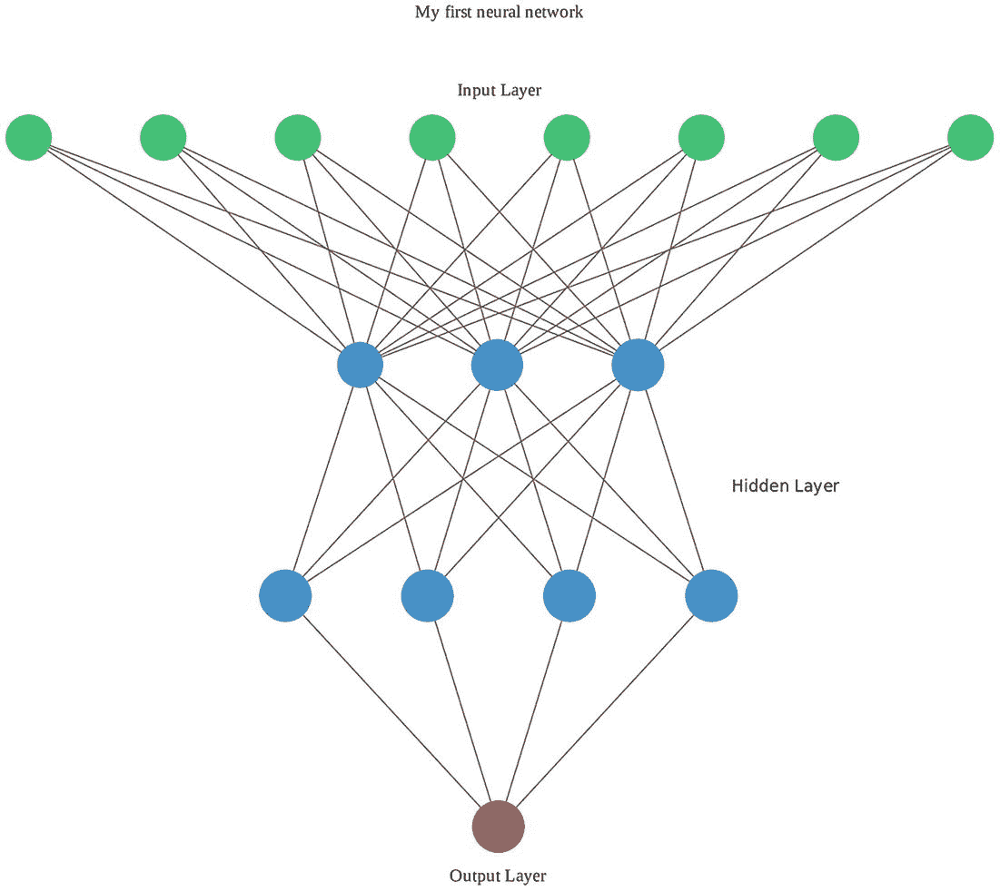
图 2-5 深度神经网络

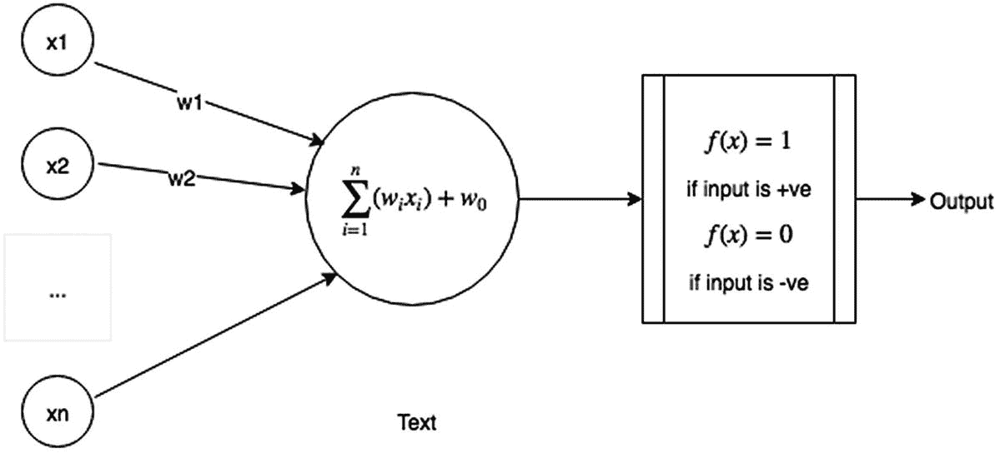
图 2-4 单节点示例

### 2.8.8.1 Torch 和 tch-rs

Torch 是一个科学计算框架，广泛支持机器学习算法，并且对 GPU [8] 有良好的支持。它被广泛用于深度学习和创建神经网络架构。Torch 的 C 语言实现被打包在名为 `libtorch` 的包中分发。它提供了一个灵活的 N 维数组或张量，支持索引、切片、转置、类型转换、调整大小、共享存储和克隆等基本例程。大多数其他包都使用此对象，并且在其之上构建了有用且更复杂的例程。

在 Rust 中，`libtorch` C++ API 已通过 `tch-rs` crate 进行了扩展。^(⁹) 该 crate 的目标是尽可能接近 C++ API。

要使用 `tch-rs`，只需将 `tch-rs` 添加到你的 `Cargo.toml` 中，然后执行 `cargo build` 即可。如果你在 Mac 系统上，可能会遇到清单 2-54 中显示的错误。

```
dyld: Library not loaded: @rpath/libmklml.dylib
Referenced from: /path to libtorch/lib/libcaffe2.dylib
Reason: image not found
清单 2-54
可能的错误
```

我们可以通过手动下载文件并在 Mac 终端中添加 lib 文件的路径来解决此错误（清单 2-55）。

```
wget https://github.com/intel/mkl-dnn/releases/download/v0.18/mklml_mac_2019.0.3.20190220.tgz
$ gunzip -c mklml_mac_2019.0.3.20190220.tgz| tar xvf -
$ export LD_LIBRARY_PATH=/path to mkl folder/lib:"$LD_LIBRARY_PATH"
清单 2-55
mkl 安装
```

之后代码应该可以构建。

接下来，我们将在其上构建一个小型神经网络，以便网络可以在数据上进行训练。为此，我们需要更改数据。接下来，我们将查看所有重要步骤。这些步骤假设所有数据预处理步骤已完成，并且与我们之前章节中遇到的步骤类似。完整的代码也存在于 `iris_classification_tchrs` 包中，供参考。

首先，我们需要指定相同的测试训练比例。这是一个需要注意的技术细节，原因在于矩阵乘法的工作方式以及我们稍后将看到的影响（清单 2-56）。

```
pub fn run() -> Result> {
// 之前的代码 ...
let test_size: f64 = 0.5;
// 剩余代码 ...
清单 2-56
chapter2/iris_classification_tchrs/src/simple_nn.rs
```

现在，我们需要将向量转换为 torch 张量，以便我们能够对这些张量执行计算（清单 2-57）。

```
use tch::{kind, Kind, Tensor};
pub fn run() -> Result> {
// 之前的代码 ...
let flower_x_train = Tensor::float_vec(
flower_x_train.as_slice());
let flower_y_train = Tensor::float_vec(
flower_y_train.as_slice()).to_kind(Kind::Int64);
let flower_x_test = Tensor::float_vec(
flower_x_test.as_slice());
let flower_y_test = Tensor::float_vec(
flower_y_test.as_slice()).to_kind(Kind::Int64);
// 剩余代码 ...
清单 2-57
chapter3/iris_classification_tchrs/src/main.rs
```

现在，我们可以重塑向量以反映训练集大小和特征维度。在这种情况下，标签值本质上是向量（清单 2-58）。

```
pub fn run() -> Result> {
// 之前的代码 ...
let train_size = train_size as i64;
let test_size = test_size as i64;
let flower_x_train = flower_x_train.view(&[train_size, 4]);
let flower_x_test = flower_x_test.view(&[test_size, 4]);
let flower_y_train = flower_y_train.view(&[train_size]);
let flower_y_test = flower_y_test.view(&[test_size]);
// 剩余代码 ...
清单 2-58
chapter3/iris_classification_tchrs/src/main.rs
```

现在我们开始实际创建神经网络。与图 2-4 类似，我们将创建一个单层网络，在该网络中对矩阵方程 *Y* = *X* * *W* + *B* 进行优化，其中所有值均为向量或矩阵[9]。为此，我们需要初始化权重和偏置（代码清单 2-59）。

```
pub fn run() -> Result> {
// 之前的代码 ...
let mut ws = Tensor::ones(
&[feature_length, 1], kind::FLOAT_CPU)
.set_requires_grad(true);
let mut bs = Tensor::ones(
&[train_size], kind::FLOAT_CPU)
.set_requires_grad(true);
// 剩余代码 ...
代码清单 2-59
chapter3/iris_classification_tchrs/src/main.rs
```

在上述示例中，我们将 `requires_grad` 设置为 `true`，因为需要计算这些值的梯度。张量的 `requires_grad` 默认值为 `false`，对于 `requires_grad` 为 `false` 的张量，不会计算其梯度[8]。

接下来，我们首先需要执行矩阵乘法 `flower_x_train * ws + bs`。然后，我们将根据 `flower_y_train` 计算损失。接着，需要反向传播损失。此操作将重复多个周期（epoch），并且我们将报告每个周期的准确率，以便能够跟踪模型准确率的增减情况（代码清单 2-60）。

```
pub fn run() -> Result> {
// run 代码的前面部分 ...
for epoch in 1..200 {
let logits = flower_x_train.mm(&ws) + &bs;
let loss = logits.squeeze().cross_entropy_for_logits(
&flower_y_train);
ws.zero_grad();
bs.zero_grad();
loss.backward();
no_grad(|| {
ws += ws.grad() * (-1);
bs += bs.grad() * (-1);
});
let test_logits = flower_x_test.mm(&ws) + &bs;
let test_accuracy = test_logits
.argmax1(-1, false)
.eq1(&flower_y_test)
.to_kind(Kind::Float)
.mean()
.double_value(&[]);
println!(
"epoch: {:4} train loss: {:8.5} test acc: {:5.2}%",
epoch,
loss.double_value(&[]),
100\. * test_accuracy
);
}
Ok(())
}
代码清单 2-60
chapter3/iris_classification_tchrs/src/simple_nn.rs
```

我们期望看到模型损失逐步下降。输出应类似于代码清单 2-61 所示。

```
$ cd chapter2/iris_classification_tchrs
$ wget https://github.com/intel/mkl-dnn/releases/download/v0.19/mklml_mac_2019.0.5.20190502.tgz
... 其他日志 ...
Length: 28288113 (27M) [application/octet-stream]
Saving to: 'mklml_mac_2019.0.5.20190502.tgz'
mklml_mac_2019.0.5.20190502.tgz                100%[========================================================================================>]  26.98M  1.07MB/s    in 2m 44s
2019-08-08 08:44:34 (169 KB/s) - 'mklml_mac_2019.0.5.20190502.tgz' saved [28288113/28288113]
$ gunzip -c mklml_mac_2019.0.5.20190502.tgz| tar xvf -
x mklml_mac_2019.0.5.20190502/
...
x mklml_mac_2019.0.5.20190502/third-party-programs.txt
$ ls mklml_mac_2019.0.5.20190502/lib
libiomp5.dylib libmklml.dylib
$ export LD_LIBRARY_PATH=mklml_mac_2019.0.5.20190502/lib:"$LD_LIBRARY_PATH"
$ cargo run nn < ../datasets/iris.csv
Finished dev [unoptimized + debuginfo] target(s) in 0.05s
Running `target/debug/iris_classification_tchrs nn`
Training data shape [300]
Training flower_y_train data shape [75]
epoch:    1 train loss:  1.69804 test acc: 30.67%
... 每个周期都打印
epoch:  199 train loss:  1.10409 test acc: 29.33%
代码清单 2-61
chapter3/iris_classification_tchrs/src/simple_nn.rs
```

`使用 Torch 的线性网络` 创建之前的模型对于理解神经网络很有帮助，但在 `torch` 中还有一种更好的创建网络的方法，类似于 `pytorch` 中所倡导的方式。要在 `torch` 中创建模型，我们可以创建一个简单的 `struct`，然后为该结构体实现 `forward` 方法（代码清单 2-62）。

```
use tch;
use tch::{nn, kind, Kind, Tensor, no_grad, vision, Device};
use tch::{nn::Module, nn::OptimizerConfig};
static FEATURE_DIM: i64 = 4;
static HIDDEN_NODES: i64 = 10;
static LABELS: i64 = 3;
#[derive(Debug)]
struct Net {
    fc1: nn::Linear,
    fc2: nn::Linear,
}
impl Net {
    fn new(vs: &nn::Path) -> Net {
        let fc1 = nn::Linear::new(vs,
                                 FEATURE_DIM, HIDDEN_NODES,
                                 Default::default());
        let fc2 = nn::Linear::new(vs,
                                 HIDDEN_NODES, LABELS,
                                 Default::default());
        Net { fc1, fc2 }
    }
}
impl Module for Net {
    fn forward(&self, xs: &Tensor) -> Tensor {
        xs.apply(&self.fc1).relu().apply(&self.fc2)
    }
}
代码清单 2-62
chapter2/iris_classification_tchrs/src/linear_with_sgd.rs
```

在上述模型中，我们创建了两个线性网络，本质上是在输入层和输出标签之间构建了一个隐藏网络。然后重写 `forward` 方法来实现该网络。

为了训练上述网络，我们需要将 `Flower` 向量转换为 `torch` 张量（代码清单 2-63）。

```
pub fn run() -> Result<()> {
    // 之前的代码包含数据加载和数据分割 ...
    let flower_x_train = Tensor::float_vec(
        flower_x_train.as_slice());
    let flower_y_train = Tensor::float_vec(
        flower_y_train.as_slice()).to_kind(Kind::Int64);
    let flower_x_test = Tensor::float_vec(
        flower_x_test.as_slice());
    let flower_y_test = Tensor::float_vec(
        flower_y_test.as_slice()).to_kind(Kind::Int64);
    let train_size = train_size as i64;
    let test_size = test_size as i64;
    let flower_x_train = flower_x_train.view(
        &[train_size, FEATURE_DIM]);
    let flower_x_test = flower_x_test.view(
        &[test_size, FEATURE_DIM]);
    let flower_y_train = flower_y_train.view(
        &[train_size]);
    let flower_y_test = flower_y_test.view(
        &[test_size]);
    // 该函数的剩余部分 ...
代码清单 2-63
chapter2/iris_classification_tchrs/src/linear_with_sgd.rs
```

现在，模型和相应的张量已经创建完毕，我们应该能够使用 `SGD` 算法来训练该模型（代码清单 2-64）。

```
let vs = nn::VarStore::new(Device::Cpu); // 对于更大的模型，请使用 GPU。
let net = Net::new(&vs.root());
let opt = nn::Adam::default().build(&vs, 1e-3)?;
for epoch in 1..200 {
    let loss = net
        .forward(&flower_x_train)
        .cross_entropy_for_logits(&flower_y_train);
    opt.backward_step(&loss);
    let test_accuracy = net
        .forward(&flower_x_test)
        .accuracy_for_logits(&flower_y_test);
    println!(
        "epoch: {:4} train loss: {:8.5} test acc: {:5.2}%",
        epoch,
        f64::from(&loss),
        100\. * f64::from(&test_accuracy),
    );
};
代码清单 2-64
chapter2/iris_classification_tchrs/src/simple_nn.rs
```

我们应该能够运行命令 `cargo run linear_with_sgd < data/iris.csv` 来运行这个线性模型。

### 2.8.9 模型评估

与回归部分类似，在本分类部分中，我们也一直在展示模型的准确率以及相应的模型代码，以便读者可以自行执行代码并核对准确率。本节将解释我们使用的各个模型评估函数。

`准确率` 评估分类模型最常用的指标是分类准确率。它是正确预测的数量与总输入样本数量的比值。

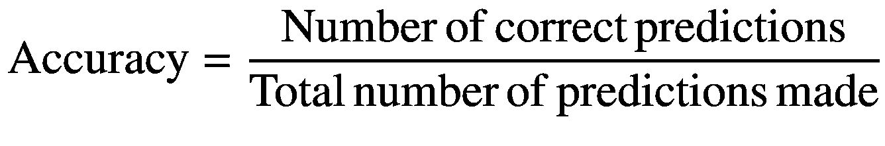

(9)

我们可以使用下面的函数（列表 2-65）来实现它。

## 准确率计算

```rust
pub fn accuracy(y_test: &[u32], y_preds: &[u32]) -> f32 {
    let mut correct_hits = 0;
    for (predicted, actual) in y_preds.iter().zip(y_test.iter()) {
        if predicted == actual {
            correct_hits += 1;
        }
    }
    let acc: f32 = correct_hits as f32 / y_test.len() as f32;
    acc
}
```
列表 2-65 `ml-utils/src/sup_metrics.rs`

该函数的签名使用 `u32` 类型，因为 `y` 值将是特定的标签。

或者，由于我们在本章中使用 `rustlearn`，我们可以使用该包中的 `accuracy_score` 函数（列表 2-66）。

```rust
use rustlearn::metrics::accuracy_score;
pub fn run() -> Result<()> {
    // 之前的代码 ...
    let prediction = model.predict(&flower_x_test).unwrap();
    let acc = accuracy_score(&flower_y_test, &prediction);
    // 剩余代码 ...
}
```
列表 2-66 `chapter3/rustlearn_classification_tasks/src/logistic_reg.rs`

使用上述函数，我们应该能够看到所实现模型的以下准确率分数（列表 2-67）。

```
$ cargo run lr < data/iris.csv
Finished dev [unoptimized + debuginfo] target(s) in 3.66s
Running `target/debug/rustlearn_classification_tasks lr`
Logistic Regression: accuracy: 0.3
Logistic Regression: accuracy: 0.3
```
列表 2-67 `chapter3/rustlearn_classification_tasks/src/logistic_reg.rs`

这种计算准确率分数的方法仅在每个类别的样本数量相等时才有效。例如，假设 99% 的样本属于 A 类，其余 1% 属于 B 类。那么根据上述指标，一个简单的模型（如列表 2-68 所示）将所有样本外类别预测为 A 类，其准确率将达到 99%。

```rust
fn model(y_test: &Vec<String>) -> Vec<String> {
    vec![String::from("Class A"); y_test.len()]
}
```
列表 2-68 我的超棒机器学习模型

结果将是，我们会对达到高准确率产生一种虚假的安全感。

## 对数损失

**对数损失**（或称交叉熵损失）通过惩罚错误分类来工作。它适用于多类分类。当预测概率偏离实际标签时，对数损失会增加。一个完美的模型的对数损失为 0。因此，当实际观测标签为 1 时，预测概率为 0.12 将会很糟糕，并导致较高的对数损失 [10]。其公式如下：

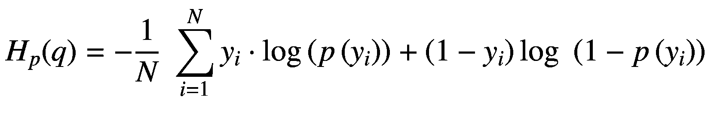

(10)

图 2-6 中的图表显示了在真实观测值为 1 的情况下，可能出现的对数损失范围。当概率接近 1 时，对数损失并不陡峭，但当概率趋近于 0 时，它会迅速增加。我们希望任何错误都受到惩罚，但请注意，当预测器自信且错误时，惩罚是无限的。

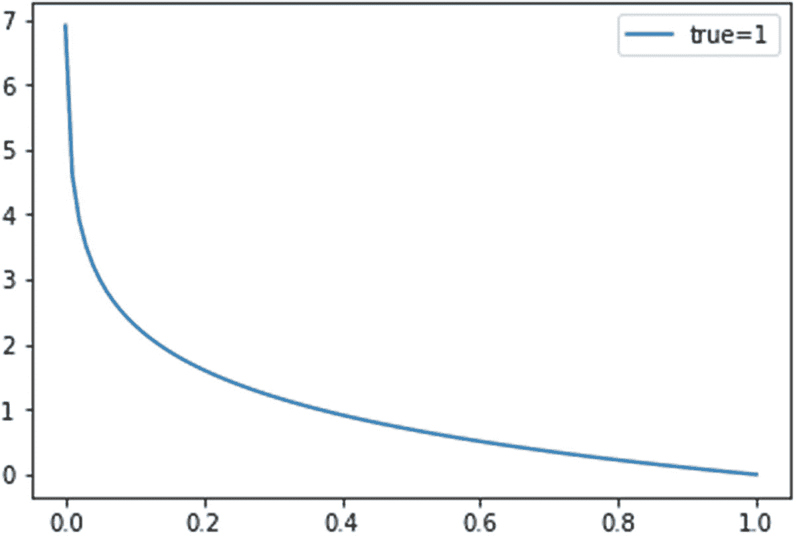

图 2-6 对数损失

因此，与简单的“是/否”性质相比，对数损失对准确率有更细致的考量。它根据模型与真实值的偏差程度给出一个值。

在 Rust 中，列表 2-69 中的函数将计算对数损失分数。向量 `y_test` 和 `y_preds` 分别是真实值和预测值。对数损失对于概率值 0 和 1 是未定义的，因此 `y_test` 向量被限制在略高于 0 和略低于 1 的范围内，由 `eps` 根据公式 `max(min(*p*, 1 − ∈), ∈)` 给出。注意，这里使用了 `partial_cmp` 进行比较，因为我们是在两个浮点数之间进行比较。Rust 官方的立场是，比较浮点数非常棘手且依赖于具体情况，最好尽可能避免。没有“开箱即用”的万能解决方案 [11]。

完成后，我们将在限制后的向量上实现用于二分类的实际对数损失函数。

```rust
fn logloss_score(y_test: &Vec<f32>,
                  y_preds: &Vec<f32>,
                  eps: f32) -> f32 {
    let y_preds = y_preds.iter().map(|&p| {
        match p.partial_cmp(&(1.0 - eps)) {
            Some(Ordering::Less) => p,
            _ => 1.0 - eps, // 如果相等或更大。
        }
    });
    let y_preds = y_preds.map(|p| {
        match p.partial_cmp(&eps) {
            Some(Ordering::Less) => eps,
            _ => p,
        }
    });
    let logloss_vals = y_preds.zip(y_test.iter())
        .map(|(predicted, &actual)| {
            if actual as f32 == 1.0 {
                (-1.0) * predicted.ln()
            } else if actual as f32 == 0.0 {
                (-1.0) * (1.0 - predicted).ln()
            } else {
                panic!("不支持。y_preds 应为 0 或 1");
            }
        });
    logloss_vals.sum()
}
```
列表 2-69 `ml-utils/src/sup_metrics.rs`

现在可以将其用于类似列表 2-70 的代码中。

```rust
pub fn run() -> Result<()> {
    let preds = vec![1., 0.0001, 0.908047338626,
                     0.0199900075962, 0.904058545833, 0.321508119045,
                     0.657086320195];
    let actuals = vec![1., 0., 0., 1., 1., 0., 0.];
    println!("{:?}",
             logloss_score(&actuals, &preds, 1e-15)); // 输出 7.8581247
    Ok(())
}
```
列表 2-70 `chapter2/rustlearn_classification_tasks/src/binary_class_scores.rs`

## ROC-AUC

**ROC-AUC**（ROC 曲线）是一个显示分类模型在所有分类阈值下性能的图表 [12]。该曲线绘制了两个参数：
*   真正率
*   假正率

真正率（`TPR`）是召回率的同义词，因此定义为：

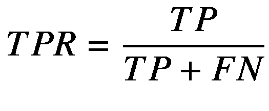

(11)

假正率定义为：

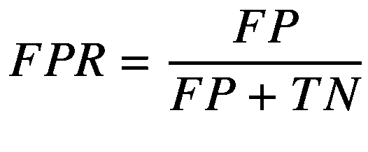

(12)

ROC 曲线在不同分类阈值下绘制 `TPR` 与 `FPR` 的关系。降低分类阈值会将更多项目分类为正类，从而同时增加假正例和真正例。

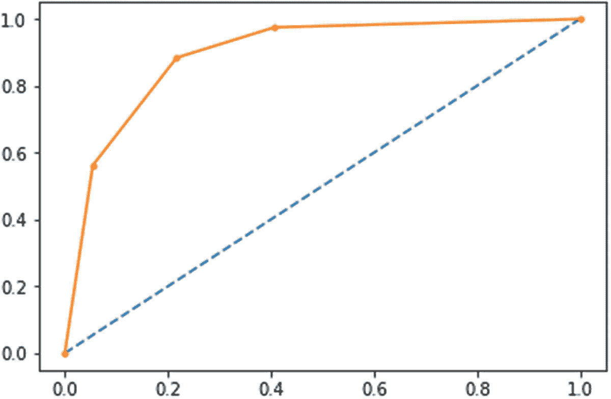

图 2-7 ROC-AUC 曲线

`AUC` 代表“ROC 曲线下面积”。它测量整个 ROC 曲线下的整个二维区域。对于图 2-7，ROC-AUC 面积为 0.895。显而易见，该分数的范围在 0 到 1 之间。值越大，模型的性能越好。

`rustlearn` crate 为二分类实现了 `ROC-AUC` 分数（列表 2-71）。

```
use rustlearn::metrics::roc_auc_score;
pub fn run() -> Result<()> {
let preds = vec![
1., 0.0001, 0.908047338626,
0.0199900075962, 0.904058545833,
0.321508119045, 0.657086320195];
let actuals = vec![1., 0., 0., 1., 1., 0., 0.];
println!("logloss score: {:?}",
logloss_score(&actuals, &preds, 1e-15));
println!("roc auc scores: {:?}",
roc_auc_score(&Array::from(actuals), // new code
&Array::from(preds))?);
Ok(())
}
清单 2-71
chaper3/rustlearn_classification_tasks/src/binary_class_scores.rs
```

运行上述代码应得到类似清单 2-72 所示的结果。

```
$ cargo run bs
Finished dev [unoptimized + debuginfo] target(s) in 0.16s
Running `target/debug/rustlearn_classification_tasks bs`
logloss score: 7.8581247
roc auc scores: 0.6666667
清单 2-72
chaper3/rustlearn_classification_tasks/src/binary_class_scores.rs
```

## 2.9 本章小结

本章向你介绍了不同的回归算法，例如线性回归、高斯过程和广义线性模型。除了算法之外，还介绍了`rusty_machine`包，以及如何使用该包创建这些算法的回归模型。最后，我们以理解如何评估回归模型来结束本章。

在下一章中，你将学习如何创建分类模型。