# 3. 无监督学习与强化学习

在前面的章节中，我们了解了属于监督学习范畴的回归和分类算法 [1]。在本章中，我们将探讨机器学习的其余形式，即无监督算法和强化学习。在无监督算法中，没有给出标签或目标类别。因此，无监督学习的目标是尝试找到模式的自然划分。

执行无监督学习的主要形式是通过聚类。

首先，我们将重点介绍不同的无监督学习算法，以及如何使用 Rust 实现它们。我们将使用相同的 Iris 数据集，数据准备步骤与我们在第 2 章中看到的相同。最后，我们应该得到两个 `rusty_machine` 稠密矩阵 `flower_x_train` 和 `flower_x_test`。尽管该数据集并非完全适合无监督学习（因为我们知道标签），但它是一个理解创建无监督模型工作原理的好数据集。

## 3.1 K-Means 聚类

执行无监督学习的一种方法是基于相似性概念观察哪些数据组聚集在一起。解决聚类问题的最简单模型是 k-means。需要预先设定聚类的数量；基于此，数据集被分类，以便形成这些设定数量的聚类。图 3-1 展示了一个使用 k-means 进行聚类的数据集示例。

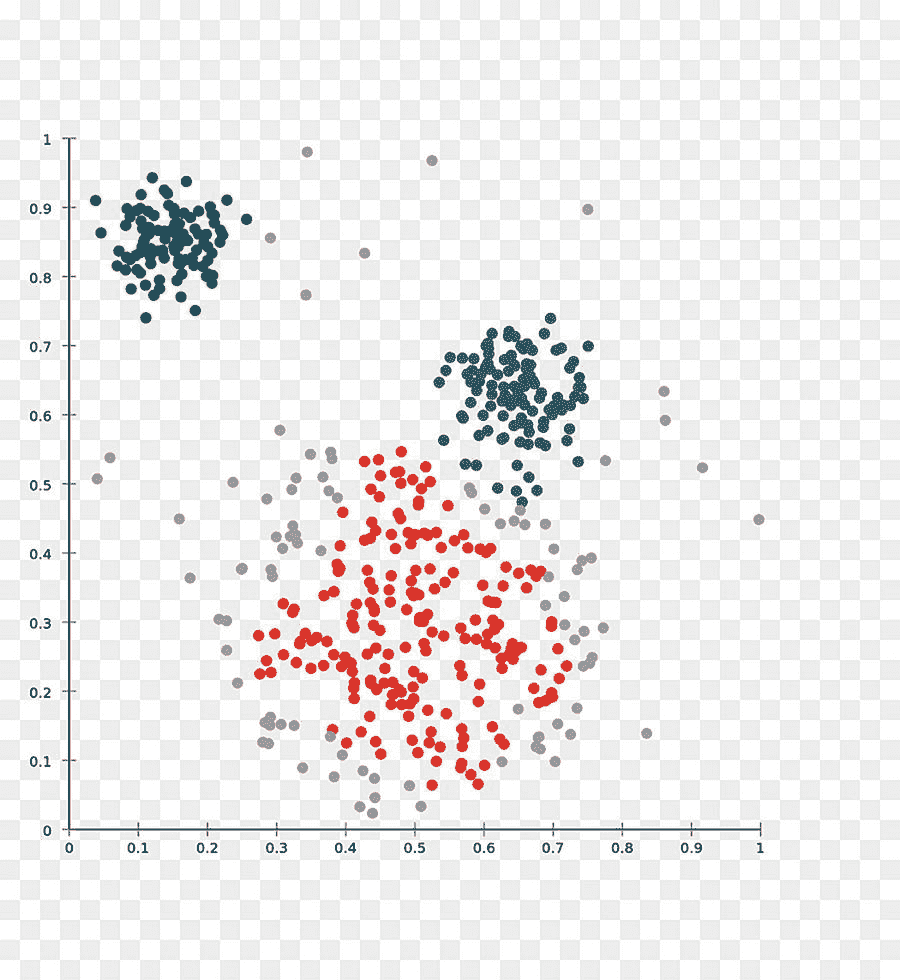

图 3-1

K-means 聚类：此处聚类数取为 3，但我们也可以取为 2

最终 k-means 的输出很大程度上取决于所使用的初始模式。这些模式通常使用 Forgy、Random Partition 或 K-means++ 方法进行初始化。在 Forgy 方法中，从数据集中随机选择 k 个观测值作为初始均值。在随机划分方法中，一开始为每个观测值分配一个聚类，然后进入更新步骤，从而将初始均值计算为聚类随机分配点的质心。Forgy 方法倾向于分散初始均值，而随机划分则将它们全部放置在靠近数据集中心的位置。

K-Means++ 与普通 K-Means 几乎相同，只是 K-Means++ 首先随机分配一个聚类中心，然后根据第一个中心搜索其他中心 [2]。

使用 `rusty_machine`，我们可以利用 `KMeansClassifier` 结构体，通过 `train` 方法在数据上实现和应用 K-Means。然后，我们可以查看模型质心，或者对未见过的数据运行 `predict` 方法（清单 3-1）。

```
use rusty_machine as rm;
use rm::learning::k_means::KMeansClassifier;
fn main() -> Result> {
// 数据加载和分割代码 ...
const clusters: usize = 3;
let model_type = "Kmeans";
let mut model = KMeansClassifier::new(clusters);
model.train(&flower_x_train)?;
let centroids = model.centroids().as_ref().unwrap();
println!("模型质心:\n{:.3}", centroids);
println!("正在预测样本...");
let classes = model.predict(&flower_x_test).unwrap();
println!("kmeans 的类别数: {:?}",
classes.data().len());
剩余代码 ...
清单 3-1
rust-machine-learning/chapter3/rusty_machine_unsupervised/src/main.rs 输出
```

此代码的输出应类似于清单 3-2 所示。

```
$ cargo run < ../../chapter2/datasets/iris.csv
Finished dev [unoptimized + debuginfo] target(s) in 0.04s
Running `target/debug/rusty_machine_unsupervised`
正在训练 Kmeans 模型
模型质心:
5.817 2.710 5.817 1.410
4.988 3.388 4.988 0.260
6.886 3.081 6.886 1.956
正在预测样本...
kmeans 的类别数: 30
清单 3-2
rust-machine-learning/chapter3/rusty_machine_unsupervised/src/main.rs 输出
```

创建此模型会使用 k-means++ 初始化 k-means。除此之外，我们还可以使用 Forgy 或 `RandomPartition` 方法（清单 3-3）。

```
use rm::learning::k_means::{KMeansClassifier, Forgy,
RandomPartition, KPlusPlus};
fn main() -> Result> {
// 之前的代码 ...
// 可以使用 Forgy 或 RandomPartition
let mut model = KMeansClassifier::new_specified(3, 100, Forgy);
// 训练模型
println!("正在训练 kmeans forgy 模型");
model.train(&flower_x_train)?;
let centroids = model.centroids().as_ref().unwrap();
println!("模型质心:\n{:.3}", centroids);
// 预测类别并划分
println!("正在预测样本...");
let classes = model.predict(&flower_x_test).unwrap();
println!("kmeans 的类别数: {:?}", classes.data().len());
println!("{:?}", classes.data().len());
// 剩余代码 ...
}
清单 3-3
rust-machine-learning/chapter3/rusty_machine_unsupervised/src/main.rs 输出
```

请注意，在 `KMeansClassifier::new_specified` 的参数中，我们传递了 3，这是划分的数量，并且我们将 `number_of_epochs` 参数指定为 100。划分类型在清单 3-4 中为 `Forgy`，仅显示清单 3-3 中代码块的输出。

```
正在训练 kmeans forgy 模型
模型质心:
5.018 3.414 5.018 0.264
5.867 2.721 5.867 1.463
6.873 3.045 6.873 1.976
正在预测样本...
kmeans 的类别数: 30

清单 3-4
rust-machine-learning/chapter3/rusty_machine_unsupervised/src/main.rs 输出
```

## 3.2 高斯混合模型

在执行无监督学习时，`k-means` 算法通常是首选算法，因为它的训练和理解相对简单。但 k-means 的简单特性在实际应用中也带来了挑战。在本节中，我们将介绍高斯混合模型（简称 GMM），它是 k-means 的更通用版本。GMM 为 k-means 提供了更坚实的理论和数学基础 [3]。

可以将 k-means 想象为定义圆形球体（或最简单的圆形）：如果一个点位于圆内，它就属于该簇或组；如果不在圆内，则不属于该组。簇中心是圆心，半径可以是最远点到圆心的距离。在 k-means 中，这个半径充当了一个硬边界，决定了哪些点是簇的成员，哪些不是。相比之下，我们可以放宽这个硬边界假设，并假设所有簇中心都对分布中的所有点产生影响。一个有趣的类比是：尽管太阳系中的行星属于同一个簇并围绕太阳（类比簇中心）旋转，但遥远的恒星和星系确实对地球和其他行星施加了某种引力。不过这种引力非常微小，因此在实际计算中可以忽略。

从数学上讲，这是通过假设所有数据点都是由有限数量的、参数未知的高斯分布混合生成的。因此，我们从硬边界的 k-means 转向了一个更具概率性的模型。图 3-2 展示了一个高斯分布，而当我们有多个分布时，其形态如图 3-3 所示。

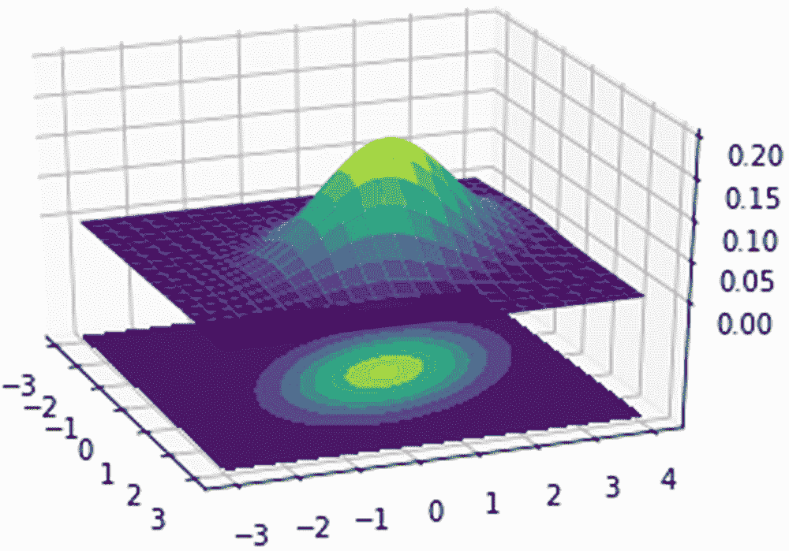

图 3-2

高斯分布

在图 3-3 中，我们使用鸢尾花数据集来映射两个变量之间的分布：`sepal_length`（花萼长度）和 `sepal_width`（花萼宽度）。

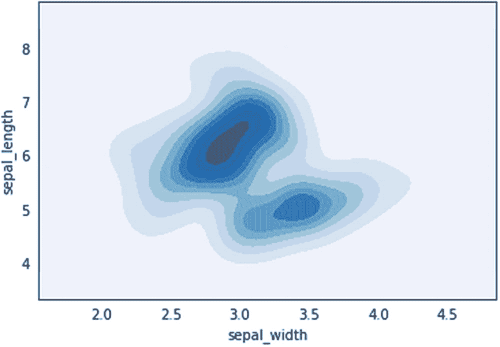

图 3-3

多个分布

一个高斯分布完全由其协方差矩阵和均值决定。高斯分布的协方差矩阵决定了其密度等高线（均为椭球体）的轴方向和长度。不同类型的协方差矩阵如下：

*   **全（`Full`）** 意味着各分量可以独立地采用任何位置和形状。
*   **绑定（`Tied`）** 意味着它们具有相同的形状，但形状可以是任意的。
*   **对角（`Diagonal`）** 意味着等高线轴与坐标轴对齐，但各分量之间的离心率可以不同。
*   **球形（`Spherical`）** 意味着等高线是一个球体。
*   **托普利茨（`Toeplitz`）** 意味着等高线的对角线元素共享相同的参数。它有一个额外的复杂度参数，用于选择活跃的非对角线元素的数量及其常数。
*   **收缩（`Shrinked`）** 意味着等高线形状由对角协方差与任意协方差的复杂组合决定。没有明显的绑定关系，但它绑定了所有特征值，使它们根据同一参数增长或收缩。
*   **核协方差（`Kernel covariance`）** 意味着在这种情况下，协方差由一个正定函数定义。这样我们就能得到一个函数的混合模型（从数学上讲，这是最大程度的泛化）。

除了上述类型，还可以对高斯混合的组成施加约束，这进一步增强了模型的泛化能力 [4]。

高斯混合模型使用期望最大化算法进行评估。该算法通过迭代来寻找统计模型中参数的最大似然估计。使用 EM 算法的优势在于，它能够估计依赖于未观测到的潜在或隐藏变量的模型参数。在这种情况下，我们可以将高斯函数的混合概率视为结果的先验概率。对于给定的各分量值，算法会评估相应的后验概率，称为责任度（`responsibilities`）。这些责任度本质上就是潜在变量 [5]。

使用 `rusty_machine`，我们可以创建一个混合模型。然后设置最大迭代次数和协方差类型。接着，我们可以使用 `train` 方法训练该模型。训练完成后，除了 `predict` 方法，我们还可以获取训练后模型的均值和协方差，并运行预测方法（列表 3-5）。

```
use rm::learning::gmm::{CovOption, GaussianMixtureModel};
use ml_utils::unsup_metrics::{jaccard_index, rand_index};
fn main() -> Result<()> {
// 之前的代码 ...
let mut model = GaussianMixtureModel::new(2);
model.set_max_iters(1000);
model.cov_option = CovOption::Diagonal;
println!("正在训练模型");
model.train(&flower_x_train)?;
// 打印 GMM 的均值和协方差
println!("{:?}", model.means());
println!("{:?}", model.covariances());
// 预测类别并划分
println!("正在预测样本...");
let classes = model.predict(&flower_x_test).unwrap();
println!("GMM 的类别数量: {:?}", classes.data().len());
// 每个点来自每个高斯分布的概率。
println!("GMM 的概率数量: {:?}", classes.data().len());
let predicted_clusters = flower_labels_clusters_gmm(classes.data());
println!("gmm 预测的簇: {:?}", predicted_clusters);
println!("兰德指数: {:?}", rand_index(&predicted_clusters, &flower_y_test_clus));
println!("杰卡德指数: {:?}", jaccard_index(&predicted_clusters, &flower_y_test_clus));
// 其余代码 ...
}
```
列表 3-5: `rust-machine-learning/chapter3/rusty_machine_unsupervised/src/main.rs`

除了 `Diagonal`，我们还可以使用 `Full` 和 `Regularized` 选项。上述模型的输出如列表 3-6 所示。

# 训练混合模型

模型均值：`Some(Matrix { rows: 3, cols: 4, data: [5.00999871185655, 3.4275000972153493, 5.00999871185655, 0.24749396211890054, 6.661363633497823, 3.010315328597311, 6.661363633497823, 1.9381371828096539, 5.685719344467794, 2.670276005506212, 5.685719344467794, 1.3354911643349907] })`

模型协方差：`Some([Matrix { rows: 4, cols: 4, data: [0.13190228661798534, 0.0, 0.0, 0.0, 0.0, 0.16249683048609323, 0.0, 0.0, 0.0, 0.0, 0.13190228661798534, 0.0, 0.0, 0.0, 0.0, 0.011992091366866362] }, Matrix { rows: 4, cols: 4, data: [0.25623508453320654, 0.0, 0.0, 0.0, 0.0, 0.06361683319359594, 0.0, 0.0, 0.0, 0.0, 0.25623508453320654, 0.0, 0.0, 0.0, 0.0, 0.11105964367994896] }, Matrix { rows: 4, cols: 4, data: [0.14296761663516486, 0.0, 0.0, 0.0, 0.0, 0.06916983667682852, 0.0, 0.0, 0.0, 0.0, 0.14296761663516486, 0.0, 0.0, 0.0, 0.0, 0.06722138159035253] }])`

正在预测样本...

`GMM` 类别数：90

`GMM` 类别：`Matrix { rows: 30, cols: 3, data: [0.00000000000000000000000000000000000000000000000000000000000000000000000000014163053449105444, 0.9999999770633979, 0.000000022936602131147763, 0.0000000000000000000000000000000000000000000000000000000026043664126255967, 0.055250462547009986, 0.94474953745299, 0.9999999948172809, 0.0000000000002230990802244913, 0.000000005182496144647463, 0.000000000000000000000000000000000000000000000006363328013832893, 0.9996792118434199, 0.0003207881565800758, 0.9999987790420889, 0.000000020897732033112106, 0.000001200060179100879, 0.00000000000000000000000000000800914271537728, 0.007492030732204336, 0.9925079692677956, 0.000000000000000000000000000000000000000000000000000000000000005285373201144257, 0.9998616296930777, 0.00013837030692238176, 0.9999995096444436, 0.0000000000041527414529597685, 0.0000004903514037292042, 0.9999999132286986, 0.000000000001393742090001966, 0.00000008676990757234786, 0.000000000000000000000000000000004855186479064118, 0.002719277709391326, 0.9972807222906086, 0.000000000000000000000000000000000000000000000000000000000000000000000000000000000000000000000000000000001355051993171768, 0.9999999999966558, 0.0000000000033441909895411436, 0.0000000000000000000000000000000000000005357830561231346, 0.9999562181964523, 0.000043781803547699205, 0.0000000000000000000000000000000000018392034391239705, 0.9999892831622388, 0.000010716837761224078, 0.00000000000000000000000003778865818805634, 0.7503202988312131, 0.2496797011687869, 0.00000000000000000000000000000000000000000000000000000000000000000000000000000000000000003893607802799448, 0.9999999999999958, 0.000000000000004298567960918699, 0.000000000000013072770177035594, 0.00023239823168584218, 0.999767601768301, 0.0000000000000000000000000000000000000000000000015160002176660837, 0.8387135667053368, 0.16128643329466325, 0.0000000000000000000000000000000000000000000000000000000000000000000000000000000000000000000034953327151517393, 0.9999997656317542, 0.00000023436824583147217, 0.0000000000000000000002340633434163898, 0.0005088161744897154, 0.9994911838255103, 0.0000000000000000000000000000000000000000000000000000000000000000000689099149495584, 0.9999999977229123, 0.0000000022770877848717026, 0.9999999436031238, 0.000000000005926988070694233, 0.000000056390949161758715, 0.9999999132286986, 0.000000000001393742090001966, 0.00000008676990757234786, 0.00000000000000000000000000000000000000000000000000000000000000000000000000000005362212435215233, 0.9999122879769339, 0.00008771202306615775, 0.9999997736979629, 0.00000000003757036119192523, 0.0000002262644667433647, 0.0000000000000000000000000000000034483840914121184, 0.9985361511608948, 0.0014638488391051328, 0.0000000000000000000000000000000000000000000004937468317251526, 0.42540236377099694, 0.5745976362290031, 0.9999999948172809, 0.0000000000002230990802244913, 0.000000005182496144647463, 0.9999998751000135, 0.00000000004214458158918603, 0.00000012485784186635827, 0.00000000000000000000000000000000025705463248504494, 0.262309436768884, 0.7376905632311159, 0.9999999956801614, 0.00000000000012481190923957532, 0.0000000043197138843938396] }`

`GMM` 概率数：90

`GMM` 预测的聚类：`[{21, 23, 2, 8, 26, 4, 7, 20, 27, 29}, {13, 3, 10, 14, 16, 6, 22, 24, 0, 12, 17, 11, 19}, {15, 9, 1, 5, 18, 25, 28}]`

兰德指数：0.7793103448275862

杰卡德指数：0.48936170212765956

## 列表 3-6

`rust-machine-learning/chapter3/rusty_machine_unsupervised/src/main.rs` 输出

## 3.3 基于密度的噪声应用空间聚类（DBSCAN）

DBSCAN 的核心思想是：聚类本质上是高密度区域，被低密度区域分隔开。这很像城市，通常高密度聚集，而乡村则密度较低。高密度意味着可能是一个聚类，低密度则被视为噪声。与 k-means 的一个有趣区别在于，k-means 假设底层聚类是凸形的，但 DBSCAN 发现聚类时并不需要这个假设；因此，DBSCAN 可能更具通用性。因此，当数据集很大、聚类形状复杂且数据集中噪声较多时，该算法特别有用。

从评估角度来看，每个点 P 都会被评估，并且在点 P 的设定半径`R`内，必须至少存在一定数量的点`m[1]`、`m[2]`……。这是聚类必须满足的最小密度。该算法需要三个输入参数 [6]。

*   `k`，最近邻列表的大小；
*   `eps`，界定一个点邻域范围的半径；
*   `min points`，在 `eps` 邻域内必须存在的最小点数。

DBSCAN 的问题在于它无法处理密度变化的情况。此外，该算法对参数设置相当敏感。

可以使用 `rusty_machine` 创建 DBSCAN 模型。在列表 3-7 中，我们创建了一个 DBSCAN 模型，其中 `eps` 设为 3，最小样本数设为 10。然后，我们将 `true` 标志传递给模型的 `set_predict` 方法。这使我们能够对新的未见数据使用 `predict` 方法。与之前的模型类似，我们可以在数据集上进行训练和预测。除此之外，我们还可以检查模型已学习到的聚类。

```rust
use rm::learning::dbscan::DBSCAN;
use rm::learning::UnSupModel;
fn main() -> Result> {
// 之前的代码 ...
let mut model = DBSCAN::new(0.3, 10);
model.set_predictive(true);
model.train(&flower_x_train)?;
let clustering = model.clusters().unwrap();
let classes = model.predict(&flower_x_test).unwrap();
// 剩余代码 ...
列表 3-7
rusty_machine_unsupervised
```

除了 `DBSCAN::new`，我们还可以使用 `DBSCAN::default`。初始化的默认值是 `eps` 为 0.5，最小点数为 5。

## 3.4 主成分分析

机器学习的主要组成部分之一是矩阵乘法。矩阵乘法通常计算成本高昂[7]。此外，还需要考虑我们处理的数据维度数量，并且不应不必要地增加过多维度。如图 3-4 所示的休斯现象表明，随着特征数量的增加，分类器的性能也会提升，直到达到最佳特征数量。在训练集大小不变的情况下，继续增加更多特征反而会降低性能。这被称为维度灾难[8]。

许多算法，如 KNN，尤其容易受到维度灾难的影响。避免这种灾难的一种方法是降维。在降维中，我们通常选择一种数学表示，使得原始数据中的大部分（如果不是全部）方差都能被解释。其效果是，我们能够移除大量特征，同时保留大量信息。

主成分分析是一种降维方法。它本质上是一种变换，将原始变量转换为一组新的变量，这些新变量是原始变量集的线性组合。这意味着，例如，如果原始特征是“a”和“b”，那么得到的特征可能是`c = p[1]*a + q[1]*b`和`d = p[2]*a + q[2]*b`。

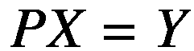

(1)

其中 `X` 是原始记录的数据集，`Y` 是数据集的表示，`P` 是线性变换矩阵。从几何角度看，我们可以看到 `P` 是从 `X` 到 `Y` 的旋转和拉伸。

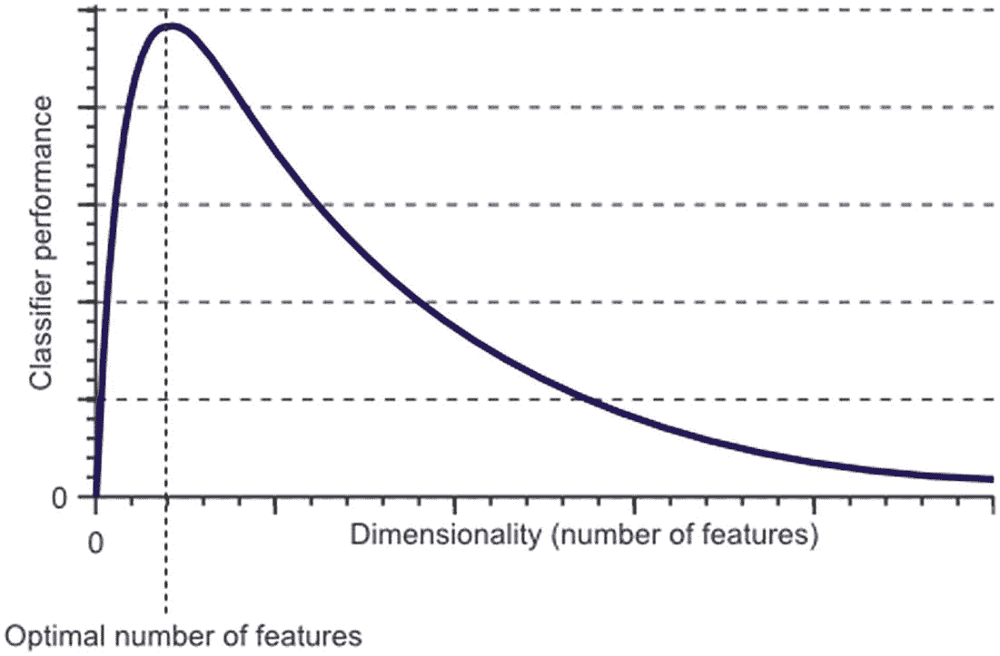

图 3-4

休斯现象

**PCA 与 Rust** 尽管 PCA 已在 `rusty_machine` 中实现，但在本书撰写时，它尚未发布到该 crate 中。因此，我们需要更新 `Cargo.toml` 文件中的依赖项，以从主分支拉取最新代码（列表 3-8）。

```toml
[dependencies]
rusty-machine = { git = "https://github.com/AtheMathmo/rusty-machine.git", rev = "f43da8d" }
Listing 3-8
Cargo.toml
```

现在，我们应该能够创建一个 PCA 模型并在数据上进行训练。在此例中，我们将维度降至 2，并要求模型对聚类进行中心化处理（列表 3-9）。

```rust
use rm::learning::pca::PCA;
use rm::learning::UnSupModel;
let mut model = PCA::new(2, true);
model.train(&flower_x_train)?;
println!("{:?}", model.predict(&flower_x_test)?);
println!("{:?}", model.components());
Listing 3-9
rusty_machine_unsupervised
```

我们也可以使用 `PCA::default` 方法来创建默认模型，但默认模型包含所有主成分。因此，我们实际上并不会降低维度。

## 3.5 测试无监督模型

评估无监督模型的性能很困难，因为没有标签来比较最终得分。一种方法是通过内部指标，例如轮廓系数，其旨在形式化地实现高簇内相似性；即一个簇内的点应彼此接近，并具有低簇间相似性，这意味着两个簇中点之间的相似性应该很低。但内部标准上的高分不一定能转化为应用中的良好效果。另一种方法是在目标应用中进行直接评估。例如，一个实现搜索功能的网站可以测量用户在使用不同聚类算法时找到答案所花费的时间，并通过 Beta 测试来比较这两种算法。这是最直接的评估方式，但成本高昂，尤其是在需要进行大规模用户研究的情况下。

第三种方法是使用用户判断的替代指标，在这种情况下，我们使用一组类别并自行创建一个黄金标准。黄金标准最好由具有较高评判者间一致性的评审员生成。然后，我们可以计算一个外部标准，以评估聚类与黄金标准类别的匹配程度。在本节中，将介绍两种外部标准的度量方法，并附有代码。

**兰德指数** 兰德指数通过考虑所有样本对，并统计在预测聚类和真实聚类中被分配到相同或不同簇的对数，来计算两个聚类之间的相似性度量。兰德指数最常见的公式关注由 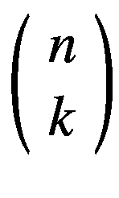 个元素对给出的以下四组不同排列：`N[11]` 是在两种聚类中都被分到同一簇的元素对数量，`N[10]` 是被 `A` 分到同一簇但被 `B` 分到不同簇的元素对数量，`N[01]` 是被 `B` 分到同一簇但被 `A` 分到不同簇的元素对数量，`N[00]` 是被 `A` 和 `B` 都分到不同簇的元素对数量。注意，`N[11]` 和 `N[00]` 是聚类 `A` 和 `B` 之间一致性的指标，而 `N[10]` 和 `N[01]` 则是不一致性的指标。

表 3-1

列联表

| 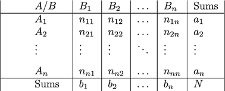 |

列联表如表 3-1 所示。因此，兰德指数由以下函数给出：

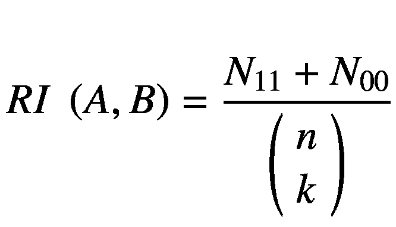

(2)

上述指数的值介于 0 和 1 之间，其中 1 表示聚类结果完全相同，0 表示聚类结果之间没有共享任何一对元素。

兰德指数已在 `ml-utils` 中实现（列表 3-10）。

```rust
pub fn rand_index(clusters1: &[HashSet],
clusters2: &[HashSet]) -> f64 {
let (n11, n10, n01, n00) = count_pairwise_cooccurence(
clusters1, clusters2);
(n11 + n00) / (n11 + n10 + n01 + n00)
}
Listing 3-10
ml-utils/src/unsup_metrics.rs
```

`count_pairwise_cooccurence` 函数的实现可以在同一模块中找到，但为简洁起见，此处省略。

现在，我们应该能够运行此函数并获取指数（列表 3-11）。

# 3.5 杰卡德指数与 3.6 强化学习

```
use ml_utils::unsup_metrics::rand_index;
println!("rand index: {:?}",
    rand_index(&predicted_clusters, &flower_y_test_clus));
```
Listing 3-11
`ml-utils/src/unsup_metrics.rs`

**杰卡德指数**与兰德指数类似。它定义为交集大小除以并集大小。

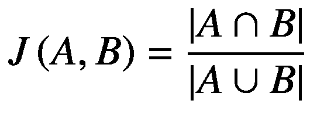
(3)

通过图 3-5 可以轻松理解这一点。当聚类彼此相似时，交集应趋近于并集。

来看一下`ml-utils`中 Jaccard 指数的实现（代码清单 3-12）。

```
pub fn jaccard_index(clusters1: &[HashSet], clusters2: &[HashSet]) -> f64 {
    let (n11, n10, n01, n00) = count_pairwise_cooccurence(clusters1, clusters2);
    let denominator = n11 + n10 + n01;
    if denominator > 0.0 {
        return n11 / denominator;
    } else {
        0.0
    }
}
```
代码清单 3-12
`ml-utils/src/unsup_metrics.rs`

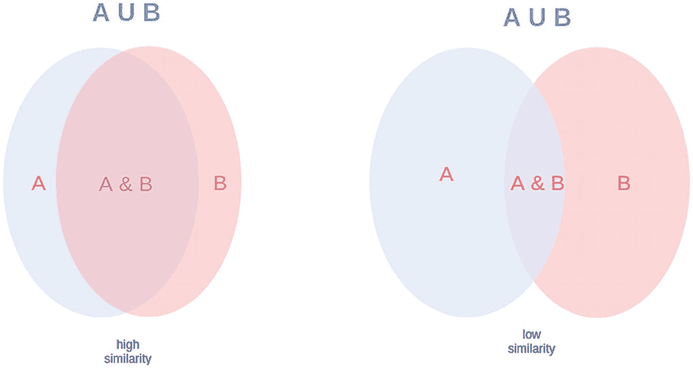
图 3-5 Jaccard

现在，我们应该能够运行此函数并获取指数（代码清单 3-13）。

```
use ml_utils::unsup_metrics::jaccard_index;
println!("jaccard index: {:?}",
    jaccard_index(&predicted_clusters, &flower_y_test_clus));
```
代码清单 3-13
`ml-utils/src/unsup_metrics.rs`

## 3.6 强化学习

强化学习是利用不同算法，在给定情境下选择合适的行动以最大化奖励。与监督学习的区别在于，可能不存在标记好的输入/输出对。在无监督学习中，我们关注的是寻找数据点之间的相似性和差异性。而强化学习更侧重于在给定环境中找到最佳行为。要构建一个强化系统，软件系统应具备在环境中进行观察和采取行动的机制。作为回报，它应以某种形式获得奖励。其理念是最大化长期奖励。

强化学习在现实世界中有多种应用。机器人已在制造业中使用了一段时间。一些重复性任务，例如拾取物体并将其放入容器中，通过在编程中使用强化学习而受益匪浅。无论成功还是失败，它们都能自我训练，并以良好的速度和精度完成任务。强化学习的另一个良好应用领域是股票市场的投机交易。智能体被用于通过 Q-learning 在交易策略之间进行选择，使用一个简单的指令来最大化投资组合的价值。强化学习在那些高度受控且需要在大量行动中快速做出选择的系统中具有巨大价值。

软件用于决定其行动所采用的算法称为其策略。该策略应能访问目标主体的两个函数：一种将观察结果作为输入的方式，以及一种采取下一步行动的方式。

强化学习的挑战之一在于，为了训练智能体，我们需要创建环境。环境既可以是现实世界，也可以是软件模拟。现实世界模拟超出了本书的范围，因此我们将针对软件模拟的一个子集。一个用于强化学习的优秀 crate 是 `rsrl`。由于 API 尚不稳定，我们将使用稍作修改的代码版本，以便能够良好地调用函数（代码清单 3-14）。因此，我们使用 `ndarray` crate 进行矩阵操作，使用 `slog` 进行日志记录。本节重点关注的 crate 是 `rsrl`，它将为我们提供强化学习的相关类型。

```
[package]
name = "rsrl_custom"
version = "0.1.0"
edition = "2018"
[dependencies]
rsrl = { git = "https://github.com/infinite-Joy/rsrl", branch = "mymodel" }
slog = "2.4.1"
ndarray = "0.12.0"
```
代码清单 3-14
`chapter3/rsrl_custom/Cargo.toml`

现在，我们应该能够创建一个自定义模型。此处的大部分代码取自 A2C 示例和强化学习中的 Cart-pole 问题。Cart-pole 问题，也称为倒立摆，是一个重心位于支点之上的摆。这导致摆非常不稳定。目标是通过在支点处沿适当方向施加力来保持杆子平衡。如图 3-6 所示。

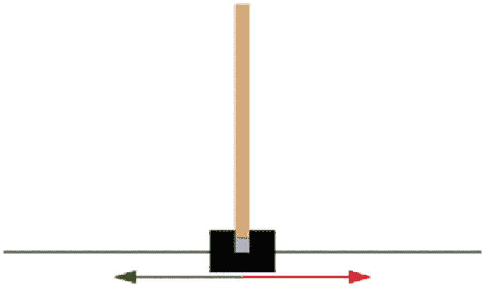
图 3-6 Cart-pole

在每个时间步，我们能够观察到其位置 *x*、速度 *dx*、角度 *θ* 和角速度 *dθ*。因此，状态空间有四个连续值维度，动作空间有一个包含两个离散值的维度。力可以用 `ALL_ACTIONS` 表示（代码清单 3-15）。

```
const ALL_ACTIONS: [f64; 2] = [-1.0 * CART_FORCE, 1.0 * CART_FORCE];
```
代码清单 3-15
`chapter3/rsrl_custom/src/main.rs`

并且我们需要根据当前状态的范围以及施加力时会发生什么来定义环境（代码清单 3-16）。

```
impl CartPole {
    fn new(x: f64, dx: f64, theta: f64, dtheta: f64) -> CartPole {
        CartPole {
            state: Vector::from_vec(vec![x, dx, theta, dtheta]),
        }
    }

    fn update_state(&mut self, a: usize) {
        let fx = |_x, y| CartPole::grad(ALL_ACTIONS[a], &y);
        let mut ns = runge_kutta4(&fx, 0.0, self.state.clone(), TAU);
        ns[StateIndex::X] = clip!(LIMITS_X.0, ns[StateIndex::X], LIMITS_X.1);
        ns[StateIndex::DX] = clip!(LIMITS_DX.0, ns[StateIndex::DX], LIMITS_DX.1);
        ns[StateIndex::THETA] = clip!(LIMITS_THETA.0, ns[StateIndex::THETA], LIMITS_THETA.1);
        ns[StateIndex::DTHETA] = clip!(LIMITS_DTHETA.0, ns[StateIndex::DTHETA], LIMITS_DTHETA.1);
        self.state = ns;
    }

    fn grad(force: f64, state: &Vector) -> Vector {
        let dx = state[StateIndex::DX];
        let theta = state[StateIndex::THETA];
        let dtheta = state[StateIndex::DTHETA];

        let cos_theta = theta.cos();
        let sin_theta = theta.sin();

        let z = (force + POLE_MOMENT * dtheta * dtheta * sin_theta) / TOTAL_MASS;
        let numer = G * sin_theta - cos_theta * z;
        let denom = FOUR_THIRDS * POLE_COM - POLE_MOMENT * cos_theta * cos_theta;
        let ddtheta = numer / denom;
        let ddx = z - POLE_COM * ddtheta * cos_theta;

        Vector::from_vec(vec![dx, ddx, dtheta, ddtheta])
    }
}
```
清单 3-16
`chapter3/rsrl_custom/src/main.rs`

# 在 rsrl 中实现 Domain trait

在 rsrl 中，要实现这个环境，我们需要实现 `Domain` trait。查看 `Domain` trait 的签名，我们可以了解需要实现的行为类型。具体内容可见 [`https://github.com/tspooner/rsrl/blob/master/src/domains/mod.rs`](https://github.com/tspooner/rsrl/blob/master/src/domains/mod.rs)

## trait 定义

```rust
pub trait Domain {
type StateSpace: Space;
type ActionSpace: Space;
fn emit(&self) -> .. // 用于观测
fn step( .. // 给定一个动作，应返回下一个状态
fn is_terminal(&self) -> bool; // 用于在某个时刻终止动作序列
fn reward( .. // 奖励机制
fn state_space(.. // 返回状态空间的一个实例
fn action_space(.. // 返回动作类的一个实例
}
```

## 默认实现

回到 Cart-pole，我们首先定义一个默认实现（清单 3-17）。

```rust
impl Default for CartPole {
fn default() -> CartPole { CartPole::new(0.0, 0.0, 0.0, 0.0) }
}
```

清单 3-17
`chapter3/rsrl_custom/src/main.rs`

## 方法实现

现在，我们应该能够为 Cart-pole 实现 `Domain` 行为。我们首先定义状态空间和动作空间。我们将选择状态空间为 `LinearSpace`，这是 `spaces` 仓库中定义的一个 n 维齐次空间。^(¹⁰) 动作空间需要是 `Ordinal`，这是在 `spaces` 包中用于定义有限、有序值集的类型（清单 3-18）。

```rust
use rsrl::geometry::product::LinearSpace;
use rsrl::geometry::discrete::Ordinal;
impl Domain for CartPole {
type StateSpace = LinearSpace;
type ActionSpace = Ordinal;
```

清单 3-18
`chapter3/rsrl_custom/src/main.rs`

`emit` 很简单。如果是最后一个状态，则将其定义为终止状态，否则定义为完整状态（清单 3-19）。

```rust
impl Domain for CartPole {
// 代码 ..
fn emit(&self) -> Observation> {
if self.is_terminal() {
Observation::Terminal(self.state.clone())
} else {
Observation::Full(self.state.clone())
}
}
fn is_terminal(&self) -> bool {
let x = self.state[StateIndex::X];
let theta = self.state[StateIndex::THETA];
x = LIMITS_X.1
|| theta = LIMITS_THETA.1
}
```

清单 3-19
`chapter3/rsrl_custom/src/main.rs`

现在，我们需要实现 `reward` 和 `state_space` 的行为。当观测是可能观测空间中的最终观测时，`reward` 行为将是最终或终止奖励。对于其他观测集，奖励应为步进奖励（清单 3-20）。

```rust
impl Domain for CartPole {
// 之前的方法定义
fn reward(&self, _: &Observation>, to: &Observation>) -> f64 {
match *to {
Observation::Terminal(_) => REWARD_TERMINAL,
_ => REWARD_STEP,
}
}
// 剩余方法
```

清单 3-20
`chapter3/rsrl_custom/src/main.rs`

状态空间行为是指智能体可能具有的行为范围，换句话说，就是环境对任何智能体施加的约束。由于我们正在尝试建模一个 Cart-pole，状态空间将是空空间与位置 *x*、速度 *dx*、角度 *θ* 和角速度 *dθ* 的有界值的组合，如前所述（清单 3-21）。

```rust
impl Domain for CartPole {
// 之前的方法定义 ...
fn state_space(&self) -> Self::StateSpace {
LinearSpace::empty() + Interval::bounded(LIMITS_X.0, LIMITS_X.1)
+ Interval::bounded(LIMITS_DX.0, LIMITS_DX.1)
+ Interval::bounded(LIMITS_THETA.0, LIMITS_THETA.1)
+ Interval::bounded(LIMITS_DTHETA.0, LIMITS_DTHETA.1)
}
// 剩余方法 ...
```

清单 3-21
`chapter3/rsrl_custom/src/main.rs`

而动作空间将只是值 2，表示在应用动作时，状态空间的某个维度将改变 2，并且这是任意两个连续状态之间唯一可能的差异（清单 3-22）。

```rust
impl Domain for CartPole {
// 之前的方法定义 ...
fn action_space(&self) -> Ordinal { Ordinal::new(2) }
}
```

清单 3-22
`chapter3/rsrl_custom/src/main.rs`

## 训练设置

目前有多种强化学习算法可用于训练环境。我们有 actor-critic 系统，使用 `Q-learning` 及其一些变体来实现。在示例中，我们使用了 actor-critic 系统。其中，本质上需要训练两个系统：一个是衡量所采取动作好坏的 critic，另一个是控制智能体行为的 actor。因此，我们首先需要定义智能体和 critic。为了定义智能体和 critic，我们首先需要定义一个策略。策略是智能体完成任务所需采取的行动。请记住，强化学习的目标是找到最优策略，因此仔细选择策略非常重要。在这种情况下，我们可以将策略定义为来自 `LFA` 库的线性函数逼近器组成的向量的 Gibbs 核采样器。^(¹¹) `LFA` 库提供了 `LFA` 类型，这是一个使用梯度下降进行线性函数逼近的框架。在策略中使用特征的线性函数的优点是，现在我们可以使用 `SARSA[0]` 来逼近 Q 函数，并将其分配为 critic。此外，智能体将从 critic 和策略中派生为 `A2C` 类型（清单 3-23）。

```rust
use rsrl::fa::fixed::Fourier;
use rsrl::fa::LFA;
use rsrl::policies::parameterised::Gibbs;
use rsrl::control::td::SARSA;
use rsrl::control::actor_critic::A2C;
fn main() {
let domain = CartPole::default();
let n_actions = domain.action_space().card().into();
let bases = Fourier::from_space(
3, domain.state_space()).with_constant();
let policy = make_shared({
let fa = LFA::vector(bases.clone(), n_actions);
Gibbs::new(fa)
});
let critic = {
let q_func = LFA::vector(bases, n_actions);
SARSA::new(q_func, policy.clone(), 0.1, 0.99)
};
let mut agent = A2C::new(critic, policy, 0.01);
// 其余代码 ..
```

清单 3-23
`chapter3/rsrl_custom/src/main.rs`

一旦创建完成，我们就可以继续训练系统以找到最优策略。在这种情况下，我们可以通过 1,000 个回合来获得最优策略（清单 3-24）。

## 代码清单

```rust
fn main() {
    // 之前的代码...
    let logger = logging::root(logging::stdout());
    let domain_builder = Box::new(CartPole::default);
    let _training_result = {
        let e = SerialExperiment::new(&mut agent, domain_builder.clone(), 1000);
        run(e, 1000, Some(logger.clone()))
    };
    let testing_result = Evaluation::new(
        &mut agent, domain_builder).next().unwrap();
    info!(logger, "solution"; testing_result);
}
```

文件路径：`chapter3/rsrl_custom/src/main.rs`

运行这段代码将返回所需的步数和最优策略。由于 `testing_result` 是 `Evaluation` 类型的结果，我们需要使用 logger 将其打印出来。

## 3.7 结论

在本章中，我们探讨了无监督学习和强化学习。在无监督学习部分，我们了解了如何使用 `rusty_machine` 在无标签数据集上实现 K-means、高斯混合模型和 DBSCAN 进行聚类，以及使用 PCA 进行降维。接着，我们使用两种流行的方法（Rand 指数和 Jaccard 指数）评估了聚类模型。实现其他评估标准的基本方法与此类似。

最后，我们探讨了强化学习以及如何在 rsrl 中使用它实现自定义模型。

在下一章中，我们将离开模型，聚焦于机器学习的另一个重要维度：如何处理常见的数据格式和转换技术。我们还将学习如何在现有数据完全非结构化的情况下创建结构化数据。