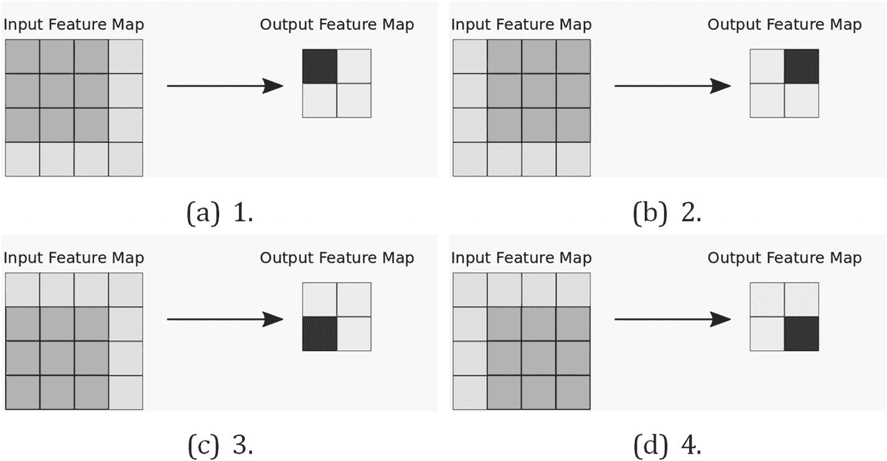
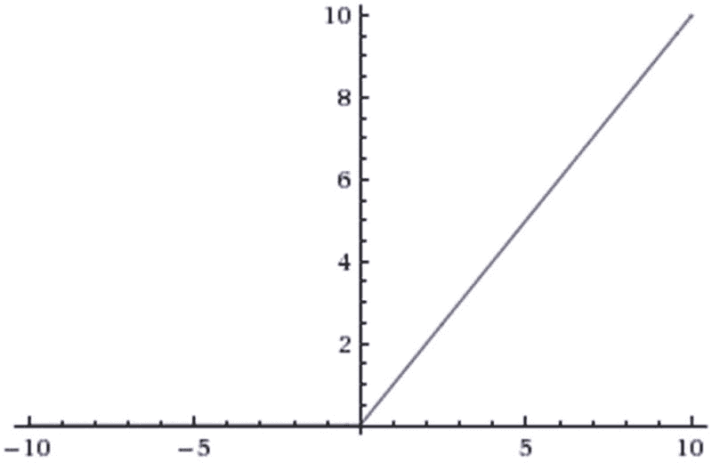
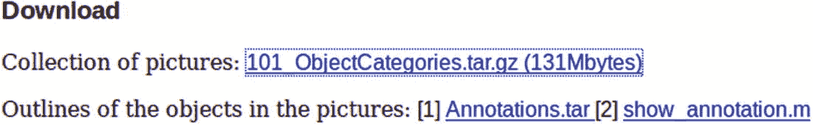
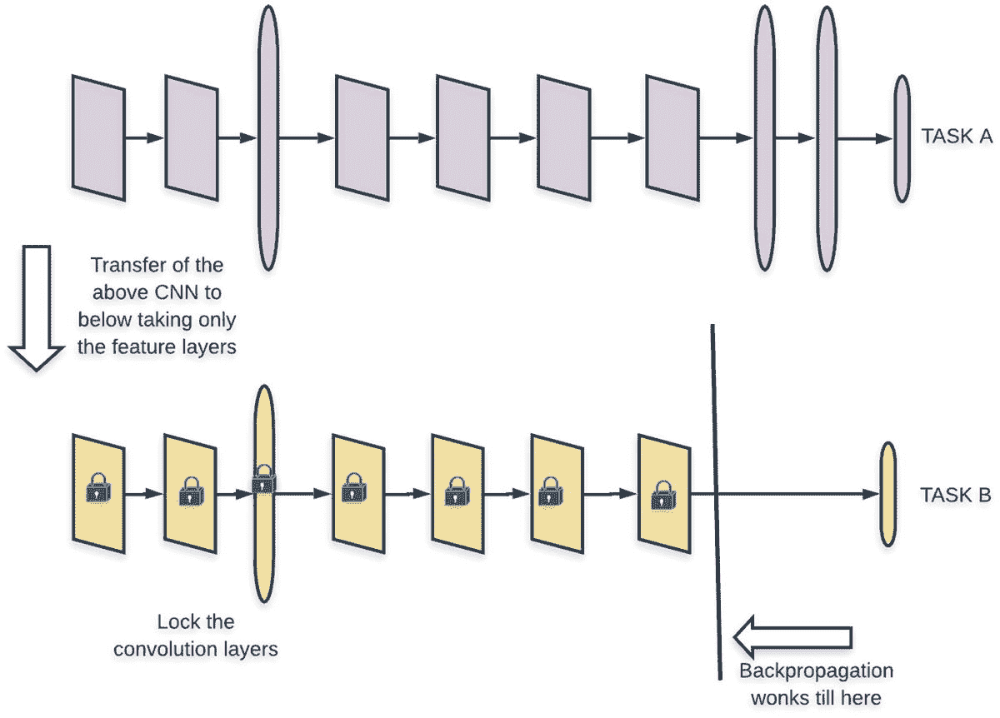
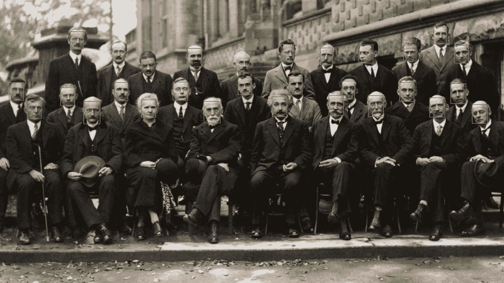

# 6. 计算机视觉

在上一章中，我们了解了机器学习如何应用于人类语言领域。这涵盖了我们的语言和听觉感官。机器学习具有巨大影响力的另一个感官是我们的视觉感官，以及机器学习如何捕捉图像的本质。整个分支被称为计算机视觉，正如我们将在本章中看到的，在 Rust 中解决计算机视觉问题已经取得了巨大进展。

作为本章的一部分，我们将研究计算机视觉中的不同应用，例如：

*   图像分类

*   使用预训练模型

*   神经风格迁移

*   人脸检测

## 6.1 图像分类

图像分类是将机器学习应用于图像，其目标是：给定一张图像和一个经过训练以查找感兴趣对象的模型，该模型将识别该对象是否存在于图像中。这是通过定义一组目标类别（要在图像中识别的对象）并使用带标签的示例照片训练模型来识别它们来实现的。

使用传统模型进行图像分类是通过从像素数据中添加新特征来实现的，例如颜色直方图、纹理和形状。这种方法的缺点是，在图像分类的情况下，特征工程成本巨大。特征需要非常精确地调整，因此在许多情况下构建鲁棒模型非常具有挑战性，且准确率较低。

### 6.1.1 卷积神经网络（CNN）

与传统模型相比，包含卷积层的神经网络在图像分类任务中表现更佳。CNN 能够逐步提取图像内容中越来越高级的表征。CNN 无需预处理数据以提取纹理和形状等特征，而是直接将图像的原始像素作为输入，“学习”如何提取这些特征，并最终推断出它们构成了什么物体。

CNN 从一个三维的输入特征图开始，其中前两个维度的大小是图像的像素长度和宽度。第三个维度的大小是图像的通道数，通常为 3。CNN 由多个模块堆叠而成，每个模块执行三个操作 [1]。

1.  卷积层：提取输入特征图的图块，并对这些特征应用滤波器。一个滤波器矩阵在特征矩阵上滑动，逐元素相乘后的和存储在结果矩阵中。在训练过程中，CNN “学习”特征矩阵的最优值，从而能够提取有意义的特征。图 6-1 展示了在 4x4 输入特征图上，使用 3x3 滤波器层进行此过程的方式。

    

    图 6-1

    通过卷积提取特征

2.  在卷积层之后引入一个 ReLU 层，以便为模型引入非线性。ReLU 函数定义为 f(x)=max(0,x)，如图 6-2 所示。

3.  应用 ReLU 激活函数后，进行池化操作以对卷积后的特征进行下采样。下采样需要在尽可能降低维度的同时，保留最关键的特征信息。通常使用最大池化，即从特征图中提取图块，并保留每个图块中的最大值，丢弃所有其他值。

在 CNN 层的末端，需要一个或多个全连接层，以便根据卷积提取的特征进行分类。



图 6-2

ReLU 函数

### 6.1.2 Rust 与 Torch

如第 2 章所述，我们可以使用 `torch` 深度学习库，^(²⁸) 许多开发者称之为 pytorch。由于在计算机视觉领域，深度学习已被证明能取得最佳效果，因此我们将主要关注创建和使用深度神经模型。目前，在 Rust 中创建和使用深度神经模型方面，`torch` 是最实用的；因此在本章中，我们将主要在 `torch` 范式下工作。

### 6.1.3 Torch 数据集

现在，我们将创建一个用于图像分类的 Rust 项目。首先创建一个名为 chapter 6 的目录，并在其中创建一个 `pytorch-image-classification` 项目（清单 6-1）。

```
$ cd chapter6
$ cargo new pytorch-image-classification --bin
$ cd pytorch-image-classification
$
清单 6-1
创建图像分类项目
```

由于我们将使用 `torch` 依赖项，让我们也下载库文件并为其建立引用，以便 `tch` 库能够找到相关的核心依赖项（清单 6-2）。

```
$ wget https://github.com/intel/mkl-dnn/releases/download/v0.19/mklml_mac_2019.0.5.20190502.tgz
$ gunzip -c mklml_mac_2019.0.5.20190502.tgz | tar xvf -
$ wget https://download.pytorch.org/libtorch/cpu/libtorch-macos-1.1.0.zip
$ unzip libtorch-macos-1.1.0.zip
$ export LD_LIBRARY_PATH=mklml_mac_2019.0.5.20190502/lib:"$LD_LIBRARY_PATH"
$ export LIBTORCH=libtorch
$ export LD_LIBRARY_PATH=${LIBTORCH}/lib:$LD_LIBRARY_PATH
$
清单 6-2
下载 mkl 和 libtorch 依赖项
```

为了构建图像分类模型，我们将使用 `Caltech101`^(²⁹) 数据集。要下载文件，请访问脚注中给出的链接并下载图像（清单 6-3）。

```
$ wget http://www.vision.caltech.edu/Image_Datasets\
/Caltech101/101_ObjectCategories.tar.gz
$ gunzip -c 101_ObjectCategories.tar.gz | tar xvf -
$
清单 6-3
下载图像
```

或者，您也可以使用浏览器下载。如果在浏览器中点击链接 [`http://www.vision.caltech.edu/Image_Datasets/Caltech101/`](http://www.vision.caltech.edu/Image_Datasets/Caltech101/)，您应该会看到一个如图 6-3 所示的链接。如果使用浏览器下载，您仍然需要使用 `gunzip` 命令解压缩。



图 6-3

下载 `caltech101`

与 `torch-vision` 类似，为了处理图像数据集，我们有一个 `vision::Dataset` 结构。让我们来看看这个结构（清单 6-4）。

```rust
#[derive(Debug)]
pub struct Dataset {
    pub train_images: Tensor,
    pub train_labels: Tensor,
    pub test_images: Tensor,
    pub test_labels: Tensor,
    pub labels: i64,
}
清单 6-4
tch-rs/src/vision/dataset.rs
```

`tch` crate 中一个便捷的函数是 `tch::vision::imagenet::load_from_dir`，用于加载图像并将其转换为上述的 `dataset`。为此，我们需要将已创建的 `caltech101` 文件按以下格式分离到训练和验证文件夹中。在根文件夹内，我们需要有“train”和“val”两个文件夹，在这些文件夹内，我们需要将不同的图像放在以标签命名的文件夹中。换句话说，所有具有相同标签的图像将位于同一个文件夹中（清单 6-5）。

```
dataset
train
accordion
image_0001.jpg
image_0002.jpg
airplanes
image_0001.jpg
image_0060.jpg
...
val
accordion
image_0036.jpg
airplanes
image_0685.jpg
...
清单 6-5
我们需要的数据集目录
```

`caltech` 数据集解压后的格式如下（清单 6-6）。

```
101_ObjectCategories
accordion
image_0001.jpg
image_0002.jpg
airplanes
image_0001.jpg
image_0002.jpg
...
102 directories, 9145 files
清单 6-6
当前目录结构
```

尽管目录结构大体相似，我们仍需编写一个小函数来将数据集拆分为训练集和验证集。清单 6-7 中的函数正是为此目的而编写的，它是一个递归函数：如果路径是目录，则继续深入；否则，对其中一个文件执行测试函数，对其余文件执行训练函数。变量 `this_label` 用于检查当前标签是否已经执行过测试函数。我们将把 `train_fn` 和 `test_fn` 实现为执行实际移动操作的函数。这些功能本可以在同一个 `visit_dir` 函数中实现，但将其作为独立函数实现会使代码更具模块化，也更易于测试。

### 6.1.4 CNN 模型

```
use std::io;
use std::fs::{self, DirEntry, copy, create_dir_all};
use std::path::Path;
fn visit_dir(dir: &Path,
train_fn: &Fn(&DirEntry),
test_fn: &Fn(&DirEntry)) -> io::Result {
if dir.is_dir() {
let mut this_label = String::from("");
for entry in fs::read_dir(dir)? {
let entry = entry?;
let path = entry.path();
if path.is_dir() {
visit_dir(&path, train_fn, test_fn)?;
} else {
let full_path: Vec = path.to_str().unwrap()
.split("/").into_iter()
.map(|x| x[..].to_string()).collect();
if this_label == full_path[1] {
train_fn(&entry); // 移动训练文件
} else {
test_fn(&entry); // 移动测试文件
}
// 第二个条目是标签
this_label = full_path[1].clone();
}
}
}
Ok(())
}
```

清单 6-7

`chapter6/pytorch-image-classifi cation/src/main.rs`

现在，我们需要定义从源文件夹到目标文件夹的实际文件复制函数。请记住，我们的目标路径格式应为“`root_dataset_foldername` > 根据文件是训练文件还是验证文件，选择 `train` 或 `val` 文件夹 > 以标签作为特定图像的文件夹名称 > 图像文件”。该函数应创建所有可能不存在的中间目录。这可以通过清单 6-8 中的 `move_file` 函数来实现。

```
use std::fs::{self, DirEntry, copy, create_dir_all};
const DATASET_FOLDER: &str = "dataset";
fn move_file(
from_path: &DirEntry, to_path: &Path)
-> io::Result {
let root_folder = Path::new(DATASET_FOLDER);
let second_order = root_folder.join(to_path);
let full_path: Vec = from_path.path().to_str().unwrap()
.split("/").into_iter().map(|x| x[..].to_string()).collect();
let label = full_path[1].clone();
let third_order = second_order.join(label);
create_dir_all(&third_order)?;
let filename = from_path.file_name();
let to_filename = third_order.join(&filename);
copy(from_path.path(), to_filename)?;
Ok(())
}
```

清单 6-8

`chapter6/pytorch-image-classifi cation/src/main.rs`

如清单 6-8 所示，根文件夹是数据集文件夹，而 `to_path` 本质上决定了文件需要进入训练文件夹还是验证文件夹。接下来，我们将源路径分割到 `full_path` 变量中，以便能够从完整路径中检索标签。一旦所有路径拼接完成，就使用 `std::fs` 标准库中的 `create_dir_all` 函数来创建所有目录。从 `from_path` 变量中解析出相应的文件名，并将其拼接到 `to_filename` 变量中。成功构建目标路径的完整路径后，我们将目标路径（即 `to_filename` 变量）传递给 `std::fs` 标准库中的 `copy` 函数，以创建文件夹结构。

现在，我们应该能够运行此代码，并将数据集分离为训练图像和验证图像（清单 6-9）。

```
fn main() {
let obj_categories = Path::new("101_ObjectCategories");
let move_to_train = |x: &DirEntry| {
let to_folder = Path::new("train");
move_file(&x, &to_folder).unwrap();
}
let move_to_test =
|x: &DirEntry| {
let to_folder = Path::new("val");
move_file(&x, &to_folder).unwrap();
};
visit_dir(
&obj_categories, &move_to_train,
&move_to_test).unwrap();
println!(
"files kept in the imagenet format in {}", DATASET_FOLDER);
... 剩余代码
}
```

清单 6-9

`chapter6/pytorch-image-classifi cation/src/main.rs`

在此处运行到清单 6-9 的代码，您应该会看到文件夹正在被移动到各自的文件夹中（清单 6-10）。

```
$ cargo run
warning: clang: warning: -Wl,-rpath=chapter6/pytorch-image-classification/libtorch/lib: 'linker' input unused [-Wunused-command-line-argument]
Finished dev [unoptimized + debuginfo] target(s) in 0.05s
Running `target/debug/pytorch-image-classification`
files kept in the imagenet format in dataset
$ ls dataset
train val
```

清单 6-10

`pytorch-image-classifi cation` 当前输出

在清单 6-10 的代码中，我们创建了两个闭包 `move_to_train` 和 `move_to_test`，它们会将适当的目标文件夹传递给 `move_file` 函数。然后，这些闭包被传递给 `visit_dir` 函数，正如我们之前所见，该函数会执行它们。运行到目前为止的代码应该能够分离文件夹，并将它们整理成 imagenet 格式。现在，我们应该能够使用 `load_from_dir` 函数，这是 `torch::vision` 中一个便捷的函数。该函数将以正确的格式加载目录，以便 `tch` 能够对其进行操作。参见清单 6-11。

```
use tch::vision::imagenet::load_from_dir;
fn main() {
// 之前的代码 ...
let image_dataset = load_from_dir(DATASET_FOLDER).unwrap();
// 剩余代码 ...
}
```

清单 6-11

`chapter6/pytorch-image-classifi cation/src/main.rs`

PyTorch 以及 `tch` 对图像使用 NCHW 格式。如果图像形状为 `[256, 3, 224, 224]`，这意味着样本数量为 256，每张图像有 3 个通道，`224x224` 是数据集的高度和宽度。

现在数据格式已正确，我们将着手定义模型。Rust 的优势在于模型可以是一个简单的结构体（清单 6-12）。

```
use tch::{Device, Tensor, nn};
use tch::nn::{ModuleT, OptimizerConfig, conv2d, linear};
#[derive(Debug)]
struct CnnNet {
conv1: nn::Conv2D,
conv2: nn::Conv2D,
fc1: nn::Linear,
fc2: nn::Linear,
}
```

清单 6-12

`chapter6/pytorch-image-classifi cation/src/main.rs`

可以为清单 6-12 中的结构体实现一个 `new` 方法，用于创建 `CnnNet` 的实例。

# Rust 中的 CNN 模型定义与训练

## 代码清单 6-13
```rust
const LABELS: i64 = 102;
const W: i64 = 224;
const H: i64 = 224;
const C: i64 = 3;
impl CnnNet {
    fn new(vs: &nn::Path) -> CnnNet {
        let conv1 = conv2d(vs, C, 32, 5, Default::default());
        let conv2 = conv2d(vs, 32, 64, 5, Default::default());
        let fc1 = linear(vs, 1024, 1024, Default::default());
        let fc2 = linear(vs, 1024, LABELS, Default::default());
        CnnNet {
            conv1,
            conv2,
            fc1,
            fc2,
        }
    }
}
// 文件：chapter6/pytorch-image-classification/src/main.rs
```

在清单 6-13 中，`conv1` 是一个卷积层，其输入维度为 `C`（常量 3），输出维度为 32。输入维度必须为 3，因为我们将 `conv1` 定义为第一个卷积层，而数据集中每张图像由 3 个通道组成。此外，`conv1` 的卷积核大小为 5x5，由第四个参数指定。最后一个参数是卷积配置，此处可传入默认参数。默认参数可在 `tch-rs` 库的 `conv.rs` 文件中查看（清单 6-14）。

## 代码清单 6-14
```rust
impl Default for ConvConfig {
    fn default() -> Self {
        ConvConfig {
            stride: 1,
            padding: 0,
            dilation: 1,
            groups: 1,
            bias: true,
            ws_init: super::Init::KaimingUniform,
            bs_init: super::Init::Const(0.),
        }
    }
}
// 文件：tch-rs/src/nn/conv.rs
```

继续描述清单 6-8，我们将定义与 `conv1` 类似但维度适当的 `conv2`。这些维度稍后会解释。我们还将创建两个全连接层 `fc1` 和 `fc2`，其中 `fc2` 的最后一维与 `LABELS` 常量定义的标签数量相同。

在 Python 的 PyTorch 中，模型通过继承 `torch.nn.Module` 创建。类似地，在 Rust 中使用 `tch` 时，我们需要实现 `nn::ModuleT` trait，该 trait 包含可用于训练模型的相关函数。参见清单 6-15。

## 代码清单 6-15
```rust
use tch::{Device, Tensor, nn};
const BATCH_SIZE: i64 = 16;
impl nn::ModuleT for CnnNet {
    fn forward_t(&self, xs: &Tensor, train: bool) -> Tensor {
        xs.view(&[-1, C, H, W])    // 输出维度: [16, 3, 224, 224]
            .apply(&self.conv1)      // [16, 32, 220, 220]
            .max_pool2d_default(2)   // [16, 32, 110, 110]
            .apply(&self.conv2)      // [16, 64, 106, 106]
            .max_pool2d_default(2)   // [16, 64, 53, 53]
            .view(&[BATCH_SIZE, -1]);// [16, 179776]
            .apply(&self.fc1)        // [16, 1024]
            .relu()                  // [16, 1024]
            .dropout_(0.5, train)    // [16, 1024]
            .apply(&self.fc2)        // [16, 102]
    }
}
// 文件：chapter6/pytorch-image-classification/src/main.rs
```

在清单 6-15 的代码中，展示了每次张量变换后维度的变化。输入张量 `xs` 的维度从 [16, 3, 224, 224] 变为 [16, 102]，即 `(batch_size, outputs)`，这是应用变换后的结果。执行此代码时，你可以验证维度是否匹配。

模型创建完成后，应能在数据集上训练它。PyTorch 模型的训练过程通常类似：初始化模型实例、定义损失函数、初始化优化器。我们还可以将返回类型改为 `Fallible`，这是 `tch` 仓库中的标准做法。这可以在清单 6-16 的代码中看到。

## 代码清单 6-16
```rust
use failure;
fn main() -> failure::Fallible {
    // 之前的代码 ...
    let image_dataset = load_from_dir(dataset_folder).unwrap();
    let vs = nn::varstore::new(device::cuda_if_available());
    let opt = nn::adam::default().build(&vs, 1e-4)?;
    let net = cnnnet::new(&vs.root());
    for epoch in 1..100 {
        for (bimages, blabels) in image_dataset.train_iter(batch_size)
            .shuffle().to_device(vs.device()) {
            let loss = net
                .forward_t(&bimages, true)
                .cross_entropy_for_logits(&blabels);
            opt.backward_step(&loss);
        }
        let test_accuracy = net.batch_accuracy_for_logits(
            &image_dataset.test_images,
            &image_dataset.test_labels,
            vs.device(),
            1024
        );
        println!("epoch: {:4} test acc: {:5.2}%", epoch, 100. * test_accuracy);
    }
    // 剩余代码 ...
    Ok(())
}
// 文件：chapter6/pytorch-image-classification/src/main.rs
```

在清单 6-16 中，`vs` 用于存储在训练过程不同阶段使用的通用配置。如前所述，模型通过变量 `net` 初始化。在 100 个 epoch 中，从数据集中分批取出数据进行训练。由于训练变量是 `Dataset` 结构体的实例，`bimages` 和 `blabels` 被整齐地取出，此处图像的形状为 [32, 3, 244, 244]，标签的形状为 [32]。`forward_t` 方法会将张量传递到之前定义的整个架构中，而 `opt.backward_step` 会计算梯度。完成 100 个 epoch 后，模型即训练完成。

现在你可以使用 `cargo run` 运行该包。运行后，检查是否生成了 `trained_model.ot` 文件。

## 注意

由于上述所有代码会消耗大量计算资源，你的笔记本电脑可能无法运行。如果发生这种情况，可以尝试减少预测的标签数量。同时，请相应修改 `LABELS` 参数，使其与你预测的标签数量一致。你也可以尝试减小 `BATCH_SIZE`。

## 6.1.5 模型构建与调试

在构建模型时，密切跟踪数据流经过程中所构建的不同张量的形状至关重要。否则，很容易遇到如清单 6-17 所示的错误。

## 代码清单 6-17
```
thread 'main' panicked at 'called `Result::unwrap()` on an `Err`
value: TorchError { c_error: "size mismatch,
m1: [2809 x 1024], m2: [179776 x 1024] at
/pytorch/aten/src/TH/generic/THTensorMath.cpp:961" }',
src/libcore/result.rs:997:5
```
训练时可能出现的尺寸不匹配错误。

或者也可能是类似清单 6-18 所示的情况。

## 代码清单 6-18
```
thread 'main' panicked at 'called `Result::unwrap()` on an `Err`
value: TorchError { c_error:
"Assertion `THTensor_sizeLegacyNoScalars(target, 0) == batch_size\' failed.
at /pytorch/aten/src/THNN/generic/ClassNLLCriterion.c:84" }',
src/libcore/result.rs:997:5
```
训练时可能出现的批次大小失败错误。

在这些情况下，我们需要对网络进行调试。一种调试方法是将应用程序迁移到 `Python` 应用，并在其中运行，同时打印出每一步的形状。参见清单 6-19。

清单 6-19 PyTorch 中的示例代码

```python
import torch.nn as nn
import torch.nn.functional as F
class Net(nn.Module):
def __init__(self):
super(Net, self).__init__()
self.conv1 = nn.Conv2d(3, 32, 5)
self.pool1 = nn.MaxPool2d(2, 2)
self.fc1 = nn.Linear(1600, 1024)
self.fc2 = nn.Linear(1024, 10)
def forward(self, x):
x = self.conv1(x)
print(x.shape)
x = self.pool1(x)
print(x.shape)
x = F.relu(self.fc1(x))
print(x.shape)
x = F.dropout(x, training=True)
print(x.shape)
x = self.fc2(x)
print(x.shape)
return x
net = Net()
```

上述逻辑同样可以应用于 `Rust`。我们可以将之前的 `forward` 函数改写成上述方式，并在过程中插入 `println!` 语句（清单 6-20）。

清单 6-20 在卷积网络中插入打印语句以便于调试

```rust
impl nn::ModuleT for CnnNet {
fn forward_t(&self, xs: &Tensor, train: bool) -> Tensor {
let xs_prime = xs.view(&[-1, C, H, W]);
println!("{:?}", xs_prime.size());
let xs_prime = xs_prime.apply(&self.conv1);
println!("{:?}", xs_prime.size());
let xs_prime = xs_prime.max_pool2d_default(2);
println!("{:?}", xs_prime.size());
let xs_prime = xs_prime.apply(&self.conv2);
println!("{:?}", xs_prime.size());
let xs_prime = xs_prime.max_pool2d_default(2);
println!("{:?}", xs_prime.size());
let xs_prime = xs_prime.view(&[BATCH_SIZE, -1]);
println!("{:?}", xs_prime.size());
let xs_prime = xs_prime.apply(&self.fc1);
println!("{:?}", xs_prime.size());
let mut xs_prime = xs_prime.relu();
println!("{:?}", xs_prime.size());
let xs_prime = xs_prime.dropout_(0.5, train);
println!("{:?}", xs_prime.size());
let xs_prime = xs_prime.apply(&self.fc2);
println!("{:?}", xs_prime.size());
xs_prime
}
}
```

这样，在运行网络时，就能打印出不同层的维度信息。

### 6.1.6 预训练模型

通常，模型训练完成后，需要部署到执行模型推理的生产环境中。在 `tch` 框架中，训练好的模型可以保存为 `.ot` 文件，然后在推理环境中加载并提供服务。可以使用变量存储（`VarStore`）来保存模型（清单 6-21）。

清单 6-21 模型保存

```rust
fn main() {
// 之前的模型训练代码 ...
vs.save("model.ot")?;
}
```

当我们使用 `cargo run` 运行训练后，这会将模型保存到当前目录。模型保存后，我们就可以在推理应用中加载该模型并运行预测。由于每个模型的架构不同，不存在适用于所有场景的通用样板函数代码。开发者需要访问每种架构才能进行预测。

`tch/examples/pretrained` 目录下的模型提供了如何加载预训练模型的示例，前提是这些模型属于标准架构之一。可以加载的标准架构包括 `alexnet`、`densenet`、`imagenet`、`resnet`、`squeezenet` 和 `VGG16`。由于代码相当标准，我们将采用 `tch` 仓库中展示的预训练模型示例。加载模型的方法如清单 6-22 所示。

清单 6-22 https://github.com/LaurentMazare/tch-rs/blob/master/examples/pretrained-models/main.rs

```rust
use tch::vision::{
alexnet, densenet, imagenet,
inception, resnet, squeezenet, vgg};
```

我们可以加载图像并将其调整为 `ImageNet` 标准的 `224x224` 尺寸，这是使用此包时的一种约定（清单 6-23）。

清单 6-23 https://github.com/LaurentMazare/tch-rs/blob/master/examples/pretrained-models/main.rs

```rust
extern crate failure;
extern crate tch;
use tch::nn::ModuleT;
use tch::vision::{
alexnet, densenet, efficientnet, imagenet, inception, mobilenet, resnet, squeezenet, vgg,
};
pub fn main() -> failure::Fallible {
let args: Vec = std::env::args().collect();
let (weights, image) = match args.as_slice() {
[_, w, i] => (std::path::Path::new(w), i.to_owned()),
_ => bail!("用法: main resnet18.ot image.jpg"),
};
let image = imagenet::load_image_and_resize224(image)?;
// 剩余代码 ...
}
```

现在，让我们尝试使用 `resnet18` 模型。我们需要一种方法在我们的深度网络中编码架构，这需要是 `ModuleT` 结构体的一个实例。因此，我们创建一个 `VarStore` 变量并创建一个 `resnet18` 网络实例（清单 6-24）。

清单 6-24 https://github.com/LaurentMazare/tch-rs/blob/master/examples/pretrained-models/main.rs

```rust
pub fn main() -> failure::Fallible {
// 之前的代码 ...
let mut vs = tch::nn::VarStore::new(tch::Device::Cpu);
let net: Box = Box::new(resnet::resnet18(&vs.root(),
imagenet::CLASS_COUNT)),
// 剩余代码 ...
```

现在模型的基本架构已经初始化，我们应该能够加载权重并创建训练好的模型（清单 6-25）。

清单 6-25 https://github.com/LaurentMazare/tch-rs/blob/master/examples/pretrained-models/main.rs

```rust
pub fn main() -> failure::Fallible {
// 之前的代码 ...
vs.load(weights)?;
// 剩余代码 ...
}
```

一旦我们能够创建模型，就应该能够对模型运行预测了。参见清单 6-26。

## 6.2 迁移学习

训练一个足够深的神经网络以达到高精度通常是不可行的，因为神经网络需要海量数据，而如此大量的数据可能并不存在，尤其是在产品的早期阶段。相反，一个在大规模数据集上预训练的卷积网络要么被用作初始化器，要么用于从图像中收集特征集。在这种情况下，我们将冻结除最后一层之外的所有网络的权重。这最后一个全连接层将被一个具有随机权重的新层替换，并且只训练这一层。一种可能的迁移学习架构如图 6-4 所示。



为了继续这个示例，我们将从这个网址下载一个预训练模型：[`https://github.com/LaurentMazare/ocaml-torch/releases/download/v0.1-unstable/resnet18.ot`](https://github.com/LaurentMazare/ocaml-torch/releases/download/v0.1-unstable/resnet18.ot)。请参见代码清单 6-29。

```
wget https://github.com/LaurentMazare/ocaml-torch/releases/download/v0.1-unstable/resnet18.ot
```

代码清单 6-29：下载 `resnet` 预训练模型

由于本节关于如何加载和进行预测的代码也是标准做法，我们将遵循主仓库中的示例。

为了做到这一点，我们需要加载数据集（代码清单 6-30）。

```
#[macro_use]
extern crate failure;
extern crate tch;

use tch::nn::{self, OptimizerConfig};
use tch::vision::{imagenet, resnet};

pub fn main() -> failure::Fallible {
    let args: Vec<String> = std::env::args().collect();
    let (weights, dataset_dir) = match args.as_slice() {
        [_, w, d] => (std::path::Path::new(w), d.to_owned()),
        _ => bail!("usage: main resnet18.ot dataset-path"),
    };
    let dataset = imagenet::load_from_dir(dataset_dir)?;
    // 剩余代码...
}
```

代码清单 6-30：`chapter6/pytorch-image-classifi cation/src/main.rs`

与预训练网络类似，我们需要创建模型并将权重加载到模型中。如前所述，我们可以将权重保存在一个变量存储中（代码清单 6-31）。

```
let mut vs = tch::nn::VarStore::new(tch::Device::Cpu);
let net = resnet::resnet18_no_final_layer(&vs.root());
vs.load(weights)?;
```

代码清单 6-31：`https://github.com/LaurentMazare/tch-rs/blob/master/examples/transfer-learning/main.rs`

我们需要以一种能够创建结果向量的方式存储模型的输出，并告诉 `pytorch` 我们不需要存储计算图，因为我们不打算计算梯度。请参见代码清单 6-32。

```
let train_images = tch::no_grad(
    || dataset.train_images.apply_t(&net, false));
let test_images = tch::no_grad(
    || dataset.test_images.apply_t(&net, false));
```

代码清单 6-32：`https://github.com/LaurentMazare/tch-rs/blob/master/examples/transfer-learning/main.rs`

### 6.2.1 训练

现在，我们可以在提取的层之上附加一个小的线性层，并且只训练该层的线性部分。这样，我们更少的数据将用于有效地只训练网络的一小部分，而不是尝试训练整个模型。我们创建模型，并使用一个变量存储来存储可训练变量（代码清单 6-33）。

```
let vs = tch::nn::VarStore::new(tch::Device::Cpu);
let linear = nn::linear(vs.root(), 512, dataset.labels, Default::default());
```

代码清单 6-33：`https://github.com/LaurentMazare/tch-rs/blob/master/examples/transfer-learning/main.rs`

与之前的代码类似，我们可以使用 `adam` 优化器来最小化分类任务中的交叉熵损失。因此，我们需要创建一个优化器并在训练数据集上进行迭代。每个 `epoch` 之后，计算训练集上的准确率并打印出来（代码清单 6-34）。

---

与加载标准通用架构的已保存模型类似，对于我们已经训练并保存的模型，我们需要访问最初用于创建该模型的原始模型架构结构体。因此，我们将为模型文件和图像文件创建一个路径。（代码清单 6-27）

```
fn main() -> failure::Fallible {
    // 之前的模型构建代码...
    let weights = Path::new("model.ot");
    let image = "image.jpg";
    // 剩余代码...
}
```

代码清单 6-27：`chapter6/pytorch-image-classifi cation/src/main.rs`

之后，我们将看到的代码与代码清单 6-27 类似，不同之处在于，这里我们将基于之前创建的 `CnnNet` 来创建一个模型。请参见代码清单 6-28。

```
pub fn main() -> failure::Fallible {
    // 之前的代码...
    // 加载图像文件并将其大小调整为通常的 imagenet 尺寸 224x224。
    let image = load_image_and_resize224(image)?;
    // 创建模型并从文件加载权重。
    let mut vs = tch::nn::VarStore::new(tch::Device::Cpu);
    let net: Box<dyn Module> = Box::new(CnnNet::new(&vs.root()));
    vs.load(weights)?;
    // 对模型进行前向传播以获取 logits。
    let output = net
        .forward_t(&image.unsqueeze(0), /*train=*/ false)
        .softmax(-1); // 转换为概率。
    // 打印该图像的前 5 个类别。
    for (probability, class) in top(&output, 5).iter() {
        println!("{:50} {:5.2}%", class, 100.0 * probability)
    }
    Ok(())
}
```

代码清单 6-28：`chapter6/pytorch-image-classifi cation/src/main.rs`

最初的代码示例（代码清单 6-26）展示了如何进行预测：

```
pub fn main() -> failure::Fallible {
    // 之前的代码...
    // 对模型进行前向传播以获取 logits。
    let output = net
        .forward_t(&image.unsqueeze(0), /*train=*/ false)
        .softmax(-1); // 转换为概率。
    // 打印该图像的前 5 个类别。
    for (probability, class) in imagenet::top(&output, 5).iter() {
        println!("{:50} {:5.2}%", class, 100.0 * probability)
    }
    // 剩余代码...
}
```

代码清单 6-26：`https://github.com/LaurentMazare/tch-rs/blob/master/examples/pretrained-models/main.rs`

let optimizer = `nn::Adam::default().build(&vs, 1e-4)`?;
for epoch_idx in 1..1001 {
let predicted = train_images.apply(&linear);
let loss = predicted.cross_entropy_for_logits(&dataset.train_labels);
optimizer.backward_step(&loss);
let test_accuracy = test_images
.apply(&linear)
.accuracy_for_logits(&dataset.test_labels);
println!("{} {:.2}%", epoch_idx, 100\. * f64::from(test_accuracy));
}
列表 6-34
https://github.com/LaurentMazare/tch-rs/blob/master/examples/transfer-learning/main.rs

训练完成后，我们可以使用 `vs.save("model.ot")?;` 保存文件，该文件可以在下一批图像准备好时，在后续的训练周期中再次使用。

### 6.2.2 神经风格迁移

神经风格迁移是一种用于生成具有另一张图像风格的图像的技术。该算法以一张内容图像和一张风格图像作为输入，并返回一张在风格上经过转换的内容图像。这是通过创建两个距离来实现的：一个用于内容，另一个用于图像。最终生成的新图像会使得其与内容图像的内容距离以及与风格图像的风格距离都最小化。

**内容损失** 要创建这样一张转换后的图像，我们需要一种方法来控制最终优化输出图像中保留多少内容图像的特征。为此，需要确定一种计算内容损失的方法。内容损失的主要挑战在于找到一种方法，仅提取图像的内容特征，而不提取图像的风格特征。根据《艺术风格》论文[2]，解决方案是利用不同卷积层的特征图。经过训练的卷积网络能够学习表示图像的不同部分：初始层捕捉粗糙的基础模式，而最终层捕捉独特的特征。正是中间层捕捉了图像的空间特征，而这正是我们所需要的。

因此，在这种情况下，内容损失仅通过计算某些较高层的均方误差来获得。这个误差有助于确保提取的图像在内容图像和当前图像之间出现在屏幕上的相同位置（列表 6-35）。

```
let content_loss: Tensor = CONTENT_INDEXES
.iter()
.map(
|&i| input_layers[i].mse_loss(&content_layers[i], 1))
.sum();
```
列表 6-35
https://github.com/LaurentMazare/tch-rs/blob/master/examples/neural-style-transfer/main.rs

**风格损失** 风格损失负责将图像的风格融入最终图像中。根据论文，图像的风格可以通过其格拉姆矩阵进行编码。格拉姆矩阵是通过计算展平的风格特征与其自身的点积得到的（列表 6-36）。

```
fn gram_matrix(m: &Tensor) -> Tensor {
let (a, b, c, d) = m.size4().unwrap();
let m = m.view(&[a * b, c * d]);
let g = m.matmul(&m.tr());
g / (a * b * c * d)
}
fn style_loss(m1: &Tensor, m2: &Tensor) -> Tensor {
gram_matrix(m1).mse_loss(&gram_matrix(m2), 1)
}
pub fn main() -> failure::Fallible {
// 之前的代码 ...
let style_loss: Tensor = STYLE_INDEXES
.iter()
.map(
|&i| style_loss(&input_layers[i], &style_layers[i]))
.sum();
// 剩余的代码 ...
}
```
列表 6-36
https://github.com/LaurentMazare/tch-rs/blob/master/examples/neural-style-transfer/main.rs

请注意，图像的风格并不依赖于像素值本身，而是依赖于像素值之间的关系。格拉姆矩阵将风格图像的所有信息（如纹理、形状和权重）去本地化，然后进行点积运算。这导致共同出现的特征获得更大的权重，而在风格图像中不具有相似性的特征则不会获得权重。

现在我们已经对风格迁移的工作原理有了基本了解，接下来看看完整的实现。要进行神经风格迁移，我们需要加载内容图像和风格图像。这些图像需要转换为 torch 张量，因此我们可以使用 `tch::vision` 中的 imagenet 模块来加载图像（列表 6-37）。

```
pub fn main() -> failure::Fallible {
// 之前的代码 ...
let style_img = imagenet::load_image(style_img)?
.unsqueeze(0).to_device(device);
let content_img = imagenet::load_image(content_img)?
.unsqueeze(0).to_device(device);
// 剩余的代码 ...
}
```
列表 6-37
https://github.com/LaurentMazare/tch-rs/blob/master/examples/neural-style-transfer/main.rs

我们还需要加载一个预训练模型。可以使用论文中使用的 19 层 VGG 网络。这是另一个可以实验的超参数，看看是否有其他模型能为内容图像提供更好的特征。通过访问此链接或使用您喜欢的下载命令来下载模型（列表 6-38）。

```
$ wget https://github.com/LaurentMazare/ocaml-torch/releases/download/v0.1-unstable/vgg16.ot
$
```
列表 6-38
下载 VGG 预训练模型

这个 VGG 模型包含两个 Sequential 子模块：features（包含卷积层和池化层）和 classifier（包含全连接层）。为了能够从图像中捕捉内容，我们需要使用 features 层。我们将从模型中加载权重并冻结模型（列表 6-39）。

```
pub fn main() -> failure::Fallible {
// 之前的代码 ...
let mut net_vs = tch::nn::VarStore::new(device);
let net = vgg::vgg16(&net_vs.root(),
imagenet::CLASS_COUNT);
net_vs.load(weights)?;
net_vs.freeze();
// 剩余的代码 ...
}
```
列表 6-39
https://github.com/LaurentMazare/tch-rs/blob/master/examples/neural-style-transfer/main.rs

现在，我们在风格图像和内容图像上运行模型。这些调用会返回一个向量，其中包含每个模型层提取的特征（列表 6-40）。

```
pub fn main() -> failure::Fallible {
// 之前的代码 ...
let style_layers = net.forward_all_t(
&style_img, false, Some(max_layer));
let content_layers = net.forward_all_t(
&content_img, false, Some(max_layer));
// 剩余的代码 ...
}
```
列表 6-40
https://github.com/LaurentMazare/tch-rs/blob/master/examples/neural-style-transfer/main.rs

我们将使用梯度优化方法来优化图像。为此，我们创建第二个变量存储来保存这张图像。该图像的初始值将通过复制内容图像得到。这张图像将被转换，使其风格与风格图像相似。参见列表 6-41。

```
pub fn main() -> failure::Fallible {
// 之前的代码 ...
let vs = nn::VarStore::new(device);
let input_var = vs.root().var_copy("img", &content_img);
// 剩余的代码 ...
}
```
列表 6-41
https://github.com/LaurentMazare/tch-rs/blob/master/examples/neural-style-transfer/main.rs

现在我们将创建优化器，它将是一个使用 Adam 优化算法的实例（列表 6-42）。

# 6.3 Tensorflow 与人脸检测

在前面的章节中，我们主要使用了 `torch` 及其对应的 Rust 框架 `tch`。在本节中，我们将使用 `tensorflow` 并探讨一个人脸检测的应用。挑战在于：接收一张图像，识别出其中的所有人脸，并生成一张新图像，在每个人脸周围绘制出方框。如第 2 章所述，在 `tensorflow` 中运行推理比训练模型要容易得多，因此在本例中，我们将主要致力于模型推理。

现在，在梯度下降循环中，需要计算内容损失和风格损失。然后将它们相加，并使用列表 6-42 中创建的优化器来优化总损失。每 1000 个 `epoch`，我们可以计算当前损失并将当前图像写入文件（列表 6-43）。

```rust
pub fn main() -> failure::Fallible {
    // 之前的代码 ...
    let opt = nn::Adam::default().build(&vs, LEARNING_RATE)?;
    // 剩余的代码
}
```
列表 6-42
https://github.com/LaurentMazare/tch-rs/blob/master/examples/neural-style-transfer/main.rs

```rust
pub fn main() -> failure::Fallible {
    // 之前的代码 ...
    for step_idx in 1..(1 + TOTAL_STEPS) {
        let input_layers = net.forward_all_t(
            &input_var, false, Some(max_layer));
        let style_loss: Tensor = STYLE_INDEXES
            .iter()
            .map(
                |&i| style_loss(&input_layers[i], &style_layers[i]))
            .sum();
        let content_loss: Tensor = CONTENT_INDEXES
            .iter()
            .map(
                |&i| input_layers[i].mse_loss(&content_layers[i], 1))
            .sum();
        let loss = style_loss * STYLE_WEIGHT + content_loss;
        opt.backward_step(&loss);
        if step_idx % 1000 == 0 {
            println!("{} {}", step_idx, f64::from(loss));
            imagenet::save_image(&input_var, &format!("out{}.jpg", step_idx))?;
        }
    }
    // 剩余的代码 ...
}
```
列表 6-43
https://github.com/LaurentMazare/tch-rs/blob/master/examples/neural-style-transfer/main.rs

现在我们应该能够运行代码了。请将 `TOTAL_STEPS` 保持在 5000 或更高，这样我们就能获得大量图像，并从中选出与目标风格最连贯且最相似的图像。

创建 `face-detection-tf` 包，用于检测人脸并在人脸周围区域绘制方框。参见代码清单 6-44。

```
$ cd chapter6
$ cargo new face-detection-tf --bin
$ cd face-detection-tf
```
代码清单 6-44
创建 `face-detection-tf` Rust 包

下载以下预训练模型。该模型将用于预测图像。图 6-5 是预测后的人脸框选图像。^(³⁰) 参见代码清单 6-45。

```
$ wget https://github.com/blaueck/tf-mtcnn/raw/master/mtcnn.pb
```
代码清单 6-45
下载 `mtcnn` 预训练模型

或者你也可以从这个网址下载：[`https://github.com/blaueck/tf-mtcnn/blob/master/mtcnn.pb`](https://github.com/blaueck/tf-mtcnn/blob/master/mtcnn.pb)。

现在我们来讨论依赖项。我们需要 `tensorflow` crate 来读取模型，并使用该模型对图像进行推理。`structopt` crate 将用于解析命令行，使输入输出解析更加方便。除此之外，我们还需要 `image` crate 来读取、写入和修改图像。`imageproc` crate 则有助于相关的图像处理操作。因此，我们的 `Cargo.toml` 文件应该类似于代码清单 6-46 所示。

```toml
[package]
name = "face-detection-tf"
version = "0.1.0"
edition = "2018"
[dependencies]
tensorflow = "0.13.0"
structopt = "0.2.15"
image = "0.21.1"
imageproc = "0.18.0"
```
代码清单 6-46
`chapter6/face-detection-tf/src/main.rs`

现在我们可以开始定义命令行。我们的应用程序可以将图像文件名作为输入之一，并将输出文件名作为需要创建的、已标识出人脸的图像文件。参见代码清单 6-47。

```rust
use std::path::PathBuf;
use structopt::StructOpt;
#[derive(Debug, StructOpt)]
#[structopt(name = "face-detection-tf", about = "人脸识别")]
struct Opt {
    #[structopt(short = "i", long = "input", parse(from_os_str))]
    input: PathBuf,
    #[structopt(short = "o", long = "output", parse(from_os_str))]
    output: PathBuf
}
```
代码清单 6-47
`chapter6/face-detection-tf/src/main.rs`

创建上述 `StructOpt` 结构体意味着，当我们在主函数中插入 `let opt = Opt::from_args();` 时，我们将能够像 `./face-detection-tf -i inputfilename.jpg -o outputfilename.jpg` 这样传递命令行参数，或者传递 `--input` 和 `--output` 作为命令行参数。要检查命令行参数现在是否运行正常，我们可以在代码的主函数中放入以下几行代码，并检查命令行是否被正确解析。参见代码清单 6-48。

```rust
use std::error::Error;
fn main() -> Result<(), Box<dyn Error>> {
    let opt = Opt::from_args();
    // 由于这是基础代码，我们会注意
    // 不要使用 to_owned 转移 opt 对象的所有权。
    // 在最终代码中，你可能不需要这段代码。
    println!("{:?}",
        (opt.input.to_owned(), opt.output.to_owned()));
    Ok(())
}
```
代码清单 6-48
`chapter6/face-detection-tf/src/main.rs`

现在运行 `cargo run` 应该会得到正确的输出（代码清单 6-49）。

```
$ cargo run -- -i input_image.jpg -o out.jpg
   Compiling face-detection-tf v0.1.0 (path to face-detection-tf)
    Finished dev [unoptimized + debuginfo] target(s) in 28.24s
     Running `target/debug/face-detection-tf -i input_image.jpg -o out.jpg`
("input_image.jpg", "out.jpg")
```
代码清单 6-49
`chapter6/face-detection-tf/src/main.rs`

现在我们可以检查是否能够加载模型。我们首先将模型作为字节数组加载，然后尝试从字节数组中推断出计算图。如果模型文件损坏，在这种情况下应该会报错（代码清单 6-50）。

如果计算图加载成功，我们应该能够使用该计算图创建一个会话。

现在，如果我们检查用于创建计算图的模型，可以看到在运行模型之前需要设置一些变量，正如模型 [`https://github.com/blaueck/tf-mtcnn/blob/master/mtcnn.py#L9`](https://github.com/blaueck/tf-mtcnn/blob/master/mtcnn.py%2523L9) 的这行代码所示。这些变量是 `min_size`、`factor` 和 `thresholds`。在运行会话之前，我们需要在会话中分配这些变量。代码清单 6-51 中分配的值与模型使用的值相同，但你可以尝试调整这些值，看看是否有更好的替代方案。

```
use tensorflow::Graph;
use tensorflow::ImportGraphDefOptions;
use tensorflow::{
Session, SessionOptions, SessionRunArgs, Tensor};
fn main() -> Result> {
... 之前的代码 ...
let model = include_bytes!("../mtcnn.pb");
let mut graph = Graph::new();
graph.import_graph_def(
&*model, &ImportGraphDefOptions::new())?;
let session = Session::new(
&SessionOptions::new(), &graph)?;
.. 剩余代码 ...
代码清单 6-50
chapter6/face-detection-tf/src/main.rs
```

另一个需要传递的变量，也是使计算图能够识别人脸的最重要的变量，是输入图像张量。因此，我们将使用 `image` crate 打开输入图像。打开图像后，我们将读取像素值，并以 BGR 格式存储到张量中。^(³¹) 参见代码清单 6-52。

```
fn main() -> Result> {
... 之前的代码 ...
let min_size = Tensor::new(
&[]).with_values(&[40f32])?;
let thresholds = Tensor::new(&[3]).with_values(
&[0.6f32, 0.7f32, 0.7f32])?;
let factor = Tensor::new(&[]).with_values(&[0.709f32])?;
let mut args = SessionRunArgs::new();
// 为模型加载我们的参数
args.add_feed(
&graph.operation_by_name_required("min_size")?,
0, &min_size);
args.add_feed(
&graph.operation_by_name_required("thresholds")?,
0, &thresholds);
args.add_feed(
&graph.operation_by_name_required("factor")?,
0, &factor);
... 剩余代码 ...
代码清单 6-51
chapter6/face-detection-tf/src/main.rs
```

因此，如代码清单 6-53 所示，我们现在应该能够将图像作为输入加载到计算图中。

```
use image::GenericImageView;
fn get_input_image_tensor(
opt: &Opt)
-> Result, Box> {
let input_image = image::open(&opt.input)?;
let mut flattened: Vec = Vec::new();
for (_x, _y, rgb) in input_image.pixels() {
flattened.push(rgb[2] as f32);
flattened.push(rgb[1] as f32);
flattened.push(rgb[0] as f32);
}
let input = Tensor::new(
&[input_image.height() as u64, input_image.width() as u64, 3])
.with_values(&flattened)?;
Ok(input)
}
代码清单 6-52
chapter6/face-detection-tf/src/main.rs
```

现在输入已经处理完毕，我们需要为输出创建端点。这将使我们能够在会话运行时获取结果（代码清单 6-54）。

```
fn main() -> Result> {
... 之前的代码 ...
let input = get_input_image_tensor(&opt)?;
args.add_feed(
&graph.operation_by_name_required("input")?, 0, &input);
... 剩余代码 ...
}
代码清单 6-53
chapter6/face-detection-tf/src/main.rs
```

执行代码清单 6-54 中的代码，直到现在，会打印出 `bbox_res` 和 `prob_res` 的维度（代码清单 6-55）。

```
fn main() -> Result> {
... 之前的代码 ...
let bbox = args.request_fetch(
&graph.operation_by_name_required("box")?, 0);
let prob = args.request_fetch(
&graph.operation_by_name_required("prob")?, 0);
session.run(&mut args)?;
let bbox_res: Tensor = args.fetch(bbox)?;
let prob_res: Tensor = args.fetch(prob)?;
println!("{:?}", bbox_res.dims());
println!("{:?}", prob_res.dims());
... 剩余代码 ...
}
代码清单 6-54
chapter6/face-detection-tf/src/main.rs
```

正如我们所见，`bbox_res` 的输出维度是 [30, 4]，而 `prob_res` 是 [30]。

```
$ cargo run -- --input Solvay_conference_1927.jpg --output output.jpg
Finished dev [unoptimized + debuginfo] target(s) in 0.06s
Running `target/debug/face-detection-tf --input Solvay_conference_1927.jpg --output output.jpg`
("Solvay_conference_1927.jpg", "output.jpg")
2019-08-25 16:30:59.485045: I tensorflow/core/platform/cpu_feature_guard.cc:141] Your CPU supports instructions that this TensorFlow binary was not compiled to use: SSE4.2 AVX AVX2 FMA
[30, 4]
[30]
$
代码清单 6-55
face-detection-tf 输出
```

现在我们需要解析输出并将其存储在一个结构体中，以便能够绘制边界框。为此，我们将创建一个 `BBox` 结构体来存储输出。参见代码清单 6-56。

```
#[derive(Copy, Clone, Debug)]
pub struct BBox {
pub x1: f32,
pub y1: f32,
pub x2: f32,
pub y2: f32,
pub prob: f32,
}
代码清单 6-56
chapter6/face-detection-tf/src/main.rs
```

现在我们应该能够将结果存储为 `Vec<BBox>`（代码清单 6-57）。

```
fn main() -> Result> {
... 之前的代码 ...
let bboxes: Vec = bbox_res
.chunks_exact(4)
.zip(prob_res.iter()) // 与概率输出结合
.map(|(bbox, &prob)| BBox {
y1: bbox[0], x1: bbox[1],
y2: bbox[2], x2: bbox[3],
prob,
}).collect();
... 剩余代码 ...
}
代码清单 6-57
chapter6/face-detection-tf/src/main.rs
```

# 在人脸周围绘制矩形

现在我们应该能够在输入图像的人脸周围绘制矩形。为此，我们将创建一个名为 `output_image` 的新图像，它当然应该是可变的，使用输入图像，并且对于所有 `bbox`，我们将在 `x1` 和 `y1` 处绘制大小为 `(bbox.x2 - bbox.x1)` 和 `(bbox.y2 - bbox.y1)` 的矩形。一旦图像更新了矩形，我们就可以保存修改后的图像（代码清单 6-58）。

```
use image;
use imageproc;
use imageproc::rect::Rect;
use imageproc::drawing::draw_hollow_rect_mut;
const LINE_COLOUR: Rgba = Rgba {
data: [0, 255, 0, 0],
};
```

代码清单 6-58
`chapter6/face-detection-tf/src/main.rs`



图 6-5

著名科学家

```
fn main() -> Result> {
... 之前的代码 ...
let mut output_image = image::open(&opt.input)?;
for bbox in bboxes {
let rect = Rect::at(bbox.x1 as i32, bbox.y1 as i32)
.of_size((bbox.x2 - bbox.x1) as u32, (bbox.y2 - bbox.y1) as u32);
draw_hollow_rect_mut(&mut output_image, rect, LINE_COLOUR);
}
output_image.save(&opt.output)?;
Ok(())
}
```

如果尚未下载，请从以下网址下载 `Solvay_conference_1927.jpg` 文件：`http://sannadullaway.com/7xdocsffg0d917t2gqkbqpqyz36qgx`，并将其放在 `face-detection-tf` 根目录中。然后我们应该能够将此文件传递给代码并构建结果图像，我们可以将其命名为 `output.jpg`（代码清单 6-59）。

```
cargo run -- --input Solvay_conference_1927.jpg --output output.jpg
Finished dev [unoptimized + debuginfo] target(s) in 0.07s
Running `target/debug/face-detection-tf --input Solvay_conference_1927.jpg --output output.jpg`
("Solvay_conference_1927.jpg", "output.jpg")
2019-08-25 14:31:02.256970: I tensorflow/core/platform/cpu_feature_guard.cc:141] Your CPU supports instructions that this TensorFlow binary was not compiled to use: SSE4.2 AVX AVX2 FMA
[30, 4]
[30]
BBox 长度: 30, Bboxes:[
BBox {
x1: 1031.1285,
y1: 333.9382,
x2: 1082.9902,
y2: 397.1919,
prob: 1.0,
},
... 打印所有框 ...
BBox {
x1: 207.15288,
y1: 357.41956,
x2: 241.75725,
y2: 403.062,
prob: 0.89407635,
},
]
```

代码清单 6-59
`face-detection-tf` 输出

检查文件夹，我们应该会看到 `output.jpg` 文件正在生成。打开该文件，我们应该会得到本节开头显示的图像。

## 6.4 结论

本章向我们介绍了计算机视觉中不同的有趣应用。本章从图像分类开始，以及如何使用 `tch` 库构建图像分类器，该库可以轻松使用 pytorch 深度学习库。然后，本章继续介绍在数据集样本数量较少时，如何使用预训练网络进行图像分类。接下来讨论的应用是神经风格迁移，并创建了一个应用程序，该程序接收内容图像和风格图像，并将内容图像以风格图像的风格进行转换。本章的下一个应用是生成式神经网络的工作原理，以及使用 `tch` 库创建假人脸生成器应用程序。在主要使用 `tch` 库之后，本章还包含了一个使用 `tensorflow` 库在图像中识别人脸的应用。

在下一章中，你将了解机器学习中的其他不同需求，例如 Rust 中的统计分析和推荐系统。