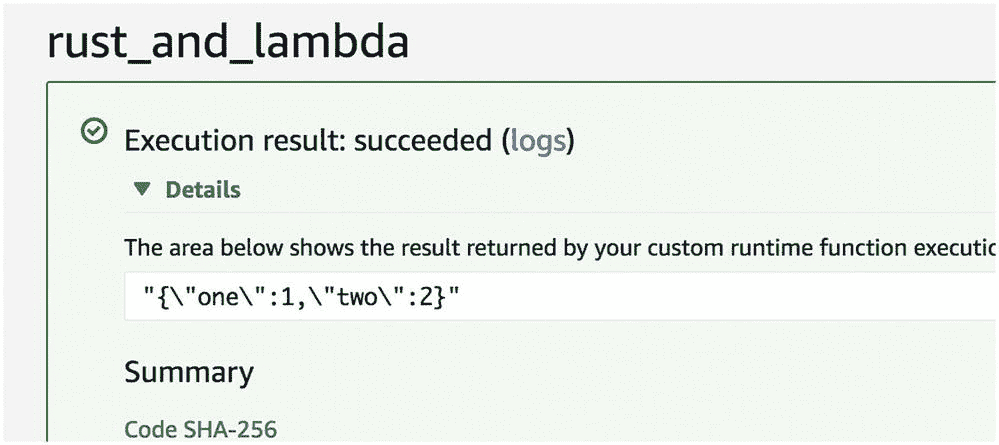
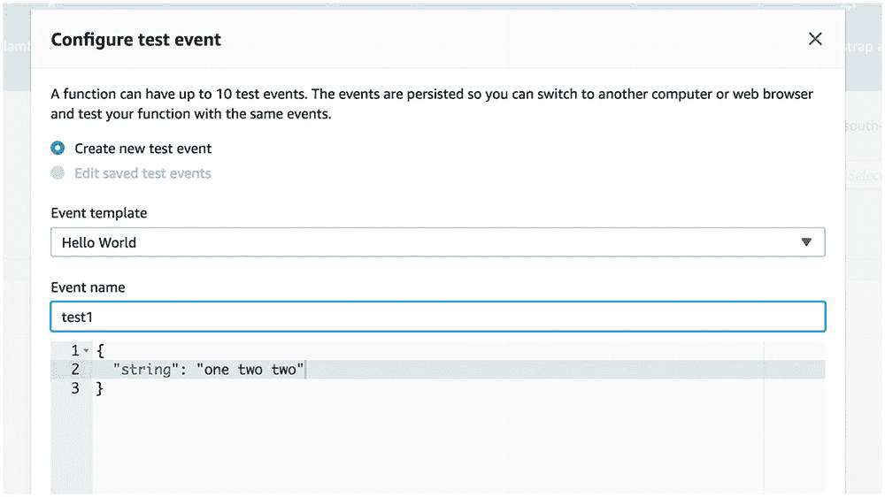
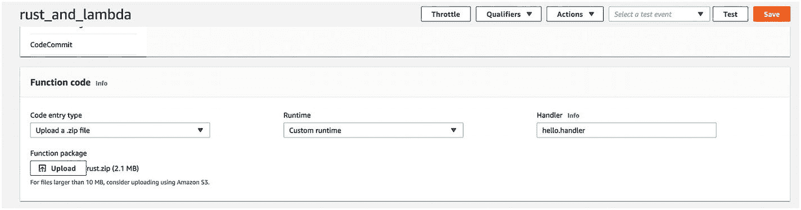
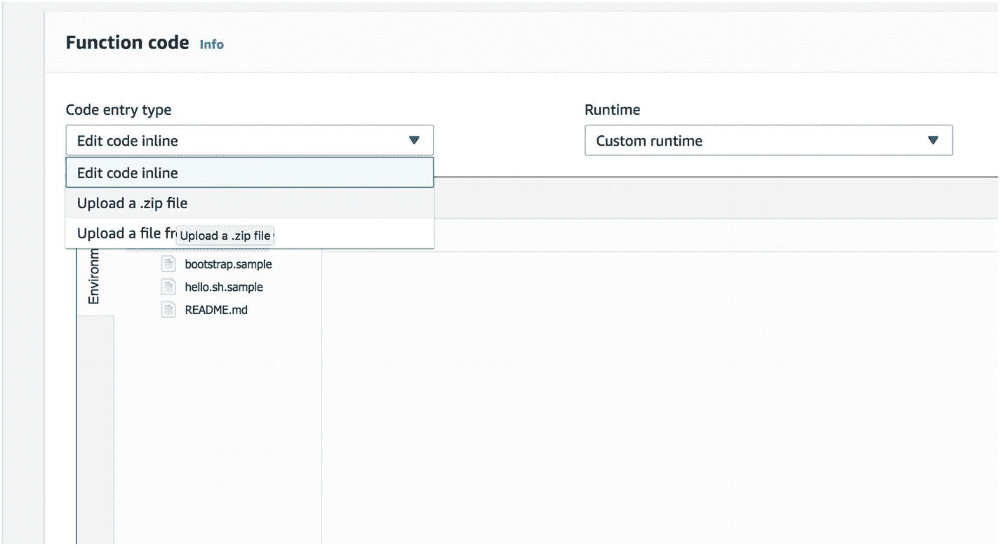
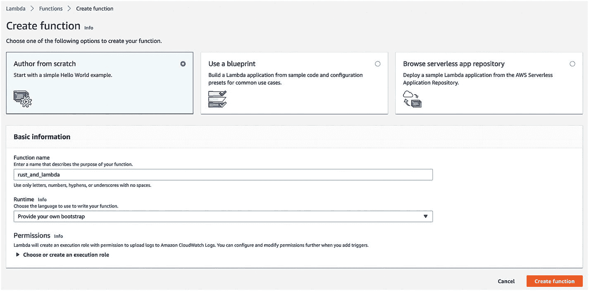

# 7. 机器学习领域

在前两章中，我们了解了机器学习在 NLP 和计算机视觉这两个主要领域中的处理方法。这些领域涵盖了机器学习的主要突破，并且这些领域的最新技术水平正在不断被推进。但许多机器学习和高性能计算也出现在这些领域之外。在本章中，我们将了解其中一些领域，以及 Rust 如何帮助在这些领域创建应用程序。我们将从统计分析开始，计算遗传数据集中不同疾病的 Z 分数。然后，我们将继续了解如何使用 Rust 中的 SIMD 和 BLAS 库编写高性能代码。最后，我们将在 Rust 中构建一个优秀书籍推荐系统。

到本章结束时，你应该对如何在不同领域构建机器学习应用程序有一个相当清晰的理解。

## 7.1 统计分析

作为数据科学家和机器学习工程师，我们需要对不同类型的数据进行大量统计分析。本节的基本假设是，如果我们能够解析数据并将变量的不同测量值存储到 ndarray 矩阵中，就应该能够对其进行统计分析。许多拥有机器学习库的编程语言都实现了 ndarray 矩阵类型。ndarray 是一个多维容器，用于存储相同类型且大小固定的元素。数组的维度和元素数量由其形状（shape）定义。在 Rust 中，ndarray 类型由 ndarray crate 实现。第 4 章已详细讨论了 ndarray crate。

为了探索如何使用 Rust 计算不同的统计参数，我们创建一个名为 statistics 的 Rust 项目，并在其中编写代码。在终端中切换到 chapter7 目录，并创建 Rust 二进制包 statistics（列表 7-1）。

```
$ cd chapter7
$ cargo new statistics --bin && cd statistics
列表 7-1
创建 Rust 二进制包 statistics
```

现在我们应该拥有 main.rs 文件和 Cargo.toml 文件。将依赖项添加到 toml 文件中。由于在本例中我们要计算数据集的不同统计量，因此需要在依赖项中添加 ndarray crate（列表 7-2）。

```
[package]
name = "statistics"
version = "0.1.0"
edition = "2018"
[dependencies]
ndarray = "0.12.1"
列表 7-2
chapter7/statistics/Cargo.toml
```

现在让我们继续讨论数据集。作为 Rust 如何使我们能够对原始数据进行统计分析的一个示例，我们可以对基因表达数据集执行简单的差异表达分析。在进行涉及大规模多重假设检验的分析时，我们将使用错误发现率来提供可解释的结果。请注意数据集的格式，以及我们将如何读取数据集以创建我们选择的向量。

我们可以从这个网址下载原始数据：`{`[`https://www.ncbi.nlm.nih.gov/sites/GDSbrowser?acc=GDS1615}`](https://www.ncbi.nlm.nih.gov/sites/GDSbrowser%253Facc%253DGDS1615%257d)。参见列表 7-3。

```
$ wget ftp://ftp.ncbi.nlm.nih.gov/geo/datasets\
/GDS1nnn/GDS1615/soft/GDS1615_full.soft.gz
$ gunzip GDS1615_full.soft.gz
列表 7-3
下载浏览器数据
```

下载数据后，我们会看到文件格式如下（列表 7-4）。

```
DATABASE = Geo

### 数据集头部信息在此处 ...
!dataset_table_begin

## 数据集头部信息在此处 ...
1007_s_at       MIR4640 80.7287 ...
// 各个记录 ...
AFFX-TrpnX-M_at --Control    1.62238 ...
!dataset_table_end
列表 7-4
查看文件内容

```

前 193 行是整个请求的头部信息以及 soft 文件中数据记录的其他元数据。记录位于 `!dataset_table_begin ... !dataset_table_end` 行之间。`dataset_table_begin` 之后的第一条记录包含以下数据结构：

*   GID：长度为 d 的基因标识符列表
*   SID：长度为 n 的样本标识符列表
*   STP：长度为 d 的样本描述列表
*   X：一个 d×n 的基因表达值数组

该数据集包含对 59 名克罗恩病患者和 26 名溃疡性结肠炎（UC）患者的外周血单核细胞（PBMC）的分析。共有 22,283 个样本。在本节中，我们将考虑两组中的平均表达水平。

接下来进入代码部分，我们首先需要解析整个文件。因此，我们创建一个 `process_file` 函数，并将文件路径传递给它。在函数内部，我们可以实现循环来读取各行（列表 7-5）。

```
use std::path::Path;
use std::fs::File;
use std::io::{BufRead, BufReader};
fn process_file(filename: &Path) {
let file = File::open(filename).unwrap();
for line in BufReader::new(file).lines() {
let thisline = line?;
// 在此处实现针对各行的业务逻辑。
}
}
fn main() {
let filename = Path::new("GDS1615_full.soft");
process_file(&filename).unwrap();
}
列表 7-5
chapter7/statistics/src/main.rs
```

在继续之前，让我们讨论一下我们需要的依赖项。由于我们要将向量转换为 ndarray 矩阵，因此需要 ndarray。另外，如果你需要测量更高级的统计量，我们还可以引入 ndarray-stats crate，它为我们处理 ndarray 向量时提供了更多选项。

现在我们应该能够读取头部信息了。首先是 `subset_description`，然后在下一行中，`subset_sample_id` 以列表形式给出。下面列表 7-6 展示了一个示例。

```
// 之前的数据 ..
!subset_description = normal
!subset_sample_id = GSM76115,...
!subset_type = disease state
// 后续数据 ...
列表 7-6
样本子集描述和样本 ID 示例
```

考虑到这一点，我们可以编写下面列表 7-7 中的代码。

```
fn process_file(filename: &Path) {
let mut SIF = HashMap::new();
let mut subset_description = String::new();
let mut within_headers = true;
for line in BufReader::new(file).lines() {
let thisline = line?;
let line_split: Vec = thisline
.split("=")
.map(|s| s.to_owned()).collect();
if within_headers {
if thisline.starts_with("!subset_description") {
subset_description = line_split[1].trim().to_owned();
};
let subset_ids = if thisline.starts_with("!subset_sample_id") {
let subset_ids = line_split[1].split(",");
let subset_ids = subset_ids.map(|s| s.trim().to_owned());
subset_ids.collect()
} else {
Vec::new()
};
for k in subset_ids {
SIF.insert(k, subset_description.to_owned());
}
}
}
// 其余代码 ...
}
列表 7-7
chapter7/statistics/src/main.rs
```

在列表 7-7 的代码中，`SIF` 是一个映射，将 `subset_sample_id` 行中的不同 `subset_ids` 映射到它们上面提到的 `subset_description`。这个过程需要持续到到达 `dataset_table_begin` 为止。参见列表 7-8。

```
'linereading: for line in BufReader::new(file).lines() {
let thisline = line?;
let line_split: Vec = thisline.split("=").map(|s| s.to_owned()).collect();
if thisline.starts_with("!dataset_table_begin") {
within_dataset_table = true;
within_headers = false;
continue 'linereading;
}
// 其余代码 ...
}
列表 7-8
chapter7/statistics/src/main.rs
```

一旦到达 `dataset_table_begin`，我们将标志 `within_headers` 设置为 false，然后跳转到下一行。这是因为 for 循环的设计方式。这样，在剩余的行中，`if within_headers` 块将不再执行。

一旦完成了子集样本 ID 到子集描述（SIF）的映射，我们就应该能够解析头部信息，即 `dataset_table_begin` 之后的第一行。请注意，在 `thisline.starts_with("!dataset_table_begin")` 块中，`within_dataset_table` 被赋值为 `true`，表明我们正处于表格内部。我们还将使用另一个变量 `gene_expression_headers` 来指示头部行已通过。我们将创建一个函数来处理已通过的头部行。我们还将创建一个函数 `process_gene_expresssion_data_headers` 来处理头部行的头部信息。该函数将接收之前创建的 SIF 映射，并为样本描述所映射到的列创建列索引。参见列表 7-9。

```
fn process_gene_expresssion_data_headers(
thisline: &String,
SIF: &HashMap)
-> (Vec, Vec, Vec) {
let SID: Vec = thisline.split("\t").map(|s| s.to_owned()).collect();
let indices: Vec = SID.iter()
.enumerate()
.filter(|&(_, x)| x.starts_with("GSM") )
.map(|(i, _)| i).collect();
let SID: Vec = indices.iter().map(|&i| SID[i].clone()).collect();
let STP: Vec = SID.iter().map(
|k| SIF.get(&k.to_string()).unwrap())
.cloned().collect();
(SID, STP, indices)
}
fn process_file(filename: &Path) {
// 之前的代码 ..
let mut gene_expression_headers = true;
let mut indices: Vec = Vec::new();
let mut gene_expression_measures_vec = Vec::new();
let mut gene_identifiers_vec = Vec::new();
let mut SID = Vec::new();
let mut STP = Vec::new();
'linereading: for line in BufReader::new(file).lines() {
let thisline = line?;
let line_split: Vec = thisline.split("=").map(|s| s.to_owned()).collect();
if within_dataset_table && gene_expression_headers {
let sid_stp_indices = process_gene_expresssion_data_headers(&thisline, &SIF);
indices = sid_stp_indices.2.clone();
SID = sid_stp_indices.0.clone();
STP = sid_stp_indices.1.clone();
gene_expression_headers = false;
continue 'linereading;
};
// 剩余代码...
}
代码清单 7-9
chapter7/statistics/src/main.rs
```

在代码清单 7-9 的代码中，当各个标识符以“GSM”开头时，就会创建索引。一旦标识符就位，就会通过 SIF 理解到描述的映射，然后返回 STD、STP 和 indices 的值供后续使用。解析完这一标题行后，我们不再希望对该行进行求值，因此在将 `gene_expression_headers` 赋值为 `false` 后继续循环，这样在后续的连续行读取中就不会再执行此代码块。

现在所有标题信息都已解析完毕，我们遍历从 soft 文件中第 196 行到末尾的基因数据。这部分数据处于数据集表中且不是 `gene_expression_headers` 这一独特条件下。因此，我们可以采用代码清单 7-10 中所示的以下代码。

```
fn process_file(filename: &Path) {
// 之前的代码 ...
if within_dataset_table && !gene_expression_headers {
if thisline.starts_with("!dataset_table_end") {
break 'linereading;
}
let (gene_expression_measures, gene_identifiers) = process_gene_expresssion_data(&thisline, &indices);
gene_expression_measures_vec.extend(gene_expression_measures);
gene_identifiers_vec.push(gene_identifiers);
}
// 剩余代码 ...
代码清单 7-10
chapter7/statistics/src/main.rs
```

`process_gene_expresssion_data` 是负责处理这些行的解析，并将其放入 `gene_expression_measures_vec` 和 `gene_identifiers_vec` 的函数。`gene_expression_measures_vec` 将包含不同标题对应的所有向量，而 `gene_identifiers_vec` 将包含拼接后的 id 引用和标识符。

创建 `gene_expression_measures_vec` 后，我们可以将其转换为 ndarray 矩阵。在代码清单 7-11 中，我们将使用 ndarray 提供的不同 Array 结构。`Array` 用于任意维度的 ndarray，而 `Array2` 和 `Array1` 分别提供维度为 2 和 1 的数组。可以使用 `stack` 函数将 ndarray 重塑为新的维度，其中 `Axis` 函数提供轴索引。

```
use ndarray;
use ndarray::{Array, Array2, Array1, Axis, stack};
fn convert_to_log_scale(X: &Array2) -> Array2 {
let two = 2.0f64;
let two_log = two.ln();
X.mapv(|x| x.ln()/two_log)
}
fn process_file(filename: &Path) {
// 之前的代码 ...
let gene_expression_measures_matrix = Array::from_shape_vec(
(22283, 127), gene_expression_measures_vec).unwrap();
let gene_expression_measures_matrix = convert_to_log_scale(
&gene_expression_measures_matrix);
// 剩余代码 ...
代码清单 7-11
chapter7/statistics/src/main.rs
```

从这个矩阵中，我们需要分离出 UC 和克罗恩病样本的索引。参见代码清单 7-12。

```
fn filter_specific_samples(
STP: &Vec,
group_type: &str) -> Vec {
STP.iter().enumerate()
.filter(|&(_, x)| x == group_type)
.map(|(i, _)| i).collect()
}
fn different_samples(
STP: &Vec) -> (Vec, Vec) {
let UC = filter_specific_samples(&STP, "ulcerative colitis");
let CD = filter_specific_samples(&STP, "Crohn's disease");
(UC, CD)
}
let (UC, CD) = different_samples(&STP);
代码清单 7-12
chapter7/statistics/src/main.rs
```

现在我们有了数据，可以计算每个组的均值和方差，这些将用于计算 Z 分数，以汇总差异表达的证据。为了构建 Z 分数，我们需要构建一些函数。第一个函数是，如果我们传递样本索引，则从 `gene_expression_measures_matrix` 中过滤出相应的列。其思路是，我们应该能够传递相关的 UC 和 CD 索引，并获取子矩阵。参见代码清单 7-13。

```
fn filter_out_relevant_columns(samples: &Vec,
gene_expression_measures_matrix: &Array2) -> Array2 {
let shape1 = samples.len();
let shape0 = gene_expression_measures_matrix.shape()[0];
let mut cols = Vec::new();
for &msamples_columns in samples {
let col = gene_expression_measures_matrix.column(
msamples_columns);
cols.push(col);
}
let Msamples = stack(Axis(0), &cols[..]).unwrap();
let Msamples = Array::from_iter(Msamples.iter());
let Msamples = Msamples.into_shape((shape0, shape1)).unwrap();
Msamples.mapv(|&x| x)
}
代码清单 7-13
chapter7/statistics/src/main.rs
```

现在我们有了子矩阵，可以计算样本的均值或方差，这在 ndarray 中是一个简单的函数（代码清单 7-14）。

```
fn mean_of_samples(samples: &Vec,
gene_expression_measures_matrix: &Array2) -> Array1 {
let Msamples = filter_out_relevant_columns(
samples, gene_expression_measures_matrix);
Msamples.mean_axis(Axis(1))
}
fn variance_of_samples(
samples: &Vec,
gene_expression_measures_matrix: &Array2)
-> Array1 {
let Msamples = filter_out_relevant_columns(samples, gene_expression_measures_matrix);
Msamples.var_axis(Axis(1), 1.)
}
代码清单 7-14
chapter7/statistics/src/main.rs
```

因此，我们最终能够计算两个样本的 Z 分数（代码清单 7-15）。

```
fn generate_zscores(UC: &Vec,
CD: &Vec,
gene_expression_measures_matrix: &Array2)
-> Array1 {
let MUC = mean_of_samples(&UC, &gene_expression_measures_matrix);
let MCD = mean_of_samples(&CD, &gene_expression_measures_matrix);
let VUC = variance_of_samples(&UC, &gene_expression_measures_matrix);
let VCD = variance_of_samples(&CD, &gene_expression_measures_matrix);
let nUC = UC.len();
let nCD = CD.len();
let z_scores_num = MUC - MCD;
let z_scores_den = (VUC/nUC as f64 + VCD/nCD as f64).mapv(f64::sqrt);
let z_scores = z_scores_num / z_scores_den;
z_scores
}
fn process_file(filename: &Path) {
// 之前的代码 ...
let z_scores = generate_zscores(&UC, &CD, &gene_expression_measures_matrix);
let z_scores_mean = z_scores.sum() / z_scores.len() as f64;
let z_scores_std = z_scores.std_axis(Axis(0), 1.);
println!("z scores mean {:?}", z_scores_mean);
println!("z scores mean {:?}", z_scores_std);
}
代码清单 7-15
chapter7/statistics/src/main.rs
```

如果一个基因没有差异表达，它在两组样本中的期望值相同。在这种情况下，Z 分数将是标准化的，即均值为零且标准差为单位值。打印 `z_scores_mean` 和 `z_scores_std`，我们发现值分别为 0.042918212228268235 和 3.5369539066322027。请注意，由于向量是 ndarray 格式，我们可以轻松地使用 ndarray API 计算统计量。

由于标准差远大于 1，似乎存在多个基因在溃疡性结肠炎（UC）和克罗恩病样本中的平均表达水平存在差异。此外，由于平均 Z 分数为正值，主要模式似乎是 UC 样本中基因的表达量高于克罗恩病样本。

同样地，我们可以计算 p 值。具体结果对本节而言并不重要，本节旨在说明，一旦在 Rust 中将值转换为`ndarray`矩阵，对它们进行统计分析就变得相当简单。

## 7.2 编写高性能代码

许多能够使用 GPU 的机器学习代码，都是通过 Rust 绑定到本质上用 C/C++编写的库来实现的。为了能够使用 GPU 或编写高性能代码，我们可以使用诸如`blas-src`或`lapack-src`之类的 crate，它们提供了对底层数学运算的访问。

在大多数情况下，我们在前几章讨论过的高级 crate 和库就足够了，但有时我们需要深入底层，执行直接的向量运算。单指令多数据流（SIMD）操作库，更广为人知的名字是 SIMD，是一个用于执行向量运算的流行库，而`faster`^(³²) crate 为我们提供了在 Rust 中运行 SIMD 指令的良好抽象。

如果我们试图在向量上并行执行指令并返回结果，SIMD 和`faster`非常有用。这种转换会作用于向量的每个元素。在清单 7-16 所示的代码中，我们将获取一个向量并返回该向量中所有元素的立方。

在运行安装代码之前，你可能需要在系统中安装好`blas`和`lapack`库。在 Ubuntu 系统中安装可能需要类似此代码中所示的命令。

```
$ sudo apt-get install libblas-dev liblapack-dev
$ sudo apt-get install libopenblas-dev
$ sudo apt-get install gfortran
$
清单 7-16
安装 libblas
```

现在我们可以创建一个 Rust 项目来探索如何编写高性能代码，并将其命名为`high-performance-computing`（清单 `7-17`）。

```
$ cd chapter7
$ cargo new high-performance-computing --bin && cd high-performance-computing
清单 7-17
创建用于高性能计算的 Rust 项目
```

我们现在应该有了`main.rs`文件和`Cargo.toml`文件。由于我们将使用`lapack`、`openblas`和 SIMD 依赖项，我们需要添加能够使用这些依赖项的 crate。参见清单 7-18。

```
[package]
name = "high-performance-computing"
version = "0.1.0"
edition = "2018"
[dependencies]
faster = "0.5.0"
rblas = "0.0.13"
清单 7-18
chapter7/high-performance-computing/Cargo.toml
```

在清单 7-18 的依赖项列表中，crate `faster` 是用于在 Rust 中编写 SIMD 代码的 Rust 代码，`rblas` crate 使我们能够访问 Open BLAS 和 OpenBLAS 包。

我们现在应该能够编写代码了，我们将从使用`faster`包并编写使用 SIMD 软件的代码开始（清单 7-19）。

```
use faster::*;
fn main() {
let my_vector: Vec = (0..10).map(
|v| v as f32).collect();
let power_of_3 = (&my_vector[..]).simd_iter(f32s(0.0))
.simd_map(|v| v * v * v)
.scalar_collect();
println!("{:?}", power_of_3);
}
清单 7-19
chapter7/high-performance-computing/src/main.rs
```

类似地，当我们尝试对向量执行归约操作时，可以使用`simd_reduce`方法。例如，在清单 7-20 的代码中，我们将尝试求向量中元素的和。

```
fn main() {
// 之前的代码 ...
let reduced = (&power_of_3[..])
.simd_iter(f32s(0.0))
.simd_reduce(f32s(0.0), |a, v| a + v ).sum();
}
清单 7-20
chapter7/high-performance-computing/src/main.rs
```

另一个对向量执行的常见操作是两个向量的点积，在这种情况下，我们将使用之前包含的`rblas` crate，它是`blas`和`openblas`库的封装。BLAS，即基本线性代数规范（Basic Linear Algebra Specification），是一组用于执行常见线性运算的底层例程。`rblas` crate 在`blas`之上实现了点积运算 [1]。

在清单 7-21 中，我们计算两个已初始化向量的点积。

```
use rblas::Dot;
fn main() {
let x = vec![1.0, -2.0, 3.0, 4.0];
let y = [1.0, 1.0, 1.0, 1.0, 7.0];
let d = Dot::dot(&x, &y[..x.len()]);
println!("dot product {:?}", d);
}
清单 7-21
chapter7/high-performance-computing/src/main.rs
```

运行清单 7-21 中的代码，我们应该得到清单 7-22 中的输出。

```
$ cargo run
Finished dev [unoptimized + debuginfo] target(s) in 0.01s
Running `target/debug/high-performance-computing`
[3.0, 3.0, ..., 3.0, 3.0]
[0.0, 1.0, 8.0, 27.0, 64.0, 125.0, 216.0, 343.0, 512.0, 729.0]
2025.0
dot product 6.0
清单 7-22
high-performance-computing 输出
```

因此，通过使用这些高性能库的封装，我们应该能够在 Rust 应用程序中编写高性能代码。

## 7.3 推荐系统

推荐系统是机器学习技术在商业中最成功、最广泛的应用之一。推荐系统中的机器学习算法通常分为两类——基于内容的过滤和协同过滤，尽管现代架构主要结合使用两者。基于内容的方法基于项目属性的相似性，而协同方法则根据交互计算相似性。

在 Rust 中，我们能够创建推荐引擎，这主要归功于优秀的`sbr-rs` crate。^(³³) 在这个 crate 中实现了两个模型。这个 crate 需要安装一些额外的操作系统级依赖项。确保你的系统中安装了`libssl`。在 Ubuntu 系统中，运行清单 7-23 中的以下命令应该没问题。

```
$ sudo apt install libssl-dev
$
清单 7-23
在 Ubuntu 上安装 libssl
```

我们可以使用`sbr`包创建的模型如下：

*   **LSTM**：使用 LSTM 网络对用户交互序列进行建模，以预测其下一个动作；
*   **EWWA**：该模型使用过去动作的指数加权平均值来预测未来的交互。

要启动项目，我们可以像清单 7-24 所示那样使用`cargo`创建一个项目。

```
$ cargo new --bin goodbooks-recommender
$
清单 7-24
新建 Rust goodbooks 包
```

这将设置项目，包含`src/main.rs`文件和`Cargo.toml`文件，正如我们在前几章中看到的那样。在 cargo 文件中添加依赖项。其中一些依赖项我们已经见过，例如用作 Web 客户端的`reqwest`。`Failure`是一个用于更好处理错误的优秀 crate。`serde`、`serde_json`和`serde_json`这些 crate 用于序列化和反序列化数据。我们将需要`csv` crate 来处理 csv 文件。`rand` crate 将帮助我们随机化数据，而`structopt` crate 用于创建良好的命令行界面。根据本节内容，最重要的 crate 是`sbr` crate，它实现了我们将在此处调用的推荐模块，如清单 7-25 所示。

```
[package]
name = "goodbooks-recommender"
version = "0.1.0"
authors = ["author names"]
edition = "2018"
[dependencies]
reqwest = "0.9.17"
failure = "0.1.5"
serde = "1"
serde_derive = "1"
serde_json = "1"
csv = "1"
sbr = "0.4.0"
rand = "0.6.5"
structopt = "0.2.15"
清单 7-25
chapter7/goodbooks-recommender/Cargo.toml
```

### 7.3.1 命令行

现在我们将开始创建命令行。对于熟悉 `git` 的读者来说，你可能已经注意到 git 有诸如 `git clone` 或 `git pull` 这样的第一级命令，然后根据第一个命令，我们会有第二级命令，例如 `origin master` 作为 `pull` 的子命令，这使我们能够编写 `git pull origin master`。类似地，我们将尝试构建一个命令行解析器（清单 7-26）。

```
use structopt::StructOpt;
#[derive(Debug, StructOpt)]
#[structopt(name = "goodbooks-recommender", about = "Books Recommendation")]
enum Opt {
#[structopt(name = "fit")]
/// 将拟合模型。
Fit,
#[structopt(name = "predict")]
/// 将根据其后的字符串预测模型。请仅在运行 fit 并保存模型后运行此命令。
Predict(BookName),
}
// 子命令也可以通过使用 1 元组枚举变体来外部化
#[derive(Debug, StructOpt)]
struct BookName {
#[structopt(short = "t", long = "text")]
/// 输入你想要预测的书籍文本
/// 多个书籍可以用逗号分隔的方式传入
text: String,
}
fn main() {
let opt = Opt::from_args();
}
清单 7-26
goodbooks-recommender/src/main.rs
```

在清单 7-26 的代码中，goodbooks-recommender 接收一个第一级命令，这本质上是一个枚举，要么是 Fit 要么是 Predict。Fit 本身就可以使用，但 Predict 需要一个单独的子命令，即一个文本。帮助函数也提供了相关文档（清单 7-27）。

```
$ cargo run -- --help
Finished dev [unoptimized + debuginfo] target(s) in 0.23s
Running `target/debug/goodbooks-recommender --help`
goodbooks-recommender 0.1.0
书籍推荐
用法:
goodbooks-recommender 
标志:
-h, --help       打印帮助信息
-V, --version    打印版本信息
子命令:
fit        将拟合模型。
help       打印此消息或给定子命令的帮助信息
predict    将根据其后的字符串预测模型。请仅在运行 fit 并保存模型后运行此命令。
清单 7-27
包运行帮助
```

我们还可以看到 predict 的帮助文本，如清单 7-28 所示。

```
$ cargo run -- predict --help
Finished dev [unoptimized + debuginfo] target(s) in 0.23s
Running `target/debug/goodbooks-recommender predict --help`
goodbooks-recommender-predict 0.1.0
将根据其后的字符串预测模型。请仅在运行 fit 并保存模型后运行此命令。
用法:
goodbooks-recommender predict --text 
标志:
-h, --help       打印帮助信息
-V, --version    打印版本信息
选项:
-t, --text     输入你想要预测的书籍文本。多个书籍可以用逗号分隔的方式传入。
清单 7-28
包运行 predict 帮助
```

### 7.3.2 下载数据

现在我们应该能够创建用于下载数据的函数，并将文件保存到目标文件夹中（清单 7-29）。

```
use std::fs::File;
use std::io::BufWriter;
use std::path::Path;
fn download(url: &str, destination: &Path)
-> Result {
if destination.exists() {
return Ok(()) // 不要多次下载
}
let mut writer = BufWriter::new(file);
let mut response = reqwest::get(url)?;
response.copy_to(&mut writer)?;
Ok(())
}
清单 7-29
chapter7/goodbooks-recommender/src/main.rs
```

在上述清单 7-29 所示的下载函数中，我们将 url 作为 str 类型，destination 作为路径。如果路径已存在，则无需执行任何操作。我们将由该函数的调用者来确保 url 和 destination 的组合是正确的。然后，我们将从 url 获取响应，并使用 `BufWriter` 模块将其写入路径。这应该能够下载我们传递给函数的任何 url。

使用上述函数，我们可以从以下 GitHub 仓库 [`https://github.com/zygmuntz/goodbooks-10k/`](https://github.com/zygmuntz/goodbooks-10k/) 下载好书数据集。该数据集包含一万本最受欢迎书籍的六百万条评分。数据集中提供的其他信息包括 isbn 值、作者等，但在此示例中我们不会关注这些。我们将下载 `ratings.csv` 和 `books.csv`，如清单 7-30 所示。

```
/// 下载评分数据和元数据。
fn download_data(ratings_path: &path,
books_path: &path) {
let ratings_url = "https://github.com/zygmuntz/\
goodbooks-10k/raw/master/ratings.csv";
let books_url = "https://github.com/zygmuntz/\
goodbooks-10k/raw/master/books.csv";
download(&ratings_url, ratings_path)
.expect("无法下载评分数据");
download(&books_url, books_path)
.expect("无法下载元数据");
}
清单 7-30
chapter7/goodbooks-recommender/src/main.rs
```

### 7.3.3 数据

现在我们可以运行这个函数，会看到文件已下载到根文件夹中。查看这两个 csv 文件。books.csv 文件中的列包括 `book_id`、`goodreads_book_id`、`work_id`、`books_count`、isbn、isbn13、authors、`original_publication_year`、`language_code`、title、`language_code`、`average_rating`、`ratings_count`、`work_ratings_count`、`work_text_reviews_count`、`ratings_1`、`ratings_2`、`ratings_3`、`ratings_4`、`ratings_5`、`image_url` 和 `small_image_url`，共 23 列。类似地，评分文件包含 user_id、`book_id` 和 rating。

从这个评分文件中，我们将创建 `user_id` 和 `book_id` 之间的映射，从书籍文件中创建 `book_id` 和 `title` 之间的映射。这可以用一个结构体来编码。为了简单起见，我们只取少量特征，但你应该尝试使用更多特征。参见清单 7-31。

```
#[derive(Debug, Serialize, Deserialize)]
struct UserReadsBook {
user_id: usize,
book_id: usize,
}
#[derive(Debug, Deserialize, Serialize)]
struct Book {
book_id: usize,
title: String
}
清单 7-31
chapter7/goodbooks-recommender/src/main.rs
```

现在我们可以编写两个函数，一个用于反序列化评分数据，另一个用于反序列化书籍数据（清单 7-32）。

```
use csv;
fn deserialize_ratings(path: &Path)
-> Result, failure::Error> {
let mut reader = csv::Reader::from_path(path)?;
let entries = reader.deserialize()
.collect::, _>>()?;
Ok(entries)
}
fn deserialize_books(path: &Path)
-> Result,
HashMap), failure::Error> {
let mut reader = csv::Reader::from_path(path)?;
let entries: Vec = reader.deserialize::()
.collect::, _>>()?;
let id_to_title: HashMap = entries
.iter()
.map(|book| (book.book_id, book.title.clone()))
.collect();
let title_to_id: HashMap = entries
.iter()
.map(|book| (book.title.clone(), book.book_id))
.collect();
Ok((id_to_title, title_to_id))
}
清单 7-32
chapter7/goodbooks-recommender/src/main.rs
```

在清单 7-31 和 7-32 中，我们将使用 csv 读取文件，然后收集向量。在 `deserialize_ratings` 函数中，我们不直接返回向量，而是返回由 `Result<Vec<UserReadsBook>` 给出的向量结果。在 `deserialize_books` 函数中，我们还创建了 `id_to_title` 和 `title_to_id` 映射，以便能够通过相关映射的简单查找从一个获取另一个。

### 7.3.4 模型构建

数据部分已经完成，现在我们可以编写用于构建模型的函数。如前所述，sbr 实现了两种模型：基于 LSTM 的模型和基于移动平均的模型（EWMA）。我们将使用 EWMA 模型。EWMA 模型在计算量上更简单，我们在此使用它。指数加权移动平均是一种用于监控过程均值微小偏移的控制方法。它按几何递减的顺序对观测值进行加权，使得最近的观测值权重最大，而较旧的观测值对模型贡献很小。在许多情况下，这已经足够了。

首先，我们编写一个函数来设置模型的超参数（清单 7-33）。

```
use sbr::models::ewma::{Hyperparameters, ImplicitEWMAModel};
use sbr::models::{Loss, Optimizer};
fn build_model(num_items: usize) -> ImplicitEWMAModel {
let hyperparameters = Hyperparameters::new(num_items, 128)
.embedding_dim(32)
.learning_rate(0.16)
.l2_penalty(0.0004)
.loss(Loss::WARP)
.optimizer(Optimizer::Adagrad)
.num_epochs(10)
.num_threads(1);
hyperparameters.build()
}
清单 7-33
chapter7/goodbooks-recommender/src/main.rs
```

为了使模型能够工作，我们需要将数据转换为 sbr 的 interactions 对象。Interactions 接收用户数量、物品数量以及时间戳。由于 ID 是序数，我们可以取最大的 ID 作为用户和物品的数量，并假设数据按时间顺序排列，将索引作为时间戳。在其他情况下，我们需要以不同的方式处理这些问题（清单 7-34）。

```
fn build_interactions(data: &[UserReadsBook]) -> Interactions {
let num_users = data
.iter()
.map(|x| x.user_id)
.max()
.unwrap() + 1;
let num_items = data
.iter()
.map(|x| x.book_id)
.max()
.unwrap() + 1;
let mut interactions = Interactions::new(num_users,
num_items);
for (idx, datum) in data.iter().enumerate() {
interactions.push(
Interaction::new(datum.user_id,
datum.book_id,
idx)
);
}
interactions
}
清单 7-34
chapter7/goodbooks-recommender/src/main.rs
```

现在模型已经构建完成，我们需要在数据上进行训练。接下来，我们将创建一个拟合函数。与之前进行的其他训练一样，需要将数据拆分为测试集和训练集，以便评估模型的拟合程度，并确保模型确实在学习。参见清单 7-35。

```
use sbr::evaluation::mrr_score;
fn fit(model: &mut ImplicitEWMAModel,
data: &Interactions)
-> Result {
let (train, test) = user_based_split(
data, &mut rng, 0.2);
model.fit(&train.to_compressed())?;
let mrr = mrr_score(model, &test.to_compressed())?;
Ok(mrr)
}
清单 7-35
chapter7/goodbooks-recommender/src/main.rs
```

在清单 7-35 的拟合函数中，结果是 MRR 分数。MRR 分数，即平均倒数排名，是衡量单个最高排名项目有效性的分数。遗憾的是，另一种流行的评分方法——平均精度均值（MAP），在 sbr 中并未实现，需要用户自行实现。

模型训练完成后，我们需要对模型进行序列化，以便将其保存到文件中。我们可以使用 serde 库来完成此操作（清单 7-36）。

```
fn serialize_model(model: &ImplicitEWMAModel,
path: &Path) -> Result {
let file = File::create(path)?;
let mut writer = BufWriter::new(file);
Ok(serde_json::to_writer(&mut writer, model)?)
}
清单 7-36
chapter7/goodbooks-recommender/src/main.rs
```

现在，我们需要一个函数来依次执行我们刚才提到的各个函数。参见清单 7-37。

```
fn main_build() {
let ratings_path = Path::new("ratings.csv");
let books_path = Path::new("books.csv");
let model_path = Path::new("model.json");
// 如果模型已存在，则提前退出。
if model_path.exists() {
println!("模型已拟合。");
return ();
}
download_data(ratings_path, books_path);
let ratings = deserialize_ratings(ratings_path).unwrap();
let (id_to_title,
title_to_id) = deserialize_books(books_path).unwrap();
println!("已反序列化 {} 条评分。", ratings.len());
println!("已反序列化 {} 本书。", id_to_title.len());
let interactions = build_interactions(&ratings);
let mut model = build_model(interactions.num_items());
println!("正在拟合...");
let mrr = fit(&mut model, &interactions)
.expect("无法拟合模型。");
println!("模型拟合完成，MRR 为 {:.2}", mrr);
serialize_model(&model, &model_path)
.expect("无法序列化模型。");
}
清单 7-37
chapter7/goodbooks-recommender/src/main.rs
```

现在，我们应该将这个 `main_build` 函数接入主函数中（清单 7-38）。

```
fn main() {
let opt = Opt::from_args();
match opt {
Opt::Fit => main_build(),
_ => {
unimplemented!();
},
}
}
清单 7-38
chapter7/goodbooks-recommender/src/main.rs
```

现在使用 `cargo run – fit` 运行它，应该会将模型保存到 `model.json` 文件中（清单 7-39）。

```
$ ls
books.csv  Cargo.lock  Cargo.toml  fit  model.json  ratings.csv  src  target
$
清单 7-39
检查目录中的 model.json 文件
```

### 7.3.5 模型预测

为了能够进行预测，我们需要完成两件事。首先是模型反序列化。模型反序列化后，它将位于 `ImplicitEWMAModel` 结构体中（代码清单 7-40）。

```
use std::io::BufReader;
fn deserialize_model() -> Result {
let file = File::open("model.json")?;
let reader = BufReader::new(file);
let model = serde_json::from_reader(reader)?;
Ok(model)
}
代码清单 7-40
chapter7/goodbooks-recommender/src/main.rs
```

模型反序列化完成后，我们将使用该模型进行预测。因此，需要将预测函数传递给模型进行推理。同时，还需要传递目标令牌（代码清单 7-41）。

```
fn predict(input_titles: &[String],
model: &ImplicitEWMAModel)
-> Result, failure::Error> {
let (id_to_title,
title_to_id) = deserialize_books(
&Path::new("books.csv")
).unwrap();
// 首先检查输入是否有效。
for title in input_titles {
if !title_to_id.contains_key(title) {
println!("未找到该标题，忽略: {}", title);
}
}
// 其余代码..
}
代码清单 7-41
chapter7/goodbooks-recommender/src/main.rs
```

为此，我们需要创建用户表示以及可能被预测的索引。

由于模型是基于标题 ID 训练的，我们将提供这些 ID 作为预测的输入。我们还需要可能被预测的 ID。在这种情况下，ID 是有序的，因此我们可以直接从 0 取到长度值。在其他情况下，我们可能需要收集实际的向量。参见代码清单 7-42。

```
fn predict(input_titles: &[String],
model: &ImplicitEWMAModel)
-> Result, failure::Error> {
// 之前的代码..
// 将标题映射为索引。
let input_indices: Vec = input_titles
.iter()
.filter_map(|title| title_to_id.get(title))
.cloned()
.collect();
let indices_to_score: Vec =
(0..id_to_title.len()).collect();
// 其余代码..
}
代码清单 7-42
chapter7/goodbooks-recommender/src/main.rs
```

基于 `input_indices` 向量，我们可以获取用户表示，并将其传递给模型进行预测（代码清单 7-43）。

```
fn predict(input_titles: &[String],
model: &ImplicitEWMAModel)
-> Result, failure::Error> {
// 之前的代码 ..
// 获取用户表示。
let user = model.user_representation(&input_indices)?;
// 获取实际预测结果。
let predictions = model.predict(&user, &indices_to_score)?;
// 其余代码 ..
代码清单 7-43
chapter7/goodbooks-recommender/src/main.rs
```

生成预测结果后，我们需要根据分数进行排序。这里我们只展示前 10 个结果（代码清单 7-44）。

```
fn predict(input_titles: &[String],
model: &ImplicitEWMAModel)
-> Result, failure::Error> {
// 之前的代码 ...
let mut predictions: Vec
= indices_to_score.iter()
.zip(predictions)
.map(|(idx, score)| (idx, score))
.collect();
predictions
.sort_by(
|(_, score_a), (_, score_b)|
score_b.partial_cmp(score_a)
.unwrap());
Ok((&predictions[..10])
.iter()
.map(|(idx, _)| id_to_title.get(idx).unwrap())
.cloned()
.collect())
}
代码清单 7-44
chapter7/goodbooks-recommender/src/main.rs
```

将其接入主方法后，应能得到我们所需的结果（代码清单 7-45）。

```
fn main() {
let opt = Opt::from_args();
match opt {
Opt::Fit => main_build(),
Predict(book) => {
let model = deserialize_model()
.expect("无法反序列化模型。");
let tokens: Vec = book.text.split(",").map(
|s| s.to_string()).collect();
let predictions = predict(&tokens, &model)
.expect("无法获取预测结果");
println!("预测结果:");
for prediction in predictions {
println!("{}", prediction);
}
},
}
}
代码清单 7-45
chapter7/goodbooks-recommender/src/main.rs
```

使用代码清单 7-46 中的命令，我们可以预测用户输入的标题。

```
$ cargo run -- predict --text "The Alchemist"
Finished dev [unoptimized + debuginfo] target(s) in 0.22s
Running `target/debug/goodbooks-recommender predict --text 'The Alchemist'`
Predictions:
The Alchemist
The Kite Runner
One Hundred Years of Solitude
The Da Vinci Code (Robert Langdon, #2)
A Thousand Splendid Suns
Life of Pi
Eat, Pray, Love
Memoirs of a Geisha
Angels & Demons  (Robert Langdon, #1)
The Five People You Meet in Heaven
$
代码清单 7-46
chapter7/goodbooks-recommender/src/main.rs
```

## 7.4 本章小结

本章向你介绍了 Rust 在高性能计算中不同有趣的领域，这些领域通常是机器学习的非传统应用。本章从统计分析开始，说明了一旦我们能够将数据集转换为 ndarray 矩阵，统计分析就变得非常简单。在下一节中，我们使用了 SIMD 和 BLAS 的封装器来对向量执行高性能和并行计算。最后，我们使用 Rust 中一个流行的推荐系统 crate 构建了一个推荐系统。

在本书的最后一章，你将学习如何利用云以及其他部署 Rust 机器学习应用和模型的方式，创建并部署用于生产的 Rust ML 应用。

# 8. 使用 Rust 应用

在本书中，我们探讨了数据转换以及在 Rust 中创建机器学习模型。一旦我们确定了要采用的机器学习工作流，就需要一种方法将其集成到整体架构中。由于 Rust 是一门相对较新的语言，你的项目中的整体架构很可能是用主流语言创建的。在本章中，我们将探讨如何将 Rust 代码集成到整体生产架构中。我们将从在 Python 应用中集成 Rust 代码开始，然后转向在 Java 应用中集成 Rust 代码。最后，我们将介绍如何在 Rust 中创建无服务器应用。

## 8.1 Rust 即插即用

由于 Rust 是一门相对较新的应用语言，你很可能正在处理一个用 Python 或 Java 等流行语言编写的、拥有数百万行代码的遗留应用。在这种情况下，使用 Rust ML 应用意味着只使用现有应用的一小部分。Rust 没有运行时这一特性，使得只要“其他”语言有调用共享库的方式，就很容易在这些语言中调用 Rust 代码。通常，所有主流语言都具备这种能力。在接下来的几节中，我们将举两个例子：一个是在 Python 中调用 Rust 函数，另一个是在 Java 中调用。

### 8.1.1 Python

在本节中，我们将使用 PyO3 运行 Rust 代码。^(³⁴) PyO3 为 Python 提供了 Rust 绑定。在这段代码中，我们将使用第 5 章创建的 `crfsuite-model`，并尝试从 Python 调用该代码。

首先，让我们简单回顾一下。在 crfsuite 代码中，我们有一个结构体 `NER`，用于从数据集中读取 `lemma`、`next_lemma`、`word` 和 `tag`。然后，数据会通过不同的函数（例如 `split_test_train` 和 `create_xseq_yseq`）进行处理，以转换为正确的向量序列。接着，我们可以将数据传递给 `crfmodel_training`，该函数将执行训练。此训练还会创建一个模型文件。训练完成后，我们可以使用 `model_prediction` 进行预测，并使用 `check_accuracy` 函数检查准确率。

为了能够使用这些功能，我们需要创建一个公共 API，并将它们封装在 Python 可调用的代码中。因此，让我们先看看所需的依赖项和整体项目结构。我们需要之前见过的数据读取和组织 crate：`csv`、`serde`、`serde-derive` 和 `rand`。我们还需要 `crfsuite` 来执行机器学习并运行之前的代码。我们还需要最新版本的 pyo3 代码。最后，我们需要指定库名称和 crate 类型。如果我们不使用 dylib，它将创建 rlib 二进制文件。rlib 格式是一种 Rust 特定的静态库格式，其中包含元数据，例如用于泛型的序列化类型检查 AST。因此，它们不适合外部使用。另外，不要使用 staticlib，因为它同样无法链接。大多数其他语言只理解并生成 .so/.dylib 格式。因此，我们的 `Cargo.toml` 将类似于清单 8-1。

```
[package]
name = "crfsuite-model"
version = "0.2.0"
edition = "2018"
[dependencies]
csv = "1.0.7"
serde = "1"
serde_derive = "1"
rand = "0.6.5"
crfsuite = "0.2.6"
pyo3 = { git = "https://github.com/PyO3/pyo3.git",
// 从 github 获取最新修订版
rev = "99fdafbb880c181f4bce16bbbac03888b3cf85c8",
features = ["extension-module"]}
[lib]
name = "crfsuite_model"
crate-type = ["cdylib"]
清单 8-1
chapter8/crfsuite-model/Cargo.toml
```

现在，我们需要为代码确定一个公共 API。这类似于著名的 scikit-learn 风格，即创建一个模型类并在代码上定义 `fit` 和 `predict` 方法。该类可以将模型文件名作为输入，而 `train` 和 `predict` 可以将训练和预测文件的路径作为训练和预测的数据（清单 8-2）。

```
use pyo3::prelude::*;
use std::fs;
use std::path::PathBuf;
#[pyclass(module = "crfsuite_model")]
pub struct CRFSuiteModel {
model_name: String,
}
#[pymethods]
impl CRFSuiteModel {
#[new]
fn new(obj: &PyRawObject, path: String) {
obj.init(CRFSuiteModel {
model_name: path,
});
}
fn fit(&self, py: Python, path: String) -> PyResult {
// 训练代码 ...
Ok("model fit done".to_string())
}
fn predict(&self,
predict_filename: String)
-> PyResult> {
// 预测代码 ...
Ok(preds)
}
}
清单 8-2
chapter8/crfsuite-model/src/lib.rs
```

现在我们已经有了整体的函数签名，将我们在 0.1 版本中的 main 方法转移到 fit 方法中（清单 8-3）。

```
fn fit(&self, py: Python, path: String) -> PyResult {
let data_file = PathBuf::from(
&path[..]);
let data = get_data(
&data_file).unwrap();
let (test_data, train_data) = split_test_train(
&data, 0.2);
let (xseq_train, yseq_train) = create_xseq_yseq(
&train_data);
let (xseq_test, yseq_test) = create_xseq_yseq(
&test_data);
crfmodel_training(
xseq_train, yseq_train, self.model_name.as_ref())
.unwrap();
let preds = model_prediction(
xseq_test, self.model_name.as_ref())
.unwrap();
check_accuracy(&preds, &yseq_test);
Ok("model fit done".to_string())
}
清单 8-3
chapter8/crfsuite-model/src/lib.rs
```

函数 `split_test_train`、`create_xseq_yseq`、`crfmodel_training`、`model_prediction` 和 `check_accuracy` 的描述已在第 5 章中说明。

为了能够创建 predict 方法，我们需要编写一些额外的代码，因为 predict 代码不能包含 `create_xseq_yseq` 函数，因为测试文件不会有 x 序列的标签。一旦创建了 `x_seq`，我们就可以将序列传递给 `model_prediction` 来获取预测结果。

我们需要创建一个没有标签的新结构体。然后，我们可以拥有类似的函数，例如用于根据 predict 函数读取数据的 `get_data`，以及用于创建不带标签的 `x_seq` 的 `create_xseq_yseq`（清单 8-4）。

```
#[derive(Debug, Deserialize, Clone)]
pub struct NER_Only_X {
lemma: String,
#[serde(rename = "next-lemma")]
next_lemma: String,
word: String,
}
fn get_data_no_y(path: &PathBuf) -> Result, Box> {
let csvfile = fs::File::open(path)?;
let mut rdr = csv::Reader::from_reader(csvfile);
let mut data = Vec::new();
for result in rdr.deserialize() {
let r: NER_Only_X = result?;
data.push(r);
}
Ok(data)
}
fn create_xseq_for_predict(data: &[NER_Only_X])
-> Vec> {
let mut xseq = vec![];
for item in data {
let seq = vec![Attribute::new(item.lemma.clone(), 1.0),
Attribute::new(item.next_lemma.clone(), 0.5)]; // 为主词赋予更高权重。
xseq.push(seq);
}
xseq
}
清单 8-4
chapter8/crfsuite-model/src/lib.rs
```

现在，我们应该能够将这些函数整合到 predict 方法中（清单 8-5）。

```
fn predict(&self, predict_filename: String) -> PyResult> {
let predict_data_file = PathBuf::from(
predict_filename);
let data = get_data_no_y(
&predict_data_file).unwrap();
let xseq_test = create_xseq_for_predict(
&data[..]);
let preds = model_prediction(
xseq_test, self.model_name.as_ref())
.unwrap();
Ok(preds)
}
清单 8-5
chapter8/crfsuite-model/src/lib.rs
```

现在，我们需要将应用程序注册为一个 Python 模块（清单 8-6）。

```
#[pymodule]
fn crfsuite_model(_py: Python, m: &PyModule) -> PyResult {
m.add_class::()?;
Ok(())
}
清单 8-6
chapter8/crfsuite-model/src/lib.rs
```

现在 Rust API 已经完成，我们需要从 Python 调用该应用程序，并且需要设置一些额外的管道。我们需要一个 setup 文件来运行 cargo build 文件、一个 pyproject.toml 和一个 MANIFEST.in，以便打包适当的文件。

`setup.py` 文件与 pyo3 示例相同。^(³⁵) 唯一的区别在于项目文件名（清单 8-7）。

```
[build-system]
requires = ["setuptools>=41.0.0", "wheel", "setuptools_rust>=0.10.2", "toml"]
build-backend = "setuptools.build_meta"
清单 8-9
chapter8/crfsuite-model/pyproject.toml
```

```
include pyproject.toml Cargo.toml
recursive-include src *
清单 8-8
chapter8/crfsuite-model/MANIFEST.in
```

```
setup(
name="crfsuite-model",
version="0.2.0",
classifiers=[
"License :: OSI Approved :: MIT License",
"Development Status :: 3 - Alpha",
"Intended Audience :: Developers",
"Programming Language :: Python",
"Programming Language :: Rust",
"Operating System :: POSIX",
"Operating System :: MacOS :: MacOS X",
],
packages=["crfsuite_model"],
rust_extensions=[RustExtension("crfsuite_model.crfsuite_model", "Cargo.toml")],
install_requires=install_requires,
tests_require=tests_require,
setup_requires=setup_requires,
include_package_data=True,
zip_safe=False,
cmdclass={
'test': PyTest,
'sdist': CargoModifiedSdist,
},
)
清单 8-7
chapter8/crfsuite-model/setup.py
```

我们还需要创建一个以项目名称命名的目录，并在其中放置一个 `__init__.py` 文件。这将有助于调用构建好的共享对象文件，该文件可以通过一个简洁的接口进行访问（清单 8-10）。

```
from .crfsuite_model import CRFSuiteModel
__all__ = ["CRFSuiteModel",]
代码清单 8-10
初始化
```

由于我们正在将文件组织成一个包，我们应该能够像调用纯 Python 编写的类一样调用这些类。接下来是作为不同文件的训练（代码清单 8-11）和预测代码（代码清单 8-12）。请注意，我们在代码中传递了相同的模型名称。

```

# coding: utf-8
from crfsuite_model import CRFSuiteModel
model = CRFSuiteModel("model.crfsuite")
res = model.predict("data/ner_predict.csv")
print(res)
代码清单 8-12
示例预测文件
```

```

# coding: utf-8
from crfsuite_model import CRFSuiteModel
model = CRFSuiteModel("model.crfsuite")
res = model.fit("data/ner.csv")
print(res)
代码清单 8-11
示例训练文件
```

现在，我们应该能够运行训练和预测的 Python 代码（代码清单 8-13）。

```
$ cd chapter8
$ python3 −m venv venv
$ source venv/bin/ activate
( venv ) $ pip install -e .
( venv ) $ python crfsuite_model_training.py
Feature generation
type: CRF1d
feature . minfreq : 0.000000
feature . possible_states : 0
feature . possible_transitions : 0
0 .... 1 .... 2 .... 3 .... 4 .... 5 .... 6 .... 7 .... 8 .... 9 .... 10
Number of features : 3136
Seconds required : 0.014
Adaptive Regularization of Weights (AROW)
variance : 1.000000
gamma: 1.000000
max_iterations : 100
epsilon : 0.000000
***** Iteration #1 *****
Loss : 1214.000000
Feature norm : 0.526245
Seconds required for this iteration : 0.014
***** Other iterations *****
***** Iteration #100 *****
Loss : 455.980399
Feature norm : 329.397943
Seconds required for this iteration : 0.012
Total seconds required for training : 1.257
Storing the model
Number of active features : 3115 (3136)
Number of active attributes : 2065 (2086)
Number of active labels : 17 (17)
Writing labels
Writing attributes
Writing feature references for transitions
Writing feature references for attributes
Seconds required : 0.015
accuracy =0.5263158 (160/304 correct)
model fit done
$
代码清单 8-13
运行训练代码
```

如果我们现在检查目录，应该会创建一个名为“model.crfsuite”的 crfsuite 模型文件（代码清单 8-14）。

```
$ l s
Cargo . lock      crfsuite_model.egg−info       data
requirements−dev.txt    venv
Cargo . toml      crfsuite_model_prediction.py  model.crfsuite
setup . py
MANIFEST. in      crfsuite_model_training.py    pip−wheel−meta
data src
crfsuite_model    crfsuite_model_training1.py   pyproject.toml
target
$
代码清单 8-14
检查模型文件
```

现在模型已创建，我们应该能够运行预测代码（代码清单 8-15）。

```
( vevn ) $ python crfsuite_model_prediction . py
[ 'O' , 'O' , 'O' , 'O' , 'O' , 'O' , 'B−geo' , 'O', 'O' ]
$
代码清单 8-15
运行预测代码
```

类似地，我们可以从本书中选取其他示例，并创建可在 Python 中调用的 API。

### 8.1.2 Java

与我们之前看到的 Python 示例类似，我们可以集成 Rust 函数并在 Java 类中调用它们。概念是相似的，我们需要在 C 接口中暴露 Rust 函数，并在 Java 中定义引用这些 C 接口的本地方法。这是通过 `jni` crate 完成的。让我们以第 2 章的 xgboost 示例为例，并将其增强为一个 Java 应用程序。

与我们之前在 Python 部分看到的一样，任何 FFI 项目都会在两种语言中都有一些代码。我们将看到作为 Java 端和 Rust 端之间桥梁所需的最少代码量。Java 要求所有本地方法都遵循 Java 本地接口（JNI）标准。因此，我们需要从 Java 定义函数签名，然后编写符合该签名的 Rust 代码。步骤如下：

*   编写功能代码；
*   编写 Java 类；
*   编写 Rust 接口，该接口封装 Rust 功能并提供在 Java 中访问这些功能的途径。

**Rust 功能** 为了实现 Rust 函数，我们将复制并粘贴之前在 xgboost 中的代码。请注意，之前的代码是一个二进制可执行文件。因此，我们需要将包转换为库，以便能够在 Rust 中调用这些函数（代码清单 8-16）。

```
$ cd chapter8
$ cp -r ../chapter2/iris_classification_xgboost .
$ mv src/main.rs src/lib.rs
$
代码清单 8-16
为 Java 接口复制 xgboost
```

现在我们需要对代码进行一些编辑。请注意，所有代码都写在 `run` 函数中，而该函数又在 `main` 函数中被调用。在这种情况下，我们不需要 `main` 函数，因此我们将删除它。然后，我们将 `run` 函数拆分为两个函数：`fit` 和 `predict`。`fit` 函数将读取训练文件，根据相关向量进行整理，然后训练模型。模型训练完成后，我们将模型保存到 `xgb.model` 文件中（代码清单 8-17）。

```
pub fn fit() -> Result> {
let training_file = "data/iris.csv";
let file = File::open(training_file).unwrap();
let mut rdr = csv::Reader::from_reader(file);
let mut data = Vec::new();
for result in rdr.deserialize() {
let r: Flower = result.unwrap();
data.push(r); // data contains all the records
}
// previous code that was part of run function.
// train model, and print evaluation data
let booster = Booster::train(&params).unwrap();
// save and load model file
println!("\nSaving Booster model...");
booster.save("xgb.model").unwrap();
Ok(())
}
代码清单 8-17
chapter8/iris_classification_xgboost/iris_classification_library/src/lib.rs
```

类似地，我们有 `predict` 方法，它跳过了所有训练代码，只包含数据读取、整理代码和预测代码（代码清单 8-18）。

```
pub fn predict() -> Result> {
println!("Loading model");
let booster = Booster::load("xgb.model").unwrap();
let predict_file = "data/predict.csv";
let file = File::open(predict_file).unwrap();
let mut rdr = csv::Reader::from_reader(file);
let mut data = Vec::new();
for result in rdr.deserialize() {
let r: Flower = result.unwrap();
data.push(r); // data contains all the records
}
let val_size: usize = data.len();
// differentiate the features and the labels.
let flower_x_val: Vec = data.iter().flat_map(
|r| r.into_feature_vector()).collect();
let flower_y_val: Vec = data.iter().map(
|r| r.into_labels()).collect();
// validation matrix with 1 row
let mut dval = DMatrix::from_dense(
&flower_x_val, val_size).unwrap();
dval.set_labels(&flower_y_val).unwrap();
let preds = booster.predict(&dval).unwrap();
Ok(flower_decoder(preds[0]))
}
代码清单 8-18
chapter8/iris_classification_xgboost/iris_classification_library/src/lib.rs
```

检查一下，在 `fit` 函数中，我们训练模型并保存模型。类似地，在 `predict` 方法中，我们加载模型来执行预测。你可能已经理解，这种在运行之间将模型持久化到磁盘的方法并不理想。此外，对于每个预测请求，它都会一遍又一遍地读取整个模型。更好的方法是将模型持久化在内存中，然后传递模型的指针，但这可能不稳定，并且可能存在内存泄漏。你可以看到，在 Python 部分也出现了同样的方法。

**Java 类** 现在我们已经重构了 Rust 类以覆盖所需功能，我们将回到 Java 类定义。需要注意的主要一点是，我们需要定义一个类，其方法名称与我们将要调用的函数名称相同，以便 JNI 能够有效地链接这些函数。因此，我们定义如清单 8-19 所示的签名。

```
class IrisClassificationXgboost {
private static native void fit();
private static native String predict();
static {
System.loadLibrary("iris_classification_xgboost");
}
}
清单 8-19
chapter8/iris_classification_xgboost/iris_classification_library/src/lib.rs
```

在[清单 6-19] 的 Java 类中，我们有 `IrisClassificationXgboost` 类，然后在其下定义了本地方法 `fit` 和 `predict`。`static System.loadLibrary` 将加载库，理解这些函数，并充当适当的链接器。

**包装函数**：现在我们将编写适当的链接器函数来包装我们的功能。为了简化操作，让我们创建一个 `iris_classification_library` 文件夹，并将 Rust 代码移入该文件夹。我们还需要在 `Cargo.toml` 中做一些修改。除了之前的依赖项，我们还需要添加 `jni` 依赖项，并且需要将 crate 类型指定为 `cdylib`（清单 8-20）。

```
[package]
name = "iris_classification_xgboost"
version = "0.1.0"
edition = "2018"
[dependencies]

# 之前的依赖项
ml-utils = { path = "../../../chapter2/ml-utils" } # 提供 ml-utils 的正确路径
jni = "0.12.3"
[lib]
name = "iris_classification_xgboost"
crate-type = ["cdylib"]
清单 8-20
chapter8/iris_classification_xgboost/iris_classification_library/Cargo.toml
```

现在，如果我们在该目录中运行 `cargo build`，我们应该会在 `target/debug` 文件夹中看到一个 `.dylib` 文件或 `.so` 文件（取决于你的操作系统）。现在我们需要定义我们的导出方法（清单 8-21）。

```
use jni;
use jni::JNIEnv;
use jni::objects::{GlobalRef, JClass, JObject, JString};
use jni::sys::{jint, jlong, jstring, jbyteArray};
#[no_mangle]
#[allow(non_snake_case)]
pub unsafe extern "system" fn Java_IrisClassificationXgboost_fit(_env: JNIEnv, _class: JClass) {
fit().unwrap();
}
#[no_mangle]
#[allow(non_snake_case)]
pub unsafe extern "system" fn Java_IrisClassificationXgboost_predict(
env: JNIEnv,
_class: JClass,
) -> jstring {
let output = env.new_string(predict().unwrap())
.expect("无法创建 Java 字符串！");
output.into_inner()
}
清单 8-21
chapter8/iris_classification_xgboost/iris_classification_library/src/lib.rs
```

注意清单 8-21 中我们加载的依赖项。`JNIEnv` 是 JVM 的接口，大多数方法都将基于它工作。`jni::objects` 中的对象是携带额外生命周期信息的对象，这些信息防止它们逃逸出上下文。`jni::sys` 中的对象旨在从 Rust 返回指向相应数据的指针。我们不能发送确切的数据，因为生命周期检查器不允许。

现在让我们关注包装函数 `Java_IrisClassificationXgboost_fit` 和 `Java_IrisClassificationXgboost_predict`。我们将对这些包装函数应用 `no_mangle` 外部属性，这样 Rust 在创建二进制文件时就不会混淆方法名称，Java 也能够识别这些函数。通常，如果在创建二进制文件时不这样做，Rust 会在内部混淆代码中编写的方法名称。^(³⁶) Java 需要按照 `Java_ 类名 _ 方法名` 的格式编写。通过这种方式，创建了 `Java_IrisClassificationXgboost_fit` 和 `Java_IrisClassificationXgboost_predict` 包装函数。

现在 `fit` 方法没问题，因为它是一个 void 方法，但对于 `Java_IrisClassificationXgboost_predict`，我们返回一个字符串。在这种情况下，我们需要处理一些额外的事情。输出类型需要是 `jstring`，因此我们需要使用 `predict` 函数中的 `env.new_string` 创建一个新的 Java 字符串。然后我们将返回指向该函数的指针。

现在我们已经编写了所有将 Rust 函数暴露给 Java 代码的代码。我们现在应该能够运行这段代码了。为此，我们在 Java 中创建 `main` 方法（清单 8-22）。

```
class IrisClassificationXgboost {
// 之前的代码
public static void main(String[] args) {
IrisClassificationXgboost.fit();
String predictions = IrisClassificationXgboost.predict();
System.out.println(predictions);
}
}
清单 8-22
chapter8/iris_classification_xgboost/iris_classification_library/src/lib.rs
```

注意清单 8-22 中，我们将 `IrisClassificationXgboost.predict` 的输出作为 Java 字符串检索，然后将其打印出来。我们现在应该能够编译这段代码并运行这些函数（清单 8-23）。

```
$ cd iris_classification_library \
&& cargo build
$ javac IrisClassificationXgboost.java \
&& java -Djava.library.path=iris_classification_library/target/debug/ \
IrisClassificationXgboost
[15:27:22] 前方危险：您已手动指定了 `updater` 参数。`tree_method` 参数将被忽略。更新器顺序不正确将导致未定义行为。对于常见用途，我们建议改用 `tree_method` 参数。
[15:27:22] src/tree/updater_prune.cc:74: 树剪枝结束，1 个根节点，2 个额外节点，0 个剪枝节点，max_depth=1
[15:27:22] src/tree/updater_prune.cc:74: 树剪枝结束，1 个根节点，4 个额外节点，0 个剪枝节点，max_depth=2
[15:27:22] src/tree/updater_prune.cc:74: 树剪枝结束，1 个根节点，4 个额外节点，0 个剪枝节点，max_depth=2
[0]     test-merror:0.066667    train-merror:0.044444
[15:27:22] src/tree/updater_prune.cc:74: 树剪枝结束，1 个根节点，2 个额外节点，0 个剪枝节点，max_depth=1
[15:27:22] src/tree/updater_prune.cc:74: 树剪枝结束，1 个根节点，4 个额外节点，0 个剪枝节点，max_depth=2
[15:27:22] src/tree/updater_prune.cc:74: 树剪枝结束，1 个根节点，4 个额外节点，0 个剪枝节点，max_depth=2
[1]     test-merror:0.066667    train-merror:0.033333
正在保存 Booster 模型...
正在加载模型
setosa
清单 8-23
chapter8/iris_classification_xgboost/iris_classification_library/src/lib.rs
```

Java 代码能够获取预测结果并将其打印出来。我们现在可以将这些命令编码到一个 makefile 中（清单 8-24）。

```
java_run: lib
javac IrisClassificationXgboost.java \
&& java -Djava.library.path=iris_classification_library/target/debug/ \
IrisClassificationXgboost
.PHONY: lib
javah:
javah IrisClassificationXgboost
lib:
cd iris_classification_library \
&& cargo build
清单 8-24
chapter8/iris_classification_xgboost/Makefile
```

通过这种方式，我们应该能够在 Rust 中创建函数，并在 Java 中调用这些应用程序。

## 8.2 云中的 Rust

在云中使用机器学习有多种好处。

*   云的按需付费模式非常适合突发性和不稳定的 AI 或机器学习工作负载。

*   云使企业能够轻松试验机器学习能力，并随着项目投入生产以及需求增加而进行扩展。

*   构建能为企业带来价值的机器学习应用存在诸多障碍：从围绕数据筛选、构建和训练优秀机器学习模型的专业知识，到机器学习模型所需的专用硬件。优秀的云提供商专注于为所有这些方面提供解决方案。

在本节中，我们将了解 AWS Lambda。在设计和学习了一个 ML 模型之后，最困难的部分实际上是在生产环境中运行和维护它。将无服务器应用集成到机器学习工作流中，可以快速扩展机器学习应用。

在创建无服务器应用时，我们通常会选择 Python 或 Node 作为运行时。幸运的是，我们有 Rust 的 AWS 运行时^(³⁷)，因此我们能够用 Rust 创建无服务器应用。AWS 无服务器应用的 API 定义了 Lambda 编程模型的基于 HTTP 的规范，理想情况下，该规范可以在任何模型中实现。

在我们的应用中，我们将创建一个简单的单词计数应用。要创建该应用，我们需要将依赖项添加到 `Cargo.toml` 文件中。`serde` 依赖项将序列化和反序列化传入的数据。我们可以使用 `log` 和 `simple-logger` 进行日志记录，并使用 `regex` 来解析传入的文本。最后，最重要的是，我们需要添加 `lambda_runtime` 才能创建无服务器应用（清单 8-25）。

```
[package]
name = "my_lambda_function"
version = "0.1.0"
edition = "2018"
[dependencies]
lambda_runtime = "0.1"
serde = "¹"
serde_derive = "¹"
serde_json = "¹"
log = "0.4"
simple_logger = "¹"
regex = "1"
Listing 8-25
chapter8/my_lambda_function/Cargo.toml
```

为了能够序列化和反序列化传入的数据，我们需要创建一个事件结构体，并添加序列化和反序列化功能，以便运行时能够解析数据（清单 8-26）。

```
use serde_derive;
use serde_derive::{Serialize, Deserialize};
#[derive(Serialize, Deserialize)]
struct CustomEvent {
string: String,
}
Listing 8-26
chapter8/my_lambda_function/src/main.rs
```

在我们的 lambda 应用中，我们需要在 `main` 函数中执行处理程序。在清单 8-27 中，`my_handler` 是处理函数，它将包含事件输出的处理代码。

```
use lambda_runtime;
use lambda_runtime::{lambda, Context, error::HandlerError};
use log;
use log::error;
use std::error::Error;
fn main() -> Result> {
simple_logger::init_with_level(log::Level::Debug).unwrap();
lambda!(my_handler);
Ok(())
}
Listing 8-27
chapter8/my_lambda_function/src/main.rs
```

现在，我们应该能够放入处理程序的代码了。传入的数据将被解析并使用 `serde` 放入 `CustomEvent` 结构体中。如果没有提供字符串，则返回提示，说明未提供输入字符串。如果提供了字符串，则创建一个哈希映射，其中包含字符串中的所有单词，其值为单词在字符串中出现的次数。字符串中的单词通过使用 `regex` 模块进行解析来识别。最后，我们需要将其序列化为字符串，我们使用 json 序列化来执行此操作（清单 8-28）。

```
use std::collections;
use std::collections::hash_map::Entry::{Occupied, Vacant};
use regex;
use regex::Regex;
fn my_handler(
event: CustomEvent, ctx: Context)
-> Result {
if event.string == "" {
error!("Empty string in request {}", ctx.aws_request_id);
return Err(ctx.new_error("Empty input string"));
}
let mut map = collections::HashMap::::new();
let re = Regex::new(r"\w+").unwrap();
for caps in re.captures_iter(&event.string) {
if let Some(cap) = caps.get(0) {
let word = cap.as_str();
match map.entry(word.to_string()) {
Occupied(mut view) => { *view.get_mut() += 1; }
Vacant(view) => { view.insert(1); }
}
}
}
let j = serde_json::to_string(&map).unwrap();
Ok(j)
}
Listing 8-28
chapter8/my_lambda_function/src/main.rs
```

现在，虽然应用本身已经完成，但我们还需要执行一些额外的步骤，才能使其在云服务器上的 lambda 运行时中运行。当配置为使用带有运行时 API 的自定义运行时，AWS Lambda 期望部署包包含一个名为 `bootstrap` 的可执行文件。我们可以配置 Cargo 生成一个名为 `bootstrap` 的文件，无论我们的 crate 名称是什么。首先，在文件的 `[package]` 部分，添加 `autobins = false` 设置。然后，在 `Cargo.toml` 的底部，添加一个新的 `[[bin]]` 部分，提供二进制文件的名称和代码的路径（清单 8-29）。

```
[package]
name = "my_lambda_function"
version = "0.1.0"
authors = ["joydeep bhattacharjee"]
autobins = false
edition = "2018"

# dependencies code
[[bin]]
name = "bootstrap"
path = "src/main.rs"
Listing 8-29
chapter8/my_lambda_function/Cargo.toml
```

这将创建一个名为 `bootstrap` 的二进制可执行文件，其构建方式符合 AWS 的期望。

现在，在构建之前，我们需要确保 Rust 编译器针对正确的平台。AWS Lambda 在 Amazon Linux 环境中执行，因此我们需要针对这个特定平台进行构建。这正是 Cargo 作为工具再次大放异彩的地方，因为它使我们能够非常轻松地构建跨平台工具。因此，我们不一定需要在 Amazon Linux 机器上编译，也可以在 MacOS 笔记本电脑上进行构建。首先，我们需要安装 `musl` 工具，以便能够针对该平台进行构建（清单 8-30）。

```
$ rustup target add x86_64-unknown-linux-musl
$
Listing 8-30
rustup add linux target
```

在构建平台之前，我们需要为编译工具链添加一个链接器。这意味着我们需要在 MacOS 平台上运行 `brew install` 命令。^(³⁸) 参见清单 8-31。

```
$ brew install filosottile/musl-cross/musl-cross
$
Listing 8-31
Brew install musl-cross
```

完成后，我们需要告诉 Cargo 在构建时使用这个链接器而不是默认的链接器。这可以通过在 `.cargo/config` 中创建一个包含链接器信息的新文件来完成（清单 8-32）。

```
[target.x86_64-unknown-linux-musl]
linker = "x86_64-linux-musl-gcc"
Listing 8-32
chapter8/my_lambda_function/.cargo/config
```

有时链接器无法被直接识别，因此我们可能需要手动创建指向链接器的软链接（清单 8-33）。

```
$ ln -s /usr/local/bin/x86_64-linux-musl-gcc /usr/local/bin/musl-gcc
$
Listing 8-33
link musl gcc
```

现在，工具链已完全就绪，我们应该能够创建可以在 lambda 平台上运行的可执行文件了（清单 8-34）。

```
$ cargo build --release --target x86_64-unknown-linux-musl
$
Listing 8-34
cargo build
```

现在，我们应该能够在目标文件夹中看到构建好的可执行文件（清单 8-35）。

```
$ ls target/x86_64-unknown-linux-musl/release/
bootstrap      bootstrap.d     build         deps       examples       incremental     native        runtime_release
$
Listing 8-35
check executable fi le
```

我们需要将这个可执行文件压缩成 zip 包，以便能够部署到 AWS Lambda 上（清单 8-36）。

```
$ zip -j rust.zip ./target/x86_64-unknown-linux-musl/release/bootstrap
$
清单 8-36
为 AWS 压缩 zip 包
```

由于这涉及相当多的命令，我们可以将它们放在一个简单的构建 shell 文件中（清单 8-37）。

```
rm -f rust.zip
cargo build --release --target x86_64-unknown-linux-musl
zip -j rust.zip target/x86_64-unknown-linux-musl/release/bootstrap
清单 8-37
chapter8/my_lambda_function/buildthis.sh
```

现在我们可以将这个文件部署到 AWS Lambda。导航到 AWS Lambda 控制台并创建一个新函数。我们需要选择“从头开始创作”。输入一个函数名称，并且重要的是，将运行时选择为“提供您自己的引导程序”。页面应该类似于图 8-1。

在下一页中，向下滚动到函数代码。点击代码输入类型，然后选择“上传 .zip 文件”。见图 8-2。

现在我们需要选择正确的文件并点击保存按钮。如图 8-3 所示。

保存后，我们的 lambda 函数就创建完成了。我们现在可以在控制台中配置一个测试用例，以查看函数是否按预期运行。如图 8-4 所示。由于我们的函数期望一个字符串参数，我们可以向字符串参数传递一个随机句子，它应该会返回单词计数。

在图 8-5 中，我们看到运行测试用例给出了正确的结果。

我们已经成功地在 Rust 中创建了一个无服务器应用程序。不过，这种编程模型存在一些注意事项。在我们的案例中，算法很简单，可以很容易地使用 Rust 构建。如果代码是纯 Rust 代码，那么构建的 Rust 工具链就能正常工作，我们应该能够轻松地构建无服务器应用程序。如果应用程序有外部库依赖项，例如我们在本书大部分内容中看到的那些，那么执行交叉链接和编译并为 AWS 平台创建二进制文件就相当困难。不过，如果我们能够做到这一点，那么模型推理就能工作。没有展示使用无服务器 Rust 进行模型训练，因为这需要时间，而无服务器应用程序有超时限制。尽管如此，在机器学习工作流中集成无服务器应用程序为开发者带来了巨大的生产力提升。



图 8-5

测试运行



图 8-4

测试用例



图 8-3

选择 zip 文件



图 8-2

选择上传方法



图 8-1

创建 lambda 函数

## 8.3 结论

最后一章向你介绍了将 Rust 代码集成到现有应用程序中的不同方法。本章首先介绍了使用 PyO3 为 Python 代码编写包装器，然后我们继续介绍了为在 Java 中使用 Rust 代码而编写 JNI 包装器代码。最后，我们在 AWS Lambda 中创建了一个无服务器应用程序，作为 Rust 在云端应用的一个示例。

### 索引

### A

Amazon S3 应用程序创建 数组 AWS Lambda AWS 无服务器应用程序

### B

引导程序

### C

Cargo Cargo.toml 文件 车杆问题 聊天机器人/自然语言理解 (NLU) 创建 dataset.json dataset.yaml, 内容 英文模型, 下载 推理引擎 (*参见* 推理引擎) 意图识别 Python 虚拟环境 snips 训练 Ubuntu 安装 clang 云, Rust AWS Lambda 优势 Cargo.toml CustomEvent 结构体 event 结构体 handler 函数 json 序列化 lambda 应用程序 lambda 函数, 创建 lambda_runtime 序列化和反序列化 无服务器应用程序 测试用例 测试运行 上传方法, 选择 单词计数应用程序 聚类中心 协同过滤 协同方法 命令行 条件随机场 (CRFs) 基于内容的过滤 卷积神经网络 (CNN) 卷积层 模型 CnnNet forward_t 方法 tch 仓库 tch-rs 库 张量变换 torch.nn.Module relu 层 模块堆叠 协方差矩阵 跨平台工具 CSS 选择器 CustomEvent 结构体

### D

datafusion dataset_table_begin 数据变换 数据类型 基于密度的噪声应用空间聚类 (DBSCAN) deserialize_books 函数 deserialize_ratings Docker

### E

EM 算法

### F

FastText fit 函数 Forgy 方法 from_path 变量 函数

### G

高斯分布 高斯函数 高斯混合模型 (GMM) 聚类中心 协方差矩阵 期望最大化算法 完整和正则化选项 高斯分布 多个分布 predict 方法 rusty_machine 基因表达数据集 gene_expression_headers gene_expression_measures_matrix gene_expression_measures_vec 图数据库

### H

堆/对象存储 基于 HTTP 的规范 Hughes 现象

### I

If 条件 图像分类 CNN 当前目录结构 模型构建与调试 预训练模型 rust 和 torch torch 数据集 Caltech101 目录 load_from_dir 函数 mkl/libtorch 依赖 move_file 函数 输出 this_label 变量 训练/验证图像 ImplicitEWMAModel 结构体 推理引擎 cargo run cargo.toml incoming 函数 模块 nlu 引擎 rocket 应用 rust 互斥锁 rust 项目 init_engine 函数 input_indices 向量 安装 意图识别 倒立摆

### J

JavaScript 对象表示法 (JSON) Cargo.toml 文件 转换, 字符串 data_formats 数据结构 默认序列化-反序列化 数据结构 定义, 结构体层次结构 mod 关键字 schema 结构体 serde_json::Value ENUM Serde 的反序列化器 json 序列化

### K

关键不变量 K-MeansClassifier 结构体 K-means 聚类

### L

Lambda 函数 Lambda 编程模型 线性代数 load_from_dir 函数 基于 LSTM 的模型

### M

机器学习 矩阵 矩阵乘法 矩阵变换 模型构建 模型反序列化 model_prediction 模型训练 Moneycontrol 基于移动平均的模型 (EWMA) 可变引用

### N

命名实体识别 (NER) 准确率函数 算法 标注工具 CRFs crfsuite-model 包 数据集 IOB2 表示法 主模块 模型预测 输出 Vec<NER> 自然语言处理 (NLP) FastText 句子分类 cargo 文件 常量 fasttext 模型 into_labels 方法 ML 模型 shuffle 向量 softmax spooky 作者数据 stemmer 算法 停用词 文本预处理 分词 to_lowercase 方法 训练, fasttext 模型 ndarray 矩阵类型 神经风格迁移 Adam 优化算法 内容损失 当前损失 梯度优化方法 模型层 风格损失 VGG 预训练模型 NoSQL Bash 连接字符串 cypher 查询 图数据库 hostname-I 命名空间 关系学习 rusted-cypher crate

### O

面向对象编程 (OOP) 枚举 方法和 impl 结构体 特性 ORMs

### P

Postgres 数据库 Postgres Docker Postgres rust crate Predict 方法 主成分分析 process_gene_expresssion_data

### Q

Q 函数 Q-learning

### R

Rand Index RandomPartition 方法 推荐系统 命令行 基于内容的过滤与协同过滤 crate rand 数据下载 数据故障 在 Ubuntu 上安装 libssl 模型构建 模型预测 包 sbr 推荐模块 Rust goodbooks 包 sbr crate 引用与借用 强化学习 智能体 车杆挑战 领域行为，车杆领域 特质 倒立摆 最优策略 Q 函数 Q 学习 实际应用 实际模拟 奖励行为 rsrl SARSA 状态空间行为 Rust 目标 二进制包 统计 推荐引擎 统计参数 测试 Rust 代码 Java 复制 xgboost，接口 fit 函数 函数创建 IrisClassificationXgboost.predict Java 类定义 jni crate main 函数 main 方法 组织与预测代码 predict 方法 rust 功能 训练代码 包装函数 xgb.model 文件 Python Cargo.toml check_accuracy clean 接口 create_xseq_yseq crfmodel_training crfsuite 模型文件 fit 方法 __init__.py 文件 model_prediction 模块 整体函数签名 predict 方法 运行预测代码 运行训练代码 split_test_train 训练与预测文件 Rust 特定的静态库格式 rusty_machine_unsupervised

### S

Scraping 包 Cargo.toml 文件 Chrome 选择器 CSS 选择器 moneycontrol 网站 输出 包创建 reqwest apis resp 变量 调度系统 Selector::parse 方法 Selector 字符串 序列化与反序列化 无服务器应用 Softmax SQL 二进制包 数据库，创建 cargo run Postgres 连接字符串 数据，s3 数据转换 Docker postgres main 方法 NoSQL (*参见* NoSQL) ORM 包根目录，运行 postgres 容器 postgres crate postgres 查询 postgres rust crate 检索数据 struct，创建表创建 向量，表写入 原生查询 标准差 统计分析 轴索引 dataset_table_begin 数据结构 依赖项 下载浏览器数据 文件，格式 gene_expression_headers gene_expression_measures_matrix gene_expression_measures_vec 均值与方差，计算 ndarray process_gene_expresssion_data_headers p 值 Rust 二进制包 统计创建 软文件 subset_description subset_ids Z 分数

### T

Tensorflow bbox_res 和 prob_res BGR 格式 cargo.toml face-detection-tf Rust 包，创建 graph mtcnn 预训练模型 result StructOpt struct to_filename 变量 分词 迁移学习 神经风格迁移 (*参见* 神经风格迁移) 训练

### U

无监督模型

### V

变量 可变性与遮蔽 夜间版本 作用域 类型 visit_dir 函数

### W

包装函数

### X, Y

XML 数据格式 Cargo.toml 文件 文件结构 层级，结构体 main 方法 serde-xml-rs crate 强类型构造 结构体，创建 结构，xml 文件 xmlreading 模块 xmlreading::run 函数

### Z

Z 分数
