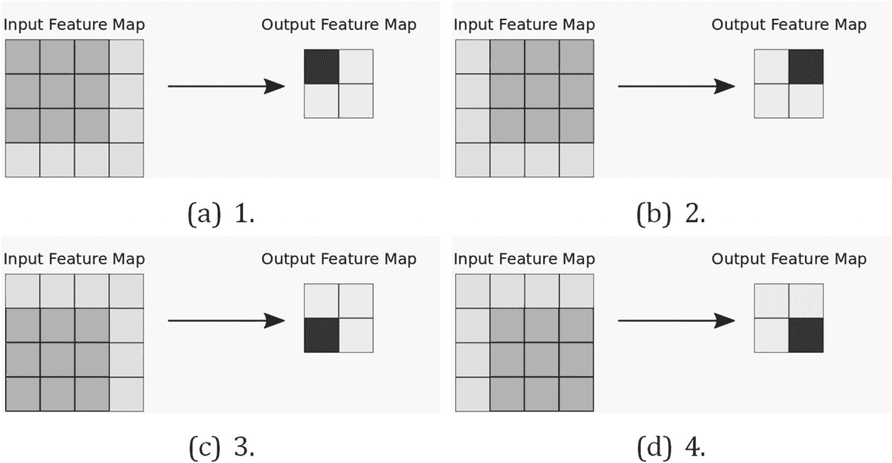
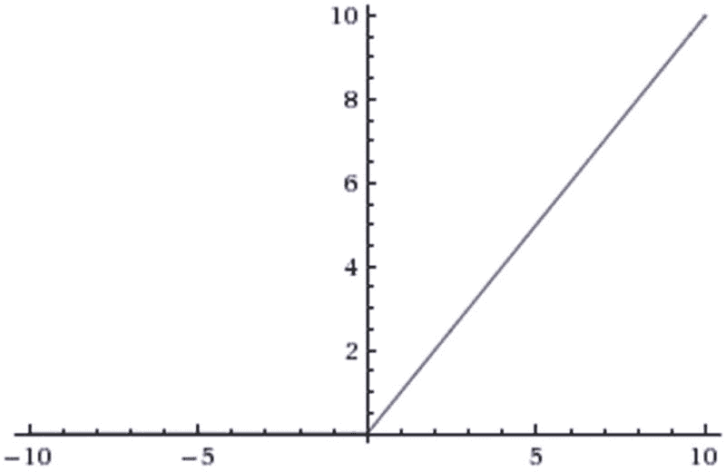
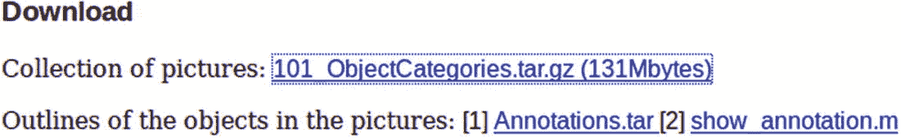
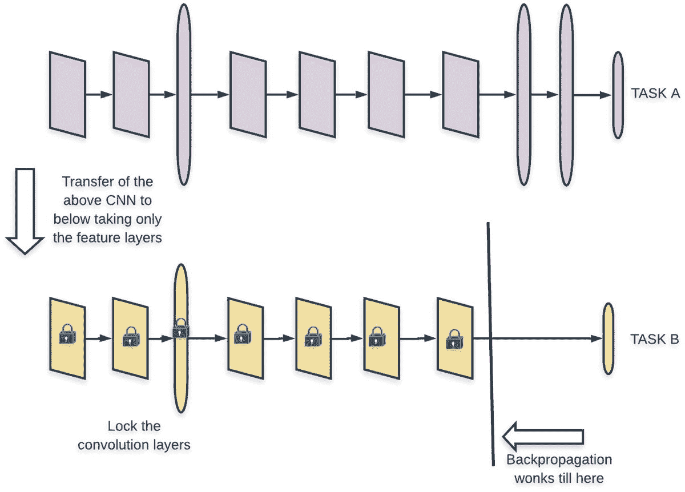
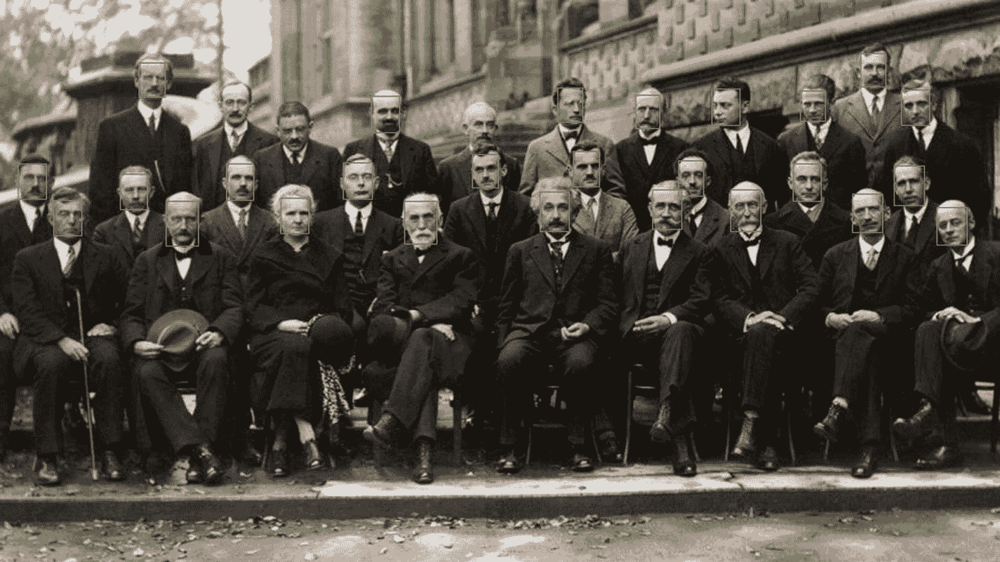

# room 实体


类型: 实体
名称: 房间
自动扩展: 否
值:
- 卧室
- [客厅, 主厅, 休息室]
- [花园, 庭院, 后院]
$
清单 5-40
dataset.yaml 的内容
```

现在我们需要根据话语 yaml 文件创建 `dataset.json` 文件（清单 5-41）。

```
(venv) $ snips-nlu generate-dataset en dataset.yaml > dataset.json
(venv) $
清单 5-41
创建 dataset.json
```

一旦 `dataset.json` 文件创建完成，我们就可以训练模型了（清单 5-42）。

```
(venv) $ snips-nlu train dataset.json snips.model -v
(venv) $
清单 5-42
snips 训练
```

清单 5-42 中命令的输出应类似于清单 5-43 所示的内容。

```
Create and train the engine...
[INFO][21:55:51.091][snips_nlu.intent_parser.deterministic_intent_parser]: Fitting deterministic parser...
[INFO][21:55:51.103][snips_nlu.intent_parser.deterministic_intent_parser]: Fitted deterministic parser in 0:00:00.011588
[INFO][21:55:51.103][snips_nlu.intent_parser.probabilistic_intent_parser]: Fitting probabilistic intent parser...
[DEBUG][21:55:51.103][snips_nlu.intent_classifier.log_reg_classifier]: Fitting LogRegIntentClassifier...
[DEBUG][21:55:51.616][snips_nlu.intent_classifier.log_reg_classifier]: Top 50 features weights by intent:

...

[DEBUG][21:55:57.292][snips_nlu.slot_filler.crf_slot_filler]: Fitted CRFSlotFiller in 0:00:01.482648
[DEBUG][21:55:57.293][snips_nlu.intent_parser.probabilistic_intent_parser]: Fitted slot fillers in 0:00:05.671146
[INFO][21:55:57.294][snips_nlu.intent_parser.probabilistic_intent_parser]: Fitted probabilistic intent parser in 0:00:06.190487
[INFO][21:55:57.294][snips_nlu.nlu_engine.nlu_engine]: Fitted NLU engine in 0:00:07.315197
Persisting the engine...
Saved the trained engine
清单 5-43
snips 训练输出
```

### 5.3.1 构建推理引擎

训练完成后，我们应该能够在应用程序中使用该模型。作为示例应用程序，我们将创建一个简单的 API，该 API 接收一个句子作为输入，并提供句子中解析出的意图。

至于依赖项，我们将使用 `snips-nlu-lib` crate 进行 snips 模型推理。`serde`、`serde_json` 和 `serde_derive` 将用于序列化和反序列化传入的请求。为了创建 Web 应用程序，我们将使用 rocket Web 框架。Rocket 框架的 API 灵感来源于 Rails、Flask、Bottle 和 Yesod 等优秀的 Web 框架；因此，在 Rocket 中创建应用程序非常有趣。为了构建推理引擎并使用这些依赖项，我们现在需要使用 cargo 创建一个 Rust 项目（清单 5-44）。

```
$ cd chapter5
$ cargo new snips-model –bin
清单 5-44
创建 snips-model Rust 项目
```

这将在目录中创建 main.rs 和 Cargo.toml 文件，我们应该能够更新 Cargo 文件，使其类似于清单 5-45 所示。crate `serde-json` 将用于解析 json 文件，`serde` 和 `serde-derive` 将为此提供帮助。crate `rocket` 和 `rocket-contrib` 将用于创建 Web API，而 `snips-nlu-lib` 是提供 NLU 功能的主要 crate。

```
[package]
name = "snips-model"
version = "0.1.0"
edition = "2018"
[dependencies]
snips-nlu-lib = { git = "https://github.com/snipsco/snips-nlu-rs", branch = "master" }
rocket = "0.4.0"
rocket_contrib = "0.4.0"
serde = "1.0"
serde_json = "1.0"
serde_derive = "1.0"
清单 5-45
chapter5/snips-model/Cargo.toml
```

请注意，我们直接使用了 snips 库的 github 链接，因为这是目前最有效的方式。

现在，我们可以在主文件中从依赖项中导入相关模块（清单 5-46）。

```
#![feature(proc_macro_hygiene, decl_macro)]
#[macro_use] extern crate rocket;
#[macro_use] extern crate rocket_contrib;
#[macro_use] extern crate serde_derive;
extern crate snips_nlu_lib;
use std::sync::Mutex;
use snips_nlu_lib::SnipsNluEngine;
use rocket::{Rocket, State};
use rocket_contrib::json::Json;
清单 5-46
chapter5/snips-model/src/main.rs
```

现在我们可以编写一个小函数来检查到目前为止的设置是否正常工作（清单 5-47）。

```
#[get("/")]
fn hello() -> &'static str {
"Hello, from snips model inference!"
}
清单 5-47
chapter5/snips-model/src/main.rs
```

要激活此端点，我们需要进行一些设置并启动应用程序（清单 5-48）。

```
fn rocket() -> Rocket {
rocket::ignite()
.mount("/", routes![hello])
}
fn main() {
rocket().launch();
}
清单 5-48
chapter5/snips-model/src/main.rs
```

使用 `cargo run` 运行应用程序。这将构建所有依赖项，如果到目前为止一切正常，您应该能够运行 Web 应用程序并看到清单 5-49 中所示的输出。

```
$ cd chapter5/snips-model
$ cargo run
Compiling snips-model v0.1.0 (...)
Finished dev [unoptimized + debuginfo] target(s) in 1m 39s
Running `target/debug/snips-model`
Loading the nlu engine...
Configured for development.
=> address: localhost
=> port: 8000
=> log: normal
=> workers: 8
=> secret key: generated
=> limits: forms = 32KiB
=> keep-alive: 5s
=> tls: disabled
Mounting /:
=> GET / (hello)
清单 5-49
运行 snips 模型推理
```

Rocket 已从 http://localhost:8000 启动

```
$
```

现在我们应该能够向 Web 服务器发出一个简单的请求（清单 5-50）。

```
$ curl localhost:8000/
Hello, from snips model inference!
$
清单 5-50
向 snips nlu 引擎发送 curl 请求
```


现在我们将进入主要的推理部分。我们将尝试创建一个函数来处理 POST 请求。为此，我们将创建一个结构体 `Message` 来保存传入的请求数据，以及一个函数 `infer` 来处理推理部分。因此，编写处理传入函数的代码将类似于清单 5-51 所示。

```
#[derive(Serialize, Deserialize)]
struct Message {
contents: String
}
#[post("/infer", format = "json", data = "")]
fn infer(message: Json,
) -> OutputType {
let query = message.0.contents; // 从传入数据中获取查询
// 剩余代码 ...
}
fn rocket() -> Rocket {
// 让 Rocket 管理引擎，以便传递给函数。
rocket::ignite()
.mount("/", routes![hello, infer])
}
fn main() {
rocket().launch();
}
清单 5-51
chapter5/snips-model/src/main.rs
```

现在我们需要加载引擎，即一个 `SnipsNluEngine` 类型的对象，根据传入的查询运行推理，并返回结果。由于这依赖于用户的查询语句，一种简单的方法是将所有代码放在 `infer` 函数中。然而，这并不理想，因为从模型创建引擎的开销很大，并且为每个请求都重复执行此操作并不理想。因此，我们需要一种机制，在应用启动时加载模型并创建引擎一次，然后在每个请求的推理周期中使用同一个模型。由于这个模型将在 Rocket 应用的线程之间共享，我们不能简单地创建一个全局变量或类似的东西。一个优雅的解决方案是使用 Rust 的互斥锁。^(²⁷) 这是一个非常有用的互斥原语，以结构体的形式实现，用于保护共享数据。

因此，我们将引擎包装成一个互斥锁（清单 5-52）。

```
type Engine = Mutex;
清单 5-52
chapter5/snips-model/src/main.rs
```

我们将定义一个不同的函数来创建引擎。这个函数将在初始化 Rocket 应用之前被调用，并且引擎对象将被传递给 Rocket 应用，由其进行管理（清单 5-53）。

```
fn init_engine() -> SnipsNluEngine {
let engine_dir = "path to snips model/snips.model";
println!("\n 正在加载 nlu 引擎...");
let engine = SnipsNluEngine::from_path(engine_dir).unwrap();
engine
}
fn rocket() -> Rocket {
// 加载 snips 推理引擎。
let engine = init_engine();
// 让 Rocket 管理引擎，以便传递给函数。
rocket::ignite()
// 让 rocket 管理引擎的状态
.manage(Mutex::new(engine))
.mount("/", routes![hello, infer])
}
清单 5-53
chapter5/snips-model/src/main.rs
```

一旦我们的 Rocket 应用可以访问引擎对象，我们就可以在我们的函数（本例中为 `infer`）中调用它，并从用户提供的文档中获取意图（清单 5-54）。

```
#[post("/infer", format = "json", data = "")]
fn infer(message: Json, engine: State) -> String {
let query = message.0.contents;
// 锁定互斥锁，以便其他线程无法更改它，
// 我们可以利用底层资源
let engine = engine.lock().unwrap();
// 获取意图
let result = engine.get_intents(query.trim()).unwrap();
// 将结果序列化为 JSON 字符串。
let result_json = serde_json::to_string_pretty(
&result).unwrap();
result_json
}
清单 5-54
chapter5/snips-model/src/main.rs
```

意图推理的构建已经完成。我们现在可以使用 `cargo run` 运行应用，如清单 5-55 所示。因此，除了之前运行应用时看到的其他输出之外，我们还应该看到 `infer` 端点也被加载了。我们还应该看到一条打印语句，告诉我们模型已从 `init_engine` 函数加载。

```
$ cd chapter5/snips-model
$ cargo run
Compiling snips-model v0.1.0 (...)
Finished dev [unoptimized + debuginfo] target(s) in 1m 39s
Running `target/debug/snips-model`
正在加载 nlu 引擎...
// 其他输出...
Mounting /:
=> GET / (hello)
=> POST /infer application/json (infer)
Rocket has launched from http://localhost:8000
$
清单 5-55
启动 nlu 引擎
```

如果 `infer` 端点正确加载，我们现在应该能够向应用发送请求并获取结果（清单 5-56）。

```
$ curl --header "Content-Type: application/json" \
--request POST \
--data '{"contents":"set the temperature to 23 degrees in the bedroom"}' \
localhost:8000/infer
[
{
"intentName": "setTemperature",
"confidenceScore": 1.0
},
{
"intentName": null,
"confidenceScore": 0.291604
},
{
"intentName": "turnLightOn",
"confidenceScore": 0.08828778
},
{
"intentName": "turnLightOff",
"confidenceScore": 0.070788406
}
]
$
清单 5-56
在另一个终端中 nlu 引擎的输出
```

NLP 中的一个重要问题领域是聊天机器人，要构建聊天机器人，我们需要一个良好的意图推理引擎。在本节中，我们了解了如何训练一个 snips 模型，并在一个简单的 Web 应用中使用该模型来推理用户指定查询中的意图。

## 5.4 结论

本章向你介绍了 NLP 中不同的有趣问题。本章从文本分类以及如何使用 fasttext 算法构建分类器开始。它还介绍了可以在 Rust 中执行的常见文本预处理步骤。然后，本章继续探讨了如何在语料库上执行命名实体识别，以及如何使用 `crfsuite` crate 创建 CRF 模型来执行 NER 任务。最后，我们研究了如何使用 snips 库创建一个意图推理 Web 应用。

在下一章中，你将学习如何创建计算机视觉模型和运行图像分类器。

脚注 1   2   3   4   5   6   7

# 6. 计算机视觉

在上一章中，我们了解了机器学习如何应用于人类语言领域。这涵盖了我们的语言和听觉感官。机器学习具有巨大影响力的另一个感官是我们的视觉感官，以及机器学习如何捕捉图像的本质。整个分支被称为计算机视觉，正如我们将在本章中看到的，在 Rust 中解决计算机视觉问题已经取得了巨大进展。

作为本章的一部分，我们将研究计算机视觉中的不同应用，例如：

*   图像分类

*   使用预训练模型

*   神经风格迁移

*   人脸检测

## 6.1 图像分类

图像分类是将机器学习应用于图像，其目标是：给定一张图像和一个经过训练以查找感兴趣对象的模型，该模型将识别该对象是否存在于图像中。这是通过定义一组目标类别（要在图像中识别的对象）并使用带标签的示例照片训练模型来识别它们来实现的。

使用传统模型进行图像分类是通过从像素数据中添加新特征来实现的，例如颜色直方图、纹理和形状。这种方法的缺点是，在图像分类的情况下，特征工程成本巨大。特征需要非常精确地调整，因此在许多情况下构建鲁棒模型非常具有挑战性，且准确率较低。


### 6.1.1 卷积神经网络（CNN）

与传统模型相比，包含卷积层的神经网络在图像分类任务中表现更佳。CNN 能够逐步提取图像内容中越来越高级的表征。CNN 无需预处理数据以提取纹理和形状等特征，而是直接将图像的原始像素作为输入，“学习”如何提取这些特征，并最终推断出它们构成了什么物体。

CNN 从一个三维的输入特征图开始，其中前两个维度的大小是图像的像素长度和宽度。第三个维度的大小是图像的通道数，通常为 3。CNN 由多个模块堆叠而成，每个模块执行三个操作 [1]。

1.  卷积层：提取输入特征图的图块，并对这些特征应用滤波器。一个滤波器矩阵在特征矩阵上滑动，逐元素相乘后的和存储在结果矩阵中。在训练过程中，CNN “学习”特征矩阵的最优值，从而能够提取有意义的特征。图 6-1 展示了在 4x4 输入特征图上，使用 3*x*3 滤波器层进行此过程的方式。

    

    图 6-1

    通过卷积提取特征

2.  在卷积层之后引入一个 Relu 层，以便为模型引入非线性。Relu 函数定义为 *f*(*x*)=*max*(0,*x*)，如图 6-2 所示。

3.  应用 Relu 激活函数后，进行池化操作以对卷积后的特征进行下采样。下采样需要在尽可能降低维度的同时，保留最关键的特征信息。通常使用最大池化，即从特征图中提取图块，并保留每个图块中的最大值，丢弃所有其他值。

在 CNN 层的末端，需要一个或多个全连接层，以便根据卷积提取的特征进行分类。



图 6-2

Relu 函数

### 6.1.2 Rust 与 Torch

如第 2 章所述，我们可以使用 torch 深度学习库，^(²⁸) 许多开发者称之为 pytorch。由于在计算机视觉领域，深度学习已被证明能取得最佳效果，因此我们将主要关注创建和使用深度神经模型。目前，在 Rust 中创建和使用深度神经模型方面，torch 是最实用的；因此在本章中，我们将主要在 torch 范式下工作。

### 6.1.3 Torch 数据集

现在，我们将创建一个用于图像分类的 Rust 项目。首先创建一个名为 chapter 6 的目录，并在其中创建一个 `pytorch-image-classification` 项目（清单 6-1）。

```
$ cd chapter6
$ cargo new pytorch-image-classification --bin
$ cd pytorch-image-classification
$
清单 6-1
创建图像分类项目
```

由于我们将使用 torch 依赖项，让我们也下载库文件并为其建立引用，以便 tch 库能够找到相关的核心依赖项（清单 6-2）。

```
$ wget https://github.com/intel/mkl-dnn/releases/download/v0.19/mklml_mac_2019.0.5.20190502.tgz
$ gunzip -c mklml_mac_2019.0.5.20190502.tgz | tar xvf -
$ wget https://download.pytorch.org/libtorch/cpu/libtorch-macos-1.1.0.zip
$ unzip libtorch-macos-1.1.0.zip
$ export LD_LIBRARY_PATH=mklml_mac_2019.0.5.20190502/lib:"$LD_LIBRARY_PATH"
$ export LIBTORCH=libtorch
$ export LD_LIBRARY_PATH=${LIBTORCH}/lib:$LD_LIBRARY_PATH
$
清单 6-2
下载 mkl 和 libtorch 依赖项
```

为了构建图像分类模型，我们将使用 Caltech101^(²⁹) 数据集。要下载文件，请访问脚注中给出的链接并下载图像（清单 6-3）。

```
$ wget http://www.vision.caltech.edu/Image_Datasets\
/Caltech101/101_ObjectCategories.tar.gz
$ gunzip -c 101_ObjectCategories.tar.gz | tar xvf -
$
清单 6-3
下载图像
```

或者，您也可以使用浏览器下载。如果在浏览器中点击链接 [`http://www.vision.caltech.edu/Image_Datasets/Caltech101/`](http://www.vision.caltech.edu/Image_Datasets/Caltech101/)，您应该会看到一个如图 6-3 所示的链接。如果使用浏览器下载，您仍然需要使用 gunzip 命令解压缩。



图 6-3

下载 caltech101

与 `torch-vision` 类似，为了处理图像数据集，我们有一个 `vision::Dataset` 结构。让我们来看看这个结构（清单 6-4）。

```
#[derive(Debug)]
pub struct Dataset {
pub train_images: Tensor,
pub train_labels: Tensor,
pub test_images: Tensor,
pub test_labels: Tensor,
pub labels: i64,
}
清单 6-4
tch-rs/src/vision/dataset.rs
```

`tch` crate 中一个便捷的函数是 `tch::vision::imagenet::load_from_dir`，用于加载图像并将其转换为上述的 `dataset`。为此，我们需要将已创建的 caltech101 文件按以下格式分离到训练和验证文件夹中。在根文件夹内，我们需要有“train”和“val”两个文件夹，在这些文件夹内，我们需要将不同的图像放在以标签命名的文件夹中。换句话说，所有具有相同标签的图像将位于同一个文件夹中（清单 6-5）。

```
dataset
train
accordion
image_0001.jpg
image_0002.jpg
airplanes
image_0001.jpg
image_0060.jpg
...
val
accordion
image_0036.jpg
airplanes
image_0685.jpg
...
清单 6-5
我们需要的数据集目录
```

caltech 数据集解压后的格式如下（清单 6-6）。

```
101_ObjectCategories
accordion
image_0001.jpg
image_0002.jpg
airplanes
image_0001.jpg
image_0002.jpg
...
102 directories, 9145 files
清单 6-6
当前目录结构
```


尽管目录结构大体相似，我们仍需编写一个小函数来将数据集拆分为训练集和验证集。清单 6-7 中的函数正是为此目的而编写的，它是一个递归函数：如果路径是目录，则继续深入；否则，对其中一个文件执行测试函数，对其余文件执行训练函数。变量 `this_label` 用于检查当前标签是否已经执行过测试函数。我们将把 `train_fn` 和 `test_fn` 实现为执行实际移动操作的函数。这些功能本可以在同一个 `visit_dir` 函数中实现，但将其作为独立函数实现会使代码更具模块化，也更易于测试。

```
use std::io;
use std::fs::{self, DirEntry, copy, create_dir_all};
use std::path::Path;
fn visit_dir(dir: &Path,
train_fn: &Fn(&DirEntry),
test_fn: &Fn(&DirEntry)) -> io::Result {
if dir.is_dir() {
let mut this_label = String::from("");
for entry in fs::read_dir(dir)? {
let entry = entry?;
let path = entry.path();
if path.is_dir() {
visit_dir(&path, train_fn, test_fn)?;
} else {
let full_path: Vec = path.to_str().unwrap()
.split("/").into_iter()
.map(|x| x[..].to_string()).collect();
if this_label == full_path[1] {
train_fn(&entry); // 移动训练文件
} else {
test_fn(&entry); // 移动测试文件
}
// 第二个条目是标签
this_label = full_path[1].clone();
}
}
}
Ok(())
}
清单 6-7
chapter6/pytorch-image-classifi cation/src/main.rs
```

现在，我们需要定义从源文件夹到目标文件夹的实际文件复制函数。请记住，我们的目标路径格式应为“`root_dataset_foldername` > 根据文件是训练文件还是验证文件，选择 'train' 或 'val' 文件夹 > 以标签作为特定图像的文件夹名称 > 图像文件”。该函数应创建所有可能不存在的中间目录。这可以通过清单 6-8 中的 `move_file` 函数来实现。

```
use std::fs::{self, DirEntry, copy, create_dir_all};
const DATASET_FOLDER: &str = "dataset";
fn move_file(
from_path: &DirEntry, to_path: &Path)
-> io::Result {
let root_folder = Path::new(DATASET_FOLDER);
let second_order = root_folder.join(to_path);
let full_path: Vec = from_path.path().to_str().unwrap()
.split("/").into_iter().map(|x| x[..].to_string()).collect();
let label = full_path[1].clone();
let third_order = second_order.join(label);
create_dir_all(&third_order)?;
let filename = from_path.file_name();
let to_filename = third_order.join(&filename);
copy(from_path.path(), to_filename)?;
Ok(())
}
清单 6-8
chapter6/pytorch-image-classifi cation/src/main.rs
```

如清单 6-8 所示，根文件夹是数据集文件夹，而 `to_path` 本质上决定了文件需要进入训练文件夹还是验证文件夹。接下来，我们将源路径分割到 `full_path` 变量中，以便能够从完整路径中检索标签。一旦所有路径拼接完成，就使用 `std::fs` 标准库中的 `create_dir_all` 函数来创建所有目录。从 `from_path` 变量中解析出相应的文件名，并将其拼接到 `to_filename` 变量中。成功构建目标路径的完整路径后，我们将目标路径（即 `to_filename` 变量）传递给 `std::fs` 标准库中的 `copy` 函数，以创建文件夹结构。

现在，我们应该能够运行此代码，并将数据集分离为训练图像和验证图像（清单 6-9）。

```
fn main() {
let obj_categories = Path::new("101_ObjectCategories");
let move_to_train = |x: &DirEntry| {
let to_folder = Path::new("train");
move_file(&x, &to_folder).unwrap();
}
let move_to_test =
|x: &DirEntry| {
let to_folder = Path::new("val");
move_file(&x, &to_folder).unwrap();
};
visit_dir(
&obj_categories, &move_to_train,
&move_to_test).unwrap();
println!(
"files kept in the imagenet format in {}", DATASET_FOLDER);
... 剩余代码
清单 6-9
chapter6/pytorch-image-classifi cation/src/main.rs
```

在此处运行到清单 6-9 的代码，您应该会看到文件夹正在被移动到各自的文件夹中（清单 6-10）。

```
$ cargo run
warning: clang: warning: -Wl,-rpath=chapter6/pytorch-image-classification/libtorch/lib: 'linker' input unused [-Wunused-command-line-argument]
Finished dev [unoptimized + debuginfo] target(s) in 0.05s
Running `target/debug/pytorch-image-classification`
files kept in the imagenet format in dataset
$ ls dataset
train val
清单 6-10
pytorch-image-classifi cation 当前输出
```

在清单 6-10 的代码中，我们创建了两个闭包 `move_to_train` 和 `move_to_test`，它们会将适当的目标文件夹传递给 `move_file` 函数。然后，这些闭包被传递给 `visit_dir` 函数，正如我们之前所见，该函数会执行它们。运行到目前为止的代码应该能够分离文件夹，并将它们整理成 imagenet 格式。现在，我们应该能够使用 `load_from_dir` 函数，这是 `torch::vision` 中一个便捷的函数。该函数将以正确的格式加载目录，以便 `tch` 能够对其进行操作。参见清单 6-11。

```
use tch::vision::imagenet::load_from_dir;
fn main() {
// 之前的代码 ...
let image_dataset = load_from_dir(DATASET_FOLDER).unwrap();
// 剩余代码 ...
}
清单 6-11
chapter6/pytorch-image-classifi cation/src/main.rs
```

PyTorch 以及 `tch` 对图像使用 NCHW 格式。如果图像形状为 [256, 3, 224, 224]，这意味着样本数量为 256，每张图像有 3 个通道，224x224 是数据集的高度和宽度。


### 6.1.4 CNN 模型

现在数据格式已正确，我们将着手定义模型。Rust 的优势在于模型可以是一个简单的结构体（清单 6-12）。

```
use tch::{Device, Tensor, nn};
use tch::nn::{ModuleT, OptimizerConfig, conv2d, linear};
#[derive(Debug)]
struct CnnNet {
conv1: nn::Conv2D,
conv2: nn::Conv2D,
fc1: nn::Linear,
fc2: nn::Linear,
}
清单 6-12
chapter6/pytorch-image-classifi cation/src/main.rs
```

可以为清单 6-12 中的结构体实现一个 `new` 方法，用于创建 `CnnNet` 的实例。

```
const LABELS: i64 = 102;
const W: i64 = 224;
const H: i64 = 224;
const C: i64 = 3;
impl CnnNet {
fn new(vs: &nn::Path) -> CnnNet {
let conv1 = conv2d(vs, C, 32, 5, Default::default());
let conv2 = conv2d(vs, 32, 64, 5, Default::default());
let fc1 = linear(vs, 1024, 1024, Default::default());
let fc2 = linear(vs, 1024, LABELS, Default::default());
CnnNet {
conv1,
conv2,
fc1,
fc2,
}
}
}
清单 6-13
chapter6/pytorch-image-classifi cation/src/main.rs
```

在清单 6-13 中，`conv1` 是一个卷积层，其输入维度为 `C`（常量 3），输出维度为 32。输入维度必须为 3，因为我们将 `conv1` 定义为第一个卷积层，而数据集中每张图像由 3 个通道组成。此外，`conv1` 的卷积核大小为 5x5，由第四个参数指定。最后一个参数是卷积配置，此处可传入默认参数。默认参数可在 `tch-rs` 库的 `conv.rs` 文件中查看（清单 6-14）。

```
impl Default for ConvConfig {
fn default() -> Self {
ConvConfig {
stride: 1,
padding: 0,
dilation: 1,
groups: 1,
bias: true,
ws_init: super::Init::KaimingUniform,
bs_init: super::Init::Const(0.),
}
}
}
清单 6-14
tch-rs/src/nn/conv.rs
```

继续描述清单 6-8，我们将定义与 `conv1` 类似但维度适当的 `conv2`。这些维度稍后会解释。我们还将创建两个全连接层 `fc1` 和 `fc2`，其中 `fc2` 的最后一维与 `LABELS` 常量定义的标签数量相同。

在 Python 的 PyTorch 中，模型通过继承 `torch.nn.Module` 创建。类似地，在 Rust 中使用 `tch` 时，我们需要实现 `nn::ModuleT` trait，该 trait 包含可用于训练模型的相关函数。参见清单 6-15。

```
use tch::{Device, Tensor, nn};
const BATCH_SIZE: i64 = 16;
impl nn::ModuleT for CnnNet {
fn forward_t(&self, xs: &Tensor, train: bool) -> Tensor {
xs.view(&[-1, C, H, W])    // 输出维度: [16, 3, 224, 224]
.apply(&self.conv1)      // [16, 32, 220, 220]
.max_pool2d_default(2)   // [16, 32, 110, 110]
.apply(&self.conv2)      // [16, 64, 106, 106]
.max_pool2d_default(2)   // [16, 64, 53, 53]
.view(&[BATCH_SIZE, -1]);// [16, 179776]
.apply(&self.fc1)        // [16, 1024]
.relu()                  // [16, 1024]
.dropout_(0.5, train)    // [16, 1024]
.apply(&self.fc2)        // [16, 102]
}
}
清单 6-15
chapter6/pytorch-image-classifi cation/src/main.rs
```

在清单 6-15 的代码中，展示了每次张量变换后维度的变化。输入张量 `xs` 的维度从 [16, 3, 224, 224] 变为 [16, 102]，即 `(batch_size, outputs)`，这是应用变换后的结果。执行此代码时，你可以验证维度是否匹配。

模型创建完成后，应能在数据集上训练它。PyTorch 模型的训练过程通常类似：初始化模型实例、定义损失函数、初始化优化器。我们还可以将返回类型改为 `Fallible`，这是 `tch` 仓库中的标准做法。这可以在清单 6-16 的代码中看到。

```
use failure;
fn main() -> failure::Fallible {
// 之前的代码 ...
let image_dataset = load_from_dir(dataset_folder).unwrap();
let vs = nn::varstore::new(device::cuda_if_available());
let opt = nn::adam::default().build(&vs, 1e-4)?;
let net = cnnnet::new(&vs.root());
for epoch in 1..100 {
for (bimages, blabels)
in image_dataset.train_iter(batch_size)
.shuffle().to_device(vs.device()) {
let loss = net
.forward_t(&bimages, true)
.cross_entropy_for_logits(&blabels);
opt.backward_step(&loss);
}
let test_accuracy =
net.batch_accuracy_for_logits(&image_dataset.test_images,
&image_dataset.test_labels,
vs.device(), 1024);
println!("epoch: {:4} test acc: {:5.2}%",
epoch, 100\. * test_accuracy,);
}
// 剩余代码 ...
Ok(())
}
清单 6-16
chapter6/pytorch-image-classifi cation/src/main.rs
```

在清单 6-16 中，`vs` 用于存储在训练过程不同阶段使用的通用配置。如前所述，模型通过变量 `net` 初始化。在 100 个 epoch 中，从数据集中分批取出数据进行训练。由于训练变量是 `Dataset` 结构体的实例，`bimages` 和 `blabels` 被整齐地取出，此处图像的形状为 [32, 3, 244, 244]，标签的形状为 [32]。`forward_t` 方法会将张量传递到之前定义的整个架构中，而 `opt.backward_step` 会计算梯度。完成 100 个 epoch 后，模型即训练完成。

现在你可以使用 `cargo run` 运行该包。运行后，检查是否生成了 `trained_model.ot` 文件。

### 注意

由于上述所有代码会消耗大量计算资源，你的笔记本电脑可能无法运行。如果发生这种情况，可以尝试减少预测的标签数量。同时，请相应修改 `LABELS` 参数，使其与你预测的标签数量一致。你也可以尝试减小 `BATCH_SIZE`。


### 6.1.5 模型构建与调试

在构建模型时，密切跟踪数据流经过程中所构建的不同张量的形状至关重要。否则，很容易遇到如清单 6-17 所示的错误。

```
thread 'main' panicked at 'called `Result::unwrap()` on an `Err`
value: TorchError { c_error: "size mismatch,
m1: [2809 x 1024], m2: [179776 x 1024] at
/pytorch/aten/src/TH/generic/THTensorMath.cpp:961" }',
src/libcore/result.rs:997:5
清单 6-17
训练时可能出现的尺寸不匹配错误
```

或者也可能是类似清单 6-18 所示的情况。

```
thread 'main' panicked at 'called `Result::unwrap()` on an `Err`
value: TorchError { c_error:
"Assertion `THTensor_sizeLegacyNoScalars(target, 0) == batch_size\' failed.
at /pytorch/aten/src/THNN/generic/ClassNLLCriterion.c:84" }',
src/libcore/result.rs:997:5
清单 6-18
训练时可能出现的批次大小失败错误
```

在这些情况下，我们需要对网络进行调试。一种调试方法是将应用程序迁移到 Python 应用，并在其中运行，同时打印出每一步的形状。参见清单 6-19。

```
import torch.nn as nn
import torch.nn.functional as F
class Net(nn.Module):
def __init__(self):
super(Net, self).__init__()
self.conv1 = nn.Conv2d(3, 32, 5)
self.pool1 = nn.MaxPool2d(2, 2)
self.fc1 = nn.Linear(1600, 1024)
self.fc2 = nn.Linear(1024, 10)
def forward(self, x):
x = self.conv1(x)
print(x.shape)
x = self.pool1(x)
print(x.shape)
x = F.relu(self.fc1(x))
print(x.shape)
x = F.dropout(x, training=True)
print(x.shape)
x = self.fc2(x)
print(x.shape)
return x
net = Net()
清单 6-19
PyTorch 中的示例代码
```

上述逻辑同样可以应用于 Rust。我们可以将之前的 `forward` 函数改写成上述方式，并在过程中插入 `println` 语句（清单 6-20）。

```
impl nn::ModuleT for CnnNet {
fn forward_t(&self, xs: &Tensor, train: bool) -> Tensor {
let xs_prime = xs.view(&[-1, C, H, W]);
println!("{:?}", xs_prime.size());
let xs_prime = xs_prime.apply(&self.conv1);
println!("{:?}", xs_prime.size());
let xs_prime = xs_prime.max_pool2d_default(2);
println!("{:?}", xs_prime.size());
let xs_prime = xs_prime.apply(&self.conv2);
println!("{:?}", xs_prime.size());
let xs_prime = xs_prime.max_pool2d_default(2);
println!("{:?}", xs_prime.size());
let xs_prime = xs_prime.view(&[BATCH_SIZE, -1]);
println!("{:?}", xs_prime.size());
let xs_prime = xs_prime.apply(&self.fc1);
println!("{:?}", xs_prime.size());
let mut xs_prime = xs_prime.relu();
println!("{:?}", xs_prime.size());
let xs_prime = xs_prime.dropout_(0.5, train);
println!("{:?}", xs_prime.size());
let xs_prime = xs_prime.apply(&self.fc2);
println!("{:?}", xs_prime.size());
xs_prime
}
}
清单 6-20
在卷积网络中插入打印语句以便于调试
```

这样，在运行网络时，就能打印出不同层的维度信息。

### 6.1.6 预训练模型

通常，模型训练完成后，需要部署到执行模型推理的生产环境中。在 `tch` 框架中，训练好的模型可以保存为 `.ot` 文件，然后在推理环境中加载并提供服务。可以使用变量存储（`VarStore`）来保存模型（清单 6-21）。

```
fn main() {
// 之前的模型训练代码 ...
vs.save("model.ot")?;
}
清单 6-21
模型保存
```

当我们使用 `cargo run` 运行训练后，这会将模型保存到当前目录。模型保存后，我们就可以在推理应用中加载该模型并运行预测。由于每个模型的架构不同，不存在适用于所有场景的通用样板函数代码。开发者需要访问每种架构才能进行预测。

`tch/examples/pretrained` 目录下的模型提供了如何加载预训练模型的示例，前提是这些模型属于标准架构之一。可以加载的标准架构包括 `alexnet`、`densenet`、`imagenet`、`resnet`、`squeezenet` 和 `VGG16`。由于代码相当标准，我们将采用 `tch` 仓库中展示的预训练模型示例。加载模型的方法如清单 6-22 所示。

```
use tch::vision::{
alexnet, densenet, imagenet,
inception, resnet, squeezenet, vgg};
清单 6-22
https://github.com/LaurentMazare/tch-rs/blob/master/examples/pretrained-models/main.rs
```

我们可以加载图像并将其调整为 ImageNet 标准的 224x224 尺寸，这是使用此包时的一种约定（清单 6-23）。

```
extern crate failure;
extern crate tch;
use tch::nn::ModuleT;
use tch::vision::{
alexnet, densenet, efficientnet, imagenet, inception, mobilenet, resnet, squeezenet, vgg,
};
pub fn main() -> failure::Fallible {
let args: Vec = std::env::args().collect();
let (weights, image) = match args.as_slice() {
[_, w, i] => (std::path::Path::new(w), i.to_owned()),
_ => bail!("用法: main resnet18.ot image.jpg"),
};
let image = imagenet::load_image_and_resize224(image)?;
// 剩余代码 ...
}
清单 6-23
https://github.com/LaurentMazare/tch-rs/blob/master/examples/pretrained-models/main.rs
```

现在，让我们尝试使用 `resnet18` 模型。我们需要一种方法在我们的深度网络中编码架构，这需要是 `ModuleT` 结构体的一个实例。因此，我们创建一个 `VarStore` 变量并创建一个 `resnet18` 网络实例（清单 6-24）。

```
pub fn main() -> failure::Fallible {
// 之前的代码 ...
let mut vs = tch::nn::VarStore::new(tch::Device::Cpu);
let net: Box = Box::new(resnet::resnet18(&vs.root(),
imagenet::CLASS_COUNT)),
// 剩余代码 ...
清单 6-24
https://github.com/LaurentMazare/tch-rs/blob/master/examples/pretrained-models/main.rs
```

现在模型的基本架构已经初始化，我们应该能够加载权重并创建训练好的模型（清单 6-25）。

```
pub fn main() -> failure::Fallible {
// 之前的代码 ...
vs.load(weights)?;
// 剩余代码 ...
}
清单 6-25
https://github.com/LaurentMazare/tch-rs/blob/master/examples/pretrained-models/main.rs
```

一旦我们能够创建模型，就应该能够对模型运行预测了。参见清单 6-26。


```
pub fn main() -> failure::Fallible {
// 之前的代码...
// 对模型进行前向传播以获取 logits。
let output = net
.forward_t(&image.unsqueeze(0), /*train=*/ false)
.softmax(-1); // 转换为概率。
// 打印该图像的前 5 个类别。
for (probability, class) in imagenet::top(&output, 5).iter() {
println!("{:50} {:5.2}%", class, 100.0 * probability)
}
// 剩余代码...
}
代码清单 6-26
https://github.com/LaurentMazare/tch-rs/blob/master/examples/pretrained-models/main.rs
```

与加载标准通用架构的已保存模型类似，对于我们已经训练并保存的模型，我们需要访问最初用于创建该模型的原始模型架构结构体。因此，我们将为模型文件和图像文件创建一个路径。（代码清单 6-27）

```
fn main() -> failure::Fallible {
// 之前的模型构建代码...
let weights = Path::new("model.ot");
let image = "image.jpg";
// 剩余代码...
代码清单 6-27
chapter6/pytorch-image-classifi cation/src/main.rs
```

之后，我们将看到的代码与代码清单 6-27 类似，不同之处在于，这里我们将基于之前创建的 `CnnNet` 来创建一个模型。请参见代码清单 6-28。

```
pub fn main() -> failure::Fallible {
// 之前的代码...
// 加载图像文件并将其大小调整为通常的 imagenet 尺寸 224x224。
let image = load_image_and_resize224(image)?;
// 创建模型并从文件加载权重。
let mut vs = tch::nn::VarStore::new(tch::Device::Cpu);
let net: Box = Box::new(CnnNet::new(&vs.root()));
vs.load(weights)?;
// 对模型进行前向传播以获取 logits。
let output = net
.forward_t(&image.unsqueeze(0), /*train=*/ false)
.softmax(-1); // 转换为概率。
// 打印该图像的前 5 个类别。
for (probability, class) in top(&output, 5).iter() {
println!("{:50} {:5.2}%", class, 100.0 * probability)
}
Ok(())
}
代码清单 6-28
chapter6/pytorch-image-classifi cation/src/main.rs
```

## 6.2 迁移学习

训练一个足够深的神经网络以达到高精度通常是不可行的，因为神经网络需要海量数据，而如此大量的数据可能并不存在，尤其是在产品的早期阶段。相反，一个在大规模数据集上预训练的卷积网络要么被用作初始化器，要么用于从图像中收集特征集。在这种情况下，我们将冻结除最后一层之外的所有网络的权重。这最后一个全连接层将被一个具有随机权重的新层替换，并且只训练这一层。一种可能的迁移学习架构如图 6-4 所示。



图 6-4

迁移学习

为了继续这个示例，我们将从这个网址下载一个预训练模型：[`https://github.com/LaurentMazare/ocaml-torch/releases/download/v0.1-unstable/resnet18.ot`](https://github.com/LaurentMazare/ocaml-torch/releases/download/v0.1-unstable/resnet18.ot)。请参见代码清单 6-29。

```
wget https://github.com/LaurentMazare/ocaml-torch/releases/download/v0.1-unstable/resnet18.ot
代码清单 6-29
下载 resnet 预训练模型
```

由于本节关于如何加载和进行预测的代码也是标准做法，我们将遵循主仓库中的示例。

为了做到这一点，我们需要加载数据集（代码清单 6-30）。

```
#[macro_use]
extern crate failure;
extern crate tch;
use tch::nn::{self, OptimizerConfig};
use tch::vision::{imagenet, resnet};
pub fn main() -> failure::Fallible {
let args: Vec = std::env::args().collect();
let (weights, dataset_dir) = match args.as_slice() {
[_, w, d] => (std::path::Path::new(w), d.to_owned()),
_ => bail!("usage: main resnet18.ot dataset-path"),
};
let dataset = imagenet::load_from_dir(dataset_dir)?;
// 剩余代码...
代码清单 6-30
chapter6/pytorch-image-classifi cation/src/main.rs
```

与预训练网络类似，我们需要创建模型并将权重加载到模型中。如前所述，我们可以将权重保存在一个变量存储中（代码清单 6-31）。

```
let mut vs = tch::nn::VarStore::new(tch::Device::Cpu);
let net = resnet::resnet18_no_final_layer(&vs.root());
vs.load(weights)?;
代码清单 6-31
https://github.com/LaurentMazare/tch-rs/blob/master/examples/transfer-learning/main.rs
```

我们需要以一种能够创建结果向量的方式存储模型的输出，并告诉 pytorch 我们不需要存储计算图，因为我们不打算计算梯度。请参见代码清单 6-32。

```
let train_images = tch::no_grad(
|| dataset.train_images.apply_t(&net, false));
let test_images = tch::no_grad(
|| dataset.test_images.apply_t(&net, false));
代码清单 6-32
https://github.com/LaurentMazare/tch-rs/blob/master/examples/transfer-learning/main.rs
```

### 6.2.1 训练

现在，我们可以在提取的层之上附加一个小的线性层，并且只训练该层的线性部分。这样，我们更少的数据将用于有效地只训练网络的一小部分，而不是尝试训练整个模型。我们创建模型，并使用一个变量存储来存储可训练变量（代码清单 6-33）。

```
let vs = tch::nn::VarStore::new(tch::Device::Cpu);
let linear = nn::linear(vs.root(), 512, dataset.labels, Default::default());
代码清单 6-33
https://github.com/LaurentMazare/tch-rs/blob/master/examples/transfer-learning/main.rs
```

与之前的代码类似，我们可以使用 adam 优化器来最小化分类任务中的交叉熵损失。因此，我们需要创建一个优化器并在训练数据集上进行迭代。每个 epoch 之后，计算训练集上的准确率并打印出来（代码清单 6-34）。

```
let optimizer = nn::Adam::default().build(&vs, 1e-4)?;
for epoch_idx in 1..1001 {
let predicted = train_images.apply(&linear);
let loss = predicted.cross_entropy_for_logits(&dataset.train_labels);
optimizer.backward_step(&loss);
let test_accuracy = test_images
.apply(&linear)
.accuracy_for_logits(&dataset.test_labels);
println!("{} {:.2}%", epoch_idx, 100\. * f64::from(test_accuracy));
}
代码清单 6-34
https://github.com/LaurentMazare/tch-rs/blob/master/examples/transfer-learning/main.rs
```

训练完成后，我们可以使用 `vs.save("model.ot")?;` 保存文件，该文件可以在下一批图像准备好时，在后续的训练周期中再次使用。


### 6.2.2 神经风格迁移

神经风格迁移是一种用于生成具有另一张图像风格的图像的技术。该算法以一张内容图像和一张风格图像作为输入，并返回一张在风格上经过转换的内容图像。这是通过创建两个距离来实现的：一个用于内容，另一个用于图像。最终生成的新图像会使得其与内容图像的内容距离以及与风格图像的风格距离都最小化。

**内容损失** 要创建这样一张转换后的图像，我们需要一种方法来控制最终优化输出图像中保留多少内容图像的特征。为此，需要确定一种计算内容损失的方法。内容损失的主要挑战在于找到一种方法，仅提取图像的内容特征，而不提取图像的风格特征。根据《艺术风格》论文[2]，解决方案是利用不同卷积层的特征图。经过训练的卷积网络能够学习表示图像的不同部分：初始层捕捉粗糙的基础模式，而最终层捕捉独特的特征。正是中间层捕捉了图像的空间特征，而这正是我们所需要的。

因此，在这种情况下，内容损失仅通过计算某些较高层的均方误差来获得。这个误差有助于确保提取的图像在内容图像和当前图像之间出现在屏幕上的相同位置（列表 6-35）。

```
let content_loss: Tensor = CONTENT_INDEXES
.iter()
.map(
|&i| input_layers[i].mse_loss(&content_layers[i], 1))
.sum();
列表 6-35
https://github.com/LaurentMazare/tch-rs/blob/master/examples/neural-style-transfer/main.rs
```

**风格损失** 风格损失负责将图像的风格融入最终图像中。根据论文，图像的风格可以通过其格拉姆矩阵进行编码。格拉姆矩阵是通过计算展平的风格特征与其自身的点积得到的（列表 6-36）。

```
fn gram_matrix(m: &Tensor) -> Tensor {
let (a, b, c, d) = m.size4().unwrap();
let m = m.view(&[a * b, c * d]);
let g = m.matmul(&m.tr());
g / (a * b * c * d)
}
fn style_loss(m1: &Tensor, m2: &Tensor) -> Tensor {
gram_matrix(m1).mse_loss(&gram_matrix(m2), 1)
}
pub fn main() -> failure::Fallible {
// 之前的代码 ...
let style_loss: Tensor = STYLE_INDEXES
.iter()
.map(
|&i| style_loss(&input_layers[i], &style_layers[i]))
.sum();
// 剩余的代码 ...
}
列表 6-36
https://github.com/LaurentMazare/tch-rs/blob/master/examples/neural-style-transfer/main.rs
```

请注意，图像的风格并不依赖于像素值本身，而是依赖于像素值之间的关系。格拉姆矩阵将风格图像的所有信息（如纹理、形状和权重）去本地化，然后进行点积运算。这导致共同出现的特征获得更大的权重，而在风格图像中不具有相似性的特征则不会获得权重。

现在我们已经对风格迁移的工作原理有了基本了解，接下来看看完整的实现。要进行神经风格迁移，我们需要加载内容图像和风格图像。这些图像需要转换为 torch 张量，因此我们可以使用 `tch::vision` 中的 imagenet 模块来加载图像（列表 6-37）。

```
pub fn main() -> failure::Fallible {
// 之前的代码 ...
let style_img = imagenet::load_image(style_img)?
.unsqueeze(0).to_device(device);
let content_img = imagenet::load_image(content_img)?
.unsqueeze(0).to_device(device);
// 剩余的代码 ...
}
列表 6-37
https://github.com/LaurentMazare/tch-rs/blob/master/examples/neural-style-transfer/main.rs
```

我们还需要加载一个预训练模型。可以使用论文中使用的 19 层 VGG 网络。这是另一个可以实验的超参数，看看是否有其他模型能为内容图像提供更好的特征。通过访问此链接或使用您喜欢的下载命令来下载模型（列表 6-38）。

```
$ wget https://github.com/LaurentMazare/ocaml-torch/releases/download/v0.1-unstable/vgg16.ot
$
列表 6-38
下载 VGG 预训练模型
```

这个 VGG 模型包含两个 Sequential 子模块：features（包含卷积层和池化层）和 classifier（包含全连接层）。为了能够从图像中捕捉内容，我们需要使用 features 层。我们将从模型中加载权重并冻结模型（列表 6-39）。

```
pub fn main() -> failure::Fallible {
// 之前的代码 ...
let mut net_vs = tch::nn::VarStore::new(device);
let net = vgg::vgg16(&net_vs.root(),
imagenet::CLASS_COUNT);
net_vs.load(weights)?;
net_vs.freeze();
// 剩余的代码 ...
}
列表 6-39
https://github.com/LaurentMazare/tch-rs/blob/master/examples/neural-style-transfer/main.rs
```

现在，我们在风格图像和内容图像上运行模型。这些调用会返回一个向量，其中包含每个模型层提取的特征（列表 6-40）。

```
pub fn main() -> failure::Fallible {
// 之前的代码 ...
let style_layers = net.forward_all_t(
&style_img, false, Some(max_layer));
let content_layers = net.forward_all_t(
&content_img, false, Some(max_layer));
// 剩余的代码 ...
}
列表 6-40
https://github.com/LaurentMazare/tch-rs/blob/master/examples/neural-style-transfer/main.rs
```

我们将使用梯度优化方法来优化图像。为此，我们创建第二个变量存储来保存这张图像。该图像的初始值将通过复制内容图像得到。这张图像将被转换，使其风格与风格图像相似。参见列表 6-41。

```
pub fn main() -> failure::Fallible {
// 之前的代码 ...
let vs = nn::VarStore::new(device);
let input_var = vs.root().var_copy("img", &content_img);
// 剩余的代码 ...
}
列表 6-41
https://github.com/LaurentMazare/tch-rs/blob/master/examples/neural-style-transfer/main.rs
```

现在我们将创建优化器，它将是一个使用 Adam 优化算法的实例（列表 6-42）。

```
pub fn main() -> failure::Fallible {
// 之前的代码 ...
let opt = nn::Adam::default().build(&vs, LEARNING_RATE)?;
// 剩余的代码 ..}
列表 6-42
https://github.com/LaurentMazare/tch-rs/blob/master/examples/neural-style-transfer/main.rs
```

现在，在梯度下降循环中，需要计算内容损失和风格损失。然后将它们相加，并使用列表 6-42 中创建的优化器来优化总损失。每 1000 个 epoch，我们可以计算当前损失并将当前图像写入文件（列表 6-43）。

```
pub fn main() -> failure::Fallible {
// 之前的代码 ...
for step_idx in 1..(1 + TOTAL_STEPS) {
let input_layers = net.forward_all_t(
&input_var, false, Some(max_layer));
let style_loss: Tensor = STYLE_INDEXES
.iter()
.map(
|&i| style_loss(&input_layers[i], &style_layers[i]))
.sum();
let content_loss: Tensor = CONTENT_INDEXES
.iter()
.map(
|&i| input_layers[i].mse_loss(&content_layers[i], 1))
.sum();
let loss = style_loss * STYLE_WEIGHT + content_loss;
opt.backward_step(&loss);
if step_idx % 1000 == 0 {
println!("{} {}", step_idx, f64::from(loss));
imagenet::save_image(&input_var, &format!("out{}.jpg", step_idx))?;
}
}
// 剩余的代码 ...
}
列表 6-43
https://github.com/LaurentMazare/tch-rs/blob/master/examples/neural-style-transfer/main.rs
```


现在我们应该能够运行代码了。请将 `TOTAL_STEPS` 保持在 5000 或更高，这样我们就能获得大量图像，并从中选出与目标风格最连贯且最相似的图像。

## 6.3 Tensorflow 与人脸检测

在前面的章节中，我们主要使用了 torch 及其对应的 Rust 框架 `tch`。在本节中，我们将使用 tensorflow 并探讨一个人脸检测的应用。挑战在于：接收一张图像，识别出其中的所有人脸，并生成一张新图像，在每个人脸周围绘制出方框。如第 2 章所述，在 tensorflow 中运行推理比训练模型要容易得多，因此在本例中，我们将主要致力于模型推理。

创建 `face-detection-tf` 包，用于检测人脸并在人脸周围区域绘制方框。参见代码清单 6-44。

```
$ cd chapter6
$ cargo new face-detection-tf --bin
$ cd face-detection-tf
$
代码清单 6-44
创建 face-detection-tf Rust 包
```

下载以下预训练模型。该模型将用于预测图像。图 6-5 是预测后的人脸框选图像。^(³⁰) 参见代码清单 6-45。

```
$ wget https://github.com/blaueck/tf-mtcnn/raw/master/mtcnn.pb
$
代码清单 6-45
下载 mtcnn 预训练模型
```

或者你也可以从这个网址下载：[`https://github.com/blaueck/tf-mtcnn/blob/master/mtcnn.pb`](https://github.com/blaueck/tf-mtcnn/blob/master/mtcnn.pb)。

现在我们来讨论依赖项。我们需要 `tensorflow` crate 来读取模型，并使用该模型对图像进行推理。`Structopt` crate 将用于解析命令行，使输入输出解析更加方便。除此之外，我们还需要 `image` crate 来读取、写入和修改图像。`imageproc` crate 则有助于相关的图像处理操作。因此，我们的 `Cargo.toml` 文件应该类似于代码清单 6-46 所示。

```
[package]
name = "face-detection-tf"
version = "0.1.0"
edition = "2018"
[dependencies]
tensorflow = "0.13.0"
structopt = "0.2.15"
image = "0.21.1"
imageproc = "0.18.0"
代码清单 6-46
chapter6/face-detection-tf/src/main.rs
```

现在我们可以开始定义命令行。我们的应用程序可以将图像文件名作为输入之一，并将输出文件名作为需要创建的、已标识出人脸的图像文件。参见代码清单 6-47。

```
use std::path::PathBuf;
use structopt::StructOpt;
#[derive(Debug, StructOpt)]
#[structopt(name = "face-detection-tf", about = "人脸识别")]
struct Opt {
#[structopt(short = "i", long = "input", parse(from_os_str))]
input: PathBuf,
#[structopt(short = "o", long = "output", parse(from_os_str))]
output: PathBuf
}
代码清单 6-47
chapter6/face-detection-tf/src/main.rs
```

创建上述 `StructOpt` 结构体意味着，当我们在主函数中插入 `let opt = Opt::from_args();` 时，我们将能够像 `./face-detection-tf -i inputfilename.jpg -o outputfilename.jpg` 这样传递命令行参数，或者传递 `--input` 和 `--output` 作为命令行参数。要检查命令行参数现在是否运行正常，我们可以在代码的主函数中放入以下几行代码，并检查命令行是否被正确解析。参见代码清单 6-48。

```
use std::error::Error;
fn main() -> Result> {
let opt = Opt::from_args();
// 由于这是基础代码，我们会注意
// 不要使用 to_owned 转移 opt 对象的所有权。
// 在最终代码中，你可能不需要这段代码。
println!("{:?}",
(opt.input.to_owned(), opt.output.to_owned()));
Ok(())
}
代码清单 6-48
chapter6/face-detection-tf/src/main.rs
```

现在运行 `cargo run` 应该会得到正确的输出（代码清单 6-49）。

```
$ cargo run -- -i input_image.jpg -o out.jpg
Compiling face-detection-tf v0.1.0 (path to face-detection-tf)
Finished dev [unoptimized + debuginfo] target(s) in 28.24s
Running `target/debug/face-detection-tf -i input_image.jpg -o out.jpg`
("input_image.jpg", "out.jpg")
$
代码清单 6-49
chapter6/face-detection-tf/src/main.rs
```

现在我们可以检查是否能够加载模型。我们首先将模型作为字节数组加载，然后尝试从字节数组中推断出计算图。如果模型文件损坏，在这种情况下应该会报错（代码清单 6-50）。

```
use tensorflow::Graph;
use tensorflow::ImportGraphDefOptions;
use tensorflow::{
Session, SessionOptions, SessionRunArgs, Tensor};
fn main() -> Result> {
... 之前的代码 ...
let model = include_bytes!("../mtcnn.pb");
let mut graph = Graph::new();
graph.import_graph_def(
&*model, &ImportGraphDefOptions::new())?;
let session = Session::new(
&SessionOptions::new(), &graph)?;
.. 剩余代码 ...
代码清单 6-50
chapter6/face-detection-tf/src/main.rs
```

如果计算图加载成功，我们应该能够使用该计算图创建一个会话。

现在，如果我们检查用于创建计算图的模型，可以看到在运行模型之前需要设置一些变量，正如模型 [`https://github.com/blaueck/tf-mtcnn/blob/master/mtcnn.py#L9`](https://github.com/blaueck/tf-mtcnn/blob/master/mtcnn.py%2523L9) 的这行代码所示。这些变量是 `min_size`、`factor` 和 `thresholds`。在运行会话之前，我们需要在会话中分配这些变量。代码清单 6-51 中分配的值与模型使用的值相同，但你可以尝试调整这些值，看看是否有更好的替代方案。

```
fn main() -> Result> {
... 之前的代码 ...
let min_size = Tensor::new(
&[]).with_values(&[40f32])?;
let thresholds = Tensor::new(&[3]).with_values(
&[0.6f32, 0.7f32, 0.7f32])?;
let factor = Tensor::new(&[]).with_values(&[0.709f32])?;
let mut args = SessionRunArgs::new();
// 为模型加载我们的参数
args.add_feed(
&graph.operation_by_name_required("min_size")?,
0, &min_size);
args.add_feed(
&graph.operation_by_name_required("thresholds")?,
0, &thresholds);
args.add_feed(
&graph.operation_by_name_required("factor")?,
0, &factor);
... 剩余代码 ...
代码清单 6-51
chapter6/face-detection-tf/src/main.rs
```

另一个需要传递的变量，也是使计算图能够识别人脸的最重要的变量，是输入图像张量。因此，我们将使用 `image` crate 打开输入图像。打开图像后，我们将读取像素值，并以 BGR 格式存储到张量中。^(³¹) 参见代码清单 6-52。

```
use image::GenericImageView;
fn get_input_image_tensor(
opt: &Opt)
-> Result, Box> {
let input_image = image::open(&opt.input)?;
let mut flattened: Vec = Vec::new();
for (_x, _y, rgb) in input_image.pixels() {
flattened.push(rgb[2] as f32);
flattened.push(rgb[1] as f32);
flattened.push(rgb[0] as f32);
}
let input = Tensor::new(
&[input_image.height() as u64, input_image.width() as u64, 3])
.with_values(&flattened)?;
Ok(input)
}
代码清单 6-52
chapter6/face-detection-tf/src/main.rs
```

因此，如代码清单 6-53 所示，我们现在应该能够将图像作为输入加载到计算图中。

```
fn main() -> Result> {
... 之前的代码 ...
let input = get_input_image_tensor(&opt)?;
args.add_feed(
&graph.operation_by_name_required("input")?, 0, &input);
... 剩余代码 ...
}
代码清单 6-53
chapter6/face-detection-tf/src/main.rs
```

现在输入已经处理完毕，我们需要为输出创建端点。这将使我们能够在会话运行时获取结果（代码清单 6-54）。


```
fn main() -> Result> {
... 之前的代码 ...
let bbox = args.request_fetch(
&graph.operation_by_name_required("box")?, 0);
let prob = args.request_fetch(
&graph.operation_by_name_required("prob")?, 0);
session.run(&mut args)?;
let bbox_res: Tensor = args.fetch(bbox)?;
let prob_res: Tensor = args.fetch(prob)?;
println!("{:?}", bbox_res.dims());
println!("{:?}", prob_res.dims());
... 剩余代码 ...
}
代码清单 6-54
chapter6/face-detection-tf/src/main.rs
```

执行代码清单 6-54 中的代码，直到现在，会打印出 `bbox_res` 和 `prob_res` 的维度（代码清单 6-55）。

```
$ cargo run -- --input Solvay_conference_1927.jpg --output output.jpg
Finished dev [unoptimized + debuginfo] target(s) in 0.06s
Running `target/debug/face-detection-tf --input Solvay_conference_1927.jpg --output output.jpg`
("Solvay_conference_1927.jpg", "output.jpg")
2019-08-25 16:30:59.485045: I tensorflow/core/platform/cpu_feature_guard.cc:141] Your CPU supports instructions that this TensorFlow binary was not compiled to use: SSE4.2 AVX AVX2 FMA
[30, 4]
[30]
$
代码清单 6-55
face-detection-tf 输出
```

正如我们所见，`bbox_res` 的输出维度是 [30, 4]，而 `prob_res` 是 [30]。

现在我们需要解析输出并将其存储在一个结构体中，以便能够绘制边界框。为此，我们将创建一个 `BBox` 结构体来存储输出。参见代码清单 6-56。

```
#[derive(Copy, Clone, Debug)]
pub struct BBox {
pub x1: f32,
pub y1: f32,
pub x2: f32,
pub y2: f32,
pub prob: f32,
}
代码清单 6-56
chapter6/face-detection-tf/src/main.rs
```

现在我们应该能够将结果存储为 `Vec<BBox>`（代码清单 6-57）。

```
fn main() -> Result> {
... 之前的代码 ...
let bboxes: Vec = bbox_res
.chunks_exact(4)
.zip(prob_res.iter()) // 与概率输出结合
.map(|(bbox, &prob)| BBox {
y1: bbox[0], x1: bbox[1],
y2: bbox[2], x2: bbox[3],
prob,
}).collect();
... 剩余代码 ...
}
代码清单 6-57
chapter6/face-detection-tf/src/main.rs
```

现在我们应该能够在输入图像的人脸周围绘制矩形。为此，我们将创建一个名为 `output_image` 的新图像，它当然应该是可变的，使用输入图像，并且对于所有 bbox，我们将在 `x1` 和 `y1` 处绘制大小为 `(bbox.x2 - bbox.x1)` 和 `(bbox.y2 - bbox.y1)` 的矩形。一旦图像更新了矩形，我们就可以保存修改后的图像（代码清单 6-58）。

```
use image;
use imageproc;
use imageproc::rect::Rect;
use imageproc::drawing::draw_hollow_rect_mut;
const LINE_COLOUR: Rgba = Rgba {
data: [0, 255, 0, 0],
};
代码清单 6-58
chapter6/face-detection-tf/src/main.rs
```



图 6-5

著名科学家

```
fn main() -> Result> {
... 之前的代码 ...
let mut output_image = image::open(&opt.input)?;
for bbox in bboxes {
let rect = Rect::at(bbox.x1 as i32, bbox.y1 as i32)
.of_size((bbox.x2 - bbox.x1) as u32, (bbox.y2 - bbox.y1) as u32);
draw_hollow_rect_mut(&mut output_image, rect, LINE_COLOUR);
}
output_image.save(&opt.output)?;
Ok(())
}
```

如果尚未下载，请从以下网址下载 `Solvay_conference_1927.jpg` 文件：[`http://sannadullaway.com/7xdocsffg0d917t2gqkbqpqyz36qgx`](http://sannadullaway.com/7xdocsffg0d917t2gqkbqpqyz36qgx)，并将其放在 face-detection-tf 根目录中。然后我们应该能够将此文件传递给代码并构建结果图像，我们可以将其命名为 output.jpg（代码清单 6-59）。

```
cargo run -- --input Solvay_conference_1927.jpg --output output.jpg
Finished dev [unoptimized + debuginfo] target(s) in 0.07s
Running `target/debug/face-detection-tf --input Solvay_conference_1927.jpg --output output.jpg`
("Solvay_conference_1927.jpg", "output.jpg")
2019-08-25 14:31:02.256970: I tensorflow/core/platform/cpu_feature_guard.cc:141] Your CPU supports instructions that this TensorFlow binary was not compiled to use: SSE4.2 AVX AVX2 FMA
[30, 4]
[30]
BBox 长度: 30, Bboxes:[
BBox {
x1: 1031.1285,
y1: 333.9382,
x2: 1082.9902,
y2: 397.1919,
prob: 1.0,
},
... 打印所有框 ...
BBox {
x1: 207.15288,
y1: 357.41956,
x2: 241.75725,
y2: 403.062,
prob: 0.89407635,
},
]
代码清单 6-59
face-detection-tf 输出
```

检查文件夹，我们应该会看到 output.jpg 文件正在生成。打开该文件，我们应该会得到本节开头显示的图像。

## 6.4 结论

本章向我们介绍了计算机视觉中不同的有趣应用。本章从图像分类开始，以及如何使用 tch 库构建图像分类器，该库可以轻松使用 pytorch 深度学习库。然后，本章继续介绍在数据集样本数量较少时，如何使用预训练网络进行图像分类。接下来讨论的应用是神经风格迁移，并创建了一个应用程序，该程序接收内容图像和风格图像，并将内容图像以风格图像的风格进行转换。本章的下一个应用是生成式神经网络的工作原理，以及使用 tch 库创建假人脸生成器应用程序。在主要使用 tch 库之后，本章还包含了一个使用 tensorflow 库在图像中识别人脸的应用。

在下一章中，你将了解机器学习中的其他不同需求，例如 Rust 中的统计分析和推荐系统。

# 7. 机器学习领域

在前两章中，我们了解了机器学习在 NLP 和计算机视觉这两个主要领域中的处理方法。这些领域涵盖了机器学习的主要突破，并且这些领域的最新技术水平正在不断被推进。但许多机器学习和高性能计算也出现在这些领域之外。在本章中，我们将了解其中一些领域，以及 Rust 如何帮助在这些领域创建应用程序。我们将从统计分析开始，计算遗传数据集中不同疾病的 Z 分数。然后，我们将继续了解如何使用 Rust 中的 SIMD 和 BLAS 库编写高性能代码。最后，我们将在 Rust 中构建一个优秀书籍推荐系统。

到本章结束时，你应该对如何在不同领域构建机器学习应用程序有一个相当清晰的理解。


## 7.1 统计分析

作为数据科学家和机器学习工程师，我们需要对不同类型的数据进行大量统计分析。本节的基本假设是，如果我们能够解析数据并将变量的不同测量值存储到 ndarray 矩阵中，就应该能够对其进行统计分析。许多拥有机器学习库的编程语言都实现了 ndarray 矩阵类型。ndarray 是一个多维容器，用于存储相同类型且大小固定的元素。数组的维度和元素数量由其形状（shape）定义。在 Rust 中，ndarray 类型由 ndarray crate 实现。第 4 章已详细讨论了 ndarray crate。

为了探索如何使用 Rust 计算不同的统计参数，我们创建一个名为 statistics 的 Rust 项目，并在其中编写代码。在终端中切换到 chapter7 目录，并创建 Rust 二进制包 statistics（列表 7-1）。

```
$ cd chapter7
$ cargo new statistics --bin && cd statistics
列表 7-1
创建 Rust 二进制包 statistics
```

现在我们应该拥有 main.rs 文件和 Cargo.toml 文件。将依赖项添加到 toml 文件中。由于在本例中我们要计算数据集的不同统计量，因此需要在依赖项中添加 ndarray crate（列表 7-2）。

```
[package]
name = "statistics"
version = "0.1.0"
edition = "2018"
[dependencies]
ndarray = "0.12.1"
列表 7-2
chapter7/statistics/Cargo.toml
```

现在让我们继续讨论数据集。作为 Rust 如何使我们能够对原始数据进行统计分析的一个示例，我们可以对基因表达数据集执行简单的差异表达分析。在进行涉及大规模多重假设检验的分析时，我们将使用错误发现率来提供可解释的结果。请注意数据集的格式，以及我们将如何读取数据集以创建我们选择的向量。

我们可以从这个网址下载原始数据：`{`[`https://www.ncbi.nlm.nih.gov/sites/GDSbrowser?acc=GDS1615}`](https://www.ncbi.nlm.nih.gov/sites/GDSbrowser%253Facc%253DGDS1615%257d)。参见列表 7-3。

```
$ wget ftp://ftp.ncbi.nlm.nih.gov/geo/datasets\
/GDS1nnn/GDS1615/soft/GDS1615_full.soft.gz
$ gunzip GDS1615_full.soft.gz
列表 7-3
下载浏览器数据
```

下载数据后，我们会看到文件格式如下（列表 7-4）。

```
DATABASE = Geo
### 数据集头部信息在此处 ...
!dataset_table_begin
## 数据集头部信息在此处 ...
1007_s_at       MIR4640 80.7287 ...
// 各个记录 ...
AFFX-TrpnX-M_at --Control    1.62238 ...
!dataset_table_end
列表 7-4
查看文件内容

```

前 193 行是整个请求的头部信息以及 soft 文件中数据记录的其他元数据。记录位于 `!dataset_table_begin ... !dataset_table_end` 行之间。`dataset_table_begin` 之后的第一条记录包含以下数据结构：

*   GID：长度为 d 的基因标识符列表
*   SID：长度为 n 的样本标识符列表
*   STP：长度为 d 的样本描述列表
*   X：一个 d×n 的基因表达值数组

该数据集包含对 59 名克罗恩病患者和 26 名溃疡性结肠炎（UC）患者的外周血单核细胞（PBMC）的分析。共有 22,283 个样本。在本节中，我们将考虑两组中的平均表达水平。

接下来进入代码部分，我们首先需要解析整个文件。因此，我们创建一个 `process_file` 函数，并将文件路径传递给它。在函数内部，我们可以实现循环来读取各行（列表 7-5）。

```
use std::path::Path;
use std::fs::File;
use std::io::{BufRead, BufReader};
fn process_file(filename: &Path) {
let file = File::open(filename).unwrap();
for line in BufReader::new(file).lines() {
let thisline = line?;
// 在此处实现针对各行的业务逻辑。
}
}
fn main() {
let filename = Path::new("GDS1615_full.soft");
process_file(&filename).unwrap();
}
列表 7-5
chapter7/statistics/src/main.rs
```

在继续之前，让我们讨论一下我们需要的依赖项。由于我们要将向量转换为 ndarray 矩阵，因此需要 ndarray。另外，如果你需要测量更高级的统计量，我们还可以引入 ndarray-stats crate，它为我们处理 ndarray 向量时提供了更多选项。

现在我们应该能够读取头部信息了。首先是 `subset_description`，然后在下一行中，`subset_sample_id` 以列表形式给出。下面列表 7-6 展示了一个示例。

```
// 之前的数据 ..
!subset_description = normal
!subset_sample_id = GSM76115,...
!subset_type = disease state
// 后续数据 ...
列表 7-6
样本子集描述和样本 ID 示例
```

考虑到这一点，我们可以编写下面列表 7-7 中的代码。

```
fn process_file(filename: &Path) {
let mut SIF = HashMap::new();
let mut subset_description = String::new();
let mut within_headers = true;
for line in BufReader::new(file).lines() {
let thisline = line?;
let line_split: Vec = thisline
.split("=")
.map(|s| s.to_owned()).collect();
if within_headers {
if thisline.starts_with("!subset_description") {
subset_description = line_split[1].trim().to_owned();
};
let subset_ids = if thisline.starts_with("!subset_sample_id") {
let subset_ids = line_split[1].split(",");
let subset_ids = subset_ids.map(|s| s.trim().to_owned());
subset_ids.collect()
} else {
Vec::new()
};
for k in subset_ids {
SIF.insert(k, subset_description.to_owned());
}
}
}
// 其余代码 ...
}
列表 7-7
chapter7/statistics/src/main.rs
```

在列表 7-7 的代码中，`SIF` 是一个映射，将 `subset_sample_id` 行中的不同 `subset_ids` 映射到它们上面提到的 `subset_description`。这个过程需要持续到到达 `dataset_table_begin` 为止。参见列表 7-8。

```
'linereading: for line in BufReader::new(file).lines() {
let thisline = line?;
let line_split: Vec = thisline.split("=").map(|s| s.to_owned()).collect();
if thisline.starts_with("!dataset_table_begin") {
within_dataset_table = true;
within_headers = false;
continue 'linereading;
}
// 其余代码 ...
}
列表 7-8
chapter7/statistics/src/main.rs
```

一旦到达 `dataset_table_begin`，我们将标志 `within_headers` 设置为 false，然后跳转到下一行。这是因为 for 循环的设计方式。这样，在剩余的行中，`if within_headers` 块将不再执行。

一旦完成了子集样本 ID 到子集描述（SIF）的映射，我们就应该能够解析头部信息，即 `dataset_table_begin` 之后的第一行。请注意，在 `thisline.starts_with("!dataset_table_begin")` 块中，`within_dataset_table` 被赋值为 `true`，表明我们正处于表格内部。我们还将使用另一个变量 `gene_expression_headers` 来指示头部行已通过。我们将创建一个函数来处理已通过的头部行。我们还将创建一个函数 `process_gene_expresssion_data_headers` 来处理头部行的头部信息。该函数将接收之前创建的 SIF 映射，并为样本描述所映射到的列创建列索引。参见列表 7-9。


```
fn process_gene_expresssion_data_headers(
thisline: &String,
SIF: &HashMap)
-> (Vec, Vec, Vec) {
let SID: Vec = thisline.split("\t").map(|s| s.to_owned()).collect();
let indices: Vec = SID.iter()
.enumerate()
.filter(|&(_, x)| x.starts_with("GSM") )
.map(|(i, _)| i).collect();
let SID: Vec = indices.iter().map(|&i| SID[i].clone()).collect();
let STP: Vec = SID.iter().map(
|k| SIF.get(&k.to_string()).unwrap())
.cloned().collect();
(SID, STP, indices)
}
fn process_file(filename: &Path) {
// 之前的代码 ..
let mut gene_expression_headers = true;
let mut indices: Vec = Vec::new();
let mut gene_expression_measures_vec = Vec::new();
let mut gene_identifiers_vec = Vec::new();
let mut SID = Vec::new();
let mut STP = Vec::new();
'linereading: for line in BufReader::new(file).lines() {
let thisline = line?;
let line_split: Vec = thisline.split("=").map(|s| s.to_owned()).collect();
if within_dataset_table && gene_expression_headers {
let sid_stp_indices = process_gene_expresssion_data_headers(&thisline, &SIF);
indices = sid_stp_indices.2.clone();
SID = sid_stp_indices.0.clone();
STP = sid_stp_indices.1.clone();
gene_expression_headers = false;
continue 'linereading;
};
// 剩余代码...
}
代码清单 7-9
chapter7/statistics/src/main.rs
```

在代码清单 7-9 的代码中，当各个标识符以“GSM”开头时，就会创建索引。一旦标识符就位，就会通过 SIF 理解到描述的映射，然后返回 STD、STP 和 indices 的值供后续使用。解析完这一标题行后，我们不再希望对该行进行求值，因此在将 `gene_expression_headers` 赋值为 `false` 后继续循环，这样在后续的连续行读取中就不会再执行此代码块。

现在所有标题信息都已解析完毕，我们遍历从 soft 文件中第 196 行到末尾的基因数据。这部分数据处于数据集表中且不是 `gene_expression_headers` 这一独特条件下。因此，我们可以采用代码清单 7-10 中所示的以下代码。

```
fn process_file(filename: &Path) {
// 之前的代码 ...
if within_dataset_table && !gene_expression_headers {
if thisline.starts_with("!dataset_table_end") {
break 'linereading;
}
let (gene_expression_measures, gene_identifiers) = process_gene_expresssion_data(&thisline, &indices);
gene_expression_measures_vec.extend(gene_expression_measures);
gene_identifiers_vec.push(gene_identifiers);
}
// 剩余代码 ...
代码清单 7-10
chapter7/statistics/src/main.rs
```

`process_gene_expresssion_data` 是负责处理这些行的解析，并将其放入 `gene_expression_measures_vec` 和 `gene_identifiers_vec` 的函数。`gene_expression_measures_vec` 将包含不同标题对应的所有向量，而 `gene_identifiers_vec` 将包含拼接后的 id 引用和标识符。

创建 `gene_expression_measures_vec` 后，我们可以将其转换为 ndarray 矩阵。在代码清单 7-11 中，我们将使用 ndarray 提供的不同 Array 结构。`Array` 用于任意维度的 ndarray，而 `Array2` 和 `Array1` 分别提供维度为 2 和 1 的数组。可以使用 `stack` 函数将 ndarray 重塑为新的维度，其中 `Axis` 函数提供轴索引。

```
use ndarray;
use ndarray::{Array, Array2, Array1, Axis, stack};
fn convert_to_log_scale(X: &Array2) -> Array2 {
let two = 2.0f64;
let two_log = two.ln();
X.mapv(|x| x.ln()/two_log)
}
fn process_file(filename: &Path) {
// 之前的代码 ...
let gene_expression_measures_matrix = Array::from_shape_vec(
(22283, 127), gene_expression_measures_vec).unwrap();
let gene_expression_measures_matrix = convert_to_log_scale(
&gene_expression_measures_matrix);
// 剩余代码 ...
代码清单 7-11
chapter7/statistics/src/main.rs
```

从这个矩阵中，我们需要分离出 UC 和克罗恩病样本的索引。参见代码清单 7-12。

```
fn filter_specific_samples(
STP: &Vec,
group_type: &str) -> Vec {
STP.iter().enumerate()
.filter(|&(_, x)| x == group_type)
.map(|(i, _)| i).collect()
}
fn different_samples(
STP: &Vec) -> (Vec, Vec) {
let UC = filter_specific_samples(&STP, "ulcerative colitis");
let CD = filter_specific_samples(&STP, "Crohn's disease");
(UC, CD)
}
let (UC, CD) = different_samples(&STP);
代码清单 7-12
chapter7/statistics/src/main.rs
```

现在我们有了数据，可以计算每个组的均值和方差，这些将用于计算 Z 分数，以汇总差异表达的证据。为了构建 Z 分数，我们需要构建一些函数。第一个函数是，如果我们传递样本索引，则从 `gene_expression_measures_matrix` 中过滤出相应的列。其思路是，我们应该能够传递相关的 UC 和 CD 索引，并获取子矩阵。参见代码清单 7-13。

```
fn filter_out_relevant_columns(samples: &Vec,
gene_expression_measures_matrix: &Array2) -> Array2 {
let shape1 = samples.len();
let shape0 = gene_expression_measures_matrix.shape()[0];
let mut cols = Vec::new();
for &msamples_columns in samples {
let col = gene_expression_measures_matrix.column(
msamples_columns);
cols.push(col);
}
let Msamples = stack(Axis(0), &cols[..]).unwrap();
let Msamples = Array::from_iter(Msamples.iter());
let Msamples = Msamples.into_shape((shape0, shape1)).unwrap();
Msamples.mapv(|&x| x)
}
代码清单 7-13
chapter7/statistics/src/main.rs
```

现在我们有了子矩阵，可以计算样本的均值或方差，这在 ndarray 中是一个简单的函数（代码清单 7-14）。

```
fn mean_of_samples(samples: &Vec,
gene_expression_measures_matrix: &Array2) -> Array1 {
let Msamples = filter_out_relevant_columns(
samples, gene_expression_measures_matrix);
Msamples.mean_axis(Axis(1))
}
fn variance_of_samples(
samples: &Vec,
gene_expression_measures_matrix: &Array2)
-> Array1 {
let Msamples = filter_out_relevant_columns(samples, gene_expression_measures_matrix);
Msamples.var_axis(Axis(1), 1.)
}
代码清单 7-14
chapter7/statistics/src/main.rs
```

因此，我们最终能够计算两个样本的 Z 分数（代码清单 7-15）。

```
fn generate_zscores(UC: &Vec,
CD: &Vec,
gene_expression_measures_matrix: &Array2)
-> Array1 {
let MUC = mean_of_samples(&UC, &gene_expression_measures_matrix);
let MCD = mean_of_samples(&CD, &gene_expression_measures_matrix);
let VUC = variance_of_samples(&UC, &gene_expression_measures_matrix);
let VCD = variance_of_samples(&CD, &gene_expression_measures_matrix);
let nUC = UC.len();
let nCD = CD.len();
let z_scores_num = MUC - MCD;
let z_scores_den = (VUC/nUC as f64 + VCD/nCD as f64).mapv(f64::sqrt);
let z_scores = z_scores_num / z_scores_den;
z_scores
}
fn process_file(filename: &Path) {
// 之前的代码 ...
let z_scores = generate_zscores(&UC, &CD, &gene_expression_measures_matrix);
let z_scores_mean = z_scores.sum() / z_scores.len() as f64;
let z_scores_std = z_scores.std_axis(Axis(0), 1.);
println!("z scores mean {:?}", z_scores_mean);
println!("z scores mean {:?}", z_scores_std);
}
代码清单 7-15
chapter7/statistics/src/main.rs
```

如果一个基因没有差异表达，它在两组样本中的期望值相同。在这种情况下，Z 分数将是标准化的，即均值为零且标准差为单位值。打印 `z_scores_mean` 和 `z_scores_std`，我们发现值分别为 0.042918212228268235 和 3.5369539066322027。请注意，由于向量是 ndarray 格式，我们可以轻松地使用 ndarray API 计算统计量。


由于标准差远大于 1，似乎存在多个基因在溃疡性结肠炎（UC）和克罗恩病样本中的平均表达水平存在差异。此外，由于平均 Z 分数为正值，主要模式似乎是 UC 样本中基因的表达量高于克罗恩病样本。

同样地，我们可以计算 p 值。具体结果对本节而言并不重要，本节旨在说明，一旦在 Rust 中将值转换为`ndarray`矩阵，对它们进行统计分析就变得相当简单。

## 7.2 编写高性能代码

许多能够使用 GPU 的机器学习代码，都是通过 Rust 绑定到本质上用 C/C++编写的库来实现的。为了能够使用 GPU 或编写高性能代码，我们可以使用诸如`blas-src`或`lapack-src`之类的 crate，它们提供了对底层数学运算的访问。

在大多数情况下，我们在前几章讨论过的高级 crate 和库就足够了，但有时我们需要深入底层，执行直接的向量运算。单指令多数据流（SIMD）操作库，更广为人知的名字是 SIMD，是一个用于执行向量运算的流行库，而`faster`^(³²) crate 为我们提供了在 Rust 中运行 SIMD 指令的良好抽象。

如果我们试图在向量上并行执行指令并返回结果，SIMD 和`faster`非常有用。这种转换会作用于向量的每个元素。在清单 7-16 所示的代码中，我们将获取一个向量并返回该向量中所有元素的立方。

在运行安装代码之前，你可能需要在系统中安装好`blas`和`lapack`库。在 Ubuntu 系统中安装可能需要类似此代码中所示的命令。

```
$ sudo apt-get install libblas-dev liblapack-dev
$ sudo apt-get install libopenblas-dev
$ sudo apt-get install gfortran
$
清单 7-16
安装 libblas
```

现在我们可以创建一个 Rust 项目来探索如何编写高性能代码，并将其命名为`high-performance-computing`（清单 `7-17`）。

```
$ cd chapter7
$ cargo new high-performance-computing --bin && cd high-performance-computing
清单 7-17
创建用于高性能计算的 Rust 项目
```

我们现在应该有了`main.rs`文件和`Cargo.toml`文件。由于我们将使用`lapack`、`openblas`和 SIMD 依赖项，我们需要添加能够使用这些依赖项的 crate。参见清单 7-18。

```
[package]
name = "high-performance-computing"
version = "0.1.0"
edition = "2018"
[dependencies]
faster = "0.5.0"
rblas = "0.0.13"
清单 7-18
chapter7/high-performance-computing/Cargo.toml
```

在清单 7-18 的依赖项列表中，crate `faster` 是用于在 Rust 中编写 SIMD 代码的 Rust 代码，`rblas` crate 使我们能够访问 Open BLAS 和 OpenBLAS 包。

我们现在应该能够编写代码了，我们将从使用`faster`包并编写使用 SIMD 软件的代码开始（清单 7-19）。

```
use faster::*;
fn main() {
let my_vector: Vec = (0..10).map(
|v| v as f32).collect();
let power_of_3 = (&my_vector[..]).simd_iter(f32s(0.0))
.simd_map(|v| v * v * v)
.scalar_collect();
println!("{:?}", power_of_3);
}
清单 7-19
chapter7/high-performance-computing/src/main.rs
```

类似地，当我们尝试对向量执行归约操作时，可以使用`simd_reduce`方法。例如，在清单 7-20 的代码中，我们将尝试求向量中元素的和。

```
fn main() {
// 之前的代码 ...
let reduced = (&power_of_3[..])
.simd_iter(f32s(0.0))
.simd_reduce(f32s(0.0), |a, v| a + v ).sum();
}
清单 7-20
chapter7/high-performance-computing/src/main.rs
```

另一个对向量执行的常见操作是两个向量的点积，在这种情况下，我们将使用之前包含的`rblas` crate，它是`blas`和`openblas`库的封装。BLAS，即基本线性代数规范（Basic Linear Algebra Specification），是一组用于执行常见线性运算的底层例程。`rblas` crate 在`blas`之上实现了点积运算 [1]。

在清单 7-21 中，我们计算两个已初始化向量的点积。

```
use rblas::Dot;
fn main() {
let x = vec![1.0, -2.0, 3.0, 4.0];
let y = [1.0, 1.0, 1.0, 1.0, 7.0];
let d = Dot::dot(&x, &y[..x.len()]);
println!("dot product {:?}", d);
}
清单 7-21
chapter7/high-performance-computing/src/main.rs
```

运行清单 7-21 中的代码，我们应该得到清单 7-22 中的输出。

```
$ cargo run
Finished dev [unoptimized + debuginfo] target(s) in 0.01s
Running `target/debug/high-performance-computing`
[3.0, 3.0, ..., 3.0, 3.0]
[0.0, 1.0, 8.0, 27.0, 64.0, 125.0, 216.0, 343.0, 512.0, 729.0]
2025.0
dot product 6.0
清单 7-22
high-performance-computing 输出
```

因此，通过使用这些高性能库的封装，我们应该能够在 Rust 应用程序中编写高性能代码。

## 7.3 推荐系统

推荐系统是机器学习技术在商业中最成功、最广泛的应用之一。推荐系统中的机器学习算法通常分为两类——基于内容的过滤和协同过滤，尽管现代架构主要结合使用两者。基于内容的方法基于项目属性的相似性，而协同方法则根据交互计算相似性。

在 Rust 中，我们能够创建推荐引擎，这主要归功于优秀的`sbr-rs` crate。^(³³) 在这个 crate 中实现了两个模型。这个 crate 需要安装一些额外的操作系统级依赖项。确保你的系统中安装了`libssl`。在 Ubuntu 系统中，运行清单 7-23 中的以下命令应该没问题。

```
$ sudo apt install libssl-dev
$
清单 7-23
在 Ubuntu 上安装 libssl
```

我们可以使用`sbr`包创建的模型如下：

*   **LSTM**：使用 LSTM 网络对用户交互序列进行建模，以预测其下一个动作；
*   **EWWA**：该模型使用过去动作的指数加权平均值来预测未来的交互。

要启动项目，我们可以像清单 7-24 所示那样使用`cargo`创建一个项目。

```
$ cargo new --bin goodbooks-recommender
$
清单 7-24
新建 Rust goodbooks 包
```

这将设置项目，包含`src/main.rs`文件和`Cargo.toml`文件，正如我们在前几章中看到的那样。在 cargo 文件中添加依赖项。其中一些依赖项我们已经见过，例如用作 Web 客户端的`reqwest`。`Failure`是一个用于更好处理错误的优秀 crate。`serde`、`serde_json`和`serde_json`这些 crate 用于序列化和反序列化数据。我们将需要`csv` crate 来处理 csv 文件。`rand` crate 将帮助我们随机化数据，而`structopt` crate 用于创建良好的命令行界面。根据本节内容，最重要的 crate 是`sbr` crate，它实现了我们将在此处调用的推荐模块，如清单 7-25 所示。

```
[package]
name = "goodbooks-recommender"
version = "0.1.0"
authors = ["author names"]
edition = "2018"
[dependencies]
reqwest = "0.9.17"
failure = "0.1.5"
serde = "1"
serde_derive = "1"
serde_json = "1"
csv = "1"
sbr = "0.4.0"
rand = "0.6.5"
structopt = "0.2.15"
清单 7-25
chapter7/goodbooks-recommender/Cargo.toml
```


### 7.3.1 命令行

现在我们将开始创建命令行。对于熟悉 `git` 的读者来说，你可能已经注意到 git 有诸如 `git clone` 或 `git pull` 这样的第一级命令，然后根据第一个命令，我们会有第二级命令，例如 `origin master` 作为 `pull` 的子命令，这使我们能够编写 `git pull origin master`。类似地，我们将尝试构建一个命令行解析器（清单 7-26）。

```
use structopt::StructOpt;
#[derive(Debug, StructOpt)]
#[structopt(name = "goodbooks-recommender", about = "Books Recommendation")]
enum Opt {
#[structopt(name = "fit")]
/// 将拟合模型。
Fit,
#[structopt(name = "predict")]
/// 将根据其后的字符串预测模型。请仅在运行 fit 并保存模型后运行此命令。
Predict(BookName),
}
// 子命令也可以通过使用 1 元组枚举变体来外部化
#[derive(Debug, StructOpt)]
struct BookName {
#[structopt(short = "t", long = "text")]
/// 输入你想要预测的书籍文本
/// 多个书籍可以用逗号分隔的方式传入
text: String,
}
fn main() {
let opt = Opt::from_args();
}
清单 7-26
goodbooks-recommender/src/main.rs
```

在清单 7-26 的代码中，goodbooks-recommender 接收一个第一级命令，这本质上是一个枚举，要么是 Fit 要么是 Predict。Fit 本身就可以使用，但 Predict 需要一个单独的子命令，即一个文本。帮助函数也提供了相关文档（清单 7-27）。

```
$ cargo run -- --help
Finished dev [unoptimized + debuginfo] target(s) in 0.23s
Running `target/debug/goodbooks-recommender --help`
goodbooks-recommender 0.1.0
书籍推荐
用法:
goodbooks-recommender 
标志:
-h, --help       打印帮助信息
-V, --version    打印版本信息
子命令:
fit        将拟合模型。
help       打印此消息或给定子命令的帮助信息
predict    将根据其后的字符串预测模型。请仅在运行 fit 并保存模型后运行此命令。
清单 7-27
包运行帮助
```

我们还可以看到 predict 的帮助文本，如清单 7-28 所示。

```
$ cargo run -- predict --help
Finished dev [unoptimized + debuginfo] target(s) in 0.23s
Running `target/debug/goodbooks-recommender predict --help`
goodbooks-recommender-predict 0.1.0
将根据其后的字符串预测模型。请仅在运行 fit 并保存模型后运行此命令。
用法:
goodbooks-recommender predict --text 
标志:
-h, --help       打印帮助信息
-V, --version    打印版本信息
选项:
-t, --text     输入你想要预测的书籍文本。多个书籍可以用逗号分隔的方式传入。
清单 7-28
包运行 predict 帮助
```

### 7.3.2 下载数据

现在我们应该能够创建用于下载数据的函数，并将文件保存到目标文件夹中（清单 7-29）。

```
use std::fs::File;
use std::io::BufWriter;
use std::path::Path;
fn download(url: &str, destination: &Path)
-> Result {
if destination.exists() {
return Ok(()) // 不要多次下载
}
let mut writer = BufWriter::new(file);
let mut response = reqwest::get(url)?;
response.copy_to(&mut writer)?;
Ok(())
}
清单 7-29
chapter7/goodbooks-recommender/src/main.rs
```

在上述清单 7-29 所示的下载函数中，我们将 url 作为 str 类型，destination 作为路径。如果路径已存在，则无需执行任何操作。我们将由该函数的调用者来确保 url 和 destination 的组合是正确的。然后，我们将从 url 获取响应，并使用 `BufWriter` 模块将其写入路径。这应该能够下载我们传递给函数的任何 url。

使用上述函数，我们可以从以下 GitHub 仓库 [`https://github.com/zygmuntz/goodbooks-10k/`](https://github.com/zygmuntz/goodbooks-10k/) 下载好书数据集。该数据集包含一万本最受欢迎书籍的六百万条评分。数据集中提供的其他信息包括 isbn 值、作者等，但在此示例中我们不会关注这些。我们将下载 `ratings.csv` 和 `books.csv`，如清单 7-30 所示。

```
/// 下载评分数据和元数据。
fn download_data(ratings_path: &path,
books_path: &path) {
let ratings_url = "https://github.com/zygmuntz/\
goodbooks-10k/raw/master/ratings.csv";
let books_url = "https://github.com/zygmuntz/\
goodbooks-10k/raw/master/books.csv";
download(&ratings_url, ratings_path)
.expect("无法下载评分数据");
download(&books_url, books_path)
.expect("无法下载元数据");
}
清单 7-30
chapter7/goodbooks-recommender/src/main.rs
```

### 7.3.3 数据

现在我们可以运行这个函数，会看到文件已下载到根文件夹中。查看这两个 csv 文件。books.csv 文件中的列包括 `book_id`、`goodreads_book_id`、`work_id`、`books_count`、isbn、isbn13、authors、`original_publication_year`、`language_code`、title、`language_code`、`average_rating`、`ratings_count`、`work_ratings_count`、`work_text_reviews_count`、`ratings_1`、`ratings_2`、`ratings_3`、`ratings_4`、`ratings_5`、`image_url` 和 `small_image_url`，共 23 列。类似地，评分文件包含 user_id、`book_id` 和 rating。

从这个评分文件中，我们将创建 `user_id` 和 `book_id` 之间的映射，从书籍文件中创建 `book_id` 和 `title` 之间的映射。这可以用一个结构体来编码。为了简单起见，我们只取少量特征，但你应该尝试使用更多特征。参见清单 7-31。

```
#[derive(Debug, Serialize, Deserialize)]
struct UserReadsBook {
user_id: usize,
book_id: usize,
}
#[derive(Debug, Deserialize, Serialize)]
struct Book {
book_id: usize,
title: String
}
清单 7-31
chapter7/goodbooks-recommender/src/main.rs
```

现在我们可以编写两个函数，一个用于反序列化评分数据，另一个用于反序列化书籍数据（清单 7-32）。

```
use csv;
fn deserialize_ratings(path: &Path)
-> Result, failure::Error> {
let mut reader = csv::Reader::from_path(path)?;
let entries = reader.deserialize()
.collect::, _>>()?;
Ok(entries)
}
fn deserialize_books(path: &Path)
-> Result,
HashMap), failure::Error> {
let mut reader = csv::Reader::from_path(path)?;
let entries: Vec = reader.deserialize::()
.collect::, _>>()?;
let id_to_title: HashMap = entries
.iter()
.map(|book| (book.book_id, book.title.clone()))
.collect();
let title_to_id: HashMap = entries
.iter()
.map(|book| (book.title.clone(), book.book_id))
.collect();
Ok((id_to_title, title_to_id))
}
清单 7-32
chapter7/goodbooks-recommender/src/main.rs
```

在清单 7-31 和 7-32 中，我们将使用 csv 读取文件，然后收集向量。在 `deserialize_ratings` 函数中，我们不直接返回向量，而是返回由 `Result<Vec<UserReadsBook>` 给出的向量结果。在 `deserialize_books` 函数中，我们还创建了 `id_to_title` 和 `title_to_id` 映射，以便能够通过相关映射的简单查找从一个获取另一个。


### 7.3.4 模型构建

数据部分已经完成，现在我们可以编写用于构建模型的函数。如前所述，sbr 实现了两种模型：基于 LSTM 的模型和基于移动平均的模型（EWMA）。我们将使用 EWMA 模型。EWMA 模型在计算量上更简单，我们在此使用它。指数加权移动平均是一种用于监控过程均值微小偏移的控制方法。它按几何递减的顺序对观测值进行加权，使得最近的观测值权重最大，而较旧的观测值对模型贡献很小。在许多情况下，这已经足够了。

首先，我们编写一个函数来设置模型的超参数（清单 7-33）。

```
use sbr::models::ewma::{Hyperparameters, ImplicitEWMAModel};
use sbr::models::{Loss, Optimizer};
fn build_model(num_items: usize) -> ImplicitEWMAModel {
let hyperparameters = Hyperparameters::new(num_items, 128)
.embedding_dim(32)
.learning_rate(0.16)
.l2_penalty(0.0004)
.loss(Loss::WARP)
.optimizer(Optimizer::Adagrad)
.num_epochs(10)
.num_threads(1);
hyperparameters.build()
}
清单 7-33
chapter7/goodbooks-recommender/src/main.rs
```

为了使模型能够工作，我们需要将数据转换为 sbr 的 interactions 对象。Interactions 接收用户数量、物品数量以及时间戳。由于 ID 是序数，我们可以取最大的 ID 作为用户和物品的数量，并假设数据按时间顺序排列，将索引作为时间戳。在其他情况下，我们需要以不同的方式处理这些问题（清单 7-34）。

```
fn build_interactions(data: &[UserReadsBook]) -> Interactions {
let num_users = data
.iter()
.map(|x| x.user_id)
.max()
.unwrap() + 1;
let num_items = data
.iter()
.map(|x| x.book_id)
.max()
.unwrap() + 1;
let mut interactions = Interactions::new(num_users,
num_items);
for (idx, datum) in data.iter().enumerate() {
interactions.push(
Interaction::new(datum.user_id,
datum.book_id,
idx)
);
}
interactions
}
清单 7-34
chapter7/goodbooks-recommender/src/main.rs
```

现在模型已经构建完成，我们需要在数据上进行训练。接下来，我们将创建一个拟合函数。与之前进行的其他训练一样，需要将数据拆分为测试集和训练集，以便评估模型的拟合程度，并确保模型确实在学习。参见清单 7-35。

```
use sbr::evaluation::mrr_score;
fn fit(model: &mut ImplicitEWMAModel,
data: &Interactions)
-> Result {
let (train, test) = user_based_split(
data, &mut rng, 0.2);
model.fit(&train.to_compressed())?;
let mrr = mrr_score(model, &test.to_compressed())?;
Ok(mrr)
}
清单 7-35
chapter7/goodbooks-recommender/src/main.rs
```

在清单 7-35 的拟合函数中，结果是 MRR 分数。MRR 分数，即平均倒数排名，是衡量单个最高排名项目有效性的分数。遗憾的是，另一种流行的评分方法——平均精度均值（MAP），在 sbr 中并未实现，需要用户自行实现。

模型训练完成后，我们需要对模型进行序列化，以便将其保存到文件中。我们可以使用 serde 库来完成此操作（清单 7-36）。

```
fn serialize_model(model: &ImplicitEWMAModel,
path: &Path) -> Result {
let file = File::create(path)?;
let mut writer = BufWriter::new(file);
Ok(serde_json::to_writer(&mut writer, model)?)
}
清单 7-36
chapter7/goodbooks-recommender/src/main.rs
```

现在，我们需要一个函数来依次执行我们刚才提到的各个函数。参见清单 7-37。

```
fn main_build() {
let ratings_path = Path::new("ratings.csv");
let books_path = Path::new("books.csv");
let model_path = Path::new("model.json");
// 如果模型已存在，则提前退出。
if model_path.exists() {
println!("模型已拟合。");
return ();
}
download_data(ratings_path, books_path);
let ratings = deserialize_ratings(ratings_path).unwrap();
let (id_to_title,
title_to_id) = deserialize_books(books_path).unwrap();
println!("已反序列化 {} 条评分。", ratings.len());
println!("已反序列化 {} 本书。", id_to_title.len());
let interactions = build_interactions(&ratings);
let mut model = build_model(interactions.num_items());
println!("正在拟合...");
let mrr = fit(&mut model, &interactions)
.expect("无法拟合模型。");
println!("模型拟合完成，MRR 为 {:.2}", mrr);
serialize_model(&model, &model_path)
.expect("无法序列化模型。");
}
清单 7-37
chapter7/goodbooks-recommender/src/main.rs
```

现在，我们应该将这个 `main_build` 函数接入主函数中（清单 7-38）。

```
fn main() {
let opt = Opt::from_args();
match opt {
Opt::Fit => main_build(),
_ => {
unimplemented!();
},
}
}
清单 7-38
chapter7/goodbooks-recommender/src/main.rs
```

现在使用 `cargo run – fit` 运行它，应该会将模型保存到 `model.json` 文件中（清单 7-39）。

```
$ ls
books.csv  Cargo.lock  Cargo.toml  fit  model.json  ratings.csv  src  target
$
清单 7-39
检查目录中的 model.json 文件
```


### 7.3.5 模型预测

为了能够进行预测，我们需要完成两件事。首先是模型反序列化。模型反序列化后，它将位于 `ImplicitEWMAModel` 结构体中（代码清单 7-40）。

```
use std::io::BufReader;
fn deserialize_model() -> Result {
let file = File::open("model.json")?;
let reader = BufReader::new(file);
let model = serde_json::from_reader(reader)?;
Ok(model)
}
代码清单 7-40
chapter7/goodbooks-recommender/src/main.rs
```

模型反序列化完成后，我们将使用该模型进行预测。因此，需要将预测函数传递给模型进行推理。同时，还需要传递目标令牌（代码清单 7-41）。

```
fn predict(input_titles: &[String],
model: &ImplicitEWMAModel)
-> Result, failure::Error> {
let (id_to_title,
title_to_id) = deserialize_books(
&Path::new("books.csv")
).unwrap();
// 首先检查输入是否有效。
for title in input_titles {
if !title_to_id.contains_key(title) {
println!("未找到该标题，忽略: {}", title);
}
}
// 其余代码..
}
代码清单 7-41
chapter7/goodbooks-recommender/src/main.rs
```

为此，我们需要创建用户表示以及可能被预测的索引。

由于模型是基于标题 ID 训练的，我们将提供这些 ID 作为预测的输入。我们还需要可能被预测的 ID。在这种情况下，ID 是有序的，因此我们可以直接从 0 取到长度值。在其他情况下，我们可能需要收集实际的向量。参见代码清单 7-42。

```
fn predict(input_titles: &[String],
model: &ImplicitEWMAModel)
-> Result, failure::Error> {
// 之前的代码..
// 将标题映射为索引。
let input_indices: Vec = input_titles
.iter()
.filter_map(|title| title_to_id.get(title))
.cloned()
.collect();
let indices_to_score: Vec =
(0..id_to_title.len()).collect();
// 其余代码..
}
代码清单 7-42
chapter7/goodbooks-recommender/src/main.rs
```

基于 `input_indices` 向量，我们可以获取用户表示，并将其传递给模型进行预测（代码清单 7-43）。

```
fn predict(input_titles: &[String],
model: &ImplicitEWMAModel)
-> Result, failure::Error> {
// 之前的代码 ..
// 获取用户表示。
let user = model.user_representation(&input_indices)?;
// 获取实际预测结果。
let predictions = model.predict(&user, &indices_to_score)?;
// 其余代码 ..
代码清单 7-43
chapter7/goodbooks-recommender/src/main.rs
```

生成预测结果后，我们需要根据分数进行排序。这里我们只展示前 10 个结果（代码清单 7-44）。

```
fn predict(input_titles: &[String],
model: &ImplicitEWMAModel)
-> Result, failure::Error> {
// 之前的代码 ...
let mut predictions: Vec
= indices_to_score.iter()
.zip(predictions)
.map(|(idx, score)| (idx, score))
.collect();
predictions
.sort_by(
|(_, score_a), (_, score_b)|
score_b.partial_cmp(score_a)
.unwrap());
Ok((&predictions[..10])
.iter()
.map(|(idx, _)| id_to_title.get(idx).unwrap())
.cloned()
.collect())
}
代码清单 7-44
chapter7/goodbooks-recommender/src/main.rs
```

将其接入主方法后，应能得到我们所需的结果（代码清单 7-45）。

```
fn main() {
let opt = Opt::from_args();
match opt {
Opt::Fit => main_build(),
Predict(book) => {
let model = deserialize_model()
.expect("无法反序列化模型。");
let tokens: Vec = book.text.split(",").map(
|s| s.to_string()).collect();
let predictions = predict(&tokens, &model)
.expect("无法获取预测结果");
println!("预测结果:");
for prediction in predictions {
println!("{}", prediction);
}
},
}
}
代码清单 7-45
chapter7/goodbooks-recommender/src/main.rs
```

使用代码清单 7-46 中的命令，我们可以预测用户输入的标题。

```
$ cargo run -- predict --text "The Alchemist"
Finished dev [unoptimized + debuginfo] target(s) in 0.22s
Running `target/debug/goodbooks-recommender predict --text 'The Alchemist'`
Predictions:
The Alchemist
The Kite Runner
One Hundred Years of Solitude
The Da Vinci Code (Robert Langdon, #2)
A Thousand Splendid Suns
Life of Pi
Eat, Pray, Love
Memoirs of a Geisha
Angels & Demons  (Robert Langdon, #1)
The Five People You Meet in Heaven
$
代码清单 7-46
chapter7/goodbooks-recommender/src/main.rs
```

## 7.4 本章小结

本章向你介绍了 Rust 在高性能计算中不同有趣的领域，这些领域通常是机器学习的非传统应用。本章从统计分析开始，说明了一旦我们能够将数据集转换为 ndarray 矩阵，统计分析就变得非常简单。在下一节中，我们使用了 SIMD 和 BLAS 的封装器来对向量执行高性能和并行计算。最后，我们使用 Rust 中一个流行的推荐系统 crate 构建了一个推荐系统。

在本书的最后一章，你将学习如何利用云以及其他部署 Rust 机器学习应用和模型的方式，创建并部署用于生产的 Rust ML 应用。

# 8. 使用 Rust 应用

在本书中，我们探讨了数据转换以及在 Rust 中创建机器学习模型。一旦我们确定了要采用的机器学习工作流，就需要一种方法将其集成到整体架构中。由于 Rust 是一门相对较新的语言，你的项目中的整体架构很可能是用主流语言创建的。在本章中，我们将探讨如何将 Rust 代码集成到整体生产架构中。我们将从在 Python 应用中集成 Rust 代码开始，然后转向在 Java 应用中集成 Rust 代码。最后，我们将介绍如何在 Rust 中创建无服务器应用。

## 8.1 Rust 即插即用

由于 Rust 是一门相对较新的应用语言，你很可能正在处理一个用 Python 或 Java 等流行语言编写的、拥有数百万行代码的遗留应用。在这种情况下，使用 Rust ML 应用意味着只使用现有应用的一小部分。Rust 没有运行时这一特性，使得只要“其他”语言有调用共享库的方式，就很容易在这些语言中调用 Rust 代码。通常，所有主流语言都具备这种能力。在接下来的几节中，我们将举两个例子：一个是在 Python 中调用 Rust 函数，另一个是在 Java 中调用。


### 8.1.1 Python

在本节中，我们将使用 PyO3 运行 Rust 代码。^(³⁴) PyO3 为 Python 提供了 Rust 绑定。在这段代码中，我们将使用第 5 章创建的 `crfsuite-model`，并尝试从 Python 调用该代码。

首先，让我们简单回顾一下。在 crfsuite 代码中，我们有一个结构体 `NER`，用于从数据集中读取 `lemma`、`next_lemma`、`word` 和 `tag`。然后，数据会通过不同的函数（例如 `split_test_train` 和 `create_xseq_yseq`）进行处理，以转换为正确的向量序列。接着，我们可以将数据传递给 `crfmodel_training`，该函数将执行训练。此训练还会创建一个模型文件。训练完成后，我们可以使用 `model_prediction` 进行预测，并使用 `check_accuracy` 函数检查准确率。

为了能够使用这些功能，我们需要创建一个公共 API，并将它们封装在 Python 可调用的代码中。因此，让我们先看看所需的依赖项和整体项目结构。我们需要之前见过的数据读取和组织 crate：`csv`、`serde`、`serde-derive` 和 `rand`。我们还需要 `crfsuite` 来执行机器学习并运行之前的代码。我们还需要最新版本的 pyo3 代码。最后，我们需要指定库名称和 crate 类型。如果我们不使用 dylib，它将创建 rlib 二进制文件。rlib 格式是一种 Rust 特定的静态库格式，其中包含元数据，例如用于泛型的序列化类型检查 AST。因此，它们不适合外部使用。另外，不要使用 staticlib，因为它同样无法链接。大多数其他语言只理解并生成 .so/.dylib 格式。因此，我们的 `Cargo.toml` 将类似于清单 8-1。

```
[package]
name = "crfsuite-model"
version = "0.2.0"
edition = "2018"
[dependencies]
csv = "1.0.7"
serde = "1"
serde_derive = "1"
rand = "0.6.5"
crfsuite = "0.2.6"
pyo3 = { git = "https://github.com/PyO3/pyo3.git",
// 从 github 获取最新修订版
rev = "99fdafbb880c181f4bce16bbbac03888b3cf85c8",
features = ["extension-module"]}
[lib]
name = "crfsuite_model"
crate-type = ["cdylib"]
清单 8-1
chapter8/crfsuite-model/Cargo.toml
```

现在，我们需要为代码确定一个公共 API。这类似于著名的 scikit-learn 风格，即创建一个模型类并在代码上定义 `fit` 和 `predict` 方法。该类可以将模型文件名作为输入，而 `train` 和 `predict` 可以将训练和预测文件的路径作为训练和预测的数据（清单 8-2）。

```
use pyo3::prelude::*;
use std::fs;
use std::path::PathBuf;
#[pyclass(module = "crfsuite_model")]
pub struct CRFSuiteModel {
model_name: String,
}
#[pymethods]
impl CRFSuiteModel {
#[new]
fn new(obj: &PyRawObject, path: String) {
obj.init(CRFSuiteModel {
model_name: path,
});
}
fn fit(&self, py: Python, path: String) -> PyResult {
// 训练代码 ...
Ok("model fit done".to_string())
}
fn predict(&self,
predict_filename: String)
-> PyResult> {
// 预测代码 ...
Ok(preds)
}
}
清单 8-2
chapter8/crfsuite-model/src/lib.rs
```

现在我们已经有了整体的函数签名，将我们在 0.1 版本中的 main 方法转移到 fit 方法中（清单 8-3）。

```
fn fit(&self, py: Python, path: String) -> PyResult {
let data_file = PathBuf::from(
&path[..]);
let data = get_data(
&data_file).unwrap();
let (test_data, train_data) = split_test_train(
&data, 0.2);
let (xseq_train, yseq_train) = create_xseq_yseq(
&train_data);
let (xseq_test, yseq_test) = create_xseq_yseq(
&test_data);
crfmodel_training(
xseq_train, yseq_train, self.model_name.as_ref())
.unwrap();
let preds = model_prediction(
xseq_test, self.model_name.as_ref())
.unwrap();
check_accuracy(&preds, &yseq_test);
Ok("model fit done".to_string())
}
清单 8-3
chapter8/crfsuite-model/src/lib.rs
```

函数 `split_test_train`、`create_xseq_yseq`、`crfmodel_training`、`model_prediction` 和 `check_accuracy` 的描述已在第 5 章中说明。

为了能够创建 predict 方法，我们需要编写一些额外的代码，因为 predict 代码不能包含 `create_xseq_yseq` 函数，因为测试文件不会有 x 序列的标签。一旦创建了 `x_seq`，我们就可以将序列传递给 `model_prediction` 来获取预测结果。

我们需要创建一个没有标签的新结构体。然后，我们可以拥有类似的函数，例如用于根据 predict 函数读取数据的 `get_data`，以及用于创建不带标签的 `x_seq` 的 `create_xseq_yseq`（清单 8-4）。

```
#[derive(Debug, Deserialize, Clone)]
pub struct NER_Only_X {
lemma: String,
#[serde(rename = "next-lemma")]
next_lemma: String,
word: String,
}
fn get_data_no_y(path: &PathBuf) -> Result, Box> {
let csvfile = fs::File::open(path)?;
let mut rdr = csv::Reader::from_reader(csvfile);
let mut data = Vec::new();
for result in rdr.deserialize() {
let r: NER_Only_X = result?;
data.push(r);
}
Ok(data)
}
fn create_xseq_for_predict(data: &[NER_Only_X])
-> Vec> {
let mut xseq = vec![];
for item in data {
let seq = vec![Attribute::new(item.lemma.clone(), 1.0),
Attribute::new(item.next_lemma.clone(), 0.5)]; // 为主词赋予更高权重。
xseq.push(seq);
}
xseq
}
清单 8-4
chapter8/crfsuite-model/src/lib.rs
```

现在，我们应该能够将这些函数整合到 predict 方法中（清单 8-5）。

```
fn predict(&self, predict_filename: String) -> PyResult> {
let predict_data_file = PathBuf::from(
predict_filename);
let data = get_data_no_y(
&predict_data_file).unwrap();
let xseq_test = create_xseq_for_predict(
&data[..]);
let preds = model_prediction(
xseq_test, self.model_name.as_ref())
.unwrap();
Ok(preds)
}
清单 8-5
chapter8/crfsuite-model/src/lib.rs
```

现在，我们需要将应用程序注册为一个 Python 模块（清单 8-6）。

```
#[pymodule]
fn crfsuite_model(_py: Python, m: &PyModule) -> PyResult {
m.add_class::()?;
Ok(())
}
清单 8-6
chapter8/crfsuite-model/src/lib.rs
```

现在 Rust API 已经完成，我们需要从 Python 调用该应用程序，并且需要设置一些额外的管道。我们需要一个 setup 文件来运行 cargo build 文件、一个 pyproject.toml 和一个 MANIFEST.in，以便打包适当的文件。

`setup.py` 文件与 pyo3 示例相同。^(³⁵) 唯一的区别在于项目文件名（清单 8-7）。

```
[build-system]
requires = ["setuptools>=41.0.0", "wheel", "setuptools_rust>=0.10.2", "toml"]
build-backend = "setuptools.build_meta"
清单 8-9
chapter8/crfsuite-model/pyproject.toml
```

```
include pyproject.toml Cargo.toml
recursive-include src *
清单 8-8
chapter8/crfsuite-model/MANIFEST.in
```

```
setup(
name="crfsuite-model",
version="0.2.0",
classifiers=[
"License :: OSI Approved :: MIT License",
"Development Status :: 3 - Alpha",
"Intended Audience :: Developers",
"Programming Language :: Python",
"Programming Language :: Rust",
"Operating System :: POSIX",
"Operating System :: MacOS :: MacOS X",
],
packages=["crfsuite_model"],
rust_extensions=[RustExtension("crfsuite_model.crfsuite_model", "Cargo.toml")],
install_requires=install_requires,
tests_require=tests_require,
setup_requires=setup_requires,
include_package_data=True,
zip_safe=False,
cmdclass={
'test': PyTest,
'sdist': CargoModifiedSdist,
},
)
清单 8-7
chapter8/crfsuite-model/setup.py
```

我们还需要创建一个以项目名称命名的目录，并在其中放置一个 `__init__.py` 文件。这将有助于调用构建好的共享对象文件，该文件可以通过一个简洁的接口进行访问（清单 8-10）。


```
from .crfsuite_model import CRFSuiteModel
__all__ = ["CRFSuiteModel",]
代码清单 8-10
初始化
```

由于我们正在将文件组织成一个包，我们应该能够像调用纯 Python 编写的类一样调用这些类。接下来是作为不同文件的训练（代码清单 8-11）和预测代码（代码清单 8-12）。请注意，我们在代码中传递了相同的模型名称。

```
