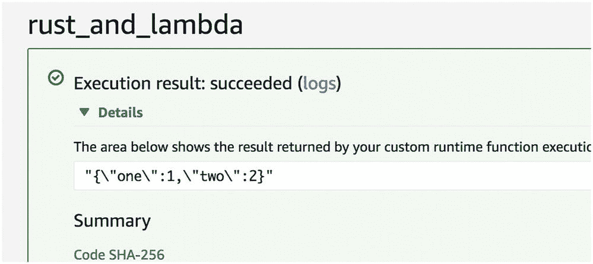
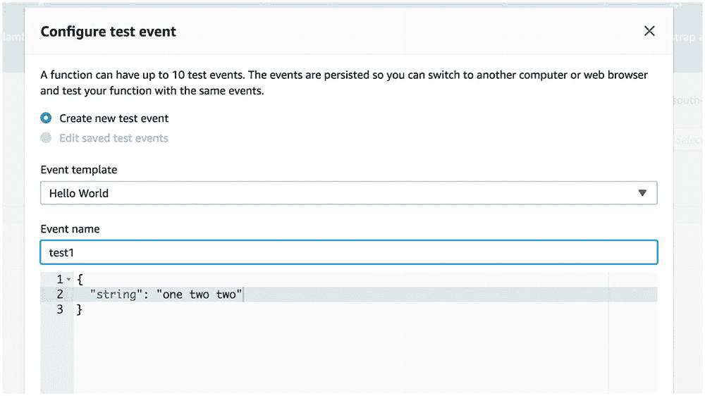
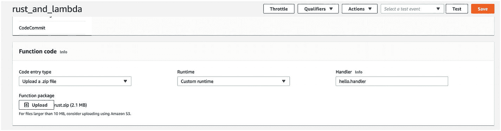
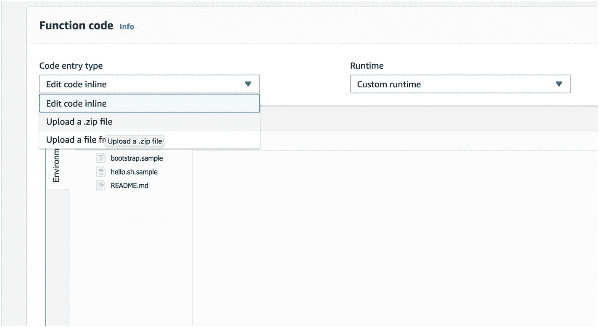
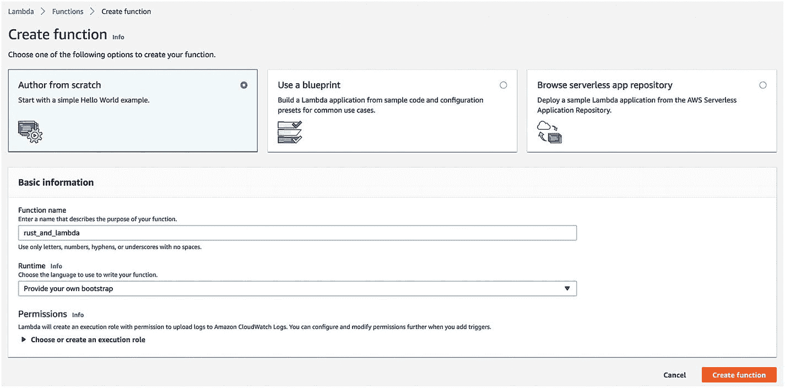

# dependencies code
[[bin]]
name = "bootstrap"
path = "src/main.rs"
Listing 8-29
chapter8/my_lambda_function/Cargo.toml
```

这将创建一个名为 `bootstrap` 的二进制可执行文件，其构建方式符合 AWS 的期望。

现在，在构建之前，我们需要确保 Rust 编译器针对正确的平台。AWS Lambda 在 Amazon Linux 环境中执行，因此我们需要针对这个特定平台进行构建。这正是 Cargo 作为工具再次大放异彩的地方，因为它使我们能够非常轻松地构建跨平台工具。因此，我们不一定需要在 Amazon Linux 机器上编译，也可以在 MacOS 笔记本电脑上进行构建。首先，我们需要安装 `musl` 工具，以便能够针对该平台进行构建（清单 8-30）。

```
$ rustup target add x86_64-unknown-linux-musl
$
Listing 8-30
rustup add linux target
```

在构建平台之前，我们需要为编译工具链添加一个链接器。这意味着我们需要在 MacOS 平台上运行 `brew install` 命令。^(³⁸) 参见清单 8-31。

```
$ brew install filosottile/musl-cross/musl-cross
$
Listing 8-31
Brew install musl-cross
```

完成后，我们需要告诉 Cargo 在构建时使用这个链接器而不是默认的链接器。这可以通过在 `.cargo/config` 中创建一个包含链接器信息的新文件来完成（清单 8-32）。

```
[target.x86_64-unknown-linux-musl]
linker = "x86_64-linux-musl-gcc"
Listing 8-32
chapter8/my_lambda_function/.cargo/config
```

有时链接器无法被直接识别，因此我们可能需要手动创建指向链接器的软链接（清单 8-33）。

```
$ ln -s /usr/local/bin/x86_64-linux-musl-gcc /usr/local/bin/musl-gcc
$
Listing 8-33
link musl gcc
```

现在，工具链已完全就绪，我们应该能够创建可以在 lambda 平台上运行的可执行文件了（清单 8-34）。

```
$ cargo build --release --target x86_64-unknown-linux-musl
$
Listing 8-34
cargo build
```

现在，我们应该能够在目标文件夹中看到构建好的可执行文件（清单 8-35）。

```
$ ls target/x86_64-unknown-linux-musl/release/
bootstrap      bootstrap.d     build         deps       examples       incremental     native        runtime_release
$
Listing 8-35
check executable fi le
```


我们需要将这个可执行文件压缩成 zip 包，以便能够部署到 AWS Lambda 上（清单 8-36）。

```
$ zip -j rust.zip ./target/x86_64-unknown-linux-musl/release/bootstrap
$
清单 8-36
为 AWS 压缩 zip 包
```

由于这涉及相当多的命令，我们可以将它们放在一个简单的构建 shell 文件中（清单 8-37）。

```
rm -f rust.zip
cargo build --release --target x86_64-unknown-linux-musl
zip -j rust.zip target/x86_64-unknown-linux-musl/release/bootstrap
清单 8-37
chapter8/my_lambda_function/buildthis.sh
```

现在我们可以将这个文件部署到 AWS Lambda。导航到 AWS Lambda 控制台并创建一个新函数。我们需要选择“从头开始创作”。输入一个函数名称，并且重要的是，将运行时选择为“提供您自己的引导程序”。页面应该类似于图 8-1。

在下一页中，向下滚动到函数代码。点击代码输入类型，然后选择“上传 .zip 文件”。见图 8-2。

现在我们需要选择正确的文件并点击保存按钮。如图 8-3 所示。

保存后，我们的 lambda 函数就创建完成了。我们现在可以在控制台中配置一个测试用例，以查看函数是否按预期运行。如图 8-4 所示。由于我们的函数期望一个字符串参数，我们可以向字符串参数传递一个随机句子，它应该会返回单词计数。

在图 8-5 中，我们看到运行测试用例给出了正确的结果。

我们已经成功地在 Rust 中创建了一个无服务器应用程序。不过，这种编程模型存在一些注意事项。在我们的案例中，算法很简单，可以很容易地使用 Rust 构建。如果代码是纯 Rust 代码，那么构建的 Rust 工具链就能正常工作，我们应该能够轻松地构建无服务器应用程序。如果应用程序有外部库依赖项，例如我们在本书大部分内容中看到的那些，那么执行交叉链接和编译并为 AWS 平台创建二进制文件就相当困难。不过，如果我们能够做到这一点，那么模型推理就能工作。没有展示使用无服务器 Rust 进行模型训练，因为这需要时间，而无服务器应用程序有超时限制。尽管如此，在机器学习工作流中集成无服务器应用程序为开发者带来了巨大的生产力提升。



图 8-5

测试运行



图 8-4

测试用例



图 8-3

选择 zip 文件



图 8-2

选择上传方法



图 8-1

创建 lambda 函数

## 8.3 结论

最后一章向你介绍了将 Rust 代码集成到现有应用程序中的不同方法。本章首先介绍了使用 PyO3 为 Python 代码编写包装器，然后我们继续介绍了为在 Java 中使用 Rust 代码而编写 JNI 包装器代码。最后，我们在 AWS Lambda 中创建了一个无服务器应用程序，作为 Rust 在云端应用的一个示例。

### 索引

### A

Amazon S3 应用程序创建 数组 AWS Lambda AWS 无服务器应用程序

### B

引导程序

### C

Cargo Cargo.toml 文件 车杆问题 聊天机器人/自然语言理解 (NLU) 创建 dataset.json dataset.yaml, 内容 英文模型, 下载 推理引擎 (*参见* 推理引擎) 意图识别 Python 虚拟环境 snips 训练 Ubuntu 安装 clang 云, Rust AWS Lambda 优势 Cargo.toml CustomEvent 结构体 event 结构体 handler 函数 json 序列化 lambda 应用程序 lambda 函数, 创建 lambda_runtime 序列化和反序列化 无服务器应用程序 测试用例 测试运行 上传方法, 选择 单词计数应用程序 聚类中心 协同过滤 协同方法 命令行 条件随机场 (CRFs) 基于内容的过滤 卷积神经网络 (CNN) 卷积层 模型 CnnNet forward_t 方法 tch 仓库 tch-rs 库 张量变换 torch.nn.Module relu 层 模块堆叠 协方差矩阵 跨平台工具 CSS 选择器 CustomEvent 结构体

### D

datafusion dataset_table_begin 数据变换 数据类型 基于密度的噪声应用空间聚类 (DBSCAN) deserialize_books 函数 deserialize_ratings Docker

### E

EM 算法

### F

FastText fit 函数 Forgy 方法 from_path 变量 函数

### G

高斯分布 高斯函数 高斯混合模型 (GMM) 聚类中心 协方差矩阵 期望最大化算法 完整和正则化选项 高斯分布 多个分布 predict 方法 rusty_machine 基因表达数据集 gene_expression_headers gene_expression_measures_matrix gene_expression_measures_vec 图数据库

### H

堆/对象存储 基于 HTTP 的规范 Hughes 现象

### I

If 条件 图像分类 CNN 当前目录结构 模型构建与调试 预训练模型 rust 和 torch torch 数据集 Caltech101 目录 load_from_dir 函数 mkl/libtorch 依赖 move_file 函数 输出 this_label 变量 训练/验证图像 ImplicitEWMAModel 结构体 推理引擎 cargo run cargo.toml incoming 函数 模块 nlu 引擎 rocket 应用 rust 互斥锁 rust 项目 init_engine 函数 input_indices 向量 安装 意图识别 倒立摆

### J

JavaScript 对象表示法 (JSON) Cargo.toml 文件 转换, 字符串 data_formats 数据结构 默认序列化-反序列化 数据结构 定义, 结构体层次结构 mod 关键字 schema 结构体 serde_json::Value ENUM Serde 的反序列化器 json 序列化

### K

关键不变量 K-MeansClassifier 结构体 K-means 聚类

### L

Lambda 函数 Lambda 编程模型 线性代数 load_from_dir 函数 基于 LSTM 的模型

### M

机器学习 矩阵 矩阵乘法 矩阵变换 模型构建 模型反序列化 model_prediction 模型训练 Moneycontrol 基于移动平均的模型 (EWMA) 可变引用

### N

命名实体识别 (NER) 准确率函数 算法 标注工具 CRFs crfsuite-model 包 数据集 IOB2 表示法 主模块 模型预测 输出 Vec<NER> 自然语言处理 (NLP) FastText 句子分类 cargo 文件 常量 fasttext 模型 into_labels 方法 ML 模型 shuffle 向量 softmax spooky 作者数据 stemmer 算法 停用词 文本预处理 分词 to_lowercase 方法 训练, fasttext 模型 ndarray 矩阵类型 神经风格迁移 Adam 优化算法 内容损失 当前损失 梯度优化方法 模型层 风格损失 VGG 预训练模型 NoSQL Bash 连接字符串 cypher 查询 图数据库 hostname-I 命名空间 关系学习 rusted-cypher crate

### O

面向对象编程 (OOP) 枚举 方法和 impl 结构体 特性 ORMs

### P

Postgres 数据库 Postgres Docker Postgres rust crate Predict 方法 主成分分析 process_gene_expresssion_data

### Q

Q 函数 Q-learning


### R

Rand Index RandomPartition 方法 推荐系统 命令行 基于内容的过滤与协同过滤 crate rand 数据下载 数据故障 在 Ubuntu 上安装 libssl 模型构建 模型预测 包 sbr 推荐模块 Rust goodbooks 包 sbr crate 引用与借用 强化学习 智能体 车杆挑战 领域行为，车杆领域 特质 倒立摆 最优策略 Q 函数 Q 学习 实际应用 实际模拟 奖励行为 rsrl SARSA 状态空间行为 Rust 目标 二进制包 统计 推荐引擎 统计参数 测试 Rust 代码 Java 复制 xgboost，接口 fit 函数 函数创建 IrisClassificationXgboost.predict Java 类定义 jni crate main 函数 main 方法 组织与预测代码 predict 方法 rust 功能 训练代码 包装函数 xgb.model 文件 Python Cargo.toml check_accuracy clean 接口 create_xseq_yseq crfmodel_training crfsuite 模型文件 fit 方法 __init__.py 文件 model_prediction 模块 整体函数签名 predict 方法 运行预测代码 运行训练代码 split_test_train 训练与预测文件 Rust 特定的静态库格式 rusty_machine_unsupervised

### S

Scraping 包 Cargo.toml 文件 Chrome 选择器 CSS 选择器 moneycontrol 网站 输出 包创建 reqwest apis resp 变量 调度系统 Selector::parse 方法 Selector 字符串 序列化与反序列化 无服务器应用 Softmax SQL 二进制包 数据库，创建 cargo run Postgres 连接字符串 数据，s3 数据转换 Docker postgres main 方法 NoSQL (*参见* NoSQL) ORM 包根目录，运行 postgres 容器 postgres crate postgres 查询 postgres rust crate 检索数据 struct，创建表创建 向量，表写入 原生查询 标准差 统计分析 轴索引 dataset_table_begin 数据结构 依赖项 下载浏览器数据 文件，格式 gene_expression_headers gene_expression_measures_matrix gene_expression_measures_vec 均值与方差，计算 ndarray process_gene_expresssion_data_headers p 值 Rust 二进制包 统计创建 软文件 subset_description subset_ids Z 分数

### T

Tensorflow bbox_res 和 prob_res BGR 格式 cargo.toml face-detection-tf Rust 包，创建 graph mtcnn 预训练模型 result StructOpt struct to_filename 变量 分词 迁移学习 神经风格迁移 (*参见* 神经风格迁移) 训练

### U

无监督模型

### V

变量 可变性与遮蔽 夜间版本 作用域 类型 visit_dir 函数

### W

包装函数

### X, Y

XML 数据格式 Cargo.toml 文件 文件结构 层级，结构体 main 方法 serde-xml-rs crate 强类型构造 结构体，创建 结构，xml 文件 xmlreading 模块 xmlreading::run 函数

### Z

Z 分数
