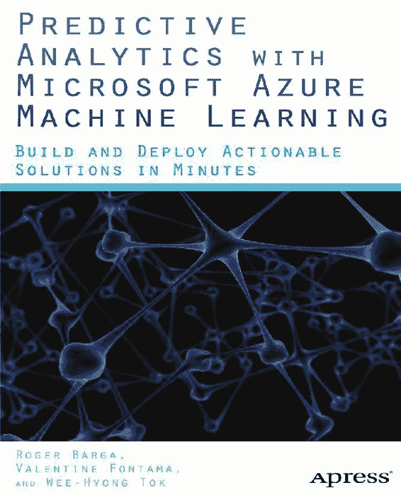

**使用 Microsoft Azure 机器学习进行预测分析**

**在数分钟内构建并部署可操作的解决方案**


Roger Barga

Valentine Fontama

Wee Hyong Tok

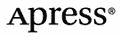

**使用 Microsoft Azure 机器学习进行预测分析：在数分钟内构建并部署可操作的解决方案**

版权所有 © 2014 归 Roger Barga、Valentine Fontama 和 Wee Hyong Tok 所有。

本作品受版权保护。出版商保留所有权利，无论是涉及材料的全部或部分，特别是翻译、重印、重用插图、朗诵、广播、微缩胶片复制或以任何其他物理方式复制、传输或信息存储与检索、电子改编、计算机软件，或现在已知或以后开发的类似或不同方法的权利。此法律保留的例外情况包括与评论或学术分析相关的简短摘录，或专门为输入计算机系统并执行而提供的材料，仅供作品购买者独家使用。仅可根据出版商所在地现行版权法的规定复制本出版物或其部分内容，并且必须始终从 Springer 获得使用许可。使用许可可通过 Copyright Clearance Center 的 RightsLink 获取。违反者将根据相应的版权法被起诉。

ISBN-13（平装本）：978-1-4842-0446-7

ISBN-13（电子版）：978-1-4842-0445-0

本书中可能出现商标名称、徽标和图像。我们不会在每次出现商标名称、徽标或图像时都使用商标符号，而是仅以编辑方式使用这些名称、徽标和图像，以利于商标所有者，且无意侵犯商标权。

本出版物中使用的商品名称、商标、服务标志和类似术语，即使未明确标识，也不应被视为对其是否受专有权利保护的表达意见。

尽管本书中的建议和信息在出版时被认为是真实准确的，但作者、编辑和出版商均不对可能出现的任何错误或遗漏承担法律责任。出版商对本书所含内容不作任何明示或暗示的保证。

常务董事：Welmoed Spahr

首席编辑：James DeWolf

开发编辑：Douglas Pundick

技术审阅人：Jacob Spoelstra 和 Hang Zhang

编辑委员会：Steve Anglin、Mark Beckner、Gary Cornell、Louise Corrigan、James DeWolf、Jonathan Gennick、Robert Hutchinson、Michelle Lowman、James Markham、Matthew Moodie、Jeff Olson、Jeffrey Pepper、Douglas Pundick、Ben Renow-Clarke、Dominic Shakeshaft、Gwenan Spearing、Matt Wade、Steve Weiss

协调编辑：Kevin Walter

文字编辑：Mary Behr

排版：SPi Global

索引编制：SPi Global

插图：SPi Global

封面设计：Anna Ishchenko

全球图书贸易发行由 Springer Science+Business Media New York 负责，地址：233 Spring Street, 6th Floor, New York, NY 10013。电话：1-800-SPRINGER，传真：(201) 348-4505，电子邮件：orders-ny@springer-sbm.com，或访问 [www.springeronline.com](http://www.springeronline.com)。Apress Media, LLC 是加利福尼亚州的有限责任公司，其唯一成员（所有者）是 Springer Science + Business Media Finance Inc (SSBM Finance Inc)。SSBM Finance Inc 是一家**特拉华州**公司。

有关翻译信息，请发送电子邮件至 rights@apress.com，或访问 [www.apress.com](http://www.apress.com)。

Apress 和 friends of ED 的书籍可批量购买用于学术、企业或促销用途。大多数图书也提供电子书版本和许可证。如需更多信息，请参阅我们的特殊批量销售–电子书许可网页：[www.apress.com/bulk-sales](http://www.apress.com/bulk-sales)。

作者在本文中引用的任何源代码或其他补充材料均可供读者在 [www.apress.com](http://www.apress.com) 获取。有关如何找到本书源代码的详细信息，请访问 [www.apress.com/source-code/](http://www.apress.com/source-code/)。

内容概览

关于作者

致谢

前言

引言

 第 1 部分：介绍数据科学与 Microsoft Azure 机器学习

 第 1 章：数据科学简介

 第 2 章：Microsoft Azure 机器学习介绍

 第 3 章：与 R 的集成

 第 2 部分：统计与机器学习算法

 第 4 章：统计与机器学习算法简介

 第 3 部分：实际应用

 第 5 章：构建客户倾向模型

 第 6 章：构建流失模型

 第 7 章：客户细分模型

 第 8 章：构建预测性维护模型

索引

目录

关于作者

致谢

前言

引言

 第 1 部分：介绍数据科学与 Microsoft Azure 机器学习

 第 1 章：数据科学简介

什么是数据科学？

分析谱系

描述性分析

诊断性分析

预测性分析

规范性分析

为什么它很重要，为什么是现在？

数据作为竞争资产

客户需求增加

数据挖掘技术认知提升

获取更多数据

更快更便宜的处理能力

数据科学流程

常见数据科学技术

分类算法

聚类算法

回归算法

模拟

内容分析

推荐引擎

数据科学前沿

集成模型的兴起

总结

参考文献

 第 2 章：Microsoft Azure 机器学习介绍

你好，机器学习工作室！

实验的组成部分

创建实验的五个简单步骤

步骤 1：获取数据

步骤 2：预处理数据

步骤 3：定义特征

步骤 4：选择并应用机器学习算法

步骤 5：对新数据进行预测

在生产环境中部署模型

将模型部署到暂存环境

测试 Web 服务

将模型从暂存环境迁移到生产环境


访问 Azure 机器学习 Web 服务

总结

 第 3 章：与 R 的集成

R 简介

构建并部署你的第一个 R 脚本

使用 R 进行数据预处理

使用脚本包（Zip）

使用 R 构建并部署决策树

总结

 第 2 部分：统计与机器学习算法

 第 4 章：统计与机器学习算法简介

回归算法

线性回归

神经网络

决策树

提升决策树

分类算法

支持向量机

贝叶斯点机

聚类算法

总结

 第 3 部分：实际应用

 第 5 章：构建客户倾向模型

业务问题

数据获取与准备

从本地文件系统加载数据

从其他来源加载数据

数据分析

训练模型

模型测试与验证

模型性能

总结

 第 6 章：构建流失模型

流失模型简介

构建并部署客户流失模型

准备与理解数据

数据预处理与特征选择

用于预测流失的分类模型

评估客户流失模型的性能

总结

 第 7 章：客户细分模型

客户细分模型简介

构建并部署你的第一个 K-Means 聚类模型

特征哈希

识别正确的特征

K-Means 聚类的特性

批发客户的客户细分

从 UCI 机器学习库加载数据

使用 K-Means 聚类进行批发客户细分

新数据的聚类分配

总结

 第 8 章：构建预测性维护模型

概述

业务问题

数据获取与准备

数据集

数据加载

数据分析

训练模型

模型测试与验证

模型性能

模型部署

将模型发布到暂存环境

将模型从暂存环境迁移到生产环境

总结

索引

关于作者


**Roger Barga** 是亚马逊网络服务（Amazon Web Services）的总经理兼开发总监。在加入亚马逊之前，Roger 是微软云与企业部门中云机器学习组的集团项目经理，其团队负责 Azure 机器学习服务的产品管理。Roger 于 1997 年加入微软，担任微软研究院数据库组的研究员，负责数据库、工作流和流处理系统的系统研究和产品开发工作。他将基础研究的想法，通过概念验证原型，推进到产品组的孵化工作中。在加入微软之前，Roger 是太平洋西北国家实验室机器学习组的研究科学家，负责构建和部署基于机器学习的解决方案。Roger 还是华盛顿大学的附属教授，在数据科学和机器学习项目中担任讲师。

Roger 拥有计算机科学博士学位、计算机科学硕士学位（主攻机器学习方向），以及数学与计算科学学士学位。他发表了 90 多篇经过同行评审的技术论文和书籍章节，从 1991 年到 2013 年与 214 位合著者合作，被 1,084 位作者引用超过 700 次。


**Valentine Fontama** 是微软数据与决策科学组（DDSG）的首席数据科学家，负责领导外部咨询项目，为微软客户提供世界级的高级分析解决方案。Val 在数据科学和商业领域拥有超过 18 年的经验。在获得人工神经网络博士学位后，他将数据挖掘应用于环境科学和信贷行业。在加入微软之前，Val 是伦敦 Equifax 公司的新技术顾问，率先将数据挖掘应用于消费信贷行业的风险评估和市场营销。他目前是华盛顿大学数据科学专业的附属教授。

在微软的上一任职位中，Val 是高级产品营销经理，负责云和企业营销中的大数据和预测分析。在此职位上，他领导了 Microsoft Azure 机器学习、微软首个 Hadoop 服务 HDInsight、微软首个数据仓库设备并行数据仓库，以及三个版本的 Fast Track 数据仓库的产品管理工作。他还在定义微软的内存计算战略和定位方面发挥了关键作用。

Val 拥有沃顿商学院的战略管理与营销 MBA 学位、神经网络博士学位、计算硕士学位，以及数学与电子学学士学位（一等荣誉）。他合著了《Introducing Microsoft Azure HDInsight》一书，并发表了 11 篇学术论文，被超过 227 位作者引用 152 次。


**Wee-Hyong Tok** 是微软 SQL Server 团队的高级项目经理。Wee-Hyong 拥有超过 12 年的数据库系统经验（其中在工业界拥有超过 6 年的数据平台经验，在学术界拥有 6 年的经验）。

在攻读博士学位之前，Wee-Hyong 是新加坡一家大型电信公司的系统分析师，负责市场营销决策支持系统。在获得新加坡国立大学数据流系统博士学位后，他加入微软并加入了 SQL Server 团队。在过去的六年里，Wee-Hyong 积累了与来自亚洲和美国的分布式工程团队合作的丰富经验，并负责塑造 SSIS 服务器，将其从概念引入到 SQL Server 2012 的发布。最近，Wee-Hyong 加入了 Azure 数据工厂团队，该团队提供用于编排和管理数据转换与移动的服务。


Wee Hyong 拥有新加坡国立大学的数据流系统博士学位、计算科学硕士学位以及计算机科学一等荣誉学士学位。他发表了 21 篇经同行评审的学术论文和期刊文章，并合著了两本书籍：《*Microsoft Azure HDInsight 入门*》和《*Microsoft SQL Server 2012 Integration Services*》。

致谢

我要向微软 CloudML 团队的众多成员表达感谢，他们陪伴我们完成了这本书；感谢所有提供支持、阅读、提出意见并协助编辑和校对的人。我要感谢我的合著者 Val 和 Wee-Hyong，他们的动力和毅力是完成本书的关键，还要感谢我们的出版商 Apress，特别是 Kevin Walter 和 James T. DeWolf，让这一切成为可能。最重要的是，我要感谢我的妻子 Terre，以及我的女儿 Amelie 和 Jolie，尽管这本书占用了大量本应陪伴她们的时间，她们依然给予我支持和鼓励。

——Roger Barga

我要感谢我的合著者 Roger 和 Wee-Hyong，在这个项目上与我们进行了深入的合作。特别感谢我的妻子 Veronica，以及我可爱的孩子们 Engu、Chembe 和 Nayah，感谢他们的支持和鼓励。

——Valentine Fontama

我要感谢我的合著者 Roger 和 Val，我们一起努力塑造了本书的内容。我深深感谢 CloudML 团队的数据科学家们所做的审阅工作。我还要感谢从概念到出版一直与我们合作的 Apress 团队。我要感谢 Juliet、Nathaniel、Siak-Eng 和 Hwee-Tiang，感谢他们的爱、支持和耐心。

——Wee-Hyong

前言

很少有人能充分认识到机器学习在企业应用中的巨大潜力。我很幸运，在入职第一份工作仅仅几个月后，就初步领略了它的潜在益处。那是 1995 年，信用卡发卡机构开始采用神经网络模型来实时检测信用卡欺诈。当信用卡被使用时，销售点系统的交易数据会被发送到发卡机构的信用授权系统，在那里，神经网络会对欺诈概率进行评分。如果概率很高，交易就会被实时拒绝。我当时是一名构建此类模型的科学家，我交付的首批模型之一就是为一家南美银行开发的。模型部署后，该银行在第一天就识别出了超过一百万美元此前未被发现的欺诈行为。这让我大开眼界。此后的岁月里，我见证了机器学习在众多不同应用中带来的巨大价值，例如需求预测、故障和异常检测、广告定向投放、在线推荐以及像 Cortana 这样的虚拟助手。通过将机器学习嵌入到企业系统中，组织可以改善客户体验、降低系统性故障风险、增加收入并实现显著的成本节约。

然而，构建机器学习系统是一个缓慢、耗时且容易出错的过程。尽管我们现在能够分析非常庞大的数据集，并以极高的交易速率进行部署，但以下瓶颈依然存在：

*   机器学习系统的开发需要深厚的专业知识。尽管机器学习的核心原则现在已为更广泛的受众所了解，但招聘到有才华的数据科学家在今天和二十年前一样困难。
*   从业者被迫使用各种工具来收集、清理、合并和分析数据。这些工具学习曲线陡峭，且彼此之间并未集成。商业机器学习软件的部署和维护成本高昂。
*   构建和验证模型需要大量的实验。数据科学家常常感到受限于计算和存储资源，因为他们需要运行大量实验，而这些实验会产生大量新数据。
*   软件工具不支持可扩展的实验或组织实验运行的方法。在没有工具支持的情况下，与团队协作进行实验、共享衍生变量和脚本等行为是手动且临时的。评估和调试统计模型仍然是一个挑战。

数据科学家通过编写自定义程序并在执行机器学习实验时进行大量无差别的繁重工作来绕过这些限制。但在部署阶段，情况变得更加困难。在关键业务过程中（如实时欺诈预防或广告定向投放）部署机器学习模型，需要复杂的工程技术。必须满足以下需求：

*   通常，离线开发的机器学习模型现在必须用 C++、C# 或 Java 等语言重新实现。
*   必须构建交易数据管道。离线模型中使用的数据转换和变量必须重新编码和编译。
*   这些重新实现不可避免地会引入错误，需要验证模型是否按原始设计工作。
*   必须为模型构建一个自定义容器，并配备适当的监控、指标和日志记录。
*   高级部署需要 A/B 测试框架来并排评估替代模型。需要有一种机制来切换模型的引入或退出，最好无需重新编译和部署整个应用程序。
*   必须通过统计测试来验证候选生产模型是否按原始设计工作。

系统做出的自动决策以及业务成果必须被记录下来，以便用于改进机器学习模型和进行监控。

服务必须针对高可用性、灾难恢复以及与终端点的地理接近性进行设计。

当服务需要扩展以满足更高的交易速率和/或低延迟要求时，需要投入更多工作来配置新硬件、将服务部署到新机器并进行横向扩展。

所有这些都是耗时且工程密集的步骤，在基础设施和人力方面都代价高昂。一个生产级机器学习应用的端到端工程和维护需要一个高技能团队，而很少有组织能够建立并维持这样的团队。

Microsoft Azure ML 正是为解决这些问题而设计的。


*   这是一项完全托管的云服务，无需安装软件、管理硬件，也无需处理操作系统版本或开发环境。
*   数据科学家只需一个浏览器，即可从任何地点、任何设备登录 Azure 并开始开发机器学习模型。他们可以在 Azure 存储中托管几乎无限数量的文件。
*   ML Studio 是一个用于机器学习的集成开发环境，它允许你通过易于使用的拖放连接范式，将实验设置为简单的数据流图。数据科学家可以避免为大量常见任务编写程序，从而专注于实验设计和迭代。
*   提供了许多示例实验，方便你快速上手。
*   内置了微软研究院开发的一系列精选算法，并支持自定义 R 代码。超过 350 个开源 R 包可以在 Azure ML 中安全使用。
*   数据流图可以包含多个并行路径，这些路径会自动并行运行，使科学家能够执行复杂的实验并进行并排比较，而无需受限于通常的计算约束。
*   实验易于共享，因此其他人可以接手你的工作，在你停下的地方继续推进。

Azure ML 还使得在云中大规模创建生产部署变得简单。预训练的机器学习模型可以整合到评分工作流中，只需点击几下，即可创建一个新的云托管 REST API。该 REST API 经过精心设计，能够实现低延迟响应。无需重新实现或移植——这是相对于传统数据分析软件的一个关键优势。来自互联网任何地方（笔记本电脑、网站、移动设备、可穿戴设备和联网机器）的数据都可以发送到新创建的 API 以获取预测结果。例如，数据科学家可以创建一个欺诈检测 API，该 API 将交易信息作为输入，并返回低/中/高风险指标作为输出。这样的 API 随后将在云端“上线”，随时准备接收开发者选择调用的任何软件的调用。API 后端可以弹性伸缩，因此当交易率飙升时，Azure ML 服务可以自动处理负载。数据科学家可以创建和部署的机器学习 API 数量几乎没有限制——而且这一切都无需依赖工程团队。对于工程和 IT 团队来说，使用这些 REST API 集成新的机器学习模型变得简单，并且在部署前轻松并排测试多个模型，从而以低成本实现显著更高的敏捷性。Azure 提供了在生产环境中扩展和管理 API 的机制，包括衡量可用性、延迟和性能的机制。因此，为企业构建稳健、高可用、可靠的机器学习系统并管理生产部署，变得异常快速、廉价和简单，并带来巨大的商业利益。

我们相信 Azure ML 是一项颠覆性的技术。它使初创公司和大型企业都能利用机器学习的巨大潜力。初创公司现在能够使用以前只有最成熟的企业才能使用的相同能力。大型企业则能够释放其大数据中的潜在价值，以产生显著更多的收入和效率。最重要的是，现在可能实现的迭代和实验速度将允许快速创新，并为我们周围所有云连接设备中的智能铺平道路。

当我于 1995 年开始职业生涯时，构建和部署信用卡欺诈检测系统需要一个大型组织。借助 Azure ML 这样的工具和云的力量，一位才华横溢的数据科学家就能完成同样的壮举。本书的作者们在数据科学领域拥有丰富的经验，他们编写本书旨在帮助你开启使用 Azure ML 的精彩旅程。

—Joseph Sirosh
微软公司机器学习部门企业副总裁

引言

数据科学和机器学习需求旺盛，因为客户越来越多地寻求从其数据中挖掘洞察的方法。现在，越来越多的客户意识到，由于数据的数量、速度和复杂性已经超越了传统分析工具的能力范围，商业智能已不足以应对。虽然商业智能处理描述性和诊断性分析，但数据科学通过预测性和规范性分析开启了新的机遇。

本书概述了数据科学，并深入介绍了微软最新的预测分析服务——Microsoft Azure Machine Learning。本书提供了一种结构化的数据科学方法，以及解决实际业务问题（如买家倾向性建模、客户流失分析、预测性维护和产品推荐）的实用指南。微软这项新服务的简洁性将有助于将数据科学和机器学习推广到比现有产品更广泛的受众群体。了解如何使用微软新的 Azure Machine Learning 服务，快速构建和部署复杂的预测模型作为机器学习 Web 服务。

谁应该阅读本书？

本书面向数据科学家、业务分析师、商业智能专业人士和开发者。

读者需要具备统计学和数据分析的基本技能。不过，读者无需是数据科学家或拥有深厚的数据挖掘技能，也能从本书中获益。

你将学到什么

本书将提供以下内容：

*   数据科学的深厚背景知识，以及如何使用结构化方法和最佳实践解决业务数据科学问题
*   如何使用 Microsoft Azure Machine Learning 服务有效地构建和部署预测模型作为机器学习 Web 服务
*   展示如何解决典型预测分析问题（如倾向性建模、流失分析和产品推荐）的实践示例

在本书结束时，你将掌握基础数据科学、数据挖掘过程的基本技能，并对新的 Microsoft Azure Machine Learning 服务有清晰的理解。你还将获得使用机器学习解决实际业务问题的框架。

第一部分


介绍数据科学与 Microsoft Azure Machine Learning

第一章


数据科学导论

那么，什么是数据科学？为什么它如此热门？它只是另一个在炒作过后就会消失的时尚吗？我们将从数据科学的简单介绍开始，定义它是什么、为什么重要以及为什么是现在。本章重点介绍数据科学过程，并提供指导原则和最佳实践。它介绍了数据科学中一些最常用的技术和算法。并探讨了集成模型，这是数据科学前沿的一项关键技术。

什么是数据科学？


数据科学是从数据中获取有用洞察的实践。虽然它也适用于小数据，但数据科学对大数据尤为重要，因为如今我们从组织内外的众多来源收集了 PB 级别的结构化和非结构化数据。结果，我们变得数据丰富但信息贫乏。数据科学提供了强大的流程和技术，用于从这片数据海洋中挖掘可操作的信息。数据科学借鉴了多个学科，包括统计学、数学、运筹学、信号处理、语言学、数据库与存储、编程、机器学习以及科学计算。图 1-1 展示了数据科学最常见的学科领域。尽管*数据科学*这个术语在商业领域是新的，但它自 1960 年就已存在，当时彼得·诺尔首次将其用于指代计算机科学中的数据处理方法。自 20 世纪 90 年代末以来，著名的统计学家如 C.F.吴和威廉·S·克利夫兰也使用了数据科学这一术语，他们认为这门学科与统计学相同或是其延伸。

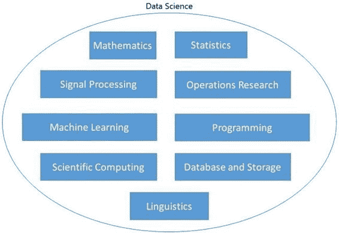

图 1-1. 突出构成数据科学的主要学术学科

数据科学的实践者是数据科学家，他们的技能涵盖统计学、数学、运筹学、信号处理、语言学、数据库与存储、编程、机器学习以及科学计算。此外，为了有效工作，数据科学家还需要良好的沟通和数据可视化技能。领域知识对于交付有意义的成果也至关重要。如此广泛的技能很难在一个人身上找到，这就是为什么数据科学是一项团队运动，而非个人努力。要有效运作，需要组建一个拥有互补数据科学技能的团队。

分析光谱

根据高德纳公司的分类，我们进行的所有分析都可以归为四类：描述性分析、诊断性分析、预测性分析和规范性分析。描述性分析通常有助于描述情况，并能回答诸如*发生了什么？*、*我的客户是谁？*等问题。诊断性分析帮助你理解事情发生的原因，并能回答诸如*为什么会发生？*之类的问题。预测性分析具有前瞻性，可以回答诸如*未来会发生什么？*之类的问题。顾名思义，规范性分析更具指导性，有助于回答诸如*我们应该做什么？*、*到达目的地的最佳路线是什么？*或*我应该如何分配我的投资？*等问题。

图 1-2 展示了完整的分析光谱。该图也显示了分析的复杂程度。

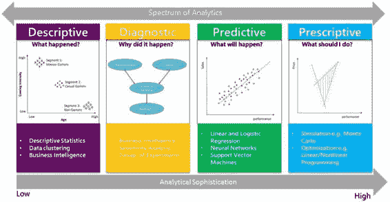

图 1-2. 所有数据分析的光谱

描述性分析

描述性分析用于解释在特定情况下正在发生的事情。这类分析通常需要人工干预，可用于回答诸如*发生了什么？*、*我的客户是谁？*、*我们有多少种用户类型？*等问题。常用的技术包括使用图表、直方图、箱线图或数据聚类进行描述性统计。你将在本章后面探讨这些技术。

诊断性分析

诊断性分析帮助你理解某些事情发生的原因以及关键驱动因素是什么。例如，无线服务提供商可能会用它来回答诸如*为什么掉线率在增加？*或*为什么我们每个月都在流失更多客户？*等问题。客户诊断分析可以通过聚类、分类、决策树或内容分析等技术来完成。这些技术存在于统计学、数据挖掘和机器学习中。需要注意的是，商业智能也用于诊断性分析。

预测性分析

预测性分析帮助你预测未来会发生什么。它用于预测不确定结果的概率。例如，它可以用来预测信用卡交易是否欺诈，或者某个客户是否可能升级到高级电话套餐。统计学和机器学习为预测提供了很好的技术。这包括神经网络、决策树、蒙特卡洛模拟和回归等技术。

规范性分析

规范性分析将建议采取最佳行动方案以优化你的业务成果。通常，规范性分析将预测模型与业务规则（例如，如果欺诈概率超过给定阈值则拒绝交易）相结合。例如，它可以建议向特定客户提供的最佳电话套餐，或者基于优化，为你的送货卡车提出最佳路线。规范性分析在渠道优化、投资组合优化或交通优化等场景中非常有用，可以根据当前交通状况找到最佳路线。可以使用决策树、线性和非线性规划、蒙特卡洛模拟或来自统计学和数据挖掘的博弈论等技术来进行规范性分析。参见图 1-2。

分析的复杂性从描述性分析到规范性分析逐渐增加。在许多方面，规范性分析是分析的理想境界，通常被分析能力最强的组织所使用。想象一家智能电信公司，它将分析模型嵌入到其业务流程系统中。其客户呼叫中心系统嵌入了以下分析模型：

*   **客户流失模型**：这是一个预测模型，用于预测客户流失的概率。换句话说，它预测了致电呼叫中心的客户最终转向竞争对手的可能性。
*   **客户细分模型**：该模型将客户划分为不同的细分市场，用于营销目的。
*   **客户倾向模型**：该模型预测客户对每个营销优惠（例如升级到高级套餐）的响应倾向。

当客户来电时，呼叫中心系统会通过其手机号码实时识别客户。然后，呼叫中心系统使用这三个模型对客户进行评分。如果客户在客户流失模型上得分很高，意味着他们非常有可能转向竞争对手。在这种情况下，电信公司会立即将客户转接给一组有权提供有吸引力优惠以防止流失的呼叫中心代理。否则，如果细分模型将客户评分为高价值客户，他/她将被转接到专门的礼宾服务，该服务等待时间更短，客户服务最佳。如果倾向模型显示客户升级倾向很高，呼叫代理会收到提醒，并尝试以有吸引力的升级方案进行向上销售。该解决方案的美妙之处在于，所有模型都融入了电信公司的业务流程中，驱动其代理做出明智的决策，从而提高盈利能力和客户满意度。这在图 1-3 中进行了说明。

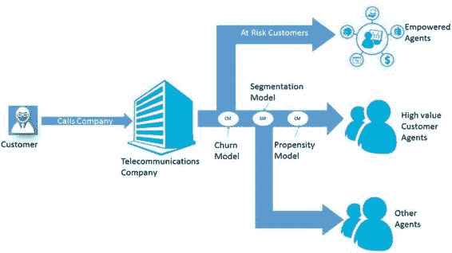

图 1-3. 一家使用规范性分析的智能电信公司

为什么它很重要，为什么是现在？


数据科学为客户提供了基于其收集的所有数据做出更明智、更及时决策的真正机会。借助合适的工具，数据科学不仅能从客户自身数据中，还能从其组织外日益增长的数据源（如天气数据、客户人口统计数据、来自信用机构的消费者信用数据，以及来自 Twitter、Instagram 等社交媒体网站的数据）中，为客户提供新颖且可操作的见解。以下是数据科学如今对企业成功至关重要的几个原因。

**数据作为竞争资产**

数据如今已成为一种关键资产，为那些正确利用数据进行决策的明智组织提供了竞争优势。麦肯锡和 Gartner 都认同这一点：在最近的一篇论文中，麦肯锡指出，使用数据和业务分析进行决策的公司比不这样做的公司生产力更高，股本回报率也更高。类似地，Gartner 认为，投资于现代数据基础设施的组织将比其同行表现高出多达 20%。大数据为组织提供了机会，可以跨数据孤岛整合有价值的数据，以获取推动更明智决策的新见解。

*“使用数据和业务分析指导决策的公司比不这样做的竞争对手生产力更高，股本回报率也更高。”*

——Brad Brown 等人，麦肯锡全球研究所，2011 年

*“到 2015 年，将高价值、多样化的新型信息类型和来源整合到连贯信息管理基础设施中的组织，其财务表现将比行业同行高出 20% 以上。”*

——Regina Casonato 等人，Gartner¹

**客户需求增长**

在过去的几十年里，商业智能一直是大多数组织使用的关键分析形式。然而，随着大数据的出现，越来越多的客户现在渴望使用预测分析来改进营销和业务规划。传统的 BI 能很好地提供对业务的回顾性分析，但无助于解决任何涉及预测或预报的前瞻性问题。

过去两年，客户对预测分析的需求激增，因为他们寻求更强大的分析技术，从存储的大量业务数据中挖掘价值。根据我们的综合经验，我们从未见过客户对数据科学的需求像过去两年这样旺盛！

**对数据挖掘技术的认识提高**

如今，一部分数据挖掘和机器学习算法已被更广泛地理解，因为它们已被 Netflix 和 Amazon 等早期采用者试用和测试，这些公司在其推荐引擎中使用这些算法。虽然大多数客户不完全理解所用机器学习算法的细节，但它们在 Netflix 电影推荐或在线商店推荐引擎中的应用非常显著。同样，许多客户现在也意识到了大多数成熟的在线供应商大量使用的定向广告。因此，虽然许多客户可能不了解所用算法的细节，但他们现在越来越理解其商业价值。

**获取更多数据**

数字数据在过去几年中呈爆炸式增长，并且没有放缓的迹象。大多数行业专家现在都同意，我们收集的数据比以往任何时候都多。根据 IDC 的数据，到 2020 年，全球数字宇宙将增长到 35 ZB（即 35 万亿 TB）。其他人认为，全球数据现在每 5 年增长多达 10 倍，这令人震惊。在最近的一项研究中，麦肯锡咨询公司还发现，在美国 17 个经济部门中的 15 个部门中，拥有超过 1000 名员工的公司平均存储超过 235 TB 的数据——这比美国国会图书馆存储的数据还要多！这种数据爆炸是由社交媒体、手机、智能传感器等新数据源的兴起以及计算机行业的巨大进步所驱动的。

收集的大量数据也使您能够构建更准确的预测模型。我们从统计学中知道，置信区间（也称为误差范围）与样本量成反比。因此，样本量越大，误差范围越小。这反过来又提高了模型预测的准确性。

**更快、更便宜的处理能力**

我们现在拥有的计算能力比以往任何时候都强大得多。摩尔定律提出，计算机芯片的性能将呈指数级增长，每 18 个月翻一番。这一趋势在现代计算的大部分历史中都是正确的。2010 年，国际半导体技术路线图更新了这一预测，预测增长将在 2013 年放缓，届时计算机密度和数量将每 3 年翻一番，而不是 18 个月。尽管如此，处理器性能的指数级增长已经带来了技术和经济生产力的巨大提升。如今，智能手机的处理能力比 20 年前的台式电脑强大五倍。例如，诺基亚 Lumia 928 配备的双核 1.5 GHz 高通骁龙™ S4 处理器，其速度至少是 1993 年发布的、在个人电脑中非常流行的英特尔奔腾 P5 CPU 的五倍。在九十年代，需要像 DEC VAX 大型机或 DEC Alpha 工作站这样昂贵的工作站才能运行先进的、计算密集型算法。值得注意的是，今天的智能手机也比 1994 年速度在 200-300 MHz 的强大 DEC Alpha 处理器快五倍！如今，您可以在配备多核处理器的经济型个人工作站上运行相同的算法。此外，我们可以利用 Hadoop 的 MapReduce 架构，以比以往低得多的成本在商品服务器集群上部署强大的数据挖掘算法。借助数据科学，我们现在拥有了通过智能部署数据挖掘和机器学习算法来发现数据中隐藏模式的工具。

我们还看到了容量的巨大提升以及计算机内存价格的指数级下降。这在图 1-4 和 1-5 中得到了说明，这些图表显示了自 1960 年以来计算机内存价格的指数级下降和容量的增长。自 1990 年以来，每 MB 内存的平均价格已从 59 美元降至微不足道的 0.49 美分——价格降低了 99.2%！与此同时，内存模块的容量已从 8MB 增加到惊人的 8GB！因此，一台普通的笔记本电脑现在比九十年代初的高端工作站还要强大。

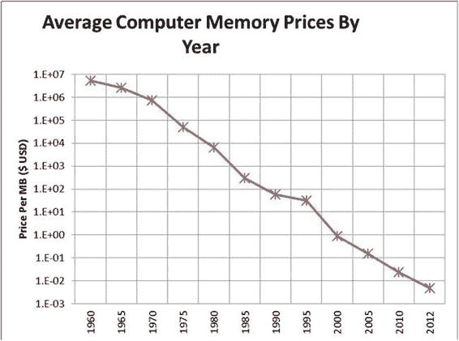

图 1-4. 自 1960 年以来的平均计算机内存价格

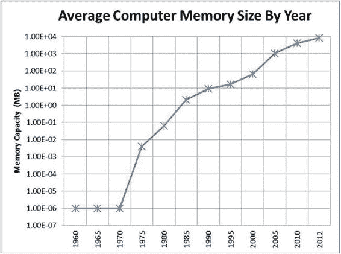

图 1-5. 自 1960 年以来的平均计算机内存大小

 **注意** 有关内存价格历史的更多信息，请访问 John C. McCallum 的网站：[`www.jcmit.com/mem2012.htm`](http://www.jcmit.com/mem2012.htm)。

**数据科学流程**

一个典型的数据科学项目遵循 图 1-6 中概述的五步流程。让我们详细回顾每个步骤。


1.  **定义业务问题**：这一步至关重要，因为它将指导项目的后续工作。在构建任何模型之前，必须与项目发起人合作，明确他/她试图解决的具体业务问题。否则，你可能会花费数周甚至数月的时间构建出精妙的模型，却解决了错误的问题，导致前功尽弃。一个优秀的数据科学项目能够提炼出深刻的见解，从而推动更明智的业务决策。因此，分析工作应当服务于某个业务目标，而不应成为“寻找钉子的锤子”！从业者会使用正式的咨询技术和框架（例如引导式发现研讨会和六西格玛方法论）来帮助业务利益相关者确定业务目标的优先级和范围。
2.  **获取并准备数据**：此步骤包含两项活动。首先是获取来自多个源系统（包括数据库、CRM 系统、Web 日志文件等）的原始数据。这可能涉及 ETL（提取、转换和加载）流程、数据库管理员以及商业智能人员。然而，数据科学家需要深度参与，以确保以正确的格式提取到正确的数据。处理原始数据还能提供下游所需的关键背景信息。其次，一旦提取到正确的数据，就需要对其进行分析并准备建模。这包括处理缺失数据、数据中的异常值以及数据转换。通常，如果一个变量的缺失值超过 40%，则可以舍弃该变量，除非其缺失（或不缺失）这一事实本身传达了关键信息。例如，在调查中，填写可选字段“年龄”的人群可能存在强烈的人口统计学偏差。对于其余情况，我们需要决定如何处理缺失值：是使用平均值、中位数还是其他值进行插补？有多种统计技术可用于检测异常值。在箱线图中，异常值是指大于或小于四分位距（IQR）1.5 倍的样本（值）。四分位距是第 75 百分位数减去第 25 百分位数。我们需要决定是否剔除异常值。如果保留它是有意义的，则需要为该变量找到一个有用的转换方法。例如，对数转换通常适用于转换收入数据。

相关性分析、主成分分析或因子分析是展示变量之间关系的有用技术。最后，在此阶段进行特征选择，以确定下一步在模型中使用的正确变量。

这一步可能既费力又耗时。事实上，在一个典型的数据科学项目中，我们花费高达 75% 到 80% 的时间在数据获取和准备上。尽管如此，这是将原始数据转化为用于建模的高质量“宝石”的关键步骤。那句老话依然正确：*垃圾进，垃圾出*。在数据准备上明智地投入，能提高项目的成功率。

3.  **开发模型**：这是项目中最有趣的部分，我们将在此开发预测模型。在此步骤中，我们根据业务问题和数据确定用于建模的正确算法。例如，如果是二元分类问题，我们可以使用逻辑回归、决策树、提升决策树或神经网络。如果最终模型需要具有可解释性，那么像提升决策树这样的算法就不适用。模型构建是一个迭代过程：我们尝试不同的模型以找到预测能力最强的那个。在退出此阶段之前，我们还会与客户进行几次验证，以确保模型满足他们的需求。
4.  **部署模型**：模型构建完成后，最终模型必须部署到生产环境中，用于对交易进行评分，或供客户使用以驱动实际的业务决策。根据客户环境的不同，模型的部署方式也多种多样。在大多数情况下，部署模型涉及重新实现数据科学家开发的数据转换和预测算法，以便与现有的决策管理平台集成。可以说，目前这是一个繁琐的过程。Azure 机器学习通过使数据科学家能够将其完成的模型部署为 Web 服务，从而极大地简化了模型部署，这些 Web 服务可以从任何平台（包括移动设备）上的任何应用程序进行调用。
5.  **监控模型性能**：数据科学并非在部署后就结束了。值得注意的是，每个统计或机器学习模型都只是对现实世界的一种近似，因此从一开始就存在不完美之处。当一个经过验证的模型经过测试并部署到生产环境后，必须对其进行监控，以确保其按预期运行。这一点至关重要，因为任何数据驱动的模型都有固定的“保质期”。模型的准确性会随着时间的推移而下降，因为从根本上说，生产环境中的数据会因多种原因随时间变化，例如，企业可能会推出新产品以针对不同的人群。例如，我们之前讨论的无线运营商可能会选择为青少年推出一个新的电话套餐。如果他们继续使用相同的流失和倾向模型，可能会在新产品推出后看到模型性能下降。这是因为用于构建流失和倾向模型的原始数据集并未包含大量的青少年客户。通过对生产环境中的模型进行密切监控，我们可以检测到其性能何时开始下降。当其准确性显著下降时，就该重建模型了：要么使用包含生产数据的最新数据集对其进行重新训练，要么使用额外的数据集完全重建。在这种情况下，我们将返回步骤 1，重新审视业务目标并从头开始。

我们应该多久重建一次模型？频率因业务领域而异。在数据变化不快的稳定业务环境中，模型可以每一两年重建一次。一个很好的例子是零售银行产品，如抵押贷款和汽车贷款。然而，在环境数据快速变化的动态环境中，模型可能需要每天或每周重建。一个典型的例子是竞争激烈的无线电话行业。由于客户不断被竞争对手更具吸引力的优惠所吸引，流失模型需要每隔几天就重新训练一次。

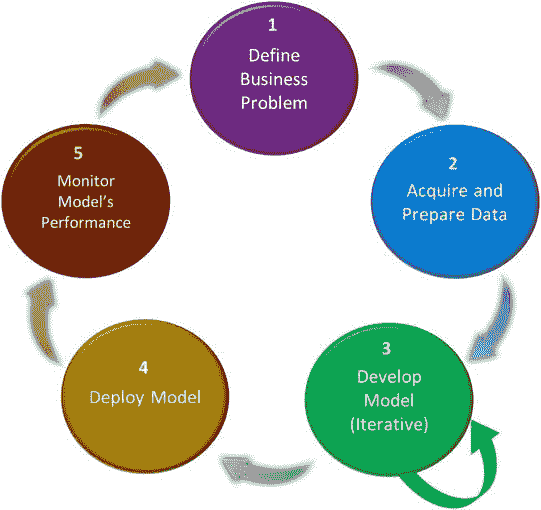

图 1-6. 数据科学流程概览

常见的数据科学技术

数据科学从其组成学科中提供了大量的算法，这些学科包括统计学、数学、运筹学、信号处理、语言学、数据库与存储、编程、机器学习以及科学计算。为简单起见，我们将这些算法分为以下几组：


*   分类
*   聚类
*   回归
*   模拟
*   内容分析
*   推荐系统

第 4 章提供了其中一些算法的更多细节。

分类算法

分类算法通常用于将人或事物划分到多个组别中的某一个。它们也广泛用于预测。例如，为了防止欺诈，发卡机构会将信用卡交易分类为欺诈性或非欺诈性。发卡机构通常拥有大量历史信用卡交易数据，并了解每笔交易的状态。其中许多案例是由合法的持卡人报告的，他们不想为未经授权的费用买单。因此，发卡机构知道每笔交易是否属于欺诈。利用这些历史数据，发卡机构现在可以构建一个模型，用于预测新的信用卡交易是否可能属于欺诈。这是一个二元分类问题，所有案例都归属于两个类别之一。

另一个分类问题是客户升级到高级电话套餐的倾向性。在这种情况下，无线运营商需要知道客户是否会升级到高级套餐。利用销售和使用数据，运营商可以确定哪些客户过去曾升级过。因此，他们可以将所有客户分为两组：升级或未升级。由于运营商还拥有新老客户的人口统计和行为数据，他们可以构建一个模型来预测新客户升级的可能性；换句话说，该模型会将每个客户归入两个类别之一。

统计学和数据挖掘提供了许多优秀的分类工具：包括逻辑回归（统计学家广泛用于构建信用评分卡或购买倾向模型）、或神经网络算法（如反向传播、径向基函数或岭多项式网络）。其他还包括决策树或集成模型，如提升决策树或随机森林。对于具有两个以上类别的更复杂的分类问题，可以使用预测多个类别的多模态技术。分类问题通常使用监督学习算法，这些算法使用带标签的数据进行训练。Azure 机器学习提供了多种分类算法，包括逻辑回归、决策树、提升决策树、多模态神经网络等。更多详情请参见第 4 章。

聚类算法

聚类使用无监督学习将数据分组到不同的类别中。聚类问题和分类问题的一个主要区别在于，聚类的结果事先是未知的。在聚类之前，我们不知道每个数据点属于哪个簇。相比之下，对于分类问题，我们有历史数据显示每个数据点属于哪个类别。例如，贷款机构从历史数据中知道客户是否拖欠了汽车贷款。

聚类的一个很好的应用是客户细分，我们将客户划分为不同的细分市场以进行营销。在一个好的细分模型中，每个细分市场内的数据非常相似。然而，不同细分市场之间的数据差异很大。例如，游戏行业的营销人员需要更好地了解其客户，以便为他们制定合适的优惠方案。假设他/她只有关于客户的两个变量，即年龄和游戏强度。通过聚类，营销人员发现游戏客户存在三个不同的细分市场，如图 1-7 所示。细分市场 1 是重度游戏玩家，他们每天热衷于玩电脑游戏，并且通常很年轻。细分市场 2 是休闲游戏玩家，他们只是偶尔玩游戏，通常在三四十岁。非游戏玩家很少玩电脑游戏，通常年龄较大；他们构成了细分市场 3。

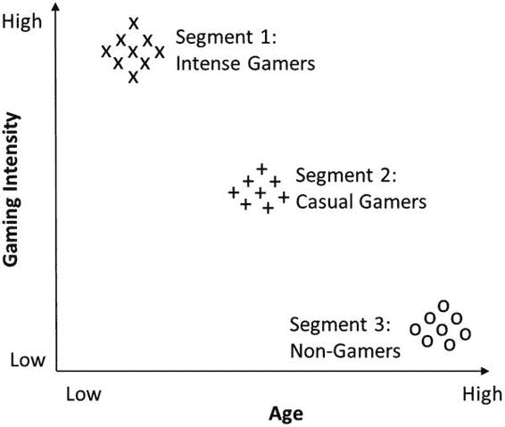

图 1-7。来自聚类算法的简单假设客户细分

统计学提供了几种聚类工具，但最广泛使用的是 k-means 算法，它使用距离度量将相似的数据聚类在一起。使用此算法，您可以预先决定想要多少个簇；这就是常数 K。如果您设置 K = 3，算法将生成三个簇。有关 k-means 算法的更多详细信息，请参考 Haralambos Marmanis 和 Dmitry Babenko 的著作。机器学习还提供了更复杂的算法，例如由 Teuvo Kohonen 开发的自组织映射（也称为 Kohonen 网络），或由 Stephen Grossberg 和 Gail Carpenter 开发的自适应共振理论（ART）网络。聚类算法通常使用无监督学习，因为在训练期间结果是未知的。

 **注意**  您可以在以下书籍和论文中阅读更多关于聚类算法的内容：

《智能网络算法》，Haralambos Marmanis 和 Dmitry Babenko 著。Manning Publications Co.，斯坦福德，康涅狄格州。2011 年 1 月。

《自组织映射。第三扩展版》。

Springer。Kohonen, T. 2001 年。“Art2-A：一种用于快速类别学习和识别的自适应共振算法”，Carpenter, G., Grossberg, S., 和 Rosen, D. 著。Neural Networks, 4:493-504。1991a。

回归算法

回归技术用于预测具有数值结果的响应变量。例如，无线运营商可以使用回归技术来预测其客服中心的呼叫量。有了这些信息，他们可以分配适当数量的客服中心人员以满足需求。回归模型的输入变量可以是数值型或分类型。然而，这些算法的共同点是输出（或响应变量）通常是数值型的。一些最常用的回归技术包括线性回归、决策树、神经网络和提升决策树回归。

线性回归是统计学中最古老的预测技术之一，其目标是根据一组观测变量预测给定的结果。一个简单的线性回归模型是一个线性函数。如果只有一个输入变量，线性回归模型就是最适合数据的直线。对于两个或更多输入变量，回归模型就是最适合底层数据的超平面。

人工神经网络是一组模仿大脑功能的算法。它们通过示例学习，并且即使映射响应变量与自变量之间的函数未知，也能被训练从数据集中进行预测。有许多不同的神经网络算法，包括反向传播网络和径向基函数（RBF）。然而，最常见的是反向传播，也称为多层感知器。神经网络用于回归或分类。

决策树算法是一种分层技术，它基于某些统计标准迭代地分割数据集。决策树的目标是最大化树中不同节点之间的方差，并最小化每个节点内部的方差。一些最常用的决策树算法包括迭代二分器 3（ID3）、C4.5 和 C5.0（ID3 的后继者）、自动交互检测（AID）、卡方自动交互检测（CHAID）以及分类与回归树（CART）。虽然非常有用，但 ID3、C4.5、C5.0 和 CHAID 算法是分类算法，不适用于回归。另一方面，CART 算法既可用于分类也可用于回归。

模拟


仿真技术广泛应用于众多行业，用于对现实世界中的流程进行建模和优化。工程师们长期以来一直使用有限元或有限体积等数学方法来模拟飞机机翼或汽车的空气动力学特性。仿真技术为工程公司节省了数百万美元的研发成本，因为他们不再需要完全依赖真实的物理模型进行测试。此外，通过简单地调整计算机模型中的变量，仿真技术还提供了测试更多场景的机会。

在商业领域，仿真技术被用于对呼叫中心等待时间优化、卡车运输公司或航空公司的路线优化等流程进行建模。通过仿真，业务分析师可以对大量假设进行建模，以优化利润或其他业务目标。

统计学为仿真和优化提供了许多强大的技术：马尔可夫链分析可用于模拟动态系统中的状态变化。例如，它可以用来模拟客户在呼叫中心中的流转情况：客户在挂断前会等待多久，或者他们在与交互式语音应答（IVR）系统交互后继续等待的可能性有多大？线性规划用于优化卡车运输或航空路线，而蒙特卡洛模拟则用于寻找在给定业务成果（如利润）下进行优化的最佳条件。

内容分析

内容分析用于挖掘文本文件、图像和视频等内容以获取洞察。文本挖掘利用统计和语言分析来理解文本的含义。对于大多数实际应用来说，简单的关键词搜索过于原始。例如，通过简单的关键词搜索来理解推特数据流的情感倾向是一个手动且费力的过程，因为你必须存储代表正面、中性和负面情感的关键词。然后，在扫描推特数据时，你需要根据检测到的特定关键词对每条推文进行评分。这种方法虽然在特定情况下有用，但既繁琐又相当原始。通过文本挖掘和自然语言处理（NLP），这个过程可以实现自动化，它能够挖掘文本并尝试根据上下文推断词语的含义，而不是依赖简单的关键词搜索。

机器学习还提供了多种通过模式识别来分析图像和视频的工具。通过模式识别，我们可以利用人脸识别算法识别已知目标。多层感知器和自适应共振理论（ART）网络等神经网络算法可用于在视频流中检测和跟踪已知目标，或辅助分析 X 光图像。

推荐引擎

推荐引擎已被亚马逊等在线零售商广泛使用，用于根据用户的偏好推荐产品。推荐引擎主要有三种方法。协同过滤（CF）基于用户或项目之间的相似性进行推荐。在基于项目的协同过滤中，我们分析项目数据以找出哪些项目是相似的。对于协同过滤，这些数据特指用户与电影之间的交互（例如评分或观看行为），而不是电影本身的特征（如类型、导演、演员）。因此，每当客户购买此集合中的一部电影时，我们就会根据相似性推荐其他电影。

第二类推荐引擎通过分析每个用户所选的内容来进行推荐。在这种情况下，会使用文本挖掘或自然语言处理技术来分析文档文件等内容。相似的内容类型被归为一组，这构成了向新用户进行推荐的基础。关于协同过滤和基于内容的方法的更多信息，请参阅 Haralambos Marmanis 和 Dmitry Babenko 的著作。

推荐引擎的第三种方法使用复杂的机器学习算法来确定产品关联性。这种方法也被称为购物篮分析。朴素贝叶斯或微软关联规则等算法被用于挖掘销售数据，以确定哪些产品会一起销售。

数据科学的前沿

让我们通过快速概述处于数据科学前沿的集成模型来结束本章。

集成模型的兴起

集成模型是机器学习中的一组分类器，它们使用一组算法而不是单一算法来解决分类问题。它们模仿了我们人类通过咨询知识渊博的朋友或专家来提高决策准确性的倾向。当面临诸如医疗诊断等重要决策时，我们倾向于寻求其他医生的第二意见来提高我们的信心。同样，集成模型使用一组算法作为专家小组，以提高分类问题的准确性并减少方差。

机器学习界对集成模型的研究已有数十年之久。事实上，早在 1979 年，Dasarathy 和 Sheela 就发表了开创性的论文。然而，自 20 世纪 90 年代中期以来，该领域取得了快速进展，多项重要贡献催生了非常成功的实际应用。

集成模型的实际应用

在过去几年中，集成模型已在许多伟大的实际应用中发挥作用，包括相机中的人脸识别、生物信息学、Netflix 电影推荐以及微软的 Xbox Kinect。让我们来看看其中的两个应用。

首先，集成模型对 Netflix 大奖赛的成功起到了至关重要的作用。2006 年，Netflix 举办了一场公开竞赛，悬赏 100 万美元，奖励能够将其现有解决方案改进 10%的最佳协同过滤算法。2009 年 9 月，这笔 100 万美元的奖金被授予了 BellKor's Pragmatic Chaos 团队，这是一个由 AT&T 实验室的科学家与两个不太知名的团队联合组成的团队。在竞赛开始时，大多数团队都使用单一分类器算法：虽然它们比 Netflix 的模型性能高出 6-8%，但性能很快陷入停滞，直到团队开始应用集成模型。领先的参赛者很快意识到，他们可以通过将自己的算法与看似较弱的团队的算法相结合来改进自己的模型。最终，包括获胜者在内的大多数顶级团队都使用集成模型显著超越了 Netflix 的推荐引擎。例如，亚军团队在他们的集成模型中使用了超过 900 个单独的模型。

微软的 Xbox Kinect 传感器也使用了集成建模。随机森林（一种集成模型形式）被有效地用于在用户使用 Xbox Kinect 传感器玩游戏时跟踪骨骼运动。

尽管在实际应用中取得了成功，但集成模型的一个关键局限性在于它们是黑盒模型，其决策难以解释。因此，它们不适用于需要解释决策的应用场景。信用评分卡就是一个很好的例子，因为贷款机构需要解释他们分配给每个消费者的信用评分。在某些市场，这种解释是法律要求，因此，尽管集成模型具有预测能力，但它们并不适用。

构建集成模型

构建集成模型有三个关键步骤：a) 选择数据，b) 训练分类器，以及 c) 组合分类器。

构建集成模型的第一步是为分类器模型选择数据。在采样数据时，一个关键目标是最大化模型的多样性，因为这可以提高解决方案的准确性。一般来说，你的模型越多样化，最终分类器的性能就越好，其预测的方差也就越小。


该过程的第二步需要训练多个独立的分类器。但如何分配这些分类器呢？在众多可用策略中，最流行的两种是装袋（bagging）和提升（boosting）。装袋算法使用数据的不同子集来训练每个模型。随机森林算法采用的就是这种装袋方法。相比之下，提升算法通过在训练过程中提高训练集中被错误分类样本的重要性来提升性能。因此，在训练过程中，每个新增的模型都会重点关注那些被错误分类的数据。提升决策树算法使用的就是这种提升策略。

最后，当所有分类器训练完成后，最终步骤是将它们的结果结合起来，做出最终预测。有多种方法可以整合这些结果，从简单的多数投票到加权多数投票。

集成模型是机器学习中一个非常令人兴奋的部分，在分类问题上具有取得突破性进展的潜力。

总结

本章介绍了数据科学，定义了它是什么、为什么重要以及为什么是现在。我们概述了数据科学的关键学科领域，包括统计学、数学、运筹学、信号处理、语言学、数据库与存储、编程以及机器学习。我们探讨了人们对数据科学兴趣日益浓厚的几个关键原因：数据量不断增长、数据成为竞争资产、数据挖掘意识的增强以及硬件成本的降低。

我们介绍了一个简单的五步数据科学流程，并提供了如何正确应用它的指南。我们还介绍了数据科学中一些最常用的技术和算法。最后，我们介绍了集成模型，这是数据科学前沿的关键技术之一。

参考文献

1.  Alexander Linden, 2014\. 高级分析中的关键趋势和新兴技术。Gartner BI 峰会 2014，美国拉斯维加斯。
2.  “你准备好迎接大数据时代了吗？”，麦肯锡全球研究院 - Brad Brown, Michael Chui, and James Manyika，2011 年 10 月。
3.  “21 世纪的信息管理”，Gartner - Regina Casonato, Anne Lapkin, Mark A. Beyer, Yvonne Genovese, Ted Friedman，2011 年 9 月。
4.  John C. McCallum: [`www.jcmit.com/mem2012.htm`](http://www.jcmit.com/mem2012.htm).
5.  “智能网络算法”，Haralambos Marmanis and Dmitry Babenko。Manning Publications Co., Stamford CT. 2011 年 1 月。
6.  “自组织映射。第三扩展版”。Springer. Kohonen, T. 2001.
7.  “Art2-A：一种用于快速类别学习和识别的自适应共振算法”，Carpenter, G., Grossberg, S., and Rosen, D. 神经网络，4:493–504\. 1991a.
8.  “使用 Microsoft SQL Server 2008 进行数据挖掘”，Jamie MacLennan, ZhaoHui Tang and Bogdan Crivat. Wiley Publishing Inc, Indianapolis, Indiana, 2009.

第 2 章


介绍 Microsoft Azure 机器学习

*Azure 机器学习，数据科学、预测分析、云计算和您的数据在此交汇！*

Azure 机器学习使数据科学家和开发人员能够利用预测分析将数据转化为洞察。通过让开发者更容易地在端到端解决方案中使用预测模型，Azure 机器学习使得可操作的洞察能够被轻松获取并投入实际应用。

使用机器学习工作室，数据科学家和开发者可以快速构建、测试和开发使用最先进机器学习算法的预测模型。

你好，机器学习工作室！

*Azure 机器学习工作室提供了一个交互式的* *可视化工作区*，使您能够轻松地构建、测试和部署预测分析模型。

在机器学习工作室中，您可以通过将数据集和分析模块拖放到设计图面上来构建预测模型。您可以使用 Azure 机器学习工作室中的实验迭代地构建预测分析模型。每个实验都是一个完整的工作流，包含构建、测试和评估预测模型所需的所有组件。在一个实验中，机器学习模块通过线条连接在一起，这些线条显示了数据和参数在工作流中的流动。一旦您设计好一个实验，就可以使用机器学习工作室来执行它。

机器学习工作室允许您通过在几分钟内构建和测试多个模型来快速迭代。在构建实验时，通常需要迭代预测模型的设计、编辑参数或模块，并多次运行实验。通常，您会保存实验的多个副本（使用不同的参数）。当您首次打开机器学习工作室时，您会注意到它的组织方式如下：

*   **实验**：已创建、运行并保存为草稿的实验。其中包括一组随服务提供的示例实验，以帮助您快速启动项目。
*   **Web 服务**：您已发布为 Web 服务的实验列表。在您发布第一个实验之前，此列表为空。
*   **设置**：可用于配置您的帐户和资源的一系列设置。您可以使用此选项邀请其他用户共享您在 Azure 机器学习中的工作区。

要开发一个预测模型，您需要能够处理来自不同数据源的数据。此外，数据在用作训练预测模型的输入之前，需要进行转换和分析。各种数据操作和统计函数用于预处理数据并识别数据中有用的部分。在开发模型时，您会经历一个迭代过程，使用各种技术来理解数据、数据中的关键特征以及用于调整机器学习算法的参数。您会持续迭代，直到获得一个经过训练且有效的模型，可以投入使用。

实验的组成部分

一个实验由构建、测试和评估预测模型所必需的关键组件组成。在 Azure 机器学习中，一个实验包含两个主要组件：数据集和模块。

数据集包含已上传到机器学习工作室的数据。在创建预测模型时会用到数据集。机器学习工作室还提供了几个示例数据集，以帮助您快速创建最初的几个实验。在探索机器学习工作室的过程中，您可以上传更多的数据集。

模块是您在构建预测模型时将使用的算法。机器学习工作室提供了大量的模块，以支持端到端的数据科学工作流，包括从不同数据源读取数据；预处理数据；到构建、训练、评分和验证预测模型。这些模块包括以下内容：


*   **转换为 ARFF**：将 .NET 序列化数据集转换为 ARFF 格式。
*   **转换为 CSV**：将 .NET 序列化数据集转换为 CSV 格式。
*   **读取器**：此模块用于从多个源读取数据，包括 Web、Azure SQL 数据库、Azure Blob 存储或 Hive 表。
*   **写入器**：此模块用于将数据写入 Azure SQL 数据库、Azure Blob 存储或 Hadoop 分布式文件系统 (HDFS)。
*   **移动平均筛选器**：为给定数据集创建移动平均值。
*   **联接**：此模块基于用户指定的键联接两个数据集。它对两个数据集执行内联接、左外联接、完全外联接和左半联接。
*   **拆分**：此模块将一个数据集拆分为两部分。它通常用于将数据集拆分为独立的训练数据集和测试数据集。
*   **基于筛选器的特征选择**：此模块用于查找建模中最重要的变量。它使用七种不同的技术（例如，斯皮尔曼相关系数、皮尔逊相关系数、互信息、卡方检验等）从原始数据中对最重要的变量进行排序。
*   **基础统计**：计算给定数据集的基础统计信息，例如平均值、标准差等。
*   **线性回归**：可用于使用线性回归算法创建预测模型。
*   **训练模型**：此模块使用给定的训练数据集训练选定的分类或回归算法。
*   **扫描参数**：对于给定的学习算法以及训练和验证数据集，此模块会查找能产生最佳训练模型的参数。
*   **评估模型**：此模块用于评估已训练的分类或回归模型的性能。
*   **交叉验证模型**：此模块用于执行交叉验证以避免过拟合。默认情况下，此模块使用 10 折交叉验证。
*   **为模型评分**：为已训练的分类或回归模型评分。

所有可用的模块都组织在图 2-1 所示的菜单下。每个模块都提供一组参数，您可以使用这些参数来微调该模块所用算法的行为。当选中一个模块时，您将在画布的右侧窗格中看到该模块的参数。

创建实验的五个简单步骤

在本节中，您将学习如何使用 Azure Machine Learning Studio 开发一个简单的预测分析模型。要设计一个实验，您需要组装一组用于创建、训练、测试和评估模型的组件。此外，您还可以利用其他模块来预处理数据、执行特征选择和/或降维、将数据拆分为训练集和测试集，以及评估或交叉验证模型。以下五个基本步骤可作为创建实验的指南。

***创建模型***

*   步骤 1：获取数据
*   步骤 2：预处理数据
*   步骤 3：定义特征

***训练模型***

*   步骤 4：选择并应用学习算法

***测试模型***

*   步骤 5：对新数据进行预测

步骤 1：获取数据

Azure Machine Learning Studio 提供了许多示例数据集。此外，您还可以从许多不同的源导入数据。在此示例中，您将使用名为**汽车价格数据（原始）**的包含示例数据集，该数据集代表汽车价格数据。

1.  要开始一个新实验，请单击 Machine Learning Studio 窗口底部的 **+新建**，然后选择**实验**。
2.  将实验重命名为“第 02 章 – Hello ML”。
3.  在 Machine Learning Studio 的左侧，您将看到实验项目列表（参见图 2-1）。单击**已保存的数据集**，然后在搜索框中键入“automobile”。找到**汽车价格数据（原始）**。

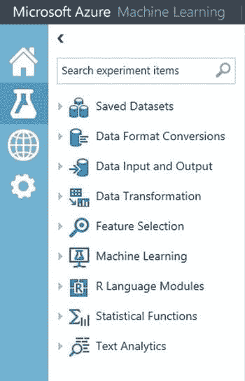

图 2-1。调色板搜索

4.  将数据集拖入实验。您也可以双击数据集以将其包含在实验中（参见图 2-2）。

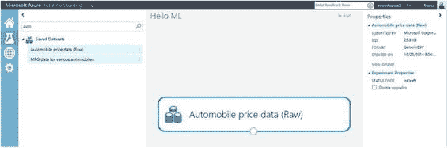

图 2-2。使用数据集

通过单击数据集的输出端口，您可以选择**可视化**，这将允许您探索数据并了解每个列的关键统计信息（参见图 2-3）。

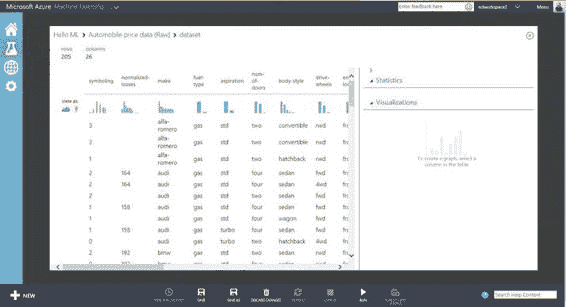

图 2-3。数据集可视化

通过单击右上角的 **x** 关闭可视化窗口。

步骤 2：预处理数据

在开始设计实验之前，预处理数据集非常重要。在大多数情况下，原始数据需要经过预处理才能用作训练预测分析模型的输入。

从之前的探索中，您可能已经注意到数据中存在缺失值。作为分析数据的先决条件，需要清理这些缺失值。对于此实验，您将用指定的值替换缺失值。此外，将删除 normalized-losses 列，因为该列包含太多缺失值。

 **提示**  清理输入数据中的缺失值是使用大多数模块的先决条件。

1.  要删除 normalized-losses 列，请拖动**投影列**模块，并将其连接到**汽车价格数据（原始）**数据集的输出端口。此模块允许您选择要在模型中包含或排除哪些数据列。
2.  选择**投影列**模块，然后在属性窗格（即右侧窗格）中单击**启动列选择器**。

1.  确保在名为**起始于**的筛选器下拉菜单中选择了**所有列**。这将指示投影列传递所有列（除了您即将排除的列）。
    2.  在下一行中，选择**排除**和**列名**，然后在文本框内单击。将显示一个列列表；选择“normalized-losses”，它将被添加到文本框中。如图 2-4 所示。
    3.  单击复选标记确定按钮关闭列选择器。

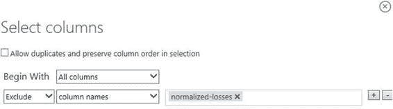

图 2-4。选择列

除 normalized-losses 列外，所有列都将通过。您可以在**投影列**的属性窗格中看到这一点。如图 2-5 所示。

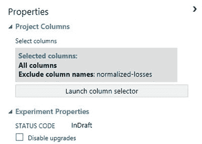

图 2-5。投影列属性

 **提示**  在设计实验时，您可以通过双击模块并输入文本来向模块添加注释。这使其他人能够理解实验中每个模块的用途，并可以帮助您记录实验设计。

3.  将**缺失值清理器**模块拖到实验画布上，并将其连接到**投影列**模块。您将使用默认属性，该属性将缺失值替换为 0。详细信息请参见图 2-6。

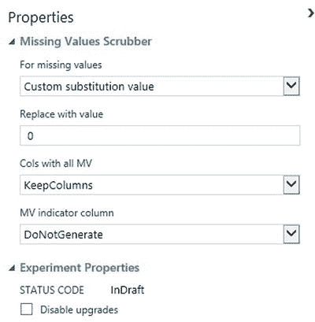

图 2-6。缺失值清理器属性

4.  现在单击**运行**。
5.  当实验成功完成时，每个模块都会有一个绿色的复选标记，表示其成功完成（参见图 2-7）。

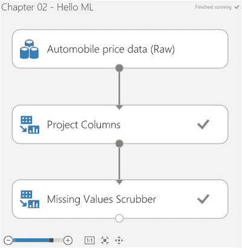

图 2-7。首次实验运行

此时，您已经通过清理和转换数据预处理了数据集。要查看清理后的数据集，请双击**缺失值清理器**模块的输出端口，然后选择**可视化**。请注意，normalized-losses 列不再包含在内，并且没有缺失值。

步骤 3：定义特征


在机器学习中，特征是依据原始数据创建的独立可测量属性，用于帮助算法学习当前任务。理解每个特征所扮演的角色至关重要。例如，某些特征比其他特征更能预测目标变量。此外，有些特征可能与其他特征存在强相关性（例如城市油耗与高速公路油耗）。将高度相关的特征作为输入可能并无益处，因为它们包含相似的信息。

在本练习中，你将构建一个预测模型，使用**汽车价格数据（原始）**数据集中的部分特征来预测新汽车的价格。每一行代表一辆汽车，每一列是该汽车的一个特征。识别出一组可用于构建预测模型的优质特征非常重要。这通常需要实验和对问题领域的了解。出于演示目的，你将使用**项目列**模块选择以下特征：制造商、车身样式、轴距、发动机尺寸、马力、最高转速、高速公路油耗和价格。

1.  将**项目列**模块拖到实验画布上。将其连接到**缺失值清理器**模块。
2.  在属性窗格中，单击**启动列选择器**。
3.  在列选择器中，将**起始于**设置为**无列**，然后在筛选行中选择**包含**和**列名**。输入以下列名：制造商、车身样式、轴距、发动机尺寸、马力、最高转速、高速公路油耗和价格。这将指示模块仅传递这些列。
4.  单击**确定**。

 **提示**  在构建实验时，你将运行它。通过运行实验，你可以启用**缺失值清理器**模块中使用的数据列定义。

当你将**项目列**连接到**缺失值清理器**时，**项目列**模块会识别数据中的列定义。当你单击列名框时，会显示一个列列表，然后你可以一次选择一列，将其添加到列表中。

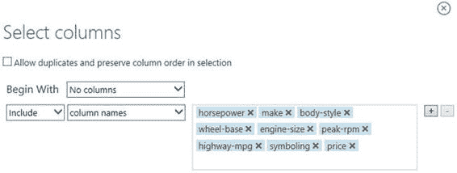

图 2-8. 选择列

图 2-8 显示了**项目列**模块中选定的列列表。当你训练预测模型时，需要提供目标变量。这是模型将要预测的特征。在本练习中，你将根据汽车的几个关键特征（例如马力、制造商等）来预测汽车价格。

步骤 4：选择并应用机器学习算法

构建预测模型时，首先需要训练模型，然后验证模型是否有效。在本实验中，你将构建一个回归模型。

 **提示**  分类和回归是两种常见的预测模型类型。在分类中，目标是预测给定数据行是否属于某个类别（例如，客户是否会流失？这笔信用卡交易是否欺诈？）。在回归中，目标是预测一个连续结果（例如，汽车价格或明天的温度）。

在本实验中，你将训练一个回归模型，并用它来预测汽车价格。具体来说，你将训练一个简单的*线性回归*模型。模型训练完成后，你将使用机器学习工作室中提供的一些模块来验证模型。

1.  **将数据拆分为训练集和测试集**：选择**拆分**模块并将其拖到实验画布上，然后将其连接到上一个**项目列**模块的输出。将**第一个输出数据集中的行比例**设置为 0.8。这样，你将使用 80% 的数据来训练模型，并保留 20% 用于测试。

 **提示**  通过更改随机种子参数，你可以生成不同的随机样本用于训练和测试。该参数控制**拆分**模块中伪随机数生成器的种子设定。

2.  运行实验。这允许**项目列**和**拆分**模块将列定义传递给你接下来要添加的模块。
3.  要选择学习算法，请展开画布左侧模块面板中的**机器学习**类别，然后展开**初始化模型**。这将显示几个可用于初始化学习算法的模块类别。
4.  对于本示例实验，请在**回归**类别下选择**线性回归**模块，并将其拖到实验画布上。
5.  找到**训练模型**模块并将其拖到实验中。单击**启动列选择器**，然后选择价格列。这是你的模型将要预测的特征。图 2-9 显示了此目标选择。

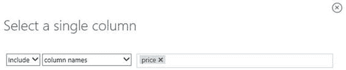

图 2-9. 选择价格列

6.  将**线性回归**模块的输出连接到**训练模型**模块的左侧输入端口。
7.  同时，将**拆分**模块的训练数据输出（即左侧端口）连接到**训练模型**模块的右侧输入端口。
8.  运行实验。

结果是一个经过训练的回归模型，可用于对新样本进行评分以做出预测。图 2-10 显示了截至步骤 7 的实验。

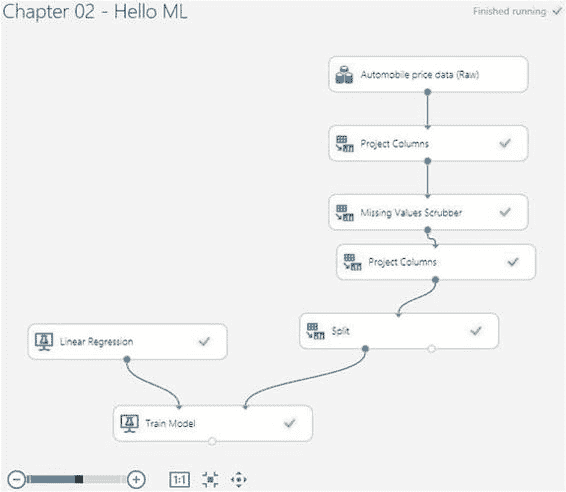

图 2-10. 应用学习算法

步骤 5：对新数据进行预测

现在你已经训练好了模型，可以使用它对另外 20% 的数据进行评分，看看模型在未见数据上的预测效果如何。

1.  找到**评分模型**模块并将其拖到实验画布上，然后将左侧输入端口连接到**训练模型**模块的输出，将右侧输入端口连接到**拆分**模块的测试数据输出（右侧端口）。详情请参见图 2-11。

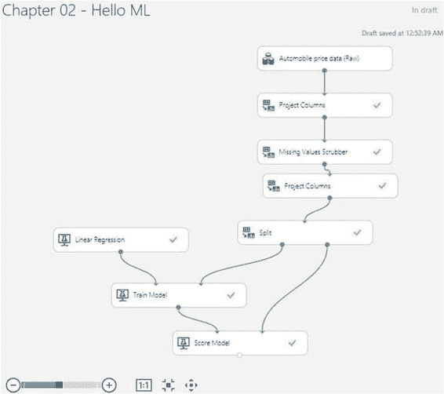

图 2-11. 评分模型模块

2.  运行实验并查看**评分模型**模块的输出（双击输出端口并选择**可视化**）。输出将显示价格的预测值以及测试数据中的已知值。
3.  最后，要测试结果的质量，请选择**评估模型**模块并将其拖到实验画布上，然后将左侧输入端口连接到**评分模型**模块的输出（有两个输入端口，因为**评估模型**模块可用于比较两个不同的模型）。
4.  运行实验并查看**评估模型**模块的输出（双击输出端口并选择**可视化**）。你的模型将显示以下统计信息：
    1.  **平均绝对误差** (MAE)：绝对误差的平均值（*误差*是预测值与实际值之间的差值）。
    2.  **均方根误差** (RMSE)：平方误差平均值的平方根。
    3.  **相对绝对误差**：绝对误差相对于实际值与所有实际值平均值之间绝对差值的平均值。
    4.  **相对平方误差**：平方误差相对于实际值与所有实际值平均值之间平方差值的平均值。
    5.  **决定系数**：也称为 R 平方值，这是一个统计指标，表示模型对数据的拟合程度。


对于每个误差统计量，数值越小越好；较小的值表示预测值与实际值更接近。对于**决定系数**，其值越接近 1（1.0），预测效果越好（参见图 2-12）。如果值为 1.0，意味着模型解释了数据中 100%的变异性，这相当不切实际！

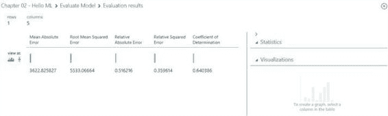

图 2-12。评估结果

最终的实验应类似于图 2-13 中的截图。

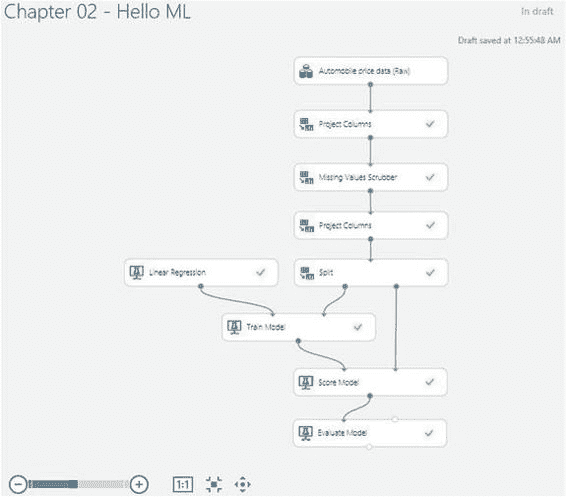

图 2-13。回归模型实验

恭喜！你已在机器学习工作室中创建了第一个机器学习实验。在第 5 章至第 8 章中，你将了解如何应用这五个步骤来创建预测分析解决方案，以应对来自不同领域的业务挑战，例如买家倾向性、流失分析、客户细分和预测性维护。此外，第 3 章展示了如何在 Azure 机器学习实验中使用 R 脚本。

在生产环境中部署模型

目前，将机器学习模型部署到生产环境所需时间过长。该过程通常效率低下，且往往需要重写模型以在目标生产平台上运行，这成本高昂且需要大量时间和精力。Azure 机器学习通过云中的集成流程简化了机器学习模型的部署。你可以在几分钟内（而非数天或数周）部署新的预测模型。部署后，你的模型将作为 Web 服务运行，可从不同平台（包括服务器、笔记本电脑、平板电脑甚至智能手机）进行调用。要将模型部署到生产环境，请遵循以下两个步骤。

1.  在 Azure 机器学习工作室中将模型部署到过渡环境。
2.  在 Azure 管理门户中，将模型从过渡环境移至生产环境。

将模型部署到过渡环境

要将模型部署到过渡环境，请在 Azure 机器学习工作室中执行以下步骤。

1.  使用 Azure 机器学习工作室底部的**另存为**按钮保存你训练好的模型。将其重命名为你选择的新名称。
    1.  **运行**实验。
    2.  右键单击训练模块（例如**训练模型**）的输出，然后选择**另存为已训练模型**选项。
    3.  删除用于训练的任何模块（例如**拆分、训练模型、评估模型**）。
    4.  将新保存的模型直接连接到**评分模型**模块。
    5.  重新运行实验。
2.  在步骤 1c 中删除之前，你的实验应如图图 2-14 所示。

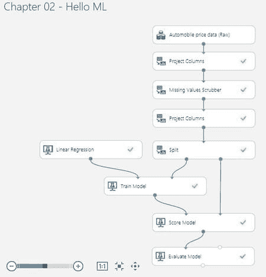

图 2-14。删除训练模块之前的预测模型

删除训练模块（即**拆分、线性回归、训练模型**和**评估模型**）并用保存的训练模型替换后，实验现在应如图图 2-15 所示。

 **提示** 你可能想知道为什么将**汽车价格数据（原始）**数据集保留连接到模型。服务将使用用户的数据，而不是原始数据集，那么为什么还要保留连接呢？

确实，服务不需要原始的汽车价格数据。但它确实需要该数据的架构，其中包括列数以及哪些列是数值列等信息。需要此架构信息才能解释用户的数据。你保留这些组件的连接，以便在服务运行时评分模块能够拥有数据集架构。数据不会被使用，仅使用架构。

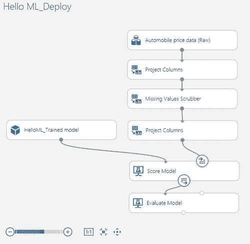

图 2-15。使用保存的训练模型的实验

3.  接下来，设置发布输入和输出。为此，请执行以下步骤。

1.  右键单击名为**评分模型**的模块的右侧输入。选择**设置为发布输入**选项。
    2.  右键单击**评分模型**模块的输出，然后选择**设置为发布输出**。

完成这两个步骤后，你将看到两个圆圈突出显示**评分模型**模块上选定的发布输入和输出。如图图 2-15 所示。

4.  分配发布输入和输出后，运行实验，然后通过单击屏幕底部的**发布 Web 服务**将其发布到过渡环境。

 **提示** 发布 Web 服务后，你可以对其进行更新。例如，如果你想更改模型，只需编辑之前保存的训练实验，调整模型参数，然后保存训练后的模型（覆盖之前保存的模型）。当你再次打开评分实验时，会看到一条通知，告知你某些内容已更改（即你的训练模型），并且你可以更新实验。当你再次发布实验时，它将替换 Web 服务，现在使用你更新后的模型。

你可以通过单击**配置**选项卡来配置服务。在此处，你可以修改服务名称（默认使用实验名称）并为其添加描述。你还可以为输入和输出列提供更友好的标签。

测试 Web 服务

在**仪表板**页面上，单击**过渡服务**下的**测试**链接。将弹出一个对话框，要求你输入服务的输入数据。这些列与原始**汽车价格数据（原始）**数据集中出现的列相同。输入一组数据，然后单击**确定**。

Web 服务生成的结果显示在仪表板底部。根据你配置服务的方式，你看到的结果由评分模块生成。

将模型从过渡环境移至生产环境

此时，你的模型已处于过渡环境，但尚未在生产环境中运行。要将其发布到生产环境，你需要通过以下步骤将其从过渡环境移至生产环境。

1.  在 Azure 机器学习工作室中配置新的 Web 服务，并使其准备好投入生产，如下所示。
    1.  在 Azure 机器学习工作室中，单击右侧窗格中名为**Web 服务**的菜单。它将显示所有 Web 服务的列表。
    2.  单击你刚刚创建的新服务的名称。你可以通过单击**测试**URL 来测试它。
    3.  现在单击配置选项卡，然后为**准备好投入生产？**选项选择**是**。然后点击屏幕底部的**保存**按钮。现在你的模型已准备好发布到生产环境。
2.  现在切换到 Azure 管理门户，并将你的 Web 服务发布到生产环境，如下所示。
    1.  在 Azure 管理门户的左侧窗格中选择**机器学习**。
    2.  选择包含要部署到生产环境的实验的工作区。
    3.  单击工作区的名称，然后单击名为**Web 服务**的选项卡。
    4.  选择 Azure 管理门户窗口底部的**+添加**按钮。

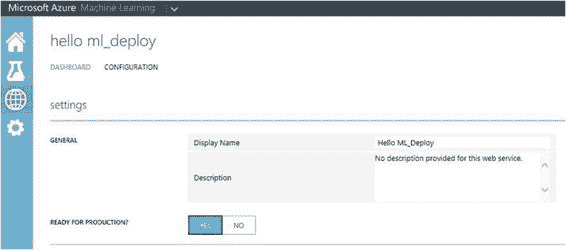

图 2-16\. 一个对话框，用于将机器学习模型从过渡服务器提升为实时生产 Web 服务


恭喜！您刚刚将第一个机器学习模型部署到了生产环境。如果从“Web 服务”选项卡点击您的模型，您将看到详细信息，例如模型在七天内做出的预测次数。该服务还会显示您可用于以请求/响应或批处理执行模式将模型作为 Web 服务调用的 API。不仅如此，您还会获得可用于在 C#、Python 或 R 中调用新 Web 服务的示例代码。您可以使用此示例代码，从浏览器中的 Web 表单或您选择的任何其他应用程序，将模型作为 Web 服务进行调用。

访问 Azure 机器学习 Web 服务

要作为 Web 服务发挥作用，用户需要能够向服务发送数据并接收结果。该 Web 服务是一个 Azure Web 服务，可以通过以下两种方式之一接收和返回数据：

*   **请求/响应**：用户可以使用 HTTP 协议向服务发送一组汽车价格数据，服务会响应一个预测价格的单一结果。
*   **批处理执行**：用户可以向服务发送一个 Azure BLOB 的 URL，该 BLOB 包含一行或多行汽车价格数据。服务将结果存储在另一个 BLOB 中，并返回该容器的 URL。

在 Web 服务的**仪表板**选项卡上，有指向信息的链接，这些信息将帮助开发人员编写代码来访问此服务。单击“请求/响应”行上的 API 帮助页面链接，将打开一个页面，其中包含使用服务请求/响应协议的示例代码。同样，“批处理执行”行上的链接提供了向服务发出批处理请求的示例代码。

API 帮助页面包含 R、C# 和 Python 编程语言的示例。例如，清单 2-1 显示了可用于访问您发布的 Web 服务的 R 代码（实际的服务 URL 将显示在您的示例代码中）。

***清单 2-1***。用于以编程方式访问服务的 R 代码

```
library("RCurl")
library("RJSONIO")

# 接受由公共证书颁发机构颁发的 SSL 证书
options(RCurlOptions = list(sslVersion=3L, cainfo = system.file("CurlSSL", "cacert.pem", package = "RCurl")))

h = basicTextGatherer()
req = list(Id="score00001",
 Instance=list(FeatureVector=list(
    "symboling"= "0",
    "make"= "0",
    "body-style"= "0",
    "wheel-base"= "0",
    "engine-size"= "0",
    "horsepower"= "0",
    "peak-rpm"= "0",
    "highway-mpg"= "0",
    "price"= "0"
 ),GlobalParameters=fromJSON('{}')))

body = toJSON(req)
api_key = "abc123" # 将此替换为 Web 服务的 API 密钥
authz_hdr = paste('Bearer', api_key, sep=' ')

h$reset()
curlPerform(url = "https://ussouthcentral.services.azureml.net/workspaces/fcaf778fe92f4fefb2f104acf9980a6c/services/ca2aea46a205473aabca2670c5607518/score",
            httpheader=c('Content-Type' = "application/json", 'Authorization' = authz_hdr),
            postfields=body,
            writefunction = h$update,
            verbose = TRUE
            )

result = h$value()
print(result)
```

总结

在本章中，您学习了如何使用 Azure 机器学习工作室创建您的第一个实验。您了解了如何执行数据预处理，以及如何在 Azure 机器学习工作室中训练、测试和评估您的模型。此外，您还了解了如何将新模型部署到生产环境。部署后，您的机器学习模型将作为 Azure 上的 Web 服务运行，可以从 Web 表单或任何其他应用程序（服务器、笔记本电脑、平板电脑或智能手机）进行调用。在本书的其余部分，您将学习如何使用 Azure 机器学习创建实验，以解决各种业务问题，例如客户倾向、客户流失和预测性维护。此外，您还将学习如何使用 R 脚本扩展 Azure 机器学习。同时，第 4 章 介绍了 Azure 机器学习中最常用的统计和机器学习算法。

第 3 章


与 R 的集成

本章将介绍 R，并展示它如何与 Microsoft Azure 机器学习集成。通过简单的示例，您将学习在使用 Azure 机器学习时如何编写和运行自己的 R 代码。您还将了解 Azure 机器学习支持的 R 包，以及如何在 Azure 机器学习工作室（ML Studio）中使用它们。

R 简介

R 是一种开源统计编程语言，计算统计和数据科学社区通常使用它来解决广泛的业务问题。这些问题涵盖以下领域：

*   生物信息学（例如基因组分析）
*   精算科学（例如计算保险、金融和其他行业的风险敞口）
*   电信（分析企业和消费者客户群中的流失、欺诈性 SIM 卡使用或移动使用模式）
*   金融和银行业（例如识别金融交易中的欺诈）、制造业（例如预测硬件组件故障时间）等等。

使用 R 时，用户会因其 R 包工具箱而感到强大，该工具箱提供了用于数据分析、可视化和建模的强大功能。截至 2014 年，综合 R 档案网络（CRAN）提供了超过 5000 个 R 包的大型集合。除了 CRAN，Github（https://github.com/trending?l=r）上还有许多其他 R 包，以及 Bioconductor R 存储库（[www.bioconductor.org/](http://www.bioconductor.org/)）中用于生物信息学的专用 R 包。

 **注意** R 由奥克兰大学的 Joss Ihaka 和 Robert Gentleman 于 1994 年创建。自 R 创建以来，许多顶尖的计算机科学家和统计学家通过为 R 代码库做出贡献或提供 R 包，使 R 用户能够利用最新的统计分析、可视化和数据挖掘技术，从而推动了 R 的成功。这促使 R 成为数据科学家的语言之一。在 [www.r-project.org/](http://www.r-project.org/) 上了解更多关于 R 的信息。

鉴于数据科学社区在使用 R 解决机器学习问题方面的势头，对于一个基于云的机器学习平台来说，让数据科学家能够继续使用他们熟悉的 R 脚本并保持高效至关重要。目前，Azure 机器学习支持超过 400 个 R 包。表 3-1 显示了当前支持的 R 包的一个子集。这些 R 包使您能够对广泛的机器学习问题进行建模，从购物篮分析、分类、回归、预测到可视化。

表 3-1。Azure 机器学习支持的 R 包


| R 包 | 描述 |
| --- | --- |
| **Arules** | 频繁项集与关联规则挖掘 |
| **FactoMineR** | 数据探索 |
| **Forecast** | 单变量时间序列预测（指数平滑与自动 ARIMA） |
| **ggplot2** | 图形绘制 |
| **Glmnet** | 线性回归、逻辑回归与多项回归模型、泊松回归及 Cox 模型 |
| **Party** | 决策树工具 |
| **randomForest** | 基于树状森林的分类与回归模型 |
| **Rsonlp** | 使用增广拉格朗日乘子法进行通用非线性优化 |
| **Xts** | 时间序列 |
| **Zoo** | 时间序列 |

 **提示**  要获取已安装包的完整列表，请在云机器学习中创建一个新实验，使用**执行 R 脚本**模块，在**执行 R 脚本**模块的主体中提供以下脚本，并运行实验。实验完成后

```
out <- data.frame(installed.packages())maml.mapOutputPort("out")
```

，右键单击模块的左侧输出端口并选择**可视化**。云机器学习中已安装的包将被列出。

Azure 机器学习提供了 R 语言模块，使您能够将 R 集成到机器学习实验中。目前，可在 Azure 机器学习工作室（ML Studio）中使用的 R 语言模块是**执行 R 脚本**模块。

**执行 R 脚本**模块允许您指定输入数据集（最多两个数据集）、一个 R 脚本以及一个包含一组 R 脚本的 Zip 文件（可选）。模块处理数据后，会生成一个结果数据集和一个 R 设备输出。在 Azure 机器学习中，R 脚本使用 R 4.1.0 执行。

 **注意**  R 设备输出显示 R 脚本执行期间生成的控制台输出和图形。例如，在 R 脚本中，您可能使用了 R 的 plot() 函数。当您右键单击 R 设备输出并选择**可视化**时，可以查看 plot() 的输出。

ML Studio 使您能够监控和排查实验的进度。执行完成后，您可以查看 R 模块每次运行的输出日志。如果执行失败，输出日志还将帮助您排查问题。

在本章中，您将学习如何将 R 与 Azure 机器学习集成。通过使用 ML Studio 中提供的简单示例和数据集，您将掌握基本技能，以释放 R 的强大功能，使用 Azure 机器学习创建令人兴奋且有用的实验。让我们开始吧！

构建和部署您的第一个 R 脚本

要构建和部署您的第一个 R 脚本模块，首先需要创建一个新实验。创建实验后，您将看到 Azure 机器学习工作室（ML Studio）中提供的**执行 R 脚本**模块。该脚本将由 Azure 机器学习使用 R 3.1.0（本书撰写时云机器学习上安装的版本）执行。图 3-1 显示了 R 语言模块。

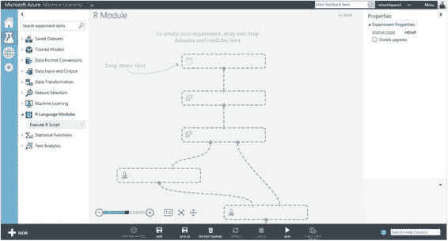

图 3-1. ML Studio 中的 R 语言模块

在本节中，您将学习如何使用执行 R 脚本对数据集执行采样。请按照以下步骤操作。

1.  从工具箱中，展开**已保存数据集**节点，单击**成人普查收入二元分类**数据集。将其拖放到实验设计区域。
2.  从工具箱中，展开**R 语言模块**节点，单击**执行 R 脚本**模块。将其拖放到实验设计区域。
3.  将数据集连接到**执行 R 脚本**模块。图 3-2 显示了实验设计。

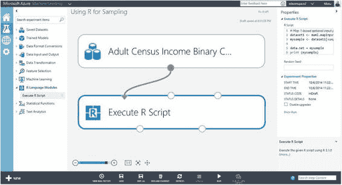

图 3-2. 使用执行 R 脚本对成人普查收入二元分类数据集执行采样

**执行 R 脚本**模块为 R 脚本可使用的数据集提供了两个输入端口。此外，它还允许您指定一个包含模块使用的 R 源脚本文件的 Zip 文件。您可以在本地机器上编辑并测试 R 源脚本文件。然后，将所需文件压缩成 Zip 文件，并通过“新建 > 数据集 > 来自本地文件”路径上传到 Azure 机器学习。**执行 R 脚本**模块处理数据后，该模块提供两个输出端口：结果数据集和 R 设备。结果数据集对应于 R 脚本的输出，可以传递给下一个模块。R 设备输出端口为您提供了一种简便的方式来查看 R 解释器生成的控制台输出和图形。

让我们继续使用 ML Studio 创建您的第一个 R 脚本。

4.  单击**执行 R 脚本**模块。
5.  在属性窗格中，编写以下 R 脚本以执行采样：

```
    # 将基于 1 的可选输入端口映射到变量
    dataset1 <- maml.mapInputPort(1) # 类别: data.frame
    mysample <- dataset1[sample(1:nrow(dataset1), 50, replace=FALSE),]

data.set = mysample
    print (mysample)

# 选择要发送到输出数据集端口的数据框
    maml.mapOutputPort("data.set");

用于执行采样的 R 脚本
    ```

要使用**执行 R 脚本**模块，通常采用以下模式：

*   将输入端口映射到 R 变量或数据框。
*   R 脚本的主体部分。
*   将结果映射到输出端口（参见图 3-3）。

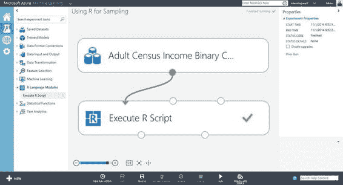

图 3-3. 采样实验成功执行

要查看此模式的实际应用，请注意在提供的 R 脚本中，使用了 maml.mapInputPort(1) 方法将从模块第一个输入端口传入的数据集映射到 R 数据框。接下来，查看用于对数据执行采样的 R 脚本。出于调试目的，我们还打印了采样的结果。在 R 脚本的最后一步，将结果分配给 data.set，并使用 maml.mapOutputPort("data.set") 映射到输出端口。

现在您可以运行实验了。为此，请单击 ML Studio 底部窗格的“运行”图标。图 3-3 显示实验已成功完成执行。

实验运行完成后，您可以查看 R 脚本的输出。为此，请右键单击**执行 R 脚本**模块的**结果数据集**。图 3-4 显示了右键单击**执行 R 脚本**模块的**结果数据集**时可用的选项。选择**可视化**。

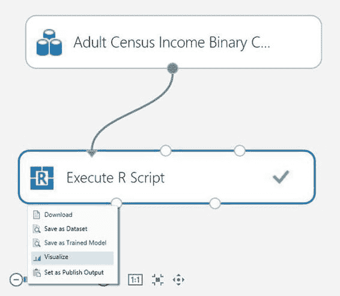

图 3-4. 可视化 R 脚本的输出

单击**可视化**后，您将看到样本包含 50 行。每行有 15 列以及数据的数据分布。图 3-5 显示了结果数据集的可视化。

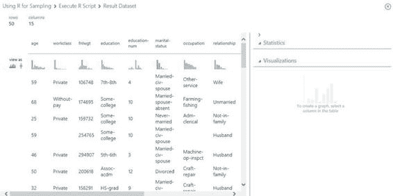

图 3-5. R 脚本生成的结果数据集的可视化

恭喜，您已成功完成了在 Azure 机器学习中集成第一个简单 R 脚本！在下一节中，您将学习如何使用 Azure 机器学习和 R 创建机器学习模型。

 **注意**  了解更多关于 R 和机器学习的信息，请访问 [`ocw.mit.edu/courses/sloan-school-of-management/15-097-prediction-machine-learning-and-statistics-spring-2012/lecture-notes/MIT15_097S12_lec02.pdf`](http://ocw.mit.edu/courses/sloan-school-of-management/15-097-prediction-machine-learning-and-statistics-spring-2012/lecture-notes/MIT15_097S12_lec02.pdf)。


使用 R 进行数据预处理

在许多机器学习任务中，降维是一个重要步骤，用于减少机器学习算法的特征数量。主成分分析（PCA）是一种常用的降维技术。PCA 通过寻找一组新的变量（主成分）来降低数据集的维度，这些变量是原始数据集的线性组合，并且与所有其他变量不相关。在本节中，您将学习如何使用 R 进行数据预处理并降低数据集的维度。

让我们开始使用 **执行 R 脚本** 模块对 ML Studio 中提供的示例数据集之一进行主成分分析。请按照以下步骤操作。

1.  创建一个新实验。
2.  从“已保存的数据集”中，选择 **CRM 数据集共享**（参见图 3-6）。

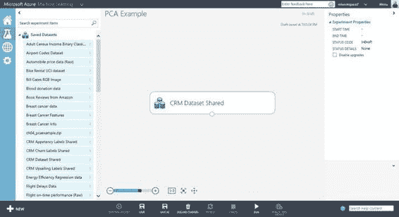

图 3-6。使用示例数据集 CRM 数据集共享

3.  右键单击输出节点，然后选择 **可视化**。从图 3-7 所示的可视化中，您将看到有 230 列。

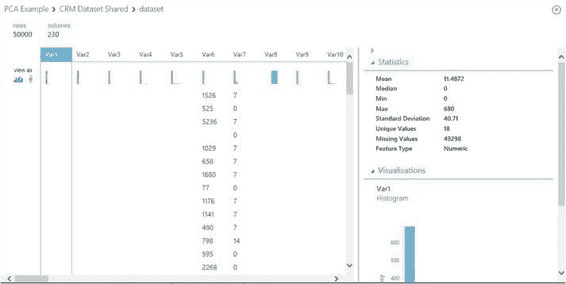

图 3-7。CRM 共享数据集中的初始 230 列

4.  在执行 PCA 之前，您需要确保 **执行 R 脚本** 模块的输入是数值型的。对于 CRM 数据集共享的示例数据集，您知道前 190 列是数值型的，其余 40 列是分类型的。您首先使用 **投影列**，并将 **选定列 |** 列索引设置为 1-190。
5.  接下来，使用 **缺失值清理器** 模块将缺失值替换为 0，如下所示：
    1.  对于缺失值：自定义替换值
    2.  替换为值：0
    3.  全部缺失的列：保留列
    4.  缺失值指示列：不生成
6.  清理完缺失值后，使用 **元数据编辑器** 模块将所有列的数据类型更改为整数。
7.  接下来，将 **执行 R 脚本** 模块拖放到设计界面并连接模块，如图 3-8 所示。

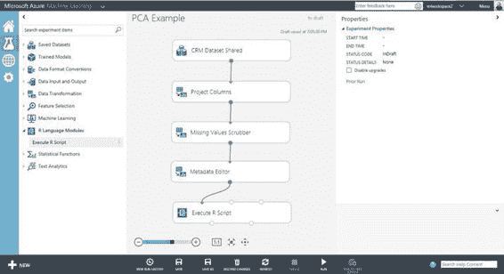

图 3-8。使用执行 R 脚本模块执行 PCA

8.  单击 **执行 R 脚本** 模块。您可以提供以下脚本，该脚本将用于执行 PCA：

```
    # 将基于 1 的可选输入端口映射到变量
    dataset1 <- maml.mapInputPort(1)
    # 对前 190 列执行 PCA
    pca = prcomp(dataset1[,1:190])

# 返回前 10 个主成分
    top_pca_scores = data.frame(pca$x[,1:10])
    data.set = top_pca_scores
    plot(data.set)
    # 选择要发送到输出数据集端口的数据框
    maml.mapOutputPort("data.set");
    ```

图 3-9 展示了如何在 ML Studio 中使用该脚本。

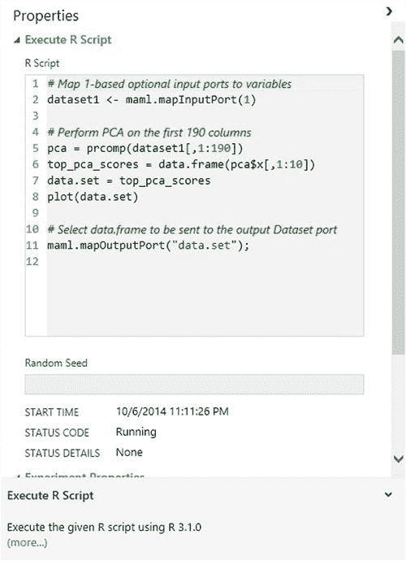

图 3-9。对前 190 列执行 PCA

9.  单击 **运行**。
10.  实验成功执行后，单击 **执行 R 脚本** 模块的 **结果数据集** 节点。单击 **可视化**。
11.  图 3-10 显示了 CRM 共享数据集的前十个主成分。这些主成分将在后续步骤中用于构建分类模型。

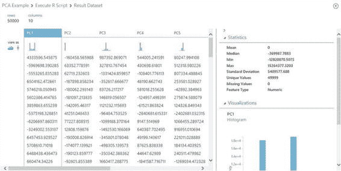

图 3-10。为 CRM 共享数据集识别的主成分

 **提示** 您还可以提供一个包含 R 脚本的 Zip 文件作为脚本包，并在 **执行 R 脚本** 模块中使用它。

使用脚本包（Zip）

如果您有一个一直在使用的 R 脚本，并希望将其用作实验的一部分，您可以将该 R 脚本打包成 Zip 文件，然后作为数据集上传到 ML Studio。要配合 **执行 R 脚本** 模块使用脚本包，您首先需要将文件打包成 Zip 格式，请按照以下步骤操作。

1.  导航到包含您打算在实验中使用的 R 脚本的文件夹（参见图 3-11）。

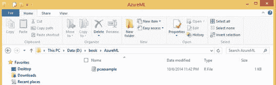

图 3-11。包含 R 脚本 pcaexample.r 的文件夹

2.  选择所有要打包的文件并右键单击。在本示例中，右键单击文件 **pcaexample.r**，然后选择 **发送到压缩（zipped）文件夹**，如图 3-12 所示。

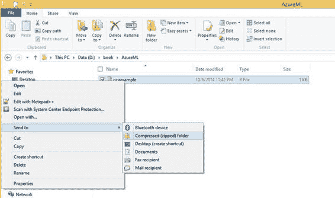

图 3-12。将 R 脚本打包为 ZIP 文件

3.  接下来，将 zip 文件上传到 ML Studio。为此，选择 **新建数据集  来自本地文件**。选择您要上传的 Zip 文件，如图 3-13 和图 3-14 所示。

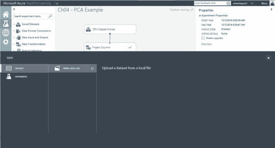

图 3-13。新建数据集  来自本地文件

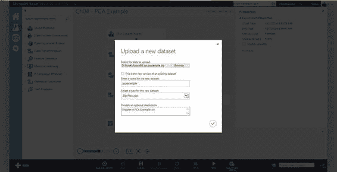

图 3-14。上传新数据集

4.  数据集上传后，您可以在实验中使用它。为此，从 **已保存的数据集** 中选择 **上传的 Zip 文件**，并将其拖放到实验中。
5.  将上传的 Zip 文件连接到 **执行 R 脚本** 模块的 **脚本包（Zip）** 输入，如图 3-15 所示。

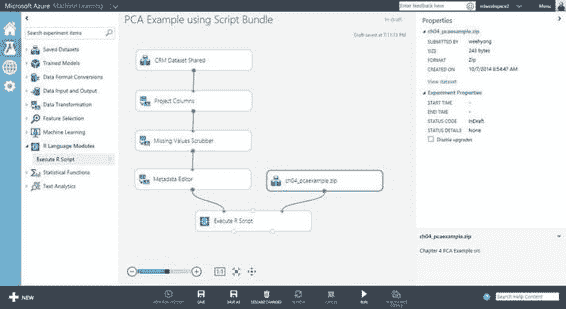

图 3-15。使用脚本包作为执行 R 脚本模块的输入

6.  在 **执行 R 脚本** 模块中，指定 R 脚本的位置，如下所示，如图 3-16 所示：

```
    # 将基于 1 的可选输入端口映射到变量
    dataset1 <- maml.mapInputPort(1)
    # 可选 Zip 端口的内容位于 ./src/ 中
    source("src/pcaexample.r");

# 选择要发送到输出数据集端口的数据框
    maml.mapOutputPort("data.set");
    ```

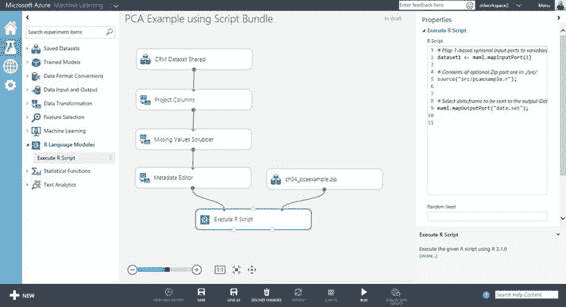

图 3-16。使用脚本包作为执行 R 脚本模块的输入

7.  现在，您可以使用已上传到 ML Studio 的 Zip 文件中的 R 脚本运行实验。使用脚本包可以轻松引用一个您可以在 ML Studio 外部测试的 R 脚本文件。要更新脚本，您需要重新上传 Zip 文件。

使用 R 构建和部署决策树

在本节中，您将学习如何使用 R 构建机器学习模型。使用 R 时，您可以利用大量 R 包，这些包实现了各种机器学习算法，用于分类、聚类、回归、K 近邻、购物篮分析等。

 **注意** 当您使用 R 中可用的机器学习算法并通过 **执行 R** 模块执行它们时，您只能可视化模型和参数。您无法保存训练好的模型并将其用作其他 ML Studio 模块的输入。

使用 ML Studio，提供了几种 R 机器学习算法。例如，您可以使用 **R 自动 ARIMA** 模块为单变量时间序列构建最优自回归移动平均模型。您还可以使用 **R K 近邻分类** 模块创建 K 近邻（KNN）分类模型。

在本节中，您将学习如何使用一个名为 **rpart** 的 R 包来构建决策树。**rpart** 包为您提供了用于执行分类和回归的递归划分算法。


 **注意**  了解更多关于 **rpart** R 包的信息，请访问 [`cran.r-project.org/web/packages/rpart/rpart.pdf`](http://cran.r-project.org/web/packages/rpart/rpart.pdf)。

在本练习中，你将使用成人普查收入二元分类数据集。让我们开始吧。

1.  从工具箱中，将以下模块拖放到实验设计区域：
    1.  **成人普查收入二元分类**数据集（位于**已保存数据集**下）
    2.  **项目列**（位于数据**转换  操作**下）
    3.  **执行 R 脚本**模块（位于 **R 语言**模块下）
2.  将**成人普查收入二元分类**数据集连接到**项目列**。
3.  点击**项目列**以选择将在实验中使用的列。选择以下列：年龄、性别、教育程度、收入、婚姻状况、职业。

图 3-17 展示了列的选择，图 3-18 展示了完成的实验和项目列属性。

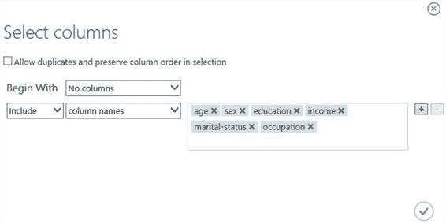

图 3-17. 选择将要使用的列

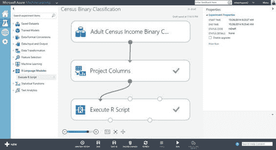

图 3-18. 完整的实验

4.  将**项目列**连接到**执行 R 脚本**。
5.  点击**执行 R 脚本**并提供以下脚本。图 3-19 展示了 ML Studio 中的 R 脚本。

```
    library(rpart)

# 将基于 1 的可选输入端口映射到变量
    Dataset1 <- maml.mapInputPort(1) # 类别: data.frame

fit <- rpart(income ~ age + sex + education + occupation, method="class", data=Dataset1)

# 显示结果以及分割的摘要
    printcp(fit)
    plotcp(fit)
    summary(fit)

# 绘制决策树
    plot(fit, uniform=TRUE, margin = 0.1, compress = TRUE, main="普查数据集的分类树")
    text(fit, use.n=TRUE, all=TRUE, cex=0.8, pretty=1)

data.set = Dataset1

# 选择要发送到输出数据集端口的数据框
    maml.mapOutputPort("data.set");
    ```

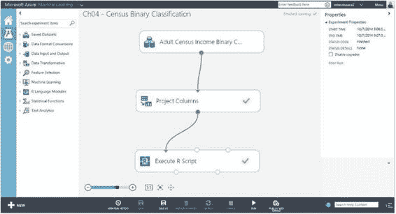

图 3-19\. 使用 R 脚本执行分类的实验

在 R 脚本中，首先使用 library() 加载 rpart 库。接着，将传递给**执行 R 脚本**模块的数据集映射到一个数据框。

要构建决策树，你将使用 rpart 函数。rpart 支持多种类型的方法：class（分类）和 anova（回归）。在本练习中，你将使用 rpart 执行分类（即 method="class"），如下所示：

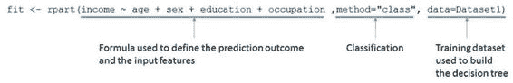

指定的公式使用以下格式：预测变量 ~ 输入特征 1 + 输入特征 2 + ...

决策树构建完成后，R 脚本会调用 printcp()、plotcp() 和 summary() 函数来显示结果，以及树中每个分割值的摘要。在 R 脚本中，plot() 函数用于绘制 rpart 模型。默认情况下，绘制 rpart 模型时，会使用缩写表示法来表示分割值。在 R 脚本中，添加了 pretty=1 的设置，以显示实际的分割值（参见图 3-20）。

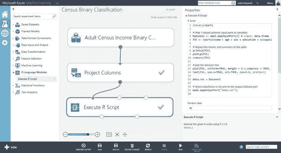

图 3-20. ML Studio 中的 R 脚本

现在你可以运行实验了。为此，请点击 ML Studio 底部窗格的“运行”图标。实验成功执行后，你可以查看决策树的详细信息，并可视化决策树的整体形状。

要查看决策树的详细信息，请点击**执行 R 脚本**模块，然后在**属性**窗格中点击**查看输出日志**（如图 3-21 所示）。

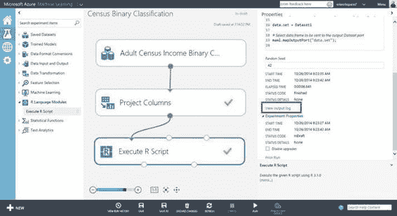

图 3-21. 查看执行 R 脚本的输出日志


输出日志的示例如下：

```
[ModuleOutput] 分类树：
[ModuleOutput]
[ModuleOutput]
[ModuleOutput]
[ModuleOutput] 树构建中实际使用的变量：
[ModuleOutput]
[ModuleOutput] [1] age        education  occupation sex
[ModuleOutput]
[ModuleOutput]
...
[ModuleOutput]   主要分裂点：
[ModuleOutput]
[ModuleOutput]       education  分裂为 LLLLLLLLRRLRLRL，改进值=1274.3680，(0 个缺失值)
[ModuleOutput]
[ModuleOutput]       occupation 分裂为 LLLRLLLLLRRLLL，改进值=1065.9400，(1843 个缺失值)
[ModuleOutput]
[ModuleOutput]       age        < 29.5 向左，改进值= 980.1513，(0 个缺失值)
[ModuleOutput]
[ModuleOutput]       sex        分裂为 LR，改进值= 555.3667，(0 个缺失值)
```

要可视化决策树，请点击 **R 设备** 输出端口（即 **执行 R 脚本** 模块的第二个输出），您将看到刚刚使用 rpart 构建的决策树（如图 3-22 所示）。

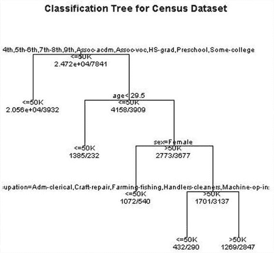

图 3-22. 使用 rpart 构建的决策树

 **注意**  Azure 机器学习提供了丰富的已保存数据集集合，可用于您的实验。此外，您还可以在 UCI 机器学习库中找到大量数据集，网址为 [`archive.ics.uci.edu/ml/datasets.html`](http://archive.ics.uci.edu/ml/datasets.html)。

总结

在本章中，您了解了 R 与 Azure 机器学习集成所提供的激动人心的可能性。您学习了如何在 ML Studio 中使用不同的 R 语言模块。在您使用 R 设计实验时，您学习了如何将模块的输入和输出映射到 R 变量和数据框。接下来，您学习了如何构建第一个 R 脚本来执行数据采样，以及如何使用 ML Studio 中内置的数据可视化工具来可视化结果。以此为基础，您继续构建和部署了使用 R 脚本包进行数据预处理以及构建决策树的实验。

第二部分


统计与机器学习算法

第四章


统计与机器学习算法简介

本章将作为 Microsoft Azure 机器学习中一些最常用算法的参考。我们将简要介绍线性回归和逻辑回归、用于聚类的 k-means、决策树、决策森林（随机森林、提升决策树和 Gemini）、神经网络、支持向量机以及贝叶斯点机等算法。

本章将为本书后续章节中您将遇到的一些算法提供良好的基础和参考材料。我们将这些算法分为以下几类：

*   回归
*   分类
*   聚类

回归算法

首先，我们来谈谈 Azure 机器学习服务中常用的回归技术。回归技术用于预测具有数值结果的响应变量，例如预测汽车的每加仑英里数或预测城市的温度。输入变量可以是数值型或分类型。然而，这些算法的共同点是输出（或响应变量）是数值型的。我们将回顾一些最常用的回归技术，包括线性回归、神经网络、决策树和提升决策树回归。

线性回归

线性回归是统计学中最古老的预测技术之一。事实上，其根源可以追溯到 1795 年卡尔·弗里德里希·高斯的工作。线性回归的目标是在响应变量和自变量之间拟合一个线性模型，并利用该模型根据一组观测到的自变量来预测结果。一个简单的线性回归模型是一个具有如下结构的公式：

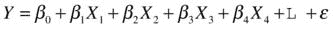

其中

*   Y 是响应变量（即您试图预测的结果），例如每加仑英里数。
*   *X*[1]、*X*[2]、*X*[3] 等是用于预测结果的自变量。
*   *β*[0] 是一个常数，即回归线的截距。
*   *β*[1]、*β*[2]、*β*[3] 等是自变量的系数。这些系数指的是每个变量的偏斜率。
*   *ε* 是与响应变量相关的误差或噪声，无法由自变量 X1、X2 和 X3 解释。

线性回归模型有两个组成部分：确定性部分（即 *β*[1]*X*[1] + *β*[2]*X*[2] + ...）和随机部分（即误差 *ε*）。您可以将这两个部分视为模型中的信号和噪声。

如果您只有一个输入变量 X，那么回归模型就是最适合数据的最佳直线。图 4-1 展示了一个简单线性回归模型的示例，该模型根据汽车的马力预测其每加仑英里数。对于两个输入变量，线性回归是在三维空间中拟合一组数据点的最佳平面。变量的系数（即 *β*[1]、*β*[2]、*β*[3] 等）是每个变量的偏斜率。如果保持所有其他变量不变，那么当变量 *X*[1] 增加 1 时，结果 Y 将增加 *β*[1]。这就是为什么经济学家通常使用短语“*ceteris paribus*”或“*所有其他条件相同*”来描述一个自变量对给定结果的影响。

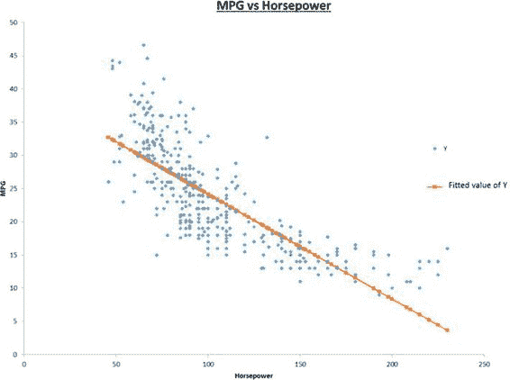

图 4-1. 一个根据汽车马力预测其每加仑英里数的简单线性回归模型

线性回归使用最小二乘法或梯度下降法来为给定数据集找到最佳的模型系数。最小二乘法通过最小化训练数据中每个观测值的拟合值与实际值之间的平方误差之和来实现这一点。梯度下降法通过每次迭代更新系数来找到最优的模型系数。更新朝着减少模型拟合值与训练数据实际值之间误差总和的方向进行。通过多次迭代，它沿着负梯度的方向移动，从而找到局部最小值，因此得名。

 **注意**  您可以从《使用回归进行商业分析：案例手册》（Foster, D. P., Stine, R.H., Waterman, R.P.; 纽约，美国；Springer-Verlag, 1998）一书中了解更多关于线性回归的知识。

神经网络

人工神经网络是一组模仿大脑功能的算法。有许多不同的神经网络算法，包括反向传播网络、霍普菲尔德网络、科霍宁网络（也称为自组织映射）和自适应共振理论（或 ART）网络。然而，最常见的是反向传播算法，也称为多层感知器。

反向传播网络具有多个按层排列的神经元。最常用的架构是图 4-2 中所示的三层网络。这种架构有一个输入层、一个隐藏层和一个输出层。但是，您也可以有两个或更多的隐藏层。输入和输出节点的数量由数据集决定。基本上，输入节点的数量等于您想要用来预测输出的自变量的数量。输出节点的数量与响应变量的数量相同。相比之下，隐藏节点的数量则更加灵活。


神经网络模型的开发分为两个步骤：训练和测试。在训练过程中，你将训练集中的一组样本展示给神经网络。每个样本都包含自变量和响应变量的值。在训练过程中，你会多次向神经网络展示这些样本。在每次迭代中，网络都会预测响应值。在训练的前向传播阶段，隐藏层和输出层中的每个节点都会计算其输入的加权和，然后通过激活函数利用这个和来计算其输出。神经网络中每个神经元的输出通常使用以下 S 型激活函数：


然而，神经网络中也可以使用其他激活函数，例如高斯函数、双曲正切函数（tanh）、线性阈值函数，甚至简单的线性函数。

假设有 M 个输入节点。输入节点与第一个隐藏层之间的连接权重用 *w*¹[*ij*] 表示。

在每个隐藏节点处，加权和的计算公式如下：


计算出加权和后，S 型激活函数的计算方式如下：


在计算出输出节点的激活水平后，反向传播阶段开始。在此阶段，算法根据实际的响应值计算其预测的误差。利用梯度下降法，它根据误差按比例调整所有连接的权重。权重的调整方式旨在减少下一次的误差。经过多次迭代，神经网络会收敛到一个解。

在测试过程中，你只需使用训练好的模型对记录进行评分。对于每条记录，神经网络会根据给定的输入变量集预测响应变量的值（参见图 4-2）。


图 4-2. 一个包含三层的神经网络：一个输入层、一个隐藏层和一个输出层

学习率决定了收敛到解的速度。如果学习率过低，算法将需要更多的学习迭代（因此也需要更多时间）才能收敛到最小值。相反，如果学习率过大，算法会来回震荡，可能永远找不到局部最小值。因此，神经网络将成为一个糟糕的预测器。

另一个重要参数是隐藏节点的数量。神经网络的准确性可能会随着隐藏节点数量的增加而提高。然而，这也会增加处理时间，并可能导致过拟合。通常，增加隐藏节点或隐藏层的数量很容易导致参数过多，从而增加过拟合的风险。一个经验法则是，初始隐藏节点数大致等于输入节点数的平方根。另一个通用经验法则是，隐藏层中的神经元数量应介于输入层大小和输出层大小之间。例如，（输入节点数 + 输出节点数）× 2/3。这些经验法则仅仅是起点，旨在避免过拟合；最佳数量只能通过实验和在测试数据上验证性能来找到。

决策树

决策树算法是一种分层技术，它通过基于特定的统计标准迭代地分割数据集来工作。决策树的目标是最大化树中不同节点之间的方差，并最小化每个节点内部的方差。图 4-3 展示了一个简单的决策树，它通过两次数据分割创建而成。根节点（节点 0）包含数据集中的所有数据。算法根据定义的统计量分割数据，创建三个新节点（节点 1、节点 2 和节点 3）。使用相同的统计量，它在节点 1 处再次分割数据，创建出另外两个叶节点（即节点 4 和节点 5）。决策树通过遍历到叶节点（即终端节点之一：节点 2、3、4 或 5）来对每一行数据进行预测。


图 4-3. 一个包含两次数据分割的简单决策树

图 4-4 展示了一个虚构的非常简单的决策树示例，用于预测客户是否会购买自行车。在这个例子中，原始数据集包含 100 个样本。预测能力最强的变量是年龄，因此决策首先按年龄分割数据。年龄小于 30 岁的客户进入左分支，而年龄在 30 岁及以上的客户进入右分支。下一个最重要的变量是性别，因此在下一层，决策树按性别分割数据。在年轻分支（即针对 30 岁以下的客户）中，决策树将数据分割为男性和女性分支。对于年长分支，它也执行相同的操作。最后，图 4-4 显示了每个节点中的样本数量以及购买概率。因此，如果你有一位 23 岁的女性客户，该树预测她只有 30%的几率购买自行车，因为她最终会进入节点 3。一位 45 岁的男性客户将有 80%的几率购买自行车，因为他最终会进入树中的节点 6。


图 4-4. 一个用于预测购买自行车可能性的简单决策树

一些最常用的决策树算法包括迭代二分器 3（ID3）、C4.5 和 C5.0（ID3 的后继者）、自动交互检测（AID）、卡方自动交互检测（CHAID）以及分类与回归树（CART）。虽然非常有用，但 ID3、C4.5、C5.0 和 CHAID 算法是分类算法，不适用于回归。顾名思义，CART 算法既可用于分类也可用于回归。

如何选择在每个层级用于分割数据的变量？每个决策树算法使用不同的统计量来选择最佳的分割变量。ID3、C4.5 和 C5.0 使用信息增益，而 CART 使用一种称为基尼不纯度的度量。基尼不纯度衡量随机选择样本的错误分类率。

 **注意**  关于决策树的更多信息，可参阅 S. Chiu 和 D. Tavella 合著的《Data Mining and Market Intelligence for Optimal Market Returns》（英国牛津，Butterworth-Heinemann 出版社，2008 年）以及[`en.wikipedia.org/wiki/Decision_tree_learning`](http://en.wikipedia.org/wiki/Decision_tree_learning)。

提升决策树

提升决策树是集成模型的一种形式。与其他集成模型一样，提升决策树使用多个决策树来产生更优的预测器。每个单独的决策树可能是弱预测器。然而，当它们组合在一起时，会产生更优的结果。

如第 1 章所述，构建集成模型有三个关键步骤：a) 数据选择，b) 训练分类器，c) 组合分类器。


构建集成模型的第一步是为分类器模型选择数据。在采样数据时，一个关键目标是最大化模型的多样性，因为这能提升解决方案的准确性。通常，模型越多样化，最终分类器的性能就越好，其预测结果的方差也越小。

该过程的第二步是训练多个独立的分类器。但如何分配这些分类器呢？在众多可用策略中，最流行的两种是装袋（bagging）和提升（boosting）。装袋算法使用不同的随机数据子集来训练每个模型。这些模型可以在其随机训练数据子集上并行训练。相比之下，提升算法通过顺序训练模型、在训练数据上测试每个模型的性能来提升整体表现。训练集中被错误分类的样本会在后续训练中获得更高的权重。因此，在训练过程中，每个新增的模型都会更关注那些被错误分类的数据。提升决策树算法就采用了这种提升策略。在这种情况下，每一棵新的决策树在训练时都会重点处理被错误分类的案例，以降低错误率。这就是提升决策树如何从弱决策树中产生卓越结果的原因。

关注提升决策树的两个关键参数非常重要：每棵决策树的叶子数量以及提升迭代次数。每棵树中的叶子数量决定了模型中变量之间允许的交互程度。如果该值设为 2，则不允许任何交互。如果设为 3，则模型最多可以包含两个变量的交互效应。你需要尝试不同的值，以找到最适合你数据集的那个。据报道，对于大多数应用，每棵树 4-8 个叶子能产生良好效果。相比之下，每棵树只有两个叶子会导致结果不佳。第二个需要调整的重要参数是提升迭代次数（即模型中树的数量）。非常多的树可以减少误差，但容易导致过拟合。为了避免过拟合，你需要找到一个最优的树的数量，使验证数据集上的误差最小化。

最后，一旦你训练好了所有分类器，最后一步就是结合它们的结果来做出最终预测。有多种方法可以结合这些结果，从简单的多数投票到加权多数投票。

 **注意** 你可以从 C. Zhang 和 Y. Ma 合著的《集成机器学习：方法与运用》（纽约，纽约州：Springer 出版社，2012 年，第 1-34 页）以及 [`en.wikipedia.org/wiki/Gradient_boosting#Gradient_tree_boosting`](http://en.wikipedia.org/wiki/Gradient_boosting#Gradient_tree_boosting) 了解更多关于提升决策树的信息。

分类算法

分类是监督式机器学习的一种类型。在监督式学习中，目标是利用带标签的训练数据推断出一个函数。然后，该函数可用于确定新数据集（其中标签未知）的标签。可用于构建模型的分类算法（非详尽列表）包括决策树、逻辑回归、神经网络、支持向量机、朴素贝叶斯和贝叶斯点机。

分类算法用于预测输入数据（其中标签未知）的标签。标签也被称为类别、分组或目标变量。例如，一家电信公司想要预测以下内容：

*   *流失*：有倾向转向其他电信提供商的客户
*   *购买倾向*：愿意购买新产品或服务的客户
*   *向上销售*：愿意购买升级服务或附加服务的客户

为了实现这一点，电信公司使用训练数据（其中标签已知或已预先定义）构建一个分类模型。在本节中，你将了解几种可用于构建模型的常见分类算法。一旦模型构建完成并通过测试数据验证，电信公司的数据科学家就可以使用该模型来预测客户的流失、购买倾向和向上销售标签（其中标签未知）。因此，电信公司可以利用这些预测来设计营销策略，以减少客户流失，并向更愿意购买新服务或进行向上销售的客户提供服务。

分类算法常用的其他场景包括金融机构，在这些机构中，模型用于判断信用卡交易是否为欺诈案例，或者根据客户的财务状况决定是否批准贷款申请。酒店和航空公司使用模型来判断是否应将客户升级到更高级别的服务（例如，从经济舱升级到商务舱，从普通房间升级到套房等）。

分类问题定义如下：给定一个输入样本 *X* = (*x*[1], *x*[2], ... *x*[*d*])，其中 *x*[*i*] 指的是大小为 d 的样本中的一个项目。分类的目标是学习映射 *X* → *Y*，其中 *y* Î *Y* 是一个类别。

一个数据实例属于 J 个组（或类别）之一，例如 *C*[1], *C*[2], ..., *C*[*j*]。例如，在电信场景的二分类问题中，类别 *C*[1] 指的是将会流失并转向新电信提供商的客户，而类别 *C*[2] 指的是不会流失的客户。

为了实现这一点，首先使用带标签的训练数据，通过一种分类算法来训练模型。然后，通过使用测试数据来验证模型，以确定训练好的模型（即分类器）所犯的错误数量。使用各种指标来衡量分类器的性能。这些指标包括测量训练模型的准确率、精确率、召回率和曲线下面积（AUC）。

在前面的章节中，你了解了决策树、提升决策树和神经网络的工作原理。这些算法对于回归和分类都很有用。在本节中，你将学习支持向量机和贝叶斯点机的工作原理。

支持向量机

支持向量机（SVM）由 Bernhard E. Boser、Isabelle Guyon 和 Vladimir N. Vapnik 于 1992 年在学习理论会议（COLOT）上提出。SVM 基于植根于统计学习理论的技术，被认为是一种基于核的学习算法。

SVM 的核心思想是找到能将训练数据分成两个类别的分离超平面，并且该超平面具有尽可能宽的间隔（或边距）。当只有两个输入变量时，一条直线即可将数据分成两个类别。在高维空间（即超过两个输入变量）中，一个超平面将训练数据分成两个类别。图 4-5 展示了超平面如何分隔两个类别以及间隔。圈出的项目是支持向量，因为它们定义了提供最大间隔的最优超平面。


图 4-5. 支持向量机、分离超平面与间隔


请考虑以下示例。假设一家电信公司拥有以下由 *n* 个客户组成的训练数据。在这 n 个客户中，我们假设有 50 个客户会流失，另外 50 个客户不会流失。对于每个客户，你提取 10 个输入变量（或特征）来表示该客户。给定一个已经使用服务一段时间的客户，该电信公司的数据科学家和业务分析师希望确定该客户是否会流失并转向其他电信服务提供商。

假设训练数据包含以下内容：(*x*[1],*y*[1]), ... ,(*x*[*n*],*y*[*n*])，其中 (*x*[*i*],*y*[*j*]) 表示将 *x*[*i*] 映射到类别 *y*[*j*]。超平面决策函数为


其中 *w* 和 *w*[0] 是系数。一个分离超平面将满足以下约束条件：


最优分离超平面是能够在两个类别之间实现最大间隔的超平面。描述超平面的这两个约束条件可以用以下方程表示：


该方程可用于表示所有可用于分离数据的超平面。通常，由于直接计算 ||*w*|| 范数的值存在困难，因此不会直接以其当前形式（也称为原始形式）求解该方程。在实践中，使用该方程的对偶形式来求解优化问题，从而确定最优超平面。

 **注意**  你可以从以下书籍中了解更多关于支持向量机以及如何最大化间隔的信息：

Vladimir, C. and Filip, M., *Learning From Data (Concepts, Theory and Methods)*.
pp. 353 – 384 (Wiley-Interscience, 1998).

关于支持向量机的优秀概述可以在 [`en.wikipedia.org/wiki/Support_vector_machine`](http://en.wikipedia.org/wiki/Support_vector_machine) 找到。

Azure 机器学习提供了一个**两类支持向量机**模块，使您能够构建支持二元预测的模型。该模块的输入可以是连续变量和/或分类变量。该模块提供了多个参数，可用于微调支持向量机算法的行为。这些参数包括：

*   *迭代次数*：决定模型训练的速度。此参数使您能够在训练速度和模型准确性之间取得平衡。默认值设置为 1。
*   *Lambda*：用于调整所生成模型复杂度的 L1 正则化权重。Lambda 的默认值设置为 0.001。使用非零值是为了避免模型过拟合。
*   *标准化特征*：决定算法是否对值进行标准化。
*   *投影到单位球面*：决定算法是否将值投影到单位球面。
*   *随机数种子*：计算模型时用于随机数生成的种子值。
*   *允许未知分类级别*：决定算法是否支持未知的分类值。如果设置为 True，算法会为每个分类列创建一个额外的级别。该额外级别用于映射测试数据集中未在训练数据集中找到的级别。

贝叶斯点机

贝叶斯点机（BPM）是一种线性分类算法，由 Ralf Herbrich、Thore Grapel 和 Colin Campbell 于 2001 年提出。贝叶斯点机算法的核心思想是识别一个“平均”分类器，该分类器能够有效且高效地逼近多个线性分类器（基于其泛化能力）的理论最优贝叶斯平均。这个“平均”分类器被称为贝叶斯点。在实证研究中，贝叶斯点机在实验室数据和真实世界数据上的表现始终优于支持向量机。

 **注意**  Azure 机器学习中使用的贝叶斯点机算法基于 Infer.Net，并对原始贝叶斯点机算法进行了改进。这些改进使得 Azure 机器学习中使用的贝叶斯点机更加稳健，并且不易过拟合数据。它还减少了执行性能调优的需求。

其中一些改进包括使用期望传播作为消息传递算法。此外，该实现不需要使用参数扫描和标准化数据。

回顾之前对分类问题的定义：给定一个输入样本 *X* = (*x*[1], *x*[2], . . ., *x*[*d*])，其中 *x*[*i*] 指的是大小为 d 的样本中的一个项目。分类的目标是学习映射 *X* → *Y*，其中 *y* Î *Y* 是一个类别。

给定样本中的一个项目 *x*[*i*]，其中 *x*[*i*] 是一个包含一个或多个变量的向量。BPM 通过执行以下步骤来确定 *x*[*i*] 的类别标签：

*   计算 *x*[*i*] 与权重向量 w 的内积。
*   如果 (*x*[*i*]·*w*) 为正，则确定 *x*[*i*] 是否属于类别 y。（*x*[*i*]·*w* 是向量 *x*[*i*] 和 w 的内积）。计算中会添加高斯噪声。

在训练过程中，BPM 算法使用先验知识和训练数据来学习 w 的后验分布。计算中使用的高斯噪声有助于处理不存在能够完美分类训练数据的 *w* 的情况（即，当训练数据中的两个类别不是线性可分时）。

 **注意**  你可以在 [`research.microsoft.com/apps/pubs/default.aspx?id=65611`](http://research.microsoft.com/apps/pubs/default.aspx?id=65611) 了解更多关于 BPM 的信息。

此外，以下关于使用 Infer.Net 和 BPM 的教程提供了对该算法工作原理的深入理解：[`research.microsoft.com/en-us/um/cambridge/projects/infernet/docs/Bayes%20Point%20Machine%20tutorial.aspx`](http://research.microsoft.com/en-us/um/cambridge/projects/infernet/docs/Bayes%20Point%20Machine%20tutorial.aspx)。

Azure 机器学习提供了一个**两类贝叶斯点机**模块，使您能够构建支持二元预测的模型。该模块提供了多个参数，可用于微调**贝叶斯点机**模块的行为。这些参数包括：

*   *训练迭代次数*：决定训练过程中消息传递算法使用的迭代次数。通常，期望更多的迭代次数能提高模型预测的准确性。默认的训练迭代次数为 30。
*   *包含偏置*：决定是否在每个训练和预测实例中添加一个恒定的偏置值。

与**支持向量机**模块类似，也支持名为**允许未知分类级别**的参数。

聚类算法

聚类是一种无监督机器学习。在聚类中，目标是将相似的对象分组在一起。大多数现有的聚类算法可以分为以下几类：


*   *划分法*：将数据集划分为 *k* 个数据分区。每个分区对应一个簇。
*   *层次法*：给定一个数据集，层次法在构建簇时采用自底向上或自顶向下的方式。在自底向上方法（也称为凝聚法）中，算法开始时将数据集中的每个项分配到一个簇中。随着算法在层次结构中向上移动，它会将各个（相似的）簇合并成更大的簇。这一过程持续进行，直到所有簇合并为一个（层次结构的根节点）。在自顶向下方法（也称为分裂法）中，算法开始时将所有项放在一个簇中，并在每次迭代中将其划分为更小的簇。
*   *密度法*：基于密度的算法通过考虑每个项“邻域”内的密度（项的数量）来增长簇。它们通常用于识别具有“任意”形状的簇。相比之下，大多数基于划分的算法依赖于距离度量的使用。这会产生具有规则形状（例如球形）的簇。

 **注意**  请阅读 [`en.wikipedia.org/wiki/Cluster_analysis`](http://en.wikipedia.org/wiki/Cluster_analysis) 上对各种聚类算法的精彩概述。

在本章中，我们将重点介绍基于划分的聚类算法。具体来说，你将学习 k-means 聚类的工作原理。

对于基于划分的聚类算法，能够测量点与向量之间的距离（或相似度）非常重要。各种距离度量包括欧几里得距离、余弦距离、曼哈顿距离（也称为城市街区距离）、切比雪夫距离、闵可夫斯基距离和马氏距离。

在 Azure 机器学习中，**K-Means 聚类**模块支持欧几里得距离和余弦距离度量。给定两个点 p1 和 p2，p1 和 p2 之间的欧几里得距离是连接这两点的线段的长度。欧几里得距离也可用于测量两个向量之间的距离。给定两个向量 v1 和 v2，余弦距离是 v1 和 v2 之间夹角的余弦值。

用于聚类的距离度量是根据被聚类数据的类型来选择的。欧几里得距离对所比较向量的尺度/大小很敏感。例如，即使两个向量看起来相对相似，特征的尺度也会影响欧几里得距离的值。在这种情况下，余弦距离度量更合适，因为它受尺度的影响较小。这两个向量之间的余弦角会很小。

K-means 聚类的工作原理如下：

1.  从数据集中随机选择 k 个项作为 k 个簇的初始中心。
2.  对于剩余的每个项，根据该项与簇中心之间的距离，将其分配到 k 个簇之一。
3.  计算每个簇的新中心。
4.  重复步骤 2 和 3，直到簇不再发生变化，或达到最大迭代次数。

为了说明这一点，图 4-6 展示了一个用于 k-means 聚类的数据集。该数据中有三个不同的簇，用不同的颜色表示。


图 4-6. 用于 k-means 聚类的数据集

图 4-7 展示了 k=3 时的 k-means 聚类，以及三个簇质心（用 + 符号表示）如何在每次迭代中移动，以减小均方误差并更准确地反映簇中心。


图 4-7. k=3 时 K-means 聚类算法的迭代过程，其中簇质心不断移动以最小化误差

Azure 机器学习中的 **K-Means 聚类**模块支持不同的质心初始化算法。这由 **初始化** 属性指定。支持五种质心初始化算法。表 4-1 显示了支持的不同质心初始化方法。

表 4-1. K-Means 聚类 - 质心初始化算法

| 质心初始化算法 | 描述 |
| --- | --- |
| **默认** | 选取前 N 个点作为初始质心 |
| **随机** | 随机选取初始质心 |
| **K-Means++** | K-Means++ 质心初始化 |
| **K-Means+ 快速** | K-Means++ 质心初始化，其中 P:=1（在算法的每次迭代中选取最远的质心） |
| **均匀** | 均匀选取 N 个点作为初始质心 |

总结

在本章中，你学习了不同的回归、分类和聚类算法。你了解了每种算法的工作原理以及它们适合解决的问题类型。本章的目标是为你在后续章节中使用这些算法解决各种问题奠定基础。此外，本章提供的资源将帮助你更深入地了解机器学习的最新进展，以及其中一些算法背后的理论。

第三部分


实际应用

第五章


构建客户倾向模型

本章将提供构建机器学习模型的实用指南。它侧重于买家倾向模型，展示了如何将数据科学流程应用于此业务问题。通过逐步指南，本章将解释如何应用关键概念并利用 Microsoft Azure 机器学习的功能进行倾向建模。

业务问题

假设你是一家大型自行车制造商的营销经理。你需要开展一次邮件营销活动，以吸引更多客户购买你的自行车。你的预算有限，管理层希望你最大化投资回报率（ROI）。因此，你的邮件营销活动的目标是找到最有可能购买你自行车的潜在客户。

如果预算无限，任务就很简单：你可以直接购买名单并给每个人发送邮件。然而，这种蛮力方法效率低下，并且会产生有限的 ROI，因为对大多数收件人来说，这无异于垃圾邮件。使用这种无针对性的方法，你不太可能实现目标，因为它会导致非常低的响应率。

更好的方法是使用预测分析来定位最有可能购买你自行车的潜在客户，例如最有可能购买自行车的客户。这类预测分析被称为买家倾向模型或客户定位模型。通过这种方法，你可以构建模型来预测潜在客户对你的邮件营销活动做出响应的可能性。

在本章中，我们将向你展示如何在 Azure 机器学习中构建这类模型。使用完成的模型，你将给潜在客户打分，并且只给那些最有可能对你的活动做出响应的客户发送邮件。我们还将展示如何在有限的营销预算下最大化 ROI。

 **注意**  你需要拥有一个 Azure 机器学习帐户。如果你还没有帐户，请参阅第 2 章了解如何设置新帐户的说明。

正如你在第 1 章中看到的，数据科学流程通常遵循以下五个步骤。

1.  定义业务问题。
2.  数据获取与准备。
3.  模型开发。
4.  模型部署。
5.  监控模型性能。

在定义了业务问题之后，你将在本章的其余部分探索数据获取与准备、模型开发和评估。

数据获取与准备


在本节中，你将了解如何从不同来源加载数据并在 Azure Machine Learning 中进行分析。Azure Machine Learning 支持从多种来源加载数据，包括本地计算机、Web、Azure 上的 SQL 数据库、Hive 表或 Azure Blob 存储。

从本地文件系统加载数据

最简单的数据加载方式是从本地计算机加载。请按照以下步骤操作。

1.  在浏览器中访问 URL [`studio.azureml.net`](https://studio.azureml.net)，并登录到你在 Azure Machine Learning 中的工作区。
2.  接着，点击左侧窗格菜单中的 **Experiments** 项。
3.  点击窗口左下角的 **+New** 按钮，然后从新出现的菜单中选择 **Dataset**，如图 5-1 所示。


图 5-1. 从本地计算机加载新数据集

4.  当你选择 **From Local File** 选项时，系统会提示你选择要从本地计算机加载的数据文件。

你已使用这些步骤将 BikeBuyer.csv 文件从本地文件系统加载到 Azure Machine Learning 中。

从其他来源加载数据

你可以使用 Azure Machine Learning 中的 Reader 模块从非本地来源加载数据。具体来说，使用 Reader 模块可以从 Web、Azure 上的 SQL 数据库、Azure 表、Azure Blob 存储或 Hive 表加载数据。为此，你需要在调用 Reader 模块之前创建一个新实验。请按照以下步骤使用 Reader 模块从上述任何来源加载数据。

1.  在浏览器中访问 URL [`studio.azureml.net`](https://studio.azureml.net)，并登录到你在 Azure Machine Learning 中的工作区。
2.  接着，点击左侧窗格菜单中的 **Experiments** 项。
3.  点击窗口左下角的 **+New** 按钮，然后从新出现的菜单中选择 **Experiment**。一个新的实验将启动，并带有一个空白画布，如图 5-2 所示。


图 5-2. 在 Azure Machine Learning 中启动新实验

4.  打开 **Data Input and Output** 菜单项，你将看到两个模块：**Reader** 和 **Writer**。
5.  将 **Reader** 模块从菜单拖放到画布上的任意位置。
6.  点击画布上的 **Reader** 模块，其属性将显示在右侧窗格的 **Reader** 下。现在，在下拉菜单中指定数据源，然后输入所有必需参数的值。图 5-3 显示了为从我们的 Azure Blob 存储帐户读取 BikeBuyer.csv 文件而输入的完整参数。Account Name 和 Account Key 指的是 Microsoft Azure 上的一个存储帐户。你可以通过以下方式从 Azure 门户获取这些参数。
    1.  登录 Microsoft Azure，网址为 [`azure.microsoft.com`](http://azure.microsoft.com)。
    2.  在顶部菜单中，点击 **Portal**。这将带你进入 Azure 门户。
    3.  从左侧窗格的菜单中选择 **storage**。这将在右侧窗格中列出你所有的存储帐户。
    4.  点击包含你的机器学习模型所需数据的存储帐户。
    5.  在屏幕底部，点击标有 **Manage Access Keys** 的钥匙图标。将显示你的存储帐户名称和访问密钥。使用主访问密钥作为 Azure Machine Learning 中 **Reader** 模块的 Account Key。


图 5-3. 使用 Reader 模块从 Azure Blob 存储加载 BikeBuyer.csv 文件

 **注意**  你可以使用上述说明将多个来源的多个数据集加载到 Azure Machine Learning 中。但请注意，每个 Reader 模块一次只能加载一个数据集。

数据分析

将数据加载到 Azure Machine Learning 后，下一步是进行预处理，为建模准备数据。作为此过程的一部分，对数据进行可视化总是非常有用的。你可以通过 Reader 模块或从左侧窗格的 Saved Datasets 菜单项中选择 BikeBuyer.csv 来可视化 Bike Buyer 数据集。当鼠标悬停在 Reader 模块底部的小圆圈上时，会打开一个菜单，提供两个选项：**Download** 或 **Visualize**。详情请参见图 5-4。如果选择 Download 选项，你可以将数据保存到本地计算机，并在 Excel 中打开以查看数据。或者，你也可以通过选择 Visualize 选项在 Azure Machine Learning 中可视化数据。


图 5-4. 在 Azure Machine Learning 中可视化数据的两个选项

如果选择 Visualize 选项，数据将在一个新窗口中呈现，如图 5-5 所示。图 5-5 显示了 BikeBuyer.csv 数据集，其中包含所有客户的历史销售数据。你可以看到该数据集有 10,000 行和 13 列，包括人口统计变量，如婚姻状况、性别、年收入、子女数量、职业、年龄等。其他变量包括房屋所有权状况、汽车数量和通勤距离。最后一列名为 Bike Buyer，非常重要，因为它显示了哪些客户过去曾从你的商店购买过自行车。


图 5-5. 在 Azure Machine Learning 中可视化 Bike Buyer 数据集

图 5-5 还显示了数据集中所有变量的描述性统计信息，如均值、中位数、标准差等。此外，它还显示了每个变量的数据类型和缺失值的数量。向下滚动，你将看到显示实际值的数据集样本。

特征列表顶部的第一行是一组缩略图，显示了每个变量的分布情况。你可以通过点击缩略图查看完整的分布。例如，如果你点击年收入上方的缩略图，Azure Machine Learning 会在屏幕右侧窗格中打开完整的直方图；如图 5-6 所示。该直方图显示了所选变量的分布情况，你可以开始思考如何在模型中使用它。例如，在图 5-6 中，你可以清楚地看到年收入并非来自正态分布。如果非要描述，它看起来更像是对数正态分布。你还可以在直方图中发现异常值。Azure Machine Learning 允许你在直方图上叠加概率密度函数或累积分布。


图 5-6. 年收入直方图

使用 Azure Machine Learning，你还可以将数据转换为对数尺度。这是一种捕获不能丢弃的有效异常值的重要技术。例如，如果你的潜在目标包括高收入客户，那么简单地将高收入人群作为异常值丢弃是不明智的。对数变换是捕获极端收入的更好方法。图 5-7 显示了在 x 轴上使用对数尺度变换后的年收入。


图 5-7. 在对数尺度上变换年收入

Azure Machine Learning 中另一个有用的可视化工具是统计学中广泛使用的箱线图。你可以使用箱线图而不是直方图来可视化你的连续变量。为此，请在第一个标有 **view as** 的缩略图中选择箱线图图标。


图 5-8 以箱线图而非直方图的形式展示了年收入。在此图中，箱体底部的 y 值为第 25 百分位数，箱体顶部的 y 值为第 75 百分位数。箱体中间的线代表年收入的中位数。箱线图能更清晰地显示异常值：在图 5-8 中，异常值以三个点的形式显示在须线边缘的上方。异常值是如何确定的？一个经验法则是，任何位于 1.5 倍 IQR 之上或之下的点都是异常值。IQR 是四分位距，计算方法为第 75 百分位数减去第 25 百分位数。在箱线图中，IQR 是箱体顶部和底部之间的距离。由于你在此案例中不打算剔除异常值，一个很好的替代方案是使用对数函数对年收入进行转换。结果如图 5-9 所示。现在你可以看到，经过对数转换后，箱线图中的三个点消失了。这意味着三个极端的年收入值不再被视为异常值。这是将有效的极端值纳入模型的一个绝佳方法。这种处理方式还能提高预测模型的效能。


图 5-8. 年收入的箱线图


图 5-9. 年收入对数的箱线图

更多数据处理方法

除了可视化之外，Azure 机器学习还提供了许多其他数据预处理选项。左侧窗格的菜单包含许多按功能组织的模块。其中许多模块可用于数据预处理。

**数据格式转换** 项下有五个用于转换数据格式的不同模块。例如，名为**转换为 CSV** 的模块可将不同类型的数据（如**数据集、DataTableDotNet** 等）转换为 CSV 格式。

菜单中的**数据转换**项包含数据筛选、数据处理、数据采样和缩放等子类别。名为**统计函数**的菜单项也包含许多与数据预处理相关的模块。

图 5-10 展示了其中一些模块的实际应用。**联接**模块（位于**处理**子类别下）使您能够联接数据集。例如，如果倾向模型有第二个相关数据，您可以使用联接模块将其与自行车购买者数据集联接起来。


图 5-10. 更多数据准备选项

名为**描述性统计**的模块会显示数据集的描述性统计信息。例如，如果您单击此模块底部的小圆圈，Azure 机器学习会显示自行车购买者数据集的描述性统计信息，如均值、中位数、标准差、偏度、峰度等。它还会显示每个变量中缺失值的数量。根据经验法则，如果一个变量有 40%或更多的缺失值，除非该变量对业务至关重要，否则可以将其从分析中剔除。

您可以使用名为**缺失值清理器**的模块来处理缺失值。与 Azure 机器学习中的任何其他模块一样，当您选择此模块时，其参数会显示在右侧窗格中。此模块允许您以多种方式处理缺失值。首先，您可以删除包含缺失值的列。默认情况下，该工具会保留所有包含缺失值的变量。其次，您可以在参数框中用硬编码值替换缺失值。默认情况下，该工具会将所有缺失值替换为数字 0。或者，您也可以使用给定变量的均值、中位数或众数来替换缺失值。

**线性相关**模块对于计算数据集中变量的相关性也很有用。如果您单击线性相关模块底部的小圆圈，然后选择“可视化”，该工具会显示一个相关矩阵。在此矩阵中，您可以查看数据集中所有变量之间的两两相关性。此模块计算的是皮尔逊相关系数。因此，此模块不支持其他相关类型，如斯皮尔曼相关。此外，请注意此模块仅计算连续变量的相关性。对于分类变量，该模块会显示 NaN。

特征选择

特征选择是数据预处理中非常重要的一部分。也称为变量选择，这是为预测模型寻找正确变量的过程。在处理包含数百个变量的大型数据集时，这一点尤为关键。将超过 600 个变量扔给预测模型会浪费计算机资源，同时也会降低其预测准确性。通过特征选择，您可以找到对预测最有影响力的变量。由于自行车购买者数据集只有 13 个变量，您可以跳过此步骤。但是，让我们看看如何在 Azure 机器学习中进行特征选择，因为这对于大型数据集非常重要。

要在 Azure 机器学习中进行特征选择，请从左侧窗格的模块列表中拖拽名为**基于筛选器的特征选择**的模块。您可以通过在搜索框中搜索或打开**特征选择**类别来找到此模块。要使用此模块，您需要将其作为输入连接到数据集。图 5-11 展示了它作为自行车购买者数据集的特征选择的使用情况。在运行实验之前，请使用右侧窗格中的**启动列选择器**来定义预测的目标变量。在此案例中，选择**自行车购买者**列作为目标，因为这是您需要预测的内容。


图 5-11. Azure 机器学习中的特征选择

您还需要选择将用于特征选择的评分方法。Azure 机器学习提供以下评分选项：

*   皮尔逊相关
*   互信息
*   肯德尔相关
*   斯皮尔曼相关
*   卡方检验
*   费舍尔分数
*   基于计数

相关方法会找出一组与输出高度相关，但彼此之间相关性较低的变量。相关性是使用皮尔逊、肯德尔或斯皮尔曼相关系数计算的，具体取决于您选择的选项。

费舍尔分数使用统计学中的费舍尔准则对变量进行排序。相比之下，互信息选项是一种信息论方法，它使用互信息对变量进行排序。互信息衡量每个变量的概率密度与结果变量的概率密度之间的依赖性。

最后，卡方检验选项使用独立性检验来选择最佳特征；换句话说，它检验每个变量是否与结果变量独立。然后，它根据卡方检验对变量进行排序。

 **注意**   有关特征选择策略的更多信息，请参见 [`en.wikipedia.org/wiki/Feature_selection#Correlation_feature_selection`](http://en.wikipedia.org/wiki/Feature_selection#Correlation_feature_selection) 或 [`jmlr.org/papers/volume3/guyon03a/guyon03a`](http://jmlr.org/papers/volume3/guyon03a/guyon03a).pdf。


运行实验时，**基于筛选的特征选择**模块会生成两个输出。首先，筛选后的数据集列出了最重要变量的实际数据。其次，该模块会按重要性显示变量列表，并附有每个选定变量的得分。图 5-12 展示了特征选择的结果。在此案例中，你将特征数量设置为五个，并使用卡方检验进行评分。图 5-12 显示了六列，因为结果集包含了目标变量（即自行车购买者）以及排名前十的变量，包括年龄、汽车数量、通勤距离、教育程度和地区。结果集的最后一行显示了每个选定变量的得分。由于变量已排序，得分从左到右递减。


图 5-12. 自行车购买者数据集的特征选择结果，包含排名靠前的变量

请注意，选定的变量会根据评分方法的不同而变化。因此，在确定最终变量集之前，尝试不同的评分方法是值得的。对于自行车购买者数据集，卡方检验和互信息评分方法产生了相似的变量排名。

训练模型

数据预处理完成后，就可以开始训练预测模型了。第一步是为当前问题选择正确的算法类型。对于倾向性模型，你需要一个分类算法，因为你的目标变量是布尔型。模型的目标是预测潜在客户是否会购买你的自行车。因此，这是一个典型的二分类问题示例。正如你在第 1 章和第 4 章中看到的，分类算法使用监督学习进行训练。训练数据中每个特征集都有已知的结果；换句话说，历史数据中的每一行都包含“自行车购买者”字段，该字段显示客户是否购买了自行车。“自行车购买者”字段是你需要预测的因变量（也称为响应变量）。输入变量是预测因子（也称为自变量或回归变量），例如年龄、汽车数量、通勤距离、教育程度、地区等。如果你使用逻辑回归，你的模型可以表示如下：


其中，b0 是一个常数，即回归线的截距；b1、b2、b3 等是自变量的系数。e 是误差项，表示所选变量无法解释的数据变异性。在这个方程中，*BikeBuyer* 是客户购买自行车的概率。其值范围从 0 到 1。*Age*、*cars* 和 *Commute_distance* 是预测变量。

在训练过程中，你将输入变量和输出变量都提供给所选算法。在每次学习迭代中，算法将尝试使用当前已学习的权重来预测已知结果。最初，由于权重尚未充分学习，预测误差会很高。在后续迭代中，算法将调整其权重，以将预测误差降至最低。请注意，每种算法都使用不同的策略来调整权重，从而减少预测误差。有关 Azure 机器学习中统计和机器学习算法的更多详细信息，请参阅第 4 章。

Azure 机器学习提供了广泛的分类算法，从多类决策森林和丛林到两类逻辑回归、神经网络和支持向量机。对于客户倾向性模型，由于响应变量（自行车购买者）有两个类别，因此两类分类算法是合适的。因此，你可以使用**分类**子类别下的任何两类算法。要查看完整的算法列表，请展开左侧窗格中名为**初始化模型**的类别。展开名为**分类**的子类别，Azure 机器学习将列出所有可用的分类算法。我们建议尝试其中几种算法，直到找到最适合当前任务的算法。图 5-13 展示了一个简单但完整的自行车购买者倾向性模型实验。


图 5-13. 客户倾向性建模的简单实验

**项目列**模块仅排除了名为 ID 的列，因为它与模型无关。使用**缺失值清理器**模块处理缺失值，如上一节所述。**拆分**模块将数据分成两个样本，一个用于训练，另一个用于测试。在此实验中，你保留了 70% 的数据用于训练，其余 30% 用于测试。这是避免过拟合的常用策略之一。如果没有测试样本，模型很容易记住数据和噪声。在这种情况下，模型在训练数据上会表现出非常高的准确率，但在生产环境中使用未见过的数据进行测试时，性能会很差。避免过拟合的另一个好策略是交叉验证；本章稍后将对此进行讨论。

训练预测模型使用了两个模块：**两类逻辑回归**模块实现了逻辑回归算法，而**训练模型**模块则实际执行训练。**训练模型**模块可以训练与其连接的任何合适算法。因此，它可以用于训练前面讨论的任何分类模块，例如**两类提升决策树**、**两类决策森林**、**两类决策丛林**、**两类神经网络**或**两类支持向量机**。

模型测试与验证

模型训练完成后，下一步是使用留出样本对其进行测试，以避免过拟合。在此示例中，你的测试集是之前使用拆分模块创建的 30% 样本。图 5-13 展示了如何使用名为**评分模型**的模块来测试训练好的模型。

最后，使用名为**评估模型**的模块来评估模型的性能。图 5-13 展示了如何使用此模块来评估模型在测试样本上的性能。下一节还将提供有关模型评估的更多详细信息。

如前所述，避免过拟合的另一种策略是交叉验证，即不仅使用两个，而是使用数据的多个样本来训练和测试模型。Azure 机器学习使用 10 折验证，将原始数据集分成 10 个样本。图 5-14 展示了一个修改后的实验，该实验同时使用了交叉验证以及训练和测试集方法。在实验的右侧轨道上，你将**训练模型**和**评分模型**这两个模块替换为**交叉验证模型**模块。你可以通过单击**交叉验证模型**模块右下角的**小圆圈**来检查交叉验证的结果。这将显示 10 个模型中每个模型的性能。


图 5-14. 使用交叉验证的修改后实验

模型性能


**评估模型**模块用于衡量已训练模型的性能。该模块接收两个数据集作为输入：第一个是来自已测试模型的评分数据集，第二个是用于比较的可选数据集。运行实验后，您可以通过点击**评估模型**模块底部的**小圆圈**来检查模型的性能。该模块提供以下指标来衡量分类模型（如倾向模型）的性能：

*   **受试者工作特征**（ROC）曲线，绘制了真正例率与假正例率的关系。
*   **提升曲线**（也称为增益曲线），绘制了真正例数量与正例率的关系。这在市场营销中很常见。
*   **精确率与召回率**图表。
*   **混淆矩阵**，展示了第一类和第二类错误。

图 5-15 展示了您之前构建的倾向模型的 ROC 曲线。ROC 曲线直观地展示了预测性二分类模型的性能。图表中从(0,0)到(1,1)的对角线代表了随机猜测的性能；因此，如果您随机选择目标客户，您的响应将落在这条对角线上。一个好的预测模型应该远优于随机猜测。因此，在 ROC 曲线上，一个好的模型应位于对角线上方。理想模型（100%准确）将有一条从(0,0)到(0,1)的垂直线，接着是一条从(0,1)到(1,1)的水平线。


图 5-15. 客户倾向模型的 ROC 曲线

衡量 ROC 曲线性能的一种方法是测量曲线下面积（AUC）。曲线下面积越大，模型性能越好。理想模型的 AUC 为 1.0，而随机猜测的 AUC 为 0.5。您构建的逻辑回归模型的 AUC 为 0.689，这远优于随机猜测！

图 5-16 展示了您之前构建的逻辑回归模型的混淆矩阵。混淆矩阵包含四个单元格，即：

*   **真正例**：这些是客户实际购买了自行车且模型正确预测的情况。
*   **真负例**：在历史数据集中，这些客户没有购买自行车，且模型正确预测他们不会购买。
*   **假正例**：在这种情况下，模型错误地预测客户会购买自行车，而实际上他们并未购买。这通常被称为第一类错误。您构建的逻辑回归模型仅有 2 个假正例。
*   **假负例**：在这种情况下，模型错误地预测客户不会购买自行车，而实际上客户购买了。这也被称为第二类错误。该逻辑回归模型有多达 276 个假负例。


图 5-16. 混淆矩阵及更多性能指标

此外，图 5-16 还展示了模型的准确率、精确率和召回率。以下是这些指标的计算公式。

精确率是结果中真正例的比例。


召回率是模型识别出的购买者百分比，其计算公式为：


最后，准确率衡量模型正确识别购买者和非购买者的能力，公式如下：


其中 tp = 真正例，tn = 真负例，fp = 假正例，fn = 假负例。

您还可以在单个 ROC 图表上比较两个模型的性能。例如，让我们修改图 5-14 中的实验，使用**两类提升决策树**模块作为第二个训练器，而不是**两类逻辑回归**模块。现在您的实验有两个不同的分类器：左侧分支的两类逻辑回归和右侧分支的两类提升决策树。您将两个模型的评分数据集连接到同一个**评估模型**模块。更新后的实验如图 5-17 所示，结果如图 5-18 所示。在此图表中，标记为“用于比较的评分数据集”的曲线是**两类提升决策树**模型的 ROC 曲线，而标记为“评分数据集”的曲线是**两类逻辑回归**模型的 ROC 曲线。您可以清楚地看到，提升决策树模型优于逻辑回归模型，因为它在随机猜测的对角线上方具有更高的提升度。提升决策树模型的曲线下面积（AUC）为 0.722，优于您之前看到的逻辑回归模型的 0.689。


图 5-17. 使用同一个评估模型模块比较两个模型的更新后实验


图 5-18. 比较两个预测模型（提升决策树与逻辑回归）性能的 ROC 曲线

总结

在本章中，我们提供了关于如何使用 Microsoft Azure 机器学习服务构建购买者倾向模型的实用指南。通过本章的分步指南，我们解释了如何在 Microsoft Azure 机器学习服务中构建购买者倾向模型。您学习了如何执行数据预处理和分析，这是理解用于构建客户倾向模型的数据的关键步骤。基于对数据的理解，您使用了二类逻辑回归和二类提升决策树算法进行分类。您还了解了如何评估模型性能并避免过拟合。

第 6 章


构建流失模型

在本章中，我们将揭示构建客户流失模型的秘诀，这类模型需求非常高。许多行业使用流失分析作为减少客户流失的手段。本章将展示在 Microsoft Azure 机器学习中构建客户流失模型的整体视图。

流失模型概述

企业需要制定有效的客户流失管理策略，因为吸引新客户的成本高于留住现有客户。客户流失可以表现为不同形式，例如转向竞争对手的服务、减少使用服务的时间、减少使用的服务数量，或转向低成本服务。零售、媒体、电信和银行业的公司使用流失模型来创造更好的产品、服务和体验，从而提高客户留存率。

让我们深入探讨为什么流失模型对电信公司如此重要。许多电信公司的消费者业务在一个竞争极其激烈的市场中运营。在许多国家，通常有两家或更多电信公司争夺同一客户。此外，移动号码可携性使客户更容易转向其他电信提供商。

许多电信公司将流失水平作为其年度报告的一部分进行跟踪。流失模型的使用使电信提供商能够制定有效的业务策略来留住客户，并防止潜在的收入损失。


流失模型使企业能够预测哪些客户最有可能流失，并理解导致流失发生的因素。在用于构建流失模型的不同机器学习技术中，分类算法是常用的一种。Azure 机器学习提供了多种分类算法，包括决策森林、决策丛林、逻辑回归、神经网络、贝叶斯点机和支持向量机。图 6-1 展示了可在 Azure 机器学习工作室中使用的不同分类算法。


图 6-1. ML 工作室中可用的分类算法

在构建（基于分类算法的）流失模型之前，理解数据非常重要。对于用于训练和测试流失模型的数据集，你应该提出以下（非详尽）问题：

*   每一列捕获了哪种信息？
*   是直接使用每一列的信息，还是应该从每一列计算出更有意义的派生值？
*   数据分布是怎样的？
*   每一列的值是数值型还是分类型？
*   某一列是否包含许多缺失值？

一旦理解了数据，你就可以按照以下步骤开始构建流失模型。

1.  数据准备与理解
2.  数据预处理与特征选择
3.  用于预测客户流失的分类模型
4.  评估模型性能
5.  模型运营化

在本章中，你将学习如何执行这些步骤中的每一步，为电信业务场景构建一个流失模型。你将学习 Azure 机器学习工作室中用于理解数据和执行数据预处理的不同工具。你还将学习用于评估模型有效性的不同性能指标。让我们开始吧！

构建和部署客户流失模型

在本节中，你将学习如何使用不同的分类算法构建客户流失模型。为了构建客户流失模型，你将使用来自 KDD Cup 2009 的电信数据集。该数据集由法国领先的电信公司 Orange 提供。根据 Orange 2013 年度报告，Orange 在全球拥有 2.36 亿客户（1550 万固定宽带客户和 1.785 亿移动客户）。

KDD Cup 2009 挑战的目标是构建一个有效的机器学习模型，用于预测客户流失、购买新产品/服务的意愿（倾向性）以及向上销售的机会。在本节中，你将专注于预测客户流失。

 **注意**  KDD Cup 是由 ACM 知识发现与数据挖掘特别兴趣小组（SIGKDD）组织的年度竞赛。每年，数据科学家都会参与各种数据挖掘和知识发现挑战。这些挑战的范围从预测谁最有可能向慈善机构捐款（1997 年）、在线零售商的点击流分析（2000 年）、预测电影评分行为（2007 年），到预测客户更换服务提供商的倾向（2009 年）。

准备和理解数据

在本练习中，你将使用较小的 Orange 数据集，该数据集包含 50,000 行。每行有 230 列（称为变量）。前 190 个变量是数值型，最后 40 个变量是分类型。

在开始构建实验之前，请从 KDD Cup 网站下载以下小数据集和流失标签：

*   orange_small_train.data.zip - [www.sigkdd.org/site/2009/files/orange_small_train.data.zip](http://www.sigkdd.org/site/2009/files/orange_small_train.data.zip)
*   orange_small_train_churn.labels - [www.sigkdd.org/site/2009/files/orange_small_train_churn.labels](http://www.sigkdd.org/site/2009/files/orange_small_train_churn.labels)

在 orange_small_train_churn.labels 文件中，每一行包含一个 +1 或 -1 值。+1 值表示正例（客户已流失），-1 值表示负例（客户未流失）。

文件上传后，你应该按照以下步骤将数据集和标签上传到机器学习工作室：

1.  点击 **新建** 并选择 **数据集  来自本地文件**（图 6-2）。


图 6-2. 使用机器学习工作室上传 Orange 数据集

2.  接下来，选择要上传的文件：**orange_small_train.data**（图 6-3）。


图 6-3. 上传数据集

3.  点击 **确定**。

Orange 数据集上传后，重复步骤将流失标签文件上传到机器学习工作室。完成后，当你创建新实验时，应该能够看到这两个 Orange 数据集。为此，创建一个新实验，并展开左侧窗格中的“已保存数据集”菜单。图 6-4 显示了您上传的 Orange 训练数据和流失标签数据集。


图 6-4. 已保存数据集：Orange 训练数据和流失标签

在构建任何机器学习模型时，在尝试构建模型之前理解数据非常重要。为此，请按如下步骤创建一个新实验。

1.  点击 **新建**  **实验**。
2.  命名实验为 - **理解 Orange 数据集**。
3.  从 **已保存数据集** 中，选择 **orange_small_train.data** 数据集（双击它）。
4.  从 **统计函数** 中，选择 **描述性统计**（双击它）。
5.  你将看到这两个模块。将数据集与 **描述性统计** 模块连接起来。图 6-5 显示了完成的实验。


图 6-5. 理解 Orange 数据集

6.  点击 **运行**。
7.  运行成功完成后，右键单击 **描述性统计** 下方的圆圈，然后选择 **可视化**。
8.  你将看到数据的分析结果，其中涵盖了每个变量的唯一值计数、缺失值计数、最小值和最大值（图 6-6）。


图 6-6. Orange 数据集的描述性统计

这提供了关于每个变量的有用信息。从可视化结果中，你将观察到有许多变量存在缺失值（例如，Var1、Var8）。例如，Var8 实际上是一个没有有用信息的列。

 **提示**  当可视化 **描述性统计** 的输出时，它只显示前 100 个变量。要查看所有 230 个变量的全部统计信息，请右键单击 **描述性统计** 模块的底部圆圈，然后选择 **另存为数据集**。数据集保存后，你可以选择下载文件并在 Excel 中查看所有行。

数据预处理与特征选择

在大多数分类任务中，你通常需要确定哪些变量应用于构建模型。机器学习工作室提供了两个特征选择模块，可用于确定建模的正确变量。这包括基于筛选器的特征选择和线性判别分析。


在本练习中，您将不会使用这些特征选择模块。图 6-7 展示了数据预处理步骤。


图 6-7. 数据预处理步骤

为简化操作，请执行以下步骤来预处理数据。

1.  将变量分为前 190 列（数值数据）和剩余 40 列（分类数据）。为此，请添加两个**投影列**模块。

对于第一个**投影列**模块，选择**列索引：1-190**（图 6-8）。


图 6-8. 选择列索引 1-190（数值列）

对于第二个**投影列**模块，选择**列索引：191-230**（图 6-9）。


图 6-9. 选择列索引 191-230（分类列）

2.  对于前 190 列，执行以下操作：
    1.  使用**投影列**选择包含数值数据的列（并移除包含零值或极少值的列）。这些列包括：Var6、Var8、Var15、Var20、Var31、Var32、Var39、Var42、Var48、Var52、Var55、Var79、Var141、Var167、Var175 和 Var185。图 6-10 展示了被排除的列。


图 6-10. 排除不包含有效值的列

2.  应用一个数学运算，为每一行加 1。这样做的理由是，这使您能够区分列中实际为 0 的行与替换值 0（当您使用缺失值清理器时）。图 6-11 展示了**数学运算**模块的属性。


图 6-11. 为现有数值变量加 1

3.  使用**缺失值清理器**将缺失值替换为 0。图 6-12 展示了其属性。


图 6-12. 缺失值清理器属性

4.  使用**量化**模块，通过量化函数将输入值映射到更少的箱中。在本练习中，您将使用**等宽分箱**模式。图 6-13 展示了所使用的属性。


图 6-13. 量化属性

3.  对于剩余的 40 列，执行以下步骤：
    1.  使用**缺失值清理器**将其替换为 0。图 6-14 展示了其属性。


图 6-14. 缺失值清理器（用于剩余 40 列）

2.  使用**元数据编辑器**将所有列的类型更改为**分类**。图 6-15 展示了其属性。


图 6-15. 使用元数据编辑器将列标记为包含分类数据

4.  将其与**ChurnLabel**数据集中的标签合并。图 6-16 展示了合并后的数据。


图 6-16. 合并训练数据和训练标签

5.  将标签列重命名为**ChurnLabel**。图 6-17 展示了如何使用元数据编辑器重命名列。


图 6-17. 将标签列重命名为 ChurnLabel

用于预测客户流失的分类模型

在本节中，您将开始使用 Azure 机器学习工作室中提供的分类算法构建客户流失模型。为了预测客户流失，您将使用两种分类算法：双类提升决策树和双类决策森林。

决策树是一种用于分类或回归的机器学习算法。在训练过程中，它会使用能带来最高信息增益的输入变量来分割数据。这个过程会在每个数据子集上重复，直到不再需要分割为止。决策树的叶节点标识了要预测的标签（或类别）。该预测基于概率分布给出。

提升决策树和决策森林算法构建了一个决策树集成，并使用它们进行预测。这两种方法的主要区别在于，在提升决策树算法中，多个决策树按顺序生长，使得一棵树的输出作为下一棵树的输入。这是一种集成建模的提升方法。相比之下，决策森林算法中每棵决策树彼此独立生长；集成中的每棵树都使用从原始数据集中抽取的数据样本。这是集成建模的装袋方法。有关决策树、决策森林和提升决策树的更多详细信息，请参见第 4 章。图 6-18 展示了数据如何被分割并用作输入来训练这两个分类模型。


图 6-18. 将数据分割为训练集和测试集，并训练客户流失模型

从图 6-18 中，您可以看到执行了以下步骤。

1.  将输入数据分割为训练数据和测试数据：在本练习中，您通过指定**第一个输出数据集中的行比例**并将其设置为**0.7**来分割数据。这将 70%的数据分配给训练集，剩余 30%分配给测试数据集。

图 6-19 展示了分割模块的属性。


图 6-19. 分割模块的属性

2.  使用训练数据训练模型：在本练习中，您将训练两个分类模型：双类提升决策树和双类决策森林。图 6-20 和 6-21 展示了每个分类算法的属性。


图 6-20. 双类提升决策树的属性


图 6-21. 双类决策森林的属性

3.  使用**训练模型**模块训练模型：要训练模型，您需要选择标签列。在本练习中，您将使用**ChurnLabel**列。图 6-22 展示了**训练模型**的属性。


图 6-22. 使用 ChurnLabel 作为标签列

对模型进行评分：训练完客户流失模型后，您可以使用**评分模型**模块来预测测试数据集的标签列。**评分模型**的输出将用于**评估模型**，以了解模型的性能。

恭喜，您已成功构建了一个客户流失模型！您学习了如何使用机器学习工作室中提供的两种分类算法。您还学习了如何评估模型的性能。在接下来的几章中，您将学习如何将模型部署到生产环境并使其可操作化。

评估客户流失模型的性能


使用**评分模型**预测客户是否会流失后，**评分模型**模块的输出会传递给**评估模型**，以生成每个模型的评估指标。图 6-23 展示了**评分模型**和**评估模型**模块。


图 6-23. 对模型进行评分和评估

评估模型后，您可以右键单击**评估模型**底部的圆圈，查看两个客户流失模型的性能。图 6-24 展示了受试者工作特征曲线（ROC 曲线），而图 6-25 则展示了两个客户流失模型的准确率、精确率、召回率和 F1 分数。


图 6-24. 两个客户流失模型的 ROC 曲线


图 6-25. 客户流失模型的准确率、精确率、召回率和 F1 分数

ROC 曲线展示了客户流失模型的性能。图表中从 (0,0) 到 (1,1) 的对角线表示随机猜测的性能。例如，如果您随机猜测哪个客户会流失，曲线将位于对角线上。一个好的预测模型应优于随机猜测，其 ROC 曲线应位于对角线上方。客户流失模型的性能可以通过考虑曲线下面积（AUC）来衡量。曲线下面积越大，模型性能越好。理想模型的 AUC 为 1.0，而随机猜测的 AUC 为 0.5。

从可视化结果中，您可以看到客户流失模型的累积 AUC、准确率和精确率分别为 0.698、0.907 和 0.283。您还可以看到客户模型的 F1 分数为 0.204。

 **注意** 有关使用 F1 分数衡量机器学习模型准确性的详细讨论，请参阅 [`en.wikipedia.org/wiki/F1_score`](http://en.wikipedia.org/wiki/F1_score)。

总结

使用 KDD Cup 2009 Orange 电信数据集，您逐步学习了如何使用 Azure 机器学习构建客户流失模型。在构建模型之前，您花时间先理解数据并执行了数据预处理。接下来，您学习了如何使用两类提升决策树和两类决策森林算法执行分类，并使用电信数据集构建预测客户流失的模型。构建模型后，您还学习了如何衡量模型的性能。

第 7 章


客户细分模型

在本章中，您将学习如何在 Microsoft Azure 机器学习中构建客户细分模型。通过一个实际示例，我们提供了一份逐步指南，介绍如何使用 Microsoft Azure 机器学习通过 k-means 聚类轻松构建细分模型。模型构建完成后，您将学习如何执行验证并将其部署到生产环境中。

客户细分模型概述

为了有效竞争并构建畅销的产品和服务，公司必须找出目标客户细分群体以及每个细分群体的特征。识别客户细分群体至关重要，因为它有助于公司更好地定位营销活动，以赢得最有利可图的客户。公司的数据分析师负责筛选来自内部和外部数据源的数据，以找出能够吸引特定客户细分群体（这些群体可能事先未知）的神奇要素。

客户细分使公司能够制定营销策略并执行针对特定客户细分群体的营销活动。此外，客户细分还能带来更高的客户满意度，因为不同细分群体的不同需求可以得到适当满足。

 **注意** 在 [`en.wikipedia.org/wiki/Market_segmentation`](http://en.wikipedia.org/wiki/Market_segmentation) 了解更多关于市场细分的知识。

公司必须能够掌握海量可用信息（例如市场研究报告、概念/市场测试等）。虽然这些市场研究数据提供了关于市场的定性和定量信息的良好平衡，但如果公司能够利用其已有的巨大数据宝库（例如会员/忠诚度计划数据库、来自在线服务/零售店的计费数据、CRM 系统等），它们可以更有效地竞争。在这个数据宝库中，蕴藏着公司可以转化为竞争优势的洞察。这些洞察使公司能够了解潜在的客户细分群体及其特征。

例如，在美国，许多人熟悉消费者信用评分的使用。消费者信用评分帮助银行了解申请贷款（汽车贷款、抵押贷款等）的客户的风险状况。这反过来使银行能够根据个人所属的风险细分群体调整其利率。

另一个例子是电信行业。许多电信提供商努力获取洞察，以了解如何有效地向属于两大群体（企业客户和个人消费者）的客户进行销售。为了找出针对消费者的有效营销策略，电信提供商通常对使用服务的个人画像感兴趣。具有相似画像的人被归为一组，并提供吸引该画像的折扣或增值服务。电信提供商考虑的特征（非详尽列表）包括收入群体、亲友通话频率、通话/短信次数及发生时间、如何支付月账单（在线、自助服务终端、实体店）、付款延迟等。

在各类无监督机器学习技术中，k-means 聚类是用于执行客户细分的常用技术。在本章中，您将学习如何使用 Microsoft Azure 机器学习对 Wikipedia SP 500 数据集（ML Studio 中可用的示例数据集之一）执行 k-means 聚类。

Wikipedia SP 500 数据集包含以下信息：行业类别，以及描述标准普尔 500 指数（SP500）中每家公司的文本。您将构建并部署一个 k-means 聚类模型来对公司进行细分。由于从文本中提取的特征数量众多，您将执行一个 R 脚本来执行主成分分析，以识别用于确定聚类的前 10 个特征。执行 k-means 聚类后，彼此相似的公司（基于从公司描述性文本中提取的特征）将被分配到同一细分群体。

 **注意** 有关不同统计和机器学习算法的概述，请参阅第 4 章。在本章中，您还将了解聚类算法的类别，以及 K-Means 聚类的工作原理。

构建和部署您的第一个 K-Means 聚类模型

为了帮助您开始构建第一个 k-means 聚类模型，您将使用 ML Studio 中提供的示例实验之一。该实验使用 k-means 聚类对标准普尔 500 指数（S&P 500）列表中的公司进行细分。


实验成功执行后，您可以看到来自不同行业类别的公司已被分配到不同的聚类中（图 7-1）。在此示例中，k-means 算法在 x 轴上找到了三个标记为 0、1 和 2 的片段。在每个方框中，您将看到每个类别中被分配到某个聚类的公司数量。在聚类 2 中，您可以看到有 1 家公司来自非必需消费品类别。


图 7-1. 公司细分

让我们开始吧！在本练习中，我们使用名为“示例实验 - S & P 500 公司聚类 - 开发”的示例实验（如图 7-2 所示）。从图 7-3 中，您将看到该实验包含以下步骤。

1.  从维基百科 S&P 500 数据集中检索数据。
2.  对数据执行特征哈希以向量化特征。
3.  执行 R 脚本以识别特征的主成分。
4.  投影将在聚类模型中使用的列。
5.  使用两个 k-means 聚类模型训练聚类模型。为每个 k-means 聚类模型指定了不同数量的聚类。
6.  将结果转换为 CSV 文件。

在本节中，您将学习如何执行公司细分。


图 7-2. ML Studio 中的实验示例


图 7-3. 在 ML Studio 中创建您的第一个 k-means 聚类模型

特征哈希

在机器学习中，输入特征可以是自由文本。表示自由文本的一种常见方法是使用词袋模型。每个单词被表示为一个标记。每当该单词在文本中出现时，该标记被赋值为 1。如果单词未出现，则赋值为 0。

然而，词袋模型无法扩展，因为事先无法知道可能的单词数量。想象一下为每个 S&P 500 公司描述文本中的每个单词都表示一个标记。输入的维度可能会非常大。因此，一种常见的方法是使用哈希函数将所有标记转换为数值特征，并限制可能的哈希值范围。为此，特征哈希（也称为“哈希技巧”）在机器学习社区中被广泛用于在数据集用作机器学习算法的输入之前对其进行预处理。

在此示例中，**特征哈希**模块用于对 S&P 500 公司的描述文本执行哈希运算。在底层，特征哈希模块使用 Vowpal Wabbit 库执行 32 位 MurmurHash 哈希。在本练习中，哈希位大小设置为 **12**，并使用 **N-grams**。执行特征哈希模块后，您将看到描述文本已被转换为大量列，列名以 Text_HashingFeature_ 为前缀（如图 7-4 所示）。


图 7-4. 特征哈希

 **注意**  Vowpal Wabbit 库是一个开源机器学习库。有关更多信息，请参阅 [`github.com/JohnLangford/vowpal_wabbit/wiki/Tutorial`](https://github.com/JohnLangford/vowpal_wabbit/wiki/Tutorial)。

MurmurHash 是一族非加密哈希函数，具有良好的分布性、雪崩效应和抗碰撞性。有关 MurmurHash 哈希函数族的更多信息，请参阅 [`code.google.com/p/smhasher/`](https://code.google.com/p/smhasher/)。

识别正确的特征

当使用 k-means 聚类进行客户细分时，您需要识别将在聚类过程中使用的特征。执行特征哈希后，将基于描述文本计算出大量特征。

**主成分分析** (PCA) 是一种强大的统计技术，可用于识别较少数量的特征（即主成分），这些特征能够捕捉原始特征的关键本质。

在此示例实验中，您将学习如何使用 R 执行主成分分析。具体来说，您将使用**执行 R 脚本**模块来执行以下 R 脚本（该脚本已作为示例实验的一部分提供）。

```
# 将基于 1 的可选输入端口映射到变量
dataset1 <- maml.mapInputPort(1) # 类别: data.frame

# 示例操作
titles_categories = dataset1[,1:2]
pca = prcomp(dataset1[,4:4099])
top_pca_scores = data.frame(pca$x[,1:10])
data.set = cbind(titles_categories,top_pca_scores)

# 您将在 R 设备端口中看到此输出。
# 它将包含您的 stdout、stderr 和 PNG 图形设备。
plot(pca)

# 选择要发送到输出数据集端口的数据框
maml.mapOutputPort("data.set");
```

从 R 脚本中，您会注意到使用了 R 函数 prcomp。prcomp 的输入包括 dataset1 的第 4 列到第 4099 列。计算结果存储在变量 pca 中。对于此示例实验，您将获取前 10 个主成分，并将它们用作 k-means 聚类算法的输入。

运行实验后，您可以单击**执行 R 脚本**模块，并选择可视化结果数据集。图 7-5 显示了结果数据集以及计算出的前 10 个主成分 (PC)。


图 7-5. 结果数据集的可视化（数据集的前 10 个主成分）

 **注意**  请参阅 [`en.wikipedia.org/wiki/Principal_component_analysis`](http://en.wikipedia.org/wiki/Principal_component_analysis) 以了解有关 PCA 的更多信息。

在 R 中，有几个函数可用于执行 PCA。这些函数包括 pca()、prcomp() 和 princomp()。prcomp() 是常用的函数，因为它在数值上更稳定，并且返回一个包含以下信息的 R 对象：特征向量、特征值的平方根以及得分。

请参阅第 3 章 以了解有关如何将 R 与 Azure 机器学习结合使用的更多信息。

K-Means 聚类的属性

从图 7-3 中，您将看到 k-means 聚类在实验中使用了两次。两个 k-means 聚类模块之间的主要区别在于质心数量（即 k 值）。这也与您希望从 k-means 算法中获得的片段或聚类数量相同。对于左侧的 k-means 聚类，示例实验指定 k 值为 3（即 k-means 聚类模型将识别 3 个聚类）；而右侧的 k-means 聚类模型指定 k 值为 4。

您可以通过单击每个 k-means 聚类矩形来查看指定的质心数量。图 7-6 显示了 K-Means 聚类模型的各种属性，包括

*   质心数量
*   度量：用于计算聚类之间距离的度量
*   初始化：用于指定初始质心种子的方法
*   迭代次数：使用的迭代次数


图 7-6. k-means 聚类模型的属性


在执行聚类分析时，用户需要指定空间中任意两点之间的距离度量。在 ML Studio 中，这由 **Metric** 属性定义。支持两种距离度量：欧几里得距离（也称为 L2 范数）和余弦距离。根据输入数据的特性和用例，用户应选择 k-means 聚类所使用的相关 **Metric** 属性。

 **注意**  在执行聚类分析时，能够测量点与向量之间的距离（或相似度）非常重要。欧几里得距离和余弦距离是常用的距离度量。

*欧几里得距离*：给定两点 p1 和 p2，p1 与 p2 之间的欧几里得距离是连接这两点的线段的长度。欧几里得距离也可用于测量两个向量之间的距离。

*余弦距离*：给定两个向量 v1 和 v2，余弦距离是 v1 与 v2 之间夹角的余弦值。

选择使用哪种距离度量通常取决于具体领域。

欧几里得距离对所比较向量的尺度/幅度很敏感。需要注意的是，即使两个向量可能相对相似，但如果特征的尺度差异显著，欧几里得距离可能会显示这两个向量是不同的。在这种情况下，通常使用余弦距离，因为无论尺度如何，两个向量之间的余弦夹角都会很小。

选择距离度量的指标后，您需要选择质心初始化算法。在 Azure 机器学习中，这由 **Initialization** 属性定义。支持五种质心初始化算法。表 7-1 展示了不同的质心初始化算法。

表 7-1. K-Means 聚类，质心初始化算法

| 质心初始化算法 | 描述 |
| --- | --- |
| **默认** | 选取前 N 个点作为初始质心 |
| **随机** | 随机选取初始质心 |
| **K-Means++** | K-Means++ 质心初始化 |
| **K-Means+ 快速** | K-Means++ 质心初始化，其中 P:=1（在算法的每次迭代中选取最远的质心） |
| **均匀** | 均匀选取 N 个点作为初始质心 |

这些属性已在示例实验中为您预先配置好。

至此，您可以准备运行实验了。点击 ML Studio 底部面板上的 **运行**。实验成功执行后，将生成两组聚类。**元数据编辑器** 模块用于更改数据集中与列关联的元数据，以包含分配的聚类。此外，**转换为 CSV** 模块用于将结果转换为逗号分隔值，以便您下载结果集。

恭喜！您已成功使用 ML Studio 中的 **K-Means 聚类** 模块运行了第一个公司细分实验。

批发客户的客户细分

通过上一节，您了解了示例实验中用于执行客户细分的核心模块（K-Means 聚类、训练聚类模型）。

在本节中，您将逐步学习如何构建聚类模型，以对批发客户数据集执行客户细分。

 **注意**  批发客户数据集可在 UCI 机器学习库中找到。该数据集包含八列（称为属性或特征），并包含一家在不同地区运营的批发分销商的客户信息。

这些列包括在鲜奶、食品杂货、冷冻食品、洗涤剂、纸张和熟食产品上的年度支出。此外，它还包含客户渠道（酒店/咖啡馆/餐厅）或零售的信息。

请参考 [`archive.ics.uci.edu/ml/datasets/Wholesale`](http://archive.ics.uci.edu/ml/datasets/Wholesale)+customers。

从 UCI 机器学习库加载数据

让我们开始使用 **读取器** 模块从 UCI 机器学习库检索数据。为此，从工具箱中拖放一个 **读取器** 模块（数据输入和输出）。接下来，配置 **读取器** 模块以从 Http 源读取数据，并提供数据集的 URL：[`archive.ics.uci.edu/ml/machine-learning-databases/00292/Wholesale%20customers%20data.csv`](http://archive.ics.uci.edu/ml/machine-learning-databases/00292/Wholesale%20customers%20data.csv)

图 7-7 展示了 **读取器** 模块及其配置。


图 7-7. 使用读取器模块从 HTTP 数据源读取数据

使用 K-Means 聚类进行批发客户细分

对于此实验，您将使用数据集中的所有八列作为执行聚类的输入。为此，拖放 **K-Means 聚类** 和 **训练聚类模型**，并根据 图 7-8 所示连接各模块。


图 7-8. 使用 K-Means 聚类和训练聚类模型

要配置每个模块，请点击该模块，并使用屏幕右侧的 **属性** 窗格指定值。对于 **K-Means 聚类** 模块，将其配置为识别四个聚类（**质心数 = 4**），并使用 **欧几里得** 距离度量。使用默认的 100 次迭代次数。对于 **训练聚类模型** 模块，将其配置为在执行聚类时使用 **所有** 特征。

最后，您希望在实验成功运行后可视化结果。为此，您将使用 **元数据编辑器** 模块。配置 **元数据编辑器**，使其使用 **训练聚类模型** 模块生成的所有特征。图 7-9 展示了聚类实验的最终设计。


图 7-9. 完成批发客户细分的实验

实验成功运行后，您可以右键点击 **元数据编辑器** 模块的 **结果** 数据集输出，查看聚类分配（如 图 7-10 所示）。


图 7-10. 显示批发客户聚类分配的直方图

新数据的聚类分配

如果您有新客户，并希望将他们分配到您已识别的某个聚类中，该怎么办？在本节中，您将学习如何使用 **分配到聚类** 模块。

在此示例中，您首先将输入数据集拆分为两个集合。第一个集合将用于训练聚类模型，第二个集合将用于聚类分配。对于实际用例，第二个数据集将是您新获取的数据（例如，您希望分配到聚类的新客户）。要拆分输入数据集，您将使用 **拆分** 模块（位于 **数据转换  采样与拆分** 中），并将其配置为将 90% 的输入数据重定向到其第一个输出，其余 10% 重定向到第二个输出。您将使用 **拆分** 模块第一个输出的数据来训练聚类模型。


图 7-11 展示了修改后的聚类实验设计，其中添加了“分配到聚类”和“拆分”模块。要配置“分配到聚类”模块，请单击该模块，然后点击**启动**列选择器以选择所有列。将“分配到聚类”模块的输出**链接**到元数据编辑器模块。当有新观测数据时，它会被分配到质心距离最近的聚类。

现在可以运行实验来执行聚类分配。实验成功运行后，您可以通过右键单击元数据编辑器模块的**结果**数据集，并选择**可视化**来查看结果。


图 7-11. 使用训练好的聚类模型执行聚类分配的实验

恭喜！您已成功构建了一个 k-means 聚类模型，并使用训练好的模型将新数据分配到聚类中。

总结

在本章中，您学习了如何使用 Azure 机器学习创建 k-means 聚类模型。为了快速入门，您使用了 Azure 机器学习中提供的示例实验，该实验对标准普尔 500 公司（基于每家公司的描述性文本）进行细分。您了解了 ML Studio 中用于执行聚类的主要模块：K-Means 聚类和训练聚类模型。您还学习了如何使用特征哈希对输入（包含自由文本）进行向量化，以及使用 PCA 识别主成分。

此外，您还学习了在批发客户数据集上执行 k-means 聚类的步骤，以及如何使用训练好的模型对新数据进行聚类分配。

第 8 章


构建预测性维护模型

领先的制造商现在正在投资预测性维护，这有望降低成本、提高利润率并提升客户满意度。尽管统计和制造等传统技术有所帮助，但该行业仍然受到严重质量问题和组件故障导致业务中断的高成本的困扰。机器学习的进步为提高客户满意度和减少服务停机时间提供了独特的机会。本章展示了如何使用 Microsoft Azure 机器学习构建预测性维护模型。通过示例，我们将演示如何使用 Microsoft Azure 机器学习来构建、验证和部署用于预测性维护的预测模型。

概述

据故障检测专家、前 NASA 访问研究员 Ahmet Duyar 称，制造业生产力下降的一个关键原因是设备故障和不必要的维护干预导致的资产利用率低下。仅在美国，过度维护和生产力损失的成本估计就高达 7400 亿美元，因此我们显然需要更好的维护方法（Duyar, 2011）。

预测性维护技术旨在预测何时应对设备进行维护，甚至在设备发生故障之前。通过准确预测组件故障，您可以减少计划外停机时间并延长设备寿命。预测性维护还能节省成本，因为它提高了维修效率：工程师可以针对预测的故障进行维修，从而更快地完成工作。他们无需花费过多时间寻找设备故障的原因。通过预测性维护，工厂操作员可以更加主动，甚至在设备发生故障之前就解决问题。

值得澄清预测性维护与预防性维护之间的区别，因为两者经常被混淆。预防性维护是指通常提前计划的定期维护。虽然有用且在很多时候是必要的，但预防性维护可能成本高昂，并且在捕捉计划维护间隔期间出现的问题方面效果不佳。相比之下，预测性维护旨在预测故障发生之前。

让我们以汽车保养为例来说明区别。当您购买汽车时，经销商通常会根据时间或里程推荐定期保养。例如，一些汽车制造商建议在行驶 6000 英里和 10000 英里后进行全面保养。这是预防性维护的一个很好的例子。当您接近 6000 英里时，经销商会发送提醒，让您安排全面保养。相比之下，通过预测性维护，许多汽车制造商更倾向于通过传感器从您的汽车传输到数据库系统的数据，持续监控您的汽车性能。有了这些数据，他们可以检测到您的变速箱或正时皮带何时开始出现即将发生故障的迹象，并会致电您进行维护，无论您的汽车里程数是多少。

预测性维护是一种在设备正常运行期间进行的非破坏性监测形式。安装在设备上的传感器收集有价值的数据，可用于预测和防止故障。

当前的预测性维护技术包括振动分析、声学分析、红外监测、油液分析和基于模型的状态建模。振动分析使用安装在电机上的加速度计等传感器来确定其何时运行异常。据 Ahmet Duyar 称，振动分析是状态监测中使用最广泛的方法，占所有销售系统的 85%。声学分析使用声波或超声波分析来检测旋转机器中的异常摩擦和应力。虽然声波技术可以检测机械机器中的问题，但超声波更灵活，可以检测机械和电气设备中的问题。红外分析的应用范围最广，涵盖低速到高速设备以及机械和电气设备。

基于模型的状态监测使用数学模型来预测故障。这项技术最初由 NASA 开发，有一个学习阶段，在此阶段学习正常运行状态的特征。学习阶段完成后，系统进入生产阶段，在此阶段监测设备的状态。它将设备的性能与学习阶段收集的数据进行比较，如果检测到与机器正常运行状态存在严重偏差，则会标记问题。这是一种异常检测形式，当机器显著偏离正常运行状态时，监测系统会标记问题。

 **注意** 有关预测性维护的更多详细信息，请参阅以下资源：

```
http://en.wikipedia.org/wiki/Predictive_maintenance  和
```

Ahmet Duyar, “Simplifying predictive maintenance”, Orbit Vol. 31 No.1, pp. 38-45, 2011.

业务问题

假设您是半导体制造商的数据科学家。您的雇主希望您执行以下操作：

*   构建一个预测其制造过程中良率故障的模型，并且
*   通过您的分析，提供导致其过程中良率故障的因素。


这对半导体制造商来说是一个非常重要的业务问题，因为其工艺可能非常复杂，涉及从原始沙粒到最终集成电路的多个阶段。鉴于这种复杂性，有多个因素可能导致制造流程下游的良率失败。识别出最重要的因素将有助于工艺工程师提高良率，降低错误率和生产成本，从而提高生产力。

 **注意** 您需要拥有一个 Azure Machine Learning 账户。如果您还没有账户，请参考第 2 章中的说明来设置您的新账户。

在第 1 章中，您了解到数据科学流程通常遵循以下五个步骤。

1.  定义业务问题
2.  数据获取与准备
3.  模型开发
4.  模型部署
5.  监控模型性能

在定义了业务问题之后，您将在本章的剩余部分探索数据获取与准备、模型开发、评估和部署。

数据获取与准备

让我们探讨如何从源系统加载数据并在 Azure Machine Learning 中分析数据。

数据集

在本练习中，您将使用来自加州大学尔湾分校机器学习数据库的 SECOM 数据集。这个来自半导体制造业的数据集由 Michael McCann 和 Adrian Johnston 提供。

 **注意** SECOM 数据集可在加州大学尔湾分校的机器学习库中找到。该数据集包含 1,567 个样本，每个样本有 591 个特征。在这 1,567 个样本中，有 104 个代表良率失败。

这些特征或列代表了制造过程中 590 个点的传感器读数。此外，它还包括每个样本的时间戳和良率结果（即简单的通过或失败）。

请参考 [`archive.ics.uci.edu/ml/machine-learning-databases/secom/`](http://archive.ics.uci.edu/ml/machine-learning-databases/secom/)。

数据加载

Azure Machine Learning 使您能够从多个来源加载数据，包括您的本地机器、Web、Azure 上的 SQL 数据库、Hive 表或 Azure Blob 存储。

从本地文件系统加载数据

加载数据最简单的方法是从您的本地机器进行。您可以通过以下步骤完成此操作。

1.  将浏览器指向 [`studio.azureml.net`](https://studio.azureml.net) 并登录到您在 Azure Machine Learning 中的工作区。
2.  接下来，单击左侧窗格菜单中的 **Experiments** 项。
3.  单击窗口左下角的 **+New** 按钮，然后从 图 8-1 所示的新菜单中选择 **Dataset**。


图 8-1. 从本地机器加载新数据集

4.  当您选择 **From Local File** 选项时，系统将提示您选择要从机器加载的数据文件。

从其他来源加载数据

您可以使用 Azure Machine Learning 中的 **Reader** 模块从非本地来源加载数据。具体来说，使用 **Reader** 模块，您可以从 Web、Azure 上的 SQL 数据库、Azure 表、Azure Blob 存储或 Hive 表加载数据。为此，您需要在调用 **Reader** 模块之前创建一个新的实验。使用以下步骤通过 **Reader** 模块从上述任何来源加载数据。

1.  将浏览器指向 [`studio.azureml.net`](https://studio.azureml.net) 并登录到您在 Azure Machine Learning 中的工作区。
2.  接下来，单击左侧窗格菜单中的 **Experiments** 项。
3.  单击窗口左下角的 **+New** 按钮，然后从新菜单中选择 **Experiment**。一个新的实验将启动，并带有一个空白画布，如 图 8-2 所示。


图 8-2. 在 Azure Machine Learning 中启动新实验

4.  打开 **Data Input and Output** 菜单项，您将看到两个模块：**Reader** 和 **Writer**。
5.  将 **Reader** 模块从菜单拖到画布上的任意位置。
6.  单击画布中的 **Reader** 模块，其属性将显示在右侧窗格的 **Reader** 下。现在，在下拉菜单中指定数据源，然后输入所有必需参数的值。Account Name 和 Account Key 指的是 Microsoft Azure 上的存储帐户。您可以通过以下方式从 Azure 门户获取这些参数：
    1.  在 [`azure.microsoft.com`](http://azure.microsoft.com) 登录 Microsoft Azure。
    2.  在顶部菜单中，单击 **Portal**。这将带您进入 Azure 门户。
    3.  从左侧窗格的菜单中选择 **storage**。这将在右侧窗格中列出您所有的存储帐户。
    4.  单击包含您的机器学习模型所需数据的存储帐户。
    5.  在屏幕底部，单击标有 **Manage Access Keys** 的密钥图标。将显示您的存储帐户名称和访问密钥。使用 **Primary Access Key** 作为 Azure Machine Learning 中 **Reader** 模块的 Account Key。

 **注意** 您可以使用上述说明将多个来源的多个数据集加载到 Azure Machine Learning 中。但请注意，每个 **Reader** 模块一次只能加载一个数据集。

对于本项目，请从 UCI 机器学习数据库导入两个 SECOM 数据集，并将它们合并到一个本地存储的新文件中。第一个数据集仅包含传感器读数，而第二个数据集包含标签（即良率数据）。然后使用上述第一种方法将合并后的数据集加载到 Azure Machine Learning 中。

数据分析

图 8-3 显示了涵盖数据准备的实验的第一部分。数据被加载，并使用 **Missing Values Scrubber** 模块对缺失值进行预处理。之后，获取汇总统计信息，并使用 **Filter Based Feature Selection** 模块来确定用于预测的最重要变量。


图 8-3. 预处理 SECOM 数据集

图 8-4 显示了在 Azure Machine Learning 中看到的 SECOM 数据快照。如您所见，数据集中有 1,567 行和 592 列。此外，Azure Machine Learning 还显示了每个特征的唯一值数量和缺失值数量。您可以看到许多传感器都有缺失值。此外，一些传感器对所有行都有恒定的读数。例如，传感器 #6 对所有行的读数都是 100。此类特征必须被剔除，因为它们对预测没有增加任何价值，因为它们的读数没有变化。


图 8-4. 在 Azure Machine Learning 中可视化 SECOM 数据集

特征选择


特征选择在此案例中至关重要，因为它能解答你的第二个业务问题。确实，面对超过 590 个特征，你必须执行特征选择，以识别出有助于构建良好模型的特征子集，并剔除无关和冗余的特征。特征过多会带来维度灾难的风险。如果特征数量庞大，学习问题会变得困难，因为大量“额外”特征可能混淆学习算法，导致其产生高方差。同样重要的是，机器学习算法计算量极大，减少特征数量能大幅缩短模型训练所需时间，使数据科学家能在更短时间内进行实验。通过细致的特征选择，你可以找到对预测最具影响力的变量。接下来，让我们看看如何在 Azure Machine Learning 中进行特征选择。

要在 Azure Machine Learning 中执行特征选择，请从左侧窗格的模块列表中拖拽名为**基于筛选器的特征选择**的模块。你可以通过在搜索框中搜索，或展开**特征选择**类别来找到该模块。要使用此模块，你需要将其作为输入连接到一个数据集。图 8-5 展示了如何使用它对 SECOM 数据集进行特征选择。在运行实验之前，请使用右侧窗格中的**启动列选择器**来定义用于预测的目标变量。在此案例中，选择**Yield_Pass_Fail**列作为目标，因为这是你想要预测的内容。完成后，将所需特征数量设置为 100。这将指示 Azure Machine Learning 中的特征选择器找出前 100 个变量。


图 8-5. Azure Machine Learning 中的特征选择

你还需要选择用于特征选择的评分方法。Azure Machine Learning 提供以下评分选项：

*   Pearson 相关性
*   互信息
*   Kendall 相关性
*   Spearman 相关性
*   卡方检验
*   Fisher 得分
*   基于计数

相关性方法会找出一组与输出高度相关，但彼此之间相关性较低的变量。相关性计算使用 Pearson、Kendall 或 Spearman 相关系数，具体取决于你选择的选项。

Fisher 得分使用统计学中的 Fisher 准则对变量进行排序。相比之下，互信息选项是一种信息论方法，利用互信息对变量进行排序。互信息衡量每个变量的概率密度与结果变量概率密度之间的依赖性。

最后，卡方检验选项通过独立性检验来选择最佳特征；换句话说，它检验每个变量是否与结果变量独立。然后，它使用卡方检验对变量进行排序。

 **注意**  有关特征选择策略的更多信息，请参见 [`en.wikipedia.org/wiki/Feature_selection#Correlation_feature_selection`](http://en.wikipedia.org/wiki/Feature_selection#Correlation_feature_selection) 或 [`jmlr.org/papers/volume3/guyon03a/guyon03a.pdf`](http://jmlr.org/papers/volume3/guyon03a/guyon03a.pdf)。

当你运行实验时，**基于筛选器的特征选择**模块会产生两个输出：首先，筛选后的数据集列出了最重要变量的实际数据。其次，该模块会按重要性显示变量列表，并附有每个选定变量的得分。图 8-6 展示了特征选择的结果。在此案例中，你将特征数量设置为 100，并使用互信息对变量进行评分和排序。图 8-6 显示了 101 列，因为结果集包含了目标变量（即 Yield_Pass_Fail）以及前 100 个变量，包括传感器#60、传感器#248、传感器#520、传感器#104 等。结果的最后一行显示了每个选定变量的得分。由于变量已排序，得分从左到右递减。


图 8-6. SECOM 数据集特征选择的结果，显示了最重要的变量

请注意，选定的变量会因评分方法而异，因此在选择最终变量集之前，值得尝试不同的评分方法。对于 SECOM 数据集，卡方检验和互信息评分方法会产生相似的变量排序。

训练模型

完成数据预处理后，下一步是训练模型以预测良率。由于响应变量是二元的，你可以将其视为二元分类问题。你可以使用 Azure Machine Learning 中的任何二元分类算法，例如二元逻辑回归、二元提升决策树、二元决策森林、二元神经网络等。

 **注意**  并非所有预测性维护问题都相同。有些问题除了分类之外还需要不同的技术。例如，如果目标是确定部件***何时***会失效，你将需要使用生存分析。或者，如果目标是预测能耗，你可以使用预测技术或预测连续结果的回归方法。因此，你需要理解业务问题，才能找到最合适的技术。没有一种方法能放之四海而皆准！

图 8-7 展示了根据 SECOM 数据预测良率的完整实验。实验的上半部分，直到**拆分**模块，实现了数据预处理阶段。**拆分**模块将数据分为两个样本：一个训练样本，包含初始数据集的 70%；以及一个测试样本，包含剩余的 30%。


图 8-7. 根据 SECOM 数据预测良率的实验

在此实验中，你比较两种分类算法，以找到最佳的良率预测器。**拆分**模块后的左侧分支使用二元提升决策树，而右侧分支使用统计学中广泛使用的二元逻辑回归算法。每种算法都使用相同的训练样本进行训练，并使用相同的测试样本进行测试。你使用名为**训练模型**的模块来训练每种算法，并使用**评分模型**进行测试。名为**评估模型**的模块用于评估这两个分类模型的准确性。

模型测试与验证


模型训练完成后，下一步是使用留出样本进行测试，以避免过拟合并评估模型的泛化能力。我们已展示了如何使用 30%的样本测试训练好的模型。另一种避免过拟合和评估模型泛化能力的策略是交叉验证，这在第 6 章中讨论过。默认情况下，Azure 机器学习使用 10 折交叉验证。使用这种方法，你将使用 10 个留出样本而不是一个进行测试。要针对此问题执行交叉验证，只需将任意一对**训练模型**和**评分模型**模块替换为名为**交叉验证模型**的模块。图 8-8 展示了如何使用本实验中的**双类逻辑回归**部分执行交叉验证。你还需要使用来自**基于筛选的特征选择**的整个数据集作为输入数据集。对于交叉验证，无需使用**拆分**模块将数据拆分为训练集和测试集，因为名为**交叉验证模型**的模块会执行所需的数据拆分。


图 8-8. 使用交叉验证修改后的实验

模型性能

**评估模型**模块用于衡量训练后模型的性能。该模块接受两个数据集作为输入。第一个是来自已测试模型的评分数据集。第二个是用于比较的可选数据集。运行实验后，你可以通过点击名为**评估模型**模块底部的小圆圈来检查模型的性能。该模块提供了以下方法来衡量分类模型（如倾向模型）的性能：

*   接收者操作特征曲线（ROC 曲线），绘制真正例率与假正例率的关系
*   提升曲线（也称为增益曲线），绘制真正例数量与正例率的关系
*   精确率与召回率图表
*   显示第一类和第二类错误的混淆矩阵

图 8-9 显示了你之前构建的倾向模型的 ROC 曲线。ROC 曲线直观地展示了预测性二元分类模型的性能。图表上从(0,0)到(1,1)的对角线显示了随机猜测的性能；因此，如果你随机选择产量，你的响应将落在这条对角线上。一个好的预测模型应该比随机猜测好得多。因此，在 ROC 曲线上，一个好的模型应该位于对角线上方。理想或完美的模型（100%准确）将有一条从(0,0)到(0,1)的垂直线，接着是一条从(0,1)到(1,1)的水平线。


图 8-9. 比较逻辑回归和提升决策树模型在产量预测性能上的两条 ROC 曲线

衡量 ROC 曲线性能的一种方法是测量曲线下面积（AUC）。曲线下面积越高，模型性能越好。理想模型的 AUC 为 1.0，而随机猜测的 AUC 为 0.5。你构建的逻辑回归模型的 AUC 为 0.667，而提升决策树模型的 AUC 略高，为 0.741！在本实验中，双类提升决策树具有以下参数：

*   每棵树的最大叶节点数 = 50
*   形成叶节点所需的最大训练实例数 = 10
*   学习率 = 0.4
*   构建的树数量 = 1000
*   随机数种子 = 1

此外，Azure 机器学习还提供了两个模型的混淆矩阵以及精确率和召回率。通过点击两条曲线中的任意一条，工具会显示所选模型的混淆矩阵、精确率和召回率。如果你点击底部的曲线或名为“要比较的评分数据集”的图例，工具会显示逻辑回归模型的性能数据。

图 8-10 显示了逻辑回归模型的混淆矩阵。混淆矩阵包含以下四个单元格：

*   **真正例**：这些是产量失败且模型正确预测的情况。
*   **真负例**：在历史数据集中，产量通过，且模型正确预测通过。
*   **假正例**：在这种情况下，模型错误地预测产量会失败，而实际上它是通过的。这通常被称为第一类错误。你构建的提升决策树模型只有两个假正例。
*   **假负例**：这里模型错误地预测产量会通过，而实际上它失败了。这也被称为第二类错误。提升决策树模型有 27 个假负例。


图 8-10. 混淆矩阵及更多性能指标

此外，图 8-10 显示了模型的准确率、精确率和召回率。以下是这些指标的计算公式：

精确率是结果中真正例的比率。


召回率是模型识别出的购买者的百分比，其计算公式为


最后，准确率衡量模型正确识别购买者和非购买者的能力，表示为


其中 tp = 真正例，tn = 真负例，fp = 假正例，fn = 假负例。F1 分数是精确率和召回率的加权平均值。在这种情况下，由于召回率非常低，F1 分数也相当低。

模型部署

当你构建并测试了满足需求的预测模型后，可以使用 Azure 机器学习将其部署到生产环境中以供业务使用。Azure 机器学习的一个关键区别在于生产环境部署的简便性。一旦模型完成，就可以非常容易地作为 Web 服务部署到生产环境。部署后，可以从多种设备（包括服务器、笔记本电脑、平板电脑甚至智能手机）作为 Web 服务调用该模型。

将模型部署到生产环境需要以下两个步骤。

1.  将你的实验发布到 Azure 机器学习工作室的暂存环境中。
2.  从 Azure 管理门户，将实验从暂存环境移动到生产环境。

让我们详细回顾这些步骤，并了解它们如何应用于你在前面章节中构建的已完成模型。

将模型发布到暂存环境

要将模型部署到暂存环境，请在 Azure 机器学习工作室中执行以下步骤。

1.  使用 Azure 机器学习工作室底部的**另存为**按钮保存你训练好的模型。将其重命名为你选择的新名称。

1.  **运行**实验。
    2.  右键单击训练模块（例如**训练模型**）的输出，并选择**另存为训练模型**选项。
    3.  删除任何用于训练的模块（例如**拆分**、**双类提升决策树**、**训练模型**、**评估模型**）。
    4.  将新保存的模型直接连接到**评分模型**模块。
    5.  重新运行你的实验。

在步骤 1c 删除之前，你的实验应如图 8-11 所示。


图 8-11. 删除训练模块之前的预测模型

删除训练模块并用保存的训练模型替换后，实验现在应如图 8-12 所示。


图 8-12. 使用已保存训练模型的实验

2.  接下来，设置你的发布输入和输出数据端口。为此，请执行以下操作：

1.  右键单击名为 **评分模型** 的模块的右侧输入端口。选择选项 **设置为发布输入**。
    2.  右键单击 **评分模型** 模块的输出端口，然后选择 **设置为发布输出**。

完成这两个步骤后，你将在评分模型模块上看到两个圆圈，分别高亮显示所选的发布输入和输出。如图 8-12 所示。

3.  分配好发布输入和输出端口后，运行实验，然后通过单击屏幕底部的 **发布 Web 服务** 将其发布到暂存环境。

将模型从暂存环境迁移到生产环境

此时，你的模型已位于暂存环境中，但尚未在生产环境中运行。要将其发布到生产环境，你需要通过以下步骤将其从暂存环境迁移到生产环境。

1.  在 Azure 机器学习工作室中配置新的 Web 服务，并使其准备好投入生产，具体操作如下：
    1.  在 Azure 机器学习工作室中，单击右侧窗格中名为 **Web 服务** 的菜单。它将显示所有 Web 服务的列表。
    2.  单击你刚刚创建的新服务的名称。通过单击 **测试** URL 对其进行测试。
    3.  单击配置选项卡，然后为 **准备好投入生产？** 选项选择“是”。单击窗口底部的 **保存** 按钮。现在，你的模型已准备好发布到生产环境。
2.  现在切换到 Azure 管理门户，并按如下方式将你的 Web 服务发布到生产环境：
    1.  在 Azure 管理门户的右侧窗格中选择 **机器学习**。
    2.  选择包含要部署到生产环境的实验的工作区。
    3.  单击你的工作区名称，然后单击名为 **Web 服务** 的选项卡。
    4.  选择 Azure 管理门户窗口底部的 **+添加** 按钮。

恭喜，你已成功将机器学习模型发布到生产环境。如果你从 **Web 服务** 选项卡单击你的模型，你将看到详细信息，例如模型在七天内做出的预测次数。该服务还会显示可用于将模型作为 Web 服务调用的 API，支持请求/响应或批处理执行模式。此外，你还会获得可用于在 C#、Python 或 R 中调用新 Web 服务的示例代码。

总结

本章从探索预测性维护开始，展示了商业机会和机器学习的潜力。使用来自加州大学欧文分校机器学习数据仓库的 SECOM 半导体制造数据，你学习了如何在 Azure 机器学习中构建和部署预测性维护解决方案。在本分步指南中，我们解释了如何执行数据预处理和分析，这对于理解数据至关重要。基于对数据的理解，你使用了二元逻辑回归和二元提升决策树算法进行分类。你还了解了如何评估模型性能并避免过拟合。最后，你了解了如何将完成的模型作为机器学习 Web 服务部署到 Microsoft Azure 的生产环境中。

索引

  A

分析谱系

类别

数据分析

描述性分析

诊断性分析

预测性分析

规范性分析

曲线下面积 (AUC)

平均计算机内存价格

Azure 机器学习

算法

汽车价格数据

构建与测试


组件、实验

数据集

数据集可视化

部署模型

特征

迭代过程

调色板搜索

预测、新数据

预处理、数据集

分阶段投入生产

可视化工作区

Web 服务

Web 服务测试

Azure 机器学习

  B

贝叶斯点机 (BPM)

平均分类器

Azure 机器学习

线性分类器

训练迭代

BikeBuyer.csv 文件

  C

流失模型

Azure 机器学习工作室

消费业务

客户（*参见* 客户流失模型）

有效策略

训练与测试

分类与回归树 (CART)

客户流失模型

提升决策树与森林算法

分类算法

混淆矩阵、准确率、精确率、召回率与 F1 分数

数据预处理与选择

特征选择模块

元数据编辑器

缺失值清理器

投影列

量化属性

选择列

训练数据与标签

决策树

准备与理解数据

描述性统计

KDD Cup 网站

机器学习模型

机器学习工作室

Orange 训练数据与标签

上传数据集

ROC 曲线

评分与评估模型

拆分模块、属性

训练模型

两类提升决策树与森林

客户倾向模型

Bike Buyer 数据集

箱线图图标

分类算法

混淆矩阵

客户定向模型

数据科学过程

人口统计变量

直方图

四分位距 (IQR)

逻辑回归

对数变换

预测误差

预测模型

投影列

投资回报率 (ROI)

测试与验证

训练模块

真正例

数据可视化

客户细分模型

公司

消费者信用评分

数据分析师

K 均值聚类（*参见* K 均值聚类）

学习技术

电信行业

批发客户（*参见* 批发客户）

  D

数据分析

Azure 机器学习


特征选择

基于过滤的特征选择模块

启动列选择器

缺失值清洗模块

SECOM 数据集

数据格式转换

数据加载

标签

本地文件系统

本地机器

非本地源

数据挖掘技术

数据科学

学科

数据获取与准备

算法

分析谱系（*参见* 分析谱系）

分类算法

聚类

竞争性资产

内容分析

客户需求

定义

数字数据

模型开发与部署

模型性能

强大的流程

从业者

处理能力

推荐引擎

数据集

数据转换项

决策树算法

装袋与提升

CART 算法

数据选择

基尼不纯度

ID3

根节点

训练

  E

集成模型

算法

应用

构建

评估模型模块

  F, G, H

特征选择

基于过滤的特征选择

Fisher 得分

  I, J

迭代二分器 3 (ID3)

  K

K 均值聚类

类别

实验样本

特征哈希

属性

正确的特征

公司细分

  L

学习算法

凝聚与分裂

BPM

质心初始化方法

基于密度的算法

K 均值聚类

映射

基于划分的聚类

回归算法（*参见* 回归算法）

监督学习

SVM

电信

线性相关模块

  M

maml.mapInputPort(1) 方法

元数据编辑器模块

缺失值清洗器属性

  N, O

神经网络

自适应共振理论 (ART)

隐藏节点

输入与输出节点

传播

收敛速度

自组织映射

Sigmoid 激活函数

  P, Q

主成分分析 (PCA)。*参见* 主成分分析 (PCA)

预测性维护模型

业务问题

组件

部署

制造业

基于模型的状态

维修

分阶段部署

测试与验证

训练

传输

振动分析

主成分分析 (PCA)

投影列属性

  R

接收者操作特征曲线 (ROC 曲线)

回归算法

决策树算法

线性回归

神经网络

数值结果

回归模型实验

回归技术

ROC 曲线。*参见* 接收者操作特征曲线 (ROC 曲线)

R 统计编程语言

精算科学

Azure 机器学习

生物信息学

构建与部署

执行 R 脚本模块

语言模块

maml.mapInputPort(1) 方法

ML Studio

可视化

数据预处理

组件

执行 R 脚本模块

机器学习算法

元数据编辑器模块

缺失值清洗模块

主成分分析 (PCA)

样本与 CRM 数据集

决策树

成人人口普查收入二元分类数据集

library()

ML Studio

rpart

查看输出日志

金融与银行业

脚本包 (zip)

执行 R 脚本模块

包含的文件夹

包

上传数据集

电信

  S

评分模型模块

模拟

拆分模块

分阶段部署

Azure 机器学习工作室

投入生产

发布

训练模块

支持向量机 (SVM)

超平面

基于核的学习

随机数种子

电信

  T

两类提升决策树模块

  U, V

UCI 机器学习库

  W, X, Y, Z

批发客户

聚类分配

聚类模型

欧几里得距离

K 均值聚类

元数据编辑器

训练聚类模型

UCI 机器学习库
