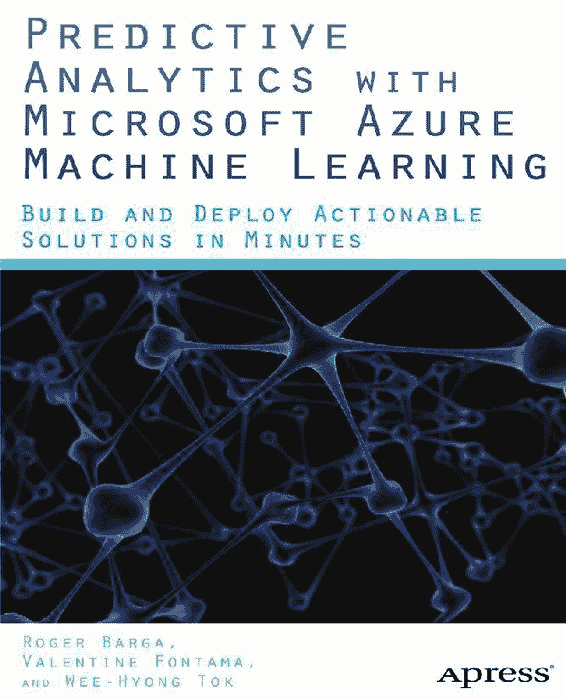
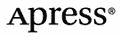

**使用 Microsoft Azure 机器学习进行预测分析**

**在数分钟内构建并部署可操作的解决方案**

Roger Barga

Valentine Fontama

Wee Hyong Tok

**使用 Microsoft Azure 机器学习进行预测分析：在数分钟内构建并部署可操作的解决方案**

版权所有 © 2014 归 Roger Barga、Valentine Fontama 和 Wee Hyong Tok 所有。

本作品受版权保护。出版商保留所有权利，无论是涉及材料的全部或部分，特别是翻译、重印、重用插图、朗诵、广播、微缩胶片复制或以任何其他物理方式复制、传输或信息存储与检索、电子改编、计算机软件，或现在已知或以后开发的类似或不同方法的权利。此法律保留的例外情况包括与评论或学术分析相关的简短摘录，或专门为输入计算机系统并执行而提供的材料，仅供作品购买者独家使用。仅可根据出版商所在地现行版权法的规定复制本出版物或其部分内容，并且必须始终从 Springer 获得使用许可。使用许可可通过 Copyright Clearance Center 的 RightsLink 获取。违反者将根据相应的版权法被起诉。

ISBN-13（平装本）：978-1-4842-0446-7

ISBN-13（电子版）：978-1-4842-0445-0

本书中可能出现商标名称、徽标和图像。我们不会在每次出现商标名称、徽标或图像时都使用商标符号，而是仅以编辑方式使用这些名称、徽标和图像，以利于商标所有者，且无意侵犯商标权。

本出版物中使用的商品名称、商标、服务标志和类似术语，即使未明确标识，也不应被视为对其是否受专有权利保护的表达意见。

尽管本书中的建议和信息在出版时被认为是真实准确的，但作者、编辑和出版商均不对可能出现的任何错误或遗漏承担法律责任。出版商对本书所含内容不作任何明示或暗示的保证。

常务董事：Welmoed Spahr

首席编辑：James DeWolf

开发编辑：Douglas Pundick

技术审阅人：Jacob Spoelstra 和 Hang Zhang

编辑委员会：Steve Anglin、Mark Beckner、Gary Cornell、Louise Corrigan、James DeWolf、Jonathan Gennick、Robert Hutchinson、Michelle Lowman、James Markham、Matthew Moodie、Jeff Olson、Jeffrey Pepper、Douglas Pundick、Ben Renow-Clarke、Dominic Shakeshaft、Gwenan Spearing、Matt Wade、Steve Weiss

协调编辑：Kevin Walter

文字编辑：Mary Behr

排版：SPi Global

索引编制：SPi Global

插图：SPi Global

封面设计：Anna Ishchenko

全球图书贸易发行由 Springer Science+Business Media New York 负责，地址：233 Spring Street, 6th Floor, New York, NY 10013。电话：1-800-SPRINGER，传真：(201) 348-4505，电子邮件：orders-ny@springer-sbm.com，或访问 [www.springeronline.com](http://www.springeronline.com)。Apress Media, LLC 是加利福尼亚州的有限责任公司，其唯一成员（所有者）是 Springer Science + Business Media Finance Inc (SSBM Finance Inc)。SSBM Finance Inc 是一家**特拉华州**公司。

有关翻译信息，请发送电子邮件至 rights@apress.com，或访问 [www.apress.com](http://www.apress.com)。

Apress 和 friends of ED 的书籍可批量购买用于学术、企业或促销用途。大多数图书也提供电子书版本和许可证。如需更多信息，请参阅我们的特殊批量销售–电子书许可网页：[www.apress.com/bulk-sales](http://www.apress.com/bulk-sales)。

作者在本文中引用的任何源代码或其他补充材料均可供读者在 [www.apress.com](http://www.apress.com) 获取。有关如何找到本书源代码的详细信息，请访问 [www.apress.com/source-code/](http://www.apress.com/source-code/)。

内容概览

关于作者

致谢

前言

引言

 第 1 部分：介绍数据科学与 Microsoft Azure 机器学习

 第 1 章：数据科学简介

 第 2 章：Microsoft Azure 机器学习介绍

 第 3 章：与 R 的集成

 第 2 部分：统计与机器学习算法

 第 4 章：统计与机器学习算法简介

 第 3 部分：实际应用

 第 5 章：构建客户倾向模型

 第 6 章：构建流失模型

 第 7 章：客户细分模型

 第 8 章：构建预测性维护模型

索引

目录

关于作者

致谢

前言

引言

 第 1 部分：介绍数据科学与 Microsoft Azure 机器学习

 第 1 章：数据科学简介

什么是数据科学？

分析谱系

描述性分析

诊断性分析

预测性分析

规范性分析

为什么它很重要，为什么是现在？

数据作为竞争资产

客户需求增加

数据挖掘技术认知提升

获取更多数据

更快更便宜的处理能力

数据科学流程

常见数据科学技术

分类算法

聚类算法

回归算法

模拟

内容分析

推荐引擎

数据科学前沿

集成模型的兴起

总结

参考文献

 第 2 章：Microsoft Azure 机器学习介绍

你好，机器学习工作室！

实验的组成部分

创建实验的五个简单步骤

步骤 1：获取数据

步骤 2：预处理数据

步骤 3：定义特征

步骤 4：选择并应用机器学习算法

步骤 5：对新数据进行预测

在生产环境中部署模型

将模型部署到暂存环境

测试 Web 服务

将模型从暂存环境迁移到生产环境

访问 Azure 机器学习 Web 服务

总结

 第 3 章：与 R 的集成

R 简介

构建并部署你的第一个 R 脚本

使用 R 进行数据预处理

使用脚本包（Zip）

使用 R 构建并部署决策树

总结

 第 2 部分：统计与机器学习算法

 第 4 章：统计与机器学习算法简介

回归算法

线性回归

神经网络

决策树

提升决策树

分类算法

支持向量机

贝叶斯点机

聚类算法

总结

 第 3 部分：实际应用

 第 5 章：构建客户倾向模型

业务问题

数据获取与准备

从本地文件系统加载数据

从其他来源加载数据

数据分析

训练模型

模型测试与验证

模型性能

总结

 第 6 章：构建流失模型

流失模型简介

构建并部署客户流失模型

准备与理解数据

数据预处理与特征选择

用于预测流失的分类模型

评估客户流失模型的性能

总结

 第 7 章：客户细分模型

客户细分模型简介

构建并部署你的第一个 K-Means 聚类模型

特征哈希

识别正确的特征

K-Means 聚类的特性

批发客户的客户细分

从 UCI 机器学习库加载数据

使用 K-Means 聚类进行批发客户细分

新数据的聚类分配

总结

 第 8 章：构建预测性维护模型

概述

业务问题

数据获取与准备

数据集

数据加载

数据分析

训练模型

模型测试与验证

模型性能

模型部署

将模型发布到暂存环境

将模型从暂存环境迁移到生产环境

总结

索引

关于作者

**Roger Barga** 是亚马逊网络服务（Amazon Web Services）的总经理兼开发总监。在加入亚马逊之前，Roger 是微软云与企业部门中云机器学习组的集团项目经理，其团队负责 Azure 机器学习服务的产品管理。Roger 于 1997 年加入微软，担任微软研究院数据库组的研究员，负责数据库、工作流和流处理系统的系统研究和产品开发工作。他将基础研究的想法，通过概念验证原型，推进到产品组的孵化工作中。在加入微软之前，Roger 是太平洋西北国家实验室机器学习组的研究科学家，负责构建和部署基于机器学习的解决方案。Roger 还是华盛顿大学的附属教授，在数据科学和机器学习项目中担任讲师。

Roger 拥有计算机科学博士学位、计算机科学硕士学位（主攻机器学习方向），以及数学与计算科学学士学位。他发表了 90 多篇经过同行评审的技术论文和书籍章节，从 1991 年到 2013 年与 214 位合著者合作，被 1,084 位作者引用超过 700 次。

**Valentine Fontama** 是微软数据与决策科学组（DDSG）的首席数据科学家，负责领导外部咨询项目，为微软客户提供世界级的高级分析解决方案。Val 在数据科学和商业领域拥有超过 18 年的经验。在获得人工神经网络博士学位后，他将数据挖掘应用于环境科学和信贷行业。在加入微软之前，Val 是伦敦 Equifax 公司的新技术顾问，率先将数据挖掘应用于消费信贷行业的风险评估和市场营销。他目前是华盛顿大学数据科学专业的附属教授。

在微软的上一任职位中，Val 是高级产品营销经理，负责云和企业营销中的大数据和预测分析。在此职位上，他领导了 Microsoft Azure 机器学习、微软首个 Hadoop 服务 HDInsight、微软首个数据仓库设备并行数据仓库，以及三个版本的 Fast Track 数据仓库的产品管理工作。他还在定义微软的内存计算战略和定位方面发挥了关键作用。

Val 拥有沃顿商学院的战略管理与营销 MBA 学位、神经网络博士学位、计算硕士学位，以及数学与电子学学士学位（一等荣誉）。他合著了《Introducing Microsoft Azure HDInsight》一书，并发表了 11 篇学术论文，被超过 227 位作者引用 152 次。

**Wee-Hyong Tok** 是微软 SQL Server 团队的高级项目经理。Wee-Hyong 拥有超过 12 年的数据库系统经验（其中在工业界拥有超过 6 年的数据平台经验，在学术界拥有 6 年的经验）。

在攻读博士学位之前，Wee-Hyong 是新加坡一家大型电信公司的系统分析师，负责市场营销决策支持系统。在获得新加坡国立大学数据流系统博士学位后，他加入微软并加入了 SQL Server 团队。在过去的六年里，Wee-Hyong 积累了与来自亚洲和美国的分布式工程团队合作的丰富经验，并负责塑造 SSIS 服务器，将其从概念引入到 SQL Server 2012 的发布。最近，Wee-Hyong 加入了 Azure 数据工厂团队，该团队提供用于编排和管理数据转换与移动的服务。

Wee Hyong 拥有新加坡国立大学的数据流系统博士学位、计算科学硕士学位以及计算机科学一等荣誉学士学位。他发表了 21 篇经同行评审的学术论文和期刊文章，并合著了两本书籍：《*Microsoft Azure HDInsight 入门*》和《*Microsoft SQL Server 2012 Integration Services*》。

致谢

我要向微软 CloudML 团队的众多成员表达感谢，他们陪伴我们完成了这本书；感谢所有提供支持、阅读、提出意见并协助编辑和校对的人。我要感谢我的合著者 Val 和 Wee-Hyong，他们的动力和毅力是完成本书的关键，还要感谢我们的出版商 Apress，特别是 Kevin Walter 和 James T. DeWolf，让这一切成为可能。最重要的是，我要感谢我的妻子 Terre，以及我的女儿 Amelie 和 Jolie，尽管这本书占用了大量本应陪伴她们的时间，她们依然给予我支持和鼓励。

——Roger Barga

我要感谢我的合著者 Roger 和 Wee-Hyong，在这个项目上与我们进行了深入的合作。特别感谢我的妻子 Veronica，以及我可爱的孩子们 Engu、Chembe 和 Nayah，感谢他们的支持和鼓励。

——Valentine Fontama

我要感谢我的合著者 Roger 和 Val，我们一起努力塑造了本书的内容。我深深感谢 CloudML 团队的数据科学家们所做的审阅工作。我还要感谢从概念到出版一直与我们合作的 Apress 团队。我要感谢 Juliet、Nathaniel、Siak-Eng 和 Hwee-Tiang，感谢他们的爱、支持和耐心。

——Wee-Hyong

前言

很少有人能充分认识到机器学习在企业应用中的巨大潜力。我很幸运，在入职第一份工作仅仅几个月后，就初步领略了它的潜在益处。那是 1995 年，信用卡发卡机构开始采用神经网络模型来实时检测信用卡欺诈。当信用卡被使用时，销售点系统的交易数据会被发送到发卡机构的信用授权系统，在那里，神经网络会对欺诈概率进行评分。如果概率很高，交易就会被实时拒绝。我当时是一名构建此类模型的科学家，我交付的首批模型之一就是为一家南美银行开发的。模型部署后，该银行在第一天就识别出了超过一百万美元此前未被发现的欺诈行为。这让我大开眼界。此后的岁月里，我见证了机器学习在众多不同应用中带来的巨大价值，例如需求预测、故障和异常检测、广告定向投放、在线推荐以及像 Cortana 这样的虚拟助手。通过将机器学习嵌入到企业系统中，组织可以改善客户体验、降低系统性故障风险、增加收入并实现显著的成本节约。

然而，构建机器学习系统是一个缓慢、耗时且容易出错的过程。尽管我们现在能够分析非常庞大的数据集，并以极高的交易速率进行部署，但以下瓶颈依然存在：

*   机器学习系统的开发需要深厚的专业知识。尽管机器学习的核心原则现在已为更广泛的受众所了解，但招聘到有才华的数据科学家在今天和二十年前一样困难。
*   从业者被迫使用各种工具来收集、清理、合并和分析数据。这些工具学习曲线陡峭，且彼此之间并未集成。商业机器学习软件的部署和维护成本高昂。
*   构建和验证模型需要大量的实验。数据科学家常常感到受限于计算和存储资源，因为他们需要运行大量实验，而这些实验会产生大量新数据。
*   软件工具不支持可扩展的实验或组织实验运行的方法。在没有工具支持的情况下，与团队协作进行实验、共享衍生变量和脚本等行为是手动且临时的。评估和调试统计模型仍然是一个挑战。

数据科学家通过编写自定义程序并在执行机器学习实验时进行大量无差别的繁重工作来绕过这些限制。但在部署阶段，情况变得更加困难。在关键业务过程中（如实时欺诈预防或广告定向投放）部署机器学习模型，需要复杂的工程技术。必须满足以下需求：

*   通常，离线开发的机器学习模型现在必须用 C++、C# 或 Java 等语言重新实现。
*   必须构建交易数据管道。离线模型中使用的数据转换和变量必须重新编码和编译。
*   这些重新实现不可避免地会引入错误，需要验证模型是否按原始设计工作。
*   必须为模型构建一个自定义容器，并配备适当的监控、指标和日志记录。
*   高级部署需要 A/B 测试框架来并排评估替代模型。需要有一种机制来切换模型的引入或退出，最好无需重新编译和部署整个应用程序。
*   必须通过统计测试来验证候选生产模型是否按原始设计工作。

系统做出的自动决策以及业务成果必须被记录下来，以便用于改进机器学习模型和进行监控。

服务必须针对高可用性、灾难恢复以及与终端点的地理接近性进行设计。

当服务需要扩展以满足更高的交易速率和/或低延迟要求时，需要投入更多工作来配置新硬件、将服务部署到新机器并进行横向扩展。

所有这些都是耗时且工程密集的步骤，在基础设施和人力方面都代价高昂。一个生产级机器学习应用的端到端工程和维护需要一个高技能团队，而很少有组织能够建立并维持这样的团队。

Microsoft Azure ML 正是为解决这些问题而设计的。

*   这是一项完全托管的云服务，无需安装软件、管理硬件，也无需处理操作系统版本或开发环境。
*   数据科学家只需一个浏览器，即可从任何地点、任何设备登录 Azure 并开始开发机器学习模型。他们可以在 Azure 存储中托管几乎无限数量的文件。
*   ML Studio 是一个用于机器学习的集成开发环境，它允许你通过易于使用的拖放连接范式，将实验设置为简单的数据流图。数据科学家可以避免为大量常见任务编写程序，从而专注于实验设计和迭代。
*   提供了许多示例实验，方便你快速上手。
*   内置了微软研究院开发的一系列精选算法，并支持自定义 R 代码。超过 350 个开源 R 包可以在 Azure ML 中安全使用。
*   数据流图可以包含多个并行路径，这些路径会自动并行运行，使科学家能够执行复杂的实验并进行并排比较，而无需受限于通常的计算约束。
*   实验易于共享，因此其他人可以接手你的工作，在你停下的地方继续推进。

Azure ML 还使得在云中大规模创建生产部署变得简单。预训练的机器学习模型可以整合到评分工作流中，只需点击几下，即可创建一个新的云托管 REST API。该 REST API 经过精心设计，能够实现低延迟响应。无需重新实现或移植——这是相对于传统数据分析软件的一个关键优势。来自互联网任何地方（笔记本电脑、网站、移动设备、可穿戴设备和联网机器）的数据都可以发送到新创建的 API 以获取预测结果。例如，数据科学家可以创建一个欺诈检测 API，该 API 将交易信息作为输入，并返回低/中/高风险指标作为输出。这样的 API 随后将在云端“上线”，随时准备接收开发者选择调用的任何软件的调用。API 后端可以弹性伸缩，因此当交易率飙升时，Azure ML 服务可以自动处理负载。数据科学家可以创建和部署的机器学习 API 数量几乎没有限制——而且这一切都无需依赖工程团队。对于工程和 IT 团队来说，使用这些 REST API 集成新的机器学习模型变得简单，并且在部署前轻松并排测试多个模型，从而以低成本实现显著更高的敏捷性。Azure 提供了在生产环境中扩展和管理 API 的机制，包括衡量可用性、延迟和性能的机制。因此，为企业构建稳健、高可用、可靠的机器学习系统并管理生产部署，变得异常快速、廉价和简单，并带来巨大的商业利益。

我们相信 Azure ML 是一项颠覆性的技术。它使初创公司和大型企业都能利用机器学习的巨大潜力。初创公司现在能够使用以前只有最成熟的企业才能使用的相同能力。大型企业则能够释放其大数据中的潜在价值，以产生显著更多的收入和效率。最重要的是，现在可能实现的迭代和实验速度将允许快速创新，并为我们周围所有云连接设备中的智能铺平道路。

当我于 1995 年开始职业生涯时，构建和部署信用卡欺诈检测系统需要一个大型组织。借助 Azure ML 这样的工具和云的力量，一位才华横溢的数据科学家就能完成同样的壮举。本书的作者们在数据科学领域拥有丰富的经验，他们编写本书旨在帮助你开启使用 Azure ML 的精彩旅程。

—Joseph Sirosh
微软公司机器学习部门企业副总裁

引言

数据科学和机器学习需求旺盛，因为客户越来越多地寻求从其数据中挖掘洞察的方法。现在，越来越多的客户意识到，由于数据的数量、速度和复杂性已经超越了传统分析工具的能力范围，商业智能已不足以应对。虽然商业智能处理描述性和诊断性分析，但数据科学通过预测性和规范性分析开启了新的机遇。

本书概述了数据科学，并深入介绍了微软最新的预测分析服务——Microsoft Azure Machine Learning。本书提供了一种结构化的数据科学方法，以及解决实际业务问题（如买家倾向性建模、客户流失分析、预测性维护和产品推荐）的实用指南。微软这项新服务的简洁性将有助于将数据科学和机器学习推广到比现有产品更广泛的受众群体。了解如何使用微软新的 Azure Machine Learning 服务，快速构建和部署复杂的预测模型作为机器学习 Web 服务。

谁应该阅读本书？

本书面向数据科学家、业务分析师、商业智能专业人士和开发者。

读者需要具备统计学和数据分析的基本技能。不过，读者无需是数据科学家或拥有深厚的数据挖掘技能，也能从本书中获益。

你将学到什么

本书将提供以下内容：

*   数据科学的深厚背景知识，以及如何使用结构化方法和最佳实践解决业务数据科学问题
*   如何使用 Microsoft Azure Machine Learning 服务有效地构建和部署预测模型作为机器学习 Web 服务
*   展示如何解决典型预测分析问题（如倾向性建模、流失分析和产品推荐）的实践示例

在本书结束时，你将掌握基础数据科学、数据挖掘过程的基本技能，并对新的 Microsoft Azure Machine Learning 服务有清晰的理解。你还将获得使用机器学习解决实际业务问题的框架。

第一部分

介绍数据科学与 Microsoft Azure Machine Learning

