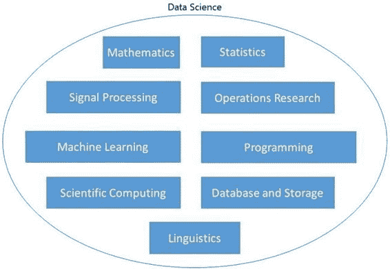
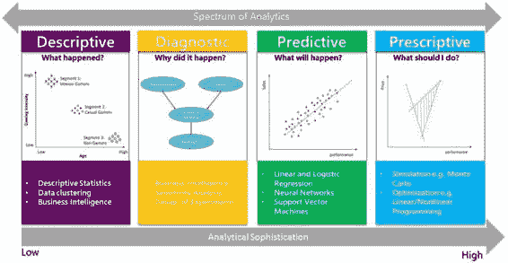
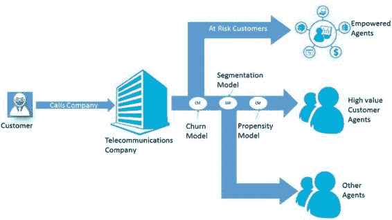
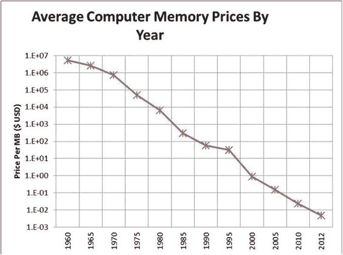
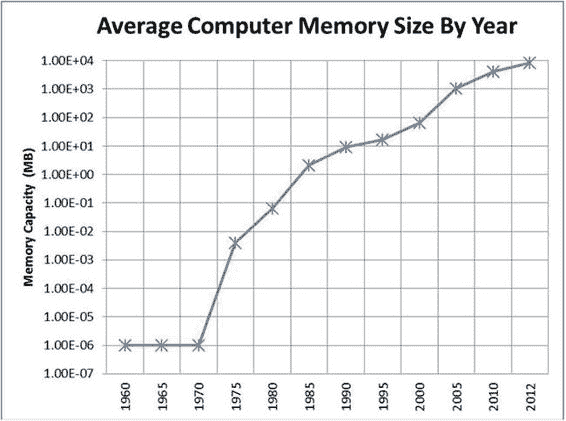
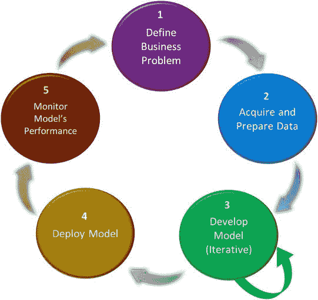
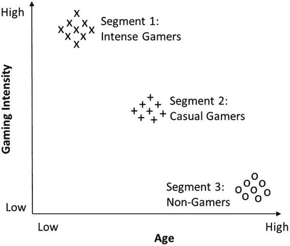

# 第一章 数据科学导论

那么，什么是数据科学？为什么它如此热门？它只是另一个在炒作过后就会消失的时尚吗？我们将从数据科学的简单介绍开始，定义它是什么、为什么重要以及为什么是现在。本章重点介绍数据科学过程，并提供指导原则和最佳实践。它介绍了数据科学中一些最常用的技术和算法。并探讨了集成模型，这是数据科学前沿的一项关键技术。

## 什么是数据科学？

数据科学是从数据中获取有用洞察的实践。虽然它也适用于小数据，但数据科学对大数据尤为重要，因为如今我们从组织内外的众多来源收集了 PB 级别的结构化和非结构化数据。结果，我们变得数据丰富但信息贫乏。数据科学提供了强大的流程和技术，用于从这片数据海洋中挖掘可操作的信息。数据科学借鉴了多个学科，包括统计学、数学、运筹学、信号处理、语言学、数据库与存储、编程、机器学习以及科学计算。图 1-1 展示了数据科学最常见的学科领域。尽管`数据科学`这个术语在商业领域是新的，但它自 1960 年就已存在，当时彼得·诺尔首次将其用于指代计算机科学中的数据处理方法。自 20 世纪 90 年代末以来，著名的统计学家如 C.F.吴和威廉·S·克利夫兰也使用了数据科学这一术语，他们认为这门学科与统计学相同或是其延伸。

图 1-1. 突出构成数据科学的主要学术学科

数据科学的实践者是数据科学家，他们的技能涵盖统计学、数学、运筹学、信号处理、语言学、数据库与存储、编程、机器学习以及科学计算。此外，为了有效工作，数据科学家还需要良好的沟通和数据可视化技能。领域知识对于交付有意义的成果也至关重要。如此广泛的技能很难在一个人身上找到，这就是为什么数据科学是一项团队运动，而非个人努力。要有效运作，需要组建一个拥有互补数据科学技能的团队。

### 分析光谱

根据高德纳公司的分类，我们进行的所有分析都可以归为四类：描述性分析、诊断性分析、预测性分析和规范性分析。描述性分析通常有助于描述情况，并能回答诸如`发生了什么？`、`我的客户是谁？`等问题。诊断性分析帮助你理解事情发生的原因，并能回答诸如`为什么会发生？`之类的问题。预测性分析具有前瞻性，可以回答诸如`未来会发生什么？`之类的问题。顾名思义，规范性分析更具指导性，有助于回答诸如`我们应该做什么？`、`到达目的地的最佳路线是什么？`或`我应该如何分配我的投资？`等问题。

图 1-2 展示了完整的分析光谱。该图也显示了分析的复杂程度。

图 1-2. 所有数据分析的光谱

#### 描述性分析

描述性分析用于解释在特定情况下正在发生的事情。这类分析通常需要人工干预，可用于回答诸如`发生了什么？`、`我的客户是谁？`、`我们有多少种用户类型？`等问题。常用的技术包括使用图表、直方图、箱线图或数据聚类进行描述性统计。你将在本章后面探讨这些技术。

#### 诊断性分析

诊断性分析帮助你理解某些事情发生的原因以及关键驱动因素是什么。例如，无线服务提供商可能会用它来回答诸如`为什么掉线率在增加？`或`为什么我们每个月都在流失更多客户？`等问题。客户诊断分析可以通过聚类、分类、决策树或内容分析等技术来完成。这些技术存在于统计学、数据挖掘和机器学习中。需要注意的是，商业智能也用于诊断性分析。

#### 预测性分析

预测性分析帮助你预测未来会发生什么。它用于预测不确定结果的概率。例如，它可以用来预测信用卡交易是否欺诈，或者某个客户是否可能升级到高级电话套餐。统计学和机器学习为预测提供了很好的技术。这包括神经网络、决策树、蒙特卡洛模拟和回归等技术。

#### 规范性分析

规范性分析将建议采取最佳行动方案以优化你的业务成果。通常，规范性分析将预测模型与业务规则（例如，如果欺诈概率超过给定阈值则拒绝交易）相结合。例如，它可以建议向特定客户提供的最佳电话套餐，或者基于优化，为你的送货卡车提出最佳路线。规范性分析在渠道优化、投资组合优化或交通优化等场景中非常有用，可以根据当前交通状况找到最佳路线。可以使用决策树、线性和非线性规划、蒙特卡洛模拟或来自统计学和数据挖掘的博弈论等技术来进行规范性分析。参见图 1-2。

分析的复杂性从描述性分析到规范性分析逐渐增加。在许多方面，规范性分析是分析的理想境界，通常被分析能力最强的组织所使用。想象一家智能电信公司，它将分析模型嵌入到其业务流程系统中。其客户呼叫中心系统嵌入了以下分析模型：
*   `客户流失模型`：这是一个预测模型，用于预测客户流失的概率。换句话说，它预测了致电呼叫中心的客户最终转向竞争对手的可能性。
*   `客户细分模型`：该模型将客户划分为不同的细分市场，用于营销目的。
*   `客户倾向模型`：该模型预测客户对每个营销优惠（例如升级到高级套餐）的响应倾向。

当客户来电时，呼叫中心系统会通过其手机号码实时识别客户。然后，呼叫中心系统使用这三个模型对客户进行评分。如果客户在客户流失模型上得分很高，意味着他们非常有可能转向竞争对手。在这种情况下，电信公司会立即将客户转接给一组有权提供有吸引力优惠以防止流失的呼叫中心代理。否则，如果细分模型将客户评分为高价值客户，他/她将被转接到专门的礼宾服务，该服务等待时间更短，客户服务最佳。如果倾向模型显示客户升级倾向很高，呼叫代理会收到提醒，并尝试以有吸引力的升级方案进行向上销售。该解决方案的美妙之处在于，所有模型都融入了电信公司的业务流程中，驱动其代理做出明智的决策，从而提高盈利能力和客户满意度。这在图 1-3 中进行了说明。

图 1-3. 一家使用规范性分析的智能电信公司

## 为什么它很重要，为什么是现在？

数据科学为客户提供了基于其收集的所有数据做出更明智、更及时决策的真正机会。借助合适的工具，数据科学不仅能从客户自身数据中，还能从其组织外日益增长的数据源（如天气数据、客户人口统计数据、来自信用机构的消费者信用数据，以及来自 Twitter、Instagram 等社交媒体网站的数据）中，为客户提供新颖且可操作的见解。以下是数据科学如今对企业成功至关重要的几个原因。

### 数据作为竞争资产

数据如今已成为一种关键资产，为那些正确利用数据进行决策的明智组织提供了竞争优势。麦肯锡和 Gartner 都认同这一点：在最近的一篇论文中，麦肯锡指出，使用数据和业务分析进行决策的公司比不这样做的公司生产力更高，股本回报率也更高。类似地，Gartner 认为，投资于现代数据基础设施的组织将比其同行表现高出多达 20%。大数据为组织提供了机会，可以跨数据孤岛整合有价值的数据，以获取推动更明智决策的新见解。

`“使用数据和业务分析指导决策的公司比不这样做的竞争对手生产力更高，股本回报率也更高。”`
——Brad Brown 等人，麦肯锡全球研究所，2011 年

`“到 2015 年，将高价值、多样化的新型信息类型和来源整合到连贯信息管理基础设施中的组织，其财务表现将比行业同行高出 20% 以上。”`
——Regina Casonato 等人，Gartner¹

### 客户需求增长

在过去的几十年里，商业智能一直是大多数组织使用的关键分析形式。然而，随着大数据的出现，越来越多的客户现在渴望使用预测分析来改进营销和业务规划。传统的 BI 能很好地提供对业务的回顾性分析，但无助于解决任何涉及预测或预报的前瞻性问题。

过去两年，客户对预测分析的需求激增，因为他们寻求更强大的分析技术，从存储的大量业务数据中挖掘价值。根据我们的综合经验，我们从未见过客户对数据科学的需求像过去两年这样旺盛！

### 对数据挖掘技术的认识提高

如今，一部分数据挖掘和机器学习算法已被更广泛地理解，因为它们已被 Netflix 和 Amazon 等早期采用者试用和测试，这些公司在其推荐引擎中使用这些算法。虽然大多数客户不完全理解所用机器学习算法的细节，但它们在 Netflix 电影推荐或在线商店推荐引擎中的应用非常显著。同样，许多客户现在也意识到了大多数成熟的在线供应商大量使用的定向广告。因此，虽然许多客户可能不了解所用算法的细节，但他们现在越来越理解其商业价值。

### 获取更多数据

数字数据在过去几年中呈爆炸式增长，并且没有放缓的迹象。大多数行业专家现在都同意，我们收集的数据比以往任何时候都多。根据 IDC 的数据，到 2020 年，全球数字宇宙将增长到 35 ZB（即 35 万亿 TB）。其他人认为，全球数据现在每 5 年增长多达 10 倍，这令人震惊。在最近的一项研究中，麦肯锡咨询公司还发现，在美国 17 个经济部门中的 15 个部门中，拥有超过 1000 名员工的公司平均存储超过 235 TB 的数据——这比美国国会图书馆存储的数据还要多！这种数据爆炸是由社交媒体、手机、智能传感器等新数据源的兴起以及计算机行业的巨大进步所驱动的。

收集的大量数据也使您能够构建更准确的预测模型。我们从统计学中知道，置信区间（也称为误差范围）与样本量成反比。因此，样本量越大，误差范围越小。这反过来又提高了模型预测的准确性。

### 更快、更便宜的处理能力

我们现在拥有的计算能力比以往任何时候都强大得多。摩尔定律提出，计算机芯片的性能将呈指数级增长，每 18 个月翻一番。这一趋势在现代计算的大部分历史中都是正确的。2010 年，国际半导体技术路线图更新了这一预测，预测增长将在 2013 年放缓，届时计算机密度和数量将每 3 年翻一番，而不是 18 个月。尽管如此，处理器性能的指数级增长已经带来了技术和经济生产力的巨大提升。如今，智能手机的处理能力比 20 年前的台式电脑强大五倍。例如，诺基亚 Lumia 928 配备的双核 1.5 GHz 高通骁龙™ S4 处理器，其速度至少是 1993 年发布的、在个人电脑中非常流行的英特尔奔腾 P5 CPU 的五倍。在九十年代，需要像 DEC VAX 大型机或 DEC Alpha 工作站这样昂贵的工作站才能运行先进的、计算密集型算法。值得注意的是，今天的智能手机也比 1994 年速度在 200-300 MHz 的强大 DEC Alpha 处理器快五倍！如今，您可以在配备多核处理器的经济型个人工作站上运行相同的算法。此外，我们可以利用 Hadoop 的 MapReduce 架构，以比以往低得多的成本在商品服务器集群上部署强大的数据挖掘算法。借助数据科学，我们现在拥有了通过智能部署数据挖掘和机器学习算法来发现数据中隐藏模式的工具。

我们还看到了容量的巨大提升以及计算机内存价格的指数级下降。这在图 1-4 和 1-5 中得到了说明，这些图表显示了自 1960 年以来计算机内存价格的指数级下降和容量的增长。自 1990 年以来，每 MB 内存的平均价格已从 59 美元降至微不足道的 0.49 美分——价格降低了 99.2%！与此同时，内存模块的容量已从 8MB 增加到惊人的 8GB！因此，一台普通的笔记本电脑现在比九十年代初的高端工作站还要强大。

图 1-4. 自 1960 年以来的平均计算机内存价格

图 1-5. 自 1960 年以来的平均计算机内存大小

 **注意** 有关内存价格历史的更多信息，请访问 John C. McCallum 的网站：[`www.jcmit.com/mem2012.htm`](http://www.jcmit.com/mem2012.htm)。

## 数据科学流程

一个典型的数据科学项目遵循 图 1-6 中概述的五步流程。让我们详细回顾每个步骤。

### 1. 定义业务问题

这一步至关重要，因为它将指导项目的后续工作。在构建任何模型之前，必须与项目发起人合作，明确他/她试图解决的具体业务问题。否则，你可能会花费数周甚至数月的时间构建出精妙的模型，却解决了错误的问题，导致前功尽弃。一个优秀的数据科学项目能够提炼出深刻的见解，从而推动更明智的业务决策。因此，分析工作应当服务于某个业务目标，而不应成为“寻找钉子的锤子”！从业者会使用正式的咨询技术和框架（例如引导式发现研讨会和六西格玛方法论）来帮助业务利益相关者确定业务目标的优先级和范围。

### 2. 获取并准备数据

此步骤包含两项活动。首先是获取来自多个源系统（包括数据库、CRM 系统、Web 日志文件等）的原始数据。这可能涉及 `ETL`（提取、转换和加载）流程、数据库管理员以及商业智能人员。然而，数据科学家需要深度参与，以确保以正确的格式提取到正确的数据。处理原始数据还能提供下游所需的关键背景信息。

其次，一旦提取到正确的数据，就需要对其进行分析并准备建模。这包括处理缺失数据、数据中的异常值以及数据转换。通常，如果一个变量的缺失值超过 40%，则可以舍弃该变量，除非其缺失（或不缺失）这一事实本身传达了关键信息。例如，在调查中，填写可选字段“年龄”的人群可能存在强烈的人口统计学偏差。对于其余情况，我们需要决定如何处理缺失值：是使用平均值、中位数还是其他值进行插补？

有多种统计技术可用于检测异常值。在箱线图中，异常值是指大于或小于四分位距（`IQR`）1.5 倍的样本（值）。四分位距是第 75 百分位数减去第 25 百分位数。我们需要决定是否剔除异常值。如果保留它是有意义的，则需要为该变量找到一个有用的转换方法。例如，对数转换通常适用于转换收入数据。

相关性分析、主成分分析或因子分析是展示变量之间关系的有用技术。最后，在此阶段进行特征选择，以确定下一步在模型中使用的正确变量。

这一步可能既费力又耗时。事实上，在一个典型的数据科学项目中，我们花费高达 75% 到 80% 的时间在数据获取和准备上。尽管如此，这是将原始数据转化为用于建模的高质量“宝石”的关键步骤。那句老话依然正确：*垃圾进，垃圾出*。在数据准备上明智地投入，能提高项目的成功率。

### 3. 开发模型

这是项目中最有趣的部分，我们将在此开发预测模型。在此步骤中，我们根据业务问题和数据确定用于建模的正确算法。例如，如果是二元分类问题，我们可以使用逻辑回归、决策树、提升决策树或神经网络。如果最终模型需要具有可解释性，那么像提升决策树这样的算法就不适用。模型构建是一个迭代过程：我们尝试不同的模型以找到预测能力最强的那个。在退出此阶段之前，我们还会与客户进行几次验证，以确保模型满足他们的需求。

### 4. 部署模型

模型构建完成后，最终模型必须部署到生产环境中，用于对交易进行评分，或供客户使用以驱动实际的业务决策。根据客户环境的不同，模型的部署方式也多种多样。在大多数情况下，部署模型涉及重新实现数据科学家开发的数据转换和预测算法，以便与现有的决策管理平台集成。可以说，目前这是一个繁琐的过程。`Azure 机器学习`通过使数据科学家能够将其完成的模型部署为 Web 服务，从而极大地简化了模型部署，这些 Web 服务可以从任何平台（包括移动设备）上的任何应用程序进行调用。

### 5. 监控模型性能

数据科学并非在部署后就结束了。值得注意的是，每个统计或机器学习模型都只是对现实世界的一种近似，因此从一开始就存在不完美之处。当一个经过验证的模型经过测试并部署到生产环境后，必须对其进行监控，以确保其按预期运行。这一点至关重要，因为任何数据驱动的模型都有固定的“保质期”。模型的准确性会随着时间的推移而下降，因为从根本上说，生产环境中的数据会因多种原因随时间变化，例如，企业可能会推出新产品以针对不同的人群。例如，我们之前讨论的无线运营商可能会选择为青少年推出一个新的电话套餐。如果他们继续使用相同的流失和倾向模型，可能会在新产品推出后看到模型性能下降。这是因为用于构建流失和倾向模型的原始数据集并未包含大量的青少年客户。通过对生产环境中的模型进行密切监控，我们可以检测到其性能何时开始下降。当其准确性显著下降时，就该重建模型了：要么使用包含生产数据的最新数据集对其进行重新训练，要么使用额外的数据集完全重建。在这种情况下，我们将返回步骤 1，重新审视业务目标并从头开始。

我们应该多久重建一次模型？频率因业务领域而异。在数据变化不快的稳定业务环境中，模型可以每一两年重建一次。一个很好的例子是零售银行产品，如抵押贷款和汽车贷款。然而，在环境数据快速变化的动态环境中，模型可能需要每天或每周重建。一个典型的例子是竞争激烈的无线电话行业。由于客户不断被竞争对手更具吸引力的优惠所吸引，流失模型需要每隔几天就重新训练一次。

图 1-6. 数据科学流程概览

## 常见的数据科学技术

数据科学从其组成学科中提供了大量的算法，这些学科包括统计学、数学、运筹学、信号处理、语言学、数据库与存储、编程、机器学习以及科学计算。为简单起见，我们将这些算法分为以下几组：

*   分类
*   聚类
*   回归
*   模拟
*   内容分析
*   推荐系统

第 4 章提供了其中一些算法的更多细节。

### 分类算法

分类算法通常用于将人或事物划分到多个组别中的某一个。它们也广泛用于预测。例如，为了防止欺诈，发卡机构会将信用卡交易分类为欺诈性或非欺诈性。发卡机构通常拥有大量历史信用卡交易数据，并了解每笔交易的状态。其中许多案例是由合法的持卡人报告的，他们不想为未经授权的费用买单。因此，发卡机构知道每笔交易是否属于欺诈。利用这些历史数据，发卡机构现在可以构建一个模型，用于预测新的信用卡交易是否可能属于欺诈。这是一个二元分类问题，所有案例都归属于两个类别之一。

另一个分类问题是客户升级到高级电话套餐的倾向性。在这种情况下，无线运营商需要知道客户是否会升级到高级套餐。利用销售和使用数据，运营商可以确定哪些客户过去曾升级过。因此，他们可以将所有客户分为两组：升级或未升级。由于运营商还拥有新老客户的人口统计和行为数据，他们可以构建一个模型来预测新客户升级的可能性；换句话说，该模型会将每个客户归入两个类别之一。

统计学和数据挖掘提供了许多优秀的分类工具：包括逻辑回归（统计学家广泛用于构建信用评分卡或购买倾向模型）、或神经网络算法（如反向传播、径向基函数或岭多项式网络）。其他还包括决策树或集成模型，如提升决策树或随机森林。对于具有两个以上类别的更复杂的分类问题，可以使用预测多个类别的多模态技术。分类问题通常使用监督学习算法，这些算法使用带标签的数据进行训练。Azure 机器学习提供了多种分类算法，包括逻辑回归、决策树、提升决策树、多模态神经网络等。更多详情请参见第 4 章。

## 聚类算法

聚类使用无监督学习将数据分组到不同的类别中。聚类问题和分类问题的一个主要区别在于，聚类的结果事先是未知的。在聚类之前，我们不知道每个数据点属于哪个簇。相比之下，对于分类问题，我们有历史数据显示每个数据点属于哪个类别。例如，贷款机构从历史数据中知道客户是否拖欠了汽车贷款。

聚类的一个很好的应用是客户细分，我们将客户划分为不同的细分市场以进行营销。在一个好的细分模型中，每个细分市场内的数据非常相似。然而，不同细分市场之间的数据差异很大。例如，游戏行业的营销人员需要更好地了解其客户，以便为他们制定合适的优惠方案。假设他/她只有关于客户的两个变量，即年龄和游戏强度。通过聚类，营销人员发现游戏客户存在三个不同的细分市场，如图 1-7 所示。细分市场 1 是重度游戏玩家，他们每天热衷于玩电脑游戏，并且通常很年轻。细分市场 2 是休闲游戏玩家，他们只是偶尔玩游戏，通常在三四十岁。非游戏玩家很少玩电脑游戏，通常年龄较大；他们构成了细分市场 3。

图 1-7。来自聚类算法的简单假设客户细分

统计学提供了几种聚类工具，但最广泛使用的是 `k-means` 算法，它使用距离度量将相似的数据聚类在一起。使用此算法，您可以预先决定想要多少个簇；这就是常数 K。如果您设置 K = 3，算法将生成三个簇。有关 `k-means` 算法的更多详细信息，请参考 Haralambos Marmanis 和 Dmitry Babenko 的著作。机器学习还提供了更复杂的算法，例如由 Teuvo Kohonen 开发的自组织映射（也称为 Kohonen 网络），或由 Stephen Grossberg 和 Gail Carpenter 开发的自适应共振理论（ART）网络。聚类算法通常使用无监督学习，因为在训练期间结果是未知的。

 **注意** 您可以在以下书籍和论文中阅读更多关于聚类算法的内容：

《智能网络算法》，Haralambos Marmanis 和 Dmitry Babenko 著。Manning Publications Co.，斯坦福德，康涅狄格州。2011 年 1 月。

《自组织映射。第三扩展版》。

Springer。Kohonen, T. 2001 年。“Art2-A：一种用于快速类别学习和识别的自适应共振算法”，Carpenter, G., Grossberg, S., 和 Rosen, D. 著。Neural Networks, 4:493-504。1991a。

## 回归算法

回归技术用于预测具有数值结果的响应变量。例如，无线运营商可以使用回归技术来预测其客服中心的呼叫量。有了这些信息，他们可以分配适当数量的客服中心人员以满足需求。回归模型的输入变量可以是数值型或分类型。然而，这些算法的共同点是输出（或响应变量）通常是数值型的。一些最常用的回归技术包括线性回归、决策树、神经网络和提升决策树回归。

线性回归是统计学中最古老的预测技术之一，其目标是根据一组观测变量预测给定的结果。一个简单的线性回归模型是一个线性函数。如果只有一个输入变量，线性回归模型就是最适合数据的直线。对于两个或更多输入变量，回归模型就是最适合底层数据的超平面。

人工神经网络是一组模仿大脑功能的算法。它们通过示例学习，并且即使映射响应变量与自变量之间的函数未知，也能被训练从数据集中进行预测。有许多不同的神经网络算法，包括反向传播网络和径向基函数（RBF）。然而，最常见的是反向传播，也称为多层感知器。神经网络用于回归或分类。

决策树算法是一种分层技术，它基于某些统计标准迭代地分割数据集。决策树的目标是最大化树中不同节点之间的方差，并最小化每个节点内部的方差。一些最常用的决策树算法包括迭代二分器 3（`ID3`）、`C4.5` 和 `C5.0`（`ID3` 的后继者）、自动交互检测（`AID`）、卡方自动交互检测（`CHAID`）以及分类与回归树（`CART`）。虽然非常有用，但 `ID3`、`C4.5`、`C5.0` 和 `CHAID` 算法是分类算法，不适用于回归。另一方面，`CART` 算法既可用于分类也可用于回归。

## 模拟

仿真技术广泛应用于众多行业，用于对现实世界中的流程进行建模和优化。工程师们长期以来一直使用有限元或有限体积等数学方法来模拟飞机机翼或汽车的空气动力学特性。仿真技术为工程公司节省了数百万美元的研发成本，因为他们不再需要完全依赖真实的物理模型进行测试。此外，通过简单地调整计算机模型中的变量，仿真技术还提供了测试更多场景的机会。

在商业领域，仿真技术被用于对呼叫中心等待时间优化、卡车运输公司或航空公司的路线优化等流程进行建模。通过仿真，业务分析师可以对大量假设进行建模，以优化利润或其他业务目标。

统计学为仿真和优化提供了许多强大的技术：马尔可夫链分析可用于模拟动态系统中的状态变化。例如，它可以用来模拟客户在呼叫中心中的流转情况：客户在挂断前会等待多久，或者他们在与交互式语音应答（IVR）系统交互后继续等待的可能性有多大？线性规划用于优化卡车运输或航空路线，而蒙特卡洛模拟则用于寻找在给定业务成果（如利润）下进行优化的最佳条件。

## 内容分析

内容分析用于挖掘文本文件、图像和视频等内容以获取洞察。文本挖掘利用统计和语言分析来理解文本的含义。对于大多数实际应用来说，简单的关键词搜索过于原始。例如，通过简单的关键词搜索来理解推特数据流的情感倾向是一个手动且费力的过程，因为你必须存储代表正面、中性和负面情感的关键词。然后，在扫描推特数据时，你需要根据检测到的特定关键词对每条推文进行评分。这种方法虽然在特定情况下有用，但既繁琐又相当原始。通过文本挖掘和自然语言处理（NLP），这个过程可以实现自动化，它能够挖掘文本并尝试根据上下文推断词语的含义，而不是依赖简单的关键词搜索。

机器学习还提供了多种通过模式识别来分析图像和视频的工具。通过模式识别，我们可以利用人脸识别算法识别已知目标。多层感知器和自适应共振理论（ART）网络等神经网络算法可用于在视频流中检测和跟踪已知目标，或辅助分析 X 光图像。

## 推荐引擎

推荐引擎已被亚马逊等在线零售商广泛使用，用于根据用户的偏好推荐产品。推荐引擎主要有三种方法。协同过滤（CF）基于用户或项目之间的相似性进行推荐。在基于项目的协同过滤中，我们分析项目数据以找出哪些项目是相似的。对于协同过滤，这些数据特指用户与电影之间的交互（例如评分或观看行为），而不是电影本身的特征（如类型、导演、演员）。因此，每当客户购买此集合中的一部电影时，我们就会根据相似性推荐其他电影。

第二类推荐引擎通过分析每个用户所选的内容来进行推荐。在这种情况下，会使用文本挖掘或自然语言处理技术来分析文档文件等内容。相似的内容类型被归为一组，这构成了向新用户进行推荐的基础。关于协同过滤和基于内容的方法的更多信息，请参阅 Haralambos Marmanis 和 Dmitry Babenko 的著作。

推荐引擎的第三种方法使用复杂的机器学习算法来确定产品关联性。这种方法也被称为购物篮分析。朴素贝叶斯或微软关联规则等算法被用于挖掘销售数据，以确定哪些产品会一起销售。

## 数据科学的前沿

让我们通过快速概述处于数据科学前沿的集成模型来结束本章。

### 集成模型的兴起

集成模型是机器学习中的一组分类器，它们使用一组算法而不是单一算法来解决分类问题。它们模仿了我们人类通过咨询知识渊博的朋友或专家来提高决策准确性的倾向。当面临诸如医疗诊断等重要决策时，我们倾向于寻求其他医生的第二意见来提高我们的信心。同样，集成模型使用一组算法作为专家小组，以提高分类问题的准确性并减少方差。

机器学习界对集成模型的研究已有数十年之久。事实上，早在 1979 年，Dasarathy 和 Sheela 就发表了开创性的论文。然而，自 20 世纪 90 年代中期以来，该领域取得了快速进展，多项重要贡献催生了非常成功的实际应用。

### 集成模型的实际应用

在过去几年中，集成模型已在许多伟大的实际应用中发挥作用，包括相机中的人脸识别、生物信息学、Netflix 电影推荐以及微软的 Xbox Kinect。让我们来看看其中的两个应用。

首先，集成模型对Netflix大奖赛的成功起到了至关重要的作用。2006年，Netflix举办了一场公开竞赛，悬赏100万美元，奖励能够将其现有解决方案改进10%的最佳协同过滤算法。2009年9月，这笔100万美元的奖金被授予了BellKor's Pragmatic Chaos团队，这是一个由AT&T实验室的科学家与两个不太知名的团队联合组成的团队。在竞赛开始时，大多数团队都使用单一分类器算法：虽然它们比Netflix的模型性能高出6-8%，但性能很快陷入停滞，直到团队开始应用集成模型。领先的参赛者很快意识到，他们可以通过将自己的算法与看似较弱的团队的算法相结合来改进自己的模型。最终，包括获胜者在内的大多数顶级团队都使用集成模型显著超越了Netflix的推荐引擎。例如，亚军团队在他们的集成模型中使用了超过900个单独的模型。

微软的Xbox Kinect传感器也使用了集成建模。随机森林（一种集成模型形式）被有效地用于在用户使用Xbox Kinect传感器玩游戏时跟踪骨骼运动。

尽管在实际应用中取得了成功，但集成模型的一个关键局限性在于它们是黑盒模型，其决策难以解释。因此，它们不适用于需要解释决策的应用场景。信用评分卡就是一个很好的例子，因为贷款机构需要解释他们分配给每个消费者的信用评分。在某些市场，这种解释是法律要求，因此，尽管集成模型具有预测能力，但它们并不适用。

## 构建集成模型

构建集成模型有三个关键步骤：a) 选择数据，b) 训练分类器，以及 c) 组合分类器。

构建集成模型的第一步是为分类器模型选择数据。在采样数据时，一个关键目标是最大化模型的多样性，因为这可以提高解决方案的准确性。一般来说，你的模型越多样化，最终分类器的性能就越好，其预测的方差也就越小。

该过程的第二步需要训练多个独立的分类器。但如何分配这些分类器呢？在众多可用策略中，最流行的两种是装袋（bagging）和提升（boosting）。装袋算法使用数据的不同子集来训练每个模型。随机森林算法采用的就是这种装袋方法。相比之下，提升算法通过在训练过程中提高训练集中被错误分类样本的重要性来提升性能。因此，在训练过程中，每个新增的模型都会重点关注那些被错误分类的数据。提升决策树算法使用的就是这种提升策略。

最后，当所有分类器训练完成后，最终步骤是将它们的结果结合起来，做出最终预测。有多种方法可以整合这些结果，从简单的多数投票到加权多数投票。

集成模型是机器学习中一个非常令人兴奋的部分，在分类问题上具有取得突破性进展的潜力。

## 总结

本章介绍了数据科学，定义了它是什么、为什么重要以及为什么是现在。我们概述了数据科学的关键学科领域，包括统计学、数学、运筹学、信号处理、语言学、数据库与存储、编程以及机器学习。我们探讨了人们对数据科学兴趣日益浓厚的几个关键原因：数据量不断增长、数据成为竞争资产、数据挖掘意识的增强以及硬件成本的降低。

我们介绍了一个简单的五步数据科学流程，并提供了如何正确应用它的指南。我们还介绍了数据科学中一些最常用的技术和算法。最后，我们介绍了集成模型，这是数据科学前沿的关键技术之一。

## 参考文献

1. Alexander Linden, 2014。高级分析中的关键趋势和新兴技术。Gartner BI峰会2014，美国拉斯维加斯。
2. “你准备好迎接大数据时代了吗？”，麦肯锡全球研究院 - Brad Brown, Michael Chui, and James Manyika，2011年10月。
3. “21世纪的信息管理”，Gartner - Regina Casonato, Anne Lapkin, Mark A. Beyer, Yvonne Genovese, Ted Friedman，2011年9月。
4. John C. McCallum: [`www.jcmit.com/mem2012.htm`](http://www.jcmit.com/mem2012.htm).
5. “智能网络算法”，Haralambos Marmanis and Dmitry Babenko。Manning Publications Co., Stamford CT。2011年1月。
6. “自组织映射。第三扩展版”。Springer。Kohonen, T。2001。
7. “Art2-A：一种用于快速类别学习和识别的自适应共振算法”，Carpenter, G., Grossberg, S., and Rosen, D。神经网络，4:493–504。1991a。
8. “使用Microsoft SQL Server 2008进行数据挖掘”，Jamie MacLennan, ZhaoHui Tang and Bogdan Crivat。Wiley Publishing Inc, Indianapolis, Indiana, 2009。