# 第 2 章 介绍 Microsoft Azure 机器学习

*Azure 机器学习，数据科学、预测分析、云计算和您的数据在此交汇！*

Azure 机器学习使数据科学家和开发人员能够利用预测分析将数据转化为洞察。通过让开发者更容易地在端到端解决方案中使用预测模型，Azure 机器学习使得可操作的洞察能够被轻松获取并投入实际应用。

使用机器学习工作室，数据科学家和开发者可以快速构建、测试和开发使用最先进机器学习算法的预测模型。

你好，机器学习工作室！

*Azure 机器学习工作室提供了一个交互式的* *可视化工作区*，使您能够轻松地构建、测试和部署预测分析模型。

在机器学习工作室中，您可以通过将数据集和分析模块拖放到设计图面上来构建预测模型。您可以使用 Azure 机器学习工作室中的实验迭代地构建预测分析模型。每个实验都是一个完整的工作流，包含构建、测试和评估预测模型所需的所有组件。在一个实验中，机器学习模块通过线条连接在一起，这些线条显示了数据和参数在工作流中的流动。一旦您设计好一个实验，就可以使用机器学习工作室来执行它。

机器学习工作室允许您通过在几分钟内构建和测试多个模型来快速迭代。在构建实验时，通常需要迭代预测模型的设计、编辑参数或模块，并多次运行实验。通常，您会保存实验的多个副本（使用不同的参数）。当您首次打开机器学习工作室时，您会注意到它的组织方式如下：

*   **实验**：已创建、运行并保存为草稿的实验。其中包括一组随服务提供的示例实验，以帮助您快速启动项目。
*   **Web 服务**：您已发布为 Web 服务的实验列表。在您发布第一个实验之前，此列表为空。
*   **设置**：可用于配置您的帐户和资源的一系列设置。您可以使用此选项邀请其他用户共享您在 Azure 机器学习中的工作区。

要开发一个预测模型，您需要能够处理来自不同数据源的数据。此外，数据在用作训练预测模型的输入之前，需要进行转换和分析。各种数据操作和统计函数用于预处理数据并识别数据中有用的部分。在开发模型时，您会经历一个迭代过程，使用各种技术来理解数据、数据中的关键特征以及用于调整机器学习算法的参数。您会持续迭代，直到获得一个经过训练且有效的模型，可以投入使用。

实验的组成部分

一个实验由构建、测试和评估预测模型所必需的关键组件组成。在 Azure 机器学习中，一个实验包含两个主要组件：数据集和模块。

数据集包含已上传到机器学习工作室的数据。在创建预测模型时会用到数据集。机器学习工作室还提供了几个示例数据集，以帮助您快速创建最初的几个实验。在探索机器学习工作室的过程中，您可以上传更多的数据集。

模块是您在构建预测模型时将使用的算法。机器学习工作室提供了大量的模块，以支持端到端的数据科学工作流，包括从不同数据源读取数据；预处理数据；到构建、训练、评分和验证预测模型。这些模块包括以下内容：


*   **转换为 ARFF**：将 .NET 序列化数据集转换为 ARFF 格式。
*   **转换为 CSV**：将 .NET 序列化数据集转换为 CSV 格式。
*   **读取器**：此模块用于从多个源读取数据，包括 Web、Azure SQL 数据库、Azure Blob 存储或 Hive 表。
*   **写入器**：此模块用于将数据写入 Azure SQL 数据库、Azure Blob 存储或 Hadoop 分布式文件系统 (HDFS)。
*   **移动平均筛选器**：为给定数据集创建移动平均值。
*   **联接**：此模块基于用户指定的键联接两个数据集。它对两个数据集执行内联接、左外联接、完全外联接和左半联接。
*   **拆分**：此模块将一个数据集拆分为两部分。它通常用于将数据集拆分为独立的训练数据集和测试数据集。
*   **基于筛选器的特征选择**：此模块用于查找建模中最重要的变量。它使用七种不同的技术（例如，斯皮尔曼相关系数、皮尔逊相关系数、互信息、卡方检验等）从原始数据中对最重要的变量进行排序。
*   **基础统计**：计算给定数据集的基础统计信息，例如平均值、标准差等。
*   **线性回归**：可用于使用线性回归算法创建预测模型。
*   **训练模型**：此模块使用给定的训练数据集训练选定的分类或回归算法。
*   **扫描参数**：对于给定的学习算法以及训练和验证数据集，此模块会查找能产生最佳训练模型的参数。
*   **评估模型**：此模块用于评估已训练的分类或回归模型的性能。
*   **交叉验证模型**：此模块用于执行交叉验证以避免过拟合。默认情况下，此模块使用 10 折交叉验证。
*   **为模型评分**：为已训练的分类或回归模型评分。

所有可用的模块都组织在图 2-1 所示的菜单下。每个模块都提供一组参数，您可以使用这些参数来微调该模块所用算法的行为。当选中一个模块时，您将在画布的右侧窗格中看到该模块的参数。

创建实验的五个简单步骤

在本节中，您将学习如何使用 Azure Machine Learning Studio 开发一个简单的预测分析模型。要设计一个实验，您需要组装一组用于创建、训练、测试和评估模型的组件。此外，您还可以利用其他模块来预处理数据、执行特征选择和/或降维、将数据拆分为训练集和测试集，以及评估或交叉验证模型。以下五个基本步骤可作为创建实验的指南。

***创建模型***

*   步骤 1：获取数据
*   步骤 2：预处理数据
*   步骤 3：定义特征

***训练模型***

*   步骤 4：选择并应用学习算法

***测试模型***

*   步骤 5：对新数据进行预测

步骤 1：获取数据

Azure Machine Learning Studio 提供了许多示例数据集。此外，您还可以从许多不同的源导入数据。在此示例中，您将使用名为**汽车价格数据（原始）**的包含示例数据集，该数据集代表汽车价格数据。

1.  要开始一个新实验，请单击 Machine Learning Studio 窗口底部的 **+新建**，然后选择**实验**。
2.  将实验重命名为“第 02 章 – Hello ML”。
3.  在 Machine Learning Studio 的左侧，您将看到实验项目列表（参见图 2-1）。单击**已保存的数据集**，然后在搜索框中键入“automobile”。找到**汽车价格数据（原始）**。

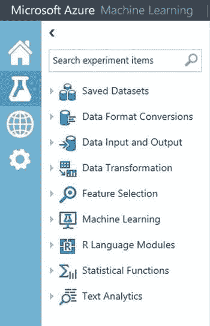

图 2-1。调色板搜索

4.  将数据集拖入实验。您也可以双击数据集以将其包含在实验中（参见图 2-2）。

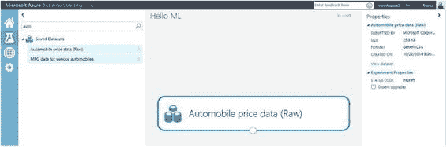

图 2-2。使用数据集

通过单击数据集的输出端口，您可以选择**可视化**，这将允许您探索数据并了解每个列的关键统计信息（参见图 2-3）。

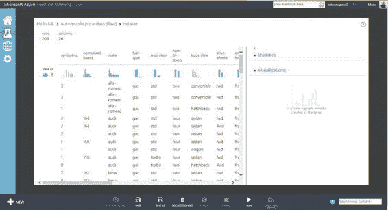

图 2-3。数据集可视化

通过单击右上角的 **x** 关闭可视化窗口。

步骤 2：预处理数据

在开始设计实验之前，预处理数据集非常重要。在大多数情况下，原始数据需要经过预处理才能用作训练预测分析模型的输入。

从之前的探索中，您可能已经注意到数据中存在缺失值。作为分析数据的先决条件，需要清理这些缺失值。对于此实验，您将用指定的值替换缺失值。此外，将删除 normalized-losses 列，因为该列包含太多缺失值。

 **提示**  清理输入数据中的缺失值是使用大多数模块的先决条件。

1.  要删除 normalized-losses 列，请拖动**投影列**模块，并将其连接到**汽车价格数据（原始）**数据集的输出端口。此模块允许您选择要在模型中包含或排除哪些数据列。
2.  选择**投影列**模块，然后在属性窗格（即右侧窗格）中单击**启动列选择器**。

1.  确保在名为**起始于**的筛选器下拉菜单中选择了**所有列**。这将指示投影列传递所有列（除了您即将排除的列）。
    2.  在下一行中，选择**排除**和**列名**，然后在文本框内单击。将显示一个列列表；选择“normalized-losses”，它将被添加到文本框中。如图 2-4 所示。
    3.  单击复选标记确定按钮关闭列选择器。

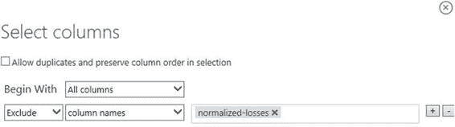

图 2-4。选择列

除 normalized-losses 列外，所有列都将通过。您可以在**投影列**的属性窗格中看到这一点。如图 2-5 所示。

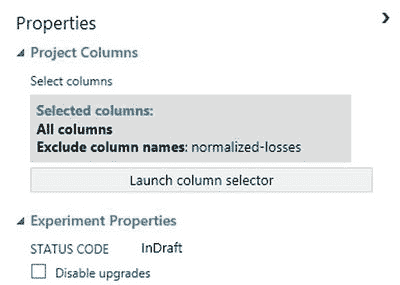

图 2-5。投影列属性

 **提示**  在设计实验时，您可以通过双击模块并输入文本来向模块添加注释。这使其他人能够理解实验中每个模块的用途，并可以帮助您记录实验设计。

3.  将**缺失值清理器**模块拖到实验画布上，并将其连接到**投影列**模块。您将使用默认属性，该属性将缺失值替换为 0。详细信息请参见图 2-6。

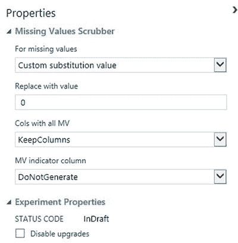

图 2-6。缺失值清理器属性

4.  现在单击**运行**。
5.  当实验成功完成时，每个模块都会有一个绿色的复选标记，表示其成功完成（参见图 2-7）。

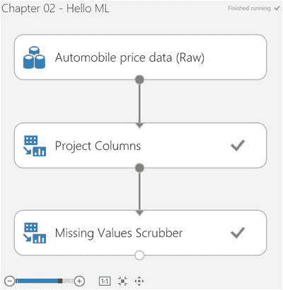

图 2-7。首次实验运行

此时，您已经通过清理和转换数据预处理了数据集。要查看清理后的数据集，请双击**缺失值清理器**模块的输出端口，然后选择**可视化**。请注意，normalized-losses 列不再包含在内，并且没有缺失值。

步骤 3：定义特征


在机器学习中，特征是依据原始数据创建的独立可测量属性，用于帮助算法学习当前任务。理解每个特征所扮演的角色至关重要。例如，某些特征比其他特征更能预测目标变量。此外，有些特征可能与其他特征存在强相关性（例如城市油耗与高速公路油耗）。将高度相关的特征作为输入可能并无益处，因为它们包含相似的信息。

在本练习中，你将构建一个预测模型，使用**汽车价格数据（原始）**数据集中的部分特征来预测新汽车的价格。每一行代表一辆汽车，每一列是该汽车的一个特征。识别出一组可用于构建预测模型的优质特征非常重要。这通常需要实验和对问题领域的了解。出于演示目的，你将使用**项目列**模块选择以下特征：制造商、车身样式、轴距、发动机尺寸、马力、最高转速、高速公路油耗和价格。

1.  将**项目列**模块拖到实验画布上。将其连接到**缺失值清理器**模块。
2.  在属性窗格中，单击**启动列选择器**。
3.  在列选择器中，将**起始于**设置为**无列**，然后在筛选行中选择**包含**和**列名**。输入以下列名：制造商、车身样式、轴距、发动机尺寸、马力、最高转速、高速公路油耗和价格。这将指示模块仅传递这些列。
4.  单击**确定**。

 **提示**  在构建实验时，你将运行它。通过运行实验，你可以启用**缺失值清理器**模块中使用的数据列定义。

当你将**项目列**连接到**缺失值清理器**时，**项目列**模块会识别数据中的列定义。当你单击列名框时，会显示一个列列表，然后你可以一次选择一列，将其添加到列表中。

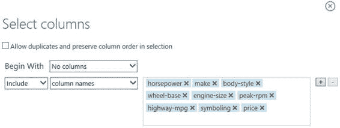

图 2-8. 选择列

图 2-8 显示了**项目列**模块中选定的列列表。当你训练预测模型时，需要提供目标变量。这是模型将要预测的特征。在本练习中，你将根据汽车的几个关键特征（例如马力、制造商等）来预测汽车价格。

步骤 4：选择并应用机器学习算法

构建预测模型时，首先需要训练模型，然后验证模型是否有效。在本实验中，你将构建一个回归模型。

 **提示**  分类和回归是两种常见的预测模型类型。在分类中，目标是预测给定数据行是否属于某个类别（例如，客户是否会流失？这笔信用卡交易是否欺诈？）。在回归中，目标是预测一个连续结果（例如，汽车价格或明天的温度）。

在本实验中，你将训练一个回归模型，并用它来预测汽车价格。具体来说，你将训练一个简单的*线性回归*模型。模型训练完成后，你将使用机器学习工作室中提供的一些模块来验证模型。

1.  **将数据拆分为训练集和测试集**：选择**拆分**模块并将其拖到实验画布上，然后将其连接到上一个**项目列**模块的输出。将**第一个输出数据集中的行比例**设置为 0.8。这样，你将使用 80% 的数据来训练模型，并保留 20% 用于测试。

 **提示**  通过更改随机种子参数，你可以生成不同的随机样本用于训练和测试。该参数控制**拆分**模块中伪随机数生成器的种子设定。

2.  运行实验。这允许**项目列**和**拆分**模块将列定义传递给你接下来要添加的模块。
3.  要选择学习算法，请展开画布左侧模块面板中的**机器学习**类别，然后展开**初始化模型**。这将显示几个可用于初始化学习算法的模块类别。
4.  对于本示例实验，请在**回归**类别下选择**线性回归**模块，并将其拖到实验画布上。
5.  找到**训练模型**模块并将其拖到实验中。单击**启动列选择器**，然后选择价格列。这是你的模型将要预测的特征。图 2-9 显示了此目标选择。

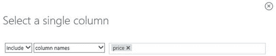

图 2-9. 选择价格列

6.  将**线性回归**模块的输出连接到**训练模型**模块的左侧输入端口。
7.  同时，将**拆分**模块的训练数据输出（即左侧端口）连接到**训练模型**模块的右侧输入端口。
8.  运行实验。

结果是一个经过训练的回归模型，可用于对新样本进行评分以做出预测。图 2-10 显示了截至步骤 7 的实验。

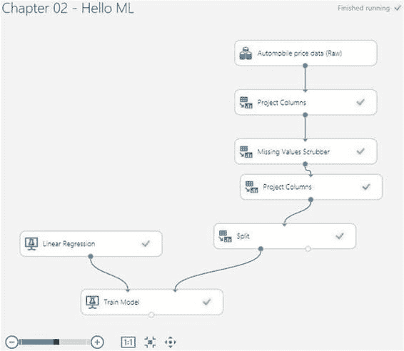

图 2-10. 应用学习算法

步骤 5：对新数据进行预测

现在你已经训练好了模型，可以使用它对另外 20% 的数据进行评分，看看模型在未见数据上的预测效果如何。

1.  找到**评分模型**模块并将其拖到实验画布上，然后将左侧输入端口连接到**训练模型**模块的输出，将右侧输入端口连接到**拆分**模块的测试数据输出（右侧端口）。详情请参见图 2-11。

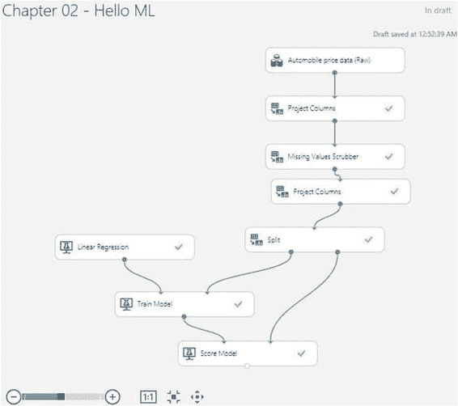

图 2-11. 评分模型模块

2.  运行实验并查看**评分模型**模块的输出（双击输出端口并选择**可视化**）。输出将显示价格的预测值以及测试数据中的已知值。
3.  最后，要测试结果的质量，请选择**评估模型**模块并将其拖到实验画布上，然后将左侧输入端口连接到**评分模型**模块的输出（有两个输入端口，因为**评估模型**模块可用于比较两个不同的模型）。
4.  运行实验并查看**评估模型**模块的输出（双击输出端口并选择**可视化**）。你的模型将显示以下统计信息：
    1.  **平均绝对误差** (MAE)：绝对误差的平均值（*误差*是预测值与实际值之间的差值）。
    2.  **均方根误差** (RMSE)：平方误差平均值的平方根。
    3.  **相对绝对误差**：绝对误差相对于实际值与所有实际值平均值之间绝对差值的平均值。
    4.  **相对平方误差**：平方误差相对于实际值与所有实际值平均值之间平方差值的平均值。
    5.  **决定系数**：也称为 R 平方值，这是一个统计指标，表示模型对数据的拟合程度。


对于每个误差统计量，数值越小越好；较小的值表示预测值与实际值更接近。对于**决定系数**，其值越接近 1（1.0），预测效果越好（参见图 2-12）。如果值为 1.0，意味着模型解释了数据中 100%的变异性，这相当不切实际！

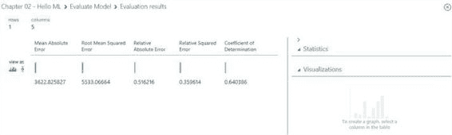

图 2-12。评估结果

最终的实验应类似于图 2-13 中的截图。

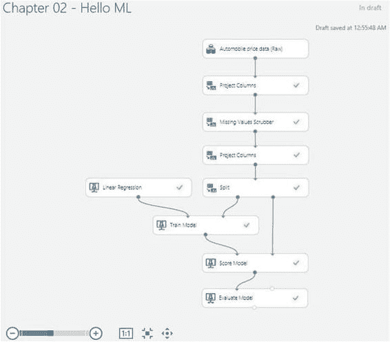

图 2-13。回归模型实验

恭喜！你已在机器学习工作室中创建了第一个机器学习实验。在第 5 章至第 8 章中，你将了解如何应用这五个步骤来创建预测分析解决方案，以应对来自不同领域的业务挑战，例如买家倾向性、流失分析、客户细分和预测性维护。此外，第 3 章展示了如何在 Azure 机器学习实验中使用 R 脚本。

在生产环境中部署模型

目前，将机器学习模型部署到生产环境所需时间过长。该过程通常效率低下，且往往需要重写模型以在目标生产平台上运行，这成本高昂且需要大量时间和精力。Azure 机器学习通过云中的集成流程简化了机器学习模型的部署。你可以在几分钟内（而非数天或数周）部署新的预测模型。部署后，你的模型将作为 Web 服务运行，可从不同平台（包括服务器、笔记本电脑、平板电脑甚至智能手机）进行调用。要将模型部署到生产环境，请遵循以下两个步骤。

1.  在 Azure 机器学习工作室中将模型部署到过渡环境。
2.  在 Azure 管理门户中，将模型从过渡环境移至生产环境。

将模型部署到过渡环境

要将模型部署到过渡环境，请在 Azure 机器学习工作室中执行以下步骤。

1.  使用 Azure 机器学习工作室底部的**另存为**按钮保存你训练好的模型。将其重命名为你选择的新名称。
    1.  **运行**实验。
    2.  右键单击训练模块（例如**训练模型**）的输出，然后选择**另存为已训练模型**选项。
    3.  删除用于训练的任何模块（例如**拆分、训练模型、评估模型**）。
    4.  将新保存的模型直接连接到**评分模型**模块。
    5.  重新运行实验。
2.  在步骤 1c 中删除之前，你的实验应如图图 2-14 所示。

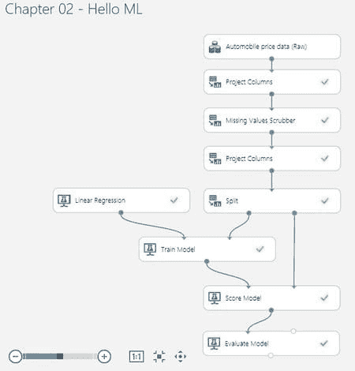

图 2-14。删除训练模块之前的预测模型

删除训练模块（即**拆分、线性回归、训练模型**和**评估模型**）并用保存的训练模型替换后，实验现在应如图图 2-15 所示。

 **提示** 你可能想知道为什么将**汽车价格数据（原始）**数据集保留连接到模型。服务将使用用户的数据，而不是原始数据集，那么为什么还要保留连接呢？

确实，服务不需要原始的汽车价格数据。但它确实需要该数据的架构，其中包括列数以及哪些列是数值列等信息。需要此架构信息才能解释用户的数据。你保留这些组件的连接，以便在服务运行时评分模块能够拥有数据集架构。数据不会被使用，仅使用架构。

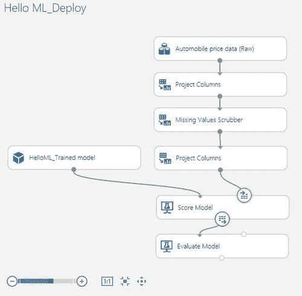

图 2-15。使用保存的训练模型的实验

3.  接下来，设置发布输入和输出。为此，请执行以下步骤。

1.  右键单击名为**评分模型**的模块的右侧输入。选择**设置为发布输入**选项。
    2.  右键单击**评分模型**模块的输出，然后选择**设置为发布输出**。

完成这两个步骤后，你将看到两个圆圈突出显示**评分模型**模块上选定的发布输入和输出。如图图 2-15 所示。

4.  分配发布输入和输出后，运行实验，然后通过单击屏幕底部的**发布 Web 服务**将其发布到过渡环境。

 **提示** 发布 Web 服务后，你可以对其进行更新。例如，如果你想更改模型，只需编辑之前保存的训练实验，调整模型参数，然后保存训练后的模型（覆盖之前保存的模型）。当你再次打开评分实验时，会看到一条通知，告知你某些内容已更改（即你的训练模型），并且你可以更新实验。当你再次发布实验时，它将替换 Web 服务，现在使用你更新后的模型。

你可以通过单击**配置**选项卡来配置服务。在此处，你可以修改服务名称（默认使用实验名称）并为其添加描述。你还可以为输入和输出列提供更友好的标签。

测试 Web 服务

在**仪表板**页面上，单击**过渡服务**下的**测试**链接。将弹出一个对话框，要求你输入服务的输入数据。这些列与原始**汽车价格数据（原始）**数据集中出现的列相同。输入一组数据，然后单击**确定**。

Web 服务生成的结果显示在仪表板底部。根据你配置服务的方式，你看到的结果由评分模块生成。

将模型从过渡环境移至生产环境

此时，你的模型已处于过渡环境，但尚未在生产环境中运行。要将其发布到生产环境，你需要通过以下步骤将其从过渡环境移至生产环境。

1.  在 Azure 机器学习工作室中配置新的 Web 服务，并使其准备好投入生产，如下所示。
    1.  在 Azure 机器学习工作室中，单击右侧窗格中名为**Web 服务**的菜单。它将显示所有 Web 服务的列表。
    2.  单击你刚刚创建的新服务的名称。你可以通过单击**测试**URL 来测试它。
    3.  现在单击配置选项卡，然后为**准备好投入生产？**选项选择**是**。然后点击屏幕底部的**保存**按钮。现在你的模型已准备好发布到生产环境。
2.  现在切换到 Azure 管理门户，并将你的 Web 服务发布到生产环境，如下所示。
    1.  在 Azure 管理门户的左侧窗格中选择**机器学习**。
    2.  选择包含要部署到生产环境的实验的工作区。
    3.  单击工作区的名称，然后单击名为**Web 服务**的选项卡。
    4.  选择 Azure 管理门户窗口底部的**+添加**按钮。

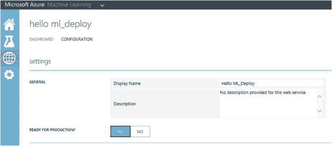

图 2-16\. 一个对话框，用于将机器学习模型从过渡服务器提升为实时生产 Web 服务


恭喜！您刚刚将第一个机器学习模型部署到了生产环境。如果从“Web 服务”选项卡点击您的模型，您将看到详细信息，例如模型在七天内做出的预测次数。该服务还会显示您可用于以请求/响应或批处理执行模式将模型作为 Web 服务调用的 API。不仅如此，您还会获得可用于在 C#、Python 或 R 中调用新 Web 服务的示例代码。您可以使用此示例代码，从浏览器中的 Web 表单或您选择的任何其他应用程序，将模型作为 Web 服务进行调用。

访问 Azure 机器学习 Web 服务

要作为 Web 服务发挥作用，用户需要能够向服务发送数据并接收结果。该 Web 服务是一个 Azure Web 服务，可以通过以下两种方式之一接收和返回数据：

*   **请求/响应**：用户可以使用 HTTP 协议向服务发送一组汽车价格数据，服务会响应一个预测价格的单一结果。
*   **批处理执行**：用户可以向服务发送一个 Azure BLOB 的 URL，该 BLOB 包含一行或多行汽车价格数据。服务将结果存储在另一个 BLOB 中，并返回该容器的 URL。

在 Web 服务的**仪表板**选项卡上，有指向信息的链接，这些信息将帮助开发人员编写代码来访问此服务。单击“请求/响应”行上的 API 帮助页面链接，将打开一个页面，其中包含使用服务请求/响应协议的示例代码。同样，“批处理执行”行上的链接提供了向服务发出批处理请求的示例代码。

API 帮助页面包含 R、C# 和 Python 编程语言的示例。例如，清单 2-1 显示了可用于访问您发布的 Web 服务的 R 代码（实际的服务 URL 将显示在您的示例代码中）。

***清单 2-1***。用于以编程方式访问服务的 R 代码

```
library("RCurl")
library("RJSONIO")

# 接受由公共证书颁发机构颁发的 SSL 证书
options(RCurlOptions = list(sslVersion=3L, cainfo = system.file("CurlSSL", "cacert.pem", package = "RCurl")))

h = basicTextGatherer()
req = list(Id="score00001",
 Instance=list(FeatureVector=list(
    "symboling"= "0",
    "make"= "0",
    "body-style"= "0",
    "wheel-base"= "0",
    "engine-size"= "0",
    "horsepower"= "0",
    "peak-rpm"= "0",
    "highway-mpg"= "0",
    "price"= "0"
 ),GlobalParameters=fromJSON('{}')))

body = toJSON(req)
api_key = "abc123" # 将此替换为 Web 服务的 API 密钥
authz_hdr = paste('Bearer', api_key, sep=' ')

h$reset()
curlPerform(url = "https://ussouthcentral.services.azureml.net/workspaces/fcaf778fe92f4fefb2f104acf9980a6c/services/ca2aea46a205473aabca2670c5607518/score",
            httpheader=c('Content-Type' = "application/json", 'Authorization' = authz_hdr),
            postfields=body,
            writefunction = h$update,
            verbose = TRUE
            )

result = h$value()
print(result)
```

总结

在本章中，您学习了如何使用 Azure 机器学习工作室创建您的第一个实验。您了解了如何执行数据预处理，以及如何在 Azure 机器学习工作室中训练、测试和评估您的模型。此外，您还了解了如何将新模型部署到生产环境。部署后，您的机器学习模型将作为 Azure 上的 Web 服务运行，可以从 Web 表单或任何其他应用程序（服务器、笔记本电脑、平板电脑或智能手机）进行调用。在本书的其余部分，您将学习如何使用 Azure 机器学习创建实验，以解决各种业务问题，例如客户倾向、客户流失和预测性维护。此外，您还将学习如何使用 R 脚本扩展 Azure 机器学习。同时，第 4 章 介绍了 Azure 机器学习中最常用的统计和机器学习算法。

