# 第 3 章 与 R 的集成
本章将介绍 R，并展示它如何与 Microsoft Azure 机器学习集成。通过简单的示例，您将学习在使用 Azure 机器学习时如何编写和运行自己的 R 代码。您还将了解 Azure 机器学习支持的 R 包，以及如何在 Azure 机器学习工作室（ML Studio）中使用它们。

## R 简介
R 是一种开源统计编程语言，计算统计和数据科学社区通常使用它来解决广泛的业务问题。这些问题涵盖以下领域：
* 生物信息学（例如基因组分析）
* 精算科学（例如计算保险、金融和其他行业的风险敞口）
* 电信（分析企业和消费者客户群中的流失、欺诈性 SIM 卡使用或移动使用模式）
* 金融和银行业（例如识别金融交易中的欺诈）、制造业（例如预测硬件组件故障时间）等等。

使用 R 时，用户会因其 R 包工具箱而感到强大，该工具箱提供了用于数据分析、可视化和建模的强大功能。截至 2014 年，综合 R 档案网络（CRAN）提供了超过 5000 个 R 包的大型集合。除了 CRAN，Github（https://github.com/trending?l=r）上还有许多其他 R 包，以及 Bioconductor R 存储库（[www.bioconductor.org/](http://www.bioconductor.org/)）中用于生物信息学的专用 R 包。

 **注意** R 由奥克兰大学的 Joss Ihaka 和 Robert Gentleman 于 1994 年创建。自 R 创建以来，许多顶尖的计算机科学家和统计学家通过为 R 代码库做出贡献或提供 R 包，使 R 用户能够利用最新的统计分析、可视化和数据挖掘技术，从而推动了 R 的成功。这促使 R 成为数据科学家的语言之一。在 [www.r-project.org/](http://www.r-project.org/) 上了解更多关于 R 的信息。

鉴于数据科学社区在使用 R 解决机器学习问题方面的势头，对于一个基于云的机器学习平台来说，让数据科学家能够继续使用他们熟悉的 R 脚本并保持高效至关重要。目前，Azure 机器学习支持超过 400 个 R 包。表 3-1 显示了当前支持的 R 包的一个子集。这些 R 包使您能够对广泛的机器学习问题进行建模，从购物篮分析、分类、回归、预测到可视化。

表 3-1。Azure 机器学习支持的 R 包
| R 包 | 描述 |
| --- | --- |
| **Arules** | 频繁项集与关联规则挖掘 |
| **FactoMineR** | 数据探索 |
| **Forecast** | 单变量时间序列预测（指数平滑与自动 ARIMA） |
| **ggplot2** | 图形绘制 |
| **Glmnet** | 线性回归、逻辑回归与多项回归模型、泊松回归及 Cox 模型 |
| **Party** | 决策树工具 |
| **randomForest** | 基于树状森林的分类与回归模型 |
| **Rsonlp** | 使用增广拉格朗日乘子法进行通用非线性优化 |
| **Xts** | 时间序列 |
| **Zoo** | 时间序列 |

 **提示** 要获取已安装包的完整列表，请在云机器学习中创建一个新实验，使用**执行 R 脚本**模块，在**执行 R 脚本**模块的主体中提供以下脚本，并运行实验。实验完成后
```
out <- data.frame(installed.packages())
maml.mapOutputPort("out")
```
，右键单击模块的左侧输出端口并选择**可视化**。云机器学习中已安装的包将被列出。

Azure 机器学习提供了 R 语言模块，使您能够将 R 集成到机器学习实验中。目前，可在 Azure 机器学习工作室（ML Studio）中使用的 R 语言模块是**执行 R 脚本**模块。

**执行 R 脚本**模块允许您指定输入数据集（最多两个数据集）、一个 R 脚本以及一个包含一组 R 脚本的 Zip 文件（可选）。模块处理数据后，会生成一个结果数据集和一个 R 设备输出。在 Azure 机器学习中，R 脚本使用 R 4.1.0 执行。

 **注意** R 设备输出显示 R 脚本执行期间生成的控制台输出和图形。例如，在 R 脚本中，您可能使用了 R 的 `plot()` 函数。当您右键单击 R 设备输出并选择**可视化**时，可以查看 `plot()` 的输出。

ML Studio 使您能够监控和排查实验的进度。执行完成后，您可以查看 R 模块每次运行的输出日志。如果执行失败，输出日志还将帮助您排查问题。

在本章中，您将学习如何将 R 与 Azure 机器学习集成。通过使用 ML Studio 中提供的简单示例和数据集，您将掌握基本技能，以释放 R 的强大功能，使用 Azure 机器学习创建令人兴奋且有用的实验。让我们开始吧！

## 构建和部署您的第一个 R 脚本
要构建和部署您的第一个 R 脚本模块，首先需要创建一个新实验。创建实验后，您将看到 Azure 机器学习工作室（ML Studio）中提供的**执行 R 脚本**模块。该脚本将由 Azure 机器学习使用 R 3.1.0（本书撰写时云机器学习上安装的版本）执行。图 3-1 显示了 R 语言模块。

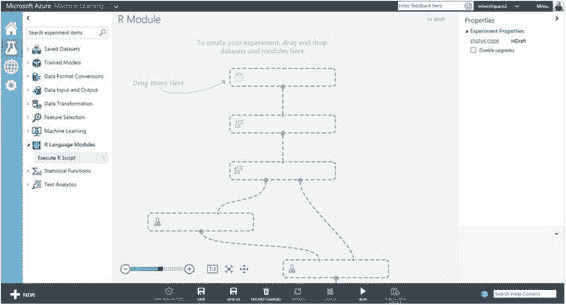
图 3-1. ML Studio 中的 R 语言模块

在本节中，您将学习如何使用执行 R 脚本对数据集执行采样。请按照以下步骤操作。
1. 从工具箱中，展开**已保存数据集**节点，单击**成人普查收入二元分类**数据集。将其拖放到实验设计区域。
2. 从工具箱中，展开**R 语言模块**节点，单击**执行 R 脚本**模块。将其拖放到实验设计区域。
3. 将数据集连接到**执行 R 脚本**模块。图 3-2 显示了实验设计。

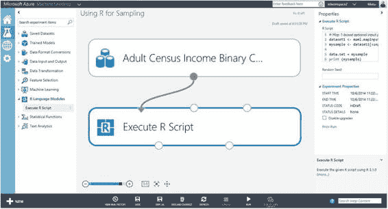
图 3-2. 使用执行 R 脚本对成人普查收入二元分类数据集执行采样

**执行 R 脚本**模块为 R 脚本可使用的数据集提供了两个输入端口。此外，它还允许您指定一个包含模块使用的 R 源脚本文件的 Zip 文件。您可以在本地机器上编辑并测试 R 源脚本文件。然后，将所需文件压缩成 Zip 文件，并通过“新建 > 数据集 > 来自本地文件”路径上传到 Azure 机器学习。**执行 R 脚本**模块处理数据后，该模块提供两个输出端口：结果数据集和 R 设备。结果数据集对应于 R 脚本的输出，可以传递给下一个模块。R 设备输出端口为您提供了一种简便的方式来查看 R 解释器生成的控制台输出和图形。

让我们继续使用 ML Studio 创建您的第一个 R 脚本。
4. 单击**执行 R 脚本**模块。
5. 在属性窗格中，编写以下 R 脚本以执行采样：

```
# 将基于 1 的可选输入端口映射到变量
dataset1 <- maml.mapInputPort(1) # 类别: data.frame
mysample <- dataset1[sample(1:nrow(dataset1), 50, replace=FALSE),]

data.set = mysample
print (mysample)

# 选择要发送到输出数据集端口的数据框
maml.mapOutputPort("data.set");
```
用于执行采样的 R 脚本

要使用**执行 R 脚本**模块，通常采用以下模式：
* 将输入端口映射到 R 变量或数据框。
* R 脚本的主体部分。
* 将结果映射到输出端口（参见图 3-3）。

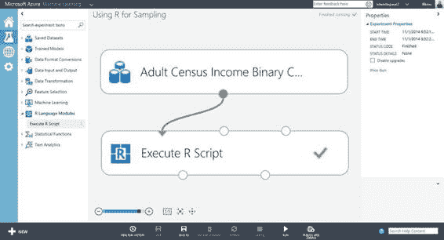
图 3-3. 采样实验成功执行

要查看此模式的实际应用，请注意在提供的 R 脚本中，使用了 `maml.mapInputPort(1)` 方法将从模块第一个输入端口传入的数据集映射到 R 数据框。接下来，查看用于对数据执行采样的 R 脚本。出于调试目的，我们还打印了采样的结果。在 R 脚本的最后一步，将结果分配给 `data.set`，并使用 `maml.mapOutputPort("data.set")` 映射到输出端口。

现在您可以运行实验了。为此，请单击 ML Studio 底部窗格的“运行”图标。图 3-3 显示实验已成功完成执行。

实验运行完成后，您可以查看 R 脚本的输出。为此，请右键单击**执行 R 脚本**模块的**结果数据集**。图 3-4 显示了右键单击**执行 R 脚本**模块的**结果数据集**时可用的选项。选择**可视化**。

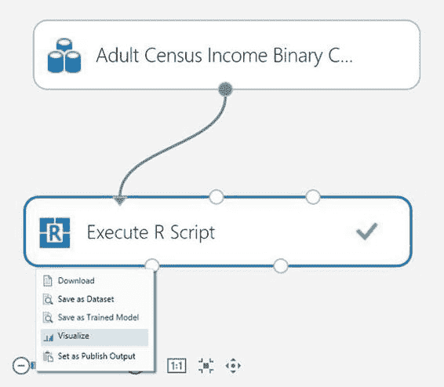
图 3-4. 可视化 R 脚本的输出

单击**可视化**后，您将看到样本包含 50 行。每行有 15 列以及数据的数据分布。图 3-5 显示了结果数据集的可视化。

## 使用 R 进行数据预处理

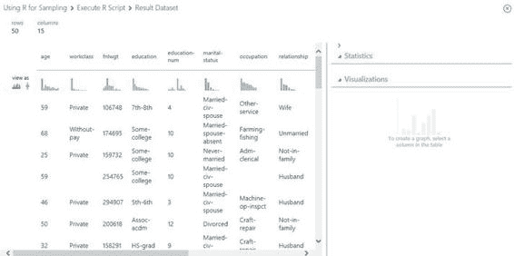
图 3-5. R 脚本生成的结果数据集的可视化

恭喜，您已成功完成了在 Azure 机器学习中集成第一个简单 R 脚本！在下一节中，您将学习如何使用 Azure 机器学习和 R 创建机器学习模型。

 **注意** 了解更多关于 R 和机器学习的信息，请访问 [`ocw.mit.edu/courses/sloan-school-of-management/15-097-prediction-machine-learning-and-statistics-spring-2012/lecture-notes/MIT15_097S12_lec02.pdf`](http://ocw.mit.edu/courses/sloan-school-of-management/15-097-prediction-machine-learning-and-statistics-spring-2012/lecture-notes/MIT15_097S12_lec02.pdf)。

在许多机器学习任务中，降维是一个重要步骤，用于减少机器学习算法的特征数量。主成分分析（PCA）是一种常用的降维技术。PCA 通过寻找一组新的变量（主成分）来降低数据集的维度，这些变量是原始数据集的线性组合，并且与所有其他变量不相关。在本节中，您将学习如何使用 R 进行数据预处理并降低数据集的维度。

让我们开始使用 **执行 R 脚本** 模块对 ML Studio 中提供的示例数据集之一进行主成分分析。请按照以下步骤操作。

1.  创建一个新实验。

2.  从“已保存的数据集”中，选择 **CRM 数据集共享**（参见图 3-6）。

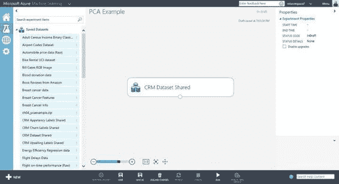
图 3-6。使用示例数据集 CRM 数据集共享

3.  右键单击输出节点，然后选择 **可视化**。从图 3-7 所示的可视化中，您将看到有 230 列。

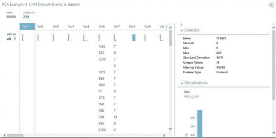
图 3-7。CRM 共享数据集中的初始 230 列

4.  在执行 PCA 之前，您需要确保 **执行 R 脚本** 模块的输入是数值型的。对于 CRM 数据集共享的示例数据集，您知道前 190 列是数值型的，其余 40 列是分类型的。您首先使用 **投影列**，并将 **选定列 |** 列索引设置为 `1-190`。

5.  接下来，使用 **缺失值清理器** 模块将缺失值替换为 `0`，如下所示：
    1.  对于缺失值：自定义替换值
    2.  替换为值：`0`
    3.  全部缺失的列：保留列
    4.  缺失值指示列：不生成

6.  清理完缺失值后，使用 **元数据编辑器** 模块将所有列的数据类型更改为整数。

7.  接下来，将 **执行 R 脚本** 模块拖放到设计界面并连接模块，如图 3-8 所示。

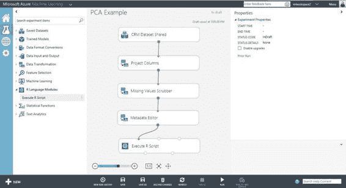
图 3-8。使用执行 R 脚本模块执行 PCA

8.  单击 **执行 R 脚本** 模块。您可以提供以下脚本，该脚本将用于执行 PCA：

```r
    # 将基于 1 的可选输入端口映射到变量
    dataset1 <- maml.mapInputPort(1)
    # 对前 190 列执行 PCA
    pca = prcomp(dataset1[,1:190])

    # 返回前 10 个主成分
    top_pca_scores = data.frame(pca$x[,1:10])
    data.set = top_pca_scores
    plot(data.set)
    # 选择要发送到输出数据集端口的数据框
    maml.mapOutputPort("data.set");
```

图 3-9 展示了如何在 ML Studio 中使用该脚本。

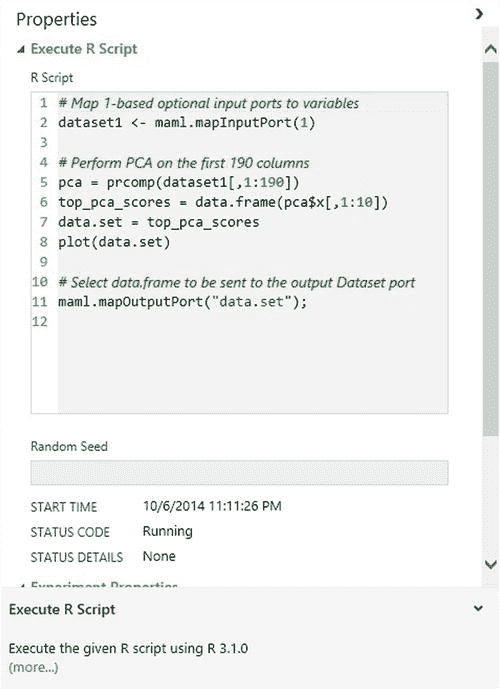
图 3-9。对前 190 列执行 PCA

9.  单击 **运行**。

10.  实验成功执行后，单击 **执行 R 脚本** 模块的 **结果数据集** 节点。单击 **可视化**。

11.  图 3-10 显示了 CRM 共享数据集的前十个主成分。这些主成分将在后续步骤中用于构建分类模型。

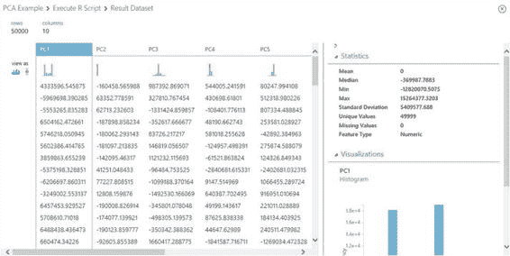
图 3-10。为 CRM 共享数据集识别的主成分

 **提示** 您还可以提供一个包含 R 脚本的 Zip 文件作为脚本包，并在 **执行 R 脚本** 模块中使用它。

## 使用脚本包（Zip）

如果您有一个一直在使用的 R 脚本，并希望将其用作实验的一部分，您可以将该 R 脚本打包成 Zip 文件，然后作为数据集上传到 ML Studio。要配合 **执行 R 脚本** 模块使用脚本包，您首先需要将文件打包成 Zip 格式，请按照以下步骤操作。

1.  导航到包含您打算在实验中使用的 R 脚本的文件夹（参见图 3-11）。

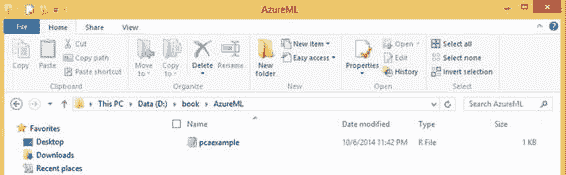
图 3-11。包含 R 脚本 `pcaexample.r` 的文件夹

2.  选择所有要打包的文件并右键单击。在本示例中，右键单击文件 `pcaexample.r`，然后选择 **发送到压缩（zipped）文件夹**，如图 3-12 所示。

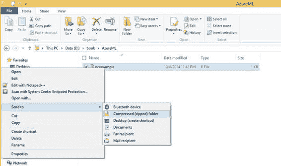
图 3-12。将 R 脚本打包为 ZIP 文件

3.  接下来，将 zip 文件上传到 ML Studio。为此，选择 **新建数据集  来自本地文件**。选择您要上传的 Zip 文件，如图 3-13 和图 3-14 所示。

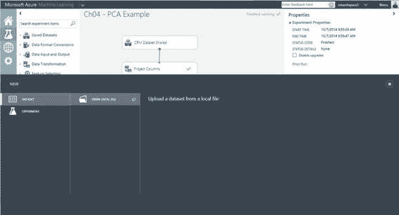
图 3-13。新建数据集  来自本地文件

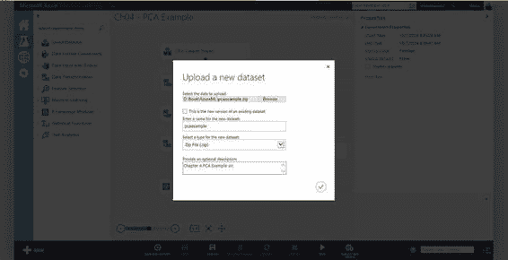
图 3-14。上传新数据集

4.  数据集上传后，您可以在实验中使用它。为此，从 **已保存的数据集** 中选择 **上传的 Zip 文件**，并将其拖放到实验中。

5.  将上传的 Zip 文件连接到 **执行 R 脚本** 模块的 **脚本包（Zip）** 输入，如图 3-15 所示。

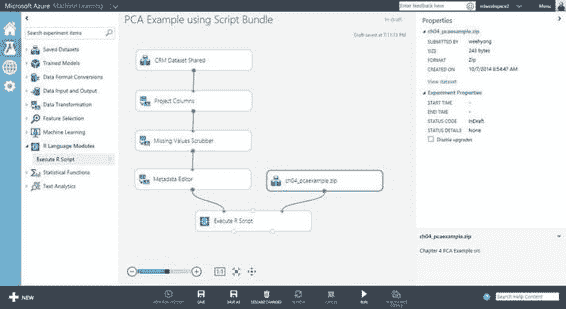
图 3-15。使用脚本包作为执行 R 脚本模块的输入

6.  在 **执行 R 脚本** 模块中，指定 R 脚本的位置，如下所示，如图 3-16 所示：

```r
    # 将基于 1 的可选输入端口映射到变量
    dataset1 <- maml.mapInputPort(1)
    # 可选 Zip 端口的内容位于 ./src/ 中
    source("src/pcaexample.r");

    # 选择要发送到输出数据集端口的数据框
    maml.mapOutputPort("data.set");
```

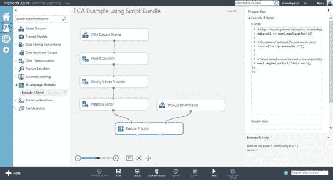
图 3-16。使用脚本包作为执行 R 脚本模块的输入

7.  现在，您可以使用已上传到 ML Studio 的 Zip 文件中的 R 脚本运行实验。使用脚本包可以轻松引用一个您可以在 ML Studio 外部测试的 R 脚本文件。要更新脚本，您需要重新上传 Zip 文件。

## 使用 R 构建和部署决策树

在本节中，您将学习如何使用 R 构建机器学习模型。使用 R 时，您可以利用大量 R 包，这些包实现了各种机器学习算法，用于分类、聚类、回归、K 近邻、购物篮分析等。

 **注意** 当您使用 R 中可用的机器学习算法并通过 **执行 R** 模块执行它们时，您只能可视化模型和参数。您无法保存训练好的模型并将其用作其他 ML Studio 模块的输入。

使用 ML Studio，提供了几种 R 机器学习算法。例如，您可以使用 **R 自动 ARIMA** 模块为单变量时间序列构建最优自回归移动平均模型。您还可以使用 **R K 近邻分类** 模块创建 K 近邻（KNN）分类模型。

在本节中，您将学习如何使用一个名为 **rpart** 的 R 包来构建决策树。**rpart** 包为您提供了用于执行分类和回归的递归划分算法。

 **注意** 了解更多关于 `rpart` R 包的信息，请访问 [`cran.r-project.org/web/packages/rpart/rpart.pdf`](http://cran.r-project.org/web/packages/rpart/rpart.pdf)。

在本练习中，你将使用成人普查收入二元分类数据集。让我们开始吧。

1.  从工具箱中，将以下模块拖放到实验设计区域：
    1.  `成人普查收入二元分类`数据集（位于`已保存数据集`下）
    2.  `项目列`（位于数据`转换  操作`下）
    3.  `执行 R 脚本`模块（位于 `R 语言`模块下）
2.  将`成人普查收入二元分类`数据集连接到`项目列`。
3.  点击`项目列`以选择将在实验中使用的列。选择以下列：`age`、`sex`、`education`、`income`、`marital-status`、`occupation`。

图 3-17 展示了列的选择，图 3-18 展示了完成的实验和项目列属性。

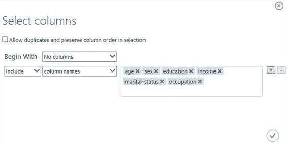
图 3-17. 选择将要使用的列

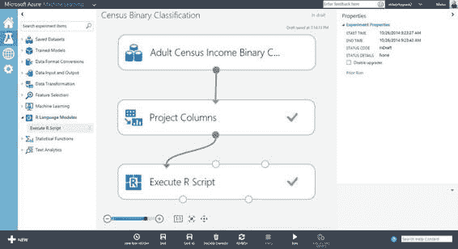
图 3-18. 完整的实验

4.  将`项目列`连接到`执行 R 脚本`。
5.  点击`执行 R 脚本`并提供以下脚本。图 3-19 展示了 ML Studio 中的 R 脚本。

```
    library(rpart)

# 将基于 1 的可选输入端口映射到变量
    Dataset1 <- maml.mapInputPort(1) # 类别: data.frame

fit <- rpart(income ~ age + sex + education + occupation, method="class", data=Dataset1)

# 显示结果以及分割的摘要
    printcp(fit)
    plotcp(fit)
    summary(fit)

# 绘制决策树
    plot(fit, uniform=TRUE, margin = 0.1, compress = TRUE, main="普查数据集的分类树")
    text(fit, use.n=TRUE, all=TRUE, cex=0.8, pretty=1)

data.set = Dataset1

# 选择要发送到输出数据集端口的数据框
    maml.mapOutputPort("data.set");
```

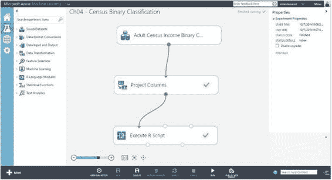
图 3-19. 使用 R 脚本执行分类的实验

在 R 脚本中，首先使用 `library()` 加载 `rpart` 库。接着，将传递给`执行 R 脚本`模块的数据集映射到一个数据框。

要构建决策树，你将使用 `rpart()` 函数。`rpart()` 支持多种类型的方法：`class`（分类）和 `anova`（回归）。在本练习中，你将使用 `rpart()` 执行分类（即 `method="class"`），如下所示：

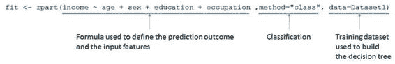

指定的公式使用以下格式：预测变量 ~ 输入特征 1 + 输入特征 2 + ...

决策树构建完成后，R 脚本会调用 `printcp()`、`plotcp()` 和 `summary()` 函数来显示结果，以及树中每个分割值的摘要。在 R 脚本中，`plot()` 函数用于绘制 `rpart` 模型。默认情况下，绘制 `rpart` 模型时，会使用缩写表示法来表示分割值。在 R 脚本中，添加了 `pretty=1` 的设置，以显示实际的分割值（参见图 3-20）。

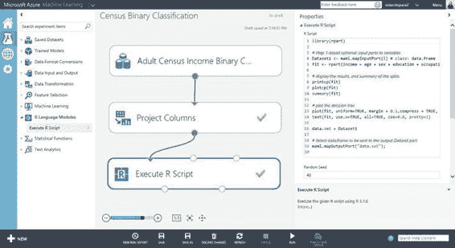
图 3-20. ML Studio 中的 R 脚本

现在你可以运行实验了。为此，请点击 ML Studio 底部窗格的“运行”图标。实验成功执行后，你可以查看决策树的详细信息，并可视化决策树的整体形状。

要查看决策树的详细信息，请点击`执行 R 脚本`模块，然后在`属性`窗格中点击`查看输出日志`（如图 3-21 所示）。

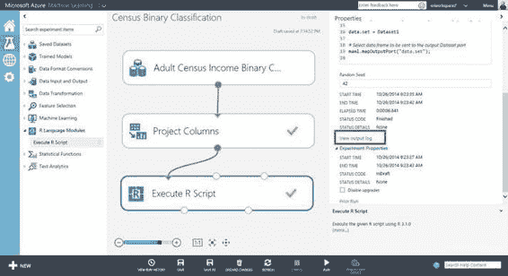
图 3-21. 查看执行 R 脚本的输出日志

输出日志的示例如下：

```
[ModuleOutput] 分类树：
[ModuleOutput]
[ModuleOutput]
[ModuleOutput]
[ModuleOutput] 树构建中实际使用的变量：
[ModuleOutput]
[ModuleOutput] [1] age        education  occupation sex
[ModuleOutput]
[ModuleOutput]
...
[ModuleOutput]   主要分裂点：
[ModuleOutput]
[ModuleOutput]       education  分裂为 LLLLLLLLRRLRLRL，改进值=1274.3680，(0 个缺失值)
[ModuleOutput]
[ModuleOutput]       occupation 分裂为 LLLRLLLLLRRLLL，改进值=1065.9400，(1843 个缺失值)
[ModuleOutput]
[ModuleOutput]       age        < 29.5 向左，改进值= 980.1513，(0 个缺失值)
[ModuleOutput]
[ModuleOutput]       sex        分裂为 LR，改进值= 555.3667，(0 个缺失值)
```

要可视化决策树，请点击 `R 设备` 输出端口（即 `执行 R 脚本` 模块的第二个输出），您将看到刚刚使用 `rpart` 构建的决策树（如图 3-22 所示）。

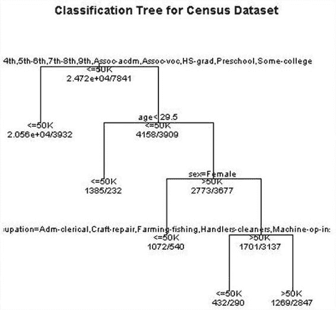
图 3-22. 使用 `rpart` 构建的决策树

 **注意** Azure 机器学习提供了丰富的已保存数据集集合，可用于您的实验。此外，您还可以在 UCI 机器学习库中找到大量数据集，网址为 [`archive.ics.uci.edu/ml/datasets.html`](http://archive.ics.uci.edu/ml/datasets.html)。

**总结**

在本章中，您了解了 R 与 Azure 机器学习集成所提供的激动人心的可能性。您学习了如何在 ML Studio 中使用不同的 R 语言模块。在您使用 R 设计实验时，您学习了如何将模块的输入和输出映射到 R 变量和数据框。接下来，您学习了如何构建第一个 R 脚本来执行数据采样，以及如何使用 ML Studio 中内置的数据可视化工具来可视化结果。以此为基础，您继续构建和部署了使用 R 脚本包进行数据预处理以及构建决策树的实验。

**第二部分**


**统计与机器学习算法**