# 第四章 统计与机器学习算法简介

本章将作为 Microsoft Azure 机器学习中一些最常用算法的参考。我们将简要介绍线性回归和逻辑回归、用于聚类的 k-means、决策树、决策森林（随机森林、提升决策树和 Gemini）、神经网络、支持向量机以及贝叶斯点机等算法。

本章将为本书后续章节中您将遇到的一些算法提供良好的基础和参考材料。我们将这些算法分为以下几类：

*   回归
*   分类
*   聚类

回归算法

首先，我们来谈谈 Azure 机器学习服务中常用的回归技术。回归技术用于预测具有数值结果的响应变量，例如预测汽车的每加仑英里数或预测城市的温度。输入变量可以是数值型或分类型。然而，这些算法的共同点是输出（或响应变量）是数值型的。我们将回顾一些最常用的回归技术，包括线性回归、神经网络、决策树和提升决策树回归。

线性回归

线性回归是统计学中最古老的预测技术之一。事实上，其根源可以追溯到 1795 年卡尔·弗里德里希·高斯的工作。线性回归的目标是在响应变量和自变量之间拟合一个线性模型，并利用该模型根据一组观测到的自变量来预测结果。一个简单的线性回归模型是一个具有如下结构的公式：

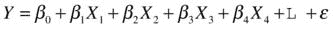

其中

*   Y 是响应变量（即您试图预测的结果），例如每加仑英里数。
*   *X*[1]、*X*[2]、*X*[3] 等是用于预测结果的自变量。
*   *β*[0] 是一个常数，即回归线的截距。
*   *β*[1]、*β*[2]、*β*[3] 等是自变量的系数。这些系数指的是每个变量的偏斜率。
*   *ε* 是与响应变量相关的误差或噪声，无法由自变量 X1、X2 和 X3 解释。

线性回归模型有两个组成部分：确定性部分（即 *β*[1]*X*[1] + *β*[2]*X*[2] + ...）和随机部分（即误差 *ε*）。您可以将这两个部分视为模型中的信号和噪声。

如果您只有一个输入变量 X，那么回归模型就是最适合数据的最佳直线。图 4-1 展示了一个简单线性回归模型的示例，该模型根据汽车的马力预测其每加仑英里数。对于两个输入变量，线性回归是在三维空间中拟合一组数据点的最佳平面。变量的系数（即 *β*[1]、*β*[2]、*β*[3] 等）是每个变量的偏斜率。如果保持所有其他变量不变，那么当变量 *X*[1] 增加 1 时，结果 Y 将增加 *β*[1]。这就是为什么经济学家通常使用短语“*ceteris paribus*”或“*所有其他条件相同*”来描述一个自变量对给定结果的影响。

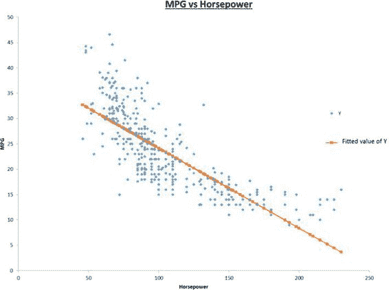

图 4-1. 一个根据汽车马力预测其每加仑英里数的简单线性回归模型

线性回归使用最小二乘法或梯度下降法来为给定数据集找到最佳的模型系数。最小二乘法通过最小化训练数据中每个观测值的拟合值与实际值之间的平方误差之和来实现这一点。梯度下降法通过每次迭代更新系数来找到最优的模型系数。更新朝着减少模型拟合值与训练数据实际值之间误差总和的方向进行。通过多次迭代，它沿着负梯度的方向移动，从而找到局部最小值，因此得名。

 **注意**  您可以从《使用回归进行商业分析：案例手册》（Foster, D. P., Stine, R.H., Waterman, R.P.; 纽约，美国；Springer-Verlag, 1998）一书中了解更多关于线性回归的知识。

神经网络

人工神经网络是一组模仿大脑功能的算法。有许多不同的神经网络算法，包括反向传播网络、霍普菲尔德网络、科霍宁网络（也称为自组织映射）和自适应共振理论（或 ART）网络。然而，最常见的是反向传播算法，也称为多层感知器。

反向传播网络具有多个按层排列的神经元。最常用的架构是图 4-2 中所示的三层网络。这种架构有一个输入层、一个隐藏层和一个输出层。但是，您也可以有两个或更多的隐藏层。输入和输出节点的数量由数据集决定。基本上，输入节点的数量等于您想要用来预测输出的自变量的数量。输出节点的数量与响应变量的数量相同。相比之下，隐藏节点的数量则更加灵活。

神经网络模型的开发分为两个步骤：训练和测试。在训练过程中，你将训练集中的一组样本展示给神经网络。每个样本都包含自变量和响应变量的值。在训练过程中，你会多次向神经网络展示这些样本。在每次迭代中，网络都会预测响应值。在训练的前向传播阶段，隐藏层和输出层中的每个节点都会计算其输入的加权和，然后通过激活函数利用这个和来计算其输出。神经网络中每个神经元的输出通常使用以下 S 型激活函数：

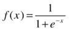

然而，神经网络中也可以使用其他激活函数，例如高斯函数、双曲正切函数（tanh）、线性阈值函数，甚至简单的线性函数。

假设有 M 个输入节点。输入节点与第一个隐藏层之间的连接权重用 *w*¹[*ij*] 表示。

在每个隐藏节点处，加权和的计算公式如下：

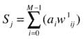

计算出加权和后，S 型激活函数的计算方式如下：

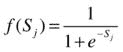

在计算出输出节点的激活水平后，反向传播阶段开始。在此阶段，算法根据实际的响应值计算其预测的误差。利用梯度下降法，它根据误差按比例调整所有连接的权重。权重的调整方式旨在减少下一次的误差。经过多次迭代，神经网络会收敛到一个解。

在测试过程中，你只需使用训练好的模型对记录进行评分。对于每条记录，神经网络会根据给定的输入变量集预测响应变量的值（参见图 4-2）。

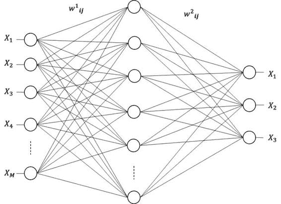

图 4-2. 一个包含三层的神经网络：一个输入层、一个隐藏层和一个输出层

学习率决定了收敛到解的速度。如果学习率过低，算法将需要更多的学习迭代（因此也需要更多时间）才能收敛到最小值。相反，如果学习率过大，算法会来回震荡，可能永远找不到局部最小值。因此，神经网络将成为一个糟糕的预测器。

另一个重要参数是隐藏节点的数量。神经网络的准确性可能会随着隐藏节点数量的增加而提高。然而，这也会增加处理时间，并可能导致过拟合。通常，增加隐藏节点或隐藏层的数量很容易导致参数过多，从而增加过拟合的风险。一个经验法则是，初始隐藏节点数大致等于输入节点数的平方根。另一个通用经验法则是，隐藏层中的神经元数量应介于输入层大小和输出层大小之间。例如，（输入节点数 + 输出节点数）× 2/3。这些经验法则仅仅是起点，旨在避免过拟合；最佳数量只能通过实验和在测试数据上验证性能来找到。

决策树

决策树算法是一种分层技术，它通过基于特定的统计标准迭代地分割数据集来工作。决策树的目标是最大化树中不同节点之间的方差，并最小化每个节点内部的方差。图 4-3 展示了一个简单的决策树，它通过两次数据分割创建而成。根节点（节点 0）包含数据集中的所有数据。算法根据定义的统计量分割数据，创建三个新节点（节点 1、节点 2 和节点 3）。使用相同的统计量，它在节点 1 处再次分割数据，创建出另外两个叶节点（即节点 4 和节点 5）。决策树通过遍历到叶节点（即终端节点之一：节点 2、3、4 或 5）来对每一行数据进行预测。

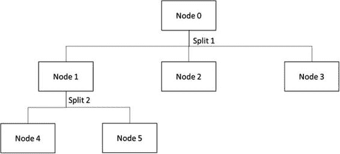

图 4-3. 一个包含两次数据分割的简单决策树

图 4-4 展示了一个虚构的非常简单的决策树示例，用于预测客户是否会购买自行车。在这个例子中，原始数据集包含 100 个样本。预测能力最强的变量是年龄，因此决策首先按年龄分割数据。年龄小于 30 岁的客户进入左分支，而年龄在 30 岁及以上的客户进入右分支。下一个最重要的变量是性别，因此在下一层，决策树按性别分割数据。在年轻分支（即针对 30 岁以下的客户）中，决策树将数据分割为男性和女性分支。对于年长分支，它也执行相同的操作。最后，图 4-4 显示了每个节点中的样本数量以及购买概率。因此，如果你有一位 23 岁的女性客户，该树预测她只有 30%的几率购买自行车，因为她最终会进入节点 3。一位 45 岁的男性客户将有 80%的几率购买自行车，因为他最终会进入树中的节点 6。

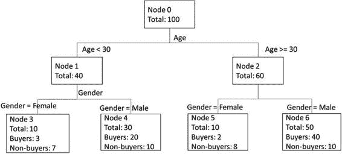

图 4-4. 一个用于预测购买自行车可能性的简单决策树

一些最常用的决策树算法包括迭代二分器 3（ID3）、C4.5 和 C5.0（ID3 的后继者）、自动交互检测（AID）、卡方自动交互检测（CHAID）以及分类与回归树（CART）。虽然非常有用，但 ID3、C4.5、C5.0 和 CHAID 算法是分类算法，不适用于回归。顾名思义，CART 算法既可用于分类也可用于回归。

如何选择在每个层级用于分割数据的变量？每个决策树算法使用不同的统计量来选择最佳的分割变量。ID3、C4.5 和 C5.0 使用信息增益，而 CART 使用一种称为基尼不纯度的度量。基尼不纯度衡量随机选择样本的错误分类率。

 **注意**  关于决策树的更多信息，可参阅 S. Chiu 和 D. Tavella 合著的《Data Mining and Market Intelligence for Optimal Market Returns》（英国牛津，Butterworth-Heinemann 出版社，2008 年）以及[`en.wikipedia.org/wiki/Decision_tree_learning`](http://en.wikipedia.org/wiki/Decision_tree_learning)。

提升决策树

提升决策树是集成模型的一种形式。与其他集成模型一样，提升决策树使用多个决策树来产生更优的预测器。每个单独的决策树可能是弱预测器。然而，当它们组合在一起时，会产生更优的结果。

如第 1 章所述，构建集成模型有三个关键步骤：a) 数据选择，b) 训练分类器，c) 组合分类器。

构建集成模型的第一步是为分类器模型选择数据。在采样数据时，一个关键目标是最大化模型的多样性，因为这能提升解决方案的准确性。通常，模型越多样化，最终分类器的性能就越好，其预测结果的方差也越小。

该过程的第二步是训练多个独立的分类器。但如何分配这些分类器呢？在众多可用策略中，最流行的两种是装袋（bagging）和提升（boosting）。装袋算法使用不同的随机数据子集来训练每个模型。这些模型可以在其随机训练数据子集上并行训练。相比之下，提升算法通过顺序训练模型、在训练数据上测试每个模型的性能来提升整体表现。训练集中被错误分类的样本会在后续训练中获得更高的权重。因此，在训练过程中，每个新增的模型都会更关注那些被错误分类的数据。提升决策树算法就采用了这种提升策略。在这种情况下，每一棵新的决策树在训练时都会重点处理被错误分类的案例，以降低错误率。这就是提升决策树如何从弱决策树中产生卓越结果的原因。

关注提升决策树的两个关键参数非常重要：每棵决策树的叶子数量以及提升迭代次数。每棵树中的叶子数量决定了模型中变量之间允许的交互程度。如果该值设为 2，则不允许任何交互。如果设为 3，则模型最多可以包含两个变量的交互效应。你需要尝试不同的值，以找到最适合你数据集的那个。据报道，对于大多数应用，每棵树 4-8 个叶子能产生良好效果。相比之下，每棵树只有两个叶子会导致结果不佳。第二个需要调整的重要参数是提升迭代次数（即模型中树的数量）。非常多的树可以减少误差，但容易导致过拟合。为了避免过拟合，你需要找到一个最优的树的数量，使验证数据集上的误差最小化。

最后，一旦你训练好了所有分类器，最后一步就是结合它们的结果来做出最终预测。有多种方法可以结合这些结果，从简单的多数投票到加权多数投票。

 **注意** 你可以从 C. Zhang 和 Y. Ma 合著的《集成机器学习：方法与运用》（纽约，纽约州：Springer 出版社，2012 年，第 1-34 页）以及 [`en.wikipedia.org/wiki/Gradient_boosting#Gradient_tree_boosting`](http://en.wikipedia.org/wiki/Gradient_boosting#Gradient_tree_boosting) 了解更多关于提升决策树的信息。

分类算法

分类是监督式机器学习的一种类型。在监督式学习中，目标是利用带标签的训练数据推断出一个函数。然后，该函数可用于确定新数据集（其中标签未知）的标签。可用于构建模型的分类算法（非详尽列表）包括决策树、逻辑回归、神经网络、支持向量机、朴素贝叶斯和贝叶斯点机。

分类算法用于预测输入数据（其中标签未知）的标签。标签也被称为类别、分组或目标变量。例如，一家电信公司想要预测以下内容：

*   *流失*：有倾向转向其他电信提供商的客户
*   *购买倾向*：愿意购买新产品或服务的客户
*   *向上销售*：愿意购买升级服务或附加服务的客户

为了实现这一点，电信公司使用训练数据（其中标签已知或已预先定义）构建一个分类模型。在本节中，你将了解几种可用于构建模型的常见分类算法。一旦模型构建完成并通过测试数据验证，电信公司的数据科学家就可以使用该模型来预测客户的流失、购买倾向和向上销售标签（其中标签未知）。因此，电信公司可以利用这些预测来设计营销策略，以减少客户流失，并向更愿意购买新服务或进行向上销售的客户提供服务。

分类算法常用的其他场景包括金融机构，在这些机构中，模型用于判断信用卡交易是否为欺诈案例，或者根据客户的财务状况决定是否批准贷款申请。酒店和航空公司使用模型来判断是否应将客户升级到更高级别的服务（例如，从经济舱升级到商务舱，从普通房间升级到套房等）。

分类问题定义如下：给定一个输入样本 *X* = (*x*[1], *x*[2], ... *x*[*d*])，其中 *x*[*i*] 指的是大小为 d 的样本中的一个项目。分类的目标是学习映射 *X* → *Y*，其中 *y* Î *Y* 是一个类别。

一个数据实例属于 J 个组（或类别）之一，例如 *C*[1], *C*[2], ..., *C*[*j*]。例如，在电信场景的二分类问题中，类别 *C*[1] 指的是将会流失并转向新电信提供商的客户，而类别 *C*[2] 指的是不会流失的客户。

为了实现这一点，首先使用带标签的训练数据，通过一种分类算法来训练模型。然后，通过使用测试数据来验证模型，以确定训练好的模型（即分类器）所犯的错误数量。使用各种指标来衡量分类器的性能。这些指标包括测量训练模型的准确率、精确率、召回率和曲线下面积（AUC）。

在前面的章节中，你了解了决策树、提升决策树和神经网络的工作原理。这些算法对于回归和分类都很有用。在本节中，你将学习支持向量机和贝叶斯点机的工作原理。

支持向量机

支持向量机（SVM）由 Bernhard E. Boser、Isabelle Guyon 和 Vladimir N. Vapnik 于 1992 年在学习理论会议（COLOT）上提出。SVM 基于植根于统计学习理论的技术，被认为是一种基于核的学习算法。

SVM 的核心思想是找到能将训练数据分成两个类别的分离超平面，并且该超平面具有尽可能宽的间隔（或边距）。当只有两个输入变量时，一条直线即可将数据分成两个类别。在高维空间（即超过两个输入变量）中，一个超平面将训练数据分成两个类别。图 4-5 展示了超平面如何分隔两个类别以及间隔。圈出的项目是支持向量，因为它们定义了提供最大间隔的最优超平面。

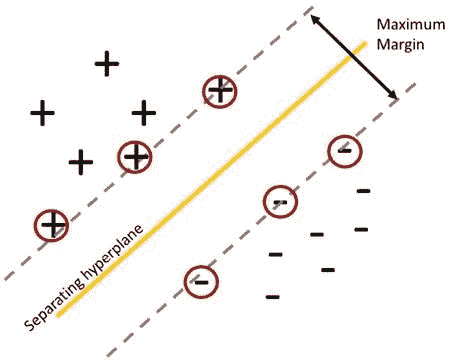

图 4-5. 支持向量机、分离超平面与间隔

请考虑以下示例。假设一家电信公司拥有以下由 *n* 个客户组成的训练数据。在这 n 个客户中，我们假设有 50 个客户会流失，另外 50 个客户不会流失。对于每个客户，你提取 10 个输入变量（或特征）来表示该客户。给定一个已经使用服务一段时间的客户，该电信公司的数据科学家和业务分析师希望确定该客户是否会流失并转向其他电信服务提供商。

假设训练数据包含以下内容：(*x*[1],*y*[1]), ... ,(*x*[*n*],*y*[*n*])，其中 (*x*[*i*],*y*[*j*]) 表示将 *x*[*i*] 映射到类别 *y*[*j*]。超平面决策函数为

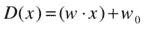

其中 *w* 和 *w*[0] 是系数。一个分离超平面将满足以下约束条件：

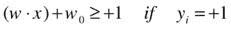

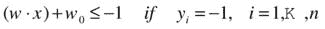

最优分离超平面是能够在两个类别之间实现最大间隔的超平面。描述超平面的这两个约束条件可以用以下方程表示：

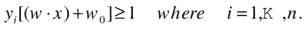

该方程可用于表示所有可用于分离数据的超平面。通常，由于直接计算 ||*w*|| 范数的值存在困难，因此不会直接以其当前形式（也称为原始形式）求解该方程。在实践中，使用该方程的对偶形式来求解优化问题，从而确定最优超平面。

 **注意**  你可以从以下书籍中了解更多关于支持向量机以及如何最大化间隔的信息：

Vladimir, C. and Filip, M., *Learning From Data (Concepts, Theory and Methods)*.
pp. 353 – 384 (Wiley-Interscience, 1998).

关于支持向量机的优秀概述可以在 [`en.wikipedia.org/wiki/Support_vector_machine`](http://en.wikipedia.org/wiki/Support_vector_machine) 找到。

Azure 机器学习提供了一个**两类支持向量机**模块，使您能够构建支持二元预测的模型。该模块的输入可以是连续变量和/或分类变量。该模块提供了多个参数，可用于微调支持向量机算法的行为。这些参数包括：

*   *迭代次数*：决定模型训练的速度。此参数使您能够在训练速度和模型准确性之间取得平衡。默认值设置为 1。
*   *Lambda*：用于调整所生成模型复杂度的 L1 正则化权重。Lambda 的默认值设置为 0.001。使用非零值是为了避免模型过拟合。
*   *标准化特征*：决定算法是否对值进行标准化。
*   *投影到单位球面*：决定算法是否将值投影到单位球面。
*   *随机数种子*：计算模型时用于随机数生成的种子值。
*   *允许未知分类级别*：决定算法是否支持未知的分类值。如果设置为 True，算法会为每个分类列创建一个额外的级别。该额外级别用于映射测试数据集中未在训练数据集中找到的级别。

贝叶斯点机

贝叶斯点机（BPM）是一种线性分类算法，由 Ralf Herbrich、Thore Grapel 和 Colin Campbell 于 2001 年提出。贝叶斯点机算法的核心思想是识别一个“平均”分类器，该分类器能够有效且高效地逼近多个线性分类器（基于其泛化能力）的理论最优贝叶斯平均。这个“平均”分类器被称为贝叶斯点。在实证研究中，贝叶斯点机在实验室数据和真实世界数据上的表现始终优于支持向量机。

 **注意**  Azure 机器学习中使用的贝叶斯点机算法基于 Infer.Net，并对原始贝叶斯点机算法进行了改进。这些改进使得 Azure 机器学习中使用的贝叶斯点机更加稳健，并且不易过拟合数据。它还减少了执行性能调优的需求。

其中一些改进包括使用期望传播作为消息传递算法。此外，该实现不需要使用参数扫描和标准化数据。

回顾之前对分类问题的定义：给定一个输入样本 *X* = (*x*[1], *x*[2], . . ., *x*[*d*])，其中 *x*[*i*] 指的是大小为 d 的样本中的一个项目。分类的目标是学习映射 *X* → *Y*，其中 *y* Î *Y* 是一个类别。

给定样本中的一个项目 *x*[*i*]，其中 *x*[*i*] 是一个包含一个或多个变量的向量。BPM 通过执行以下步骤来确定 *x*[*i*] 的类别标签：

*   计算 *x*[*i*] 与权重向量 w 的内积。
*   如果 (*x*[*i*]·*w*) 为正，则确定 *x*[*i*] 是否属于类别 y。（*x*[*i*]·*w* 是向量 *x*[*i*] 和 w 的内积）。计算中会添加高斯噪声。

在训练过程中，BPM 算法使用先验知识和训练数据来学习 w 的后验分布。计算中使用的高斯噪声有助于处理不存在能够完美分类训练数据的 *w* 的情况（即，当训练数据中的两个类别不是线性可分时）。

 **注意**  你可以在 [`research.microsoft.com/apps/pubs/default.aspx?id=65611`](http://research.microsoft.com/apps/pubs/default.aspx?id=65611) 了解更多关于 BPM 的信息。

此外，以下关于使用 Infer.Net 和 BPM 的教程提供了对该算法工作原理的深入理解：[`research.microsoft.com/en-us/um/cambridge/projects/infernet/docs/Bayes%20Point%20Machine%20tutorial.aspx`](http://research.microsoft.com/en-us/um/cambridge/projects/infernet/docs/Bayes%20Point%20Machine%20tutorial.aspx)。

Azure 机器学习提供了一个**两类贝叶斯点机**模块，使您能够构建支持二元预测的模型。该模块提供了多个参数，可用于微调**贝叶斯点机**模块的行为。这些参数包括：

*   *训练迭代次数*：决定训练过程中消息传递算法使用的迭代次数。通常，期望更多的迭代次数能提高模型预测的准确性。默认的训练迭代次数为 30。
*   *包含偏置*：决定是否在每个训练和预测实例中添加一个恒定的偏置值。

与**支持向量机**模块类似，也支持名为**允许未知分类级别**的参数。

聚类算法

聚类是一种无监督机器学习。在聚类中，目标是将相似的对象分组在一起。大多数现有的聚类算法可以分为以下几类：

*   *划分法*：将数据集划分为 *k* 个数据分区。每个分区对应一个簇。
*   *层次法*：给定一个数据集，层次法在构建簇时采用自底向上或自顶向下的方式。在自底向上方法（也称为凝聚法）中，算法开始时将数据集中的每个项分配到一个簇中。随着算法在层次结构中向上移动，它会将各个（相似的）簇合并成更大的簇。这一过程持续进行，直到所有簇合并为一个（层次结构的根节点）。在自顶向下方法（也称为分裂法）中，算法开始时将所有项放在一个簇中，并在每次迭代中将其划分为更小的簇。
*   *密度法*：基于密度的算法通过考虑每个项“邻域”内的密度（项的数量）来增长簇。它们通常用于识别具有“任意”形状的簇。相比之下，大多数基于划分的算法依赖于距离度量的使用。这会产生具有规则形状（例如球形）的簇。

 **注意**  请阅读 [`en.wikipedia.org/wiki/Cluster_analysis`](http://en.wikipedia.org/wiki/Cluster_analysis) 上对各种聚类算法的精彩概述。

在本章中，我们将重点介绍基于划分的聚类算法。具体来说，你将学习 k-means 聚类的工作原理。

对于基于划分的聚类算法，能够测量点与向量之间的距离（或相似度）非常重要。各种距离度量包括欧几里得距离、余弦距离、曼哈顿距离（也称为城市街区距离）、切比雪夫距离、闵可夫斯基距离和马氏距离。

在 Azure 机器学习中，**K-Means 聚类**模块支持欧几里得距离和余弦距离度量。给定两个点 p1 和 p2，p1 和 p2 之间的欧几里得距离是连接这两点的线段的长度。欧几里得距离也可用于测量两个向量之间的距离。给定两个向量 v1 和 v2，余弦距离是 v1 和 v2 之间夹角的余弦值。

用于聚类的距离度量是根据被聚类数据的类型来选择的。欧几里得距离对所比较向量的尺度/大小很敏感。例如，即使两个向量看起来相对相似，特征的尺度也会影响欧几里得距离的值。在这种情况下，余弦距离度量更合适，因为它受尺度的影响较小。这两个向量之间的余弦角会很小。

K-means 聚类的工作原理如下：

1.  从数据集中随机选择 k 个项作为 k 个簇的初始中心。
2.  对于剩余的每个项，根据该项与簇中心之间的距离，将其分配到 k 个簇之一。
3.  计算每个簇的新中心。
4.  重复步骤 2 和 3，直到簇不再发生变化，或达到最大迭代次数。

为了说明这一点，图 4-6 展示了一个用于 k-means 聚类的数据集。该数据中有三个不同的簇，用不同的颜色表示。

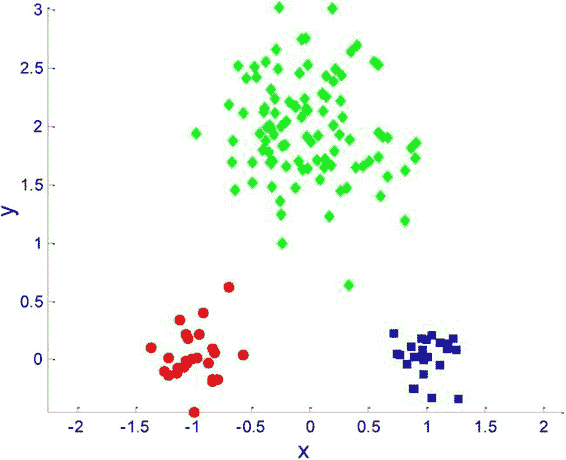

图 4-6. 用于 k-means 聚类的数据集

图 4-7 展示了 k=3 时的 k-means 聚类，以及三个簇质心（用 + 符号表示）如何在每次迭代中移动，以减小均方误差并更准确地反映簇中心。

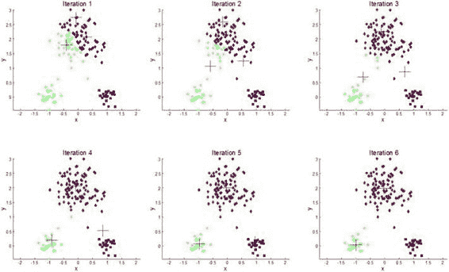

图 4-7. k=3 时 K-means 聚类算法的迭代过程，其中簇质心不断移动以最小化误差

Azure 机器学习中的 **K-Means 聚类**模块支持不同的质心初始化算法。这由 **初始化** 属性指定。支持五种质心初始化算法。表 4-1 显示了支持的不同质心初始化方法。

表 4-1. K-Means 聚类 - 质心初始化算法

| 质心初始化算法 | 描述 |
| --- | --- |
| **默认** | 选取前 N 个点作为初始质心 |
| **随机** | 随机选取初始质心 |
| **K-Means++** | K-Means++ 质心初始化 |
| **K-Means+ 快速** | K-Means++ 质心初始化，其中 P:=1（在算法的每次迭代中选取最远的质心） |
| **均匀** | 均匀选取 N 个点作为初始质心 |

总结

在本章中，你学习了不同的回归、分类和聚类算法。你了解了每种算法的工作原理以及它们适合解决的问题类型。本章的目标是为你在后续章节中使用这些算法解决各种问题奠定基础。此外，本章提供的资源将帮助你更深入地了解机器学习的最新进展，以及其中一些算法背后的理论。

第三部分

实际应用

