# 第五章 构建客户倾向模型

本章将提供构建机器学习模型的实用指南。它侧重于买家倾向模型，展示了如何将数据科学流程应用于此业务问题。通过逐步指南，本章将解释如何应用关键概念并利用 Microsoft Azure 机器学习的功能进行倾向建模。

## 业务问题

假设你是一家大型自行车制造商的营销经理。你需要开展一次邮件营销活动，以吸引更多客户购买你的自行车。你的预算有限，管理层希望你最大化投资回报率（ROI）。因此，你的邮件营销活动的目标是找到最有可能购买你自行车的潜在客户。

如果预算无限，任务就很简单：你可以直接购买名单并给每个人发送邮件。然而，这种蛮力方法效率低下，并且会产生有限的 ROI，因为对大多数收件人来说，这无异于垃圾邮件。使用这种无针对性的方法，你不太可能实现目标，因为它会导致非常低的响应率。

更好的方法是使用预测分析来定位最有可能购买你自行车的潜在客户，例如最有可能购买自行车的客户。这类预测分析被称为买家倾向模型或客户定位模型。通过这种方法，你可以构建模型来预测潜在客户对你的邮件营销活动做出响应的可能性。

在本章中，我们将向你展示如何在 Azure 机器学习中构建这类模型。使用完成的模型，你将给潜在客户打分，并且只给那些最有可能对你的活动做出响应的客户发送邮件。我们还将展示如何在有限的营销预算下最大化 ROI。

 注意 你需要拥有一个 Azure 机器学习帐户。如果你还没有帐户，请参阅第 2 章了解如何设置新帐户的说明。

正如你在第 1 章中看到的，数据科学流程通常遵循以下五个步骤。

1. 定义业务问题。
2. 数据获取与准备。
3. 模型开发。
4. 模型部署。
5. 监控模型性能。

在定义了业务问题之后，你将在本章的其余部分探索数据获取与准备、模型开发和评估。

## 数据获取与准备

在本节中，你将了解如何从不同来源加载数据并在 `Azure Machine Learning` 中进行分析。`Azure Machine Learning` 支持从多种来源加载数据，包括本地计算机、Web、Azure 上的 SQL 数据库、Hive 表或 Azure Blob 存储。

### 从本地文件系统加载数据

最简单的数据加载方式是从本地计算机加载。请按照以下步骤操作。

1. 在浏览器中访问 URL `studio.azureml.net`，并登录到你在 `Azure Machine Learning` 中的工作区。
2. 接着，点击左侧窗格菜单中的 `Experiments` 项。
3. 点击窗口左下角的 `+New` 按钮，然后从新出现的菜单中选择 `Dataset`，如图 5-1 所示。

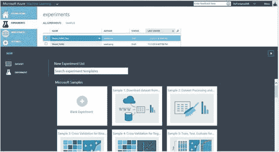

图 5-1. 从本地计算机加载新数据集

4. 当你选择 `From Local File` 选项时，系统会提示你选择要从本地计算机加载的数据文件。

你已使用这些步骤将 `BikeBuyer.csv` 文件从本地文件系统加载到 `Azure Machine Learning` 中。

### 从其他来源加载数据

你可以使用 `Azure Machine Learning` 中的 `Reader` 模块从非本地来源加载数据。具体来说，使用 `Reader` 模块可以从 Web、Azure 上的 SQL 数据库、Azure 表、Azure Blob 存储或 Hive 表加载数据。为此，你需要在调用 `Reader` 模块之前创建一个新实验。请按照以下步骤使用 `Reader` 模块从上述任何来源加载数据。

1. 在浏览器中访问 URL `studio.azureml.net`，并登录到你在 `Azure Machine Learning` 中的工作区。
2. 接着，点击左侧窗格菜单中的 `Experiments` 项。
3. 点击窗口左下角的 `+New` 按钮，然后从新出现的菜单中选择 `Experiment`。一个新的实验将启动，并带有一个空白画布，如图 5-2 所示。

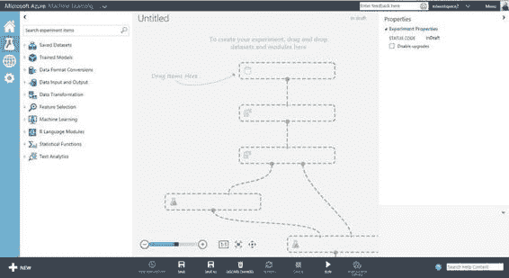

图 5-2. 在 `Azure Machine Learning` 中启动新实验

4. 打开 `Data Input and Output` 菜单项，你将看到两个模块：`Reader` 和 `Writer`。
5. 将 `Reader` 模块从菜单拖放到画布上的任意位置。
6. 点击画布上的 `Reader` 模块，其属性将显示在右侧窗格的 `Reader` 下。现在，在下拉菜单中指定数据源，然后输入所有必需参数的值。图 5-3 显示了为从我们的 Azure Blob 存储帐户读取 `BikeBuyer.csv` 文件而输入的完整参数。`Account Name` 和 `Account Key` 指的是 Microsoft Azure 上的一个存储帐户。你可以通过以下方式从 Azure 门户获取这些参数。
    1. 登录 Microsoft Azure，网址为 `azure.microsoft.com`。
    2. 在顶部菜单中，点击 `Portal`。这将带你进入 Azure 门户。
    3. 从左侧窗格的菜单中选择 `storage`。这将在右侧窗格中列出你所有的存储帐户。
    4. 点击包含你的机器学习模型所需数据的存储帐户。
    5. 在屏幕底部，点击标有 `Manage Access Keys` 的钥匙图标。将显示你的存储帐户名称和访问密钥。使用主访问密钥作为 `Azure Machine Learning` 中 `Reader` 模块的 `Account Key`。

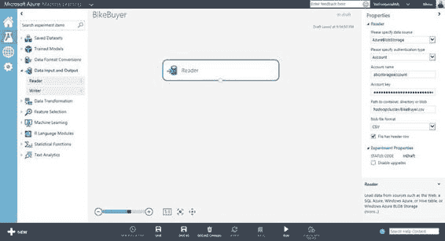

图 5-3. 使用 `Reader` 模块从 Azure Blob 存储加载 `BikeBuyer.csv` 文件

 注意 你可以使用上述说明将多个来源的多个数据集加载到 `Azure Machine Learning` 中。但请注意，每个 `Reader` 模块一次只能加载一个数据集。

## 数据分析

将数据加载到 `Azure Machine Learning` 后，下一步是进行预处理，为建模准备数据。作为此过程的一部分，对数据进行可视化总是非常有用的。你可以通过 `Reader` 模块或从左侧窗格的 `Saved Datasets` 菜单项中选择 `BikeBuyer.csv` 来可视化 Bike Buyer 数据集。当鼠标悬停在 `Reader` 模块底部的小圆圈上时，会打开一个菜单，提供两个选项：`Download` 或 `Visualize`。详情请参见图 5-4。如果选择 `Download` 选项，你可以将数据保存到本地计算机，并在 Excel 中打开以查看数据。或者，你也可以通过选择 `Visualize` 选项在 `Azure Machine Learning` 中可视化数据。

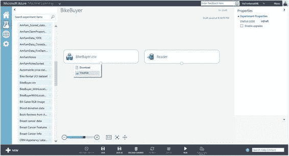

图 5-4. 在 `Azure Machine Learning` 中可视化数据的两个选项

如果选择 `Visualize` 选项，数据将在一个新窗口中呈现，如图 5-5 所示。图 5-5 显示了 `BikeBuyer.csv` 数据集，其中包含所有客户的历史销售数据。你可以看到该数据集有 10,000 行和 13 列，包括人口统计变量，如婚姻状况、性别、年收入、子女数量、职业、年龄等。其他变量包括房屋所有权状况、汽车数量和通勤距离。最后一列名为 Bike Buyer，非常重要，因为它显示了哪些客户过去曾从你的商店购买过自行车。

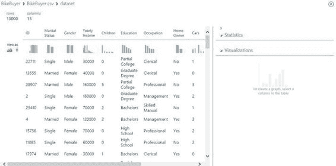

图 5-5. 在 `Azure Machine Learning` 中可视化 Bike Buyer 数据集

图 5-5 还显示了数据集中所有变量的描述性统计信息，如均值、中位数、标准差等。此外，它还显示了每个变量的数据类型和缺失值的数量。向下滚动，你将看到显示实际值的数据集样本。

特征列表顶部的第一行是一组缩略图，显示了每个变量的分布情况。你可以通过点击缩略图查看完整的分布。例如，如果你点击年收入上方的缩略图，`Azure Machine Learning` 会在屏幕右侧窗格中打开完整的直方图；如图 5-6 所示。该直方图显示了所选变量的分布情况，你可以开始思考如何在模型中使用它。例如，在图 5-6 中，你可以清楚地看到年收入并非来自正态分布。如果非要描述，它看起来更像是对数正态分布。你还可以在直方图中发现异常值。`Azure Machine Learning` 允许你在直方图上叠加概率密度函数或累积分布。

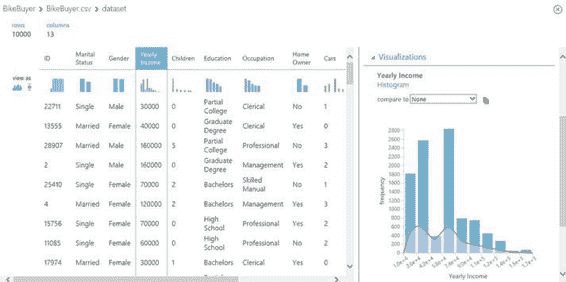

图 5-6. 年收入直方图

# 更多数据处理方法

除了可视化之外，Azure 机器学习还提供了许多其他数据预处理选项。左侧窗格的菜单包含许多按功能组织的模块。其中许多模块可用于数据预处理。

`数据格式转换`项下有五个用于转换数据格式的不同模块。例如，名为`转换为 CSV`的模块可将不同类型的数据（如`数据集`、`DataTableDotNet`等）转换为 CSV 格式。

菜单中的`数据转换`项包含数据筛选、数据处理、数据采样和缩放等子类别。名为`统计函数`的菜单项也包含许多与数据预处理相关的模块。

图 5-10 展示了其中一些模块的实际应用。`联接`模块（位于`处理`子类别下）使您能够联接数据集。例如，如果倾向模型有第二个相关数据，您可以使用联接模块将其与自行车购买者数据集联接起来。

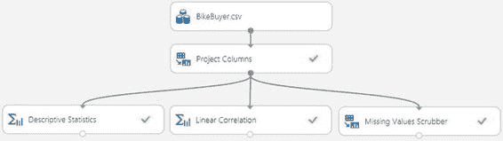
图 5-10. 更多数据准备选项

名为`描述性统计`的模块会显示数据集的描述性统计信息。例如，如果您单击此模块底部的小圆圈，Azure 机器学习会显示自行车购买者数据集的描述性统计信息，如均值、中位数、标准差、偏度、峰度等。它还会显示每个变量中缺失值的数量。根据经验法则，如果一个变量有 40%或更多的缺失值，除非该变量对业务至关重要，否则可以将其从分析中剔除。

您可以使用名为`缺失值清理器`的模块来处理缺失值。与 Azure 机器学习中的任何其他模块一样，当您选择此模块时，其参数会显示在右侧窗格中。此模块允许您以多种方式处理缺失值。首先，您可以删除包含缺失值的列。默认情况下，该工具会保留所有包含缺失值的变量。其次，您可以在参数框中用硬编码值替换缺失值。默认情况下，该工具会将所有缺失值替换为数字 0。或者，您也可以使用给定变量的均值、中位数或众数来替换缺失值。

`线性相关`模块对于计算数据集中变量的相关性也很有用。如果您单击线性相关模块底部的小圆圈，然后选择“可视化”，该工具会显示一个相关矩阵。在此矩阵中，您可以查看数据集中所有变量之间的两两相关性。此模块计算的是皮尔逊相关系数。因此，此模块不支持其他相关类型，如斯皮尔曼相关。此外，请注意此模块仅计算连续变量的相关性。对于分类变量，该模块会显示 NaN。

# 特征选择

特征选择是数据预处理中非常重要的一部分。也称为变量选择，这是为预测模型寻找正确变量的过程。在处理包含数百个变量的大型数据集时，这一点尤为关键。将超过 600 个变量扔给预测模型会浪费计算机资源，同时也会降低其预测准确性。通过特征选择，您可以找到对预测最有影响力的变量。由于自行车购买者数据集只有 13 个变量，您可以跳过此步骤。但是，让我们看看如何在 Azure 机器学习中进行特征选择，因为这对于大型数据集非常重要。

要在 Azure 机器学习中进行特征选择，请从左侧窗格的模块列表中拖拽名为`基于筛选器的特征选择`的模块。您可以通过在搜索框中搜索或打开`特征选择`类别来找到此模块。要使用此模块，您需要将其作为输入连接到数据集。图 5-11 展示了它作为自行车购买者数据集的特征选择的使用情况。在运行实验之前，请使用右侧窗格中的`启动列选择器`来定义预测的目标变量。在此案例中，选择`自行车购买者`列作为目标，因为这是您需要预测的内容。

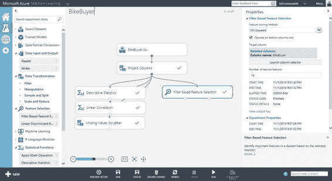
图 5-11. Azure 机器学习中的特征选择

您还需要选择将用于特征选择的评分方法。Azure 机器学习提供以下评分选项：

*   皮尔逊相关

*   互信息

*   肯德尔相关

*   斯皮尔曼相关

*   卡方检验

*   费舍尔分数

*   基于计数

相关方法会找出一组与输出高度相关，但彼此之间相关性较低的变量。相关性是使用皮尔逊、肯德尔或斯皮尔曼相关系数计算的，具体取决于您选择的选项。

费舍尔分数使用统计学中的费舍尔准则对变量进行排序。相比之下，互信息选项是一种信息论方法，它使用互信息对变量进行排序。互信息衡量每个变量的概率密度与结果变量的概率密度之间的依赖性。

最后，卡方检验选项使用独立性检验来选择最佳特征；换句话说，它检验每个变量是否与结果变量独立。然后，它根据卡方检验对变量进行排序。

> **注意** 有关特征选择策略的更多信息，请参见 [`en.wikipedia.org/wiki/Feature_selection#Correlation_feature_selection`](http://en.wikipedia.org/wiki/Feature_selection#Correlation_feature_selection) 或 [`jmlr.org/papers/volume3/guyon03a/guyon03a.pdf`](http://jmlr.org/papers/volume3/guyon03a/guyon03a.pdf)。

运行实验时，`基于筛选的特征选择`模块会生成两个输出。首先，筛选后的数据集列出了最重要变量的实际数据。其次，该模块会按重要性显示变量列表，并附有每个选定变量的得分。图 5-12 展示了特征选择的结果。在此案例中，你将特征数量设置为五个，并使用卡方检验进行评分。图 5-12 显示了六列，因为结果集包含了目标变量（即自行车购买者）以及排名前十的变量，包括年龄、汽车数量、通勤距离、教育程度和地区。结果集的最后一行显示了每个选定变量的得分。由于变量已排序，得分从左到右递减。

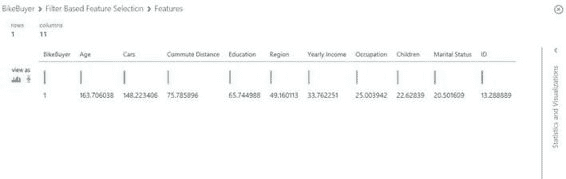
图 5-12. 自行车购买者数据集的特征选择结果，包含排名靠前的变量

请注意，选定的变量会根据评分方法的不同而变化。因此，在确定最终变量集之前，尝试不同的评分方法是值得的。对于自行车购买者数据集，卡方检验和互信息评分方法产生了相似的变量排名。

# 训练模型

数据预处理完成后，就可以开始训练预测模型了。第一步是为当前问题选择正确的算法类型。对于倾向性模型，你需要一个分类算法，因为你的目标变量是布尔型。模型的目标是预测潜在客户是否会购买你的自行车。因此，这是一个典型的二分类问题示例。正如你在第 1 章和第 4 章中看到的，分类算法使用监督学习进行训练。训练数据中每个特征集都有已知的结果；换句话说，历史数据中的每一行都包含“自行车购买者”字段，该字段显示客户是否购买了自行车。“自行车购买者”字段是你需要预测的因变量（也称为响应变量）。输入变量是预测因子（也称为自变量或回归变量），例如年龄、汽车数量、通勤距离、教育程度、地区等。如果你使用逻辑回归，你的模型可以表示如下：

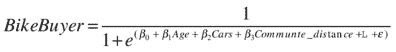

其中，`b0` 是一个常数，即回归线的截距；`b1`、`b2`、`b3` 等是自变量的系数。`e` 是误差项，表示所选变量无法解释的数据变异性。在这个方程中，`BikeBuyer` 是客户购买自行车的概率。其值范围从 0 到 1。`Age`、`cars` 和 `Commute_distance` 是预测变量。

# 训练过程

在训练过程中，你将输入变量和输出变量都提供给所选算法。在每次学习迭代中，算法将尝试使用当前已学习的权重来预测已知结果。最初，由于权重尚未充分学习，预测误差会很高。在后续迭代中，算法将调整其权重，以将预测误差降至最低。请注意，每种算法都使用不同的策略来调整权重，从而减少预测误差。有关 `Azure` 机器学习中统计和机器学习算法的更多详细信息，请参阅第 4 章。

`Azure` 机器学习提供了广泛的分类算法，从多类决策森林和丛林到两类逻辑回归、神经网络和支持向量机。对于客户倾向性模型，由于响应变量（自行车购买者）有两个类别，因此两类分类算法是合适的。因此，你可以使用`分类`子类别下的任何两类算法。要查看完整的算法列表，请展开左侧窗格中名为`初始化模型`的类别。展开名为`分类`的子类别，`Azure` 机器学习将列出所有可用的分类算法。我们建议尝试其中几种算法，直到找到最适合当前任务的算法。图 5-13 展示了一个简单但完整的自行车购买者倾向性模型实验。

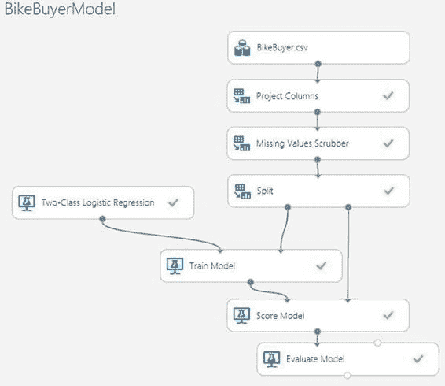

图 5-13. 客户倾向性建模的简单实验

`项目列`模块仅排除了名为 `ID` 的列，因为它与模型无关。使用`缺失值清理器`模块处理缺失值，如上一节所述。`拆分`模块将数据分成两个样本，一个用于训练，另一个用于测试。在此实验中，你保留了 70% 的数据用于训练，其余 30% 用于测试。这是避免过拟合的常用策略之一。如果没有测试样本，模型很容易记住数据和噪声。在这种情况下，模型在训练数据上会表现出非常高的准确率，但在生产环境中使用未见过的数据进行测试时，性能会很差。避免过拟合的另一个好策略是交叉验证；本章稍后将对此进行讨论。

训练预测模型使用了两个模块：`两类逻辑回归`模块实现了逻辑回归算法，而`训练模型`模块则实际执行训练。`训练模型`模块可以训练与其连接的任何合适算法。因此，它可以用于训练前面讨论的任何分类模块，例如`两类提升决策树`、`两类决策森林`、`两类决策丛林`、`两类神经网络`或`两类支持向量机`。

## 模型测试与验证

模型训练完成后，下一步是使用留出样本对其进行测试，以避免过拟合。在此示例中，你的测试集是之前使用`拆分`模块创建的 30% 样本。图 5-13 展示了如何使用名为`评分模型`的模块来测试训练好的模型。最后，使用名为`评估模型`的模块来评估模型的性能。图 5-13 展示了如何使用此模块来评估模型在测试样本上的性能。下一节还将提供有关模型评估的更多详细信息。

如前所述，避免过拟合的另一种策略是交叉验证，即不仅使用两个，而是使用数据的多个样本来训练和测试模型。`Azure` 机器学习使用 10 折验证，将原始数据集分成 10 个样本。图 5-14 展示了一个修改后的实验，该实验同时使用了交叉验证以及训练和测试集方法。在实验的右侧轨道上，你将`训练模型`和`评分模型`这两个模块替换为`交叉验证模型`模块。你可以通过单击`交叉验证模型`模块右下角的`小圆圈`来检查交叉验证的结果。这将显示 10 个模型中每个模型的性能。

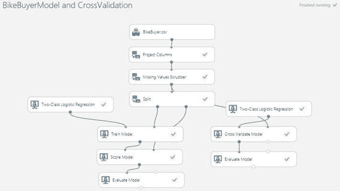

图 5-14. 使用交叉验证的修改后实验

## 模型性能

`评估模型`模块用于衡量已训练模型的性能。该模块接收两个数据集作为输入：第一个是来自已测试模型的评分数据集，第二个是用于比较的可选数据集。运行实验后，您可以通过点击`评估模型`模块底部的`小圆圈`来检查模型的性能。该模块提供以下指标来衡量分类模型（如倾向模型）的性能：

*   `受试者工作特征`（`ROC`）曲线，绘制了真正例率与假正例率的关系。
*   `提升曲线`（也称为增益曲线），绘制了真正例数量与正例率的关系。这在市场营销中很常见。
*   `精确率与召回率`图表。
*   `混淆矩阵`，展示了第一类和第二类错误。

图 5-15 展示了您之前构建的倾向模型的 `ROC` 曲线。`ROC` 曲线直观地展示了预测性二分类模型的性能。图表中从 `(0,0)` 到 `(1,1)` 的对角线代表了随机猜测的性能；因此，如果您随机选择目标客户，您的响应将落在这条对角线上。一个好的预测模型应该远优于随机猜测。因此，在 `ROC` 曲线上，一个好的模型应位于对角线上方。理想模型（100%准确）将有一条从 `(0,0)` 到 `(0,1)` 的垂直线，接着是一条从 `(0,1)` 到 `(1,1)` 的水平线。

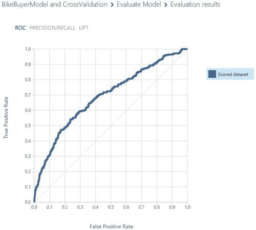

图 5-15. 客户倾向模型的 `ROC` 曲线

衡量 `ROC` 曲线性能的一种方法是测量曲线下面积（`AUC`）。曲线下面积越大，模型性能越好。理想模型的 `AUC` 为 1.0，而随机猜测的 `AUC` 为 0.5。您构建的逻辑回归模型的 `AUC` 为 0.689，这远优于随机猜测！

图 5-16 展示了您之前构建的逻辑回归模型的`混淆矩阵`。混淆矩阵包含四个单元格，即：

*   `真正例`：这些是客户实际购买了自行车且模型正确预测的情况。
*   `真负例`：在历史数据集中，这些客户没有购买自行车，且模型正确预测他们不会购买。
*   `假正例`：在这种情况下，模型错误地预测客户会购买自行车，而实际上他们并未购买。这通常被称为第一类错误。您构建的逻辑回归模型仅有 2 个`假正例`。
*   `假负例`：在这种情况下，模型错误地预测客户不会购买自行车，而实际上客户购买了。这也被称为第二类错误。该逻辑回归模型有多达 276 个`假负例`。

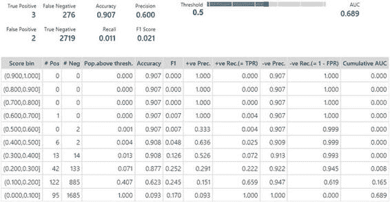

图 5-16. 混淆矩阵及更多性能指标

此外，图 5-16 还展示了模型的准确率、精确率和召回率。以下是这些指标的计算公式。精确率是结果中真正例的比例。

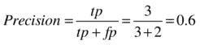

召回率是模型识别出的购买者百分比，其计算公式为：

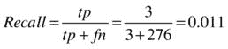

最后，准确率衡量模型正确识别购买者和非购买者的能力，公式如下：

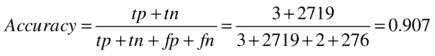

其中 `tp` = 真正例，`tn` = 真负例，`fp` = 假正例，`fn` = 假负例。

您还可以在单个 `ROC` 图表上比较两个模型的性能。例如，让我们修改图 5-14 中的实验，使用`两类提升决策树`模块作为第二个训练器，而不是`两类逻辑回归`模块。现在您的实验有两个不同的分类器：左侧分支的`两类逻辑回归`和右侧分支的`两类提升决策树`。您将两个模型的评分数据集连接到同一个`评估模型`模块。更新后的实验如图 5-17 所示，结果如图 5-18 所示。在此图表中，标记为“用于比较的评分数据集”的曲线是`两类提升决策树`模型的 `ROC` 曲线，而标记为“评分数据集”的曲线是`两类逻辑回归`模型的 `ROC` 曲线。您可以清楚地看到，提升决策树模型优于逻辑回归模型，因为它在随机猜测的对角线上方具有更高的提升度。提升决策树模型的曲线下面积（`AUC`）为 0.722，优于您之前看到的逻辑回归模型的 0.689。

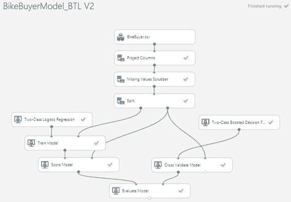

图 5-17. 使用同一个`评估模型`模块比较两个模型的更新后实验

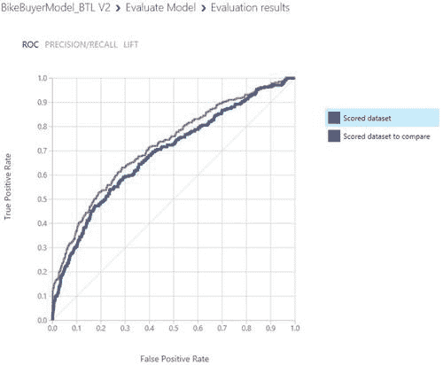

图 5-18. 比较两个预测模型（提升决策树与逻辑回归）性能的 `ROC` 曲线

# 总结

在本章中，我们提供了关于如何使用 `Microsoft Azure` 机器学习服务构建购买者倾向模型的实用指南。通过本章的分步指南，我们解释了如何在 `Microsoft Azure` 机器学习服务中构建购买者倾向模型。您学习了如何执行数据预处理和分析，这是理解用于构建客户倾向模型的数据的关键步骤。基于对数据的理解，您使用了二类逻辑回归和二类提升决策树算法进行分类。您还了解了如何评估模型性能并避免过拟合。