# 第 6 章 构建流失模型

在本章中，我们将揭示构建客户流失模型的秘诀，这类模型需求非常高。许多行业使用流失分析作为减少客户流失的手段。本章将展示在 Microsoft Azure 机器学习中构建客户流失模型的整体视图。

## 流失模型概述

企业需要制定有效的客户流失管理策略，因为吸引新客户的成本高于留住现有客户。客户流失可以表现为不同形式，例如转向竞争对手的服务、减少使用服务的时间、减少使用的服务数量，或转向低成本服务。零售、媒体、电信和银行业的公司使用流失模型来创造更好的产品、服务和体验，从而提高客户留存率。

让我们深入探讨为什么流失模型对电信公司如此重要。许多电信公司的消费者业务在一个竞争极其激烈的市场中运营。在许多国家，通常有两家或更多电信公司争夺同一客户。此外，移动号码可携性使客户更容易转向其他电信提供商。

许多电信公司将流失水平作为其年度报告的一部分进行跟踪。流失模型的使用使电信提供商能够制定有效的业务策略来留住客户，并防止潜在的收入损失。

流失模型使企业能够预测哪些客户最有可能流失，并理解导致流失发生的因素。在用于构建流失模型的不同机器学习技术中，分类算法是常用的一种。Azure 机器学习提供了多种分类算法，包括决策森林、决策丛林、逻辑回归、神经网络、贝叶斯点机和支持向量机。图 6-1 展示了可在 Azure 机器学习工作室中使用的不同分类算法。

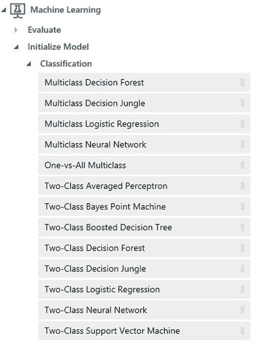

图 6-1. ML 工作室中可用的分类算法

在构建（基于分类算法的）流失模型之前，理解数据非常重要。对于用于训练和测试流失模型的数据集，你应该提出以下（非详尽）问题：

*   每一列捕获了哪种信息？
*   是直接使用每一列的信息，还是应该从每一列计算出更有意义的派生值？
*   数据分布是怎样的？
*   每一列的值是数值型还是分类型？
*   某一列是否包含许多缺失值？

一旦理解了数据，你就可以按照以下步骤开始构建流失模型。

1.  数据准备与理解
2.  数据预处理与特征选择
3.  用于预测客户流失的分类模型
4.  评估模型性能
5.  模型运营化

在本章中，你将学习如何执行这些步骤中的每一步，为电信业务场景构建一个流失模型。你将学习 Azure 机器学习工作室中用于理解数据和执行数据预处理的不同工具。你还将学习用于评估模型有效性的不同性能指标。让我们开始吧！

## 构建和部署客户流失模型

在本节中，你将学习如何使用不同的分类算法构建客户流失模型。为了构建客户流失模型，你将使用来自 KDD Cup 2009 的电信数据集。该数据集由法国领先的电信公司 Orange 提供。根据 Orange 2013 年度报告，Orange 在全球拥有 2.36 亿客户（1550 万固定宽带客户和 1.785 亿移动客户）。

KDD Cup 2009 挑战的目标是构建一个有效的机器学习模型，用于预测客户流失、购买新产品/服务的意愿（倾向性）以及向上销售的机会。在本节中，你将专注于预测客户流失。

 **注意**  KDD Cup 是由 ACM 知识发现与数据挖掘特别兴趣小组（SIGKDD）组织的年度竞赛。每年，数据科学家都会参与各种数据挖掘和知识发现挑战。这些挑战的范围从预测谁最有可能向慈善机构捐款（1997 年）、在线零售商的点击流分析（2000 年）、预测电影评分行为（2007 年），到预测客户更换服务提供商的倾向（2009 年）。

### 准备和理解数据

在本练习中，你将使用较小的 Orange 数据集，该数据集包含 50,000 行。每行有 230 列（称为变量）。前 190 个变量是数值型，最后 40 个变量是分类型。

在开始构建实验之前，请从 KDD Cup 网站下载以下小数据集和流失标签：

*   `orange_small_train.data.zip` - [www.sigkdd.org/site/2009/files/orange_small_train.data.zip](http://www.sigkdd.org/site/2009/files/orange_small_train.data.zip)
*   `orange_small_train_churn.labels` - [www.sigkdd.org/site/2009/files/orange_small_train_churn.labels](http://www.sigkdd.org/site/2009/files/orange_small_train_churn.labels)

在 `orange_small_train_churn.labels` 文件中，每一行包含一个 +1 或 -1 值。+1 值表示正例（客户已流失），-1 值表示负例（客户未流失）。

文件上传后，你应该按照以下步骤将数据集和标签上传到机器学习工作室：

1.  点击 **新建** 并选择 **数据集  来自本地文件**（图 6-2）。

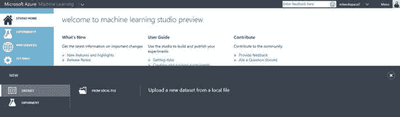

图 6-2. 使用机器学习工作室上传 Orange 数据集

2.  接下来，选择要上传的文件：`orange_small_train.data`（图 6-3）。

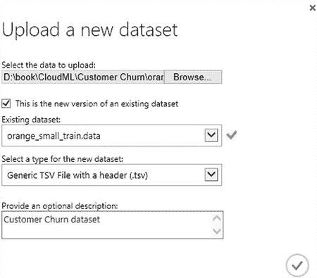

图 6-3. 上传数据集

3.  点击 **确定**。

Orange 数据集上传后，重复步骤将流失标签文件上传到机器学习工作室。完成后，当你创建新实验时，应该能够看到这两个 Orange 数据集。为此，创建一个新实验，并展开左侧窗格中的“已保存数据集”菜单。图 6-4 显示了您上传的 Orange 训练数据和流失标签数据集。

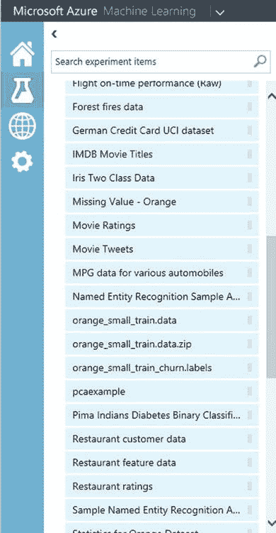

图 6-4. 已保存数据集：Orange 训练数据和流失标签

在构建任何机器学习模型时，在尝试构建模型之前理解数据非常重要。为此，请按如下步骤创建一个新实验。

1.  点击 **新建**  **实验**。
2.  命名实验为 - **理解 Orange 数据集**。
3.  从 **已保存数据集** 中，选择 `orange_small_train.data` 数据集（双击它）。
4.  从 **统计函数** 中，选择 **描述性统计**（双击它）。
5.  你将看到这两个模块。将数据集与 **描述性统计** 模块连接起来。图 6-5 显示了完成的实验。

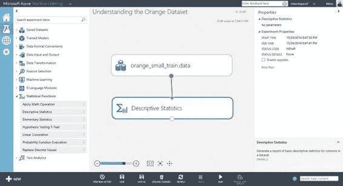

图 6-5. 理解 Orange 数据集

6.  点击 **运行**。
7.  运行成功完成后，右键单击 **描述性统计** 下方的圆圈，然后选择 **可视化**。
8.  你将看到数据的分析结果，其中涵盖了每个变量的唯一值计数、缺失值计数、最小值和最大值（图 6-6）。

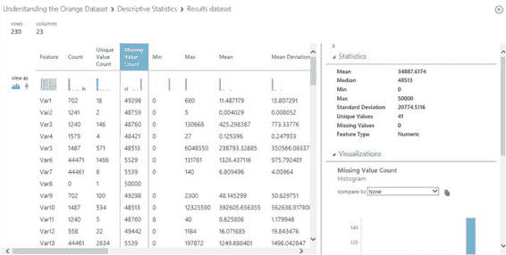

图 6-6. Orange 数据集的描述性统计

这提供了关于每个变量的有用信息。从可视化结果中，你将观察到有许多变量存在缺失值（例如，`Var1`、`Var8`）。例如，`Var8` 实际上是一个没有有用信息的列。

 **提示**  当可视化 **描述性统计** 的输出时，它只显示前 100 个变量。要查看所有 230 个变量的全部统计信息，请右键单击 **描述性统计** 模块的底部圆圈，然后选择 **另存为数据集**。数据集保存后，你可以选择下载文件并在 Excel 中查看所有行。

### 数据预处理与特征选择

在大多数分类任务中，你通常需要确定哪些变量应用于构建模型。机器学习工作室提供了两个特征选择模块，可用于确定建模的正确变量。这包括基于筛选器的特征选择和线性判别分析。

在本练习中，您将不会使用这些特征选择模块。图 6-7 展示了数据预处理步骤。

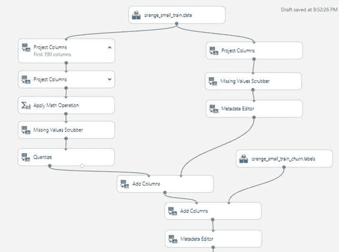

图 6-7. 数据预处理步骤

为简化操作，请执行以下步骤来预处理数据。

1.  将变量分为前 190 列（数值数据）和剩余 40 列（分类数据）。为此，请添加两个 **投影列** 模块。
    对于第一个 **投影列** 模块，选择 **列索引：1-190**（图 6-8）。

    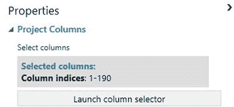

    图 6-8. 选择列索引 1-190（数值列）

    对于第二个 **投影列** 模块，选择 **列索引：191-230**（图 6-9）。

    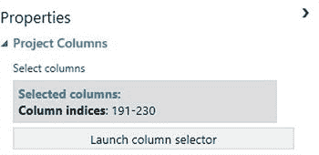

    图 6-9. 选择列索引 191-230（分类列）

2.  对于前 190 列，执行以下操作：

## 数据准备

1.  使用`投影列`选择包含数值数据的列（并移除包含零值或极少值的列）。这些列包括：`Var6`、`Var8`、`Var15`、`Var20`、`Var31`、`Var32`、`Var39`、`Var42`、`Var48`、`Var52`、`Var55`、`Var79`、`Var141`、`Var167`、`Var175` 和 `Var185`。图 6-10 展示了被排除的列。

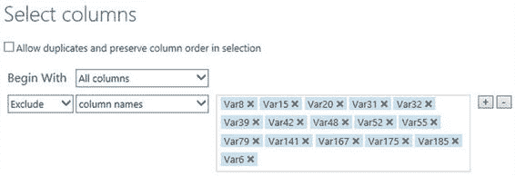

2.  应用一个数学运算，为每一行加 1。这样做的理由是，这使您能够区分列中实际为 0 的行与替换值 0（当您使用缺失值清理器时）。图 6-11 展示了`数学运算`模块的属性。

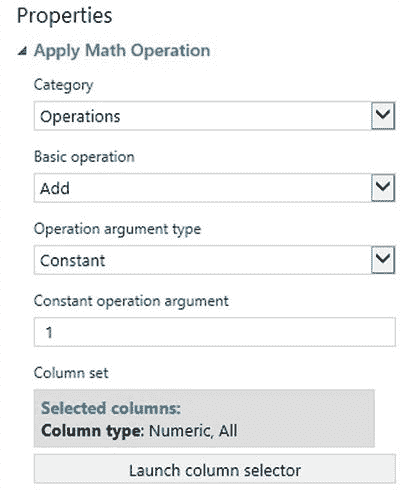

3.  使用`缺失值清理器`将缺失值替换为 0。图 6-12 展示了其属性。

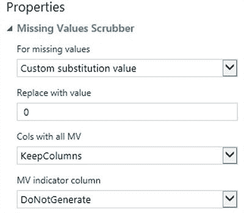

4.  使用`量化`模块，通过量化函数将输入值映射到更少的箱中。在本练习中，您将使用`等宽分箱`模式。图 6-13 展示了所使用的属性。

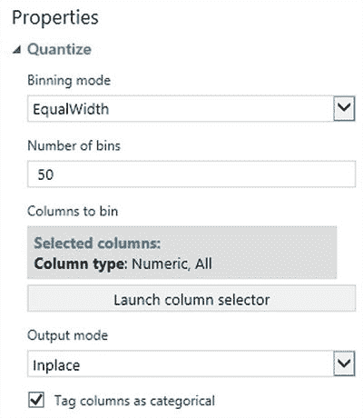

5.  对于剩余的 40 列，执行以下步骤：
    1.  使用`缺失值清理器`将其替换为 0。图 6-14 展示了其属性。

        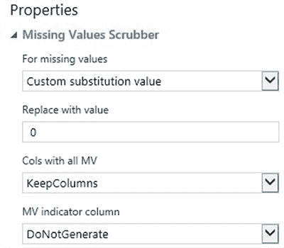

    2.  使用`元数据编辑器`将所有列的类型更改为`分类`。图 6-15 展示了其属性。

        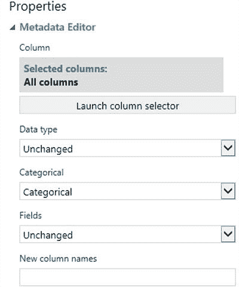

6.  将其与`ChurnLabel`数据集中的标签合并。图 6-16 展示了合并后的数据。

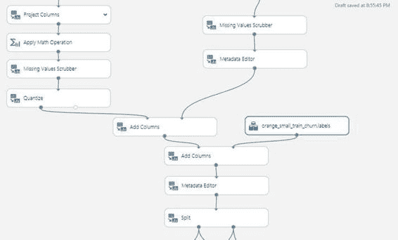

7.  将标签列重命名为`ChurnLabel`。图 6-17 展示了如何使用元数据编辑器重命名列。

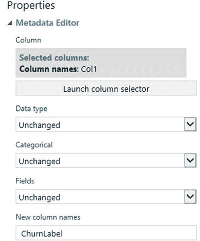

## 构建和评估分类模型

在本节中，您将开始使用 Azure 机器学习工作室中提供的分类算法构建客户流失模型。为了预测客户流失，您将使用两种分类算法：双类提升决策树和双类决策森林。

决策树是一种用于分类或回归的机器学习算法。在训练过程中，它会使用能带来最高信息增益的输入变量来分割数据。这个过程会在每个数据子集上重复，直到不再需要分割为止。决策树的叶节点标识了要预测的标签（或类别）。该预测基于概率分布给出。

提升决策树和决策森林算法构建了一个决策树集成，并使用它们进行预测。这两种方法的主要区别在于，在提升决策树算法中，多个决策树按顺序生长，使得一棵树的输出作为下一棵树的输入。这是一种集成建模的提升方法。相比之下，决策森林算法中每棵决策树彼此独立生长；集成中的每棵树都使用从原始数据集中抽取的数据样本。这是集成建模的装袋方法。有关决策树、决策森林和提升决策树的更多详细信息，请参见第 4 章。图 6-18 展示了数据如何被分割并用作输入来训练这两个分类模型。

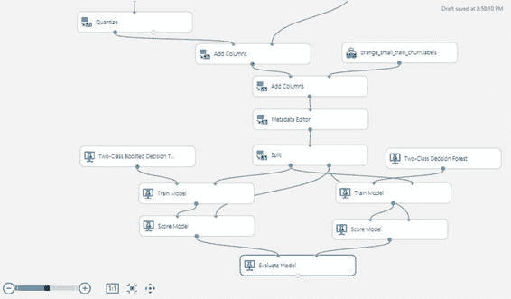

从图 6-18 中，您可以看到执行了以下步骤。

1.  将输入数据分割为训练数据和测试数据：在本练习中，您通过指定`第一个输出数据集中的行比例`并将其设置为`0.7`来分割数据。这将 70%的数据分配给训练集，剩余 30%分配给测试数据集。图 6-19 展示了`分割`模块的属性。

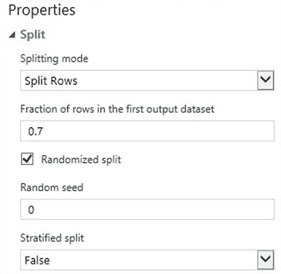

2.  使用训练数据训练模型：在本练习中，您将训练两个分类模型：双类提升决策树和双类决策森林。图 6-20 和 6-21 展示了每个分类算法的属性。

    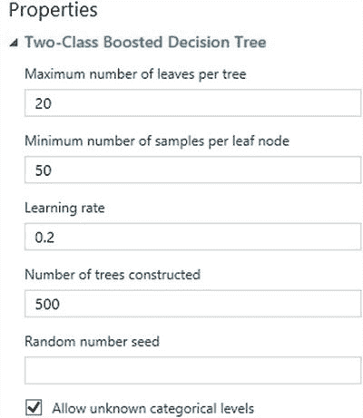

    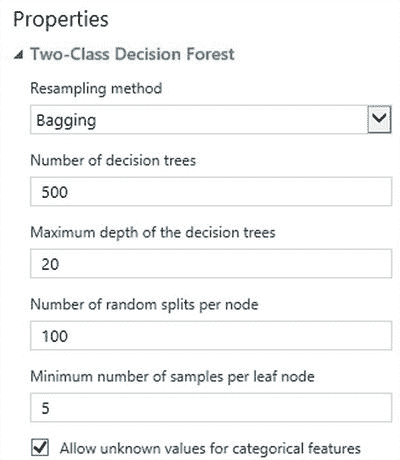

3.  使用`训练模型`模块训练模型：要训练模型，您需要选择标签列。在本练习中，您将使用`ChurnLabel`列。图 6-22 展示了`训练模型`的属性。

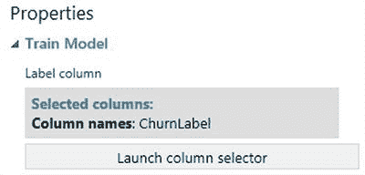

对模型进行评分：训练完客户流失模型后，您可以使用`评分模型`模块来预测测试数据集的标签列。`评分模型`的输出将用于`评估模型`，以了解模型的性能。

恭喜，您已成功构建了一个客户流失模型！您学习了如何使用机器学习工作室中提供的两种分类算法。您还学习了如何评估模型的性能。在接下来的几章中，您将学习如何将模型部署到生产环境并使其可操作化。

### 评估客户流失模型的性能

使用`评分模型`预测客户是否会流失后，`评分模型`模块的输出会传递给`评估模型`，以生成每个模型的评估指标。图 6-23 展示了`评分模型`和`评估模型`模块。

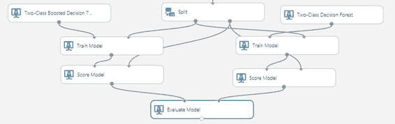

评估模型后，您可以右键单击`评估模型`底部的圆圈，查看两个客户流失模型的性能。图 6-24 展示了受试者工作特征曲线（ROC 曲线），而图 6-25 则展示了两个客户流失模型的准确率、精确率、召回率和 F1 分数。

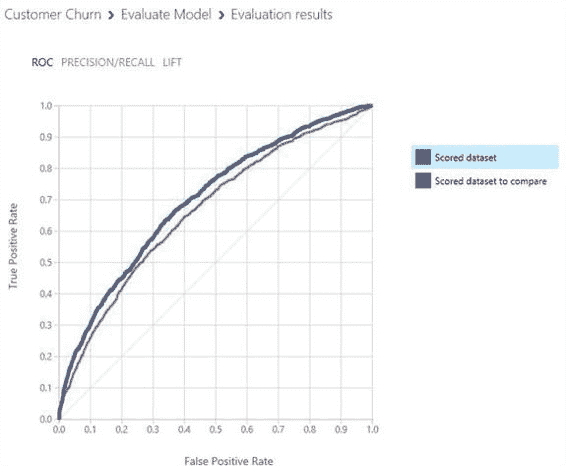

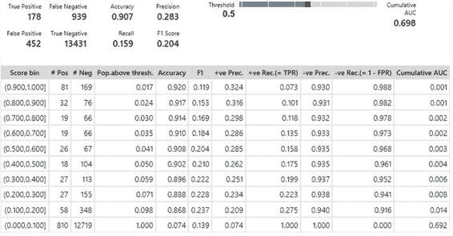

ROC 曲线展示了客户流失模型的性能。图表中从 (0,0) 到 (1,1) 的对角线表示随机猜测的性能。例如，如果您随机猜测哪个客户会流失，曲线将位于对角线上。一个好的预测模型应优于随机猜测，其 ROC 曲线应位于对角线上方。客户流失模型的性能可以通过考虑曲线下面积（AUC）来衡量。曲线下面积越大，模型性能越好。理想模型的 AUC 为 1.0，而随机猜测的 AUC 为 0.5。

从可视化结果中，您可以看到客户流失模型的累积 AUC、准确率和精确率分别为 0.698、0.907 和 0.283。您还可以看到客户模型的 F1 分数为 0.204。

 **注意** 有关使用 F1 分数衡量机器学习模型准确性的详细讨论，请参阅 [`en.wikipedia.org/wiki/F1_score`](http://en.wikipedia.org/wiki/F1_score)。

## 总结

使用 KDD Cup 2009 Orange 电信数据集，您逐步学习了如何使用 Azure 机器学习构建客户流失模型。在构建模型之前，您花时间先理解数据并执行了数据预处理。接下来，您学习了如何使用两类提升决策树和两类决策森林算法执行分类，并使用电信数据集构建预测客户流失的模型。构建模型后，您还学习了如何衡量模型的性能。