# 第 7 章 客户细分模型

在本章中，您将学习如何在 Microsoft Azure 机器学习中构建客户细分模型。通过一个实际示例，我们提供了一份逐步指南，介绍如何使用 Microsoft Azure 机器学习通过 k-means 聚类轻松构建细分模型。模型构建完成后，您将学习如何执行验证并将其部署到生产环境中。

客户细分模型概述

为了有效竞争并构建畅销的产品和服务，公司必须找出目标客户细分群体以及每个细分群体的特征。识别客户细分群体至关重要，因为它有助于公司更好地定位营销活动，以赢得最有利可图的客户。公司的数据分析师负责筛选来自内部和外部数据源的数据，以找出能够吸引特定客户细分群体（这些群体可能事先未知）的神奇要素。

客户细分使公司能够制定营销策略并执行针对特定客户细分群体的营销活动。此外，客户细分还能带来更高的客户满意度，因为不同细分群体的不同需求可以得到适当满足。

 **注意** 在 [`en.wikipedia.org/wiki/Market_segmentation`](http://en.wikipedia.org/wiki/Market_segmentation) 了解更多关于市场细分的知识。

公司必须能够掌握海量可用信息（例如市场研究报告、概念/市场测试等）。虽然这些市场研究数据提供了关于市场的定性和定量信息的良好平衡，但如果公司能够利用其已有的巨大数据宝库（例如会员/忠诚度计划数据库、来自在线服务/零售店的计费数据、CRM 系统等），它们可以更有效地竞争。在这个数据宝库中，蕴藏着公司可以转化为竞争优势的洞察。这些洞察使公司能够了解潜在的客户细分群体及其特征。

例如，在美国，许多人熟悉消费者信用评分的使用。消费者信用评分帮助银行了解申请贷款（汽车贷款、抵押贷款等）的客户的风险状况。这反过来使银行能够根据个人所属的风险细分群体调整其利率。

另一个例子是电信行业。许多电信提供商努力获取洞察，以了解如何有效地向属于两大群体（企业客户和个人消费者）的客户进行销售。为了找出针对消费者的有效营销策略，电信提供商通常对使用服务的个人画像感兴趣。具有相似画像的人被归为一组，并提供吸引该画像的折扣或增值服务。电信提供商考虑的特征（非详尽列表）包括收入群体、亲友通话频率、通话/短信次数及发生时间、如何支付月账单（在线、自助服务终端、实体店）、付款延迟等。

在各类无监督机器学习技术中，k-means 聚类是用于执行客户细分的常用技术。在本章中，您将学习如何使用 Microsoft Azure 机器学习对 Wikipedia SP 500 数据集（ML Studio 中可用的示例数据集之一）执行 k-means 聚类。

Wikipedia SP 500 数据集包含以下信息：行业类别，以及描述标准普尔 500 指数（SP500）中每家公司的文本。您将构建并部署一个 k-means 聚类模型来对公司进行细分。由于从文本中提取的特征数量众多，您将执行一个 R 脚本来执行主成分分析，以识别用于确定聚类的前 10 个特征。执行 k-means 聚类后，彼此相似的公司（基于从公司描述性文本中提取的特征）将被分配到同一细分群体。

 **注意** 有关不同统计和机器学习算法的概述，请参阅第 4 章。在本章中，您还将了解聚类算法的类别，以及 K-Means 聚类的工作原理。

构建和部署您的第一个 K-Means 聚类模型

为了帮助您开始构建第一个 k-means 聚类模型，您将使用 ML Studio 中提供的示例实验之一。该实验使用 k-means 聚类对标准普尔 500 指数（S&P 500）列表中的公司进行细分。


实验成功执行后，您可以看到来自不同行业类别的公司已被分配到不同的聚类中（图 7-1）。在此示例中，k-means 算法在 x 轴上找到了三个标记为 0、1 和 2 的片段。在每个方框中，您将看到每个类别中被分配到某个聚类的公司数量。在聚类 2 中，您可以看到有 1 家公司来自非必需消费品类别。

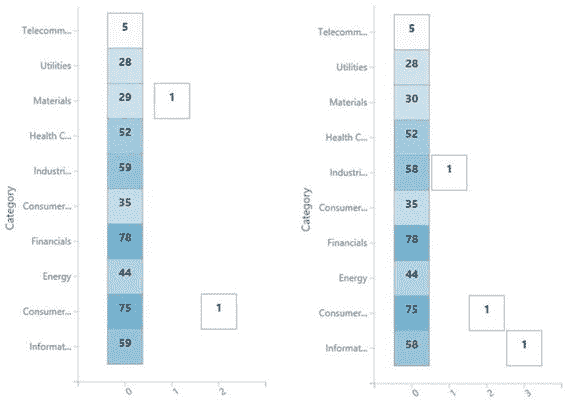

图 7-1. 公司细分

让我们开始吧！在本练习中，我们使用名为“示例实验 - S & P 500 公司聚类 - 开发”的示例实验（如图 7-2 所示）。从图 7-3 中，您将看到该实验包含以下步骤。

1.  从维基百科 S&P 500 数据集中检索数据。
2.  对数据执行特征哈希以向量化特征。
3.  执行 R 脚本以识别特征的主成分。
4.  投影将在聚类模型中使用的列。
5.  使用两个 k-means 聚类模型训练聚类模型。为每个 k-means 聚类模型指定了不同数量的聚类。
6.  将结果转换为 CSV 文件。

在本节中，您将学习如何执行公司细分。

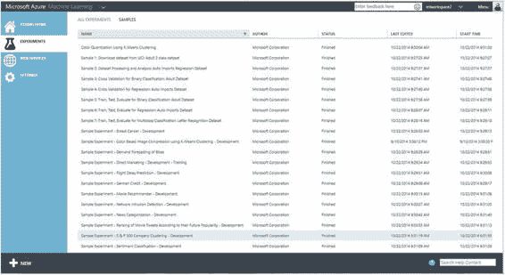

图 7-2. ML Studio 中的实验示例

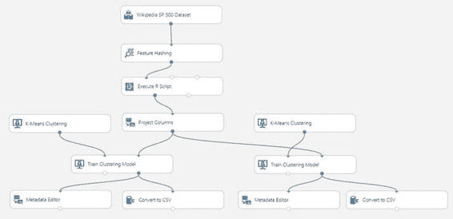

图 7-3. 在 ML Studio 中创建您的第一个 k-means 聚类模型

特征哈希

在机器学习中，输入特征可以是自由文本。表示自由文本的一种常见方法是使用词袋模型。每个单词被表示为一个标记。每当该单词在文本中出现时，该标记被赋值为 1。如果单词未出现，则赋值为 0。

然而，词袋模型无法扩展，因为事先无法知道可能的单词数量。想象一下为每个 S&P 500 公司描述文本中的每个单词都表示一个标记。输入的维度可能会非常大。因此，一种常见的方法是使用哈希函数将所有标记转换为数值特征，并限制可能的哈希值范围。为此，特征哈希（也称为“哈希技巧”）在机器学习社区中被广泛用于在数据集用作机器学习算法的输入之前对其进行预处理。

在此示例中，**特征哈希**模块用于对 S&P 500 公司的描述文本执行哈希运算。在底层，特征哈希模块使用 Vowpal Wabbit 库执行 32 位 MurmurHash 哈希。在本练习中，哈希位大小设置为 **12**，并使用 **N-grams**。执行特征哈希模块后，您将看到描述文本已被转换为大量列，列名以 Text_HashingFeature_ 为前缀（如图 7-4 所示）。

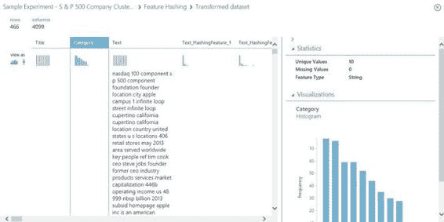

图 7-4. 特征哈希

 **注意**  Vowpal Wabbit 库是一个开源机器学习库。有关更多信息，请参阅 [`github.com/JohnLangford/vowpal_wabbit/wiki/Tutorial`](https://github.com/JohnLangford/vowpal_wabbit/wiki/Tutorial)。

MurmurHash 是一族非加密哈希函数，具有良好的分布性、雪崩效应和抗碰撞性。有关 MurmurHash 哈希函数族的更多信息，请参阅 [`code.google.com/p/smhasher/`](https://code.google.com/p/smhasher/)。

识别正确的特征

当使用 k-means 聚类进行客户细分时，您需要识别将在聚类过程中使用的特征。执行特征哈希后，将基于描述文本计算出大量特征。

**主成分分析** (PCA) 是一种强大的统计技术，可用于识别较少数量的特征（即主成分），这些特征能够捕捉原始特征的关键本质。

在此示例实验中，您将学习如何使用 R 执行主成分分析。具体来说，您将使用**执行 R 脚本**模块来执行以下 R 脚本（该脚本已作为示例实验的一部分提供）。

```
# 将基于 1 的可选输入端口映射到变量
dataset1 <- maml.mapInputPort(1) # 类别: data.frame

# 示例操作
titles_categories = dataset1[,1:2]
pca = prcomp(dataset1[,4:4099])
top_pca_scores = data.frame(pca$x[,1:10])
data.set = cbind(titles_categories,top_pca_scores)

# 您将在 R 设备端口中看到此输出。
# 它将包含您的 stdout、stderr 和 PNG 图形设备。
plot(pca)

# 选择要发送到输出数据集端口的数据框
maml.mapOutputPort("data.set");
```

从 R 脚本中，您会注意到使用了 R 函数 prcomp。prcomp 的输入包括 dataset1 的第 4 列到第 4099 列。计算结果存储在变量 pca 中。对于此示例实验，您将获取前 10 个主成分，并将它们用作 k-means 聚类算法的输入。

运行实验后，您可以单击**执行 R 脚本**模块，并选择可视化结果数据集。图 7-5 显示了结果数据集以及计算出的前 10 个主成分 (PC)。

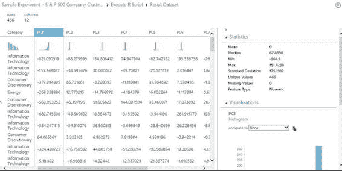

图 7-5. 结果数据集的可视化（数据集的前 10 个主成分）

 **注意**  请参阅 [`en.wikipedia.org/wiki/Principal_component_analysis`](http://en.wikipedia.org/wiki/Principal_component_analysis) 以了解有关 PCA 的更多信息。

在 R 中，有几个函数可用于执行 PCA。这些函数包括 pca()、prcomp() 和 princomp()。prcomp() 是常用的函数，因为它在数值上更稳定，并且返回一个包含以下信息的 R 对象：特征向量、特征值的平方根以及得分。

请参阅第 3 章 以了解有关如何将 R 与 Azure 机器学习结合使用的更多信息。

K-Means 聚类的属性

从图 7-3 中，您将看到 k-means 聚类在实验中使用了两次。两个 k-means 聚类模块之间的主要区别在于质心数量（即 k 值）。这也与您希望从 k-means 算法中获得的片段或聚类数量相同。对于左侧的 k-means 聚类，示例实验指定 k 值为 3（即 k-means 聚类模型将识别 3 个聚类）；而右侧的 k-means 聚类模型指定 k 值为 4。

您可以通过单击每个 k-means 聚类矩形来查看指定的质心数量。图 7-6 显示了 K-Means 聚类模型的各种属性，包括

*   质心数量
*   度量：用于计算聚类之间距离的度量
*   初始化：用于指定初始质心种子的方法
*   迭代次数：使用的迭代次数

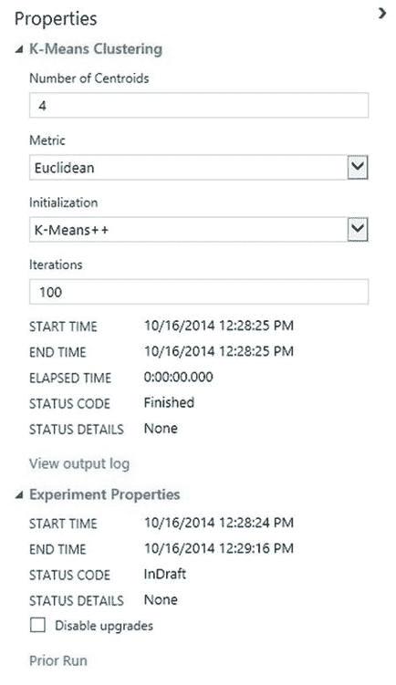

图 7-6. k-means 聚类模型的属性


在执行聚类分析时，用户需要指定空间中任意两点之间的距离度量。在 ML Studio 中，这由 **Metric** 属性定义。支持两种距离度量：欧几里得距离（也称为 L2 范数）和余弦距离。根据输入数据的特性和用例，用户应选择 k-means 聚类所使用的相关 **Metric** 属性。

 **注意**  在执行聚类分析时，能够测量点与向量之间的距离（或相似度）非常重要。欧几里得距离和余弦距离是常用的距离度量。

*欧几里得距离*：给定两点 p1 和 p2，p1 与 p2 之间的欧几里得距离是连接这两点的线段的长度。欧几里得距离也可用于测量两个向量之间的距离。

*余弦距离*：给定两个向量 v1 和 v2，余弦距离是 v1 与 v2 之间夹角的余弦值。

选择使用哪种距离度量通常取决于具体领域。

欧几里得距离对所比较向量的尺度/幅度很敏感。需要注意的是，即使两个向量可能相对相似，但如果特征的尺度差异显著，欧几里得距离可能会显示这两个向量是不同的。在这种情况下，通常使用余弦距离，因为无论尺度如何，两个向量之间的余弦夹角都会很小。

选择距离度量的指标后，您需要选择质心初始化算法。在 Azure 机器学习中，这由 **Initialization** 属性定义。支持五种质心初始化算法。表 7-1 展示了不同的质心初始化算法。

表 7-1. K-Means 聚类，质心初始化算法

| 质心初始化算法 | 描述 |
| --- | --- |
| **默认** | 选取前 N 个点作为初始质心 |
| **随机** | 随机选取初始质心 |
| **K-Means++** | K-Means++ 质心初始化 |
| **K-Means+ 快速** | K-Means++ 质心初始化，其中 P:=1（在算法的每次迭代中选取最远的质心） |
| **均匀** | 均匀选取 N 个点作为初始质心 |

这些属性已在示例实验中为您预先配置好。

至此，您可以准备运行实验了。点击 ML Studio 底部面板上的 **运行**。实验成功执行后，将生成两组聚类。**元数据编辑器** 模块用于更改数据集中与列关联的元数据，以包含分配的聚类。此外，**转换为 CSV** 模块用于将结果转换为逗号分隔值，以便您下载结果集。

恭喜！您已成功使用 ML Studio 中的 **K-Means 聚类** 模块运行了第一个公司细分实验。

批发客户的客户细分

通过上一节，您了解了示例实验中用于执行客户细分的核心模块（K-Means 聚类、训练聚类模型）。

在本节中，您将逐步学习如何构建聚类模型，以对批发客户数据集执行客户细分。

 **注意**  批发客户数据集可在 UCI 机器学习库中找到。该数据集包含八列（称为属性或特征），并包含一家在不同地区运营的批发分销商的客户信息。

这些列包括在鲜奶、食品杂货、冷冻食品、洗涤剂、纸张和熟食产品上的年度支出。此外，它还包含客户渠道（酒店/咖啡馆/餐厅）或零售的信息。

请参考 [`archive.ics.uci.edu/ml/datasets/Wholesale`](http://archive.ics.uci.edu/ml/datasets/Wholesale)+customers。

从 UCI 机器学习库加载数据

让我们开始使用 **读取器** 模块从 UCI 机器学习库检索数据。为此，从工具箱中拖放一个 **读取器** 模块（数据输入和输出）。接下来，配置 **读取器** 模块以从 Http 源读取数据，并提供数据集的 URL：[`archive.ics.uci.edu/ml/machine-learning-databases/00292/Wholesale%20customers%20data.csv`](http://archive.ics.uci.edu/ml/machine-learning-databases/00292/Wholesale%20customers%20data.csv)

图 7-7 展示了 **读取器** 模块及其配置。

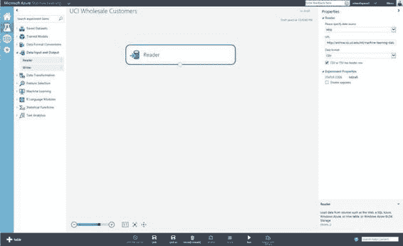

图 7-7. 使用读取器模块从 HTTP 数据源读取数据

使用 K-Means 聚类进行批发客户细分

对于此实验，您将使用数据集中的所有八列作为执行聚类的输入。为此，拖放 **K-Means 聚类** 和 **训练聚类模型**，并根据 图 7-8 所示连接各模块。

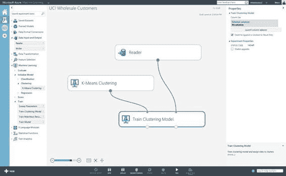

图 7-8. 使用 K-Means 聚类和训练聚类模型

要配置每个模块，请点击该模块，并使用屏幕右侧的 **属性** 窗格指定值。对于 **K-Means 聚类** 模块，将其配置为识别四个聚类（**质心数 = 4**），并使用 **欧几里得** 距离度量。使用默认的 100 次迭代次数。对于 **训练聚类模型** 模块，将其配置为在执行聚类时使用 **所有** 特征。

最后，您希望在实验成功运行后可视化结果。为此，您将使用 **元数据编辑器** 模块。配置 **元数据编辑器**，使其使用 **训练聚类模型** 模块生成的所有特征。图 7-9 展示了聚类实验的最终设计。

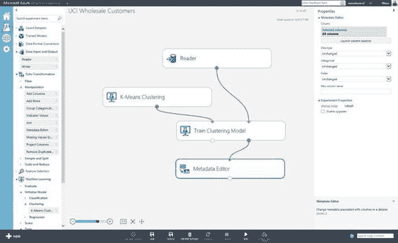

图 7-9. 完成批发客户细分的实验

实验成功运行后，您可以右键点击 **元数据编辑器** 模块的 **结果** 数据集输出，查看聚类分配（如 图 7-10 所示）。

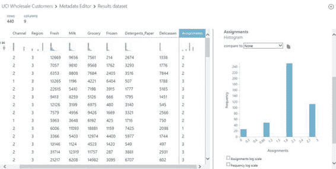

图 7-10. 显示批发客户聚类分配的直方图

新数据的聚类分配

如果您有新客户，并希望将他们分配到您已识别的某个聚类中，该怎么办？在本节中，您将学习如何使用 **分配到聚类** 模块。

在此示例中，您首先将输入数据集拆分为两个集合。第一个集合将用于训练聚类模型，第二个集合将用于聚类分配。对于实际用例，第二个数据集将是您新获取的数据（例如，您希望分配到聚类的新客户）。要拆分输入数据集，您将使用 **拆分** 模块（位于 **数据转换  采样与拆分** 中），并将其配置为将 90% 的输入数据重定向到其第一个输出，其余 10% 重定向到第二个输出。您将使用 **拆分** 模块第一个输出的数据来训练聚类模型。


图 7-11 展示了修改后的聚类实验设计，其中添加了“分配到聚类”和“拆分”模块。要配置“分配到聚类”模块，请单击该模块，然后点击**启动**列选择器以选择所有列。将“分配到聚类”模块的输出**链接**到元数据编辑器模块。当有新观测数据时，它会被分配到质心距离最近的聚类。

现在可以运行实验来执行聚类分配。实验成功运行后，您可以通过右键单击元数据编辑器模块的**结果**数据集，并选择**可视化**来查看结果。

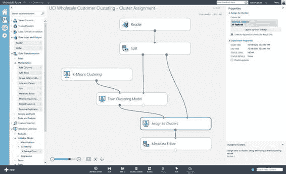

图 7-11. 使用训练好的聚类模型执行聚类分配的实验

恭喜！您已成功构建了一个 k-means 聚类模型，并使用训练好的模型将新数据分配到聚类中。

总结

在本章中，您学习了如何使用 Azure 机器学习创建 k-means 聚类模型。为了快速入门，您使用了 Azure 机器学习中提供的示例实验，该实验对标准普尔 500 公司（基于每家公司的描述性文本）进行细分。您了解了 ML Studio 中用于执行聚类的主要模块：K-Means 聚类和训练聚类模型。您还学习了如何使用特征哈希对输入（包含自由文本）进行向量化，以及使用 PCA 识别主成分。

此外，您还学习了在批发客户数据集上执行 k-means 聚类的步骤，以及如何使用训练好的模型对新数据进行聚类分配。

