# 第 8 章 构建预测性维护模型

领先的制造商现在正在投资预测性维护，这有望降低成本、提高利润率并提升客户满意度。尽管统计和制造等传统技术有所帮助，但该行业仍然受到严重质量问题和组件故障导致业务中断的高成本的困扰。机器学习的进步为提高客户满意度和减少服务停机时间提供了独特的机会。本章展示了如何使用 Microsoft Azure 机器学习构建预测性维护模型。通过示例，我们将演示如何使用 Microsoft Azure 机器学习来构建、验证和部署用于预测性维护的预测模型。

概述

据故障检测专家、前 NASA 访问研究员 Ahmet Duyar 称，制造业生产力下降的一个关键原因是设备故障和不必要的维护干预导致的资产利用率低下。仅在美国，过度维护和生产力损失的成本估计就高达 7400 亿美元，因此我们显然需要更好的维护方法（Duyar, 2011）。

预测性维护技术旨在预测何时应对设备进行维护，甚至在设备发生故障之前。通过准确预测组件故障，您可以减少计划外停机时间并延长设备寿命。预测性维护还能节省成本，因为它提高了维修效率：工程师可以针对预测的故障进行维修，从而更快地完成工作。他们无需花费过多时间寻找设备故障的原因。通过预测性维护，工厂操作员可以更加主动，甚至在设备发生故障之前就解决问题。

值得澄清预测性维护与预防性维护之间的区别，因为两者经常被混淆。预防性维护是指通常提前计划的定期维护。虽然有用且在很多时候是必要的，但预防性维护可能成本高昂，并且在捕捉计划维护间隔期间出现的问题方面效果不佳。相比之下，预测性维护旨在预测故障发生之前。

让我们以汽车保养为例来说明区别。当您购买汽车时，经销商通常会根据时间或里程推荐定期保养。例如，一些汽车制造商建议在行驶 6000 英里和 10000 英里后进行全面保养。这是预防性维护的一个很好的例子。当您接近 6000 英里时，经销商会发送提醒，让您安排全面保养。相比之下，通过预测性维护，许多汽车制造商更倾向于通过传感器从您的汽车传输到数据库系统的数据，持续监控您的汽车性能。有了这些数据，他们可以检测到您的变速箱或正时皮带何时开始出现即将发生故障的迹象，并会致电您进行维护，无论您的汽车里程数是多少。

预测性维护是一种在设备正常运行期间进行的非破坏性监测形式。安装在设备上的传感器收集有价值的数据，可用于预测和防止故障。

当前的预测性维护技术包括振动分析、声学分析、红外监测、油液分析和基于模型的状态建模。振动分析使用安装在电机上的加速度计等传感器来确定其何时运行异常。据 Ahmet Duyar 称，振动分析是状态监测中使用最广泛的方法，占所有销售系统的 85%。声学分析使用声波或超声波分析来检测旋转机器中的异常摩擦和应力。虽然声波技术可以检测机械机器中的问题，但超声波更灵活，可以检测机械和电气设备中的问题。红外分析的应用范围最广，涵盖低速到高速设备以及机械和电气设备。

基于模型的状态监测使用数学模型来预测故障。这项技术最初由 NASA 开发，有一个学习阶段，在此阶段学习正常运行状态的特征。学习阶段完成后，系统进入生产阶段，在此阶段监测设备的状态。它将设备的性能与学习阶段收集的数据进行比较，如果检测到与机器正常运行状态存在严重偏差，则会标记问题。这是一种异常检测形式，当机器显著偏离正常运行状态时，监测系统会标记问题。

 **注意** 有关预测性维护的更多详细信息，请参阅以下资源：

```
http://en.wikipedia.org/wiki/Predictive_maintenance  和
```

Ahmet Duyar, “Simplifying predictive maintenance”, Orbit Vol. 31 No.1, pp. 38-45, 2011.

业务问题

假设您是半导体制造商的数据科学家。您的雇主希望您执行以下操作：

*   构建一个预测其制造过程中良率故障的模型，并且
*   通过您的分析，提供导致其过程中良率故障的因素。


这对半导体制造商来说是一个非常重要的业务问题，因为其工艺可能非常复杂，涉及从原始沙粒到最终集成电路的多个阶段。鉴于这种复杂性，有多个因素可能导致制造流程下游的良率失败。识别出最重要的因素将有助于工艺工程师提高良率，降低错误率和生产成本，从而提高生产力。

 **注意** 您需要拥有一个 Azure Machine Learning 账户。如果您还没有账户，请参考第 2 章中的说明来设置您的新账户。

在第 1 章中，您了解到数据科学流程通常遵循以下五个步骤。

1.  定义业务问题
2.  数据获取与准备
3.  模型开发
4.  模型部署
5.  监控模型性能

在定义了业务问题之后，您将在本章的剩余部分探索数据获取与准备、模型开发、评估和部署。

数据获取与准备

让我们探讨如何从源系统加载数据并在 Azure Machine Learning 中分析数据。

数据集

在本练习中，您将使用来自加州大学尔湾分校机器学习数据库的 SECOM 数据集。这个来自半导体制造业的数据集由 Michael McCann 和 Adrian Johnston 提供。

 **注意** SECOM 数据集可在加州大学尔湾分校的机器学习库中找到。该数据集包含 1,567 个样本，每个样本有 591 个特征。在这 1,567 个样本中，有 104 个代表良率失败。

这些特征或列代表了制造过程中 590 个点的传感器读数。此外，它还包括每个样本的时间戳和良率结果（即简单的通过或失败）。

请参考 [`archive.ics.uci.edu/ml/machine-learning-databases/secom/`](http://archive.ics.uci.edu/ml/machine-learning-databases/secom/)。

数据加载

Azure Machine Learning 使您能够从多个来源加载数据，包括您的本地机器、Web、Azure 上的 SQL 数据库、Hive 表或 Azure Blob 存储。

从本地文件系统加载数据

加载数据最简单的方法是从您的本地机器进行。您可以通过以下步骤完成此操作。

1.  将浏览器指向 [`studio.azureml.net`](https://studio.azureml.net) 并登录到您在 Azure Machine Learning 中的工作区。
2.  接下来，单击左侧窗格菜单中的 **Experiments** 项。
3.  单击窗口左下角的 **+New** 按钮，然后从 图 8-1 所示的新菜单中选择 **Dataset**。

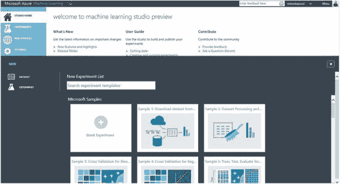

图 8-1. 从本地机器加载新数据集

4.  当您选择 **From Local File** 选项时，系统将提示您选择要从机器加载的数据文件。

从其他来源加载数据

您可以使用 Azure Machine Learning 中的 **Reader** 模块从非本地来源加载数据。具体来说，使用 **Reader** 模块，您可以从 Web、Azure 上的 SQL 数据库、Azure 表、Azure Blob 存储或 Hive 表加载数据。为此，您需要在调用 **Reader** 模块之前创建一个新的实验。使用以下步骤通过 **Reader** 模块从上述任何来源加载数据。

1.  将浏览器指向 [`studio.azureml.net`](https://studio.azureml.net) 并登录到您在 Azure Machine Learning 中的工作区。
2.  接下来，单击左侧窗格菜单中的 **Experiments** 项。
3.  单击窗口左下角的 **+New** 按钮，然后从新菜单中选择 **Experiment**。一个新的实验将启动，并带有一个空白画布，如 图 8-2 所示。

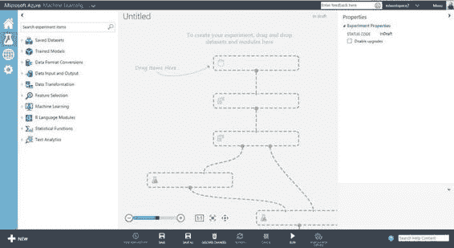

图 8-2. 在 Azure Machine Learning 中启动新实验

4.  打开 **Data Input and Output** 菜单项，您将看到两个模块：**Reader** 和 **Writer**。
5.  将 **Reader** 模块从菜单拖到画布上的任意位置。
6.  单击画布中的 **Reader** 模块，其属性将显示在右侧窗格的 **Reader** 下。现在，在下拉菜单中指定数据源，然后输入所有必需参数的值。Account Name 和 Account Key 指的是 Microsoft Azure 上的存储帐户。您可以通过以下方式从 Azure 门户获取这些参数：
    1.  在 [`azure.microsoft.com`](http://azure.microsoft.com) 登录 Microsoft Azure。
    2.  在顶部菜单中，单击 **Portal**。这将带您进入 Azure 门户。
    3.  从左侧窗格的菜单中选择 **storage**。这将在右侧窗格中列出您所有的存储帐户。
    4.  单击包含您的机器学习模型所需数据的存储帐户。
    5.  在屏幕底部，单击标有 **Manage Access Keys** 的密钥图标。将显示您的存储帐户名称和访问密钥。使用 **Primary Access Key** 作为 Azure Machine Learning 中 **Reader** 模块的 Account Key。

 **注意** 您可以使用上述说明将多个来源的多个数据集加载到 Azure Machine Learning 中。但请注意，每个 **Reader** 模块一次只能加载一个数据集。

对于本项目，请从 UCI 机器学习数据库导入两个 SECOM 数据集，并将它们合并到一个本地存储的新文件中。第一个数据集仅包含传感器读数，而第二个数据集包含标签（即良率数据）。然后使用上述第一种方法将合并后的数据集加载到 Azure Machine Learning 中。

数据分析

图 8-3 显示了涵盖数据准备的实验的第一部分。数据被加载，并使用 **Missing Values Scrubber** 模块对缺失值进行预处理。之后，获取汇总统计信息，并使用 **Filter Based Feature Selection** 模块来确定用于预测的最重要变量。

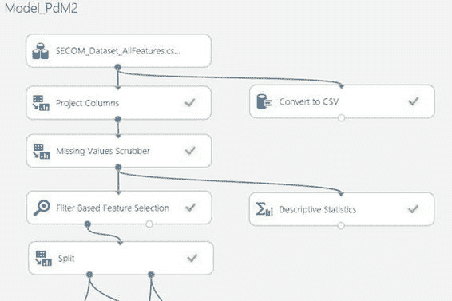

图 8-3. 预处理 SECOM 数据集

图 8-4 显示了在 Azure Machine Learning 中看到的 SECOM 数据快照。如您所见，数据集中有 1,567 行和 592 列。此外，Azure Machine Learning 还显示了每个特征的唯一值数量和缺失值数量。您可以看到许多传感器都有缺失值。此外，一些传感器对所有行都有恒定的读数。例如，传感器 #6 对所有行的读数都是 100。此类特征必须被剔除，因为它们对预测没有增加任何价值，因为它们的读数没有变化。

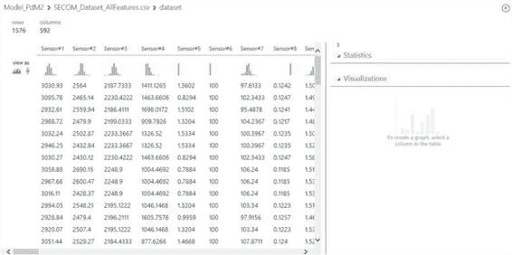

图 8-4. 在 Azure Machine Learning 中可视化 SECOM 数据集

特征选择


特征选择在此案例中至关重要，因为它能解答你的第二个业务问题。确实，面对超过 590 个特征，你必须执行特征选择，以识别出有助于构建良好模型的特征子集，并剔除无关和冗余的特征。特征过多会带来维度灾难的风险。如果特征数量庞大，学习问题会变得困难，因为大量“额外”特征可能混淆学习算法，导致其产生高方差。同样重要的是，机器学习算法计算量极大，减少特征数量能大幅缩短模型训练所需时间，使数据科学家能在更短时间内进行实验。通过细致的特征选择，你可以找到对预测最具影响力的变量。接下来，让我们看看如何在 Azure Machine Learning 中进行特征选择。

要在 Azure Machine Learning 中执行特征选择，请从左侧窗格的模块列表中拖拽名为**基于筛选器的特征选择**的模块。你可以通过在搜索框中搜索，或展开**特征选择**类别来找到该模块。要使用此模块，你需要将其作为输入连接到一个数据集。图 8-5 展示了如何使用它对 SECOM 数据集进行特征选择。在运行实验之前，请使用右侧窗格中的**启动列选择器**来定义用于预测的目标变量。在此案例中，选择**Yield_Pass_Fail**列作为目标，因为这是你想要预测的内容。完成后，将所需特征数量设置为 100。这将指示 Azure Machine Learning 中的特征选择器找出前 100 个变量。

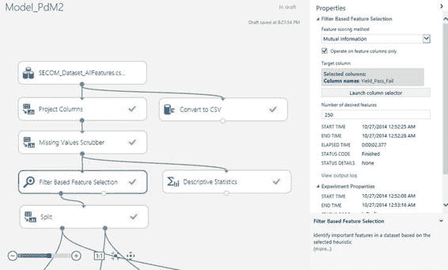

图 8-5. Azure Machine Learning 中的特征选择

你还需要选择用于特征选择的评分方法。Azure Machine Learning 提供以下评分选项：

*   Pearson 相关性
*   互信息
*   Kendall 相关性
*   Spearman 相关性
*   卡方检验
*   Fisher 得分
*   基于计数

相关性方法会找出一组与输出高度相关，但彼此之间相关性较低的变量。相关性计算使用 Pearson、Kendall 或 Spearman 相关系数，具体取决于你选择的选项。

Fisher 得分使用统计学中的 Fisher 准则对变量进行排序。相比之下，互信息选项是一种信息论方法，利用互信息对变量进行排序。互信息衡量每个变量的概率密度与结果变量概率密度之间的依赖性。

最后，卡方检验选项通过独立性检验来选择最佳特征；换句话说，它检验每个变量是否与结果变量独立。然后，它使用卡方检验对变量进行排序。

 **注意**  有关特征选择策略的更多信息，请参见 [`en.wikipedia.org/wiki/Feature_selection#Correlation_feature_selection`](http://en.wikipedia.org/wiki/Feature_selection#Correlation_feature_selection) 或 [`jmlr.org/papers/volume3/guyon03a/guyon03a.pdf`](http://jmlr.org/papers/volume3/guyon03a/guyon03a.pdf)。

当你运行实验时，**基于筛选器的特征选择**模块会产生两个输出：首先，筛选后的数据集列出了最重要变量的实际数据。其次，该模块会按重要性显示变量列表，并附有每个选定变量的得分。图 8-6 展示了特征选择的结果。在此案例中，你将特征数量设置为 100，并使用互信息对变量进行评分和排序。图 8-6 显示了 101 列，因为结果集包含了目标变量（即 Yield_Pass_Fail）以及前 100 个变量，包括传感器#60、传感器#248、传感器#520、传感器#104 等。结果的最后一行显示了每个选定变量的得分。由于变量已排序，得分从左到右递减。

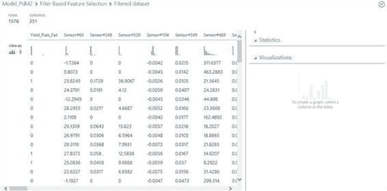

图 8-6. SECOM 数据集特征选择的结果，显示了最重要的变量

请注意，选定的变量会因评分方法而异，因此在选择最终变量集之前，值得尝试不同的评分方法。对于 SECOM 数据集，卡方检验和互信息评分方法会产生相似的变量排序。

训练模型

完成数据预处理后，下一步是训练模型以预测良率。由于响应变量是二元的，你可以将其视为二元分类问题。你可以使用 Azure Machine Learning 中的任何二元分类算法，例如二元逻辑回归、二元提升决策树、二元决策森林、二元神经网络等。

 **注意**  并非所有预测性维护问题都相同。有些问题除了分类之外还需要不同的技术。例如，如果目标是确定部件***何时***会失效，你将需要使用生存分析。或者，如果目标是预测能耗，你可以使用预测技术或预测连续结果的回归方法。因此，你需要理解业务问题，才能找到最合适的技术。没有一种方法能放之四海而皆准！

图 8-7 展示了根据 SECOM 数据预测良率的完整实验。实验的上半部分，直到**拆分**模块，实现了数据预处理阶段。**拆分**模块将数据分为两个样本：一个训练样本，包含初始数据集的 70%；以及一个测试样本，包含剩余的 30%。

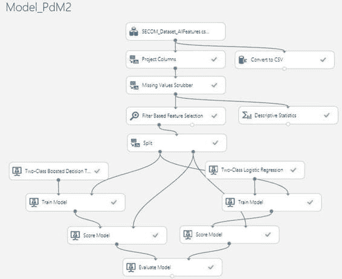

图 8-7. 根据 SECOM 数据预测良率的实验

在此实验中，你比较两种分类算法，以找到最佳的良率预测器。**拆分**模块后的左侧分支使用二元提升决策树，而右侧分支使用统计学中广泛使用的二元逻辑回归算法。每种算法都使用相同的训练样本进行训练，并使用相同的测试样本进行测试。你使用名为**训练模型**的模块来训练每种算法，并使用**评分模型**进行测试。名为**评估模型**的模块用于评估这两个分类模型的准确性。

模型测试与验证


模型训练完成后，下一步是使用留出样本进行测试，以避免过拟合并评估模型的泛化能力。我们已展示了如何使用 30%的样本测试训练好的模型。另一种避免过拟合和评估模型泛化能力的策略是交叉验证，这在第 6 章中讨论过。默认情况下，Azure 机器学习使用 10 折交叉验证。使用这种方法，你将使用 10 个留出样本而不是一个进行测试。要针对此问题执行交叉验证，只需将任意一对**训练模型**和**评分模型**模块替换为名为**交叉验证模型**的模块。图 8-8 展示了如何使用本实验中的**双类逻辑回归**部分执行交叉验证。你还需要使用来自**基于筛选的特征选择**的整个数据集作为输入数据集。对于交叉验证，无需使用**拆分**模块将数据拆分为训练集和测试集，因为名为**交叉验证模型**的模块会执行所需的数据拆分。

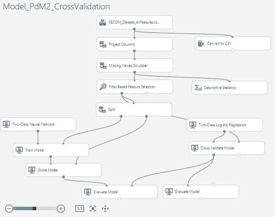

图 8-8. 使用交叉验证修改后的实验

模型性能

**评估模型**模块用于衡量训练后模型的性能。该模块接受两个数据集作为输入。第一个是来自已测试模型的评分数据集。第二个是用于比较的可选数据集。运行实验后，你可以通过点击名为**评估模型**模块底部的小圆圈来检查模型的性能。该模块提供了以下方法来衡量分类模型（如倾向模型）的性能：

*   接收者操作特征曲线（ROC 曲线），绘制真正例率与假正例率的关系
*   提升曲线（也称为增益曲线），绘制真正例数量与正例率的关系
*   精确率与召回率图表
*   显示第一类和第二类错误的混淆矩阵

图 8-9 显示了你之前构建的倾向模型的 ROC 曲线。ROC 曲线直观地展示了预测性二元分类模型的性能。图表上从(0,0)到(1,1)的对角线显示了随机猜测的性能；因此，如果你随机选择产量，你的响应将落在这条对角线上。一个好的预测模型应该比随机猜测好得多。因此，在 ROC 曲线上，一个好的模型应该位于对角线上方。理想或完美的模型（100%准确）将有一条从(0,0)到(0,1)的垂直线，接着是一条从(0,1)到(1,1)的水平线。

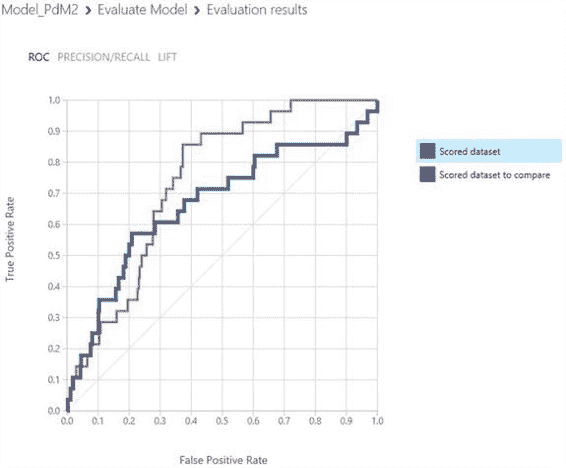

图 8-9. 比较逻辑回归和提升决策树模型在产量预测性能上的两条 ROC 曲线

衡量 ROC 曲线性能的一种方法是测量曲线下面积（AUC）。曲线下面积越高，模型性能越好。理想模型的 AUC 为 1.0，而随机猜测的 AUC 为 0.5。你构建的逻辑回归模型的 AUC 为 0.667，而提升决策树模型的 AUC 略高，为 0.741！在本实验中，双类提升决策树具有以下参数：

*   每棵树的最大叶节点数 = 50
*   形成叶节点所需的最大训练实例数 = 10
*   学习率 = 0.4
*   构建的树数量 = 1000
*   随机数种子 = 1

此外，Azure 机器学习还提供了两个模型的混淆矩阵以及精确率和召回率。通过点击两条曲线中的任意一条，工具会显示所选模型的混淆矩阵、精确率和召回率。如果你点击底部的曲线或名为“要比较的评分数据集”的图例，工具会显示逻辑回归模型的性能数据。

图 8-10 显示了逻辑回归模型的混淆矩阵。混淆矩阵包含以下四个单元格：

*   **真正例**：这些是产量失败且模型正确预测的情况。
*   **真负例**：在历史数据集中，产量通过，且模型正确预测通过。
*   **假正例**：在这种情况下，模型错误地预测产量会失败，而实际上它是通过的。这通常被称为第一类错误。你构建的提升决策树模型只有两个假正例。
*   **假负例**：这里模型错误地预测产量会通过，而实际上它失败了。这也被称为第二类错误。提升决策树模型有 27 个假负例。

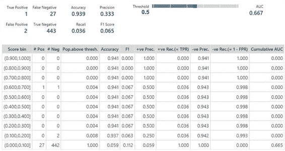

图 8-10. 混淆矩阵及更多性能指标

此外，图 8-10 显示了模型的准确率、精确率和召回率。以下是这些指标的计算公式：

精确率是结果中真正例的比率。

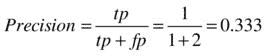

召回率是模型识别出的购买者的百分比，其计算公式为

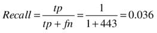

最后，准确率衡量模型正确识别购买者和非购买者的能力，表示为

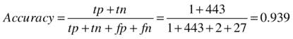

其中 tp = 真正例，tn = 真负例，fp = 假正例，fn = 假负例。F1 分数是精确率和召回率的加权平均值。在这种情况下，由于召回率非常低，F1 分数也相当低。

模型部署

当你构建并测试了满足需求的预测模型后，可以使用 Azure 机器学习将其部署到生产环境中以供业务使用。Azure 机器学习的一个关键区别在于生产环境部署的简便性。一旦模型完成，就可以非常容易地作为 Web 服务部署到生产环境。部署后，可以从多种设备（包括服务器、笔记本电脑、平板电脑甚至智能手机）作为 Web 服务调用该模型。

将模型部署到生产环境需要以下两个步骤。

1.  将你的实验发布到 Azure 机器学习工作室的暂存环境中。
2.  从 Azure 管理门户，将实验从暂存环境移动到生产环境。

让我们详细回顾这些步骤，并了解它们如何应用于你在前面章节中构建的已完成模型。

将模型发布到暂存环境

要将模型部署到暂存环境，请在 Azure 机器学习工作室中执行以下步骤。

1.  使用 Azure 机器学习工作室底部的**另存为**按钮保存你训练好的模型。将其重命名为你选择的新名称。

1.  **运行**实验。
    2.  右键单击训练模块（例如**训练模型**）的输出，并选择**另存为训练模型**选项。
    3.  删除任何用于训练的模块（例如**拆分**、**双类提升决策树**、**训练模型**、**评估模型**）。
    4.  将新保存的模型直接连接到**评分模型**模块。
    5.  重新运行你的实验。

在步骤 1c 删除之前，你的实验应如图 8-11 所示。

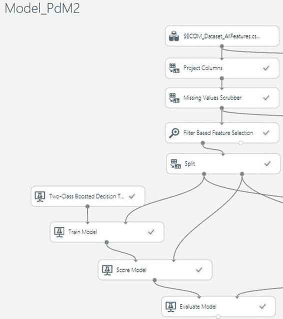

图 8-11. 删除训练模块之前的预测模型

删除训练模块并用保存的训练模型替换后，实验现在应如图 8-12 所示。

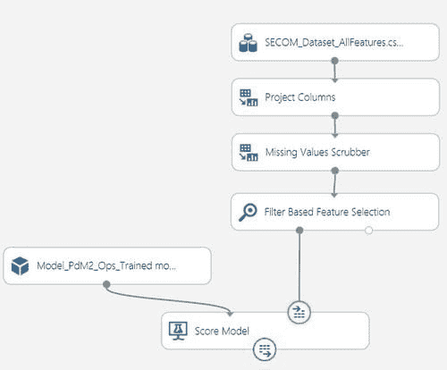


图 8-12. 使用已保存训练模型的实验

2.  接下来，设置你的发布输入和输出数据端口。为此，请执行以下操作：

1.  右键单击名为 **评分模型** 的模块的右侧输入端口。选择选项 **设置为发布输入**。
    2.  右键单击 **评分模型** 模块的输出端口，然后选择 **设置为发布输出**。

完成这两个步骤后，你将在评分模型模块上看到两个圆圈，分别高亮显示所选的发布输入和输出。如图 8-12 所示。

3.  分配好发布输入和输出端口后，运行实验，然后通过单击屏幕底部的 **发布 Web 服务** 将其发布到暂存环境。

将模型从暂存环境迁移到生产环境

此时，你的模型已位于暂存环境中，但尚未在生产环境中运行。要将其发布到生产环境，你需要通过以下步骤将其从暂存环境迁移到生产环境。

1.  在 Azure 机器学习工作室中配置新的 Web 服务，并使其准备好投入生产，具体操作如下：
    1.  在 Azure 机器学习工作室中，单击右侧窗格中名为 **Web 服务** 的菜单。它将显示所有 Web 服务的列表。
    2.  单击你刚刚创建的新服务的名称。通过单击 **测试** URL 对其进行测试。
    3.  单击配置选项卡，然后为 **准备好投入生产？** 选项选择“是”。单击窗口底部的 **保存** 按钮。现在，你的模型已准备好发布到生产环境。
2.  现在切换到 Azure 管理门户，并按如下方式将你的 Web 服务发布到生产环境：
    1.  在 Azure 管理门户的右侧窗格中选择 **机器学习**。
    2.  选择包含要部署到生产环境的实验的工作区。
    3.  单击你的工作区名称，然后单击名为 **Web 服务** 的选项卡。
    4.  选择 Azure 管理门户窗口底部的 **+添加** 按钮。

恭喜，你已成功将机器学习模型发布到生产环境。如果你从 **Web 服务** 选项卡单击你的模型，你将看到详细信息，例如模型在七天内做出的预测次数。该服务还会显示可用于将模型作为 Web 服务调用的 API，支持请求/响应或批处理执行模式。此外，你还会获得可用于在 C#、Python 或 R 中调用新 Web 服务的示例代码。

总结

本章从探索预测性维护开始，展示了商业机会和机器学习的潜力。使用来自加州大学欧文分校机器学习数据仓库的 SECOM 半导体制造数据，你学习了如何在 Azure 机器学习中构建和部署预测性维护解决方案。在本分步指南中，我们解释了如何执行数据预处理和分析，这对于理解数据至关重要。基于对数据的理解，你使用了二元逻辑回归和二元提升决策树算法进行分类。你还了解了如何评估模型性能并避免过拟合。最后，你了解了如何将完成的模型作为机器学习 Web 服务部署到 Microsoft Azure 的生产环境中。

索引

  A

分析谱系

类别

数据分析

描述性分析

诊断性分析

预测性分析

规范性分析

曲线下面积 (AUC)

平均计算机内存价格

Azure 机器学习

算法

汽车价格数据

构建与测试


组件、实验

数据集

数据集可视化

部署模型

特征

迭代过程

调色板搜索

预测、新数据

预处理、数据集

分阶段投入生产

可视化工作区

Web 服务

Web 服务测试

Azure 机器学习

  B

贝叶斯点机 (BPM)

平均分类器

Azure 机器学习

线性分类器

训练迭代

BikeBuyer.csv 文件

  C

流失模型

Azure 机器学习工作室

消费业务

客户（*参见* 客户流失模型）

有效策略

训练与测试

分类与回归树 (CART)

客户流失模型

提升决策树与森林算法

分类算法

混淆矩阵、准确率、精确率、召回率与 F1 分数

数据预处理与选择

特征选择模块

元数据编辑器

缺失值清理器

投影列

量化属性

选择列

训练数据与标签

决策树

准备与理解数据

描述性统计

KDD Cup 网站

机器学习模型

机器学习工作室

Orange 训练数据与标签

上传数据集

ROC 曲线

评分与评估模型

拆分模块、属性

训练模型

两类提升决策树与森林

客户倾向模型

Bike Buyer 数据集

箱线图图标

分类算法

混淆矩阵

客户定向模型

数据科学过程

人口统计变量

直方图

四分位距 (IQR)

逻辑回归

对数变换

预测误差

预测模型

投影列

投资回报率 (ROI)

测试与验证

训练模块

真正例

数据可视化

客户细分模型

公司

消费者信用评分

数据分析师

K 均值聚类（*参见* K 均值聚类）

学习技术

电信行业

批发客户（*参见* 批发客户）

  D

数据分析

Azure 机器学习


特征选择

基于过滤的特征选择模块

启动列选择器

缺失值清洗模块

SECOM 数据集

数据格式转换

数据加载

标签

本地文件系统

本地机器

非本地源

数据挖掘技术

数据科学

学科

数据获取与准备

算法

分析谱系（*参见* 分析谱系）

分类算法

聚类

竞争性资产

内容分析

客户需求

定义

数字数据

模型开发与部署

模型性能

强大的流程

从业者

处理能力

推荐引擎

数据集

数据转换项

决策树算法

装袋与提升

CART 算法

数据选择

基尼不纯度

ID3

根节点

训练

  E

集成模型

算法

应用

构建

评估模型模块

  F, G, H

特征选择

基于过滤的特征选择

Fisher 得分

  I, J

迭代二分器 3 (ID3)

  K

K 均值聚类

类别

实验样本

特征哈希

属性

正确的特征

公司细分

  L

学习算法

凝聚与分裂

BPM

质心初始化方法

基于密度的算法

K 均值聚类

映射

基于划分的聚类

回归算法（*参见* 回归算法）

监督学习

SVM

电信

线性相关模块

  M

maml.mapInputPort(1) 方法

元数据编辑器模块

缺失值清洗器属性

  N, O

神经网络

自适应共振理论 (ART)

隐藏节点

输入与输出节点

传播

收敛速度

自组织映射

Sigmoid 激活函数

  P, Q

主成分分析 (PCA)。*参见* 主成分分析 (PCA)

预测性维护模型

业务问题

组件

部署

制造业

基于模型的状态

维修

分阶段部署

测试与验证

训练

传输

振动分析

主成分分析 (PCA)

投影列属性

  R

接收者操作特征曲线 (ROC 曲线)

回归算法

决策树算法

线性回归

神经网络

数值结果

回归模型实验

回归技术

ROC 曲线。*参见* 接收者操作特征曲线 (ROC 曲线)

R 统计编程语言

精算科学

Azure 机器学习

生物信息学

构建与部署

执行 R 脚本模块

语言模块

maml.mapInputPort(1) 方法

ML Studio

可视化

数据预处理

组件

执行 R 脚本模块

机器学习算法

元数据编辑器模块

缺失值清洗模块

主成分分析 (PCA)

样本与 CRM 数据集

决策树

成人人口普查收入二元分类数据集

library()

ML Studio

rpart

查看输出日志

金融与银行业

脚本包 (zip)

执行 R 脚本模块

包含的文件夹

包

上传数据集

电信

  S

评分模型模块

模拟

拆分模块

分阶段部署

Azure 机器学习工作室

投入生产

发布

训练模块

支持向量机 (SVM)

超平面

基于核的学习

随机数种子

电信

  T

两类提升决策树模块

  U, V

UCI 机器学习库

  W, X, Y, Z

批发客户

聚类分配

聚类模型

欧几里得距离

K 均值聚类

元数据编辑器

训练聚类模型

UCI 机器学习库
