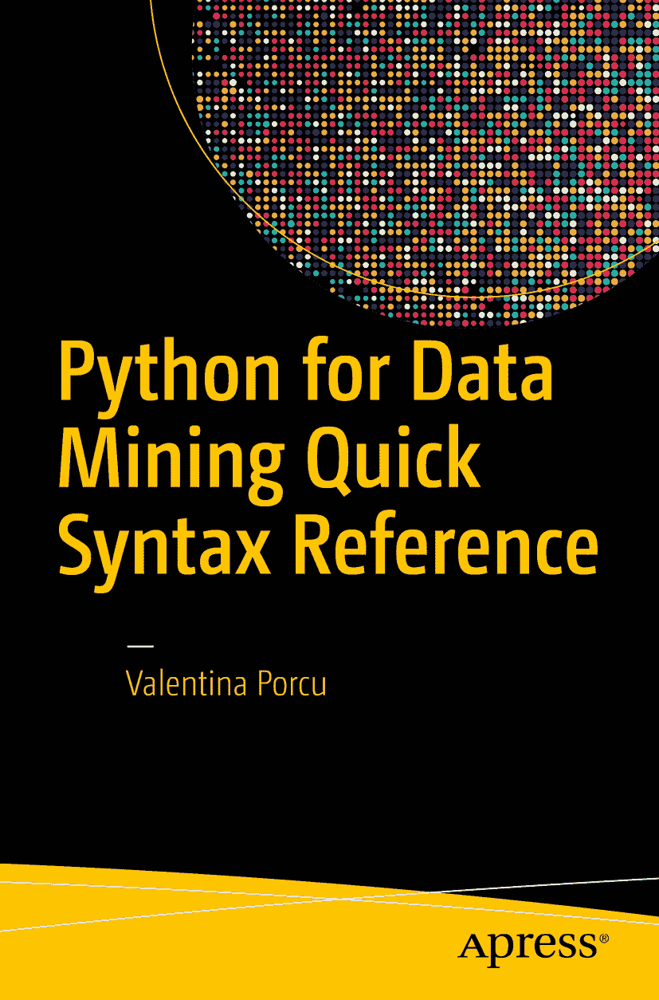

ISBN 978-1-4842-4112-7 e-ISBN 978-1-4842-4113-4 [`doi.org/10.1007/978-1-4842-4113-4`](https://doi.org/10.1007/978-1-4842-4113-4) 美国国会图书馆控制号：2018966554 © Valentina Porcu 2018 本作品受版权保护。出版商保留所有权利，无论是全部还是部分材料，特别是翻译、重印、重用插图、朗诵、广播、微缩胶片复制或任何其他物理方式，以及电子传输或信息存储与检索、电子改编、计算机软件，或现在已知或以后开发的类似或不同方法。本书中可能出现商标名称、标识和图像。我们不会在每次出现商标名称、标识或图像时使用商标符号，而是仅以编辑方式使用这些名称、标识和图像，以利于商标所有者，无意侵犯商标。本出版物中使用的商品名称、商标、服务标志和类似术语，即使未标明为商标，也不应被视为对其是否受专有权利的意见表达。尽管本书中的建议和信息在出版时被认为是真实准确的，但作者、编辑和出版商均不对可能存在的任何错误或遗漏承担法律责任。出版商对本书所含内容不作任何明示或暗示的保证。本书通过 Springer Science+Business Media New York 向全球图书贸易发行，地址：233 Spring Street, 6th Floor, New York, NY 10013。电话：1-800-SPRINGER，传真：(201) 348-4505，电子邮件：orders-ny@springer-sbm.com，或访问 www.springeronline.com。Apress Media, LLC 是加利福尼亚州的有限责任公司，其唯一成员（所有者）是 Springer Science + Business Media Finance Inc (SSBM Finance Inc)。SSBM Finance Inc 是特拉华州的一家公司。

引言

**翻译：Nicola Menicacci**

Python 是一种解释型、交互式、面向对象的语言。它拥有一个函数库，可扩展（因为可以轻松创建新模块），并且适用于所有操作系统。由于这些及其他原因，它也是数据挖掘和机器学习中最常用的编程语言之一。

我的目标是陪伴你开始学习这种编程语言，向你展示基本概念，然后帮助你过渡到数据挖掘。我们将首先了解如何使用 Python 及其结构，如何安装 Python，以及如何确定哪些工具最适合数据分析，然后转向介绍数据挖掘包。*《Python 数据挖掘快速语法参考》* 是一本入门书籍。它提供指导——从使用 Python 迈出编程第一步，到操作和导入数据集，再到检查数据分析示例。它不会全面解释诸如使用 Python 进行机器学习和统计学等主题，这些超出了本书的范围。

## 本书面向的读者

本书面向那些希望从数据分析角度更好地理解 Python 编程语言的读者。我们将从回顾 Python 的基本概念开始，然后重点介绍最常用的数据分析包。要下载代码、更深入地研究某些主题以及获取有关 Python 和数据挖掘的更多实用信息，请访问我的网站（[**Datawiring.me**](http://datawiring.me/)）。从网站首页，你可以订阅我的新闻通讯，以接收有关 Python 编码最新动态和其他新闻的更新。对于初学编程的读者，我的建议是手动编写代码以加深理解。

## 本书的组织结构

*《Python 数据挖掘快速语法参考》* 包含 11 章。在第 1 章中，我们将了解一些基本的安装概念以及用于 Python 编程的工具。我们还将探讨 Python2 和 Python3 之间的差异，并学习如何设置工作文件夹。

在第 2 章中，我们将学习一些关于创建对象、输入注释以及为系统保留字的基本概念；并了解构成 Python 编程语言语法一部分的各种运算符类型。

在第 3 章中，我们将扩展对基本 Python 结构（如元组、列表、字典、集合、字符串和文件）的使用，并学习如何创建和转换它们。

在第 4 章中，我们将创建小型的基本函数，并学习如何保存它们。

第 5 章涉及条件指令，这些指令使我们能够扩展函数的功能。此外，我们还将回顾其他一些重要函数。

在第 6 章中，我们将研究面向对象编程的基本概念，并探讨模块、方法和错误处理的概念。

第 7 章专门介绍使用我们已学习的一些基本功能导入文件。我们将学习如何打开和编辑 .csv 格式的文本文件，以及其他各种格式。

第 8 章到第 11 章解释了 Python 最重要的数据挖掘包：用于数学函数和随机数据生成的 NumPy 和 SciPy，用于数据框管理和数据导入的 pandas，用于绘制图表的 Matplotlib，以及用于机器学习的 scikit-learn。关于 scikit-learn，讨论仅限于各种算法代码的基本覆盖。由于该主题的复杂性，我们不详细研究各种技术的细节。

### 关于作者和技术审稿人

### 关于作者

### 关于技术审稿人

