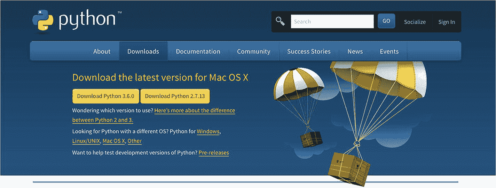
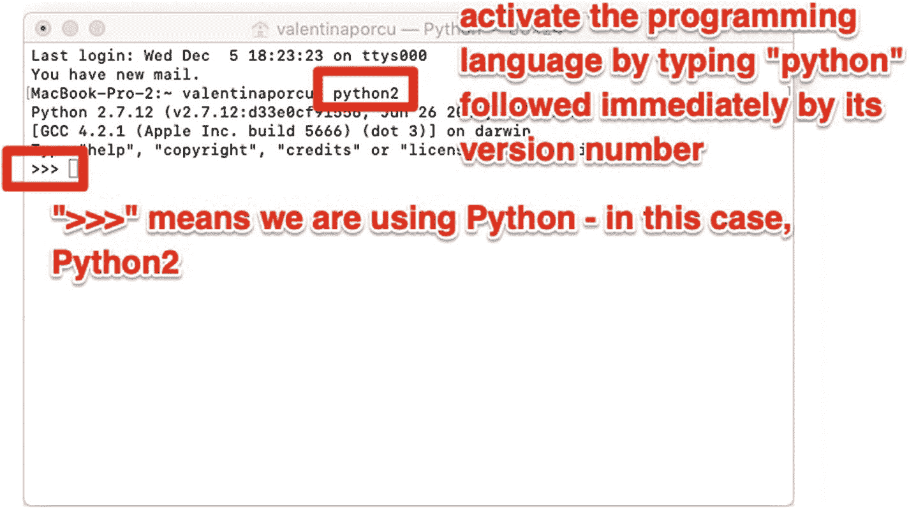
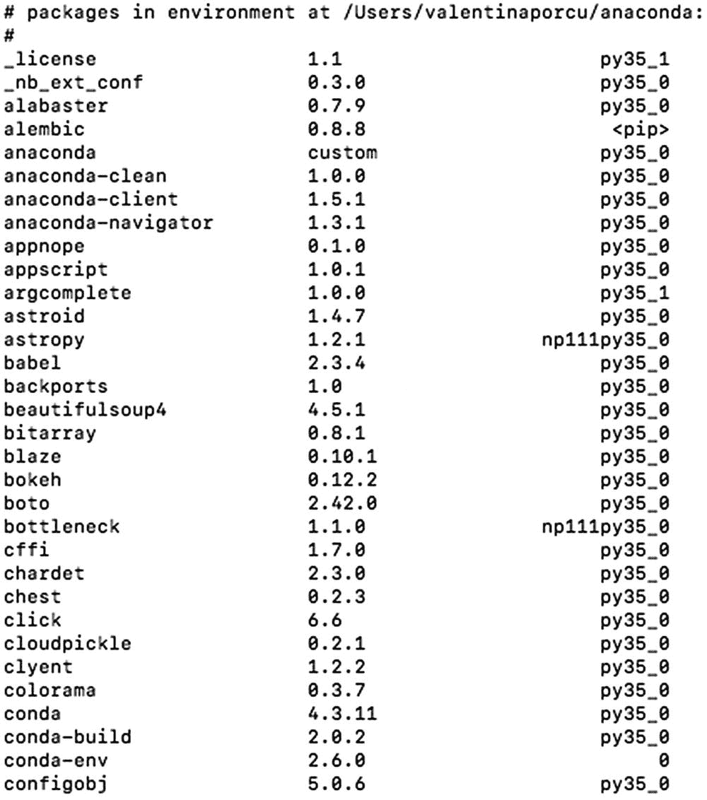
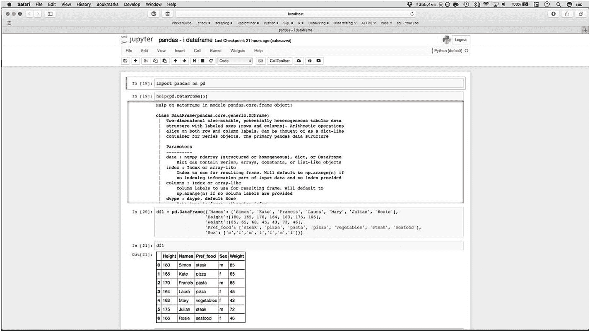
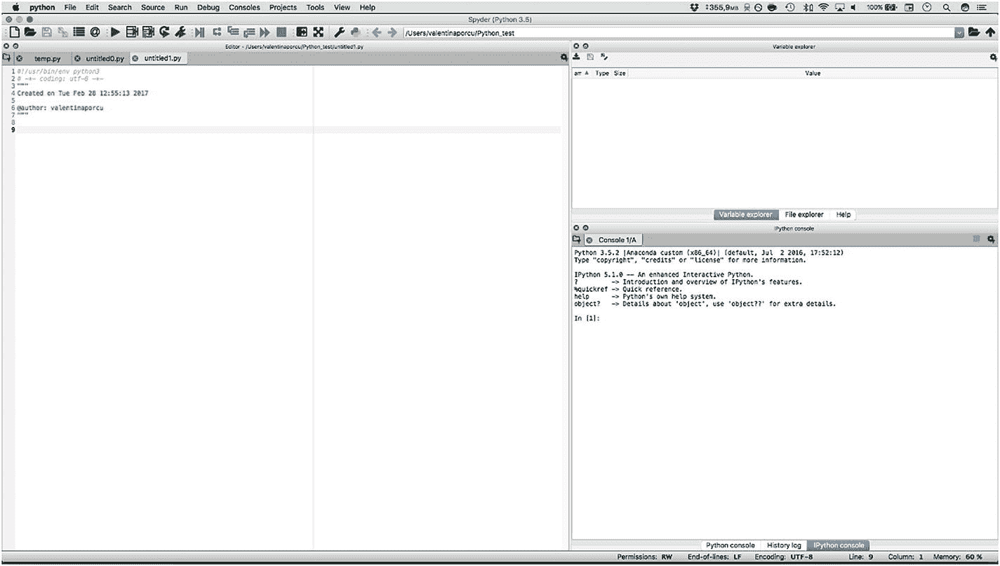
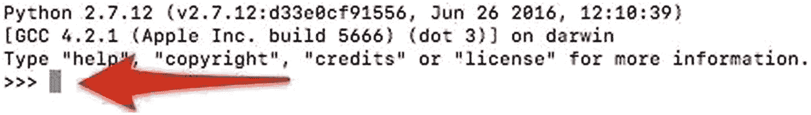
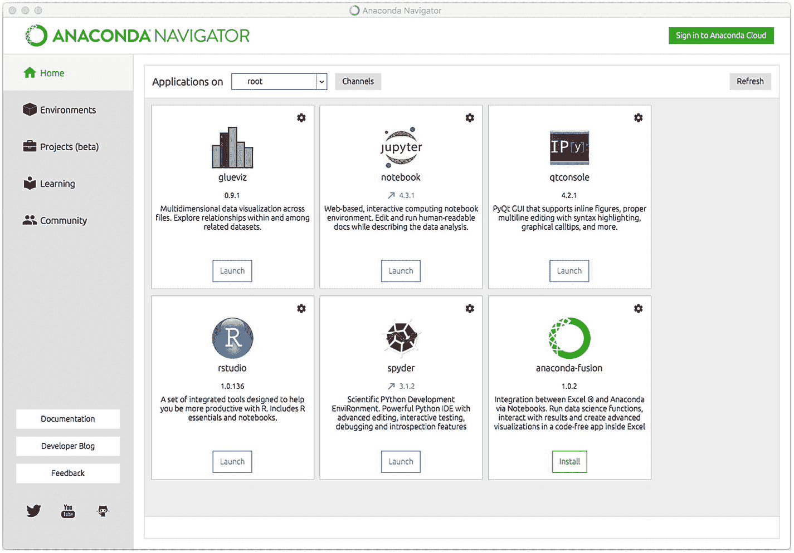
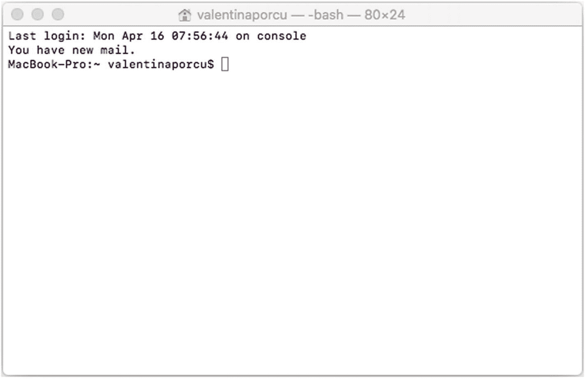
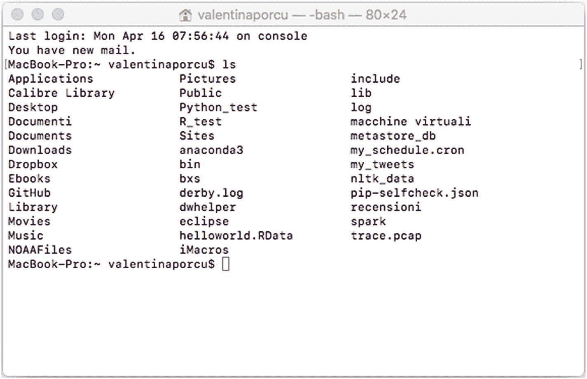

# 1. 开始入门

Python 是数据科学中使用的最重要的编程语言之一。在本章中，你将学习如何安装 Python，并回顾一些用于数据分析的集成开发环境（IDE）。你还将学习如何在计算机上设置工作目录。

## 安装 Python

Python2 和 Python3 可以轻松地从 [`https://www.python.org/downloads/`](https://www.python.org/downloads/)（图 1-1）下载并安装。请注意，如果你在使用 Mac 或 Linux 的 Unix 系统上工作，Python 是预装的。只需输入 `python` 即可加载程序。



图 1-1

Python 主页

从 [python.org](http://python.org/) 网站，点击 “Downloads”，然后根据你的操作系统选择要使用的适当版本。然后，按照屏幕上的说明安装 Python。

## 编辑器与集成开发环境

使用 Python 等编程语言有多种方式。首先，输入单词 `python`，紧接着输入其版本号。数字前没有空格。例如，在图 1-2 中，我输入了 `python2`。



图 1-2

打开 Python 的终端

以这种方式编写代码可能会显得有些繁琐，因此我们使用文本编辑器或集成开发环境来简化流程。

有许多编辑器（包括免费和付费的），它们在完整性、可扩展性和易用性方面各不相同。有些简单，有些则更高级。最常用的编辑器包括 Sublime Text、[Text Wrangler](http://www.barebones.com/)（[`www.barebones.com/`](http://www.barebones.com/)）、[Notepad++](http://notepad-plus-plus.org/download/v7.3.1.html)（[`notepad-plus-plus.org/download/v7.3.1.html`](http://notepad-plus-plus.org/download/v7.3.1.html)）（适用于 Windows）或 [TextMate](http://macromates.com/)（[`macromates.com/`](http://macromates.com/)）（适用于 Mac）。

至于 Python 专用的集成开发环境，[Wingware](http://wingware.com/)（[`wingware.com/`](http://wingware.com/)）、[Komodo](http://www.activestate.com/komodo-ide)（[`www.activestate.com/komodo-ide`](http://www.activestate.com/komodo-ide)）、`Pycharm` 和 [Emacs](http://www.gnu.org/software/emacs/)（[`www.gnu.org/software/emacs/`](http://www.gnu.org/software/emacs/)）都很流行，但还有很多其他选择。它们提供了简化工作的工具，例如自动补全、自动编辑和自动缩进、集成文档、语法高亮和代码折叠（在处理其他代码时隐藏部分代码的能力），并支持调试。

`Spyder`（包含在 [Anaconda](http://www.continuum.io/downloads)（[`www.continuum.io/downloads`](http://www.continuum.io/downloads)）中）和 [Jupyter](http://jupyter.readthedocs.io/en/latest/)（[`jupyter.readthedocs.io/en/latest/`](http://jupyter.readthedocs.io/en/latest/)），你可以从网站 [www.anaconda.com](https://www.anaconda.com) 下载，它们与 Canopy 一样，是数据科学中最常用的集成开发环境。`Jupyter` 中一个有用的工具是 `nbviewer`，它允许交换 `Jupyter` 的 `.ipynb` 文件，可以从 [`http://nbviewer.jupyter.org`](http://nbviewer.jupyter.org) 下载。`nbviewer` 也可以链接到 `GitHub`。

至于 `Anaconda`，它是一个非常有用的工具，因为它也集成了 `Jupyter`，可以从 [`www.continuum/`](http://www.continuum/) 下载。图 1-3 展示了随 `Anaconda` 安装的部分资源列表（包含超过 100 个用于数据挖掘、数学、数据分析和代数的包）。你可以通过打开图 1-3 所示的终端窗口，然后输入以下命令来查看完整列表：



图 1-3

随 `Anaconda` 安装的部分资源

```
conda list
```

我们可以根据个人习惯和需求，使用这些工具中的一个或多个来用 Python 编程。`Spyder`（图 1-4）和 `Jupyter`（图 1-5）在数据挖掘中非常常见。两者都可以单独使用和安装。例如，`Jupyter` 可以通过 `http://try.jupyter.org/` 进行测试。然而，安装 `Anaconda` 后，`Spyder` 和 `Jupyter` 都可直接使用。



图 1-5

`Jupyter` 集成开发环境中打开的脚本示例



图 1-4

`Spyder` 主屏幕

Python 代码可以直接在计算机终端上运行，或者保存为 `.py` 文件，然后通过这些编辑器运行。如前所述，“`>>>`”（如图 1-6 所示）表示我们正在运行 Python 代码。



图 1-6

Python 中的命令提示符

为了跟随本书中的示例，我建议你从 `Anaconda.com` 网站安装 `Anaconda`（图 1-7）并使用 `Jupyter`。因为 `Anaconda` 会自动包含（并安装）我们稍后将使用的一组包和模块，之后我们就不必单独安装包或模块了；它们已经加载好，随时可以使用。



图 1-7

`Anaconda` 主屏幕

## Python2 与 Python3 的区别

Python 发布了两个不同版本：`Python2` 和 `Python3`。`Python2` 诞生于 2000 年（目前最新版本是 2.7），其支持预计将持续到 2020 年。它是历史最悠久、最完整的版本。

`Python3` 于 2008 年发布（当前版本是 3.6）。`Python3` 中有许多库，但并非所有库都已从 `Python2` 转换到 `Python3`。

这两个版本非常相似，但存在一些差异。一个例子包括数学运算：

```python
>>> 5/2
2.5
```

列表 1-2
`Python 3.5.2` 中的数学运算

```python
>>> 5/2
# Python2 执行除法时会截断小数部分。
```

列表 1-1
`Python 2.7` 中的数学运算

要在 `Python2` 中获得正确结果，我们必须指定小数，如下所示：

```python
>>> 5.0/2
2.5
# 或者这样
>>> 5/2.0
2.5
# 或者指定我们谈论的是小数（浮点数）
>>> float(5)/2
2.5
```

为了同时兼容这两个 Python 版本，你还可以将 Python 导入一种称为 `future` 的形式，它允许你将 `Python3` 的函数导入到 `Python2` 中：

```python
>>> from __future__ import division
>>> 5/2
2.5
```

要更深入地了解这两个 Python 版本之间的差异，请访问[这个在线资源](http://sebastianraschka.com/Articles/2014_python_2_3_key_diff.html)（[`sebastianraschka.com/Articles/2014_python_2_3_key_diff.html`](http://sebastianraschka.com/Articles/2014_python_2_3_key_diff.html)）。

为什么选择某个 Python 版本而不是另一个？`Python2` 是定义最完善、最稳定的版本，而 `Python3` 代表了该语言的未来，尽管这两个版本可能并不总是完全一致。在本书的第一部分，我会强调这两个版本之间的差异。然而，从第 7 章开始到本书结尾，我们将使用 `Python3`。
让我们从设置一个工作目录开始。这个目录将存放我们的文件。

## 工作目录

工作目录用于存储我们的脚本和文件。当我们要求 Python 导入文件或运行脚本时，它会自动在此目录中查找。要设置工作目录，请在 Python shell 中输入以下内容：
```
>>> import os
>>>> os.getcwd()
'~/mypc'
# 要修改工作目录，我们使用以下表示法，在括号中插入新目录
>>> os.chdir("/~/Python_script")
# 然后确认修改是否正确
>>> os.getcwd()
'~/Python_script'
```
现在，当我们想要在工作簿中导入一个文件时，只需输入文件名及其扩展名，并用双引号括起来即可：
```
"file_name.extension"
```
例如：
```
"dataframe_data_collection1.csv"
```
`Python` 会检查该文件夹中是否存在同名文件，并将其导入。当我们在电脑上输入并保存一个 `Python` 文件时，也会发生同样的情况。`Python` 会自动将其放入该文件夹。即使我们运行一个 `Python` 脚本（稍后会看到），我们也必须直接从终端访问脚本所在（工作目录或其他目录）的文件夹。
如果我们想导入一个不在工作目录中，而是位于电脑其他位置或网络上的文件，可以通过输入完整的文件地址来实现：
```
"complete_address.file_name.extension"
```
例如：
```
"/~/dataframe_data1.csv"
```
现在，请确保你理解了使用终端和在喜欢的编程语言中启动会话之间的区别。

## 使用终端

要运行 `Python` 脚本，我们首先打开一个终端窗口，如图 1-8 所示。

图 1-8
我的终端
如你所见，显示的是美元符号 (`$`)，而不是 `Python` shell 的符号 (`>>>`)。要查看文件夹和文件的列表，请使用 `“ls”` 命令（图 1-9）。

图 1-9
我电脑上的资源列表
此时，我们可以通过输入以下命令进入 `Python_test` 文件夹：
```
cd Python_test
```
在该文件夹中，我可以找到我的 `Python` 脚本——即可以通过输入以下命令运行的 `.py` 文件：
```
python test.py
```
`test.py` 是我将要运行的脚本名称。

## 总结

在本章中，我们学习了如何安装 `Python`，并回顾了一些可用于数据分析的集成开发环境（`IDE`）。我们还探讨了 `Python2` 和 `Python3`，并学习了如何在终端上设置工作目录。