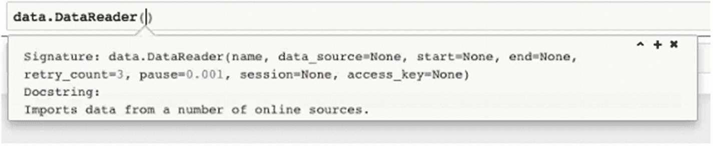
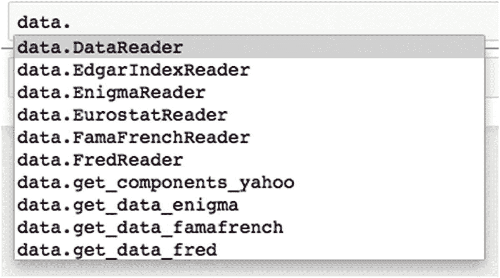
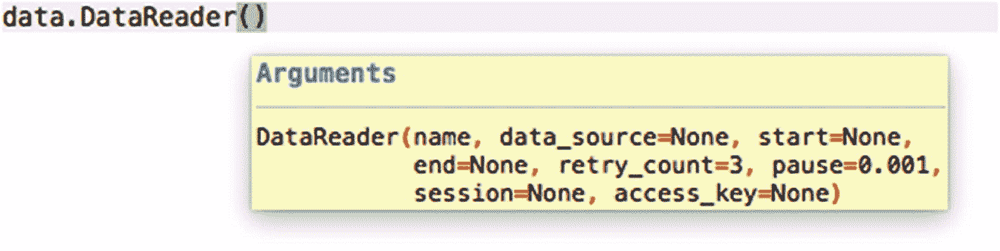
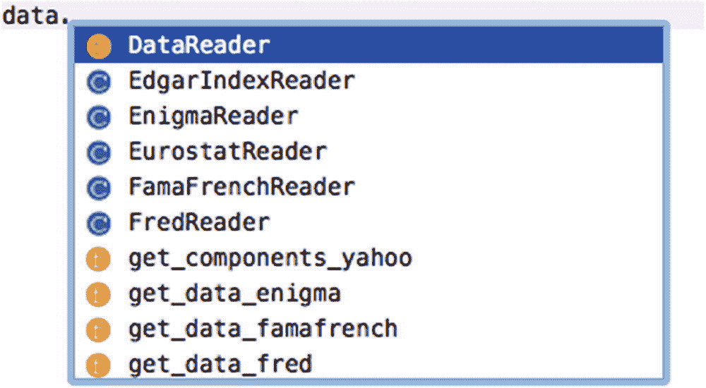
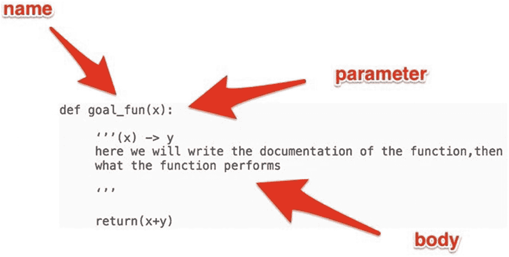

# 4. 函数

基于对象的编程语言围绕两个主要概念构建：对象和函数。对象是我们在使用 Python 等编程语言的工作会话中创建的一切。函数允许我们为这些对象分配一个或多个操作。让我们学习如何创建一个函数。

## 关于 Python 函数的一些说明

使用 Python，我们基本上有两种类型的函数：

1.  内建函数，它们是 Python 的一部分，并在我们运行 Python 时自动加载
2.  我们可以构建和使用的函数（用户自定义）

函数是一段代码，它对一个对象执行一个或多个操作并返回输出结果。当我们必须对多个对象执行相同操作时，函数尤其有用。我们可以做到这一点，而无需多次重复相同的代码行。

这两种类型的函数也得到许多可用于安装到 Python 的库中函数的支持。每当我们需要一个特定的函数（或一个包，即一组函数）时，我们可以安装它并使用它。Anaconda 不允许我们安装许多我们需要的包，因为它们已经存在于该套件中。

如果某个包未包含在 Anaconda 中，我们始终可以使用通用术语安装它：

```
$ conda install package_name
```

或者，我们可以使用 `pip`：

```
$ pip install package_name
```

无论如何，安装包的确切措辞始终包含在该包本身的官方文档中。

### 一些预定义的内置函数

默认函数位于 `builtins` 模块中。虽然数量众多，但最常用的一些包括 `dir`、`help`、`type` 和 `print`。我们可以通过输入以下内容来显示它们：

```
>>> dir(__builtins__)
['ArithmeticError', 'AssertionError', 'AttributeError', 'BaseException', 'BlockingIOError', 'BrokenPipeError', 'BufferError', 'BytesWarning', 'ChildProcessError', 'ConnectionAbortedError', 'ConnectionError', 'ConnectionRefusedError', 'ConnectionResetError', 'DeprecationWarning', 'EOFError', 'Ellipsis', 'EnvironmentError', 'Exception', 'False', 'FileExistsError', 'FileNotFoundError', 'FloatingPointError', 'FutureWarning', 'GeneratorExit', 'IOError', 'ImportError', 'ImportWarning', 'IndentationError', 'IndexError', 'InterruptedError', 'IsADirectoryError', 'KeyError', 'KeyboardInterrupt', 'LookupError', 'MemoryError', 'NameError', 'None', 'NotADirectoryError', 'NotImplemented', 'NotImplementedError', 'OSError', 'OverflowError', 'PendingDeprecationWarning', 'PermissionError', 'ProcessLookupError', 'RecursionError', 'ReferenceError', 'ResourceWarning', 'RuntimeError', 'RuntimeWarning', 'StopAsyncIteration', 'StopIteration', 'SyntaxError', 'SyntaxWarning', 'SystemError', 'SystemExit', 'TabError', 'TimeoutError', 'True', 'TypeError', 'UnboundLocalError', 'UnicodeDecodeError', 'UnicodeEncodeError', 'UnicodeError', 'UnicodeTranslateError', 'UnicodeWarning', 'UserWarning', 'ValueError', 'Warning', 'ZeroDivisionError', '__build_class__', '__debug__', '__doc__', '__import__', '__loader__', '__name__', '__package__', '__spec__', 'abs', 'all', 'any', 'ascii', 'bin', 'bool', 'bytearray', 'bytes', 'callable', 'chr', 'classmethod', 'compile', 'complex', 'copyright', 'credits', 'delattr', 'dict', 'dir', 'divmod', 'enumerate', 'eval', 'exec', 'exit', 'filter', 'float', 'format', 'frozenset', 'getattr', 'globals', 'hasattr', 'hash', 'help', 'hex', 'id', 'input', 'int', 'isinstance', 'issubclass', 'iter', 'len', 'license', 'list', 'locals', 'map', 'max', 'memoryview', 'min', 'next', 'object', 'oct', 'open', 'ord', 'pow', 'print', 'property', 'quit', 'range', 'repr', 'reversed', 'round', 'set', 'setattr', 'slice', 'sorted', 'staticmethod', 'str', 'sum', 'super', 'tuple', 'type', 'vars', 'zip']
```

`dir()` 函数很重要，因为它允许我们显示插入其中的对象的属性或方法列表。例如：

```
>>> test1 = ["object1", "object2", "object3", "object4", "object5"]
>>> dir(test1)
['__add__', '__class__', '__contains__', '__delattr__', '__delitem__', '__delslice__', '__doc__', '__eq__', '__format__', '__ge__', '__getattribute__', '__getitem__', '__getslice__', '__gt__', '__hash__', '__iadd__', '__imul__', '__init__', '__iter__', '__le__', '__len__', '__lt__', '__mul__', '__ne__', '__new__', '__reduce__', '__reduce_ex__', '__repr__', '__reversed__', '__rmul__', '__setattr__', '__setitem__', '__setslice__', '__sizeof__', '__str__', '__subclasshook__', 'append', 'count', 'extend', 'index', 'insert', 'pop', 'remove', 'reverse', 'sort']
```

属性或方法不过是我们能对该特定对象执行的操作，例如向列表中添加一个项目，正如我们在第 3 章中看到的：

```
>>> test1.append("pippo")
>>> test1
['object1', 'object2', 'object3', 'object4', 'object5', 'pippo']
```

我们可以使用 `type()` 函数，它会显示插入其中的对象的类型。

```
>>> type(test1)
```

重要的是要记住，当使用 `dir()` 函数括起一个对象（例如列表、元组、字典等）时，我们会得到一个可以分配给该特定对象的操作列表。

当我们使用其他数据科学家编写的包和函数时，获取有关其函数及其参数的信息非常有用。让我们看看如何做到这一点。

## 获取函数信息

在一个函数内部，我们可以找到该函数的所有特定参数。要获取有关函数及其参数的信息，请键入：

# 使用Python的帮助功能与函数编写

```
>>> help(print)
Help on built-in function print in module builtins:
print(...)
print(value, ..., sep=' ', end="\n", file=sys.stdout, flush=False)
Prints the values to a stream, or to sys.stdout by default.
Optional keyword arguments:
file:  a file-like object (stream); defaults to the current sys.stdout.
sep:   string inserted between values, default a space.
end:   string appended after the last value, default a newline.
flush: whether to forcibly flush the stream.
# help() 函数仅适用于 Python3
```

这样，我们就获得了一系列关于该函数的信息。要退出，请按 `q`。我们也可以获取关于特定方法的帮助：

```
>>> help(test1.append)
Help on built-in function append:
append(...)
L.append(object) -- append object to end
```

你可以在 Python 2.7 的内置函数文档 ([https://docs.python.org/2/library/functions.html](https://docs.python.org/2/library/functions.html)) 和版本 3 的内置特性文档 ([https://docs.python.org/3/library/functions.html](https://docs.python.org/3/library/functions.html)) 找到更多信息。

如果你使用的是 Jupyter，可以通过按 Tab 键来显示方法。按 Shift+Tab 可以显示函数的参数（图 4-1 和 4-2）。


*图 4-2: Jupyter 2 中的函数参数*


*图 4-1: Jupyter 1 中的方法*

使用 Spyder 时，图 4-3 和 4-4 中的信息会自动出现。


*图 4-4: Spyder 1 中的函数参数*


*图 4-3: Spyder 1 中的方法*

## 创建你自己的函数

除了使用默认特性或从其他库导入之外，我们还可以创建自己的函数。如前所述，函数是告诉 Python 如何执行某事的代码片段。一个函数包含三个部分：名称、参数和主体（图 4-5）。允许我们创建函数的语句是 `def`：


*图 4-5: 如何编写函数*

```python
>>> def goal_fun(x):
...        """(x) -> y
...        here we will write the documentation of the function, then
what the function performs
...
"""
...        return(x + y)
```

让我们创建一个将数字 5 加到任何 `x` 值上的函数：

```python
>>> def sum1(x):
...        """sum x to 5
...        """
...        return(x + 5)
>>> sum1(10)

>>> sum1(130)
```

在这个函数中，我们输入了一个参数，但我们可以输入多个参数：

```python
>>> def mult_xy(x, y):
...     """multiply x and y
...     """
...     return(x * y)
>>> mult_xy(5, 6)
```

为了帮助我们查看某个函数的执行路径，我们可以使用在线工具，例如 Python Tutor (`http://pythontutor.com/`)。

## 保存并运行你自己的模块和文件

我们已经了解了如何创建 `.py` 脚本并将其放入工作目录中，我们可以通过导入 `os` 模块并输入以下内容来找到该目录：

```python
>>> import os
>>> os.getcwd()
```

我们可以使用任何文本编辑器创建一个文件，然后重命名该文件，使其包含 `.py` 扩展名：

```
example_script.py
```

将脚本放入工作目录后，我们通过输入以下命令来运行它：

```
# 在计算机终端中输入
$ python example_script.py
```

如果脚本不在工作目录中，我们需要在计算机终端中更改目录：

```
# 在终端中输入
$ cd directory_address
```

例如：

```
# 在终端中输入
$ cd /~/Downloads
```

更改目录后，按照我们之前的方式继续操作：

```
$ python example_script.py
```

Python shell 非常适合快速测试，但对于复杂的脚本，最好使用编辑器编写，然后以这种方式运行，或者复制脚本并在 Python shell 中运行。

## 总结

编写函数对于数据科学家来说是一项非常重要的任务。像 R 这样的语言拥有大量的包和函数来满足各种统计需求。然而，使用 Python 时，我们通常需要自己编写函数，本章对此进行了详细介绍。在第 5 章中，我们将介绍更多可用于构建实用函数的工具。