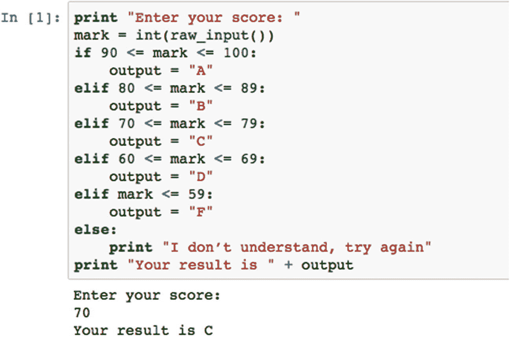
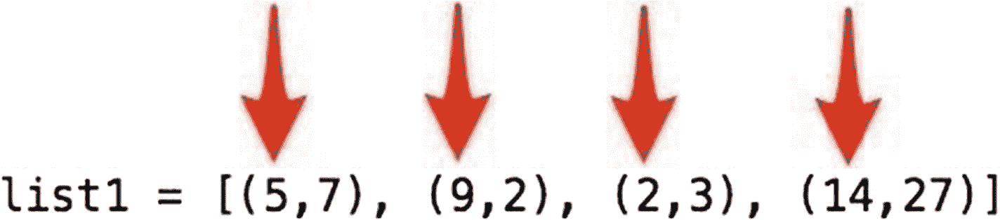

# 5. 条件指令与编写函数

在本章中，我们将探索在 Python 中创建函数和循环的方法。我们可能需要创建循环来对列表中的元素重复执行某个操作，或者创建函数来从数据集中提取某些案例。编写函数对于自动化数据分析非常重要。

## 条件指令

条件指令是我们在创建函数时用于管理条件的结构。根据特定的值或操作的结果，我们使用以下条件指令对数据执行不同的操作。

*   **if**

*   **elif**

*   **else**

这些结构，连同用于创建循环的结构，对于创建允许我们执行特殊指令（例如对数据集的多行执行递归操作、建立条件等）的功能是必不可少的。

### if

让我们看一些使用 **if** 的示例：

```
>>> x = 5
>>> y = 7
>>> if x < y:
...        print("x is less than y")
x is less than y
```

现在让我们创建对象并设置一个条件。前面的条件满足，因此打印了所需的语句。

```
>>> z = 700
>>> h = 20
>>> if h > z:
...        print("h is bigger than z")
```

在第二个例子中，条件不满足，因此没有打印任何内容。

### if + else

**if** 也可以与 **else** 一起使用，为我们提供更大的灵活性。例如：

```
>>> z = 700
>>> h = 20
>>> if h > z:
...        print("h is bigger than z")
...else:
...        print("h is not bigger than z")
h is not bigger than z
```

### elif

通过使用 **elif**，我们可以实现 **if** 的最大灵活性，它在函数中建立中间条件。例如，让我们创建一个程序，询问我们的分数是多少。然后我们将它归入一个评分等级，我们称之为 *result*。让我们使用 Python2 按如下步骤操作（我们可能需要输入编码）：

```
#!/usr/bin/env python
# -*- coding: utf-8 -*-
>>> print "Enter your score: "
>>> mark = int(raw_input())
>>> if 90 <= mark <= 100:
...    output = "A"
...elif 80 <= mark <= 89:
...    output = "B"
...elif 70 <= mark <= 79:
...    output = "C"
...elif 60 <= mark <= 69:
...    output = "D"
...elif mark <= 59:
...    output = "F"
...else:
...    print "I don't understand, try again"
...print "Your result is " + output
```

我们可以保存脚本（我将其命名为 mark2，你可以在代码文件夹中找到它，或者通过打开一个 .txt 文件并将其重命名为 .py 扩展名来自行创建），然后从 Jupyter 运行它，如图 5-1 所示。



图 5-1

在 Jupyter 中运行 mark2

### 注意

Python2 和 Python3 处理用户输入的方式不同。

在 Python 3 中，我们只需使用 input() 而不是 raw_input()：

```
>>> print("Enter your score: ")
>>> score = int(input())
>>> if 90 <= score <= 100:
...    output = "A"
...elif 80 <= score <= 89:
...    output = "B"
...elif 70 <= score <= 79:
...    output = "C"
...elif 60 <= score <= 69:
...    output = "D"
...elif score <= 59:
...    output = "F"
...else:
...    print("I don't understand, try again")
...print("Your result is " + output)
```

Enter your score:

```

```

Your result is B

## 循环

循环标识允许你重复执行某段代码的结构，可以重复特定次数或在特定条件下重复。Python 中允许你调整操作的最重要的指令是：

*   **for**

*   **while**

*   **continue 和 break**

### for

Python 指令 **for** 允许定义迭代。**for** 是一个迭代器，因此它能够遍历一个序列并对其执行操作，或执行运算。**for** 指令的格式如下：

```
for item in object:
run action on item
```

例如：

```
# 我们创建一个对象（本例中是一个元组）并打印每个元素
>>> x = (1,2,3,4,5,6,7)
# 检查对象的类型
type(x)

>>> for n in x:
...        print(n)

# 我们创建一个对象，并针对对象的每个元素，打印一条语句以及该元素
>>> x = (1,2,3,4,5,6,7)
>>> for n in x:
...    print("this is the number", n)
("this is the number", 1)
("this is the number", 2)
("this is the number", 3)
("this is the number", 4)
("this is the number", 5)
("this is the number", 6)
("this is the number", 7)
# 我们也可以打印字符串的元素
>>> string1 = "example"
>>> for s in string1:
...        print(s)
e
x
a
m
p
l
e
>>> for s in string1:
...        print(s.capitalize())
E
X
A
M
P
L
E
>>> for s in string1:
...        print(s*5)
eeeee
xxxxx
aaaaa
mmmmm
ppppp
lllll
eeeee
```

例如，如果我们有一个包含子列表的列表，并且想要打印其中的一些元素，会发生什么？让我们看一个例子：

```
# 我们创建一个包含元素对的列表
>>> list1 = [(5,7), (9,2), (2,3), (14,27)]
>>> list1
[(5, 7), (9, 2), (2, 3), (14, 27)]
```

我们只想打印每对元素中的第一个元素，如图 5-2 所示。



图 5-2

仅打印第一个元素

```
>>> for (el1, el2) in list1:
...     print el1

```

如果我们愿意，还可以对元素对执行操作——例如：

```
>>> for (el1, el2) in list1:
...        print el1+el2

# 在 Python3 中，我们为函数 print() 添加括号
>>> for (el1, el2) in list1:
...        print(el1+el2)

```

对于字典，我们可以按如下方式操作：

```
>>> dict1 = {"k1":1, "k2":2, "k3":3}
>>> for key, value in dict1.items():
...     print("the key value " + str( key ) + " is " + str( ...value ))
the key value k3 is 3
the key value k2 is 2
the key value k1 is 1
```

显然，我们也可以只打印单个键或仅打印值：

```
# python2
>>> for key, value in dict1.items(): print key
k3
k2
k1
>>> for key, value in dict1.items(): print value

# python3
>>> for key, value in dict1.items(): print(key)
k3
k2
k1
>>> for key, value in dict1.items(): print(value)

```


### while

指令 **while** 在满足特定条件时执行操作。它适用于我们不确定需要迭代多少次的情况，因此会一直运行直到满足特定条件。

```
# Python2
>>> x = 1
>>> while x >> x = 1
>>> while x < 5:
...     print(x)
...     x = x+1
```

使用 **while** 指令时，必须小心避免启动无限循环，否则将需要强制关闭程序。例如，如果我们设置这种类型的循环，将会得到一连串的“1”，直到我们停止执行：

```
# 注意：请勿运行
>>> x = 1
>>> while x < 2:
...        print x
```

让我们再看一个 **while** 的例子：

```
# Python2
>>> y = 1
>>> while y < 10:
...     print "the y value is " ,y
...     y = y +1
the y value is  1
the y value is  2
the y value is  3
the y value is  4
the y value is  5
the y value is  6
the y value is  7
the y value is  8
the y value is  9
# 在这个例子中，我们打印了每个 y 值对应的语句，y 值在每一步都会增加
```

### continue 和 break

**continue** 和 **break** 是两条允许你结束循环或继续执行下一次迭代的指令。让我们看一个 **continue** 的例子：

```
# 我们创建一个列表
>>> list1 = ['item1', 'item2', 'item3', 'cat', 'item4', 'item5']
# 我们创建一个 for 循环来打印列表中的每个元素
>>> for item in list1:
...    if item in list1:
...        if item == 'cat':
...            continue
...    print(item)
item1
item2
item3
item4
item5
# for 循环必须跳过与其他元素不同的那个元素；为了实现这个结果，我们使用了 continue，从而“跳过”了该元素
```

**break** 的工作方式类似，但与 **continue** 不同，它会中断 **for** 循环：

```
>>> for item in list1:
...    if item in list1:
...        if item == 'cat':
...            break
...    print(item)
item1
item2
item3
range()
```

正如我们在列表中看到的，`range()` 是 Python2 中的一个函数（在 Python3 中是一个内置方法），而不是条件指令。这个函数允许你创建由上限和下限（一个范围）界定的列表。

```
# Python2
# 我们创建一个从 1 到 49（包含）的数字列表
>>> list = range(1, 50)
>>> list
[1, 2, 3, 4, 5, 6, 7, 8, 9, 10, 11, 12, 13, 14, 15, 16, 17, 18, 19, 20, 21, 22, 23, 24, 25, 26, 27, 28, 29, 30, 31, 32, 33, 34, 35, 36, 37, 38, 39, 40, 41, 42, 43, 44, 45, 46, 47, 48, 49]
# 检查对象类型
>>> type(list)

# 我们创建一个从 30 到 44（包含）的数字列表
>>> list2 = range(30, 45)
>>> list2
[30, 31, 32, 33, 34, 35, 36, 37, 38, 39, 40, 41, 42, 43, 44]
# 如果我们不指定下限，只指定上限，列表将从 0 开始：
>>> list3 = range(14)
>>> list3
[0, 1, 2, 3, 4, 5, 6, 7, 8, 9, 10, 11, 12, 13]
```

我们还可以添加我们想要包含的步长，例如，三个元素作为第三个参数：这样第一个参数将是起始数字（20），第二个参数是列表的结束数字（40），第三个参数是步长（3）

```
>>> list4 = range(20, 40, 3)
>>> list4
[20, 23, 26, 29, 32, 35, 38]
# 这样，我们可以创建例如奇数或偶数的列表
>>> range(0,10,2)
[0, 2, 4, 6, 8]
>>> range(1,10,2)
[1, 3, 5, 7, 9]
```

我们也可以创建两个对象，并请求这两个对象之间的范围。例如，

```
>>> x = 17
>>> y = 39
>>> range(x, y)
[17, 18, 19, 20, 21, 22, 23, 24, 25, 26, 27, 28, 29, 30, 31, 32, 33, 34, 35, 36, 37, 38]
```

此外，我们可以将使用 `range()` 创建的列表合并到另一个循环中。例如，

```
>>> for el in range(1,10): print el

# 例如，在 for 循环中，我们不传递一个对象，而是传递一个用 range() 创建的列表
```

### 注意

在 Python2 和 Python3 中，`range()` 的使用方式不同。

要在 Python3 中获取数字列表，我们编写

```
>>> list(range(10))
[0, 1, 2, 3, 4, 5, 6, 7, 8, 9]
>>> list(range(2,10))
[2, 3, 4, 5, 6, 7, 8, 9]
# 如果在 Python3 中使用与 Python2 相同的名称，我们会得到这个结果
>>> range(10)
>>> range(0, 10)
```

## 使用条件指令扩展函数

我们刚刚学习的条件和循环指令使我们能够扩展编写函数的能力。让我们看一个例子：

```
# 我们创建一个示例函数
>>> def ex1(x):
...        y = 0
...        while(y >> ex1(0)
'Stop now!'
ex1(5)
Add one!
Add one!
Add one!
Add one!
Add one!
'Stop now!'
```

## map( ) 和 filter( ) 函数

`map()` 函数接受两个对象，一个函数和一个数据序列，并将该函数应用于数据序列。这是一个例子：

```
# map()
# Python2
# 我们创建一个求数字平方的函数
>>> def square(x):
...      return x*x
# 检查函数是否按预期工作
>>> square(9)

# 现在让我们创建一个数字列表
>>> num = [2, 5, 7, 10, 15]
# 我们将 map() 函数应用于我们的列表，仅通过一次操作就对所有列表数字求平方
>>> map(square, num)
[4, 25, 49, 100, 225]
# Python3
# 我们使用 list() 函数来获得期望的结果，就像我们对 range() 所做的那样
>>> list(map(square, num))
```

`filter()` 函数将一个函数应用于一个对象，并返回满足特定条件的结果。让我们创建第二个数字列表：

```
>>> num2 = range(1,15)
>>> num2
[1, 2, 3, 4, 5, 6, 7, 8, 9, 10, 11, 12, 13, 14]
# 我们创建一个能够区分偶数的函数
>>> def even(x):
...        if x % 2 == 0:
...                return True
...        else:
...                return False
# 我们将 filter() 函数应用于 even() 函数和一个数字列表，比如 num2
>>> filter(even, num2)
[2, 4, 6, 8, 10, 12, 14]
```

## lambda 函数

lambda 函数是一种具有特定语法的 Python 构造，它简化了函数的构建，允许我们将一个函数缩减为一行，从而使代码更简单，但功能不如使用 `def` 构造创建的函数强大。例如，要创建一个求数字平方的函数，我们这样做：

```
# 我们创建一个求数字平方的函数
>>> def square(x):
...      return x*x
# 我们检查函数是否按预期工作
>>> square(9)

```

现在我们使用 lambda 函数来创建相同的函数：

```
>>> sq2 = lambda x : x*x
>>> sq2(127)

```

如你所见，我们可以在一行中创建一个类似的函数。

让我们回到一个数字列表：

```
>>> num =[2, 5, 7, 10, 15]
# 现在我们使用我们创建的第二个函数将函数应用于整个列表
>>> map(sq2, num)
[4, 25, 49, 100, 225]
# 没有必要创建一个函数；我们可以将 lambda 函数直接集成到过程中。在这种情况下，如果我们想在那里使用相同的 lambda 函数，我们将重写它，而不是通过它的名称来调用它
>>> map(lambda x: x*x, num)
[4, 25, 49, 100, 225]
```


## 作用域

编写函数时，我们可以在函数内部定义一个对象，也可以关联一个由函数在外部创建的对象。第一种情况称为*全局变量*；第二种情况称为*局部变量*。因此，对于一个函数，我们涉及三个要素：

1.  **形式参数：** 函数定义中存在的参数

2.  **局部变量：** 通过在函数体内计算表达式来定义，并且仅在函数内部可见

3.  **全局变量：** 既不属于第一类也不属于第二类，而是在函数外部查找的变量

到目前为止，我们一直使用全局变量，先定义它们，然后通过某些函数应用各种操作。然而，在下面的例子中，我们定义一个函数外部的全局测试变量和一个函数内部的局部测试变量。函数调用的是局部变量。

```
>>> test = "hello"
>>>     def fun1():
...       test = "hi"
...       print(test)
>>> fun1()
hi
```

然而，在下一个例子中，我们引用的是函数外部的变量。这样操作，计算可以正确执行：

```
num1 = 5
def fun2():
global num1
num2 = num1 + 1
print(num2)
fun2(num1)

```

## 总结

在本章中，我们学习了条件指令，这些是在创建函数时用于管理条件的结构。我们还探讨了如何扩展函数。

