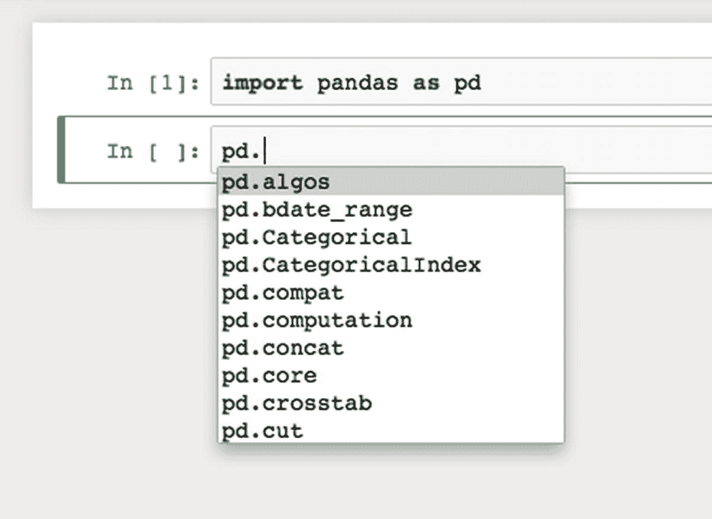
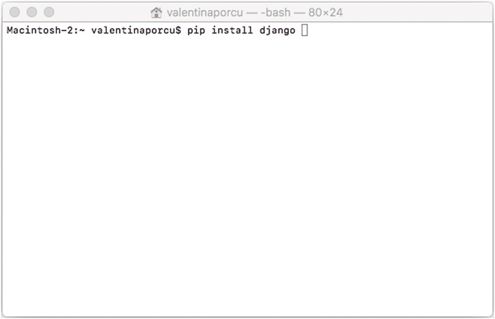
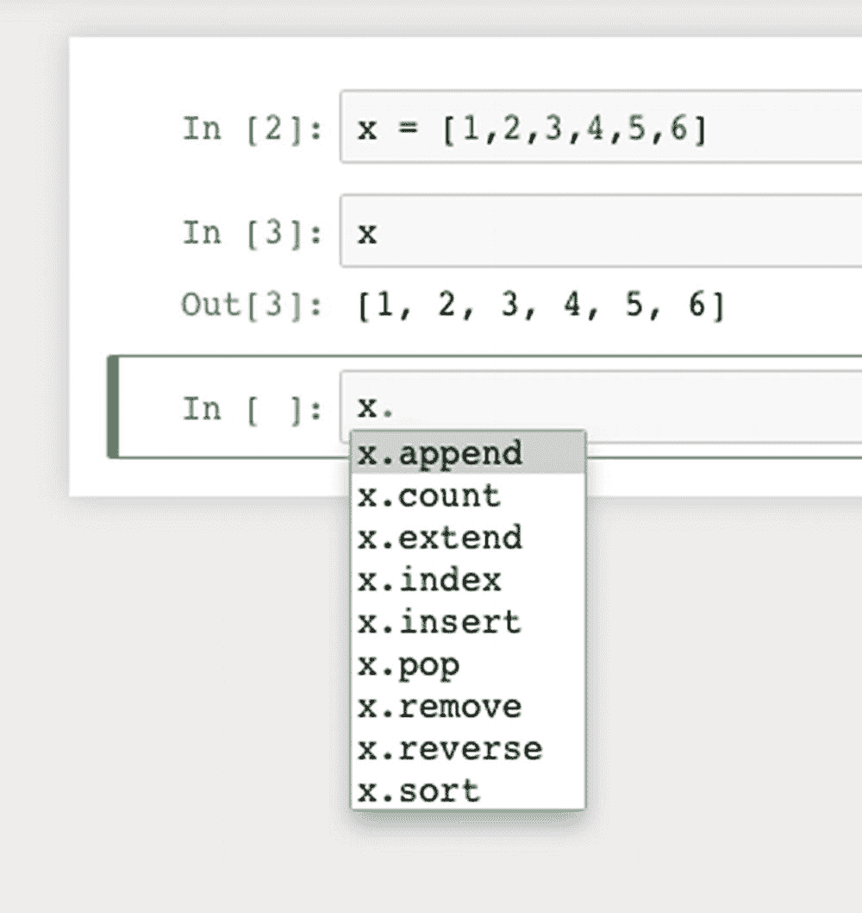
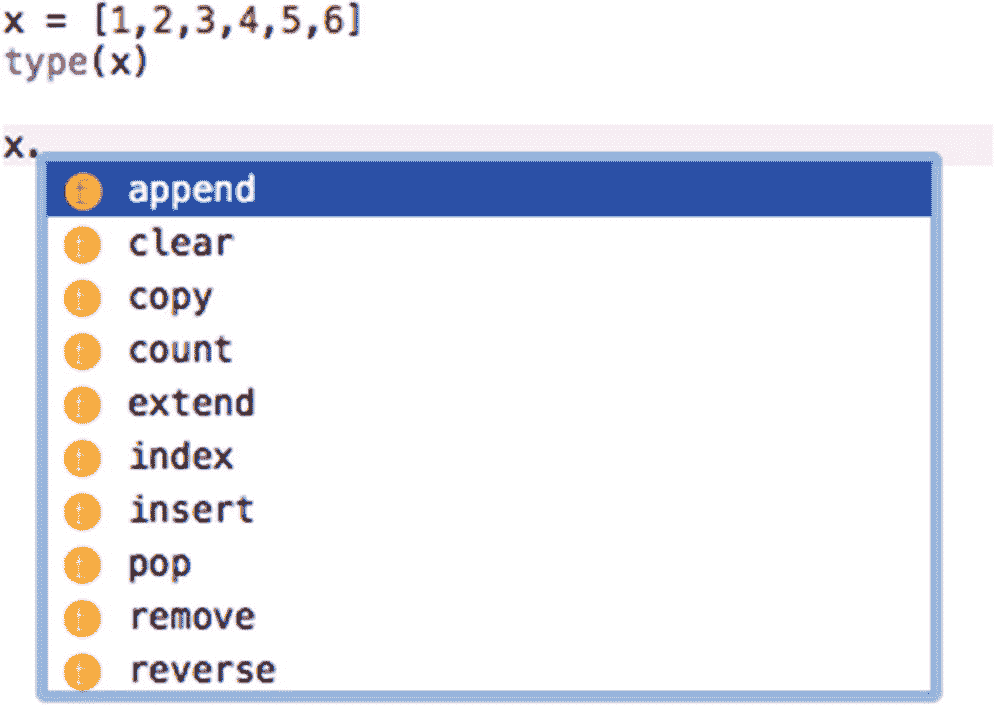
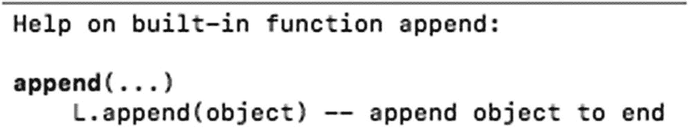

# 6. 其他基本概念

在本章中，我们将学习一些重要的编程概念（如模块和方法）、列表推导式和类创建、正则表达式，以及错误和异常的管理。

## 面向对象编程

如前所述，Python 是一种面向对象的编程语言，因此让我们来看看面向对象编程的一些基本概念。一些重要的概念包括：

* 对象
* 类
* 继承

### 关于对象的更多内容

对象是我们创建的所有数据结构，从仅包含单个数字的小型结构到包含大型数据集的大型结构。我们通过使用库中预装、我们导入或我们创建的特性或方法来对操作应用对象。

### 类

就类的概念而言，这对我们来说是本书中的一个新主题；我们之前尚未探讨过。Python 允许我们通过类的概念创建与我们的需求相关的结构。类是对象的抽象表示，我们可以随时用真实的实例来填充它。当定义一个新类时，我们可以定义该类的实例。一个类由其自身的特性来定义。例如，如果我们创建一个`Dog`类，我们可以规定它由诸如头部形状、口鼻部、毛发类型（短毛或长毛）等特性来定义。一个`Book`类可以包含诸如书籍类型、页数、主要主题、封面类型、ISBN 等特性。

### 继承

面向对象编程的另一个概念是继承。可以从现有的类创建新的类。新类继承原始类的特性，但它们可以通过新特性来扩展这些类。继承很方便，因为它允许我们扩展旧类而无需修改它们。继承可以是单继承和多继承。通过单继承，子类可以从一个现有类继承成员数据和方法；在多继承的情况下，子类可以从多个现有类继承特性。

让我们看一个创建`Cat`类的简单示例。

```
>>> class Cat:
...     def __init__(self, name, color, age, race):
...         self.name = name
...         self.color = color
...         self.age = age
...         self.race = race
```

`Cat`由名称、颜色、年龄和品种定义。我们可以创建一个猫的实例：

```
>>> cat1 = Cat("Fuffy", "white", 3, "tabby")
```

让我们查看它的特性：

```
>>> print(cat1.name)
Fuffy
>>> print(cat1.color)
white
```

我们可以通过添加方法来修改类：

```
>>> class Cat:
...     def __init__(self, name, color, age, race):
...         self.name = name
...         self.color = color
...         self.age = age
...         self.race = race
...     def cry(self):
...         print("meow")
...     def purr(self):
...         print("purr")
# 我们用这个新类创建一个猫的实例
>>> cat2 = Cat("Candy", "Red", "6", "Balinese")
```

现在，我们不仅可以像第一个示例那样基于特性来查询实例，

```
>>> print(cat2.age)
```

还可以使用方法：

```
>>> cat2.cry()
meow
>>> cat2.purr()
purr
```

让我们为虎斑猫（一种猫的品种）创建一个子类，这样它就能继承其特性。

```
>>> class tabby(Cat):
...     def character(self):
...         print("warm")
# 我们创建一个虎斑猫实例
>>> tabby1 = tabby("Pallina", "black", 4, "tabby")
>>> tabby1.purr()
purr
>>> tabby1.character()
warm
```

因此，我们不仅可以查询与虎斑猫子类相关的特性，还可以查询与现有`Cat`类相关的特性。

## 模块

模块是通常与特定主题（图形、数据分析）相关的函数集合。形式可以属于以下类别之一：

* Python 模块
* 预编译模块
* 内置模块

要使用一个模块，我们必须首先使用`import`指令导入它：

```
import ...
```

例如，

```
import numpy
```

使用`import`，我们导入了整个模块。

然而，我们可以导入模块的一部分：

```
from ... import ...
```

例如，

```
from matplotlib import cm
```

为了简化和加快代码编写速度，我们可以用另一个名称导入一个形式：

```
import numpy as np
```

然后，我们可以使用以下命令检查我们的模块：

```
help('modules')
```

导入模块后（例如，在 Jupyter 中），我们可以通过按 Tab 键显示该特定模块的所有方法来访问帮助部分（图 6-1）。



图 6-1 Jupyter 上的 pandas 方法

此外，我们可以导入模块中非常具体的元素。例如：

```
from math import sqrt
```

在这种情况下，我们没有导入整个模块——只导入了平方根函数。在这种情况下，我们不需要将`sqrt`作为`math`模块的方法来调用。我们可以直接调用平方根：

```
>>> sqrt(9)
3.0
```

如果我们导入整个模块，我们必须将`sqrt`指定为`math`模块的方法：

```
>>> import math
>>> math.sqrt(12)
3.4641016151377544
```

一些编程语言，如 Anaconda，会自动安装一系列模块和包（图 6-2）。然而，如果我们需要安装一个特定的模块，我们可以从计算机终端通过输入以下命令来完成：



图 6-2 在计算机上安装包

```
$ pip install nome_modulo
```

如图 6-2 所示，我们在终端中，而不是在 Python 窗口中，因为提示符处缺少`>>>`符号。`$`符号表示正在使用终端。

根据我们正在安装的包（例如，来自 GitHub），我们可能会在包文档本身中找到不同的安装说明。包是模块的集合，通常涉及同一主题。例如，SciPy 和 NumPy 包含数十个数据分析模块。

## 方法

在 Python 中，一切都是对象，根据其所属的类型，可以对每个对象应用不同的方法（或函数）。方法类似于函数，但它们与特定的类相关联。这意味着列表有自己的方法，元组有不同的方法，依此类推。每个方法都对对象执行一个操作，类似于函数。

根据我们用于编程或进行 Python 数据分析的工具，我们可能会获得与特定对象关联的方法建议。在使用 Spyder 和 Jupyter 时就是这种情况。图 6-3 展示了在 Spyder 中对象方法的示例；图 6-4 展示了在 Jupyter 中的方法。



图 6-4 Jupyter 示例



图 6-3 Spyder 示例

函数的一个例子是`print()`；方法的一个例子是`.upper`。让我们看一个示例：

```
>>> string1 = "this is a string"
>>> print(string1)
this is a string
>>> string1.upper()
"THIS IS A STRING"
```

要获取关于特定方法的信息，我们使用`help()`函数。例如，我们可以创建一个列表并使用`.append`方法激活帮助：

```
>>> x = [1,2,3,4,5,6]
>>> help(x.append)
```



图 6-5 上述代码的输出

## 列表推导式

列表推导式是一种语法结构，允许我们从其他列表创建新列表。让我们创建一个列表，然后对另一个列表的元素应用一个函数。我们可以使用`for`循环来实现：

# 列表推导式与正则表达式

## 列表推导式

```python
# 我们创建一个数字列表
>>> numbers = [12, 23, 34, 57, 89, 97]
# 在 Python2 中
# 使用 for 循环将数字 10 添加到列表的每个元素上
>>> for i in range(len(numbers)):
...         numbers[i] = numbers[i] + 10
>>> numbers
[22, 33, 44, 67, 99, 107]
# 我们也可以通过列表推导式将某个数字添加到每个元素来创建一个新列表
# 我们将覆盖第一个列表 `numbers`，使用 Python3 创建一个新列表，其中每个元素都加上了 10
>>> numbers = [number + 10 for number in numbers]
[32, 43, 54, 77, 109, 117]
# 我们调用列表每个元素的方式是随意的
>>> numbers = [n + 10 for n in numbers]
>>> numbers
[42, 53, 64, 87, 119, 127]
```

因此，列表推导式允许我们简化将列表转换为新列表的迭代过程。我们可以将列表推导式应用于数字列表，正如我们刚刚看到的，我们也可以将其应用于字符串。例如，我们可以迭代操作并将其中的所有内容转换为大写：

```python
>>> strings = ['this', 'is' ,'a', 'string']
>>> strings2 = [string.upper() for string in strings]
>>> strings2
['THIS', 'IS', 'A', 'STRING']
```

## 正则表达式

想象一下，尝试在文本文档中搜索一个单词。当我们进行搜索时，它会返回我们正在查找的单词的所有实例。然而，如果我们进行这种类型的搜索，可能会遗漏一些出现的情况——例如，如果它们以大写字母开头，或者它们后面或前面有标点符号。如果我们正在查找的单词也存在于另一个单词中，我们还必须考虑单词本身的空格才能找到它。

使用正则表达式（也称为 *regex*）可以更容易地识别所有这些选项。正则表达式是允许我们描述通用字符串的模式，这使得这种类型的搜索更加精细。它们对于搜索、替换或提取字符串或子字符串非常有用。例如，正则表达式可用于提取日期、电子邮件地址和物理邮件地址，因为它们不仅仅提取单个电子邮件地址。例如，我们可以在搜索框中插入一个结构类似于 `address@email.com` 的电子邮件地址，该结构识别电子邮件地址的结构，并根据其结构从同一文档中提取多个电子邮件地址。

在 Python 中，正则表达式通过 `re` 模块处理，我们可以导入它：

```python
>>> import re
# 我们创建一个示例字符串
>>> str1 = "Try searching for a word using regular expressions and the Python module kernel"
```

### 搜索一个出现

我们使用 `re.search()` 搜索一个出现：

```python
>>> re.search('word', str1)
# 这个结果告诉我们，我们正在查找的单词存在于字符串中
# 为了以最简单的形式获得相同的结果，将上一行代码保存到一个对象中，并使用 `bool()` 函数查询它：
>>> exre1 = re.search('word', str1)
>>> bool(exre1)
True
```

### 搜索所有出现

我们可以使用 `.findall()` 搜索一个出现：

```python
>>> re.findall('Try', str1)
['Try']
# 如果元素不存在，我们会收到一个空列表
>>> re.findall('some', str1)
[]
# 此函数区分大小写，因此 "'some'" 与 "'Some'" 不同
```

### 分割字符串

我们还可以将字符串分割成其组成的元素：

```python
>>> re.split(' ', str1)
['Try', 'searching', 'for', 'a', 'word', 'using', 'regular', 'expressions', 'and', 'the', 'Python', 'module', 'kernel']
# 在上面的代码中，我们使用空格作为分割元素；接下来，我们使用连词 ' and '（并在两侧插入空格以避免搜索单词的内部重复）将字符串分割成单词
>>> re.split(' and ', str1)
['Try searching for a word using regular expressions', 'the Python module kernel']
# 我们通过根据连词 "'and'" 的位置将字符串一分为二得到上述结果
```

### 使用正则表达式符号

正则表达式符号（例如 `*`、`+` 和 `?`）允许我们搜索一个字符一次或多次，或者后跟其他字母：

```python
>>> re.findall('ea*', str1)
['ea', 'e', 'e', 'e', 'e', 'e', 'e', 'e']
>>> re.findall('ea+', str1)
['ea']
>>> re.findall('ea?', str1)
['ea', 'e', 'e', 'e', 'e', 'e', 'e', 'e']
>>> re.findall('ea+?', str1)
['ea']
# 例如，我们可以提取所有以大写字母开头的单词
>>> re.findall('[A-Z][a-z]*', str1)
['Try', 'Python']
# 或者提取所有小写字母组成的单词
>>> re.findall('[a-z]*', str1)
[",
'ry',
",
'searching',
",
'for',
",
'a',
",
'word',
",
'using',
",
'regular',
",
'expressions',
",
'and',
",
'the',
",
",
'ython',
",
'module',
",
'kernel',
"]
# 或者提取所有大写或小写字母组成的单词
>>> re.findall('[a-z]*', str1, re.IGNORECASE)
['Try',
",
'searching',
",
'for',
",
'a',
",
'word',
",
'using',
",
'regular',
",
'expressions',
...
# 或者我们可以这样做
>>> re.findall('[^.\-! ]+', str1) >>> ['Try', 'searching', 'for', 'a', 'word', 'using', 'regular', 'expressions', 'and', 'the', 'Python', 'module', 'kernel']
# \d 用于查找数字
>>> str2 = "We are going to meet today at 14:15"
>>> re.findall('\d', str2)
# 我们可以使用其他符号来更精确地定位提取目标
>>> re.findall('\d+', str2)
['14', '15']
# 例如，查找所有包含字母 p 的单词
>>> re.findall(r'[p]\S*', str1)
['pressions']
# 或者查找包含字母 'p'（不区分大小写）的单词
>>> re.findall(r'[p]\S*', str1, re.IGNORECASE)
['pressions', 'Python']
# 或者从字符串中提取电子邮件地址
>>> str3 = "my email is mail@mail.com, my second email is test2@ex.com"
>>> re.findall("[\w\.-]+@[\w\.-]+", str3, re.IGNORECASE)
['mail@mail.com', 'test2@ex.com']
```

## 参考资料

我们可以使用网络上的工具（例如 [`http://pythex.org`](http://pythex.org)）来测试正则表达式。关于正则表达式的更多信息，可以在 [`https://docs.python.org/2/library/re.html`](https://docs.python.org/2/library/re.html) 找到，该页面介绍了 `re` 模块。

表 6-1 列出了正则表达式的各种符号。

### 表 6-1：符号与正则表达式

| 符号 | 描述 |
| --- | --- |
| `\\d` | 数字，0, 1, 2, . . . 9 |
| `\\D` | 非数字 |
| `\\s` | 空格 |
| `\\S` | 非空格 |
| `\\w` | 单词字符 |
| `\\W` | 非单词字符 |
| `\\t` | 制表符 |
| `\\n` | 换行符 |
| `^` | 字符串开头 |
| `$` | 字符串结尾 |
| `\` | 转义特殊字符——例如，`\\` 表示“\”，`\+` 表示“+” |

| &#124; | 分支匹配——例如 /(e&#124;d)n/ 匹配“en”和“dn” |
| --- | --- |
| * | 除 \n 或行终止符外的任意字符 |
| [ab] | a 或 b |
| [^ab] | 除 a 和 b 外的任意字符 |
| [0-9] | 所有数字 |
| [A-Z] | 所有大写字母 A 到 Z |
| [a-z] | 所有小写字母 a 到 z |
| [A-z] | 所有大写和小写字母 a 到 z |
| i+ | i 至少出现一次 |
| i* | i 出现零次或多次 |
| i? | i 出现零次或一次 |
| i{n} | i 连续出现 n 次 |
| i{n1,n2} | i 连续出现 n1 到 n2 次 |
| i{n1,n2}? | 非贪婪匹配，参见前面的示例 |
| i{n,} | i 出现 ≥ n 次 |
| [:alnum:] | 字母数字字符：[:alpha:] 和 [:digit:] |
| [:alpha:] | 字母字符：[:lower:] 和 [:upper:] |
| [:blank:] | 空白字符，例如空格和制表符 |
| [:cntrl:] | 控制字符 |
| [:digit:] | 数字：0 1 2 3 4 5 6 7 8 9 |
| [:graph:] | 图形字符：[:alnum:] 和 [:punct:] |
| [:lower:] | 当前区域设置中的小写字母 |
| [:print:] | 可打印字符：[:alnum:], [:punct:] 和空格 |
| [:punct:] | 标点字符，例如 ! “” # $ % & “ ( ) * + , - . / : ; < = > ? @ [ \ ] ^ _ ‘ { &#124; } ~ |
| [:space:] | 空格字符：制表符、换行符、垂直制表符、换页符、回车符、空格 |
| [:upper:] | 当前区域设置中的大写字母 |
| [:xdigit:] | 十六进制数字：0 1 2 3 4 5 6 7 8 9 A B C D E F a b c d e f |

输入函数（Python2 中的 `raw_input`）用于让我们与程序进行交互，该程序需要根据输入类型处理响应（我们在设置函数时学习过这一点）。在 Python2 中，我们使用 `raw_input()` 函数处理用户输入：

```python
>>> name = raw_input("What is your name? ")
What is your name? Valentina
>>> print(name)
Valentina
>>> print("Nice to meet you, " + name)
Nice to meet you, Valentina
```

## 注意

Python2 和 Python3 处理用户输入的方式不同。

在 Python3 中，我们使用 `input()` 而不是 `raw_input()`：

```python
>>> name = input("What is your name? ")
What is your name? Valentina
>>> print(name)
Valentina
>>> print("Nice to meet you, " + name)
Nice to meet you, Valentina
```

当以这种方式输入时，输入内容会被读取为字符串。因此，例如，如果我们想输入一个数字，就必须稍微不同地编写代码。我们必须指定输入的内容应被读取为数字：

```python
>>> num1 = input('add a number: ')
>>> num2 = input('add a second number ')
>>> print(num1 + num2)
# 结果将是一个整数，由加法运算得出，具体取决于你选择的数字：
```

数字不会被相加，而是像两个字符串一样被拼接。要相加它们，需要指定输入的值是数字，并按如下方式操作：

```python
>>> num1 = int(input('enter a number: '))
>>> num2 = int(input('add a second number '))
>>> print(num1 + num2)
```

## 错误与异常

Python 中的错误与异常无非是改变我们代码正常运行的异常或意外事件。异常可能是无效输入（例如，我们要求用户输入数字，但他们输入了字母）、硬件问题或找不到文件或对象的结果。主要有三种类型的错误：

1.  语法错误

2.  语义错误

3.  逻辑错误

语法错误是我们编写代码时犯的错误。它们要么是拼写错误，要么是代码中的语法错误。

```python
# 由于字符串末尾缺少引号而导致的语法错误消息示例
>>> print 'Hello World
File "", line 1
print 'Hello World
^
SyntaxError: EOL while scanning string literal
```

错误和异常通常会导致错误消息，然后我们可以使用这些消息来识别错误，并确定我们是否可以通过修改代码或处理异常来补救它。

当我们预期会发生异常时（称为 `已处理异常`），补救方法是编写合适的代码。意外的异常称为 `未处理异常`。

为了处理 Python 中的错误和异常，我们通常使用 `try()`、`except()` 和 `raise()`。

例如，让我们对两个无法相加的项目求和，例如一个数字和一个字符串：

```python
>>> 37 + 'string'
TypeError                                 Traceback (most recent call last)
 in ()
----> 1 37 + 'string'
TypeError: unsupported operand type(s) for +: 'int' and 'str'
# 显然，结果是一个错误
```

让我们看看消息中的错误类型：`TypeError`。我们需要创建一种方法来处理此错误。例如，让用户输入两个数字，然后返回这两个数字的和。

```python
>>> try:
...     num1 = int(input('enter a number: '))
...     num2 = int(input('enter a second number '))
...     print(num1 + num2)
except TypeError:
...     print("There is something wrong! Check again!")
>>> enter a number: 37
>>> enter a second number 25
```

我们处理了 `TypeError` 错误。如果用户输入两个数字，它们会被正确求和。

让我们看看如果输入了不正确的值而不是数字会发生什么：

```python
>>> try:
...     num1 = int(input('enter a number: '))
...     num2 = int(input('enter a second number '))
...     print(num1 + num2)
except TypeError:
...     print("There is something wrong! Check again!")
>>> enter a number: 37
>>> enter a second number string
ValueError                                Traceback (most recent call last)
 in ()
1 try:
2     num1 = int(input('enter a number: '))
----> 3     num2 = int(input('enter a second number '))
4     print(num1 + num2)
5 except TypeError:
ValueError: invalid literal for int() with base 10: 'string'
```

有问题！我们处理了 `TypeError` 错误，但现在出现了一个不同的错误。我们可以按如下方式处理：

```python
>>> try:
...     num1 = int(input('enter a number: '))
...     num2 = int(input('enter a second number '))
...     print(num1 + num2)
except TypeError:
...     print("There is something wrong! Check again!")
except ValueError:
...     print("There is something wrong! Check again!")
enter a number: 37
enter a second number string
There is something wrong! Check again!
```

或者，我们使用 `Exception` 来管理异常：

# Python异常处理示例

```python
>>>try:
... num1 = int(input('enter a number: '))
... num2 = int(input('enter a second number '))
... print(num1 + num2)
except Exception:
... print("There is something wrong! Check again!")
>>> enter a number: 37
>>> enter a second number test
There is something wrong! Check again!
```

`Exception` 是一个基本错误的类，它包含了大多数错误。正如我们刚才看到的，其他常见类型是 `TypeError` 和 `ValueError`，但还有其他类型：`AttributeError`、`EOFError`、`IOError`、`IndexError`、`KeyError`、`KeyboardInterrupt`、`NameError`、`StopIteration` 和 `ZeroDivisionError`。

## 总结

在本章中，我们学习了 Python 编程的基本概念：模块和方法、列表推导式和类创建、正则表达式以及错误和异常。在第 7 章中，我们将学习导入文件。