# 8. pandas

在第 7 章中，我们学习了如何使用基本函数导入通用文件。这里我们将探讨 pandas——用于数据集管理的最重要的库之一。

## 数据挖掘库

从现在开始，包括接下来的章节，我们将研究最重要和最常用的数据挖掘库：

*   `pandas`：导入、管理和操作各种格式的数据框，提取部分数据，合并两个数据框，还包含一些基本的统计函数。
*   `NumPy`：一个用于科学计算的包，包含多个高级数学和代数函数，以及随机数生成；并允许创建数组。
*   `Matplotlib`：一个允许从数据集创建图表的库。
*   `SciPy`：包含超过 60 个与数学和统计分析相关的统计函数。
*   `scikit-learn`：机器学习和数据分析最重要的工具。

## pandas

在本章中，我们将不再讨论 Python 结构，而是开始研究最重要的数据挖掘包，从 pandas 库开始。

pandas 是一个开源的 Python 库，包含用于导入、管理和操作数据的各种工具。它具有许多用于操作、重组和扫描结构化数据的高级功能，包括切片、管理缺失值、重构数据、提取数据集部分以及从网络导入和解析数据。pandas 是最重要的数据挖掘库之一。我们可以：

*   读取和导入结构化数据
*   组织和操作它们
*   计算一些基本统计量

我们可以导入整个库：

```python
>>> import pandas as pd
```

或者只导入 pandas 中的主要结构，即 `Series` 和 `DataFrame`：

```python
>>> from pandas import Series, DataFrame
```

正如我们将看到的，pandas、`NumPy`、`SciPy` 和 `Matplotlib` 通常协同工作。为了清晰起见，我将以最佳方式呈现它们——首先分别介绍。

### pandas：Series

首先，我们总是下载并安装所需的包或包集——这里就是 `pandas`。`pandas` 是 Anaconda 套件的一部分，因此如果你已经安装了 Anaconda，则无需再安装它。按如下方式调用：

```python
>>> import pandas as pd
```

如你所见，我们通过创建一个简写 `pd` 来导入该包。此时，要调用 `pandas` 函数，我们只需编写

```python
pd.function_name()
```

我们也可以导入特定的结构，例如 `Series` 和 `DataFrame`：

```python
>>> from pandas import Series, DataFrame
```

在这种情况下，当我们调用或创建这两个结构之一时，开头无需指定“pd”。

第一个 `pandas` 结构是 `Series`——一种由索引标识的一维数组。让我们创建第一个序列：

```python
>>> series1 = Series([25, 27, 28, 30],
index = ["student1", "student2", "student3", "student4"])
>>> print(series1)
student1    25
student2    27
student3    28
student4    30
dtype: int64
# 然后我们使用 .describe() 函数获取关于该序列的一些统计信息
>>> series1.describe()
count     4.000000
mean     27.500000
std       2.081666
min      25.000000
25%      26.500000
50%      27.500000
75%      28.500000
max      30.000000
dtype: float64
```

让我们查看序列的第一个元素：

```python
>>> series1[0]
```
`25`

我们也可以提取多个元素：

```python
>>> series1[[2,3]]
student3    28
student4    30
dtype: int64
```

或者通过索引提取元素：

```python
>>> series1["student1"]

>>> series1[["student1", "student4"]]
student1    25
student4    30
dtype: int64
```

`.index` 方法允许我们对序列进行索引：

```python
>>> series1.index
Index(['student1', 'student2', 'student3', 'student4'], dtype="object")
```

我们还可以验证序列中是否存在某个元素：

```python
>>> 'student2' in series1
True
```

如果我们没有单独导入 `series` 和 `data frames`，我们可以通过指定使用 `pandas` 库来创建一个序列：

```python
>>> series2 = pd.Series([40, 20, 35, 70],
index = ["price1", "price2", "price3", "price4"])
# 如果我们没有以 pd 别名导入 pandas，我们可以指定完整的包名
>>> pandas.Series([40, 20, 35, 70],
index = ["price1", "price2", "price3", "price4"])
```

`pandas` 序列由索引标记。如果我们不指定索引，它会自动创建：

```python
>>> series3 = Series([25, 27, 28, 30])
series3
0    25
1    27
2    28
3    30
dtype: int64
```

要替换序列中的某些元素，我们使用 `.replace` 方法。

```python
>>> series3.replace([25, 27], [125, 127])
0    125
1    127
2     28
3     30
dtype: int64
```

让我们创建另一个序列：一个包含随机数的序列。为此，我们需要加载 `NumPy` 库。

# pandas 数据分析：Series 与 DataFrame

## pandas：序列（Series）

我们创建一个随机数序列：

```python
>>> import numpy as np
>>> series4 = pd.Series(np.random.randn(7))
```

打印它并检查索引：

```python
series4
```
```
0   -0.227393
1   -1.079208
2    0.101591
3    0.157502
4    1.541307
5   -0.182501
6   -0.247327
dtype: float64
```

我们可以使用 `.index` 属性修改索引：

```python
>>> series4.index = ['a', 'b', 'c', 'd', 'e', 'f', 'g']
```

并再次检查索引：

```python
series4
```
```
a   -0.227393
b   -1.079208
c    0.101591
d    0.157502
e    1.541307
f   -0.182501
g   -0.247327
dtype: float64
```

我们创建另一个随机序列：

```python
>>> series5 = pd.Series(np.random.randn(7))
```

然后使用 `pd.concat()` 方法合并这两个序列：

```python
>>> s45 = pd.concat([series4, series5])
```

打印创建的序列：

```python
>>> s45
```
```
a   -0.227393
b   -1.079208
c    0.101591
d    0.157502
e    1.541307
f   -0.182501
g   -0.247327
0   -0.610507
1    0.282318
2   -1.142692
3   -1.081449
4   -1.818420
5   -1.133354
6    0.804213
dtype: float64
```

检查其中一个创建的结构：

```python
>>> type(s45)
>>> pandas.core.series.Series
```

我们删除序列中的一些元素：

```python
>>> del(s45[5])
>>> s45
```
```
a   -0.227393
b   -1.079208
c    0.101591
d    0.157502
e    1.541307
f   -0.182501
g   -0.247327
0   -0.610507
1    0.282318
2   -1.142692
3   -1.081449
4   -1.818420
6    0.804213
dtype: float64
```

```python
>>> del(s45['f'])
>>> s45
```
```
b   -1.079208
c    0.101591
e    1.541307
g   -0.247327
0   -0.610507
1    0.282318
2   -1.142692
3   -1.081449
4   -1.818420
6    0.804213
dtype: float64
```

我们从序列中切片一些元素：

```python
>>> s45[0]
```
```
-0.61050680805211532
```

```python
>>> s45[2:4]
```
```
e    1.541307
g   -0.247327
dtype: float64
```

我们可以执行对象切片，直到第四个位置：

```python
>>> s45[:4]
```

或者从第五个位置开始：

```python
>>> s45[5:]
```

或者提取最后三个项目：

```python
>>> s45[-3:]
```

我们可以使用 `.head()` 和 `.tail()` 方法提取第一个和最后一个元素：

```python
>>> s45.head(2)
>>> s45.tail(3)
```

我们可以反转序列：

```python
>>> s45[::-1]
```

最后，我们可以使用 `.copy()` 方法创建序列的副本：

```python
>>> copys45 = s45.copy()
```

## pandas：数据框（DataFrame）

pandas 中最重要的结构是 `DataFrame`，它扩展了 `Series` 的功能，使我们能够管理数据集。让我们用 pandas 创建一个小的数据框。

我们导入 pandas：

```python
>>> import pandas as pd
```

我们使用 `DataFrame` 函数从计算机创建或导入数据集或文件。要获取特定函数的帮助，我们输入：

```python
>>> help(pd.DataFrame())
```
```
Help on DataFrame in module pandas.core.frame object:
# class DataFrame(pandas.core.generic.NDFrame)
|  Two-dimensional size-mutable, potentially heterogeneous
|  tabular data structure with labeled axes (rows and columns).
|  Arithmetic operations align on both row and column labels.
|  Can be thought of as a dict-like container for Series objects.
|  The primary pandas data structure
|
|  Parameters
|  _ _ _ _ _ _ _ _ _ _
|  data : numpy ndarray (structured or homogeneous), dict, or
|  DataFrame
|      Dict can contain Series, arrays, constants, or list-like
|      objects
|  index : Index or array-like
|      Index to use for resulting frame. Will default to
|      np.arange(n) if no indexing information part of input
|      data and no index provided
|  columns : Index or array-like
|      Column labels to use for resulting frame. Will default to
|      np.arange(n) if no column labels are provided
|  dtype : dtype, default None
```

我们创建第一个数据集：

```python
>>> df1 = pd.DataFrame({'Names': ['Simon', 'Kate', 'Francis', 'Laura', 'Mary', 'Julian', 'Rosie'],
'Height':[180, 165, 170, 164, 163, 175, 166],
'Weight':[85, 65, 68, 45, 43, 72, 46],
'Pref_food':['steak', 'pizza', 'pasta', 'pizza', 'vegetables','steak','seafood'],
'Sex':['m', 'f','m','f', 'f', 'm', 'f']})
```

注意：我们不能创建名称中包含空格的变量；例如，我们可以创建变量 `Var_1`，但将变量命名为 `Var 1` 会返回错误。

我们打印数据框：

```python
>>> df1
```
```
   Height    Names   Pref_food Sex  Weight
0     180    Simon       steak   m      85
1     165     Kate       pizza   f      65
2     170  Francis       pasta   m      68
3     164    Laura       pizza   f      45
4     163     Mary  vegetables   f      43
5     175   Julian       steak   m      72
6     166    Rosie     seafood   f      46
```

对数据进行统计分析可能很有用，我们可以使用 `.describe()` 方法来实现：

```python
>>> df1.describe()
```
```
         Height     Weight
count    7.000000   7.000000
mean   169.000000  60.571429
std      6.377042  16.154021
min    163.000000  43.000000
25%    164.500000  45.500000
50%    166.000000  65.000000
75%    172.500000  70.000000
max    180.000000  85.000000
```

我们可以查看变量名：

```python
>>> df1.columns
```
```
Index(['Height', 'Names', 'Pref_food', 'Sex', 'Weight'], dtype='object')
```

此时，我们可以继续设置一个变量——在本例中是 `Names`——作为索引，方法如下：

```
>>> `df1.set_index('Names')`

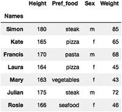

```
# 为了巩固索引，我们使用参数 `inplace = True`
>>> `df1.set_index('Names', inplace = True)`
# 我们可以按如下方式重置索引：
>>> `df1.reset_index()`
```

我们可以继续探索数据。

```
# 我们检查案例数和变量数
>>> `print(df1.shape)`
(7, 4)
# 并确定变量类型
>>> `print(df1.dtypes)`
Height        int64
Pref_food    object
Sex          object
Weight        int64
dtype: object
```

同样，我们可以使用 `head()` 和 `tail()` 函数查看第一个和最后一个元素。我们可能希望指定要显示的案例数量。在这种情况下，我们会使用括号：

```
>>> `df1.head()`
>>> `df1.tail(3)`
```

我们还可以使用 `.info()` 方法获取有关变量的信息：

```
>>> `df1.info()`

RangeIndex: 7 entries, 0 to 6
Data columns (total 5 columns):
Height       7 non-null int64
Names        7 non-null object
Pref_food    7 non-null object
Sex          7 non-null object
Weight       7 non-null int64
dtypes: int64(2), object(3)
memory usage: 360.0+ bytes
```

然后，我们可以根据其中一个变量重新排列数据：

```
>>> `df1.sort_values(by = 'Weight')`
```

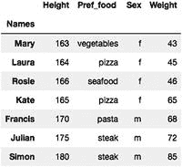

```
# 我们根据体重重新排列了数据，从最低值到最高值。要反转这些值，从最高到最低，我们将 `ascending` 参数指定为 `False`
>>> `df1.sort_values(by = 'Weight', ascending = False)`
```

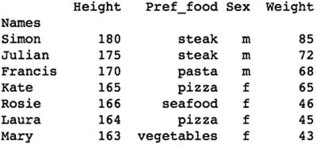

```
# 如果数据集中有任何缺失值（特别是在用作索引的变量中），我们可以通过以下方式将它们全部放在显示的开头或结尾
>>> `df1.sort_values(by = 'Weight', na_position = "last")`
>>> `df1.sort_values(by = 'Weight', na_position = "first")`
# 要按索引重新排列数据集，我们可以使用 `sort_index` 而不是 `sort_values`，以升序或降序方式对数据进行排序
>>> `df1.sort_index()`
>>> `df1.sort_index(ascending= False)`
```

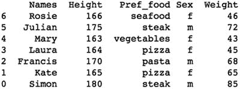

让我们看一些从数据框中切片项目的示例：

```
# 从第一列开始（Python 从 0 开始计数，所以我们使用第 0 列），让我们切片前三个案例：
>>> `df1[:3]`
Names    Height Pref_food Sex  Weight
0     Simon      180      steak   m      85
1      Kate      165      pizza   f      65
2   Francis      170      pasta   m      68
# 或者从第四个案例切片到末尾
>>> `df1[4:]`
Names   Heigth   Pref_food Sex  Weight
4      Mary    163  vegetables   f      43
5      Julian  175       steak   m      72
6      Rosie   166     seafood   f      46
# 或者切片其中一列
>>> `df1['Names']`
0      Simon
1       Kate
2    Francis
3      Laura
4       Mary
5     Julian
6      Rosie
Name: Names, dtype: object
# 通过使用单层方括号，就像我们刚才做的那样，我们可以像提取 `Series` 一样提取一个变量
# 这是另一种方法
>>> `df1.Names`
0      Simon
1       Kate
2    Francis
3      Laura
4       Mary
5     Julian
6      Rosie
Name: Names, dtype: object
# 第三种方法是使用双层方括号来选择数据框
>>> `df1[['Names']]`
```


```
# 我们也可以选择更多列
>>> `df1[['Names', 'Sex']]`
```

我们可以选择特定元素的某个变量的值——例如，第三个值：

```
>>> `df1['Sex'][2]`
'm'
# 或者某些变量的某些值
>>> `df1['Names'][1:4]`
1       Kate
2    Francis
3      Laura
Name: Names, dtype: object
```

要从数据框中选择项目，我们还可以使用 `.loc`、`.iloc` 和 `.ix` 方法：

*   `.loc`： 通过索引工作
*   `.iloc`： 通过位置提取
*   `.ix`： 两者都考虑

```
# .loc
>>> `df1.loc[1]`
Names         Kate
Height         165
Pref_food    pizza
Sex              f
Weight          65
Name: 1, dtype: object
# 我们可以提取从第一个到第四个的元素
>>> `df1.loc[:3]`
# .iloc
# 我们可以提取第一个案例和第三个变量中的元素
>>> `df1.iloc[0,2]`
'steak'
# `.iloc` 的替代方法是 `.iat` 方法
>>> `df1.iat[1,3]`
'f'
# `.at` 和 `.iat` 方法基于索引
>>> `df1.at[2,'Sex']`
'm'
#  逗号左边，我们指示要提取的案例；右边，指示列或变量（表格未显示）。要提取所有元素，我们使用冒号
# 如果我们想每隔一个案例提取一次呢？
>>> `df1[::2]`
```

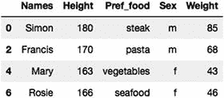

通过布尔运算符，我们可以指定提取条件。例如，我们可以提取数据集中受试者身高（`Height`）大于 170 的案例：

```
>>> `df1[df1.Height > 170]`
Names  Height  Pref_food  Sex  Weight
0    Simon  180         steak    m      85
5   Julian  175         steak    m      72
```

我们也可以指定多个条件，例如提取所有体重超过 163 的女性：

```
>>> `df1[(df1.Height > 163) & (df1.Sex == 'f')]`
```

或者，我们也可以使用 `.query()` 方法：

```
>>> `df1.query("Sex != 'f'")`
Names  Height  Pref_food Sex  Weight
0     Simon     180      steak   m      85
2   Francis     170      pasta   m      68
5    Julian     175      steak   m      72
```

现在，让我们看看如何重命名列：
```

# Pandas 数据操作：列操作、分组与数据管理

## 数据框重命名与复制

首先，我们可以重命名数据框的列名，并查看其前两行数据：

```python
>>> df1 = df1.rename(columns = {'Pref_food': 'Food'})
>>> df1.head(2)
```

我们可以创建数据框的副本：

```python
>>> df2 = df1.copy()
>>> df2
```

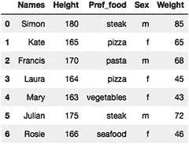

## 添加列

我们还可以添加列。例如，让我们向 `df2` 数据集中添加一个包含以厘米为单位的身高的列：

```python
>>> df2['new_col'] = df2.Height/100
>>> df2
```

我们也可以使用 `.insert()` 方法添加列。第一个元素 `5` 标记了我们想要插入新列的位置（第六个位置），第二个是新列的名称，第三个是新列的值：

```python
>>> df2.insert(5, column = 'new_col2', value = df2.Height/100)
>>> print(df2.head(2))
```

## 分组操作

让我们回到未添加内容的 `df1` 数据集。通过使用 `.groupby()`，我们还可以围绕一个或多个变量对数据集进行聚合。

我们可以创建一个包含按“Sex”变量聚合的分组对象：

```python
>>> grouped1 = df1.groupby('Sex')
>>> grouped1.groups
```

我们可以可视化以某种方式标记的案例数量：

```python
# 要查看案例，请按以下步骤操作
>>> for names, groups in grouped1:
...    print(names)
...    print(groups)
```

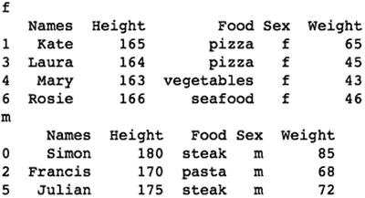

```python
# 注意，我们只获取属于某个分组的数据
>>> grouped1.get_group('f')
# 我们可以根据两个变量聚合案例
>>> grouped2 = df1.groupby(['Sex', 'Pref_food'])
>>> grouped2.groups
# 我们还可以确定每个分组中有多少个案例
>>> grouped2.size()
# 我们可以获取数据的一些描述性统计信息
>>> grouped2.describe()
```

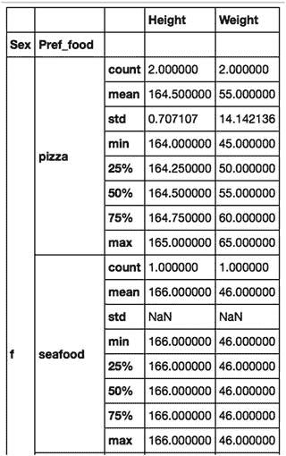

我们还可以使用 `.value_counts()` 方法统计变量的频率。

```python
>>> df1['Sex'].value_counts()
```

## 数据信息与类型转换

回到 `df1` 数据集，我们可以使用 `.info()` 方法获取变量的信息。

```python
>>> print(df1)
>>> df1.info()
```

使用 `.astype()` 方法，我们可以改变变量的类型。例如，我们可以将变量从 `int`（数值型变量）覆盖为对象变量，例如字符串：

```python
>>> df1['Weight'] = df1['Weight'].astype('object')
>>> df1.info()
```

## 数据删除

我们可以使用 `.drop()` 方法删除案例和变量：

```python
>>> df1.drop(0)
```

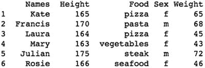

```python
# 另一方面，如果我们设置并巩固索引，则根据索引值删除案例
>>> df1.set_index('Names', inplace = True)
>>> df1.drop("Laura")
# 我们可以一次删除多个元素
>>> print(df1.drop(["Mary", "Francis"]))
# 或者删除整个列
# 为此，我们必须指定轴 1（默认轴 0 表示行）
>>> df1.drop("Height", axis = 1)
```

要删除多个列，请将它们包含在一个列表中：

```python
>>> df.drop(["column1", "column2"], axis = 1)
# 除了将轴指定为 1，我们也可以指定"columns"
>>> df.drop(["column1", "column2"], axis = "columns")
```

## 创建交叉表

`pandas` 包还允许我们使用相同的函数创建交叉表。例如，在 `df1` 数据集中，我们可以创建一个关联性别与最爱食物的交叉表。

# pandas：数据导入与导出

当我们添加 `margins` 参数时，我们还会得到包含总计的行：

```python
>>> pd.crosstab(df1.Sex, df1.Pref_food, margins=True)
```

pandas 库在从你的计算机导入各种格式（包括 .csv）的文件方面也非常重要：

```python
import pandas as pd
>>> df2 = pd.read_csv("file_address.csv")
# 我们可以通过指定第一行不包含变量名来导入文件
>>> df2 = pd.read_csv("file_address.csv", header=None)
# 或者通过指定哪一行包含变量名
>>> df2 = pd.read_csv("file_address.csv", header=0)
>>> df2 = pd.read_csv("file_address.csv", header=1)
# 我们也可以指定列名
>>> df2 = pd.read_csv("file_address.csv", names=['var1', 'var2', 'var3', 'var4'])
# 或者只导入部分列
>>> df2 = pd.read_csv("file_address.csv", usecols=[1,2,3])
# 我们还可以指定分隔数据的元素
>>> df2 = pd.read_csv("file_address.csv", sep=" ")
# 现在我们可以查看数据框的前几条记录
>>> df2.head()
# 或者后几条
>>> df2.tail()
# 我们使用括号来指定要显示的记录数
>>> df2.head(9)
>>> df2.tail(5)
# 并且我们可以查看数据集的摘要信息
>>> df2.describe()
>>> df2.info()
>>> df.dtypes() # 它告诉我们数据类型
```

`pd.read_csv()` 函数也可以用来从网络导入文件。UCI 机器学习仓库（[`archive.ics.uci.edu/ml/index.php`](https://archive.ics.uci.edu/ml/index.php)）提供了许多用于机器学习的数据集。

让我们看一个鸢尾花数据集。图 8-1 到 8-3 以及以下步骤帮助我们导航到其选项卡并复制包含数据集的链接。


图 8-1

*UCI 机器学习网站上的鸢尾花数据集*

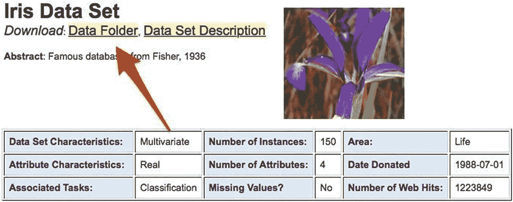

图 8-2

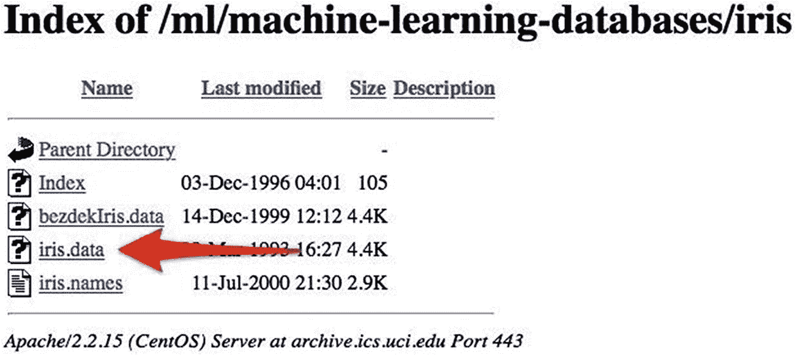

图 8-3

首先，我们复制包含数据集的链接。

```python
# 我们导入 pandas
>>> import pandas as pd
# 我们创建一个包含数据集的对象，并使用 `pd.read_csv()` 导入它
>>> iris = pd.read_csv("https://archive.ics.uci.edu/ml/machine-learning-databases/iris/iris.data")
# 我们通过使用 `.head()` 函数显示一些记录来检查数据准确性
>>> iris.head(3)
```

我们使用的 pandas 函数 `pd.read_csv()` 的结构还包括我们在此次导入中未使用的其他参数：

*   `filepath` 文件的地址（在计算机上或外部）
*   `sep = ','` 分隔数据的分隔符，例如逗号或分号
*   `dtype=` 指定列格式的方法
*   `header=` 第一行中的变量名（如果有）
*   `skiprows=` 仅导入部分记录的方法——例如，`skiprows=50` 从第 51 条记录开始读取数据
*   `index_col=` 将某一列设置为数据索引的方法
*   `skip_blank_lines=` 移除数据集中任何空行的方法
*   `na_filter=` 识别数据集中缺失值的方法，如果设置为 False，则将其移除

```python
pd.read_csv(filepath, sep=',', dtype=None, skiprows=None, index_col=None, skip_blank_lines=True, na_filter=True)
```

此外，`usecols=` 参数可用于仅导入数据集中的少数几列。例如，假设我们有图 8-4 中所示的小型数据集，我们想从中提取以下变量：

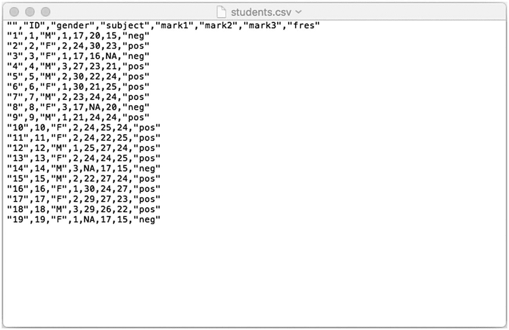

图 8-4

数据集 `students.csv`

```python
>>> df3 = pd.read_csv("~students.csv", usecols=["ID", "mark1"], index_col=["ID"])
# 我们验证数据
df3
```

一个对应的函数是 `df.to_csv("filename")`，它允许我们将一个 .csv 文件写入我们的工作目录。我们可以指定 `index=False` 参数来避免将索引与数据一起下载。

作为此文件导入函数的替代方案，我们可以使用 `pd.read_table(filepath, sep=',')` 函数，该函数同时设置了文件路径（`filepath`）和分隔符。

pandas 的其他功能允许我们读取 Excel 的 .xls 或 .xlsx 文件。为此，我们使用一个通用公式：

```python
df = pd.read_excel(filepath, "sheet_name")
```

在这种情况下，我们不仅必须指定文件的地址，还必须指定 Excel 文件是否包含多个数据表，以及我们要从中读取数据的工作表名称。与 .csv 类似，对于 Excel 格式，我们也有一个公式允许我们在计算机的工作目录中写入一个 Excel 文件：`df.to_excel()`。pandas 包还包含一个用于读取 JSON 文件的函数——`pd.read_json()`——并且还允许我们通过 `pd.read_html(url)` 函数访问网络数据，以及通过 `pd.to_html()` 将数据框转换为 HTML 表格。

让我们看一个创建和导出 JSON 文件的示例：

### pandas：数据操作

```
>>> jf = pd.DataFrame(np.arange(16).reshape(4,4), index = ['A', 'B', 'C', 'D'], columns = ['var1', 'var2', 'var3', 'var4'])
>>> jf
var1  var2  var3  var4
A     0     1     2     3
B     4     5     6     7
C     8     9    10    11
D    12    13    14    15
>>> jf.to_json('jf.json')
# 剩下的就是检查文件是否已正确创建在我们的工作目录中
```

我们已经了解了如何创建分组以及操作数据框。现在，让我们通过 `pandas` 来学习更多的操作元素。首先，导入 `pandas` 并创建一个小的数据集：

```
>>> df2 = pd.DataFrame({'Names': ['Simon', 'Kate', 'Francis', 'Laura', 'Mary', 'Julian', 'Rosie', 'Simon', 'Laura'],
'Height':[180, 165, 170, 164, 163, 175, 166, 180, 164],
'Weight':[85, 65, 68, 45, 43, 72, 46, 85, 45],
'Pref_food': ['steak', 'pizza', 'pasta', 'pizza', 'vegetables', 'steak', 'seafood', 'steak', 'pizza'],
'Sex': ['m','f','m','f','f','m','f', 'm', 'f']})
```

从“`Sex`”变量开始，我们创建两个虚拟变量，然后继续使用 `pandas`：

```
>>> df_dummy = pd.get_dummies(df2['Sex'], prefix = 'Sex')
>>> df_dummy
Sex_f  Sex_m
0    0.0    1.0
1    1.0    0.0
2    0.0    1.0
3    1.0    0.0
4    1.0    0.0
5    0.0    1.0
6    1.0    0.0
7    0.0    1.0
8    1.0    0.0
```

此时，我们可以将这两个虚拟变量连接到原始数据集中：

```
>>> df2.join(df_dummy)
Unnamed: 0  Height    Names        Food Sex  Weight  Sex_f  Sex_m
0           0     180    Simon       steak   m      85    0.0    1.0
1           1     165     Kate       pizza   f      65    1.0    0.0
2           2     170  Francis       pasta   m      68    0.0    1.0
3           3     164    Laura       pizza   f      45    1.0    0.0
4           4     163     Mary  vegetables   f      43    1.0    0.0
5           5     175   Julian       steak   m      72    0.0    1.0
6           6     166    Rosie     seafood   f      46    1.0    0.0
7           0     180    Simon       steak   m      85    0.0    1.0
8           3     164    Laura       pizza   f      45    1.0    0.0
```

我们将包含虚拟变量的连接数据集保存到一个新对象中：

```
>>> df3 = df2.join(df_dummy)
# 让我们检查一下
>>> print(df3.head(2))
Height  Names Pref_food Sex  Weight  Sex_f  Sex_m
0     180  Simon     steak   m      85    0.0    1.0
1     165   Kate     pizza   f      65    1.0    0.0
```

现在让我们删除原始的“`Sex`”变量：

```
>>> del df3['Sex']
# 再次确认
>>> print(df3.head(2))
Height  Names  Pref_food  Weight  Sex_f  Sex_m
0     180  Simon      steak      85    0.0    1.0
1     165   Kate      pizza      65    1.0    0.0
```

如你所见，我们的数据集中存在几个重复案例。首先，我们需要识别它们：

```
>>> df2.duplicated()
0    False
1    False
2    False
3    False
4    False
5    False
6    False
7     True
8     True
dtype: bool
# 我们的数据集有两个重复案例
```

要删除重复案例，我们使用 `.drop_duplicates()`：

```
>>> df2.drop_duplicates()
```

要获得一个没有重复的数据集，我们可以覆盖旧数据集或创建另一个对象：

```
>>> df3 = df2.drop_duplicates()
```

我们也可以删除一个案例，这次使用 `drop`：

```
>>> df2.drop(2)
Height   Names   Pref_food Sex  Weight
0     180   Simon       steak   m      85
1     165    Kate       pizza   f      65
3     164   Laura       pizza   f      45
4     163    Mary  vegetables   f      43
5     175  Julian       steak   m      72
6     166   Rosie     seafood   f      46
7     180   Simon       steak   m      85
8     164   Laura       pizza   f      45
# 在这个例子中，我们删除了第三个案例
```

`stack()` 和 `unstack()` 函数允许我们以不同的方式重新组织数据：

我们还可以通过 `melt()` 函数重新组织数据：

```python
>>> pd.melt(df3)
variable       value
0      Height         180
1      Height         165
2      Height         170
3      Height         164
4      Height         163
5      Height         175
6      Height         166
7       Names       Simon
8       Names        Kate
9       Names     Francis
10      Names       Laura
11      Names        Mary
12      Names      Julian
13      Names       Rosie
[...]
```

## 数据重塑

### Stack 和 Unstack

```python
>>> df3.stack()
0  Height              180
Names             Simon
Pref_food         steak
Sex                   m
Weight               85
1  Height              165
Names              Kate
Pref_food         pizza
Sex                   f
Weight               65
2  Height              170
Names           Francis
Pref_food         pasta
Sex                   m
Weight               68
3  Height              164
Names             Laura
Pref_food         pizza
Sex                   f
Weight               45
4  Height              163
Names              Mary
Pref_food    vegetables
Sex                   f
Weight               43
[...]
# 我们将结果保存到一个对象中
>>> stacked = df3.stack()
# 现在我们可以使用 `unstack()` 将其恢复为原始格式
>>> unstacked = stacked.unstack()
>>> print(unstacked)
Height    Names   Pref_food Sex Weight
0    180    Simon       steak   m     85
1    165     Kate       pizza   f     65
2    170  Francis       pasta   m     68
3    164    Laura       pizza   f     45
4    163     Mary  vegetables   f     43
5    175   Julian       steak   m     72
6    166    Rosie     seafood   f     46
```

### Melt

我们还可以通过 `melt()` 函数重新组织数据：

```python
>>> pd.melt(df3)
variable       value
0      Height         180
1      Height         165
2      Height         170
3      Height         164
4      Height         163
5      Height         175
6      Height         166
7       Names       Simon
8       Names        Kate
9       Names     Francis
10      Names       Laura
11      Names        Mary
12      Names      Julian
13      Names       Rosie
[...]
```

让我们回到初始数据集

```python
>>> df2.head(2)
Height  Names Pref_food Sex  Weight
0     180  Simon     steak   m      85
1     165   Kate     pizza   f      65
```

并使用 `.T()` 函数来转置行和列：

```python
# 我们反转行和列
>>> df2.T
```


## 数据采样

我们还可以使用 `.sample()` 函数提取数据的随机样本：

```python
>>> df2.sample(n=2)
Height  Names   Pref_food Sex  Weight
6     166  Rosie     seafood   f      46
4     163   Mary  vegetables   f      43
```

在括号中（`n=2`），我们指定了要提取的案例数量。如何总是随机提取相同的案例，以便提取结果可以重复？我们使用 `np.random.seed()` 函数。该函数括号中的数字并不重要，但如果两个人使用相同的数据集和相同的数字，他们将提取出相同的案例。

为此，我们需要导入 NumPy 包：

```python
>>> import numpy as np
>>> np.random.seed(1)
>>> df2.sample(n=2)
Height  Names Pref_food Sex  Weight
3     164  Laura     pizza   f      45
7     180  Simon     steak   m      85
>>> np.random.seed(1)
>>> df2.sample(n=2)
Height  Names Pref_food Sex  Weight
3     164  Laura     pizza   f      45
7     180  Simon     steak   m      85
```

除了提取指定数量的案例，我们还可以提取一个百分比，使用参数 `frac=` 代替 `n=`：

```python
>>> df2.sample(frac = .1)
>>> df2.sample(frac = .5)
```

使用参数 `frac=`，我们指定了百分比；0.1 表示 10%，0.5 表示 50%，以此类推。

## 最值查询

```python
# 我们可以通过指定案例数量（此处为 3）和列（此处为 `Weight`）来查看某个变量取值最高的案例
# 让我们考虑没有重复的 `df3` 数据集
>>> df3.nlargest(3, "Weight")
Height    Names Pref_food Sex  Weight
0     180    Simon     steak   m      85
5     175   Julian     steak   m      72
2     170  Francis     pasta   m      68
```

现在，让我们调用某个变量取值最低的案例，并指定案例数量：

```python
>>> df3.nsmallest(4, "Weight")
Height  Names   Pref_food Sex  Weight
4     163   Mary  vegetables   f      43
3     164  Laura       pizza   f      45
6     166  Rosie     seafood   f      46
1     165   Kate       pizza   f      65
```

最后，我们可以创建一个小型数据集，并使用 `pivot_table()` 函数重新组织数据：

# pandas缺失值处理

### pandas：缺失值

现在让我们看看如何处理包含缺失数据的数据集。导入 `pandas` 后，我们加载一个包含缺失值的数据集：

```python
>>> import pandas as pd
>>> df_missing = pd.read_csv('df_missing.csv')
# 如你所见，我创建了这个包含缺失数据的小数据集
>>> df_missing
A     B     C      D   E
0  15  96.0  74.0   31.0  50
1  41  27.0  74.0  279.0  57
2  21  32.0   NaN   99.0  96
3  48  97.0  50.0    NaN  69
4  63  98.0  74.0   44.0  55
5  43  11.0  80.0   74.0  33
6  39  38.0  81.0   20.0  41
7  58  31.0   NaN   76.0  91
8  85  94.0  37.0   65.0  60
9  98   NaN  19.0   43.0  32
```

我们可以验证案例数和变量数：

```python
>>> print(df_missing.shape)
(10, 5)
```

我们可以检查完整案例：

```python
>>> print(df_missing.dropna().shape)
(6, 5)
```

我们还可以使用 `.isnull()`，它回答的问题是：某个值是否缺失？

```python
>>> pd.isnull(df_missing)
A      B      C      D      E
0  False  False  False  False  False
1  False  False  False  False  False
2  False  False   True  False  False
3  False  False  False   True  False
4  False  False  False  False  False
5  False  False  False  False  False
6  False  False  False  False  False
7  False  False   True  False  False
8  False  False  False  False  False
9  False   True  False  False  False
```

相反，`.notnull()` 回答的问题是：某个值是否*不*缺失？

```python
>>> pd.notnull(df_missing)
A      B      C      D     E
0  True   True   True   True  True
1  True   True   True   True  True
2  True   True  False   True  True
3  True   True   True  False  True
4  True   True   True   True  True
5  True   True   True   True  True
6  True   True   True   True  True
7  True   True  False   True  True
8  True   True   True   True  True
9  True  False   True   True  True
```

我们可以按列统计缺失值：

```python
>>> df_missing.isnull().sum()
A    0
B    1
C    2
D    1
E    0
# 或者确定缺失数据的总数
>>> df_missing.isnull().sum().sum()
```

缺失值可以通过删除（即删除包含缺失值的案例）或插补（即用其他值替换缺失值，例如固定值或平均值）来处理。要执行删除操作，请按以下步骤操作：

```python
>>> df_missing.dropna()
A     B     C      D   E
0  15  96.0  74.0   31.0  50
1  41  27.0  74.0  279.0  57
4  63  98.0  74.0   44.0  55
5  43  11.0  80.0   74.0  33
6  39  38.0  81.0   20.0  41
8  85  94.0  37.0   65.0  60
```

我们删除了包含缺失值的行。我们也可以删除包含缺失值的列：

```python
>>> df_missing.dropna(axis = 1, how = 'any')
A   E
0  15  50
1  41  57
2  21  96
3  48  69
4  63  55
5  43  33
6  39  41
7  58  91
8  85  60
9  98  32
```

如前所述，使用插补方法，我们可以用另一个值替换缺失值。让我们将所有缺失值替换为一个固定值——在本例中为零：

```python
>>> df_missing.fillna(0)
A     B     C      D   E
0  15  96.0  74.0   31.0  50
1  41  27.0  74.0  279.0  57
2  21  32.0   0.0   99.0  96
3  48  97.0  50.0    0.0  69
4  63  98.0  74.0   44.0  55
5  43  11.0  80.0   74.0  33
6  39  38.0  81.0   20.0  41
7  58  31.0   0.0   76.0  91
8  85  94.0  37.0   65.0  60
9  98   0.0  19.0   43.0  32
```

我们也可以用单词替换缺失值，例如“missing”：

```python
>>> df_missing.fillna('missing')
A        B        C        D   E
0  15       96       74       31  50
1  41       27       74      279  57
2  21       32  missing       99  96
3  48       97       50  missing  69
4  63       98       74       44  55
5  43       11       80       74  33
6  39       38       81       20  41
7  58       31  missing       76  91
8  85       94       37       65  60
9  98  missing       19       43  32
```

或者将缺失值插补为平均值：

```python
>>> df4 = pd.DataFrame({'Date': ['2017-01-01', '2017-01-01', '2017-01-02', '2017-01-01', '2017-01-02', '2017-01-02', '2017-01-03', '2017-01-02', '2017-01-03', '2017-01-03'],
'Type':['x', 'x', 'y', 'x', 'y', 'x', 'z', 'y', 'z', 'y'],
'Value':[185, 265, 168, 245, 143, 172, 346, 285, 145, 128],
})
>>> print(df4)
Date Type  Value
0  2017-01-01    x    185
1  2017-01-01    x    265
2  2017-01-02    y    168
3  2017-01-01    x    245
4  2017-01-02    y    143
5  2017-01-02    x    172
6  2017-01-03    z    346
7  2017-01-02    y    285
8  2017-01-03    z    145
9  2017-01-03    y    128
>>> print(pd.pivot_table(df4, index = "Date", values = "Value", columns = "Type"))
Type                 x           y      z
Date
2017-01-01  231.666667         NaN    NaN
2017-01-02  172.000000  198.666667    NaN
2017-01-03         NaN  128.000000  245.5
# 我们按日期对数值进行聚合
```

# pandas：处理缺失值与合并数据集

## 填充缺失值

考虑变量 `'C'`。以下代码行将用 `C` 的平均值替换该列中的每个缺失值：

```
>>> df_missing['C'].fillna(df_missing['C'].mean())
0    74.000
1    74.000
2    61.125
3    50.000
4    74.000
5    80.000
6    81.000
7    61.125
8    37.000
9    19.000
Name: C, dtype: float64
```

有两种重要的 `.fillna` 方法可用于插补缺失值：`ffill` 和 `backfill`。

```
>>> df_missing['C'].fillna(method='ffill')
0    74.0
1    74.0
2    74.0
3    50.0
4    74.0
5    80.0
6    81.0
7    81.0
8    37.0
9    19.0
Name: C, dtype: float64

>>> df_missing['C'].fillna(method='backfill')
0    74.0
1    74.0
2    50.0
3    50.0
4    74.0
5    80.0
6    81.0
7    37.0
8    37.0
9    19.0
Name: C, dtype: float64
```

`ffill` 用其前面的默认值替换缺失值，而 `backfill` 则用其后面的非缺失值替换。要保存这些插入或替换操作的结果，我们必须创建一个新的数据框或覆盖初始数据框。

## pandas：合并两个数据集

合并两个数据框的方法有很多。我们可以删除重叠的案例、并列两个文件，以及连接新案例或新变量。让我们看一些 `pandas` 的示例。首先，我们需要创建示例数据框：

```
>>> df1 = pd.DataFrame({'id': ['A', 'B', 'C', 'D'], 'var1' : [37, 36, 43, 23], 'var2': [120, 117, 230, 315]})
>>> df1
  id  var1  var2
0  A    37   120
1  B    36   117
2  C    43   230
3  D    23   315

>>> df2 = pd.DataFrame({'id': ['A', 'B', 'C', 'D'], 'var3' : [12, 16, 13, 18], 'var4': [75, 54, 21, 36]})
>>> df2
  id  var3  var4
0  A    12    75
1  B    16    54
2  C    13    21
3  D    18    36

>>> df3 = pd.DataFrame({'id': ['A', 'A', 'B', 'B'], 'var3' : [2, 6, 3, 8], 'var4': [7, 5, 2, 6]})
>>> df3
  id  var3  var4
0  A     2     7
1  A     6     5
2  B     3     2
3  B     8     6
```

合并两个数据集最简单的方法是使用 `.append()` 方法：

```
>>> df1.append(df2)
  id  var1   var2  var3  var4
0  A  37.0  120.0   NaN   NaN
1  B  36.0  117.0   NaN   NaN
2  C  43.0  230.0   NaN   NaN
3  D  23.0  315.0   NaN   NaN
0  A   NaN    NaN  12.0  75.0
1  B   NaN    NaN  16.0  54.0
2  C   NaN    NaN  13.0  21.0
3  D   NaN    NaN  18.0  36.0

>>> df3.append(df1)
  id  var1   var2  var3  var4
0  A   NaN    NaN   2.0   7.0
1  A   NaN    NaN   6.0   5.0
2  B   NaN    NaN   3.0   2.0
3  B   NaN    NaN   8.0   6.0
0  A  37.0  120.0   NaN   NaN
1  B  36.0  117.0   NaN   NaN
2  C  43.0  230.0   NaN   NaN
3  D  23.0  315.0   NaN   NaN
```

如你所见，两个数据集每次都是简单并列，系统不会考虑和调整索引。要合并两个以上的数据集，我们可以使用 `.concat()`：

```
>>> pd.concat([df1, df2, df3])
  id  var1   var2  var3  var4
0  A  37.0  120.0   NaN   NaN
1  B  36.0  117.0   NaN   NaN
2  C  43.0  230.0   NaN   NaN
3  D  23.0  315.0   NaN   NaN
0  A   NaN    NaN  12.0  75.0
1  B   NaN    NaN  16.0  54.0
2  C   NaN    NaN  13.0  21.0
3  D   NaN    NaN  18.0  36.0
0  A   NaN    NaN   2.0   7.0
1  A   NaN    NaN   6.0   5.0
2  B   NaN    NaN   3.0   2.0
3  B   NaN    NaN   8.0   6.0
```

这样，我们垂直连接了数据集。我们也可以通过指定轴为 `1` 来水平连接它们（在前面的示例中，未指定轴，因此默认为 `0`）：

```
>>> pd.concat([df1, df2, df3], axis=1)
# 上面的代码和下面这行代码会得到相同的结果
>>> pd.concat([df1, df2, df3], axis='columns')
  id  var1  var2 id  var3  var4 id  var3  var4
0  A    37   120  A    12    75  A     2     7
1  B    36   117  B    16    54  A     6     5
2  C    43   230  C    13    21  B     3     2
3  D    23   315  D    18    36  B     8     6
```

我们可以用更高级的方式合并两个数据集，从两个拥有一些共同行和列的表开始，通过共享数据进行合并。允许我们进行这种类型连接的 `pandas` 函数是 `merge()`。首先，我们需要创建两个数据集：

```
>>> df_missing = pd.DataFrame(...)
```

# pandas：基础统计

```python
>>> stud1 = pd.DataFrame({'ID': [1,2,3,4,5], 'names' : ['John', 'Greta', 'Francis', 'Laura', 'Charles'], 'Logic': [28, 27, 23, 25, 30]})
>>> stud2 = pd.DataFrame({'ID': [1,6,3,4,7], 'names' : ['John', 'Kate', 'Francis', 'Laura', 'Simon'], 'Analysis': [23, 24, 28, 29, 22]})
# 默认情况下，`merge()` 函数提取两个数据集的共同案例，因此默认是 `'inner'`。内连接选择在两个数据集中具有匹配值的记录
>>> pd.merge(stud1, stud2, on = 'ID')
ID  Logic  names_x  Analysis  names_y
0   1     28     John        23     John
1   3     23  Francis        28  Francis
2   4     25    Laura        29    Laura
```

还有其他合并两个数据集的方式：`'left'`、`'right'` 和 `'outer'`。我们使用数据集索引——在本例中是 `ID` 列——作为键（索引）来合并数据集。

```python
>>> print(pd.merge(stud1, stud2, on = 'ID', how = 'left'))
ID  Logic  names_x  Analysis  names_y
0   1     28     John      23.0     John
1   2     27    Greta       NaN      NaN
2   3     23  Francis      28.0  Francis
3   4     25    Laura      29.0    Laura
4   5     30  Charles       NaN      NaN
```

`'left'` 参数允许我们将第二个数据集合并到第一个数据集中，只取第一个数据集的案例以及第二个和第一个数据集共有的案例。

```python
>>> print(pd.merge(stud1, stud2, on = 'ID', how = 'right'))
ID  Logic  names_x  Analysis  names_y
0   1   28.0     John        23     John
1   3   23.0  Francis        28  Francis
2   4   25.0    Laura        29    Laura
3   6    NaN      NaN        24     Kate
4   7    NaN      NaN        22    Simon
```

`'right'` 参数允许将第一个数据集合并到第二个数据集中，只取第二个数据集的案例以及同时与第二个和第一个数据集共有的案例。

```python
>>> print(pd.merge(stud1, stud2, on = 'ID', how = 'outer'))
ID  Logic  names_x  Analysis  names_y
0   1   28.0     John      23.0     John
1   2   27.0    Greta       NaN      NaN
2   3   23.0  Francis      28.0  Francis
3   4   25.0    Laura      29.0    Laura
4   5   30.0  Charles       NaN      NaN
5   6    NaN      NaN      24.0     Kate
6   7    NaN      NaN      22.0    Simon
```

当我们使用 `'outer'` 时，我们合并两个数据框的案例，只保留重复案例的一个副本，但不会丢失两个初始数据集中的任何一个数据。

`pandas` 库有很多用于统计的方法，我们可以用它们来获取描述性统计信息。和往常一样，我们使用我们的数据框：

```python
>>> df = pd.DataFrame({'Names': ['Simon', 'Kate', 'Francis', 'Laura', 'Mary', 'Julian', 'Rosie'],
'Height':[180, 165, 170, 164, 163, 175, 166],
'Weight':[85, 65, 68, 45, 43, 72, 46],
'Pref_food':['steak', 'pizza', 'pasta', 'pizza', 'vegetables','steak','seafood'],
'Sex':['m', 'f','m','f', 'f', 'm', 'f']})
# 关于数值数据的一些信息
>>> df.describe()
Height     Weight
count    7.000000   7.000000
mean   169.000000  60.571429
std      6.377042  16.154021
min    163.000000  43.000000
25%    164.500000  45.500000
50%    166.000000  65.000000
75%    172.500000  70.000000
max    180.000000  85.000000
# 我们也可以使用 `.transpose` 方法重新排列统计信息，使其更易读
>>> df.describe().transpose()
count        mean        std    min    25%    50%    75%    max
Height    7.0  169.000000   6.377042  163.0  164.5  166.0  172.5  180.0
Weight    7.0   60.571429  16.154021   43.0   45.5   65.0   70.0   85.0
# 值计数
>>> df.count()
Height    7
Names     7
Food      7
Sex       7
Weight    7
dtype: int64
# 中位数计算
>>> df['Height'].median()
166.0
# 平均值计算
>>> df['Height'].mean()
169.0
# 最小值
>>> df['Height'].min()

# 最大值
>>> df['Height'].max()

```

表 8-1 提供了统计方法的总结。

**表 8-1**

**统计方法**

| 方法 | 描述 |
| --- | --- |
| `.describe` | 提供一些描述性统计信息 |
| `.count` | 返回每个变量的值的数量 |
| `.mean` | 返回平均值 |
| `.median` | 返回中位数 |
| `.mode` | 返回众数 |
| `.min` | 返回最小值 |
| `.max` | 返回最大值 |
| `.std` | 返回标准差 |
| `.var` | 返回方差 |
| `.skew` | 返回偏度 |
| `.kurt` | 返回峰度 |

## 总结

在本章中，我们学习了一些使用 `pandas` 导入和管理数据的更简单方法——`pandas` 是数据处理和数据科学中最重要的库之一。在第 9 章中，我们将研究另一个对数据处理很重要的包：`NumPy`。