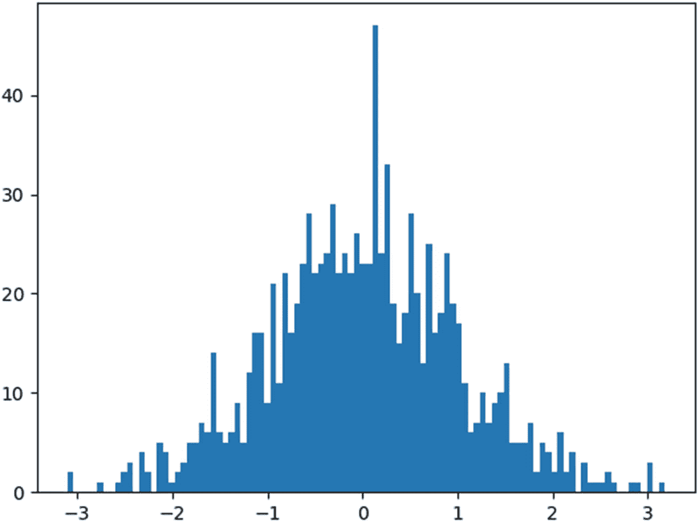

# 9. SciPy 和 NumPy

尽管 `pandas` 是一个非常重要的数据分析包，但它可以与另外两个包协同工作：`SciPy` 和 `NumPy`。

## SciPy

`SciPy` 是 Python 中用于数学和统计分析的最重要的包之一，它与 `NumPy` 紧密相连。`SciPy` 包含超过 60 个统计函数，这些函数按模块族组织：

*   `scipy.cluster`

*   `scipy.constants`

*   `scipy.fftpack`

*   `scipy.integrate`

*   `scipy.interpolate`

*   `scipy.io`

*   `scipy.lib`

*   `scipy.linalg`

*   `scipy.misc`

*   `scipy.optimize`

*   `scipy.signal`

*   `scipy.sparse`

*   `scipy.spatial`

*   `scipy.special`

*   `scipy.stats`

*   `scipy.weave`

```python
>>> import scipy as sp
>>> from scipy import stats
>>> from scipy import cluster
```

我们可以通过输入以下内容来获取这些模块的帮助，例如：

```python
>>> help(sp.cluster)
# 或
>>> help(scipy.cluster)
```

文档会直接在窗口中打开，我们可以按 `q` 键退出。

例如，`SciPy` 可用于测量某个数值或分布的概率密度：

```python
>>> from scipy.stats import norm
>>> norm.pdf(5)
1.4867195147342979e-06
```

或分配函数：

```python
>>> norm.cdf(x)
```

`SciPy` 包含非常专业的模块。就本书而言，我们特别关注它与 `NumPy` 的结合使用，因此本章的重点主要放在第二个包上。

## NumPy

在 Python 开发的早期，程序员很快就发现自己需要整合用于科学计算的工具。他们的首次尝试产生了 `Numeric` 包，该包开发于 1995 年，随后又出现了一个名为 `Numarray` 的替代包。这两个包的功能在 2006 年合并，诞生了 `NumPy`。

`NumPy` 代表“numeric Python”（数值 Python），是一个专用于科学计算的开源库，尤其是在数组管理方面。它有时被认为是 Python 版的 `MATLAB`，并提供了许多用于代数和随机数生成的高级数学函数。

```python
>>> import numpy as np
>>> from numpy import *
```

`NumPy` 最重要的结构是一种特殊类型的多维数组，称为 `ndarray`。`ndarray` 由两个元素组成：数据（真正的 `ndarray`）和描述数据的元数据（`dtype` 或数据类型）。每个 `ndarray` 关联且仅关联一个 `dtype`。我们可以有一维数组：

```python
>>> arr1 = np.array([0,1,2,3,4])
>>> arr1
array([0, 1, 2, 3, 4])
```

或者多维数组：

```python
>>> arr2 = np.array([[5,6,7,8,9], [10,11,12,13,14]])
>>> arr2
array([[ 5,  6,  7,  8,  9],
       [10, 11, 12, 13, 14]])
>>> arr2_1 = np.array([[5,6,7,8,9], [10,11,12,13,14], [2,5,7]])
# 重要的是数据具有相同的类型
```

我们可以使用 `.dtype` 属性显示数据类型。

```python
>>> arr1.dtype
dtype('int64')
# 数组中元素的数量
>>> arr1.size

# 位数
>>> arr1.itemsize
```

例如，通过使用 `NumPy` 的 `arange()` 函数，我们可以创建一个数字列表——在下面的例子中，是从 0 到 100：

```python
>>> arr3 = np.arange(100)
>>> arr3
array([ 0,  1,  2,  3,  4,  5,  6,  7,  8,  9, 10, 11, 12, 13, 14, 15, 16,
       17, 18, 19, 20, 21, 22, 23, 24, 25, 26, 27, 28, 29, 30, 31, 32, 33,
       34, 35, 36, 37, 38, 39, 40, 41, 42, 43, 44, 45, 46, 47, 48, 49, 50,
       51, 52, 53, 54, 55, 56, 57, 58, 59, 60, 61, 62, 63, 64, 65, 66, 67,
       68, 69, 70, 71, 72, 73, 74, 75, 76, 77, 78, 79, 80, 81, 82, 83, 84,
       85, 86, 87, 88, 89, 90, 91, 92, 93, 94, 95, 96, 97, 98, 99])
# arange 也允许我们设置一个数字范围
>>> np.arange(1,10)
array([1, 2, 3, 4, 5, 6, 7, 8, 9])
```

让我们创建第四个数组：

```python
>>> arr4 = np.array([['a','b','c','d','e'], ['f', 'g', 'h', 'i','l'], ['m', 'n', 'o', 'p','q']])
>>> arr4
array([['a', 'b', 'c', 'd', 'e'],
       ['f', 'g', 'h', 'i', 'l'],
       ['m', 'n', 'o', 'p', 'q']],
      dtype='<U1')
```

例如，我们可以选择第一个元素（0）：

```python
>>> arr4[0]
array(['a', 'b', 'c', 'd', 'e'],
      dtype='<U1')
```

如果我们想选择第一个元素中的第三个元素，可以按如下方式操作：

```python
>>> arr4[0][3]
'd'
```

请记住，在 Python 中，我们从零开始计数，而不是从一开始。所以，如果我们选择第一个元素，实际上得到的是第二个：

```python
>>> arr4[1]
array(['f', 'g', 'h', 'i', 'l'],
      dtype='<U1')
>>> arr4[1][1]
'g'
```

我们还可以使用负索引并按如下方式反转数组：

```python
>>> arr4[::-1]
array([['m', 'n', 'o', 'p', 'q'],
       ['f', 'g', 'h', 'i', 'l'],
       ['a', 'b', 'c', 'd', 'e']],
      dtype='|S1')
```

`arr4` 数组由三个不同的元素组成。要合并它们，我们可以使用 `.ravel()` 方法：

```python
>>> arr4.ravel()
array(['a', 'b', 'c', 'd', 'e', 'f', 'g', 'h', 'i', 'l', 'm', 'n', 'o', 'p', 'q'],
      dtype='|S1')
```

让我们创建另一个数组 `arr5`：

```python
>>> arr5 = np.array([19, 76, 2, 13, 48, 986, 1, 18])
>>> arr5
array([19, 76,  2, 13, 48, 986,  1, 18])
# 我们可以将其从最小值到最大值重新排序
>>> np.msort(arr5)
array([  1,   2,  13,  18,  19,  48,  76, 986])
```

我们可以使用各种函数重新组织数组的数据。让我们使用刚刚创建的数组 `arr5`：

`reshape()` 允许我们重新组织数组的数据——在下面的例子中，组织成四行两列。

```
>>> arr5.reshape(4,2)
>>> array([[ 19,  76],
[  2,  13],
[ 48, 986],
[  1,  18]])
>>> arr5.reshape(8,1)
array([[ 19],
[ 76],
[  2],
[ 13],
[ 48],
[986],
[  1],
[ 18]])
```

我们再创建两个数组，将它们组织成三行三列：

```
>>> x = np.array([20, 42, 17, 3, 7, 12, 14, 70, 9])
>>> x = x.reshape(3,3)
>>> x
array([[20, 42, 17],
[ 3,  7, 12],
[14, 70,  9]])
>>> y = x * 3
>>> y
array([[ 60, 126,  51],
[  9,  21,  36],
[ 42, 210,  27]])
```

与 `reshape()` 类似的是 `resize()` 函数。

```
>>> z = np.array([120, 72, 37, 43, 57, 12, 54, 20, 9])
z
array([120,  72,  37,  43,  57,  12,  54,  20,   9])
>>> z.resize(3,3)
>>> z
array([[120,  72,  37],
[ 43,  57,  12],
[ 54,  20,   9]])
```

我们可以水平连接两个数组。

```
>>> np.hstack((x, y))
array([[ 20,  42,  17,  60, 126,  51],
[  3,   7,  12,   9,  21,  36],
[ 14,  70,   9,  42, 210,  27]])
```

使用 `np.concatenate()` 函数并指定轴，可以得到相同的结果。

```
>>> np.concatenate((x,y), axis = 1)
array([[ 20,  42,  17,  60, 126,  51],
[  3,   7,  12,   9,  21,  36],
[ 14,  70,   9,  42, 210,  27]])
```

或者我们垂直排列数据。

```
>>> np.vstack((x,y))
array([[ 20,  42,  17],
[  3,   7,  12],
[ 14,  70,   9],
[ 60, 126,  51],
[  9,  21,  36],
[ 42, 210,  27]])
```

使用 `np.concatenate()` 函数，不指定轴或将其指定为零，可以得到相同的结果。

```
>>> np.concatenate((x,y))
array([[ 20,  42,  17],
[  3,   7,  12],
[ 14,  70,   9],
[ 60, 126,  51],
[  9,  21,  36],
[ 42, 210,  27]])
```

`np.dstack()` 函数沿第三轴将数组分割成元组。

```
>>> np.dstack((x,y))
array([[[ 20,  60],
[ 42, 126],
[ 17,  51]],
[[  3,   9],
[  7,  21],
[ 12,  36]],
[[ 14,  42],
[ 70, 210],
[  9,  27]]])
```

`np.hsplit()` 函数将数组按大小和形状分成相等的部分（在本例中，分成三部分）。

```
>>> np.hsplit(x, 3)
[array([[20],
[ 3],
[14]]), array([[42],
[ 7],
[70]]), array([[17],
[12],
[ 9]])]
```

我们也可以使用 `np.split()` 函数。

```
>>> np.split(x, 3)
[array([[20, 42, 17]]), array([[ 3,  7, 12]]), array([[14, 70,  9]])]
```

或者 `np.vsplit()` 函数，意思是垂直分割。我们也可以将数组转换为列表。

```
>>> z.tolist()
[[120, 72, 37], [43, 57, 12], [54, 20, 9]]
```

正如我们所见，NumPy 处理各种格式的数值数据和字符串，但我们也可以生成随机数据。`zeros()` 和 `ones()` 函数创建仅包含零或一的数组。

```
# 第一个元素表示行数；第二个元素表示列数
>>> np.zeros((4,3))
array([[ 0.,  0.,  0.],
[ 0.,  0.,  0.],
[ 0.,  0.,  0.],
[ 0.,  0.,  0.]])
>>> np.ones((5,2))
array([[ 1.,  1.],
[ 1.,  1.],
[ 1.,  1.],
[ 1.,  1.],
[ 1.,  1.]])
```

NumPy 有多种存储数据的方式。表 9-1 包含了其中一些方式，这些信息来自 `https://docs.scipy.org/doc/` 上的文档。

**表 9-1 数据存储选项**

| 数据类型 | 描述 |
| --- | --- |
| `bool_` | 布尔型（`True` 或 `False`），以字节形式存储 |
| `int_` | 默认整数类型（与 C 语言的 `long` 相同；通常为 `int64` 或 `int32`） |
| `intc` | 与 C 语言的 `int` 相同（通常为 `int32` 或 `int64`） |
| `intp` | 用于索引的整数（与 C 语言的 `ssize_t` 相同；通常为 `int32` 或 `int64`） |
| `int8` | 字节型（-128 到 127） |
| `int16` | 整型（-32768 到 32767） |
| `int32` | 整型（-2147483648 到 2147483647） |
| `int64` | 整型（-9223372036854775808 到 9223372036854775807） |
| `uint8` | 无符号整型（0 到 255） |
| `uint16` | 无符号整型（0 到 65535） |
| `uint32` | 无符号整型（0 到 4294967295） |
| `uint64` | 无符号整型（0 到 18446744073709551615） |
| `float_` | `float64` 的简写 |
| `float16` | 半精度浮点数：1 位符号位，5 位指数，10 位尾数 |
| `float32` | 单精度浮点数：1 位符号位，8 位指数，23 位尾数 |
| `float64` | 双精度浮点数：1 位符号位，11 位指数，52 位尾数 |
| `complex_` | `complex128` 的简写 |
| `complex64` | 复数，由两个 32 位浮点数表示（实部和虚部） |
| `complex128` | 复数，由两个 64 位浮点数表示（实部和虚部） |

当我们创建一个对象时，可以指定要创建的对象类型：

```
>>> o1 = np.arange(10, dtype = 'int16')
>>> o1
array([0, 1, 2, 3, 4, 5, 6, 7, 8, 9], dtype=int16)
```

NumPy 也可用于创建矩阵和进行矩阵计算。

### 我们创建两个矩阵 mat1 和 mat2

```python
>>> mat1 = np.matrix([[10, 11, 12, 13, 14], [15, 16, 17, 18, 19], [20, 21, 22, 23, 24]])
>>> mat1
matrix([[10, 11, 12, 13, 14],
[15, 16, 17, 18, 19],
[20, 21, 22, 23, 24]])
>>> mat2 = np.matrix([[25, 26, 27, 28, 29], [30, 31, 32, 33, 34], [35, 36, 37, 38, 39]])
>>> mat2
matrix([[25, 26, 27, 28, 29],
[30, 31, 32, 33, 34],
[35, 36, 37, 38, 39]])
# 我们可以进行一些数学运算
>>> mat1 + mat2
matrix([[35, 37, 39, 41, 43],
[45, 47, 49, 51, 53],
[55, 57, 59, 61, 63]])
>>> mat2 - mat1
matrix([[15, 15, 15, 15, 15],
[15, 15, 15, 15, 15],
[15, 15, 15, 15, 15]])
>>> mat2 / mat1
matrix([[ 2.5      ,  2.36363636,  2.25      ,  2.15384615,  2.07142857],
[ 2\.       ,  1.9375    ,  1.88235294,  1.83333333,  1.78947368],
[ 1.75     ,  1.71428571,  1.68181818,  1.65217391,  1.625     ]])
>>> mat1 * 3
matrix([[30, 33, 36, 39, 42],
[45, 48, 51, 54, 57],
[60, 63, 66, 69, 72]])
# Numpy 可以计算平均值
>>> np.mean(mat1)
17.0
# 最大值
>>> np.max(mat1)

# 最小值
>>> np.min(mat1)

# 中位数
>>> np.median(mat1)
17.0
# 方差
>>> np.var(mat1)
18.666666666666668
# 标准差
>>> np.std(mat1)
4.3204937989385739
# 协方差可以通过 np.cov() 计算
```

NumPy 还允许你使用 `loadtxt()` 函数导入数值数据：

```python
>>> up1 = np.loadtxt('~/Python_test/df2', delimiter = ',', usecols = (1,), unpack = True)
up1
array([  0\.        ,  15.98293881,  41.7360094 ,  21.02081375,
54.06254967,   6.68691812,  43.83810058,  39.55058136,
58.04370289,  85.02891662,  98.25872709])
# 要导入更多列，我们修改 usecols 参数：
>>> up1 = np.loadtxt('~/Python_test/df2', delimiter = ',', usecols = (1,2,3,4,5), unpack = True)
```

### NumPy：生成随机数与设置种子

要生成随机数，我们需要导入 NumPy 包。

```python
>>> import numpy as np
```

我们可以按如下方式生成一个随机数：

```python
>>> np.random.rand()
0.992777076172216
# 或者在括号内指定要自动生成的行数和列数
>>> np.random.rand(2,3)
array([[ 0.39352349,  0.57116926,  0.88967038],
[ 0.76375617,  0.24620255,  0.17408501]])
```

我们可以创建多维随机数数组：

```python
# 指定大小（10 是抽取分布的上限）
>>> np.random.randint(10, size= 8)
array([5, 8, 3, 7, 6, 8, 5, 3])
# 接下来，我们创建一个包含四个案例和五个变量的数组
>>> np.random.randint(10, size=(4, 5))
array([[4, 7, 1, 9, 8],
[7, 4, 0, 3, 7],
[3, 6, 9, 3, 4],
[4, 7, 3, 3, 9]])
# 然后我们创建一个三维数组
>>> np.random.randint(10, size=(4, 5, 6))
array([[[7, 6, 1, 0, 1, 2],
[3, 2, 3, 2, 9, 2],
[5, 5, 6, 5, 0, 2],
[1, 6, 2, 1, 9, 0],
[1, 5, 3, 1, 3, 6]],
[[0, 1, 9, 3, 4, 3],
[2, 6, 6, 6, 6, 2],
[2, 3, 7, 6, 2, 5],
[1, 7, 7, 7, 0, 3],
[3, 8, 6, 4, 1, 6]],
[[1, 1, 2, 3, 2, 6],
[0, 8, 1, 8, 1, 7],
[7, 4, 3, 1, 6, 7],
[7, 3, 1, 9, 8, 8],
[9, 0, 1, 7, 2, 7]],
[[3, 3, 2, 2, 5, 6],
[4, 9, 3, 7, 4, 4],
[8, 6, 3, 3, 7, 0],
[9, 7, 0, 5, 2, 0],
[3, 3, 9, 5, 2, 9]]])
# 使用 random.rand() 生成实数；使用 random.randint() 生成整数
```

我们可以设置一个种子，以确保生成相同的随机数，然后重复示例：

```python
>>> np.random.seed(12345)
>>> np.random.rand()
0.9296160928171479
>>> np.random.rand()
0.3163755545817859
>>> np.random.seed(12345)
>>> np.random.rand()
0.9296160928171479
>>> np.random.rand()
0.3163755545817859
```

我们可以使用 `random.randint()` 生成整数随机数：

```python
>>> print(random.randint(0, 100))

>>> print(random.randint(0, 100))

# 0 和 100 是我们可以抽取元素的界限。在这种情况下，数字 100 不能被抽取。这意味着，如果我们想模拟例如射击游戏，我们可以将界限设置在 1 和 7 之间。
```

我们也可以创建一个对象并随机抽取元素：

```python
>>> test1 = ["object1", "object2", "object3", "object4", "object5"]
>>> print(random.choice(test1))
object2
>>> print(random.choice(test1))
object4
```

我们可以使用 `np.random.randn()` 创建另一个随机对象，它会生成一个正态分布。

```python
>>> x = np.random.randn(1000)
# 我们导入 matplotlib（在第 10 章中描述）
>>> import matplotlib.pyplot as plt
# 并创建 x 对象的直方图
>>> plt.hist(x, bins = 100)
# 我们显示直方图
>>> plt.show()
```

NumPy 也可以用来生成随机数据集，例如图 9-1 中绘制的那个。但是，我们还需要加载 pandas 包。我们已经加载了 NumPy 包，所以让我们按如下步骤进行：



图 9-1

使用 NumPy 和 pandas 创建的随机数据集图

```python
# 我们导入 pandas
>>> import pandas as pd
```

我们使用 pandas 的 `DataFrame()` 函数创建一个数据框。我们可以立即识别出一个函数属于哪个包，因为该函数是该包的一个方法。

`package_name.function_name()`

我们使用pandas (`pd`)包的`DataFrame()`函数来创建数据框，并使用Numpy包 (`np`)的`random.randn()`函数来生成随机数据。在括号中，我们首先放入要生成的案例数（本例中为10），然后是变量数（本例中为5）。

```
>>> rdf = pd.DataFrame(np.random.randn(10,5))
>>> rdf
0         1         2         3         4
0  0.669980  0.626433 -0.693932 -0.841258 -0.165200
1  0.108567 -0.743791  0.367369  0.645242 -0.297283
2  1.674781  0.241534 -0.403371  0.175751  0.274626
3 -2.339962 -0.083003 -1.387095  1.559257 -1.025012
4  0.383104  0.968755  0.236508  0.186294  0.094319
5  0.956150 -1.366423  0.694575 -0.107877  1.727657
6 -0.699931 -1.184346  0.581632  0.333015 -1.137382
7  0.867757 -0.872935  0.417772 -0.045722  0.432780
8 -0.685488  1.046816  0.465459 -0.446164  0.227635
9 -0.019854  0.643384  1.459784  0.559970 -0.358676
```

如果我们使用相同的指令重新创建一个数据框，几乎肯定会得到不同的数据。为了获得相同的数据，我们需要使用一个允许我们设置种子的函数。这样，我们就可以复制数据。

```
>>> np.random.seed(12345)
>>> rdf = pd.DataFrame(np.random.randn(10,5))
>>> rdf
0         1         2         3         4
0 -0.204708  0.478943 -0.519439 -0.555730  1.965781
1  1.393406  0.092908  0.281746  0.769023  1.246435
2  1.007189 -1.296221  0.274992  0.228913  1.352917
3  0.886429 -2.001637 -0.371843  1.669025 -0.438570
4 -0.539741  0.476985  3.248944 -1.021228 -0.577087
5  0.124121  0.302614  0.523772  0.000940  1.343810
6 -0.713544 -0.831154 -2.370232 -1.860761 -0.860757
7  0.560145 -1.265934  0.119827 -1.063512  0.332883
8 -2.359419 -0.199543 -1.541996 -0.970736 -1.307030
9  0.286350  0.377984 -0.753887  0.331286  1.349742
>>> np.random.seed(12345)
>>> rdf2 = pd.DataFrame(np.random.randn(10,5))
>>> rdf2
0         1         2         3         4
0 -0.204708  0.478943 -0.519439 -0.555730  1.965781
1  1.393406  0.092908  0.281746  0.769023  1.246435
2  1.007189 -1.296221  0.274992  0.228913  1.352917
3  0.886429 -2.001637 -0.371843  1.669025 -0.438570
4 -0.539741  0.476985  3.248944 -1.021228 -0.577087
5  0.124121  0.302614  0.523772  0.000940  1.343810
6 -0.713544 -0.831154 -2.370232 -1.860761 -0.860757
7  0.560145 -1.265934  0.119827 -1.063512  0.332883
8 -2.359419 -0.199543 -1.541996 -0.970736 -1.307030
9  0.286350  0.377984 -0.753887  0.331286  1.349742
>>> np.random.seed(12345)
>>> rdf = pd.DataFrame(np.random.rand(10,5))
>>> rdf
0         1         2         3         4
0 -0.204708  0.478943 -0.519439 -0.555730  1.965781
1  1.393406  0.092908  0.281746  0.769023  1.246435
2  1.007189 -1.296221  0.274992  0.228913  1.352917
3  0.886429 -2.001637 -0.371843  1.669025 -0.438570
4 -0.539741  0.476985  3.248944 -1.021228 -0.577087
5  0.124121  0.302614  0.523772  0.000940  1.343810
6 -0.713544 -0.831154 -2.370232 -1.860761 -0.860757
7  0.560145 -1.265934  0.119827 -1.063512  0.332883
8 -2.359419 -0.199543 -1.541996 -0.970736 -1.307030
9  0.286350  0.377984 -0.753887  0.331286  1.349742
```

请注意，我们完全随机的变量没有名称；它们仅由数字标识。让我们更改列名：

```
>>> var_names = ['var1', 'var2', 'var3', 'var4', 'var5']
>>> rdf2.columns = var_names
>>> rdf2.head(2)
var1      var2      var3      var4      var5
0 -0.204708  0.478943 -0.519439 -0.555730  1.965781
1  1.393406  0.092908  0.281746  0.769023  1.246435
```

我们可以使用其他NumPy函数获取其他类型的分布。

# NumPy 数据生成与保存示例

## 二项分布
```python
>>> rdf_bin = pd.DataFrame(np.random.binomial(100, 0.5, (10,5)))
>>> rdf_bin
```
```
   0   1   2   3   4
0  47  56  48  42  53
1  43  56  51  56  46
2  50  42  40  55  46
3  46  43  54  51  53
4  41  48  47  45  42
5  53  55  51  50  58
6  51  57  46  53  48
7  56  53  46  54  54
8  53  50  52  53  46
9  50  46  54  57  56
```

## 泊松分布
```python
>>> rdf_poi = pd.DataFrame(np.random.poisson(100, (10,5)))
>>> rdf_poi
```
```
    0    1    2    3    4
0  109  107   98  111   95
1  115  109  101  108   95
2  105   97  102  100   94
3   94   93   94  122   96
4  117   85  135   90   83
5  103  106  105   93  116
6  111   95  100   95   80
7   81   75   84   93  101
8  105  109  104  104  113
9   97  120   90   98   95
```

## 均匀分布
```python
>>> rdf_un = pd.DataFrame(np.random.uniform(1, 100,(10,5)))
>>> rdf_un
```
```
          0          1          2          3          4
0  49.139046  98.433411  60.777590  76.202858  68.767153
1  93.309206  95.028762  99.021002  13.489383  97.683461
2  23.681460  19.419586  51.411931  53.519271  28.981285
3  31.705992  31.678553  27.372500  59.749684  22.496303
4  40.835909  29.567563  18.210241  23.345639  98.875500
5  43.971084  82.990738  57.678770  65.538128  73.244077
6  39.737081  39.893383  86.095572  81.191942  83.817845
7  19.610805  36.600078  48.716414  96.641192  56.768005
8  82.922981   8.534653  55.760657  55.246106  90.638916
9  37.579379  90.215102  14.922471  10.818199  97.345143
```

我们如何保存在 `NumPy` 中创建的数据框或数组？首先，我们创建一个数据框。

```python
>>> tos = pd.DataFrame(np.random.randn(10,5))
```

然后使用 `NumPy` 的 `save()` 函数保存它。

```python
>>> np.save('tos_saved', tos)
# 我们可以在工作目录中检查它
```

要加载我们保存的文件，我们使用 `NumPy` 中的 `load()` 函数。

```python
>>> load1 = np.load('tos_saved.npy')
```

`NumPy` 包含其他高级数学模块，例如用于线性代数的 `numPy.linalg`，用于傅里叶变换的 `fft`，以及许多用于财务分析的函数，例如利息和期货计算。你可以在 [https://docs.scipy.org/doc/](https://docs.scipy.org/doc/) 找到关于 `NumPy` 功能的所有必要文档。

## 摘要

`NumPy` 和 `SciPy` 是数据分析人员使用的两个非常重要的软件包。它们各自拥有多种功能，但可以组合使用，例如用于创建随机数据集。