# 10. Matplotlib

创建图表是探索性分析中的重要步骤，也是数据分析的初始阶段之一。我们可以使用 Matplotlib 构建各种分析图表，以不同方式展示数据。

## 基本绘图

为了以图形方式表示数据，我们可以使用 Matplotlib 库，它是最常用的图形表示软件包之一。其文档可在 [`https://matplotlib.org`](https://matplotlib.org) 找到。Matplotlib 网站的图库部分（位于 [`https://matplotlib.org/gallery.html`](https://matplotlib.org/gallery.html) ）提供了一系列带有代码的图表示例。

Matplotlib 随 Anaconda 一起安装，因此我们需要导入它。

```
# 我们导入 Matplotlib 库
>>> import matplotlib as mlp
>>> import matplotlib.pyplot as plt
>>> %matplotlib inline
# 最后一行代码允许我们直接使用 Jupyter 查看图表
```

我们可以通过以列表形式将元素直接插入函数中来表示它们。以下代码生成了图 10-1 中的图表。

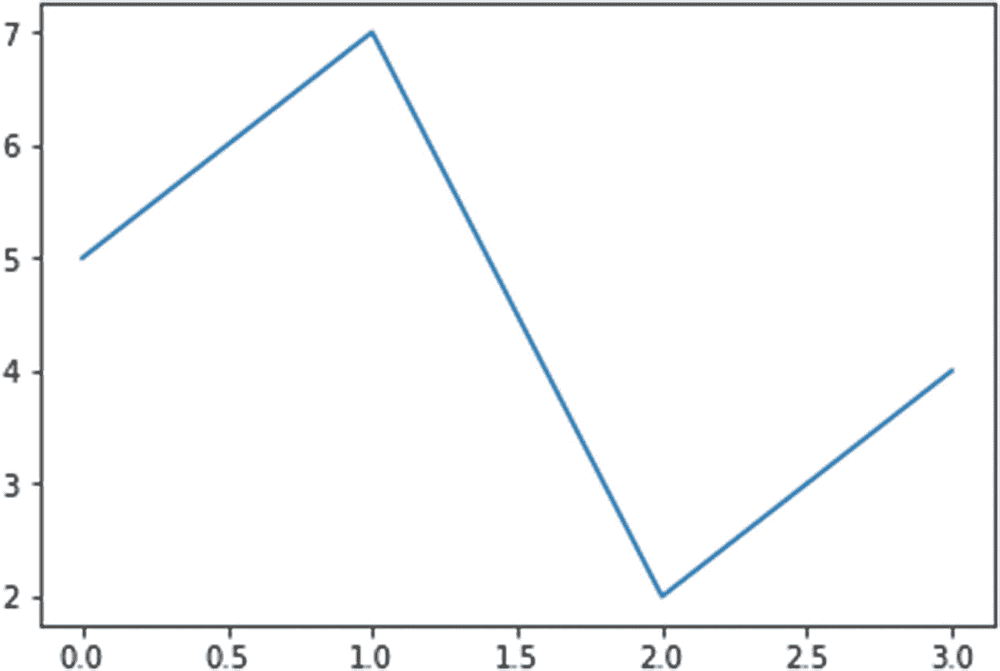

图 10-1

一个绘制的列表

```
>>> plt.plot([5,7,2,4], [4,6,9,2], 'ro')
# 'ro' 代表圆形对象
```

```
>>> plt.plot([5,7,2,4])
```

圆形对象的图表如图 10-2 所示。

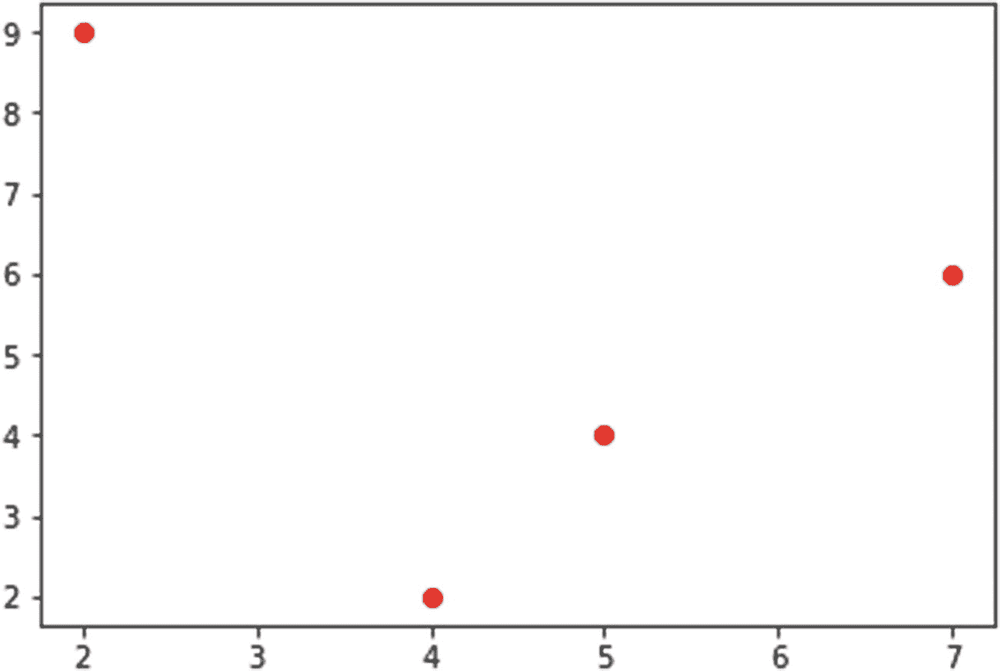

图 10-2

一个绘制的圆形对象列表

如图 10-1 所示，我们可以创建一条线。但是，我们也可以通过修改参数来自定义颜色和表示类型。

让我们创建两个对象并绘制它们。

```
# 我们创建两个对象
>>> x = [ 50, 70, 90, 65]
>>> y = [129, 192, 163, 172]
>>> plt.plot(x, y, linewidth = 4.0)
```

图表如图 10-3 所示。

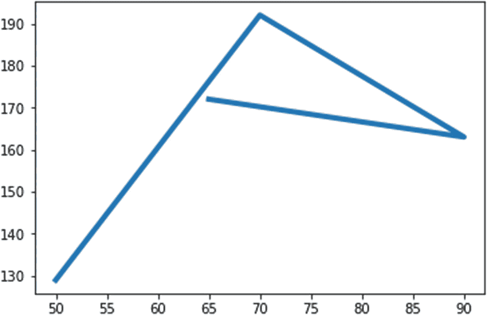

图 10-3

一个自定义图表

如您所见，我们使用线宽参数更改了线条粗细。我们还可以使用 **linestyle** 参数或 **ls** 来修改线条：

```
>>> plt.plot(x, y, linewidth = 2.0, linestyle = '--')
```

图表如图 10-4 所示。

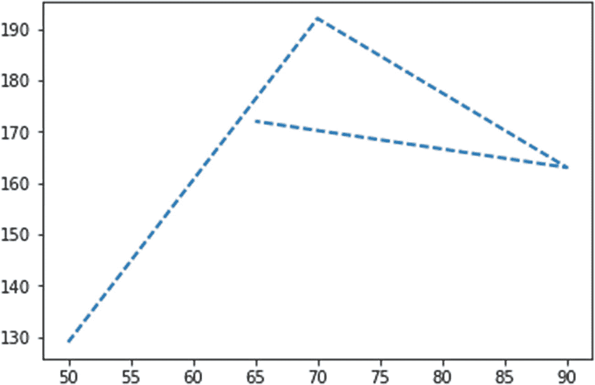

图 10-4

修改后的线条样式

我们可以添加标记以更好地突出数据：

```
>>> plt.plot(x, y, linewidth = 1.0, ls = '-', marker = "o", markersize = 10)
```

图表如图 10-5 所示。

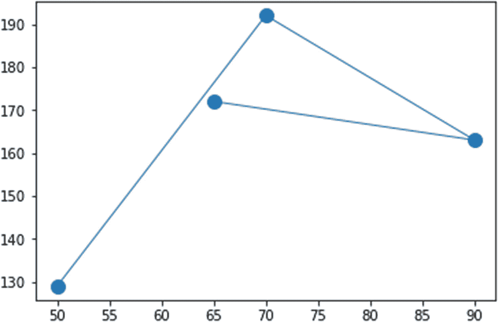

图 10-5

带有标记的图表

我们可以通过编辑（例如，内部颜色）来进一步自定义标记：

```
>>> plt.plot(x, y, linewidth = 1.0, ls = '-', marker = "o", markersize = 10, markerfacecolor = 'white')
```

图表如图 10-6 所示。

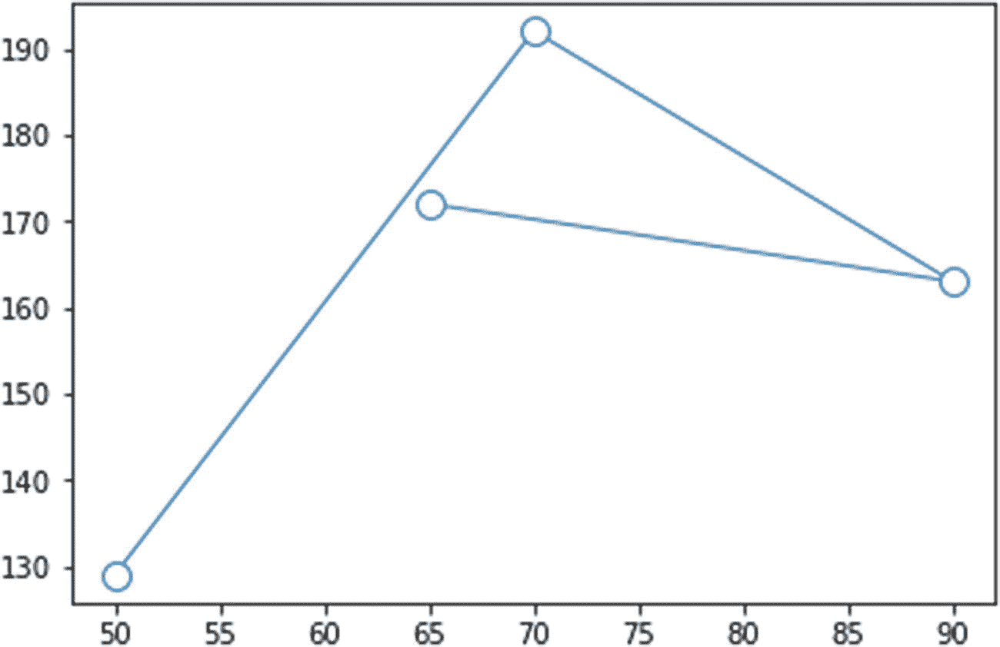

图 10-6

标记颜色更改后的图表

有关如何自定义图表的更多信息，可以使用

```
>>> help(plt.plot)
```

接下来，我们可以添加参数来添加标题和轴名称。

```
>>> plt.plot(x, y)
>>> plt.title("标题")
>>> plt.xlabel("X 轴")
>>> plt.ylabel("Y 轴")
```

图表如图 10-7 所示。

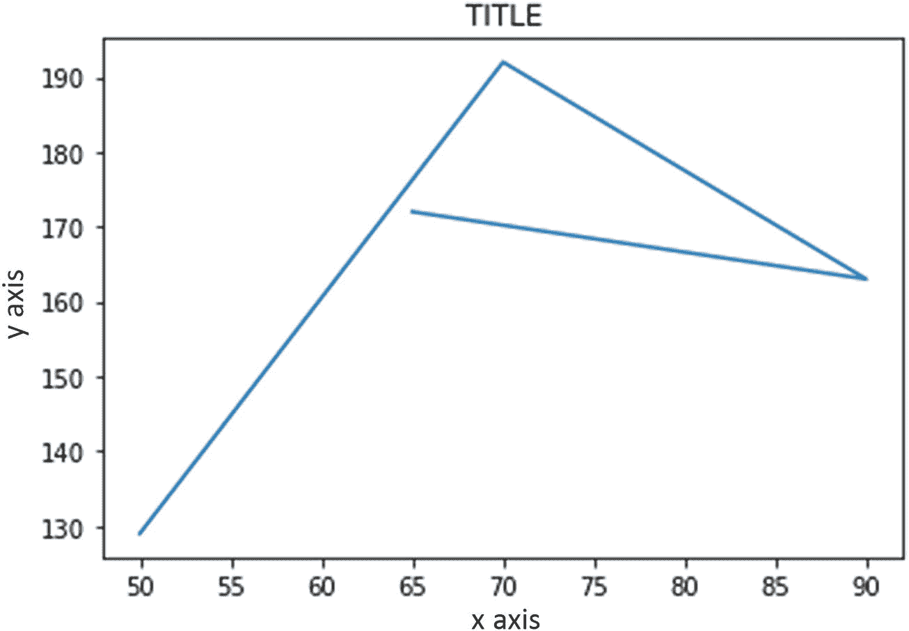

图 10-7

带有标题和轴标签的图表

我们可以通过更改所有图表元素的颜色来进一步自定义图表：

```
>>> plt.plot(x, y, color = "yellow")
>>> plt.title("标题", color = "blue")
>>> plt.xlabel("X 轴", color = "purple")
>>> plt.ylabel("Y 轴", color = "green")
```

图表如图 10-8 所示。

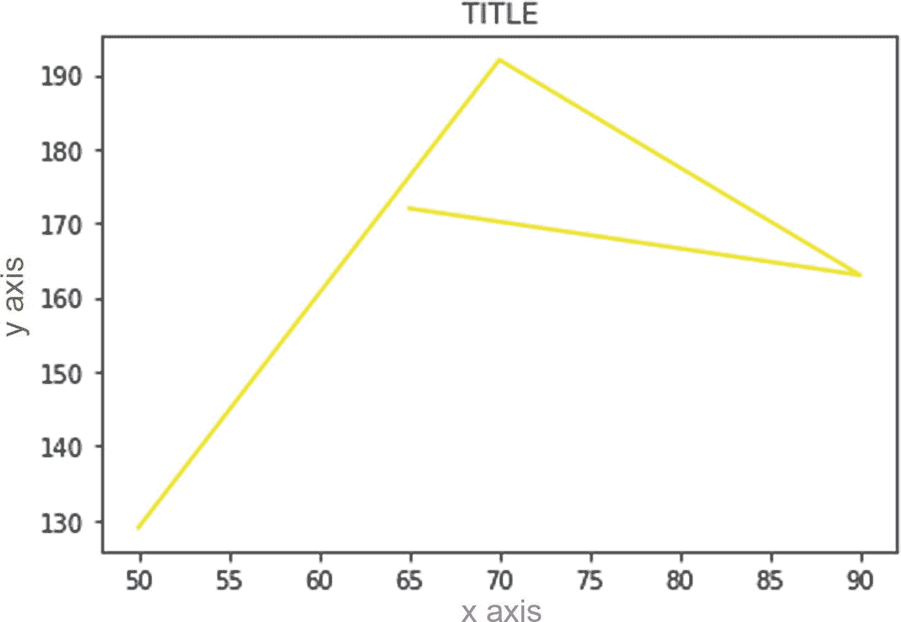

图 10-8

更改图表元素颜色

我们还可以使用 'grid' 参数添加网格，使用 'legend' 参数添加图例。

```
>>> plt.plot(x, y)
>>> plt.title("标题", color = "blue")
>>> plt.xlabel("X 轴", color = "purple")
>>> plt.ylabel("Y 轴", color = "green")
>>> plt.grid(True)
>>> plt.legend(['图例 1'])
```

图表如图 10-9 所示。

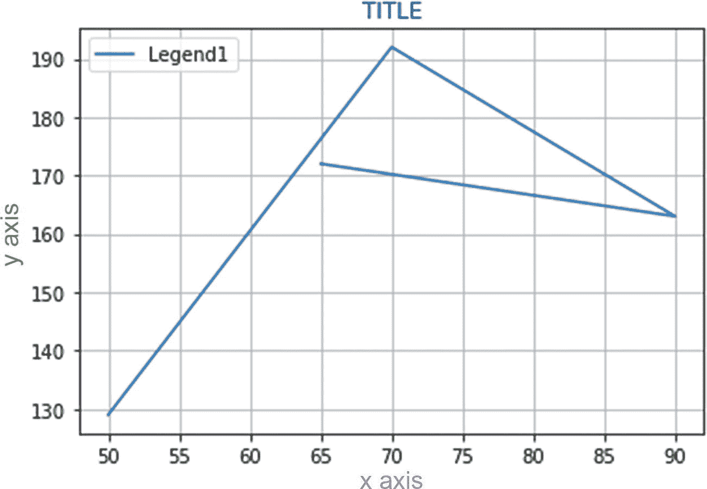

图 10-9

带有网格和图例的图表

我们可以通过更改 'loc' 参数将图例移动到图表内部：

```
>>> plt.plot(x, y)
>>> plt.title("标题", color = "blue")
>>> plt.xlabel("X 轴", color = "purple")
>>> plt.ylabel("Y 轴", color = "green")
>>> plt.grid(True)
>>> plt.legend(['图例 2'], loc = 2)
```

图表如图 10-10 所示。

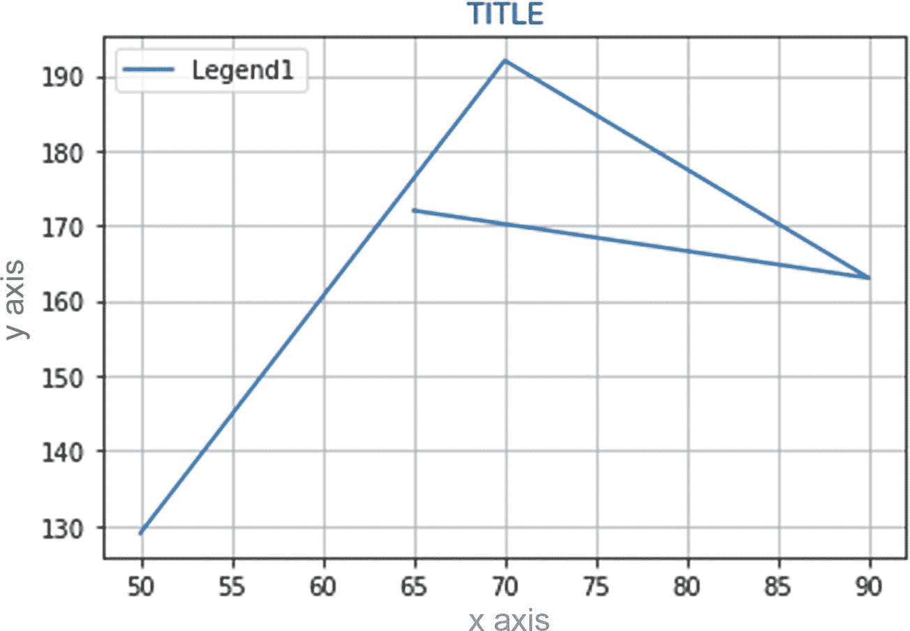

图 10-10

重新定位图例后的图表

以下是图例的可能位置：

*   0

*   1 = 右上角

*   2 = 左上角

*   3 = 右下角

*   4 = 左下角

*   5 = 右侧

*   6 = 左侧居中

*   7 = 右侧居中

*   8 = 底部居中

*   9 = 顶部居中

*   10 = 居中

颜色的代码如下：

*   b = 蓝色

*   c = 青色

*   g = 绿色

*   m = 品红色

*   r = 红色

*   y = 黄色

*   k = 黑色

*   w = 白色

我们还可以更改图表中使用的形状：

```
>>> plt.plot([1,2,3,4],[1,4,8,15],'b*')
>>> plt.plot([1,3,5,7],[1,4,8,12],'g^')
>>> plt.plot([1,2,3,5],[2,5,4,12],'ro')
>>> plt.legend(['第一个','第二个','第三个'],loc=0)
```

图表如图 10-11 所示。

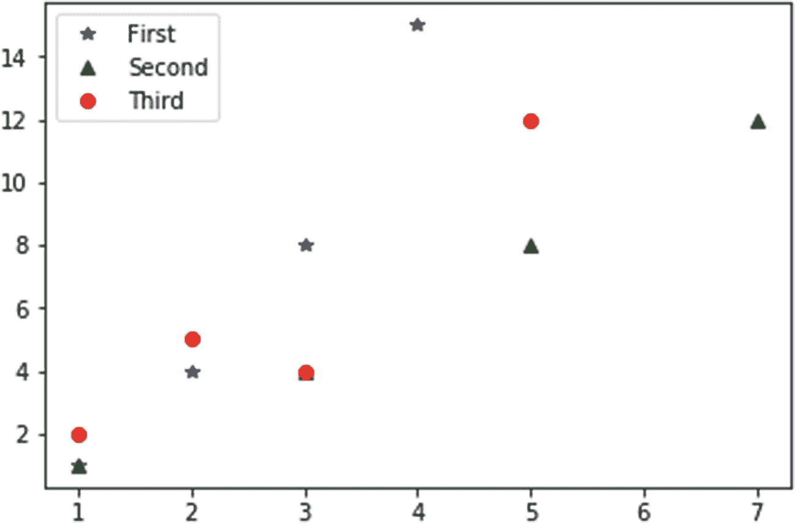

图 10-11

具有不同形状点的图表

现在让我们使用 subplot() 函数创建子图：

```
>>> plt.subplot(2,2,1)
>>> plt.plot([1,2,3,4],[1,4,8,15],'b*')
>>> plt.subplot(2,2,2)
>>> plt.plot([1,3,5,7],[1,4,8,12],'g^')
>>> plt.subplot(2,2,3)
>>> plt.plot([1,2,3,5],[2,5,4,12],'ro')
>>> plt.subplot(2,2,4)
>>> plt.plot([1,2,3,5],[2,5,4,12],'b')
```

图表如图 10-12 所示。

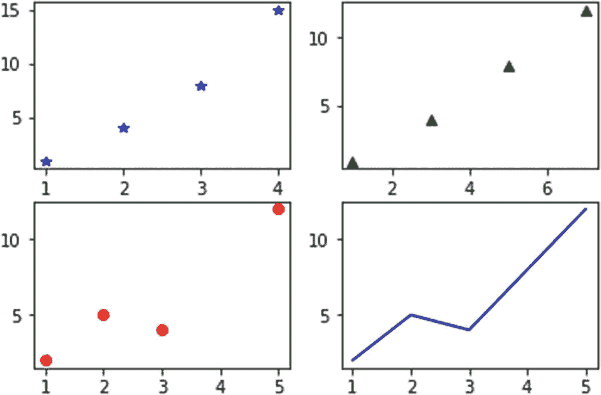

图 10-12

创建子图

我们可以指定想要的图表数量（本例中为两个）以及它们的放置方式（本例中为并排）：

```
>>> plt.subplot(1,2,1)
>>> plt.plot([1,2,3,4],[1,4,8,15],'b*')
>>> plt.subplot(1,2,2)
>>> plt.plot([1,3,5,7],[1,4,8,12],'g^')
```

图表如图 10-13 所示。

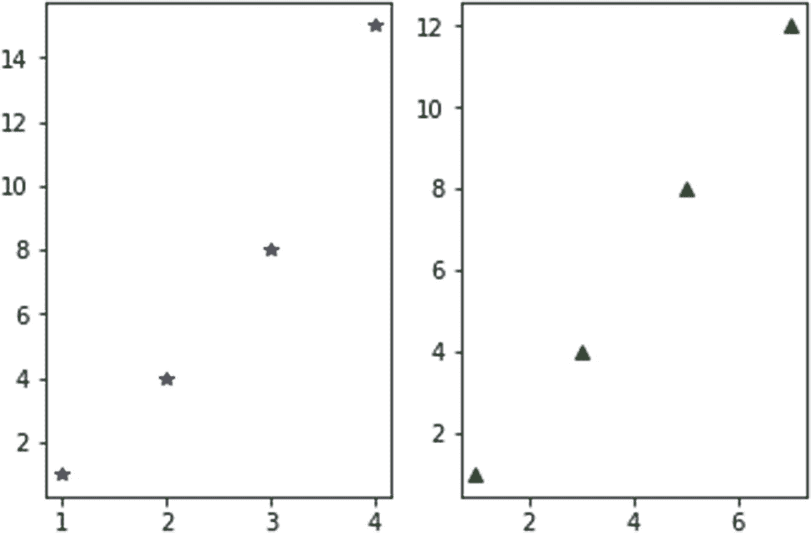

图 10-13

创建两个并排的子图


## 饼图

现在让我们看看如何创建饼图：饼图可用于展示某事物的构成（例如市场）。要绘制饼图，我们可以使用 `plt.pie()` 函数：

```
>>> plt.pie(x)
```

该图如图 10-14 所示。

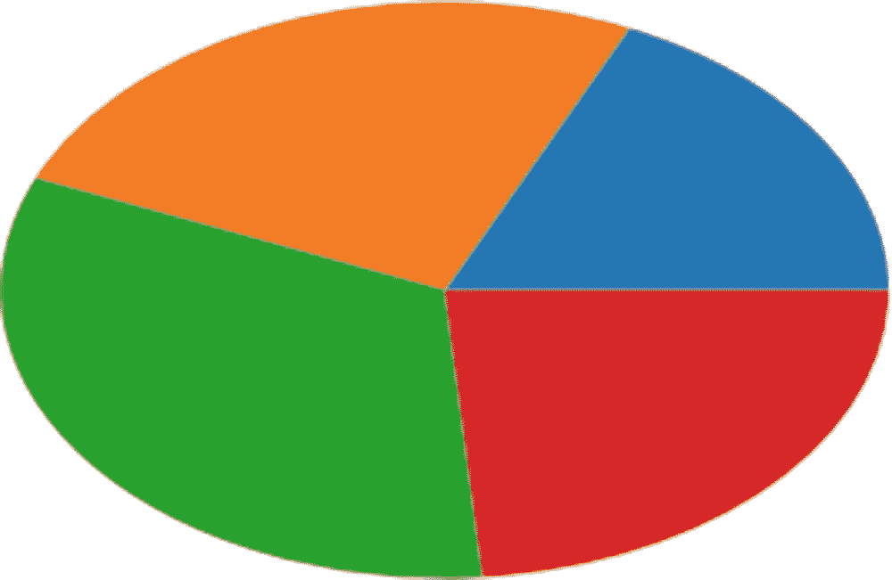

图 10-14

一个基础饼图

我们可以通过编辑其颜色来自定义它：

```
# 我们创建一个颜色调色板
>>> col1 = ["yellow", "red", "purple", "orange"]
# 我们将新颜色应用到图表中
>>> plt.pie(x, colors = col1)
```

该图如图 10-15 所示。

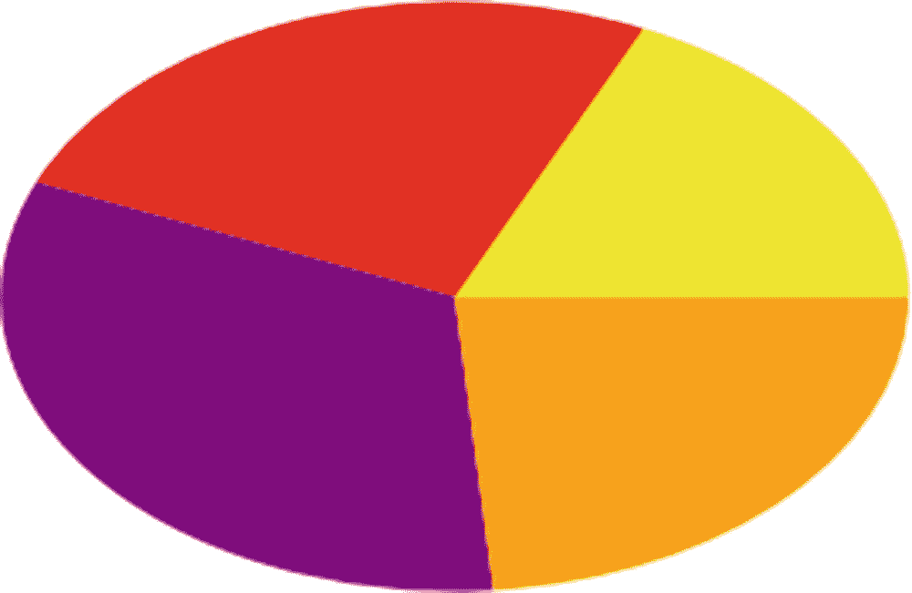

图 10-15

一个带有自定义颜色的饼图

要进一步修改颜色，我们可以使用十六进制颜色代码。可以在 [`http://cloford.com/resources/colours/500col.htm`](http://cloford.com/resources/colours/500col.htm) 找到代码列表。

让我们添加一些标签：

```
>>> lab1 = ['A','B','C','D']
>>> plt.pie(x, colors = col1, labels = lab1)
```

该图如图 10-16 所示。

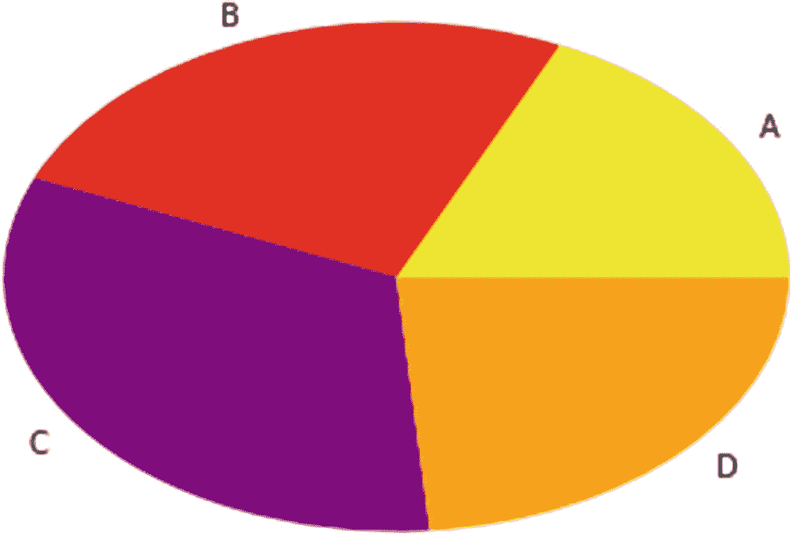

图 10-16

一个带有标签的饼图

我们可以通过使用 `'explode'` 参数来分离饼图的扇区。我们甚至可以指定分离扇区之间的距离：

```
>>> ex1 = [0.5,0,0,1]
>>> lab1 = ['A','B','C','D']
>>> plt.pie(x, colors = col1, labels = lab1, explode = ex1)
```

该图如图 10-17 所示。

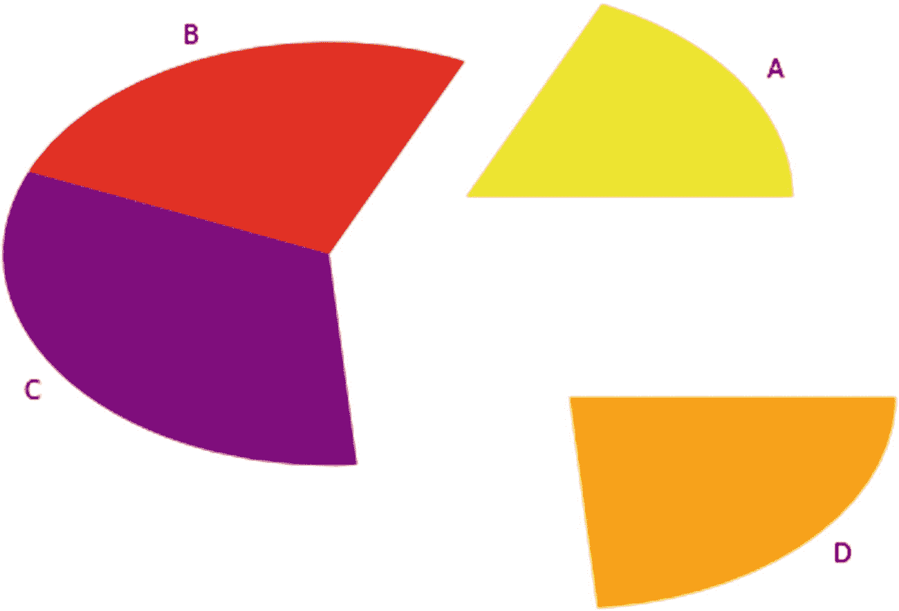

图 10-17

一个分离式饼图

## 其他图表

我们还可以创建其他类型的图表。例如，我们可以构建一个散点图。散点图对于观察两个变量之间的关系非常有用。

```
>>> plt.scatter(x, y)
```

该图如图 10-18 所示。

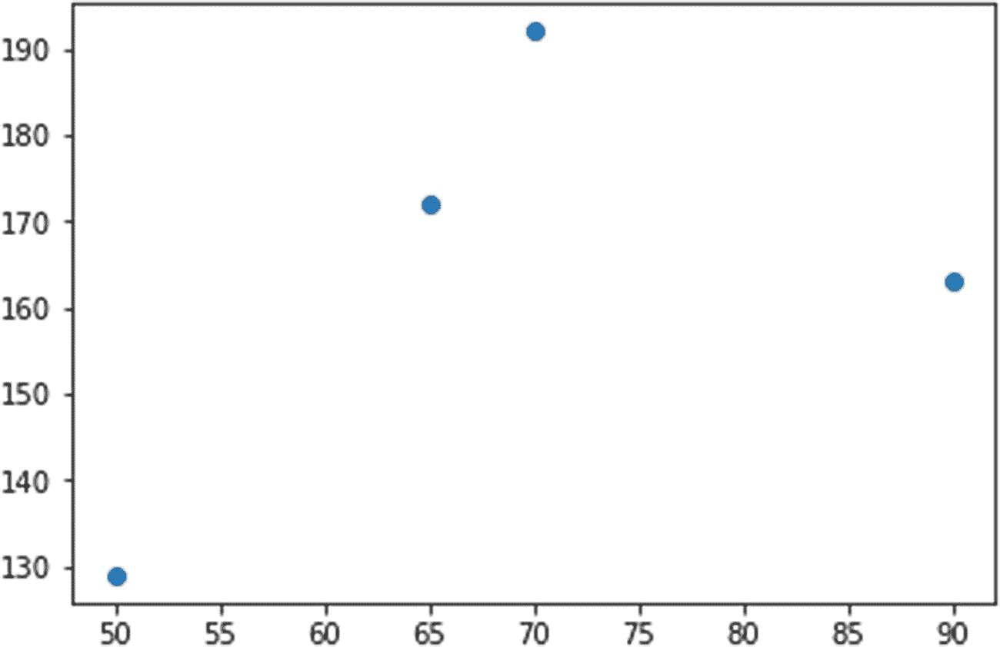

图 10-18

一个散点图

我们可以使用 `plt.bar()` 函数创建条形图。条形图和直方图对于比较数据以及展示分类变量非常有用：

```
>>> plt.bar(x, y)
```

该图如图 10-19 所示。

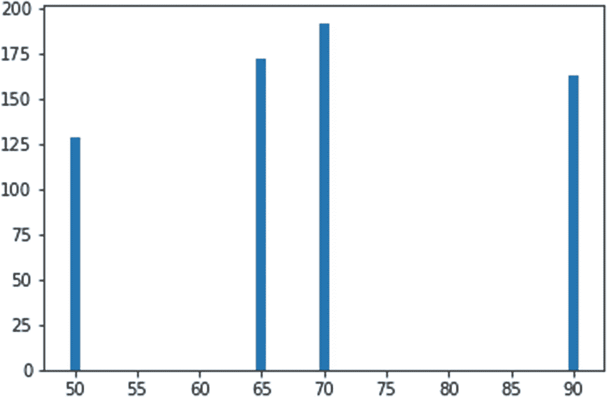

图 10-19

一个条形图

我们可以改变条形图的方向：

```
>>> plt.barh(x, y)
```

该图如图 10-20 所示。

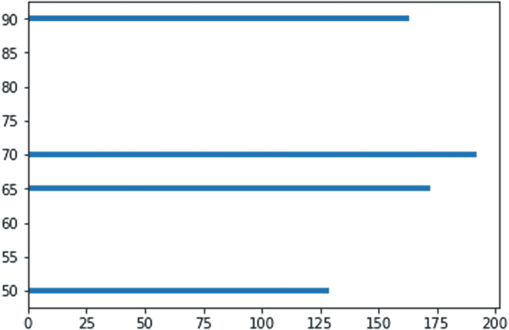

图 10-20

一个改变方向后的条形图

我们可以从数据框创建图表。为此，我们必须导入 pandas 用于数据集和 NumPy 管理。让我们生成一个包含十个案例和四个变量的随机数据集。

```
>>> import pandas as pd
>>> import numpy as np
>>> df1 = pd.DataFrame(np.random.rand(10, 4), columns = ['var1', 'var2', 'var3', 'var4'])
>>> df1.plot(kind = "bar")
```

该图如图 10-21 所示。

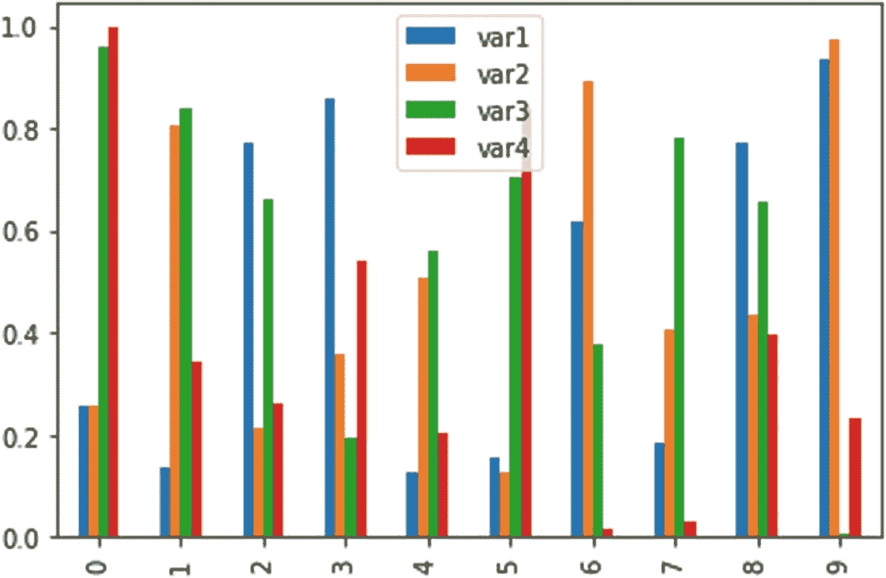

图 10-21

一个使用随机数据框创建的条形图

要创建堆叠条形图，我们使用 `'stacked'` 参数：

```
>>> df1.plot(kind = "bar", stacked = True)
```

该图如图 10-22 所示。

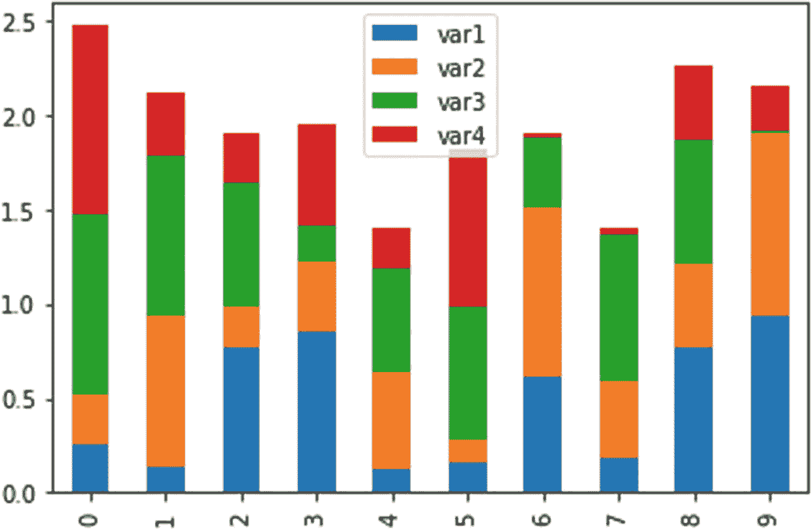

图 10-22

一个带有堆叠条形图的图表

我们可以创建一个表示数据集中变量的直方图。（本章末尾会更详细地讨论直方图。）

```
>>> df1.hist()
```

该图如图 10-23 所示。

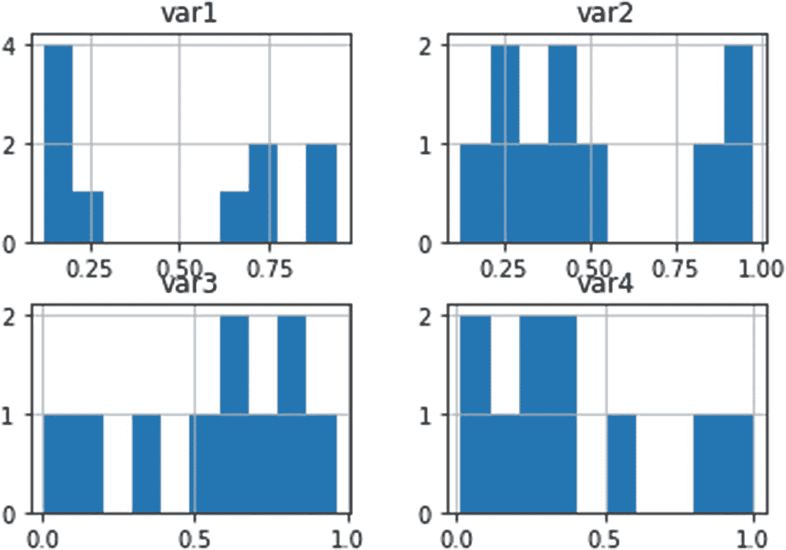

图 10-23

数据集中每个变量的多个直方图

或者，我们可以表示单个变量：

```
>>> df1['var1'].hist()
```

该图如图 10-24 所示。

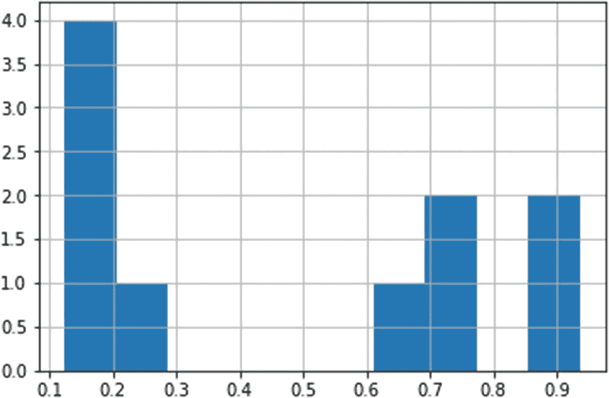

图 10-24

一个变量的直方图

我们也可以使用除名称之外的方法来选择列，例如 `.loc` 方法。

```
>>> df1.loc[1].hist()
```

我们通过使用 `boxplot()` 函数来创建箱线图。这种可视化可用于展示分布的形状、其中心值及其变异性：

```
>>> df1.boxplot(return_type = "axes")
```

该图如图 10-25 所示。

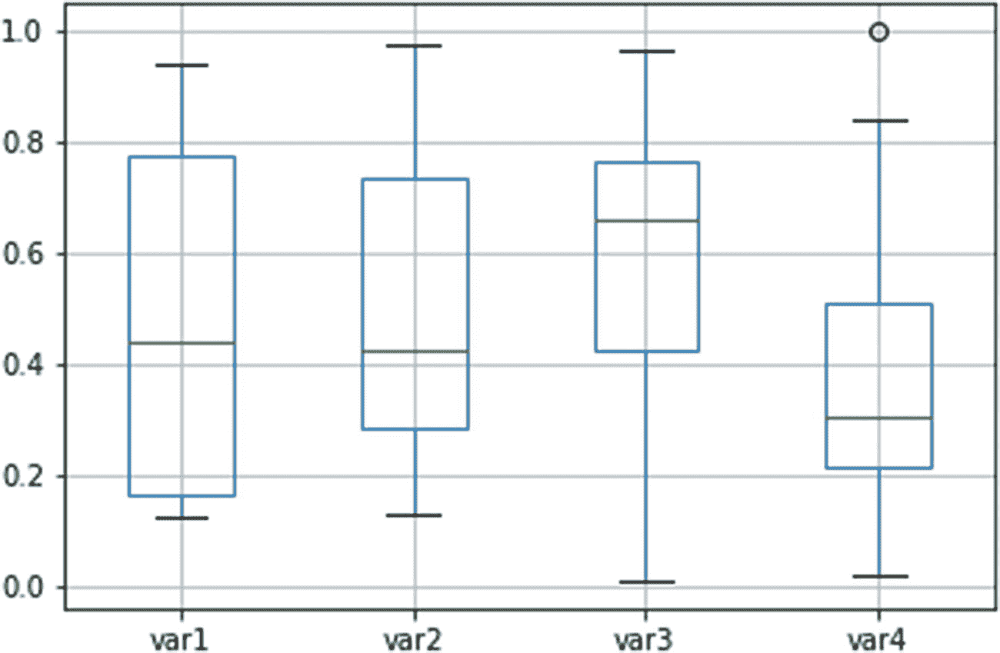

图 10-25

一个箱线图

我们可以构建面积图：

```
>>> df1.plot(kind = "area")
```

该图如图 10-26 所示。

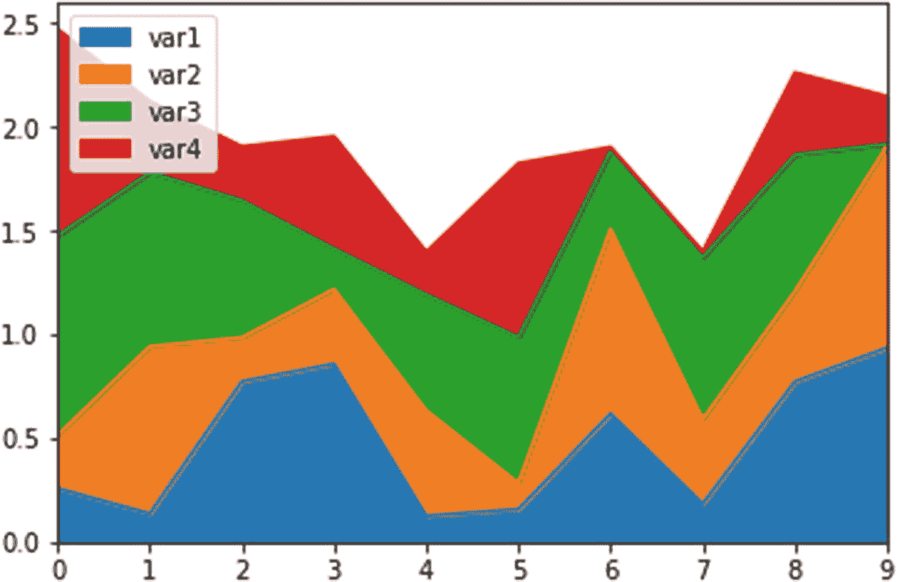

图 10-26

一个面积图

我们使用的每个函数都有其自己的参数，我们可以更改这些参数，正如我们在本章第一部分看到的那样。例如，我们可以通过应用我们已经创建的调色板来更改面积图的颜色：

```
>>> df1.plot(kind = "area", color = col1)
```

该图如图 10-27 所示。

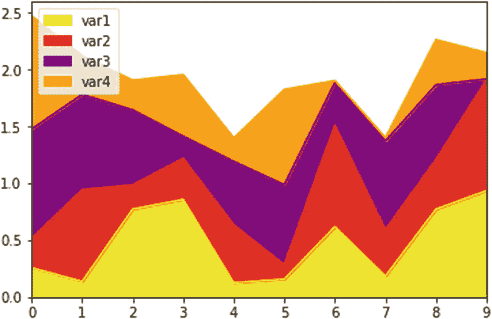

图 10-27

一个更改了颜色调色板的面积图

## 保存图表

我们可以使用 `.savefig` 方法保存我们的图表。我们还可以指定其名称并设置分辨率（每英寸点数）：

```
>>> df1.plot(kind = "scatter", x = "var3", y = "var4")
# 我们按以下方式将图像保存到工作目录中
>>> plt.savefig('graph1.png', dpi = 600)
```

让我们检查图表是否已成功保存到我们的工作目录中。我们可以使用下载的图像，例如用于演示，或在数据分析后将其包含在报告中，或在探索阶段解释我们的数据。


## 选择图表样式

Matplotlib 还包含一组可应用于图表的样式。我们可以通过输入以下代码来查看这些样式：

```
>>> plt.style.available
['bmh',
'classic',
'dark_background',
'fivethirtyeight',
'ggplot',
'grayscale',
'seaborn-bright',
'seaborn-colorblind',
'seaborn-dark-palette',
'seaborn-dark',
'seaborn-darkgrid',
'seaborn-deep',
'seaborn-muted',
'seaborn-notebook',
'seaborn-paper',
'seaborn-pastel',
'seaborn-poster',
'seaborn-talk',
'seaborn-ticks',
'seaborn-white',
'seaborn-whitegrid',
'seaborn']
```

要应用某种样式，我们需要插入一行包含主题名称的代码：

```
>>> plt.style.use('dark_background')
>>> df1.plot(kind = "area")
```

该图表如图 10-28 所示。

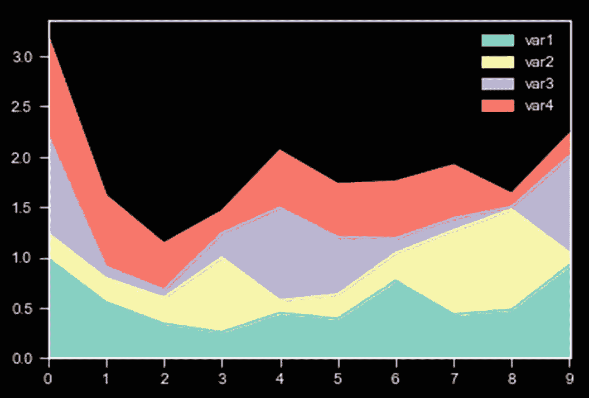

图 10-28

一个使用 Matplotlib “深色背景” 主题的自定义面积图

这是另一个示例：

```
>>> plt.style.use('seaborn-darkgrid')
>>> df1.plot(kind = "area")
```

该图表如图 10-29 所示。

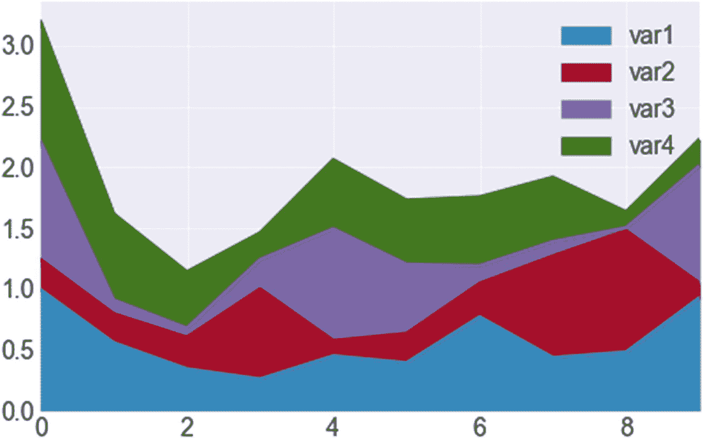

图 10-29

一个使用 “seaborn” 主题的自定义面积图

## 直方图进阶

我们可以用 NumPy 创建两个随机对象，分别以图形方式表示它们，然后将它们的数据合并到一个图表中：

```
>>> df2 = np.random.randn(100)
>>> df3 = np.random.randn(100)
>>> plt.hist(df2)
```

第一个图表如图 10-30 所示。

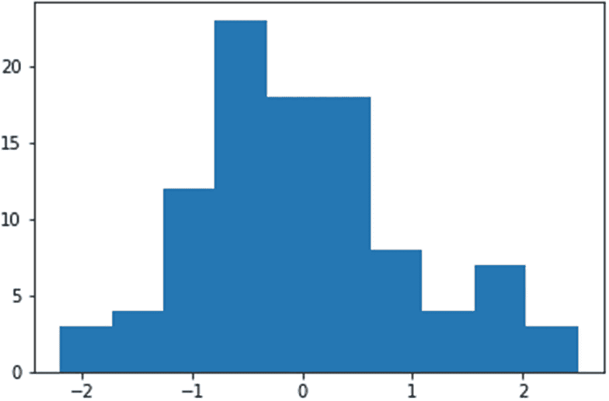

图 10-30

第一个直方图

现在让我们显示第二个直方图。

```
>>> plt.hist(df3)
```

该图表如图 10-31 所示。

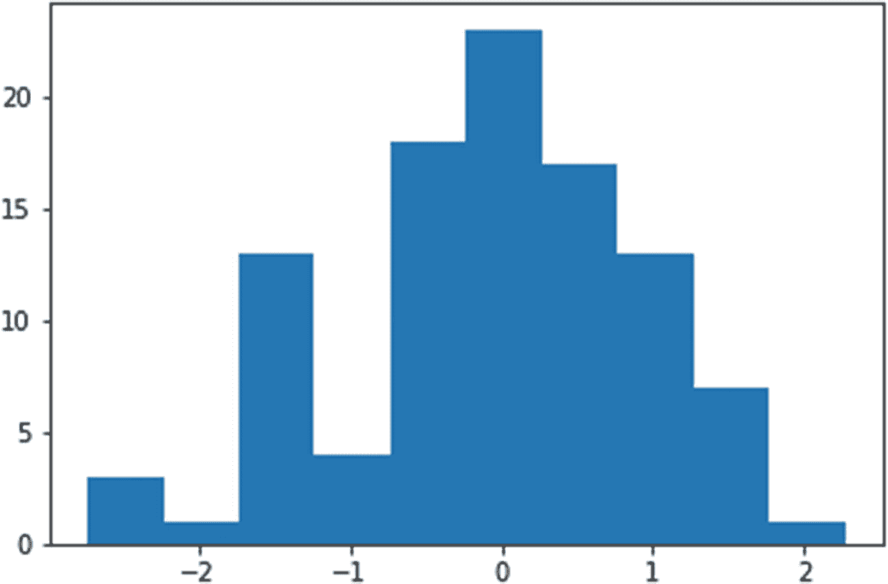

图 10-31

第二个直方图

现在让我们合并这两个数据集：

```
>>> plt.hist(df2, color = "red", alpha = 0.3, bins = 15)
>>> plt.hist(df3, alpha = 0.6, bins = 15)
# 我们将两个数据集一起呈现，并通过 alpha 参数定义是否使用颜色、透明度，以及我们希望数据被划分的区间数量。
```

该图表如图 10-32 所示。

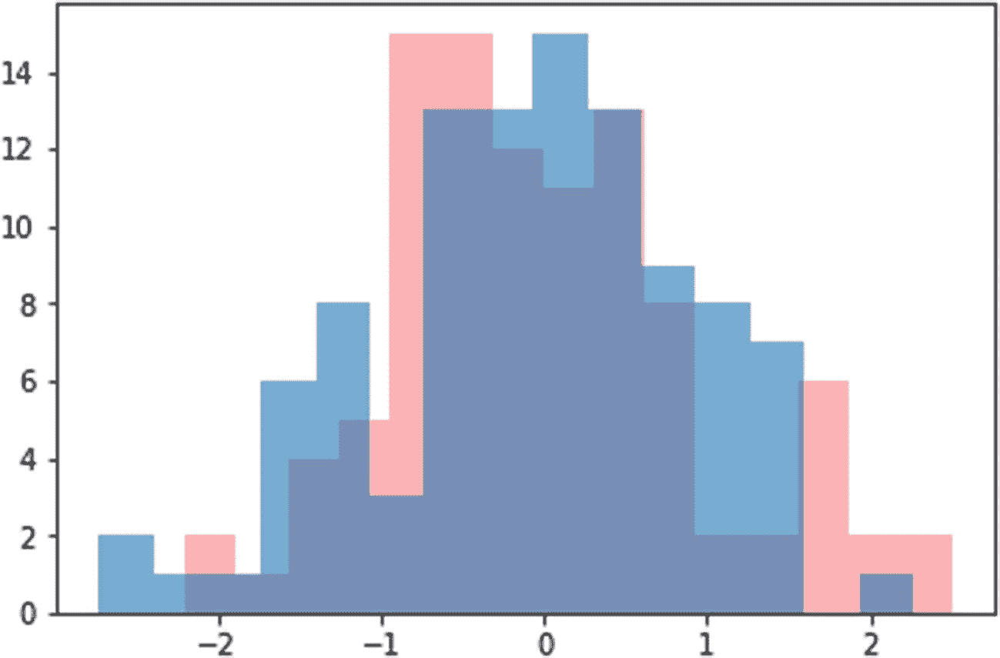

图 10-32

一个合并后的直方图

Matplotlib 只是众多可用于显示数据的 Python 包之一。其他图表创建包可以在 [`http://pbpython.com/visualization-tools-1.html`](http://pbpython.com/visualization-tools-1.html) 找到。例如，最常用的数据挖掘图表之一就是 seaborn。

## 总结

Matplotlib 是用于绘制数据的最基础的库之一。绘制数据集以进行数据分析，对于理解变量之间的关系至关重要。

