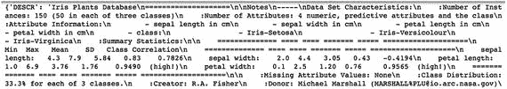
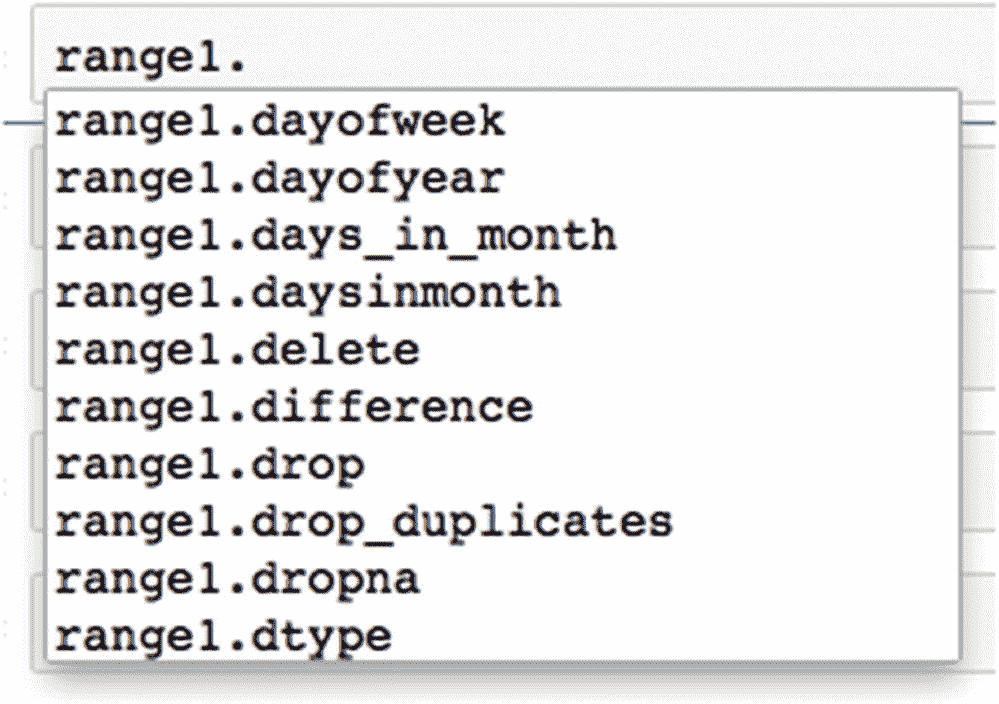
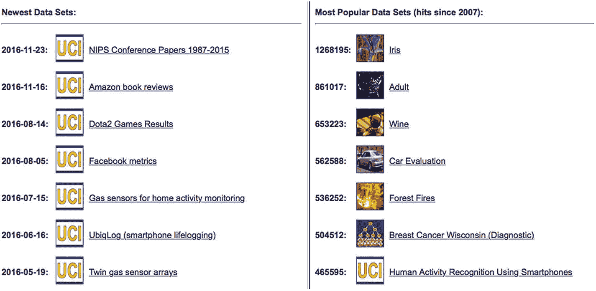
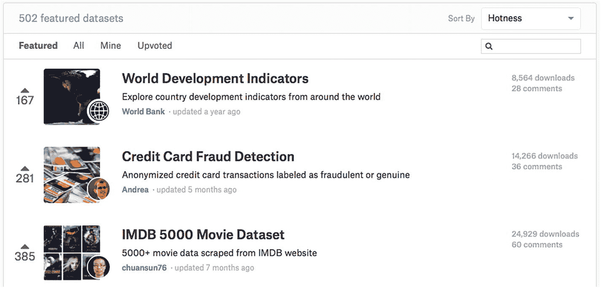

# 11. Scikit-learn

Scikit-learn 是 Python 机器学习中最重要且最常用的包之一。它提供了许多用于各种预测算法的函数。在本章中，我们将研究 Scikit-learn 包中包含的一些算法。鉴于该主题的广度，所呈现的示例反映了最常用的模型。那些没有机器学习基础知识的读者可能会发现理解本章中介绍的一些技术比较困难，这些技术不会详细解释。

## 什么是机器学习？

机器学习是数据分析的一个分支，它将以特定方式构建的数据集转化为可应用于新数据的预测。机器学习利用我们已有的数据来预测未来的行为。机器学习技术是数据挖掘领域的一场真正革命，它们对各种应用领域都产生了巨大影响。

机器学习广泛应用于日常使用的许多应用程序中。像亚马逊、Netflix、谷歌、苹果和 Facebook 这样的大公司出于各种原因使用机器学习算法。例如，Facebook 使用机器学习来识别图像中的人脸；亚马逊和 Netflix 分析客户的偏好（你最后查看或购买的商品），以推荐可能符合你兴趣的新产品。

例如，谷歌在翻译和自动驾驶中使用机器学习，或者根据我们的习惯以及我们在每周特定日子常去的地方，来建议交通较少的路线。机器学习还帮助我们区分垃圾邮件和非垃圾邮件，通常使用概率方法或结合多种方法（例如，将概率方法添加到关键词和用户定义的规则中）。

苹果和微软使用机器学习为我们提供语音助手，帮助我们仅通过语音操作手机或平板电脑。其他公司目前正在完善人工智能方法、自动驾驶等。

当 IBM 开发的超级计算机 Watson 参加 *Jeopardy!* 问答节目时，机器学习领域获得了更广泛的关注。

机器学习也被用于预测选举结果，最早由科学家 Nate Silver 在 2012 年 10 月发布美国大选预测，其结果与实际数据非常接近。

预测性数据挖掘用于医疗保健领域。患者数据和临床记录可以帮助识别那些患某些疾病（如糖尿病或心脏病）风险较高的人群。例如，DNA 分析和基因检测试剂盒已被用于检测导致或与某些类型癌症（包括乳腺癌）相关的基因。

机器学习最古老的应用之一是手写识别——特别是手写地址和邮政编码。识别基于每个手写数字的各种出现情况，使用神经网络（由贝尔实验室进行）。

机器学习及其相关主题（如深度学习和人工智能）的研究每天都在进步，并处于计算领域的前沿。像 Kaggle 这样的网站每隔几天就会发布内容，订阅者在此期间尝试解决给定的问题。最著名的 Kaggle 竞赛是由 Netflix 宣布的。2006 年，Netflix 为推荐系统悬赏 100 万美元。设计出的系统并未被 Netflix 采用，因为它过于复杂且计算成本高昂。

让我们来看看 Scikit-learn 包中的各种模块和技术。


### 导入 Scikit-learn 内置数据集

首先，scikit-learn 包中包含一些数据集，我们可以像这样导入它们：

```
>>> from sklearn import datasets
```

要导入其中一个数据集，请输入：

```
>>> iris = datasets.load_iris()
```

鸢尾花数据集由三种不同鸢尾花的花瓣和花萼组成：*杂色鸢尾*、*弗吉尼亚鸢尾*和*山鸢尾*。它包含 150 个均匀分布在三种花卉上的案例，以及五个变量。

在前面的章节中，我们了解了如何从本地计算机的外部文件或通过链接从网站导入 `.csv` 格式的数据集。Scikit-learn 还包含一些最常用的数据挖掘数据集，例如鸢尾花和波士顿房价数据集。Scikit-learn 中使用的格式对于初学者来说可能会有些令人困惑。所有数据集都包含在同一个对象中，但并非像我们在前几章中检查的 `.csv` 文件那样的表格格式。Scikit-learn 中的数据集包含数组格式的数据、目标或标签（我们想要预测的变量）以及其他一些信息，例如变量描述（在 `DESCR` 对象中）和列名，这些信息分布在两个不同的对象中：`feature_names` 用于变量，`target_names` 用于目标或标签。

```
>>> type(iris)
sklearn.datasets.base.Bunch
>>> iris.keys()
dict_keys(['data', 'target', 'target_names', 'DESCR', 'feature_names'])
```

我们可以显示实际的数据集：

```
>>> iris.data
array([[ 5.1,  3.5,  1.4,  0.2],
[ 4.9,  3\. ,  1.4,  0.2],
[ 4.7,  3.2,  1.3,  0.2],
[ 4.6,  3.1,  1.5,  0.2],
[ 5\. ,  3.6,  1.4,  0.2],
[ 5.4,  3.9,  1.7,  0.4],
[ 4.6,  3.4,  1.4,  0.3],
[ 5\. ,  3.4,  1.5,  0.2],
[ 4.4,  2.9,  1.4,  0.2],
[...]
```

通过这种方式，我们只显示数值数据。要查看实际的分类，我们必须按如下步骤操作：

```
>>> iris.target
array([0, 0, 0, 0, 0, 0, 0, 0, 0, 0, 0, 0, 0, 0, 0, 0, 0, 0, 0, 0, 0, 0, 0,
0, 0, 0, 0, 0, 0, 0, 0, 0, 0, 0, 0, 0, 0, 0, 0, 0, 0, 0, 0, 0, 0, 0,
0, 0, 0, 0, 1, 1, 1, 1, 1, 1, 1, 1, 1, 1, 1, 1, 1, 1, 1, 1, 1, 1, 1,
1, 1, 1, 1, 1, 1, 1, 1, 1, 1, 1, 1, 1, 1, 1, 1, 1, 1, 1, 1, 1, 1, 1,
1, 1, 1, 1, 1, 1, 1, 1, 2, 2, 2, 2, 2, 2, 2, 2, 2, 2, 2, 2, 2, 2, 2,
2, 2, 2, 2, 2, 2, 2, 2, 2, 2, 2, 2, 2, 2, 2, 2, 2, 2, 2, 2, 2, 2, 2,
2, 2, 2, 2, 2, 2, 2, 2, 2, 2, 2, 2])
# 数据目标是数值型的，因为 scikit-learn 默认不接受分类数据，因此需要将数据编码为数值形式
# 我们显示名称
>>> iris.target_names
array(['setosa', 'versicolor', 'virginica'],
dtype='<U10')
```

我们可以按如下方式显示案例和变量的数量：

```
>>> iris.data.shape
(150, 4)
```

我们可以通过使用 `.DESCR` 获取数据的描述：

```
>>> iris.DESCR
```



### 创建训练集和测试集

在机器学习中，我们通常从一个 `.csv` 格式的数据集开始。从这个文件中，我们将创建 4 个部分。Scikit-learn 允许我们做的一件事是创建训练数据集和测试数据集。在机器学习中，我们通常从一个带标签的数据集开始，并将其分成两部分：一部分用于训练（约占数据集的 70%–80%），用于训练算法；另一部分用于测试（剩余的 20%–30%），用于测试数据算法的有效性。这个特性使我们能够将实际数据与算法预测的数据进行比较，并查看它们的效果。训练集和测试集也分为两部分：一部分包含我们将用于创建模型的变量，另一部分包含我们想要学习预测的变量。

```
>>> from sklearn.model_selection import train_test_split
>>> x_train, x_test, y_train, y_test = train_test_split(x, y, test_size = 0.3)
# 我们只需要指定测试数据集的百分比——在本例中为 30% (0.3)
```

例如，如果我们将其应用于鸢尾花数据集，我们可以创建四个对象：一个包含鸢尾花数据集四个变量和 70% 案例的训练对象，一个包含其余元素（30%）的测试对象，以及一个始终被分成两部分的标签或目标变量。

```
>>> x_train, x_test, y_train, y_test = train_test_split(iris.data, iris.target, test_size = 0.3)
```

让我们检查一下创建的各种对象的大小：

```
>>> x_train.data.shape
(105, 4)
>>> x_test.data.shape
(45, 4)
>>> y_train.data.shape
(105,)
>>> y_test.data.shape
(45,)
```

### 预处理

Scikit-learn 允许对数据进行预处理（尽管我们不需要对鸢尾花数据集进行预处理）。

```
>>> from sklearn import preprocessing
# iris_scaled = pd.DataFrame(preprocessing.scale(iris_data))
```

### 回归

回归分析用于解释变量 y（称为*响应变量*或*因变量*）与一个或多个自变量之间的关系。

为了计算回归，让我们从 Scikit-learn 导入正确的模型：

```
>>> from sklearn.linear_model import LinearRegression
# 我们通过创建回归模型的副本来简化工作
>>> lr = LinearRegression()
# 我们使用训练对象创建模型
>>> lr.fit(x_train, y_train)
# 我们查看系数
>>> print(lr.intercept_)
>>> lr.coef_
# 我们预测测试对象的隶属关系
>>> pred = lr.predict(x_test)
>>> print(pred)
```

现在让我们看一下允许我们应用指标来衡量模型效果的代码：

```
>>> from sklearn import metrics
>>> print('MAE', metrics.mean_absolute_error(y_test, pred))
>>> print('MSE', metrics.mean_squared_error(y_test, pred))
>>> print('RMSE', np.sqrt(metrics.mean_squared_error(y_test, pred)))
>>> metrics.explained_variance_score(y_test, pred)
```

### K-近邻算法

K-近邻算法是一种用于数据预测和数据挖掘的有监督算法。它也用于模式识别（例如面部识别）、识别遗传密码中的模式、识别疾病以及电影和音乐推荐系统。K-近邻算法背后的逻辑可以用拉丁短语“*Similes cum similar bus facillime congregantur*”来概括，意思是“物以类聚”。简而言之，我们使用该算法分析数据集中的案例以找到相似的元素。然后，新案例根据它们与某个组的接近程度以及彼此之间的距离被聚合到新形成的组中。K-近邻算法然后计算未分类项与其他项的距离，并将其分配给最近的元素（或元素，k）的类别。k 只不过是我们可以用来确定未知类别项类别的邻近观测值的数量。例如，如果我们将 k 设置为 2，我们根据其两个最近的元素将类别分配给该项。如果将其设置为 3，我们得到三个最近的元素，依此类推。

```
# 我们不能在鸢尾花数据集上使用 K-近邻算法，因此从现在开始，我们仅限于给出各种分类模型代码的概念
>>> from sklearn.neighbors import KNeighborsClassifier
>>> knn = KNeighborsClassifier(n_neighbors = 3)
>>> x_train = 从数据集中，我们将使用除标签之外的变量
>>> y_train = 测试标签
>>> x_test = 新数据
>>> y_test = 新数据标签
>>> knn.fit(x_train, y_train)
>>> new_pred = knn.predict(x_new)
>>> print(new_pred)
```

在处理分类问题时，我们使用不同于回归的方法来测试模型的充分性：

```
>>> from sklearn.metrics import classification_report, confusion_matrix
>>> print(confusion_matrix(y_test, y_pred))
>>> print(classification_report(y_test, y_pred))
```


### 交叉验证

交叉验证是指将数据集划分为数量相等的若干份，通常用 k 表示（常分为五份或十份），然后在这 k 组数据上检验预测模型的适用性。

```
>>> from sklearn.model_selection import cross_val_score
>>> cv5 = cross_val_score(model, x_train, y_train, cv = 5)
>>> cv10 = cross_val_score(model, x_train, y_train, cv = 10)
>>> print(np.mean(cv5))
>>> print(np.mean(cv10))
```

### 支持向量机

支持向量机（SVM）用于确定属于两个不同类别的项目之间的边界，然后将它们投影到多维空间中，以识别能够最大化两组数据之间间隔的超平面。

```
>>> from sklearn.svm import SVC
>>> clf = svm.SVC(kernel='linear', C=1).fit(x_train, y_train)
>>> clf.score(x_test, y_test)
>>> from sklearn.model_selection import cross_val_predict
>>> pred = cross_val_predict(clf, iris.data, iris.target, cv=10)
>>> metrics.accuracy_score(iris.target, pred)
```

### 决策树

决策树背后的基本思想是一种*分而治之*的模型，在该模型中，每一步我们都可以减少节点之间的变异性。我们从整个数据集开始，然后将其划分为更小的组，这些组基于内部特征更加同质且本质。

```
>>> from sklearn.tree import DecisionTreeClassifier
>>> dtc = DecisionTreeClassifier()
>>> dtc = dtc.fit(x_train, y_train)
>>> pred = dtc.predict(y_test)
>>> sklearn.metrics.confusion_matrix(y_test, pred)
>>> sklearn.metrics.accuracy_score(y_test, pred)
>>> sklearn.metrics.classification_report(y_test, pred)
```

### KMeans

KMeans 是一种无监督的分类方法，这意味着在分类过程中我们没有标签来指导。因此，我们选择使用聚类作为一种有用的探索性分析方法，因为它允许我们根据数据集中元素的相似或相异程度对其进行分组。

聚类包含一组方法，可以将异质总体分割为同质的子组。在所有可用的聚类方法中，KMeans 是重要的方法之一。聚类的基本概念基于这样一个事实：我们将一个集合中的项目划分为同质的组，而最初并不对其进行标记。无标签数据的分组方式必须确保组内元素不仅同质，而且与其他组的元素异质。在划分聚类项目后，我们可以将新项目归类为属于第一个数据集的任一聚类。

```
>>> from sklearn.cluster import KMeans
>>> kmeans = KMeans(n_clusters=4)
>>> kmeans.fit(df)
>>> pred = kmeans.predict(df)
>>> pred
```

以上只是对使用 Scikit-learn 包进行机器学习的一个粗略讨论。机器学习是一个具有挑战性的课题，因此不易在几页纸中概括。我认为介绍一些预测性数据挖掘概念以及可用于机器学习的各种 Scikit-learn 模块会有所帮助。

## 管理日期

使用 Python 管理日期非常重要，尤其是在处理时间序列表示时。我们可以使用 `datetime` 包和 pandas 来处理日期。首先，我们必须导入 `datetime`。

```
>>> import datetime as dt
# 我们创建第一个包含时间的对象
>>> t1 = dt.time(19, 43 , 30)
>>> print(t1)
19:43:30
# 要创建包含日期的对象，我们使用 dates
>>> dt.date.today()
>>> datetime.date(2017, 3, 28)
# 我们可以查询创建的对象关于年、月、日的信息
>>> today = dt.date.today()
>>> today.year

>>> today.month

>>> today.day

>>> t2 = dt.date(2016, 5, 20)
>>> print(t2)
2016-05-20
# 我们可以查询对象以获取年、月、日
>>> t2.year

>>> t2.month

>>> t2.day

# 我们可以从计算机中找到精确的小时和分钟
>>> dt.datetime.now()
>>> datetime.datetime(2017, 3, 30, 13, 4, 52, 591324)
```

用于解析日期的资源可在 [`http://strftime.org/`](http://strftime.org/) 找到。

让我们继续使用 pandas 进行日期管理。

```
>>> import pandas as pd
# 我们可以通过 Timestamp 管理各种数据格式
>>> pd.Timestamp("2016-3-7")
>>> pd.Timestamp("2016/4/10")
>>> pd.Timestamp("2015, 12, 10")
>>> pd.Timestamp("2015, 12, 10 12:42:57")
>>> date1 = ["2016/4/10", "2015, 12, 10", "2015, 12, 10 12:42:57"]
>>> print(date1)
['2016/4/10', '2015, 12, 10', '2015, 12, 10 12:42:57']
>>> type(date1)
list
>>> pd.to_datetime(date1)
DatetimeIndex(['2016-04-10 00:00:00', '2015-12-10 00:00:00',
'2015-12-10 12:42:57'],
dtype='datetime64[ns]', freq=None)
# 我们创建另一个包含日期但也包含其他元素的对象
>>> date2 = ["2016/4/10", "2015, 12, 10", "2015, 12, 10 12:42:57", "October", "2011", "test"]
# 如果我们将此对象传递给 Timestamp，会得到一个错误
>>> pd.to_datetime(date2)
# 我们可以使用 'coerce' 参数处理错误
>>> pd.to_datetime(date2, errors = "coerce")
DatetimeIndex(['2016-04-10 00:00:00', '2015-12-10 00:00:00',
'2015-12-10 12:42:57',                 'NaT',
'2011-01-01 00:00:00',                 'NaT'],
dtype='datetime64[ns]', freq=None)
```

未被识别的日期被标识为 NaT。

让我们继续，创建一个日期范围：

```
>>> period1 = pd.date_range(start = "2016  01 01", end = "2016 12 31")
>>> print(period1)
DatetimeIndex(['2016-01-01', '2016-01-02', '2016-01-03', '2016-01-04',
'2016-01-05', '2016-01-06', '2016-01-07', '2016-01-08',
'2016-01-09', '2016-01-10',
...
'2016-12-22', '2016-12-23', '2016-12-24', '2016-12-25',
'2016-12-26', '2016-12-27', '2016-12-28', '2016-12-29',
'2016-12-30', '2016-12-31'],
dtype='datetime64[ns]', length=366, freq="D")
```

频率参数（**freq=‘D’**）表示设置了以天（day）为间隔，但我们可以修改它：


```
# 例如，插入十天
>>> pd.date_range(start = "2016  01 01", end = "2016 12 31", freq = "10D")
DatetimeIndex(['2016-01-01', '2016-01-11', '2016-01-21', '2016-01-31',
'2016-02-10', '2016-02-20', '2016-03-01', '2016-03-11',
'2016-03-21', '2016-03-31', '2016-04-10', '2016-04-20',
'2016-04-30', '2016-05-10', '2016-05-20', '2016-05-30',
'2016-06-09', '2016-06-19', '2016-06-29', '2016-07-09',
'2016-07-19', '2016-07-29', '2016-08-08', '2016-08-18',
'2016-08-28', '2016-09-07', '2016-09-17', '2016-09-27',
'2016-10-07', '2016-10-17', '2016-10-27', '2016-11-06',
'2016-11-16', '2016-11-26', '2016-12-06', '2016-12-16',
'2016-12-26'],
dtype='datetime64[ns]', freq="10D")
# 或者 12 小时
>>> pd.date_range(start = "2016  01 01", end = "2016 12 31", freq = "12H")
DatetimeIndex('2016-01-01 00:00:00', '2016-01-01 12:00:00',
'2016-01-02 00:00:00', '2016-01-02 12:00:00',
'2016-01-03 00:00:00', '2016-01-03 12:00:00',
'2016-01-04 00:00:00', '2016-01-04 12:00:00',
'2016-01-05 00:00:00', '2016-01-05 12:00:00',
...
# 频率为每周一
>>> pd.date_range(start = "2016  01 01", end = "2016 12 31", freq = "W-Mon")
DatetimeIndex(['2016-01-04', '2016-01-11', '2016-01-18', '2016-01-25',
'2016-02-01', '2016-02-08', '2016-02-15', '2016-02-22',
'2016-02-29', '2016-03-07', '2016-03-14', '2016-03-21',
'2016-03-28', '2016-04-04', '2016-04-11', '2016-04-18',
...
# 频率为每周三
>>> pd.date_range(start = "2016  01 01", end = "2016 12 31", freq = "W-Wed")
DatetimeIndex(['2016-01-06', '2016-01-13', '2016-01-20', '2016-01-27',
'2016-02-03', '2016-02-10', '2016-02-17', '2016-02-24',
'2016-03-02', '2016-03-09', '2016-03-16', '2016-03-23',
'2016-03-30', '2016-04-06', '2016-04-13', '2016-04-20',
...
```

还有其他方法可以处理日期。以下是创建日期范围的另一种方式：

```
>>> range1 = pd.date_range(start = "2016  01 01", end = "2016 03 31", freq = "D")
# 现在我们使用 .weekday_name 方法
>>> range1.weekday_name
array(['Friday', 'Saturday', 'Sunday', 'Monday', 'Tuesday', 'Wednesday',
'Thursday', 'Friday', 'Saturday', 'Sunday', 'Monday', 'Tuesday',
'Wednesday', 'Thursday', 'Friday', 'Saturday', 'Sunday', 'Monday',
'Tuesday', 'Wednesday', 'Thursday', 'Friday', 'Saturday', 'Sunday',
'Monday', 'Tuesday', 'Wednesday', 'Thursday', 'Friday', 'Saturday',
...
```

使用 Jupyter，我们可以通过 Tab 键查看管理日期的方法（图 [11-1）。



图 11-1

使用 Tab 键管理日期

## 数据源

为了开始数据挖掘和机器学习，我们将使用大量数据集来理解算法的工作原理。许多数据挖掘数据集可以从加州大学尔湾分校（UCI）的在线商店下载。UCI 网站（ [`http://archive.ics.uci.edu/ml/index.php`](http://archive.ics.uci.edu/ml/index.php) ）（图 11-2）包含了所有最常用的数据科学数据集，例如鸢尾花、波士顿、葡萄酒、短信垃圾邮件收集等，以及更多数据集（ [`http://archive.ics.uci.edu/ml/datasets.html`](http://archive.ics.uci.edu/ml/datasets.html) ）。



图 11-2

UCI 网站上的部分数据集

最近，甚至 Kaggle 也开始鼓励数据科学家发布数据集（ [`https://www.kaggle.com/datasets`](https://www.kaggle.com/datasets) ），以促进数据科学家之间的交流（图 11-3）。



图 11-3

Kaggle 网站上的部分数据集

正如我们所见，Scikit-learn 包也包含可以导入的数据集。有关 scikit-learn 及其特色数据集的更多信息，您可以浏览包文档，网址为 [`http://scikit-learn.org/stable/datasets/`](http://scikit-learn.org/stable/datasets/) 。

一个名为 *datareader* 的 pandas 包模块，提供了从某些在线来源提取数据的工具（ [`https://pandas-datareader.readthedocs.io/en/latest/remote_data.html#google-finance`](https://pandas-datareader.readthedocs.io/en/latest/remote_data.html#google-finance) ），特别是那些处理股票交易所存储库的来源，例如雅虎财经和谷歌财经。

### 索引

### A

Anaconda 主屏幕 .append() 方法 面积图 赋值运算符 .astype() 方法

### B

条形图 位运算符 boxplot() 函数 箱线图

### C

聚类 调色板 比较运算符 .concatenate() 函数 .concat() 方法 条件指令 elif 扩展函数 if + else 条件 Continuum.io .csv 格式 自定义面积图

### D

DataFrame() 函数 DataFrame，Pandas 聚合 布尔运算符 创建 交叉表创建 .info() 方法 数据重排 数据切片 可视化 数据操作，Pandas 数据挖掘库 因变量 .describe() 方法 df.to_excel() dir() 函数 分而治之模型 .drop_duplicates() .drop() 方法 .dstack() 函数 .dtype() 函数

### E

错误和异常 已处理异常 管理异常 语法错误 TypeError 未处理异常

### F

Feedparser 格式 .fillna 方法 filter() 函数 傅里叶变换 函数 创建 元素 信息 预定义内置函数 保存模块和文件 类型

### G

Github .groupby()

### H

.head() 方法 直方图数据集 .hsplit() 函数

### I

导入文件 模式，打开文件 结构 网页 插补方法 .index() 方法 .info() 方法 .insert() 方法 集成开发环境（IDE） .isnull()

### J

JSON Jupyter 打开脚本工具

### K

KMeans

### L

Lambda 函数 列表推导式 load() 函数 loadtxt() 函数 .loc 方法 循环 continue 和 break for range() 函数 while lxml 格式

### M

机器学习 Apple 和 Microsoft 交叉验证 决策树 领域 Google 导入数据集 KMeans k-近邻算法 预测性数据挖掘 预处理 回归 研究 支持向量机 训练和测试数据集 UCI 鸢尾花数据集 网站 特性 用途 map() 函数 数学运算符 Matplotlib 自定义绘图元素 颜色 网格和图例 图例 形状库 线条样式 标记 绘图和图表样式 绘制列表 重新定位图例 圆角对象 .savefig 方法 散点图 subplot() 函数 标题和坐标轴标签 melt() 函数 成员运算符 merge() 函数 方法 .append 方法 help() 函数 在 Jupyter 上 print() 函数 使用 Spyder 模块 类别 元素 import 指令 安装包 math 方法

### N

ndarray 嵌套 .notnull() np.random.randn() 函数 np.random.seed() 函数 Numarray NumPy .concatenate() 函数 数据存储，选项 .dstack() 函数 .dtype() 函数 .hsplit() 函数 多维数组 对象创建 包 随机数和种子 DataFrame () 函数 数据集 生成整数 load() 函数 np.random.randn() 函数 泊松分布 random.rand() 函数 行和列 三维数组 均匀分布 .ravel() 方法 resize() 函数 .vsplit() 函数 NumPy arrange() 函数 NumPy 库

### O

面向对象编程 类 继承 对象 ones() 函数 open() 函数 运算符 赋值 位运算 比较 数学 成员 优先级规则


### P, Q

Pandas 数据集合并函数 导入与导出数据 缺失值 序列统计 `pd.read_csv()` 函数 饼图 自定义颜色 分离十六进制颜色代码 标签 `pivot_table()` 函数 PyMongo 格式 `.py` 脚本 Python 代码注释 代码运行命令 容器对象 数据类型 字典 文件格式 文件夹与文件 格式转换 未来 主页 IDE Jupyter Spyder 不可变元组与字符串 缩进 安装 列表 数学运算 数字 对象 属性 规则 运算符（*参见* 运算符） 引号 保留术语 集合 字符串 终端 网站 工作目录 Python2 *与* Python3 Python3 Python shell 符号 Python 专用 IDE `python test.py` 脚本

### R

随机数据框 `range()` 函数 `.ravel()` 方法 正则表达式（regex） 电子邮件地址 `.findall()` `re` 模块 `re.search()` 符号 `.replace` 方法 `resize()` 函数 响应变量

### S

`.sample()` 函数 `.savefig` 方法 散点图 Scikit-learn 包 数据来源 机器学习（*参见* 机器学习） 管理日期 SciPy `.split()` 函数 Spyder SQLite3 格式 堆叠条形图 `stack()` 函数 统计方法 `.sum()` 支持向量机

### T

`.tail()` 方法 文本编辑器 `.T()` 函数 元组序列 `type()` 函数

### U

`unstack()` 函数 用户输入数字 `raw_input()` 函数

### V, W

`.value_counts()` 方法 `.vsplit()` 函数

### X, Y

xlrd 格式

### Z

`zeros()` 函数
